# PnprQuiesceProcessorDpc

- RVA: `0x00B64B50`–`0x00B64FAC` (길이 `1,116` bytes)
- VA: `0x0000000140B64B50`
- 실행 섹션: `PAGELK`
- PDB 이름 있음: `예`; PDB Function 태그: `아니요`
- unwind 정보 RVA: `0x000C8E9C`
- 디코드: `267`개 명령, `1,116/1,116` bytes 표시
- 미해석 바이트: `0` (있으면 어셈블리에 `.byte`로 보존)

> 이 문서는 커널 이미지의 기계어와 PDB 기호를 분석해 생성했습니다. 4번과 5번은 함수 원형과 자료형을 바이너리 사용 방식에서 추정한 C 해석이며 원본 소스 복구 결과는 아닙니다.

## 1. Dependencies

- 직접 호출 지점: **21**; 고유 호출 대상: **16**
- 직접 호출자로 확인된 함수: **0**
- RIP 상대 이미지 참조: **5**

### Outgoing calls
- `0x00B64BF2` → [KeDisableInterrupts](../../text/21/KeDisableInterrupts_function_00217BE0.md) (function, `0x00217BE0`)
- `0x00B64C25` → [KeGetProcessorNumberFromIndex](../../text/2D/KeGetProcessorNumberFromIndex_function_002DD320.md) (function, `0x002DD320`)
- `0x00B64C77` → [KeSuspendClockTimerSafe](../../text/5B/KeSuspendClockTimerSafe_function_005BB394.md) (function, `0x005BB394`)
- `0x00B64C7C` → [KeSaveIptStateBeforeProcessorGoesOffline](../../text/4D/KeSaveIptStateBeforeProcessorGoesOffline_function_004D9D40.md) (function, `0x004D9D40`)
- `0x00B64CA7` → [KeSaveExtendedAndSupervisorState](../../text/4F/KeSaveExtendedAndSupervisorState_function_004FC74C.md) (function, `0x004FC74C`)
- `0x00B64CB9` → [KeSaveProcessorSpecificFeatures](../../text/4F/KeSaveProcessorSpecificFeatures_function_004FAFBC.md) (function, `0x004FAFBC`)
- `0x00B64CC5` → [HalGetProcessorIdByNtNumber](../../text/2D/HalGetProcessorIdByNtNumber_function_002D5560.md) (function, `0x002D5560`)
- `0x00B64CF7` → [guard_dispatch_icall](../../text/6B/guard_dispatch_icall_function_006BAAD0.md) (function, `0x006BAAD0`)
- `0x00B64D1C` → [guard_dispatch_icall](../../text/6B/guard_dispatch_icall_function_006BAAD0.md) (function, `0x006BAAD0`)
- `0x00B64D36` → [guard_dispatch_icall](../../text/6B/guard_dispatch_icall_function_006BAAD0.md) (function, `0x006BAAD0`)
- `0x00B64D60` → [guard_dispatch_icall](../../text/6B/guard_dispatch_icall_function_006BAAD0.md) (function, `0x006BAAD0`)
- `0x00B64D65` → [KeResumeClockTimerSafe](../../text/5B/KeResumeClockTimerSafe_function_005BB334.md) (function, `0x005BB334`)
- `0x00B64DAD` → [KiRemoveSystemWorkPriorityKick](../../text/26/KiRemoveSystemWorkPriorityKick_function_002631D0.md) (function, `0x002631D0`)
- `0x00B64DB7` → [KeRestoreProcessorSpecificFeatures](../../text/4D/KeRestoreProcessorSpecificFeatures_function_004D4C90.md) (function, `0x004D4C90`)
- `0x00B64DC4` → [KeRestoreExtendedAndSupervisorState](../../text/3D/KeRestoreExtendedAndSupervisorState_function_003D60D0.md) (function, `0x003D60D0`)
- `0x00B64DC9` → [KeRestoreIptStateAfterProcessorComesOnline](../../text/4B/KeRestoreIptStateAfterProcessorComesOnline_function_004BE824.md) (function, `0x004BE824`)
- `0x00B64E14` → [PnprMirrorMarkedPages](PnprMirrorMarkedPages_function_00B6480C.md) (function, `0x00B6480C`)
- `0x00B64E90` → [PnprGetStackLimits](../../text/5A/PnprGetStackLimits_function_005A8C4C.md) (function, `0x005A8C4C`)
- `0x00B64F3F` → [KiRemoveSystemWorkPriorityKick](../../text/26/KiRemoveSystemWorkPriorityKick_function_002631D0.md) (function, `0x002631D0`)
- `0x00B64F52` → [guard_dispatch_icall](../../text/6B/guard_dispatch_icall_function_006BAAD0.md) (function, `0x006BAAD0`)
- `0x00B64F82` → [_security_check_cookie](../../text/6A/_security_check_cookie_function_006AC640.md) (function, `0x006AC640`)

### Direct callers
- 이 함수 시작 RVA로 연결되는 직접 call은 확인되지 않았습니다. 간접 호출은 완전히 역산할 수 없습니다.

### Static image references
- `0x00B64B6E` → RVA `0x00E0A740` (`.data`; read)
- `0x00B64BA0` → RVA `0x00F8AC38` (`.data`; read)
- `0x00B64D0A` → RVA `0x00E00948` (`.data`; read)
- `0x00B64D28` → RVA `0x00E008E0` (`.data`; read)
- `0x00B64F47` → RVA `0x00E00950` (`.data`; read)

## 2. Other-region calls and transfers

- 다른 실행 섹션으로 향하는 call: **20**
  - `0x00B64BF2` → [KeDisableInterrupts](../../text/21/KeDisableInterrupts_function_00217BE0.md) (`PAGELK` → `.text`)
  - `0x00B64C25` → [KeGetProcessorNumberFromIndex](../../text/2D/KeGetProcessorNumberFromIndex_function_002DD320.md) (`PAGELK` → `.text`)
  - `0x00B64C77` → [KeSuspendClockTimerSafe](../../text/5B/KeSuspendClockTimerSafe_function_005BB394.md) (`PAGELK` → `.text`)
  - `0x00B64C7C` → [KeSaveIptStateBeforeProcessorGoesOffline](../../text/4D/KeSaveIptStateBeforeProcessorGoesOffline_function_004D9D40.md) (`PAGELK` → `.text`)
  - `0x00B64CA7` → [KeSaveExtendedAndSupervisorState](../../text/4F/KeSaveExtendedAndSupervisorState_function_004FC74C.md) (`PAGELK` → `.text`)
  - `0x00B64CB9` → [KeSaveProcessorSpecificFeatures](../../text/4F/KeSaveProcessorSpecificFeatures_function_004FAFBC.md) (`PAGELK` → `.text`)
  - `0x00B64CC5` → [HalGetProcessorIdByNtNumber](../../text/2D/HalGetProcessorIdByNtNumber_function_002D5560.md) (`PAGELK` → `.text`)
  - `0x00B64CF7` → [guard_dispatch_icall](../../text/6B/guard_dispatch_icall_function_006BAAD0.md) (`PAGELK` → `.text`)
  - `0x00B64D1C` → [guard_dispatch_icall](../../text/6B/guard_dispatch_icall_function_006BAAD0.md) (`PAGELK` → `.text`)
  - `0x00B64D36` → [guard_dispatch_icall](../../text/6B/guard_dispatch_icall_function_006BAAD0.md) (`PAGELK` → `.text`)
  - `0x00B64D60` → [guard_dispatch_icall](../../text/6B/guard_dispatch_icall_function_006BAAD0.md) (`PAGELK` → `.text`)
  - `0x00B64D65` → [KeResumeClockTimerSafe](../../text/5B/KeResumeClockTimerSafe_function_005BB334.md) (`PAGELK` → `.text`)
  - `0x00B64DAD` → [KiRemoveSystemWorkPriorityKick](../../text/26/KiRemoveSystemWorkPriorityKick_function_002631D0.md) (`PAGELK` → `.text`)
  - `0x00B64DB7` → [KeRestoreProcessorSpecificFeatures](../../text/4D/KeRestoreProcessorSpecificFeatures_function_004D4C90.md) (`PAGELK` → `.text`)
  - `0x00B64DC4` → [KeRestoreExtendedAndSupervisorState](../../text/3D/KeRestoreExtendedAndSupervisorState_function_003D60D0.md) (`PAGELK` → `.text`)
  - `0x00B64DC9` → [KeRestoreIptStateAfterProcessorComesOnline](../../text/4B/KeRestoreIptStateAfterProcessorComesOnline_function_004BE824.md) (`PAGELK` → `.text`)
  - `0x00B64E90` → [PnprGetStackLimits](../../text/5A/PnprGetStackLimits_function_005A8C4C.md) (`PAGELK` → `.text`)
  - `0x00B64F3F` → [KiRemoveSystemWorkPriorityKick](../../text/26/KiRemoveSystemWorkPriorityKick_function_002631D0.md) (`PAGELK` → `.text`)
  - `0x00B64F52` → [guard_dispatch_icall](../../text/6B/guard_dispatch_icall_function_006BAAD0.md) (`PAGELK` → `.text`)
  - `0x00B64F82` → [_security_check_cookie](../../text/6A/_security_check_cookie_function_006AC640.md) (`PAGELK` → `.text`)
- 별도 외부 분기/꼬리 이동을 확인하지 못했습니다.

## 3. Assembly (complete function range)

```asm
00B64B50  48 89 5C 24 08                  mov qword ptr [rsp + 8], rbx
00B64B55  48 89 74 24 10                  mov qword ptr [rsp + 0x10], rsi
00B64B5A  48 89 7C 24 18                  mov qword ptr [rsp + 0x18], rdi
00B64B5F  55                              push rbp
00B64B60  41 54                           push r12
00B64B62  41 56                           push r14
00B64B64  48 8B EC                        mov rbp, rsp
00B64B67  48 81 EC 80 00 00 00            sub rsp, 0x80
00B64B6E  48 8B 05 CB 5B 2A 00            mov rax, qword ptr [rip + 0x2a5bcb]
00B64B75  48 33 C4                        xor rax, rsp
00B64B78  48 89 45 F0                     mov qword ptr [rbp - 0x10], rax
00B64B7C  33 C0                           xor eax, eax
00B64B7E  0F 57 C0                        xorps xmm0, xmm0
00B64B81  21 45 A0                        and dword ptr [rbp - 0x60], eax
00B64B84  4D 8B F1                        mov r14, r9
00B64B87  21 45 A4                        and dword ptr [rbp - 0x5c], eax
00B64B8A  49 8B F8                        mov rdi, r8
00B64B8D  48 21 45 B0                     and qword ptr [rbp - 0x50], rax
00B64B91  48 21 45 A8                     and qword ptr [rbp - 0x58], rax
00B64B95  44 8D 60 01                     lea r12d, [rax + 1]
00B64B99  48 89 45 E8                     mov qword ptr [rbp - 0x18], rax
00B64B9D  41 8A F4                        mov sil, r12b
00B64BA0  48 8B 05 91 60 42 00            mov rax, qword ptr [rip + 0x426091]
00B64BA7  0F 11 45 B8                     movups xmmword ptr [rbp - 0x48], xmm0
00B64BAB  0F 11 45 C8                     movups xmmword ptr [rbp - 0x38], xmm0
00B64BAF  0F 11 45 D8                     movups xmmword ptr [rbp - 0x28], xmm0
00B64BB3  44 88 22                        mov byte ptr [rdx], r12b
00B64BB6  F0 44 01 A0 B8 00 00 00         lock add dword ptr [rax + 0xb8], r12d
00B64BBE  48 8B 05 73 60 42 00            mov rax, qword ptr [rip + 0x426073]
00B64BC5  8B 88 B8 00 00 00               mov ecx, dword ptr [rax + 0xb8]
00B64BCB  41 3B C8                        cmp ecx, r8d
00B64BCE  7D 13                           jge 0x140b64be3
00B64BD0  F3 90                           pause
00B64BD2  48 8B 05 5F 60 42 00            mov rax, qword ptr [rip + 0x42605f]
00B64BD9  8B 88 B8 00 00 00               mov ecx, dword ptr [rax + 0xb8]
00B64BDF  3B CF                           cmp ecx, edi
00B64BE1  7C ED                           jl 0x140b64bd0
00B64BE3  48 8B 05 4E 60 42 00            mov rax, qword ptr [rip + 0x42604e]
00B64BEA  8B 48 40                        mov ecx, dword ptr [rax + 0x40]
00B64BED  F6 C1 20                        test cl, 0x20
00B64BF0  74 2C                           je 0x140b64c1e
00B64BF2  E8 E9 2F 6B FF                  call 0x140217be0
00B64BF7  48 8B 0D 3A 60 42 00            mov rcx, qword ptr [rip + 0x42603a]
00B64BFE  40 8A F0                        mov sil, al
00B64C01  F0 44 01 A1 C0 00 00 00         lock add dword ptr [rcx + 0xc0], r12d
00B64C09  EB 02                           jmp 0x140b64c0d
00B64C0B  F3 90                           pause
00B64C0D  48 8B 0D 24 60 42 00            mov rcx, qword ptr [rip + 0x426024]
00B64C14  8B 91 C0 00 00 00               mov edx, dword ptr [rcx + 0xc0]
00B64C1A  3B D7                           cmp edx, edi
00B64C1C  7C ED                           jl 0x140b64c0b
00B64C1E  48 8D 55 A0                     lea rdx, [rbp - 0x60]
00B64C22  41 8B CE                        mov ecx, r14d
00B64C25  E8 F6 86 77 FF                  call 0x1402dd320
00B64C2A  85 C0                           test eax, eax
00B64C2C  0F 88 73 03 00 00               js 0x140b64fa5
00B64C32  4C 8B 0D FF 5F 42 00            mov r9, qword ptr [rip + 0x425fff]
00B64C39  0F B7 55 A0                     movzx edx, word ptr [rbp - 0x60]
00B64C3D  44 0F B6 45 A2                  movzx r8d, byte ptr [rbp - 0x5e]
00B64C42  49 8B 41 10                     mov rax, qword ptr [r9 + 0x10]
00B64C46  48 8B 08                        mov rcx, qword ptr [rax]
00B64C49  48 8B 04 D1                     mov rax, qword ptr [rcx + rdx*8]
00B64C4D  4C 0F A3 C0                     bt rax, r8
00B64C51  0F 83 86 01 00 00               jae 0x140b64ddd
00B64C57  41 8B 81 C8 00 00 00            mov eax, dword ptr [r9 + 0xc8]
00B64C5E  41 3B C4                        cmp eax, r12d
00B64C61  7D 14                           jge 0x140b64c77
00B64C63  F3 90                           pause
00B64C65  48 8B 05 CC 5F 42 00            mov rax, qword ptr [rip + 0x425fcc]
00B64C6C  8B 88 C8 00 00 00               mov ecx, dword ptr [rax + 0xc8]
00B64C72  41 3B CC                        cmp ecx, r12d
00B64C75  7C EC                           jl 0x140b64c63
00B64C77  E8 18 67 A5 FF                  call 0x1405bb394
00B64C7C  E8 BF 50 97 FF                  call 0x1404d9d40
00B64C81  48 B9 F0 05 00 00 80 F7 FF FF   movabs rcx, 0xfffff780000005f0
00B64C8B  48 B8 D8 03 00 00 80 F7 FF FF   movabs rax, 0xfffff780000003d8
00B64C95  32 DB                           xor bl, bl
00B64C97  48 8B 09                        mov rcx, qword ptr [rcx]
00B64C9A  48 0B 08                        or rcx, qword ptr [rax]
00B64C9D  48 83 E1 FC                     and rcx, 0xfffffffffffffffc
00B64CA1  74 12                           je 0x140b64cb5
00B64CA3  48 8D 55 B8                     lea rdx, [rbp - 0x48]
00B64CA7  E8 A0 7A 99 FF                  call 0x1404fc74c
00B64CAC  85 C0                           test eax, eax
00B64CAE  0F B6 DB                        movzx ebx, bl
00B64CB1  41 0F 49 DC                     cmovns ebx, r12d
00B64CB5  48 8D 4D A8                     lea rcx, [rbp - 0x58]
00B64CB9  E8 FE 62 99 FF                  call 0x1404fafbc
00B64CBE  48 8D 55 A4                     lea rdx, [rbp - 0x5c]
00B64CC2  41 8B CE                        mov ecx, r14d
00B64CC5  E8 96 08 77 FF                  call 0x1402d5560
00B64CCA  85 C0                           test eax, eax
00B64CCC  0F 88 D3 02 00 00               js 0x140b64fa5
00B64CD2  48 8B 0D 5F 5F 42 00            mov rcx, qword ptr [rip + 0x425f5f]
00B64CD9  8B 81 B0 81 00 00               mov eax, dword ptr [rcx + 0x81b0]
00B64CDF  A8 02                           test al, 2
00B64CE1  74 19                           je 0x140b64cfc
00B64CE3  48 8B 81 D8 81 00 00            mov rax, qword ptr [rcx + 0x81d8]
00B64CEA  45 8A C4                        mov r8b, r12b
00B64CED  48 8B 89 A0 81 00 00            mov rcx, qword ptr [rcx + 0x81a0]
00B64CF4  8B 55 A4                        mov edx, dword ptr [rbp - 0x5c]
00B64CF7  E8 D4 5D B5 FF                  call 0x1406baad0
00B64CFC  48 8B 0D 35 5F 42 00            mov rcx, qword ptr [rip + 0x425f35]
00B64D03  8B 41 40                        mov eax, dword ptr [rcx + 0x40]
00B64D06  A8 20                           test al, 0x20
00B64D08  74 17                           je 0x140b64d21
00B64D0A  48 8B 05 37 BC 29 00            mov rax, qword ptr [rip + 0x29bc37]
00B64D11  48 8D 55 B0                     lea rdx, [rbp - 0x50]
00B64D15  48 8B 89 98 81 00 00            mov rcx, qword ptr [rcx + 0x8198]
00B64D1C  E8 AF 5D B5 FF                  call 0x1406baad0
00B64D21  48 8B 0D 10 5F 42 00            mov rcx, qword ptr [rip + 0x425f10]
00B64D28  48 8B 05 B1 BB 29 00            mov rax, qword ptr [rip + 0x29bbb1]
00B64D2F  48 8B 89 98 81 00 00            mov rcx, qword ptr [rcx + 0x8198]
00B64D36  E8 95 5D B5 FF                  call 0x1406baad0
00B64D3B  48 8B 0D F6 5E 42 00            mov rcx, qword ptr [rip + 0x425ef6]
00B64D42  8B 81 B0 81 00 00               mov eax, dword ptr [rcx + 0x81b0]
00B64D48  A8 02                           test al, 2
00B64D4A  74 19                           je 0x140b64d65
00B64D4C  48 8B 81 D8 81 00 00            mov rax, qword ptr [rcx + 0x81d8]
00B64D53  45 33 C0                        xor r8d, r8d
00B64D56  48 8B 89 A0 81 00 00            mov rcx, qword ptr [rcx + 0x81a0]
00B64D5D  8B 55 A4                        mov edx, dword ptr [rbp - 0x5c]
00B64D60  E8 6B 5D B5 FF                  call 0x1406baad0
00B64D65  E8 CA 65 A5 FF                  call 0x1405bb334
00B64D6A  48 8B 05 C7 5E 42 00            mov rax, qword ptr [rip + 0x425ec7]
00B64D71  8B 48 40                        mov ecx, dword ptr [rax + 0x40]
00B64D74  F6 C1 20                        test cl, 0x20
00B64D77  74 3A                           je 0x140b64db3
00B64D79  40 84 F6                        test sil, sil
00B64D7C  74 35                           je 0x140b64db3
00B64D7E  65 48 8B 0C 25 20 00 00 00      mov rcx, qword ptr gs:[0x20]
00B64D87  4C 8B 81 B8 8E 00 00            mov r8, qword ptr [rcx + 0x8eb8]
00B64D8E  4D 85 C0                        test r8, r8
00B64D91  74 1F                           je 0x140b64db2
00B64D93  41 0F 0D 08                     prefetchw byte ptr [r8]
00B64D97  41 8B 00                        mov eax, dword ptr [r8]
00B64D9A  8B D0                           mov edx, eax
00B64D9C  0F BA F2 15                     btr edx, 0x15
00B64DA0  F0 41 0F B1 10                  lock cmpxchg dword ptr [r8], edx
00B64DA5  75 F3                           jne 0x140b64d9a
00B64DA7  0F BA E0 15                     bt eax, 0x15
00B64DAB  73 05                           jae 0x140b64db2
00B64DAD  E8 1E E4 6F FF                  call 0x1402631d0
00B64DB2  FB                              sti
00B64DB3  48 8D 4D A8                     lea rcx, [rbp - 0x58]
00B64DB7  E8 D4 FE 96 FF                  call 0x1404d4c90
00B64DBC  84 DB                           test bl, bl
00B64DBE  74 09                           je 0x140b64dc9
00B64DC0  48 8D 4D B8                     lea rcx, [rbp - 0x48]
00B64DC4  E8 07 13 87 FF                  call 0x1403d60d0
00B64DC9  E8 56 9A 95 FF                  call 0x1404be824
00B64DCE  48 8B 05 63 5E 42 00            mov rax, qword ptr [rip + 0x425e63]
00B64DD5  F0 44 01 A0 CC 00 00 00         lock add dword ptr [rax + 0xcc], r12d
00B64DDD  48 8B 0D 54 5E 42 00            mov rcx, qword ptr [rip + 0x425e54]
00B64DE4  48 8B 41 18                     mov rax, qword ptr [rcx + 0x18]
00B64DE8  83 78 04 00                     cmp dword ptr [rax + 4], 0
00B64DEC  74 71                           je 0x140b64e5f
00B64DEE  8B 41 40                        mov eax, dword ptr [rcx + 0x40]
00B64DF1  A8 08                           test al, 8
00B64DF3  75 6A                           jne 0x140b64e5f
00B64DF5  8B 81 C8 00 00 00               mov eax, dword ptr [rcx + 0xc8]
00B64DFB  83 F8 02                        cmp eax, 2
00B64DFE  7D 14                           jge 0x140b64e14
00B64E00  F3 90                           pause
00B64E02  48 8B 05 2F 5E 42 00            mov rax, qword ptr [rip + 0x425e2f]
00B64E09  8B 88 C8 00 00 00               mov ecx, dword ptr [rax + 0xc8]
00B64E0F  83 F9 02                        cmp ecx, 2
00B64E12  7C EC                           jl 0x140b64e00
00B64E14  E8 F3 F9 FF FF                  call 0x140b6480c
00B64E19  85 C0                           test eax, eax
00B64E1B  79 2F                           jns 0x140b64e4c
00B64E1D  48 8B 0D 14 5E 42 00            mov rcx, qword ptr [rip + 0x425e14]
00B64E24  BA DA 08 00 00                  mov edx, 0x8da
00B64E29  8B 81 08 82 00 00               mov eax, dword ptr [rcx + 0x8208]
00B64E2F  85 C0                           test eax, eax
00B64E31  0F 44 C2                        cmove eax, edx
00B64E34  89 81 08 82 00 00               mov dword ptr [rcx + 0x8208], eax
00B64E3A  8B 81 0C 82 00 00               mov eax, dword ptr [rcx + 0x820c]
00B64E40  85 C0                           test eax, eax
00B64E42  41 0F 44 C4                     cmove eax, r12d
00B64E46  89 81 0C 82 00 00               mov dword ptr [rcx + 0x820c], eax
00B64E4C  48 8B 05 E5 5D 42 00            mov rax, qword ptr [rip + 0x425de5]
00B64E53  F0 44 01 A0 CC 00 00 00         lock add dword ptr [rax + 0xcc], r12d
00B64E5B  EB 02                           jmp 0x140b64e5f
00B64E5D  F3 90                           pause
00B64E5F  48 8B 05 D2 5D 42 00            mov rax, qword ptr [rip + 0x425dd2]
00B64E66  8B 88 C8 00 00 00               mov ecx, dword ptr [rax + 0xc8]
00B64E6C  83 F9 04                        cmp ecx, 4
00B64E6F  7C EC                           jl 0x140b64e5d
00B64E71  48 8B 05 C0 5D 42 00            mov rax, qword ptr [rip + 0x425dc0]
00B64E78  41 8B CE                        mov ecx, r14d
00B64E7B  48 8D 90 D8 40 00 00            lea rdx, [rax + 0x40d8]
00B64E82  48 05 D8 00 00 00               add rax, 0xd8
00B64E88  48 8D 14 CA                     lea rdx, [rdx + rcx*8]
00B64E8C  48 8D 0C C8                     lea rcx, [rax + rcx*8]
00B64E90  E8 B7 3D A4 FF                  call 0x1405a8c4c
00B64E95  48 8B 05 9C 5D 42 00            mov rax, qword ptr [rip + 0x425d9c]
00B64E9C  F0 44 01 A0 CC 00 00 00         lock add dword ptr [rax + 0xcc], r12d
00B64EA4  EB 02                           jmp 0x140b64ea8
00B64EA6  F3 90                           pause
00B64EA8  48 8B 05 89 5D 42 00            mov rax, qword ptr [rip + 0x425d89]
00B64EAF  8B 88 C8 00 00 00               mov ecx, dword ptr [rax + 0xc8]
00B64EB5  83 F9 05                        cmp ecx, 5
00B64EB8  7C EC                           jl 0x140b64ea6
00B64EBA  48 8B 0D 77 5D 42 00            mov rcx, qword ptr [rip + 0x425d77]
00B64EC1  8B 41 40                        mov eax, dword ptr [rcx + 0x40]
00B64EC4  A8 20                           test al, 0x20
00B64EC6  0F 84 8B 00 00 00               je 0x140b64f57
00B64ECC  8B 81 C8 00 00 00               mov eax, dword ptr [rcx + 0xc8]
00B64ED2  83 F8 06                        cmp eax, 6
00B64ED5  7D 14                           jge 0x140b64eeb
00B64ED7  F3 90                           pause
00B64ED9  48 8B 05 58 5D 42 00            mov rax, qword ptr [rip + 0x425d58]
00B64EE0  8B 88 C8 00 00 00               mov ecx, dword ptr [rax + 0xc8]
00B64EE6  83 F9 06                        cmp ecx, 6
00B64EE9  7C EC                           jl 0x140b64ed7
00B64EEB  48 8B 05 46 5D 42 00            mov rax, qword ptr [rip + 0x425d46]
00B64EF2  0F B7 55 A0                     movzx edx, word ptr [rbp - 0x60]
00B64EF6  48 8B 48 10                     mov rcx, qword ptr [rax + 0x10]
00B64EFA  48 8B 01                        mov rax, qword ptr [rcx]
00B64EFD  0F B6 4D A2                     movzx ecx, byte ptr [rbp - 0x5e]
00B64F01  48 8B 04 D0                     mov rax, qword ptr [rax + rdx*8]
00B64F05  48 0F A3 C8                     bt rax, rcx
00B64F09  72 3C                           jb 0x140b64f47
00B64F0B  40 84 F6                        test sil, sil
00B64F0E  74 47                           je 0x140b64f57
00B64F10  65 48 8B 0C 25 20 00 00 00      mov rcx, qword ptr gs:[0x20]
00B64F19  4C 8B 81 B8 8E 00 00            mov r8, qword ptr [rcx + 0x8eb8]
00B64F20  4D 85 C0                        test r8, r8
00B64F23  74 1F                           je 0x140b64f44
00B64F25  41 0F 0D 08                     prefetchw byte ptr [r8]
00B64F29  41 8B 00                        mov eax, dword ptr [r8]
00B64F2C  8B D0                           mov edx, eax
00B64F2E  0F BA F2 15                     btr edx, 0x15
00B64F32  F0 41 0F B1 10                  lock cmpxchg dword ptr [r8], edx
00B64F37  75 F3                           jne 0x140b64f2c
00B64F39  0F BA E0 15                     bt eax, 0x15
00B64F3D  73 05                           jae 0x140b64f44
00B64F3F  E8 8C E2 6F FF                  call 0x1402631d0
00B64F44  FB                              sti
00B64F45  EB 10                           jmp 0x140b64f57
00B64F47  48 8B 05 02 BA 29 00            mov rax, qword ptr [rip + 0x29ba02]
00B64F4E  48 8B 4D B0                     mov rcx, qword ptr [rbp - 0x50]
00B64F52  E8 79 5B B5 FF                  call 0x1406baad0
00B64F57  48 8B 05 DA 5C 42 00            mov rax, qword ptr [rip + 0x425cda]
00B64F5E  F0 44 01 A0 BC 00 00 00         lock add dword ptr [rax + 0xbc], r12d
00B64F66  EB 02                           jmp 0x140b64f6a
00B64F68  F3 90                           pause
00B64F6A  48 8B 05 C7 5C 42 00            mov rax, qword ptr [rip + 0x425cc7]
00B64F71  8B 88 BC 00 00 00               mov ecx, dword ptr [rax + 0xbc]
00B64F77  3B CF                           cmp ecx, edi
00B64F79  7C ED                           jl 0x140b64f68
00B64F7B  48 8B 4D F0                     mov rcx, qword ptr [rbp - 0x10]
00B64F7F  48 33 CC                        xor rcx, rsp
00B64F82  E8 B9 76 B4 FF                  call 0x1406ac640
00B64F87  4C 8D 9C 24 80 00 00 00         lea r11, [rsp + 0x80]
00B64F8F  49 8B 5B 20                     mov rbx, qword ptr [r11 + 0x20]
00B64F93  49 8B 73 28                     mov rsi, qword ptr [r11 + 0x28]
00B64F97  49 8B 7B 30                     mov rdi, qword ptr [r11 + 0x30]
00B64F9B  49 8B E3                        mov rsp, r11
00B64F9E  41 5E                           pop r14
00B64FA0  41 5C                           pop r12
00B64FA2  5D                              pop rbp
00B64FA3  C3                              ret
00B64FA4  CC                              int3
00B64FA5  B9 05 00 00 00                  mov ecx, 5
00B64FAA  CD 29                           int 0x29
```

## 4. C-style interpretation (structured pseudocode)

```c
__int64 __fastcall PnprQuiesceProcessorDpc(__int64 a1, __int64 a2, __int64 a3, __int64 a4)
{
    __int64 result;
    __int64 v_rbx;
    __int64 v_rsp;
    unsigned __int64 v_stack_m18;
    unsigned __int64 v_stack_m28;
    unsigned __int64 v_stack_m30;
    unsigned __int64 v_stack_m40;
    unsigned __int64 v_stack_m50;
    unsigned __int64 v_stack_m60;
    unsigned __int64 v_stack_m68;
    unsigned __int64 v_stack_m70;
    unsigned int v_stack_m74;
    unsigned __int8 v_stack_m76;
    unsigned int v_stack_m78;
    unsigned __int64 v_stack_p10;
    unsigned __int64 v_stack_p18;
    unsigned __int64 v_stack_p8;

    v_stack_p8 = v_rbx;
    v_stack_p10 = v_rsi;
    v_stack_p18 = v_rdi;
    v_rsp = (v_rsp) - (128);
    result = (*(unsigned __int64 *)(v_rip + 2776011)) ^ (v_rsp);
    v_stack_m28 = result;
    result = 0;
    v_stack_m30 = 0;
    v_stack_m60 = v_xmm0;
    v_stack_m50 = v_xmm0;
    v_stack_m40 = v_xmm0;
    *(unsigned __int8 *)(a2) = (unsigned __int8)(result + 1);
    if (((unsigned int)((unsigned int)(*(unsigned int *)(*(unsigned __int64 *)(v_rip + 4350067) + 184)))) >= ((unsigned int)(a3))) goto loc_00B64BE3;
loc_00B64BD0:
    if (((unsigned int)((unsigned int)(*(unsigned int *)(*(unsigned __int64 *)(v_rip + 4350047) + 184)))) < ((unsigned int)(a3))) goto loc_00B64BD0;
loc_00B64BE3:
    if ((((unsigned __int8)((unsigned int)(*(unsigned int *)(*(unsigned __int64 *)(v_rip + 4350030) + 64)))) & (32)) == 0) goto loc_00B64C1E;
    result = KeDisableInterrupts((unsigned int)(*(unsigned int *)(*(unsigned __int64 *)(v_rip + 4350030) + 64)), a2, a3, a4);
    goto loc_00B64C0D;
loc_00B64C0B:
loc_00B64C0D:
    if (((unsigned int)((unsigned int)(*(unsigned int *)(*(unsigned __int64 *)(v_rip + 4349988) + 192)))) < ((unsigned int)(a3))) goto loc_00B64C0B;
loc_00B64C1E:
    result = KeGetProcessorNumberFromIndex((unsigned int)((unsigned int)(a4)), v_stack_m78, a3, a4);
    if (sign_flag) goto loc_00B64FA5;
    if (condition_is_above_or_equal) goto loc_00B64DDD;
    if (((unsigned int)((unsigned int)(*(unsigned int *)(*(unsigned __int64 *)(v_rip + 4349951) + 200)))) >= ((unsigned int)(result + 1))) goto loc_00B64C77;
loc_00B64C63:
    if (((unsigned int)((unsigned int)(*(unsigned int *)(*(unsigned __int64 *)(v_rip + 4349900) + 200)))) < ((unsigned int)(result + 1))) goto loc_00B64C63;
loc_00B64C77:
    result = KeSuspendClockTimerSafe((unsigned int)(*(unsigned int *)(*(unsigned __int64 *)(v_rip + 4349900) + 200)), v_stack_m78, v_stack_m76, *(unsigned __int64 *)(v_rip + 4349951));
    result = KeSaveIptStateBeforeProcessorGoesOffline((unsigned int)(*(unsigned int *)(*(unsigned __int64 *)(v_rip + 4349900) + 200)), v_stack_m78, v_stack_m76, *(unsigned __int64 *)(v_rip + 4349951));
    v_rbx = 0;
    a1 = (*(unsigned __int64 *)((unsigned int)(*(unsigned int *)(*(unsigned __int64 *)(v_rip + 4349900) + 200)))) | (*(unsigned __int64 *)(result));
    a1 = (a1) & (-4);
    if (!(condition_is_equal)) {
        a2 = v_stack_m60;
        result = KeSaveExtendedAndSupervisorState(a1, a2, v_stack_m76, *(unsigned __int64 *)(v_rip + 4349951));
        v_rbx = 0;
        if (!sign_flag) { v_rbx = (unsigned int)(result + 1); }
    }
    result = KeSaveProcessorSpecificFeatures(v_stack_m70, a2, v_stack_m76, *(unsigned __int64 *)(v_rip + 4349951));
    result = HalGetProcessorIdByNtNumber((unsigned int)((unsigned int)(a4)), v_stack_m74, v_stack_m76, *(unsigned __int64 *)(v_rip + 4349951));
    if (sign_flag) goto loc_00B64FA5;
    result = (unsigned int)(*(unsigned int *)(*(unsigned __int64 *)(v_rip + 4349791) + 33200));
    if ((((unsigned __int8)((unsigned int)(*(unsigned int *)(*(unsigned __int64 *)(v_rip + 4349791) + 33200)))) & (2)) != 0) {
        result = *(unsigned __int64 *)(*(unsigned __int64 *)(v_rip + 4349791) + 33240);
        a3 = (unsigned __int8)(result + 1);
        a1 = *(unsigned __int64 *)(*(unsigned __int64 *)(v_rip + 4349791) + 33184);
        a2 = v_stack_m74;
        result = guard_dispatch_icall(a1, a2, a3, *(unsigned __int64 *)(v_rip + 4349951));
    }
    result = (unsigned int)(*(unsigned int *)(*(unsigned __int64 *)(v_rip + 4349749) + 64));
    if ((((unsigned __int8)((unsigned int)(*(unsigned int *)(*(unsigned __int64 *)(v_rip + 4349749) + 64)))) & (32)) != 0) {
        result = *(unsigned __int64 *)(v_rip + 2735159);
        a2 = v_stack_m68;
        a1 = *(unsigned __int64 *)(*(unsigned __int64 *)(v_rip + 4349749) + 33176);
        result = guard_dispatch_icall(a1, a2, a3, *(unsigned __int64 *)(v_rip + 4349951));
    }
    result = guard_dispatch_icall(*(unsigned __int64 *)(*(unsigned __int64 *)(v_rip + 4349712) + 33176), a2, a3, *(unsigned __int64 *)(v_rip + 4349951));
    result = (unsigned int)(*(unsigned int *)(*(unsigned __int64 *)(v_rip + 4349686) + 33200));
    if ((((unsigned __int8)((unsigned int)(*(unsigned int *)(*(unsigned __int64 *)(v_rip + 4349686) + 33200)))) & (2)) != 0) {
        result = *(unsigned __int64 *)(*(unsigned __int64 *)(v_rip + 4349686) + 33240);
        a3 = 0;
        a1 = *(unsigned __int64 *)(*(unsigned __int64 *)(v_rip + 4349686) + 33184);
        a2 = v_stack_m74;
        result = guard_dispatch_icall(a1, a2, a3, *(unsigned __int64 *)(v_rip + 4349951));
    }
    result = KeResumeClockTimerSafe(a1, a2, a3, *(unsigned __int64 *)(v_rip + 4349951));
    if ((((unsigned __int8)((unsigned int)(*(unsigned int *)(*(unsigned __int64 *)(v_rip + 4349639) + 64)))) & (32)) == 0) goto loc_00B64DB3;
    if ((unsigned __int8)((unsigned __int8)(result)) == 0) goto loc_00B64DB3;
    if (*(unsigned __int64 *)(*(unsigned __int64 *)(gs_base + (0 + 32)) + 36536) == 0) goto loc_00B64DB2;
loc_00B64D9A:
    if (*(unsigned __int64 *)(*(unsigned __int64 *)(gs_base + (0 + 32)) + 36536) != 0) goto loc_00B64D9A;
    result = (unsigned int)(*(unsigned int *)(*(unsigned __int64 *)(*(unsigned __int64 *)(gs_base + (0 + 32)) + 36536)));
    if (!(condition_is_above_or_equal)) {
        result = KiRemoveSystemWorkPriorityKick(*(unsigned __int64 *)(gs_base + (0 + 32)), (unsigned int)((unsigned int)((unsigned int)(*(unsigned int *)(*(unsigned __int64 *)(*(unsigned __int64 *)(gs_base + (0 + 32)) + 36536))))), *(unsigned __int64 *)(*(unsigned __int64 *)(gs_base + (0 + 32)) + 36536), *(unsigned __int64 *)(v_rip + 4349951));
    }
loc_00B64DB3:
    result = KeRestoreProcessorSpecificFeatures(v_stack_m70, (unsigned int)((unsigned int)((unsigned int)(*(unsigned int *)(*(unsigned __int64 *)(*(unsigned __int64 *)(gs_base + (0 + 32)) + 36536))))), *(unsigned __int64 *)(*(unsigned __int64 *)(gs_base + (0 + 32)) + 36536), *(unsigned __int64 *)(v_rip + 4349951));
    if ((unsigned __int8)(v_rbx) != 0) {
        a1 = v_stack_m60;
        result = KeRestoreExtendedAndSupervisorState(a1, (unsigned int)((unsigned int)((unsigned int)(*(unsigned int *)(*(unsigned __int64 *)(*(unsigned __int64 *)(gs_base + (0 + 32)) + 36536))))), *(unsigned __int64 *)(*(unsigned __int64 *)(gs_base + (0 + 32)) + 36536), *(unsigned __int64 *)(v_rip + 4349951));
    }
    result = KeRestoreIptStateAfterProcessorComesOnline(a1, (unsigned int)((unsigned int)((unsigned int)(*(unsigned int *)(*(unsigned __int64 *)(*(unsigned __int64 *)(gs_base + (0 + 32)) + 36536))))), *(unsigned __int64 *)(*(unsigned __int64 *)(gs_base + (0 + 32)) + 36536), *(unsigned __int64 *)(v_rip + 4349951));
loc_00B64DDD:
    if ((*(unsigned int *)(*(unsigned __int64 *)(*(unsigned __int64 *)(v_rip + 4349524) + 24) + 4)) == 0) goto loc_00B64E5F;
    if ((((unsigned __int8)((unsigned int)(*(unsigned int *)(*(unsigned __int64 *)(v_rip + 4349524) + 64)))) & (8)) != 0) goto loc_00B64E5F;
    if (((unsigned int)((unsigned int)(*(unsigned int *)(*(unsigned __int64 *)(v_rip + 4349524) + 200)))) >= 2) goto loc_00B64E14;
loc_00B64E00:
    if (((unsigned int)((unsigned int)(*(unsigned int *)(*(unsigned __int64 *)(v_rip + 4349487) + 200)))) < 2) goto loc_00B64E00;
loc_00B64E14:
    result = PnprMirrorMarkedPages((unsigned int)(*(unsigned int *)(*(unsigned __int64 *)(v_rip + 4349487) + 200)), (unsigned int)((unsigned int)((unsigned int)(*(unsigned int *)(*(unsigned __int64 *)(*(unsigned __int64 *)(gs_base + (0 + 32)) + 36536))))), *(unsigned __int64 *)(*(unsigned __int64 *)(gs_base + (0 + 32)) + 36536), *(unsigned __int64 *)(v_rip + 4349951));
    if (sign_flag) {
        a1 = *(unsigned __int64 *)(v_rip + 4349460);
        a2 = 0x8DAULL;
        result = *(unsigned int *)(a1 + 33288);
        if ((unsigned int)(result) == 0) { result = (unsigned int)(a2); }
        *(unsigned int *)(a1 + 33288) = (unsigned int)(result);
        result = *(unsigned int *)(a1 + 33292);
        if ((unsigned int)(result) == 0) { result = (unsigned int)(result + 1); }
        *(unsigned int *)(a1 + 33292) = (unsigned int)(result);
    }
    goto loc_00B64E5F;
loc_00B64E5D:
loc_00B64E5F:
    if (((unsigned int)((unsigned int)(*(unsigned int *)(*(unsigned __int64 *)(v_rip + 4349394) + 200)))) < 4) goto loc_00B64E5D;
    result = (*(unsigned __int64 *)(v_rip + 4349376)) + (216);
    result = PnprGetStackLimits(result + (unsigned int)((unsigned int)(a4)) * 8, *(unsigned __int64 *)(v_rip + 4349376) + 16600 + (unsigned int)((unsigned int)(a4)) * 8, *(unsigned __int64 *)(*(unsigned __int64 *)(gs_base + (0 + 32)) + 36536), *(unsigned __int64 *)(v_rip + 4349951));
    goto loc_00B64EA8;
loc_00B64EA6:
loc_00B64EA8:
    if (((unsigned int)((unsigned int)(*(unsigned int *)(*(unsigned __int64 *)(v_rip + 4349321) + 200)))) < 5) goto loc_00B64EA6;
    if ((((unsigned __int8)((unsigned int)(*(unsigned int *)(*(unsigned __int64 *)(v_rip + 4349303) + 64)))) & (32)) == 0) goto loc_00B64F57;
    if (((unsigned int)((unsigned int)(*(unsigned int *)(*(unsigned __int64 *)(v_rip + 4349303) + 200)))) >= 6) goto loc_00B64EEB;
loc_00B64ED7:
    if (((unsigned int)((unsigned int)(*(unsigned int *)(*(unsigned __int64 *)(v_rip + 4349272) + 200)))) < 6) goto loc_00B64ED7;
loc_00B64EEB:
    if (((unsigned int)((unsigned int)(*(unsigned int *)(*(unsigned __int64 *)(v_rip + 4349272) + 200)))) < 6) goto loc_00B64F47;
    if ((unsigned __int8)((unsigned __int8)(result)) == 0) goto loc_00B64F57;
    if (*(unsigned __int64 *)(*(unsigned __int64 *)(gs_base + (0 + 32)) + 36536) == 0) goto loc_00B64F44;
loc_00B64F2C:
    if (*(unsigned __int64 *)(*(unsigned __int64 *)(gs_base + (0 + 32)) + 36536) != 0) goto loc_00B64F2C;
    result = (unsigned int)(*(unsigned int *)(*(unsigned __int64 *)(*(unsigned __int64 *)(gs_base + (0 + 32)) + 36536)));
    if (!(condition_is_above_or_equal)) {
        result = KiRemoveSystemWorkPriorityKick(*(unsigned __int64 *)(gs_base + (0 + 32)), (unsigned int)((unsigned int)((unsigned int)(*(unsigned int *)(*(unsigned __int64 *)(*(unsigned __int64 *)(gs_base + (0 + 32)) + 36536))))), *(unsigned __int64 *)(*(unsigned __int64 *)(gs_base + (0 + 32)) + 36536), *(unsigned __int64 *)(v_rip + 4349951));
    }
    goto loc_00B64F57;
loc_00B64F47:
    result = guard_dispatch_icall(v_stack_m68, (unsigned int)((unsigned int)((unsigned int)(*(unsigned int *)(*(unsigned __int64 *)(*(unsigned __int64 *)(gs_base + (0 + 32)) + 36536))))), *(unsigned __int64 *)(*(unsigned __int64 *)(gs_base + (0 + 32)) + 36536), *(unsigned __int64 *)(v_rip + 4349951));
loc_00B64F57:
    goto loc_00B64F6A;
loc_00B64F68:
loc_00B64F6A:
    if (((unsigned int)((unsigned int)(*(unsigned int *)(*(unsigned __int64 *)(v_rip + 4349127) + 188)))) < 0) goto loc_00B64F68;
    a1 = (v_stack_m28) ^ (v_rsp);
    result = _security_check_cookie(a1, (unsigned int)((unsigned int)((unsigned int)(*(unsigned int *)(*(unsigned __int64 *)(*(unsigned __int64 *)(gs_base + (0 + 32)) + 36536))))), *(unsigned __int64 *)(*(unsigned __int64 *)(gs_base + (0 + 32)) + 36536), *(unsigned __int64 *)(v_rip + 4349951));
    return result;
loc_00B64FA5:
    return result;
}
```

## 5. (Beta) C Style

```c
int64_t PnprQuiesceProcessorDpc(int64_t Arg1, void *Arg2, int64_t Arg3, int64_t Arg4)
{
    uint8_t *arg2 = (uint8_t *)Arg2;

    int64_t result;
    int64_t local_rbx;
    int64_t local_rsp;
    uint64_t v_stack_m18;
    uint64_t v_stack_m28;
    uint64_t v_stack_m30;
    uint64_t v_stack_m40;
    uint64_t v_stack_m50;
    uint64_t v_stack_m60;
    uint64_t v_stack_m68;
    uint64_t v_stack_m70;
    uint32_t v_stack_m74;
    uint8_t v_stack_m76;
    uint32_t v_stack_m78;
    uint64_t v_stack_p10;
    uint64_t v_stack_p18;
    uint64_t v_stack_p8;

    v_stack_p8 = local_rbx;
    v_stack_p10 = local_rsi;
    v_stack_p18 = local_rdi;
    local_rsp = (local_rsp) - (128);
    result = (*(uint64_t *)(v_rip + 0x2A5BCB)) ^ (local_rsp);
    v_stack_m28 = result;
    result = 0;
    v_stack_m30 = 0;
    v_stack_m60 = v_xmm0;
    v_stack_m50 = v_xmm0;
    v_stack_m40 = v_xmm0;
    *(uint8_t *)(arg2) = (uint8_t)(result + 1);
    if (((uint32_t)((uint32_t)(*(uint32_t *)(*(uint64_t *)(v_rip + 0x426073) + 0xB8)))) >= ((uint32_t)(Arg3))) goto loc_00B64BE3;
loc_00B64BD0:
    if (((uint32_t)((uint32_t)(*(uint32_t *)(*(uint64_t *)(v_rip + 0x42605F) + 0xB8)))) < ((uint32_t)(Arg3))) goto loc_00B64BD0;
loc_00B64BE3:
    if ((((uint8_t)((uint32_t)(*(uint32_t *)(*(uint64_t *)(v_rip + 0x42604E) + 0x40)))) & (32)) == 0) goto loc_00B64C1E;
    result = KeDisableInterrupts((uint32_t)(*(uint32_t *)(*(uint64_t *)(v_rip + 0x42604E) + 0x40)), Arg2, Arg3, Arg4);
    goto loc_00B64C0D;
loc_00B64C0B:
loc_00B64C0D:
    if (((uint32_t)((uint32_t)(*(uint32_t *)(*(uint64_t *)(v_rip + 0x426024) + 0xC0)))) < ((uint32_t)(Arg3))) goto loc_00B64C0B;
loc_00B64C1E:
    result = KeGetProcessorNumberFromIndex((uint32_t)((uint32_t)(Arg4)), v_stack_m78, Arg3, Arg4);
    if (sign_flag) goto loc_00B64FA5;
    if (condition_is_above_or_equal) goto loc_00B64DDD;
    if (((uint32_t)((uint32_t)(*(uint32_t *)(*(uint64_t *)(v_rip + 0x425FFF) + 0xC8)))) >= ((uint32_t)(result + 1))) goto loc_00B64C77;
loc_00B64C63:
    if (((uint32_t)((uint32_t)(*(uint32_t *)(*(uint64_t *)(v_rip + 0x425FCC) + 0xC8)))) < ((uint32_t)(result + 1))) goto loc_00B64C63;
loc_00B64C77:
    result = KeSuspendClockTimerSafe((uint32_t)(*(uint32_t *)(*(uint64_t *)(v_rip + 0x425FCC) + 0xC8)), v_stack_m78, v_stack_m76, *(uint64_t *)(v_rip + 0x425FFF));
    result = KeSaveIptStateBeforeProcessorGoesOffline((uint32_t)(*(uint32_t *)(*(uint64_t *)(v_rip + 0x425FCC) + 0xC8)), v_stack_m78, v_stack_m76, *(uint64_t *)(v_rip + 0x425FFF));
    local_rbx = 0;
    Arg1 = (*(uint64_t *)((uint32_t)(*(uint32_t *)(*(uint64_t *)(v_rip + 0x425FCC) + 0xC8)))) | (*(uint64_t *)(result));
    Arg1 = (Arg1) & (-4);
    if (!(condition_is_equal)) {
        Arg2 = v_stack_m60;
        result = KeSaveExtendedAndSupervisorState(Arg1, Arg2, v_stack_m76, *(uint64_t *)(v_rip + 0x425FFF));
        local_rbx = 0;
        if (!sign_flag) { local_rbx = (uint32_t)(result + 1); }
    }
    result = KeSaveProcessorSpecificFeatures(v_stack_m70, Arg2, v_stack_m76, *(uint64_t *)(v_rip + 0x425FFF));
    result = HalGetProcessorIdByNtNumber((uint32_t)((uint32_t)(Arg4)), v_stack_m74, v_stack_m76, *(uint64_t *)(v_rip + 0x425FFF));
    if (sign_flag) goto loc_00B64FA5;
    result = (uint32_t)(*(uint32_t *)(*(uint64_t *)(v_rip + 0x425F5F) + 0x81B0));
    if ((((uint8_t)((uint32_t)(*(uint32_t *)(*(uint64_t *)(v_rip + 0x425F5F) + 0x81B0)))) & (2)) != 0) {
        result = *(uint64_t *)(*(uint64_t *)(v_rip + 0x425F5F) + 0x81D8);
        Arg3 = (uint8_t)(result + 1);
        Arg1 = *(uint64_t *)(*(uint64_t *)(v_rip + 0x425F5F) + 0x81A0);
        Arg2 = v_stack_m74;
        result = guard_dispatch_icall(Arg1, Arg2, Arg3, *(uint64_t *)(v_rip + 0x425FFF));
    }
    result = (uint32_t)(*(uint32_t *)(*(uint64_t *)(v_rip + 0x425F35) + 0x40));
    if ((((uint8_t)((uint32_t)(*(uint32_t *)(*(uint64_t *)(v_rip + 0x425F35) + 0x40)))) & (32)) != 0) {
        result = *(uint64_t *)(v_rip + 0x29BC37);
        Arg2 = v_stack_m68;
        Arg1 = *(uint64_t *)(*(uint64_t *)(v_rip + 0x425F35) + 0x8198);
        result = guard_dispatch_icall(Arg1, Arg2, Arg3, *(uint64_t *)(v_rip + 0x425FFF));
    }
    result = guard_dispatch_icall(*(uint64_t *)(*(uint64_t *)(v_rip + 0x425F10) + 0x8198), Arg2, Arg3, *(uint64_t *)(v_rip + 0x425FFF));
    result = (uint32_t)(*(uint32_t *)(*(uint64_t *)(v_rip + 0x425EF6) + 0x81B0));
    if ((((uint8_t)((uint32_t)(*(uint32_t *)(*(uint64_t *)(v_rip + 0x425EF6) + 0x81B0)))) & (2)) != 0) {
        result = *(uint64_t *)(*(uint64_t *)(v_rip + 0x425EF6) + 0x81D8);
        Arg3 = 0;
        Arg1 = *(uint64_t *)(*(uint64_t *)(v_rip + 0x425EF6) + 0x81A0);
        Arg2 = v_stack_m74;
        result = guard_dispatch_icall(Arg1, Arg2, Arg3, *(uint64_t *)(v_rip + 0x425FFF));
    }
    result = KeResumeClockTimerSafe(Arg1, Arg2, Arg3, *(uint64_t *)(v_rip + 0x425FFF));
    if ((((uint8_t)((uint32_t)(*(uint32_t *)(*(uint64_t *)(v_rip + 0x425EC7) + 0x40)))) & (32)) == 0) goto loc_00B64DB3;
    if ((uint8_t)((uint8_t)(result)) == 0) goto loc_00B64DB3;
    if (*(uint64_t *)(*(uint64_t *)(gs_base + (0 + 0x20)) + 0x8EB8) == 0) goto loc_00B64DB2;
loc_00B64D9A:
    if (*(uint64_t *)(*(uint64_t *)(gs_base + (0 + 0x20)) + 0x8EB8) != 0) goto loc_00B64D9A;
    result = (uint32_t)(*(uint32_t *)(*(uint64_t *)(*(uint64_t *)(gs_base + (0 + 0x20)) + 0x8EB8)));
    if (!(condition_is_above_or_equal)) {
        result = KiRemoveSystemWorkPriorityKick(*(uint64_t *)(gs_base + (0 + 0x20)), (uint32_t)((uint32_t)((uint32_t)(*(uint32_t *)(*(uint64_t *)(*(uint64_t *)(gs_base + (0 + 0x20)) + 0x8EB8))))), *(uint64_t *)(*(uint64_t *)(gs_base + (0 + 0x20)) + 0x8EB8), *(uint64_t *)(v_rip + 0x425FFF));
    }
loc_00B64DB3:
    result = KeRestoreProcessorSpecificFeatures(v_stack_m70, (uint32_t)((uint32_t)((uint32_t)(*(uint32_t *)(*(uint64_t *)(*(uint64_t *)(gs_base + (0 + 0x20)) + 0x8EB8))))), *(uint64_t *)(*(uint64_t *)(gs_base + (0 + 0x20)) + 0x8EB8), *(uint64_t *)(v_rip + 0x425FFF));
    if ((uint8_t)(local_rbx) != 0) {
        Arg1 = v_stack_m60;
        result = KeRestoreExtendedAndSupervisorState(Arg1, (uint32_t)((uint32_t)((uint32_t)(*(uint32_t *)(*(uint64_t *)(*(uint64_t *)(gs_base + (0 + 0x20)) + 0x8EB8))))), *(uint64_t *)(*(uint64_t *)(gs_base + (0 + 0x20)) + 0x8EB8), *(uint64_t *)(v_rip + 0x425FFF));
    }
    result = KeRestoreIptStateAfterProcessorComesOnline(Arg1, (uint32_t)((uint32_t)((uint32_t)(*(uint32_t *)(*(uint64_t *)(*(uint64_t *)(gs_base + (0 + 0x20)) + 0x8EB8))))), *(uint64_t *)(*(uint64_t *)(gs_base + (0 + 0x20)) + 0x8EB8), *(uint64_t *)(v_rip + 0x425FFF));
loc_00B64DDD:
    if ((*(uint32_t *)(*(uint64_t *)(*(uint64_t *)(v_rip + 0x425E54) + 0x18) + 0x4)) == 0) goto loc_00B64E5F;
    if ((((uint8_t)((uint32_t)(*(uint32_t *)(*(uint64_t *)(v_rip + 0x425E54) + 0x40)))) & (8)) != 0) goto loc_00B64E5F;
    if (((uint32_t)((uint32_t)(*(uint32_t *)(*(uint64_t *)(v_rip + 0x425E54) + 0xC8)))) >= 2) goto loc_00B64E14;
loc_00B64E00:
    if (((uint32_t)((uint32_t)(*(uint32_t *)(*(uint64_t *)(v_rip + 0x425E2F) + 0xC8)))) < 2) goto loc_00B64E00;
loc_00B64E14:
    result = PnprMirrorMarkedPages((uint32_t)(*(uint32_t *)(*(uint64_t *)(v_rip + 0x425E2F) + 0xC8)), (uint32_t)((uint32_t)((uint32_t)(*(uint32_t *)(*(uint64_t *)(*(uint64_t *)(gs_base + (0 + 0x20)) + 0x8EB8))))), *(uint64_t *)(*(uint64_t *)(gs_base + (0 + 0x20)) + 0x8EB8), *(uint64_t *)(v_rip + 0x425FFF));
    if (sign_flag) {
        Arg1 = *(uint64_t *)(v_rip + 0x425E14);
        Arg2 = 0x8DAULL;
        result = *(uint32_t *)(Arg1 + 0x8208);
        if ((uint32_t)(result) == 0) { result = (uint32_t)(Arg2); }
        *(uint32_t *)(Arg1 + 0x8208) = (uint32_t)(result);
        result = *(uint32_t *)(Arg1 + 0x820C);
        if ((uint32_t)(result) == 0) { result = (uint32_t)(result + 1); }
        *(uint32_t *)(Arg1 + 0x820C) = (uint32_t)(result);
    }
    goto loc_00B64E5F;
loc_00B64E5D:
loc_00B64E5F:
    if (((uint32_t)((uint32_t)(*(uint32_t *)(*(uint64_t *)(v_rip + 0x425DD2) + 0xC8)))) < 4) goto loc_00B64E5D;
    result = (*(uint64_t *)(v_rip + 0x425DC0)) + (216);
    result = PnprGetStackLimits(result + (uint32_t)((uint32_t)(Arg4)) * 8, *(uint64_t *)(v_rip + 0x425DC0) + 16600 + (uint32_t)((uint32_t)(Arg4)) * 8, *(uint64_t *)(*(uint64_t *)(gs_base + (0 + 0x20)) + 0x8EB8), *(uint64_t *)(v_rip + 0x425FFF));
    goto loc_00B64EA8;
loc_00B64EA6:
loc_00B64EA8:
    if (((uint32_t)((uint32_t)(*(uint32_t *)(*(uint64_t *)(v_rip + 0x425D89) + 0xC8)))) < 5) goto loc_00B64EA6;
    if ((((uint8_t)((uint32_t)(*(uint32_t *)(*(uint64_t *)(v_rip + 0x425D77) + 0x40)))) & (32)) == 0) goto loc_00B64F57;
    if (((uint32_t)((uint32_t)(*(uint32_t *)(*(uint64_t *)(v_rip + 0x425D77) + 0xC8)))) >= 6) goto loc_00B64EEB;
loc_00B64ED7:
    if (((uint32_t)((uint32_t)(*(uint32_t *)(*(uint64_t *)(v_rip + 0x425D58) + 0xC8)))) < 6) goto loc_00B64ED7;
loc_00B64EEB:
    if (((uint32_t)((uint32_t)(*(uint32_t *)(*(uint64_t *)(v_rip + 0x425D58) + 0xC8)))) < 6) goto loc_00B64F47;
    if ((uint8_t)((uint8_t)(result)) == 0) goto loc_00B64F57;
    if (*(uint64_t *)(*(uint64_t *)(gs_base + (0 + 0x20)) + 0x8EB8) == 0) goto loc_00B64F44;
loc_00B64F2C:
    if (*(uint64_t *)(*(uint64_t *)(gs_base + (0 + 0x20)) + 0x8EB8) != 0) goto loc_00B64F2C;
    result = (uint32_t)(*(uint32_t *)(*(uint64_t *)(*(uint64_t *)(gs_base + (0 + 0x20)) + 0x8EB8)));
    if (!(condition_is_above_or_equal)) {
        result = KiRemoveSystemWorkPriorityKick(*(uint64_t *)(gs_base + (0 + 0x20)), (uint32_t)((uint32_t)((uint32_t)(*(uint32_t *)(*(uint64_t *)(*(uint64_t *)(gs_base + (0 + 0x20)) + 0x8EB8))))), *(uint64_t *)(*(uint64_t *)(gs_base + (0 + 0x20)) + 0x8EB8), *(uint64_t *)(v_rip + 0x425FFF));
    }
    goto loc_00B64F57;
loc_00B64F47:
    result = guard_dispatch_icall(v_stack_m68, (uint32_t)((uint32_t)((uint32_t)(*(uint32_t *)(*(uint64_t *)(*(uint64_t *)(gs_base + (0 + 0x20)) + 0x8EB8))))), *(uint64_t *)(*(uint64_t *)(gs_base + (0 + 0x20)) + 0x8EB8), *(uint64_t *)(v_rip + 0x425FFF));
loc_00B64F57:
    goto loc_00B64F6A;
loc_00B64F68:
loc_00B64F6A:
    if (((uint32_t)((uint32_t)(*(uint32_t *)(*(uint64_t *)(v_rip + 0x425CC7) + 0xBC)))) < 0) goto loc_00B64F68;
    Arg1 = (v_stack_m28) ^ (local_rsp);
    result = _security_check_cookie(Arg1, (uint32_t)((uint32_t)((uint32_t)(*(uint32_t *)(*(uint64_t *)(*(uint64_t *)(gs_base + (0 + 0x20)) + 0x8EB8))))), *(uint64_t *)(*(uint64_t *)(gs_base + (0 + 0x20)) + 0x8EB8), *(uint64_t *)(v_rip + 0x425FFF));
    return result;
loc_00B64FA5:
    return result;
}
```

### 관측된 메모리 오프셋

구조체 형식이 확인되지 않은 접근은 인자 기준의 오프셋으로만 기록했습니다.

| 기준 인자 | 오프셋 표현 | 폭 (bit) | 접근 |
|---|---:|---:|---|
| `Arg2` | `+ 0x0` | `8` | `W` |

## 6. Execution-region graph

[열기: 2D/3D 그래프와 함수 탐색 컨트롤 패널](../../../control-panel.html?section=pagelk&rva=0x00B64B50&view=graph)

- 2D 그래프는 위에서 아래로 흐르고, 3D 그래프는 빈 공간을 드래그해 회전합니다. Shift+드래그는 이동, 휠은 확대·축소, 함수 노드 선택은 대상 보고서 이동입니다.

### Static fallback

```mermaid
flowchart TD
  bb_00B64B50[BB_00B64B50]
  bb_00B64BD0[BB_00B64BD0]
  bb_00B64BE3[BB_00B64BE3]
  bb_00B64BF2[BB_00B64BF2]
  bb_00B64C0B[BB_00B64C0B]
  bb_00B64C0D[BB_00B64C0D]
  bb_00B64C1E[BB_00B64C1E]
  bb_00B64C32[BB_00B64C32]
  bb_00B64C57[BB_00B64C57]
  bb_00B64C63[BB_00B64C63]
  bb_00B64C77[BB_00B64C77]
  bb_00B64CA3[BB_00B64CA3]
  bb_00B64CB5[BB_00B64CB5]
  bb_00B64CD2[BB_00B64CD2]
  bb_00B64CE3[BB_00B64CE3]
  bb_00B64CFC[BB_00B64CFC]
  bb_00B64D0A[BB_00B64D0A]
  bb_00B64D21[BB_00B64D21]
  bb_00B64D4C[BB_00B64D4C]
  bb_00B64D65[BB_00B64D65]
  bb_00B64D79[BB_00B64D79]
  bb_00B64D7E[BB_00B64D7E]
  bb_00B64D93[BB_00B64D93]
  bb_00B64D9A[BB_00B64D9A]
  bb_00B64DA7[BB_00B64DA7]
  bb_00B64DAD[BB_00B64DAD]
  bb_00B64DB2[BB_00B64DB2]
  bb_00B64DB3[BB_00B64DB3]
  bb_00B64DC0[BB_00B64DC0]
  bb_00B64DC9[BB_00B64DC9]
  bb_00B64DDD[BB_00B64DDD]
  bb_00B64DEE[BB_00B64DEE]
  bb_00B64DF5[BB_00B64DF5]
  bb_00B64E00[BB_00B64E00]
  bb_00B64E14[BB_00B64E14]
  bb_00B64E1D[BB_00B64E1D]
  bb_00B64E4C[BB_00B64E4C]
  bb_00B64E5D[BB_00B64E5D]
  bb_00B64E5F[BB_00B64E5F]
  bb_00B64E71[BB_00B64E71]
  bb_00B64EA6[BB_00B64EA6]
  bb_00B64EA8[BB_00B64EA8]
  bb_00B64EBA[BB_00B64EBA]
  bb_00B64ECC[BB_00B64ECC]
  bb_00B64ED7[BB_00B64ED7]
  bb_00B64EEB[BB_00B64EEB]
  bb_00B64F0B[BB_00B64F0B]
  bb_00B64F10[BB_00B64F10]
  bb_00B64F25[BB_00B64F25]
  bb_00B64F2C[BB_00B64F2C]
  bb_00B64F39[BB_00B64F39]
  bb_00B64F3F[BB_00B64F3F]
  bb_00B64F44[BB_00B64F44]
  bb_00B64F47[BB_00B64F47]
  bb_00B64F57[BB_00B64F57]
  bb_00B64F68[BB_00B64F68]
  bb_00B64F6A[BB_00B64F6A]
  bb_00B64F7B[BB_00B64F7B]
  bb_00B64FA4[BB_00B64FA4]
  bb_00B64FA5[BB_00B64FA5]
  bb_00B64B50 -->|branch| bb_00B64BE3
  bb_00B64B50 -->|fallthrough| bb_00B64BD0
  bb_00B64BD0 -->|branch| bb_00B64BD0
  bb_00B64BD0 -->|fallthrough| bb_00B64BE3
  bb_00B64BE3 -->|branch| bb_00B64C1E
  bb_00B64BE3 -->|fallthrough| bb_00B64BF2
  bb_00B64BF2 -->|branch| bb_00B64C0D
  bb_00B64C0B -->|flow| bb_00B64C0D
  bb_00B64C0D -->|branch| bb_00B64C0B
  bb_00B64C0D -->|fallthrough| bb_00B64C1E
  bb_00B64C1E -->|branch| bb_00B64FA5
  bb_00B64C1E -->|fallthrough| bb_00B64C32
  bb_00B64C32 -->|branch| bb_00B64DDD
  bb_00B64C32 -->|fallthrough| bb_00B64C57
  bb_00B64C57 -->|branch| bb_00B64C77
  bb_00B64C57 -->|fallthrough| bb_00B64C63
  bb_00B64C63 -->|branch| bb_00B64C63
  bb_00B64C63 -->|fallthrough| bb_00B64C77
  bb_00B64C77 -->|branch| bb_00B64CB5
  bb_00B64C77 -->|fallthrough| bb_00B64CA3
  bb_00B64CA3 -->|flow| bb_00B64CB5
  bb_00B64CB5 -->|branch| bb_00B64FA5
  bb_00B64CB5 -->|fallthrough| bb_00B64CD2
  bb_00B64CD2 -->|branch| bb_00B64CFC
  bb_00B64CD2 -->|fallthrough| bb_00B64CE3
  bb_00B64CE3 -->|flow| bb_00B64CFC
  bb_00B64CFC -->|branch| bb_00B64D21
  bb_00B64CFC -->|fallthrough| bb_00B64D0A
  bb_00B64D0A -->|flow| bb_00B64D21
  bb_00B64D21 -->|branch| bb_00B64D65
  bb_00B64D21 -->|fallthrough| bb_00B64D4C
  bb_00B64D4C -->|flow| bb_00B64D65
  bb_00B64D65 -->|branch| bb_00B64DB3
  bb_00B64D65 -->|fallthrough| bb_00B64D79
  bb_00B64D79 -->|branch| bb_00B64DB3
  bb_00B64D79 -->|fallthrough| bb_00B64D7E
  bb_00B64D7E -->|branch| bb_00B64DB2
  bb_00B64D7E -->|fallthrough| bb_00B64D93
  bb_00B64D93 -->|flow| bb_00B64D9A
  bb_00B64D9A -->|branch| bb_00B64D9A
  bb_00B64D9A -->|fallthrough| bb_00B64DA7
  bb_00B64DA7 -->|branch| bb_00B64DB2
  bb_00B64DA7 -->|fallthrough| bb_00B64DAD
  bb_00B64DAD -->|flow| bb_00B64DB2
  bb_00B64DB2 -->|flow| bb_00B64DB3
  bb_00B64DB3 -->|branch| bb_00B64DC9
  bb_00B64DB3 -->|fallthrough| bb_00B64DC0
  bb_00B64DC0 -->|flow| bb_00B64DC9
  bb_00B64DC9 -->|flow| bb_00B64DDD
  bb_00B64DDD -->|branch| bb_00B64E5F
  bb_00B64DDD -->|fallthrough| bb_00B64DEE
  bb_00B64DEE -->|branch| bb_00B64E5F
  bb_00B64DEE -->|fallthrough| bb_00B64DF5
  bb_00B64DF5 -->|branch| bb_00B64E14
  bb_00B64DF5 -->|fallthrough| bb_00B64E00
  bb_00B64E00 -->|branch| bb_00B64E00
  bb_00B64E00 -->|fallthrough| bb_00B64E14
  bb_00B64E14 -->|branch| bb_00B64E4C
  bb_00B64E14 -->|fallthrough| bb_00B64E1D
  bb_00B64E1D -->|flow| bb_00B64E4C
  bb_00B64E4C -->|branch| bb_00B64E5F
  bb_00B64E5D -->|flow| bb_00B64E5F
  bb_00B64E5F -->|branch| bb_00B64E5D
  bb_00B64E5F -->|fallthrough| bb_00B64E71
  bb_00B64E71 -->|branch| bb_00B64EA8
  bb_00B64EA6 -->|flow| bb_00B64EA8
  bb_00B64EA8 -->|branch| bb_00B64EA6
  bb_00B64EA8 -->|fallthrough| bb_00B64EBA
  bb_00B64EBA -->|branch| bb_00B64F57
  bb_00B64EBA -->|fallthrough| bb_00B64ECC
  bb_00B64ECC -->|branch| bb_00B64EEB
  bb_00B64ECC -->|fallthrough| bb_00B64ED7
  bb_00B64ED7 -->|branch| bb_00B64ED7
  bb_00B64ED7 -->|fallthrough| bb_00B64EEB
  bb_00B64EEB -->|branch| bb_00B64F47
  bb_00B64EEB -->|fallthrough| bb_00B64F0B
  bb_00B64F0B -->|branch| bb_00B64F57
  bb_00B64F0B -->|fallthrough| bb_00B64F10
  bb_00B64F10 -->|branch| bb_00B64F44
  bb_00B64F10 -->|fallthrough| bb_00B64F25
  bb_00B64F25 -->|flow| bb_00B64F2C
  bb_00B64F2C -->|branch| bb_00B64F2C
  bb_00B64F2C -->|fallthrough| bb_00B64F39
  bb_00B64F39 -->|branch| bb_00B64F44
  bb_00B64F39 -->|fallthrough| bb_00B64F3F
  bb_00B64F3F -->|flow| bb_00B64F44
  bb_00B64F44 -->|branch| bb_00B64F57
  bb_00B64F47 -->|flow| bb_00B64F57
  bb_00B64F57 -->|branch| bb_00B64F6A
  bb_00B64F68 -->|flow| bb_00B64F6A
  bb_00B64F6A -->|branch| bb_00B64F68
  bb_00B64F6A -->|fallthrough| bb_00B64F7B
  bb_00B64FA4 -->|flow| bb_00B64FA5
```


