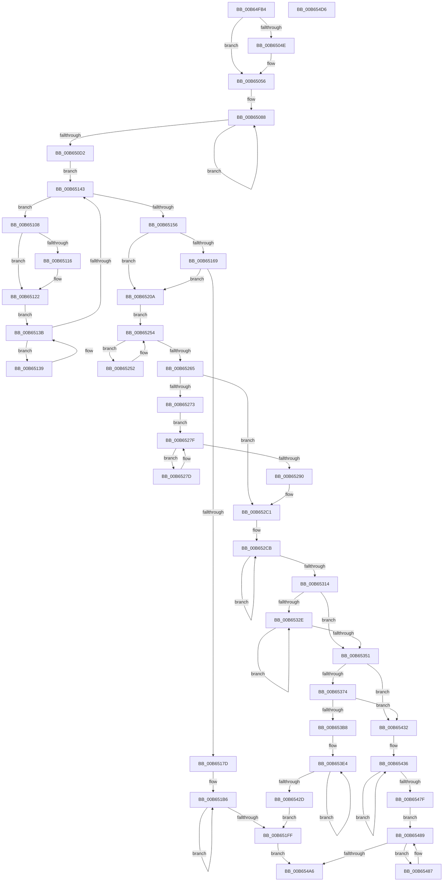

# PnprQuiesceProcessors

- RVA: `0x00B64FB4`–`0x00B654D7` (길이 `1,315` bytes)
- VA: `0x0000000140B64FB4`
- 실행 섹션: `PAGELK`
- PDB 이름 있음: `예`; PDB Function 태그: `아니요`
- unwind 정보 RVA: `0x000C8E70`
- 디코드: `320`개 명령, `1,315/1,315` bytes 표시
- 미해석 바이트: `0` (있으면 어셈블리에 `.byte`로 보존)

> 이 문서는 커널 이미지의 기계어와 PDB 기호를 분석해 생성했습니다. 4번과 5번은 함수 원형과 자료형을 바이너리 사용 방식에서 추정한 C 해석이며 원본 소스 복구 결과는 아닙니다.

## 1. Dependencies

- 직접 호출 지점: **16**; 고유 호출 대상: **10**
- 직접 호출자로 확인된 함수: **1**
- RIP 상대 이미지 참조: **7**

### Outgoing calls
- `0x00B64FF7` → [memset](../../text/6C/memset_function_006C6C40.md) (function, `0x006C6C40`)
- `0x00B65051` → [KiRaiseIrqlProcessIrqlFlags](../../text/4F/KiRaiseIrqlProcessIrqlFlags_function_004F56FC.md) (function, `0x004F56FC`)
- `0x00B65067` → [KeInitializeDpc](../../text/45/KeInitializeDpc_function_0045BBD0.md) (function, `0x0045BBD0`)
- `0x00B650E9` → [KeRemoveProcessorAffinityEx](../../text/30/KeRemoveProcessorAffinityEx_function_00304E10.md) (function, `0x00304E10`)
- `0x00B65132` → [KeInsertQueueDpc](../../text/20/KeInsertQueueDpc_function_00207C50.md) (function, `0x00207C50`)
- `0x00B6514D` → [KeEnumerateNextProcessor](../../text/41/KeEnumerateNextProcessor_function_00415480.md) (function, `0x00415480`)
- `0x00B65170` → [guard_dispatch_icall](../../text/6B/guard_dispatch_icall_function_006BAAD0.md) (function, `0x006BAAD0`)
- `0x00B65221` → [guard_dispatch_icall](../../text/6B/guard_dispatch_icall_function_006BAAD0.md) (function, `0x006BAAD0`)
- `0x00B65226` → [KeSuspendClockTimerSafe](../../text/5B/KeSuspendClockTimerSafe_function_005BB394.md) (function, `0x005BB394`)
- `0x00B6522D` → [PnprGetMillisecondCounter](PnprGetMillisecondCounter_function_00B63FD4.md) (function, `0x00B63FD4`)
- `0x00B652A8` → [guard_dispatch_icall](../../text/6B/guard_dispatch_icall_function_006BAAD0.md) (function, `0x006BAAD0`)
- `0x00B652AF` → [PnprGetMillisecondCounter](PnprGetMillisecondCounter_function_00B63FD4.md) (function, `0x00B63FD4`)
- `0x00B65376` → [PnprGetMillisecondCounter](PnprGetMillisecondCounter_function_00B63FD4.md) (function, `0x00B63FD4`)
- `0x00B65399` → [guard_dispatch_icall](../../text/6B/guard_dispatch_icall_function_006BAAD0.md) (function, `0x006BAAD0`)
- `0x00B653A2` → [PnprGetMillisecondCounter](PnprGetMillisecondCounter_function_00B63FD4.md) (function, `0x00B63FD4`)
- `0x00B654B0` → [_security_check_cookie](../../text/6A/_security_check_cookie_function_006AC640.md) (function, `0x006AC640`)

### Direct callers
- [PnprQuiesce](../../text/5A/PnprQuiesce_function_005A8DE8.md) at `0x005A8E75`

### Static image references
- `0x00B64FDA` → RVA `0x00E0A740` (`.data`; read)
- `0x00B65012` → RVA `0x00F8AC38` (`.data`; read)
- `0x00B65045` → RVA `0x00FC6D20` (`ALMOSTRO`; read)
- `0x00B6505B` → RVA `0x00B64B50` (`PnprQuiesceProcessorDpc`; read)
- `0x00B6506C` → RVA `0x00FC7120` (`ALMOSTRO`; read)
- `0x00B65169` → RVA `0x00E00938` (`.data`; read)
- `0x00B65213` → RVA `0x00E008E8` (`.data`; read)

## 2. Other-region calls and transfers

- 다른 실행 섹션으로 향하는 call: **12**
  - `0x00B64FF7` → [memset](../../text/6C/memset_function_006C6C40.md) (`PAGELK` → `.text`)
  - `0x00B65051` → [KiRaiseIrqlProcessIrqlFlags](../../text/4F/KiRaiseIrqlProcessIrqlFlags_function_004F56FC.md) (`PAGELK` → `.text`)
  - `0x00B65067` → [KeInitializeDpc](../../text/45/KeInitializeDpc_function_0045BBD0.md) (`PAGELK` → `.text`)
  - `0x00B650E9` → [KeRemoveProcessorAffinityEx](../../text/30/KeRemoveProcessorAffinityEx_function_00304E10.md) (`PAGELK` → `.text`)
  - `0x00B65132` → [KeInsertQueueDpc](../../text/20/KeInsertQueueDpc_function_00207C50.md) (`PAGELK` → `.text`)
  - `0x00B6514D` → [KeEnumerateNextProcessor](../../text/41/KeEnumerateNextProcessor_function_00415480.md) (`PAGELK` → `.text`)
  - `0x00B65170` → [guard_dispatch_icall](../../text/6B/guard_dispatch_icall_function_006BAAD0.md) (`PAGELK` → `.text`)
  - `0x00B65221` → [guard_dispatch_icall](../../text/6B/guard_dispatch_icall_function_006BAAD0.md) (`PAGELK` → `.text`)
  - `0x00B65226` → [KeSuspendClockTimerSafe](../../text/5B/KeSuspendClockTimerSafe_function_005BB394.md) (`PAGELK` → `.text`)
  - `0x00B652A8` → [guard_dispatch_icall](../../text/6B/guard_dispatch_icall_function_006BAAD0.md) (`PAGELK` → `.text`)
  - `0x00B65399` → [guard_dispatch_icall](../../text/6B/guard_dispatch_icall_function_006BAAD0.md) (`PAGELK` → `.text`)
  - `0x00B654B0` → [_security_check_cookie](../../text/6A/_security_check_cookie_function_006AC640.md) (`PAGELK` → `.text`)
- 별도 외부 분기/꼬리 이동을 확인하지 못했습니다.

## 3. Assembly (complete function range)

```asm
00B64FB4  48 8B C4                        mov rax, rsp
00B64FB7  48 89 58 08                     mov qword ptr [rax + 8], rbx
00B64FBB  48 89 70 10                     mov qword ptr [rax + 0x10], rsi
00B64FBF  48 89 78 18                     mov qword ptr [rax + 0x18], rdi
00B64FC3  4C 89 60 20                     mov qword ptr [rax + 0x20], r12
00B64FC7  55                              push rbp
00B64FC8  41 56                           push r14
00B64FCA  41 57                           push r15
00B64FCC  48 8D A8 48 FF FF FF            lea rbp, [rax - 0xb8]
00B64FD3  48 81 EC A0 01 00 00            sub rsp, 0x1a0
00B64FDA  48 8B 05 5F 57 2A 00            mov rax, qword ptr [rip + 0x2a575f]
00B64FE1  48 33 C4                        xor rax, rsp
00B64FE4  48 89 85 90 00 00 00            mov qword ptr [rbp + 0x90], rax
00B64FEB  33 D2                           xor edx, edx
00B64FED  48 8D 4D 80                     lea rcx, [rbp - 0x80]
00B64FF1  41 B8 08 01 00 00               mov r8d, 0x108
00B64FF7  E8 44 1C B6 FF                  call 0x1406c6c40
00B64FFC  45 33 FF                        xor r15d, r15d
00B64FFF  0F 57 C0                        xorps xmm0, xmm0
00B65002  33 C0                           xor eax, eax
00B65004  44 89 7C 24 3A                  mov dword ptr [rsp + 0x3a], r15d
00B65009  48 89 44 24 70                  mov qword ptr [rsp + 0x70], rax
00B6500E  89 44 24 78                     mov dword ptr [rsp + 0x78], eax
00B65012  48 8B 05 1F 5C 42 00            mov rax, qword ptr [rip + 0x425c1f]
00B65019  66 44 89 7C 24 3E               mov word ptr [rsp + 0x3e], r15w
00B6501F  44 89 7C 24 24                  mov dword ptr [rsp + 0x24], r15d
00B65024  0F 11 44 24 40                  movups xmmword ptr [rsp + 0x40], xmm0
00B65029  8B 98 B0 00 00 00               mov ebx, dword ptr [rax + 0xb0]
00B6502F  0F 11 44 24 50                  movups xmmword ptr [rsp + 0x50], xmm0
00B65034  0F 11 44 24 60                  movups xmmword ptr [rsp + 0x60], xmm0
00B65039  44 0F 20 C1                     mov rcx, cr8
00B6503D  41 8D 77 02                     lea esi, [r15 + 2]
00B65041  44 0F 22 C6                     mov cr8, rsi
00B65045  44 39 3D D4 1C 46 00            cmp dword ptr [rip + 0x461cd4], r15d
00B6504C  74 08                           je 0x140b65056
00B6504E  40 8A D6                        mov dl, sil
00B65051  E8 A6 06 99 FF                  call 0x1404f56fc
00B65056  4C 8D 44 24 20                  lea r8, [rsp + 0x20]
00B6505B  48 8D 15 EE FA FF FF            lea rdx, [rip - 0x512]
00B65062  48 8D 4C 24 40                  lea rcx, [rsp + 0x40]
00B65067  E8 64 6B 8F FF                  call 0x14045bbd0
00B6506C  48 8D 3D AD 20 46 00            lea rdi, [rip + 0x4620ad]
00B65073  40 88 74 24 41                  mov byte ptr [rsp + 0x41], sil
00B65078  48 8B C7                        mov rax, rdi
00B6507B  48 8D 4D 80                     lea rcx, [rbp - 0x80]
00B6507F  48 8B D6                        mov rdx, rsi
00B65082  41 BC 80 00 00 00               mov r12d, 0x80
00B65088  0F 10 00                        movups xmm0, xmmword ptr [rax]
00B6508B  0F 10 48 10                     movups xmm1, xmmword ptr [rax + 0x10]
00B6508F  0F 11 01                        movups xmmword ptr [rcx], xmm0
00B65092  0F 10 40 20                     movups xmm0, xmmword ptr [rax + 0x20]
00B65096  0F 11 49 10                     movups xmmword ptr [rcx + 0x10], xmm1
00B6509A  0F 10 48 30                     movups xmm1, xmmword ptr [rax + 0x30]
00B6509E  0F 11 41 20                     movups xmmword ptr [rcx + 0x20], xmm0
00B650A2  0F 10 40 40                     movups xmm0, xmmword ptr [rax + 0x40]
00B650A6  0F 11 49 30                     movups xmmword ptr [rcx + 0x30], xmm1
00B650AA  0F 10 48 50                     movups xmm1, xmmword ptr [rax + 0x50]
00B650AE  0F 11 41 40                     movups xmmword ptr [rcx + 0x40], xmm0
00B650B2  0F 10 40 60                     movups xmm0, xmmword ptr [rax + 0x60]
00B650B6  0F 11 49 50                     movups xmmword ptr [rcx + 0x50], xmm1
00B650BA  0F 10 48 70                     movups xmm1, xmmword ptr [rax + 0x70]
00B650BE  49 03 C4                        add rax, r12
00B650C1  0F 11 41 60                     movups xmmword ptr [rcx + 0x60], xmm0
00B650C5  49 03 CC                        add rcx, r12
00B650C8  0F 11 49 F0                     movups xmmword ptr [rcx - 0x10], xmm1
00B650CC  48 83 EA 01                     sub rdx, 1
00B650D0  75 B6                           jne 0x140b65088
00B650D2  48 8B 15 5F 5B 42 00            mov rdx, qword ptr [rip + 0x425b5f]
00B650D9  48 8B 00                        mov rax, qword ptr [rax]
00B650DC  48 89 01                        mov qword ptr [rcx], rax
00B650DF  48 8D 4D 80                     lea rcx, [rbp - 0x80]
00B650E3  8B 92 B4 00 00 00               mov edx, dword ptr [rdx + 0xb4]
00B650E9  E8 22 FD 79 FF                  call 0x140304e10
00B650EE  48 8B 45 88                     mov rax, qword ptr [rbp - 0x78]
00B650F2  48 89 44 24 30                  mov qword ptr [rsp + 0x30], rax
00B650F7  48 8D 45 80                     lea rax, [rbp - 0x80]
00B650FB  48 89 44 24 28                  mov qword ptr [rsp + 0x28], rax
00B65100  66 44 89 7C 24 38               mov word ptr [rsp + 0x38], r15w
00B65106  EB 3B                           jmp 0x140b65143
00B65108  48 8B 44 24 78                  mov rax, qword ptr [rsp + 0x78]
00B6510D  8B 4C 24 24                     mov ecx, dword ptr [rsp + 0x24]
00B65111  48 85 C0                        test rax, rax
00B65114  75 0C                           jne 0x140b65122
00B65116  B8 00 08 00 00                  mov eax, 0x800
00B6511B  03 C1                           add eax, ecx
00B6511D  66 89 44 24 42                  mov word ptr [rsp + 0x42], ax
00B65122  4C 8B C1                        mov r8, rcx
00B65125  44 88 7C 24 20                  mov byte ptr [rsp + 0x20], r15b
00B6512A  48 8D 4C 24 40                  lea rcx, [rsp + 0x40]
00B6512F  48 8B D3                        mov rdx, rbx
00B65132  E8 19 2B 6A FF                  call 0x140207c50
00B65137  EB 02                           jmp 0x140b6513b
00B65139  F3 90                           pause
00B6513B  8A 44 24 20                     mov al, byte ptr [rsp + 0x20]
00B6513F  84 C0                           test al, al
00B65141  74 F6                           je 0x140b65139
00B65143  48 8D 54 24 28                  lea rdx, [rsp + 0x28]
00B65148  48 8D 4C 24 24                  lea rcx, [rsp + 0x24]
00B6514D  E8 2E 03 8B FF                  call 0x140415480
00B65152  85 C0                           test eax, eax
00B65154  74 B2                           je 0x140b65108
00B65156  48 8B 05 DB 5A 42 00            mov rax, qword ptr [rip + 0x425adb]
00B6515D  8B 48 40                        mov ecx, dword ptr [rax + 0x40]
00B65160  F6 C1 20                        test cl, 0x20
00B65163  0F 84 A1 00 00 00               je 0x140b6520a
00B65169  48 8B 05 C8 B7 29 00            mov rax, qword ptr [rip + 0x29b7c8]
00B65170  E8 5B 59 B5 FF                  call 0x1406baad0
00B65175  85 C0                           test eax, eax
00B65177  0F 89 8D 00 00 00               jns 0x140b6520a
00B6517D  48 8B 0D B4 5A 42 00            mov rcx, qword ptr [rip + 0x425ab4]
00B65184  BA 97 09 00 00                  mov edx, 0x997
00B65189  41 BE 01 00 00 00               mov r14d, 1
00B6518F  8B 81 08 82 00 00               mov eax, dword ptr [rcx + 0x8208]
00B65195  85 C0                           test eax, eax
00B65197  0F 44 C2                        cmove eax, edx
00B6519A  89 81 08 82 00 00               mov dword ptr [rcx + 0x8208], eax
00B651A0  8B 81 0C 82 00 00               mov eax, dword ptr [rcx + 0x820c]
00B651A6  85 C0                           test eax, eax
00B651A8  41 0F 44 C6                     cmove eax, r14d
00B651AC  89 81 0C 82 00 00               mov dword ptr [rcx + 0x820c], eax
00B651B2  48 8D 45 80                     lea rax, [rbp - 0x80]
00B651B6  0F 10 00                        movups xmm0, xmmword ptr [rax]
00B651B9  0F 10 48 10                     movups xmm1, xmmword ptr [rax + 0x10]
00B651BD  0F 11 07                        movups xmmword ptr [rdi], xmm0
00B651C0  0F 10 40 20                     movups xmm0, xmmword ptr [rax + 0x20]
00B651C4  0F 11 4F 10                     movups xmmword ptr [rdi + 0x10], xmm1
00B651C8  0F 10 48 30                     movups xmm1, xmmword ptr [rax + 0x30]
00B651CC  0F 11 47 20                     movups xmmword ptr [rdi + 0x20], xmm0
00B651D0  0F 10 40 40                     movups xmm0, xmmword ptr [rax + 0x40]
00B651D4  0F 11 4F 30                     movups xmmword ptr [rdi + 0x30], xmm1
00B651D8  0F 10 48 50                     movups xmm1, xmmword ptr [rax + 0x50]
00B651DC  0F 11 47 40                     movups xmmword ptr [rdi + 0x40], xmm0
00B651E0  0F 10 40 60                     movups xmm0, xmmword ptr [rax + 0x60]
00B651E4  0F 11 4F 50                     movups xmmword ptr [rdi + 0x50], xmm1
00B651E8  0F 10 48 70                     movups xmm1, xmmword ptr [rax + 0x70]
00B651EC  49 03 C4                        add rax, r12
00B651EF  0F 11 47 60                     movups xmmword ptr [rdi + 0x60], xmm0
00B651F3  49 03 FC                        add rdi, r12
00B651F6  0F 11 4F F0                     movups xmmword ptr [rdi - 0x10], xmm1
00B651FA  49 2B F6                        sub rsi, r14
00B651FD  75 B7                           jne 0x140b651b6
00B651FF  48 8B 00                        mov rax, qword ptr [rax]
00B65202  48 89 07                        mov qword ptr [rdi], rax
00B65205  E9 9C 02 00 00                  jmp 0x140b654a6
00B6520A  48 8B 15 27 5A 42 00            mov rdx, qword ptr [rip + 0x425a27]
00B65211  33 C9                           xor ecx, ecx
00B65213  48 8B 05 CE B6 29 00            mov rax, qword ptr [rip + 0x29b6ce]
00B6521A  48 8B 92 98 81 00 00            mov rdx, qword ptr [rdx + 0x8198]
00B65221  E8 AA 58 B5 FF                  call 0x1406baad0
00B65226  E8 69 61 A5 FF                  call 0x1405bb394
00B6522B  33 C9                           xor ecx, ecx
00B6522D  E8 A2 ED FF FF                  call 0x140b63fd4
00B65232  48 8B 0D FF 59 42 00            mov rcx, qword ptr [rip + 0x4259ff]
00B65239  41 BE 01 00 00 00               mov r14d, 1
00B6523F  8B C0                           mov eax, eax
00B65241  48 89 81 10 82 00 00            mov qword ptr [rcx + 0x8210], rax
00B65248  F0 44 01 B1 B8 00 00 00         lock add dword ptr [rcx + 0xb8], r14d
00B65250  EB 02                           jmp 0x140b65254
00B65252  F3 90                           pause
00B65254  48 8B 05 DD 59 42 00            mov rax, qword ptr [rip + 0x4259dd]
00B6525B  8B 88 B8 00 00 00               mov ecx, dword ptr [rax + 0xb8]
00B65261  3B CB                           cmp ecx, ebx
00B65263  7C ED                           jl 0x140b65252
00B65265  48 8B 0D CC 59 42 00            mov rcx, qword ptr [rip + 0x4259cc]
00B6526C  8B 41 40                        mov eax, dword ptr [rcx + 0x40]
00B6526F  A8 20                           test al, 0x20
00B65271  74 4E                           je 0x140b652c1
00B65273  F0 44 01 B1 C0 00 00 00         lock add dword ptr [rcx + 0xc0], r14d
00B6527B  EB 02                           jmp 0x140b6527f
00B6527D  F3 90                           pause
00B6527F  48 8B 05 B2 59 42 00            mov rax, qword ptr [rip + 0x4259b2]
00B65286  8B 88 C0 00 00 00               mov ecx, dword ptr [rax + 0xc0]
00B6528C  3B CB                           cmp ecx, ebx
00B6528E  7C ED                           jl 0x140b6527d
00B65290  48 8B 0D A1 59 42 00            mov rcx, qword ptr [rip + 0x4259a1]
00B65297  41 8A D6                        mov dl, r14b
00B6529A  48 8B 81 00 82 00 00            mov rax, qword ptr [rcx + 0x8200]
00B652A1  48 8B 89 A0 81 00 00            mov rcx, qword ptr [rcx + 0x81a0]
00B652A8  E8 23 58 B5 FF                  call 0x1406baad0
00B652AD  33 C9                           xor ecx, ecx
00B652AF  E8 20 ED FF FF                  call 0x140b63fd4
00B652B4  48 8B 0D 7D 59 42 00            mov rcx, qword ptr [rip + 0x42597d]
00B652BB  89 81 18 82 00 00               mov dword ptr [rcx + 0x8218], eax
00B652C1  48 8D 4D 80                     lea rcx, [rbp - 0x80]
00B652C5  48 8B C7                        mov rax, rdi
00B652C8  48 8B D6                        mov rdx, rsi
00B652CB  0F 10 00                        movups xmm0, xmmword ptr [rax]
00B652CE  0F 10 48 10                     movups xmm1, xmmword ptr [rax + 0x10]
00B652D2  0F 11 01                        movups xmmword ptr [rcx], xmm0
00B652D5  0F 10 40 20                     movups xmm0, xmmword ptr [rax + 0x20]
00B652D9  0F 11 49 10                     movups xmmword ptr [rcx + 0x10], xmm1
00B652DD  0F 10 48 30                     movups xmm1, xmmword ptr [rax + 0x30]
00B652E1  0F 11 41 20                     movups xmmword ptr [rcx + 0x20], xmm0
00B652E5  0F 10 40 40                     movups xmm0, xmmword ptr [rax + 0x40]
00B652E9  0F 11 49 30                     movups xmmword ptr [rcx + 0x30], xmm1
00B652ED  0F 10 48 50                     movups xmm1, xmmword ptr [rax + 0x50]
00B652F1  0F 11 41 40                     movups xmmword ptr [rcx + 0x40], xmm0
00B652F5  0F 10 40 60                     movups xmm0, xmmword ptr [rax + 0x60]
00B652F9  0F 11 49 50                     movups xmmword ptr [rcx + 0x50], xmm1
00B652FD  0F 10 48 70                     movups xmm1, xmmword ptr [rax + 0x70]
00B65301  49 03 C4                        add rax, r12
00B65304  0F 11 41 60                     movups xmmword ptr [rcx + 0x60], xmm0
00B65308  49 03 CC                        add rcx, r12
00B6530B  0F 11 49 F0                     movups xmmword ptr [rcx - 0x10], xmm1
00B6530F  49 2B D6                        sub rdx, r14
00B65312  75 B7                           jne 0x140b652cb
00B65314  48 8B 00                        mov rax, qword ptr [rax]
00B65317  45 8B C7                        mov r8d, r15d
00B6531A  48 89 01                        mov qword ptr [rcx], rax
00B6531D  48 8B 05 14 59 42 00            mov rax, qword ptr [rip + 0x425914]
00B65324  4C 8B 48 10                     mov r9, qword ptr [rax + 0x10]
00B65328  45 39 79 08                     cmp dword ptr [r9 + 8], r15d
00B6532C  76 23                           jbe 0x140b65351
00B6532E  49 8B 01                        mov rax, qword ptr [r9]
00B65331  41 8B D0                        mov edx, r8d
00B65334  45 03 C6                        add r8d, r14d
00B65337  48 8B 0C D0                     mov rcx, qword ptr [rax + rdx*8]
00B6533B  48 8B 44 D7 08                  mov rax, qword ptr [rdi + rdx*8 + 8]
00B65340  48 F7 D1                        not rcx
00B65343  48 23 C1                        and rax, rcx
00B65346  48 89 44 D7 08                  mov qword ptr [rdi + rdx*8 + 8], rax
00B6534B  45 3B 41 08                     cmp r8d, dword ptr [r9 + 8]
00B6534F  72 DD                           jb 0x140b6532e
00B65351  48 8B 0D E0 58 42 00            mov rcx, qword ptr [rip + 0x4258e0]
00B65358  48 8B 41 10                     mov rax, qword ptr [rcx + 0x10]
00B6535C  44 89 B9 CC 00 00 00            mov dword ptr [rcx + 0xcc], r15d
00B65363  44 89 B1 C8 00 00 00            mov dword ptr [rcx + 0xc8], r14d
00B6536A  44 39 78 10                     cmp dword ptr [rax + 0x10], r15d
00B6536E  0F 84 BE 00 00 00               je 0x140b65432
00B65374  33 C9                           xor ecx, ecx
00B65376  E8 59 EC FF FF                  call 0x140b63fd4
00B6537B  48 8B 15 B6 58 42 00            mov rdx, qword ptr [rip + 0x4258b6]
00B65382  41 8B CE                        mov ecx, r14d
00B65385  89 82 1C 82 00 00               mov dword ptr [rdx + 0x821c], eax
00B6538B  48 8B 05 56 B5 29 00            mov rax, qword ptr [rip + 0x29b556]
00B65392  48 8B 92 98 81 00 00            mov rdx, qword ptr [rdx + 0x8198]
00B65399  E8 32 57 B5 FF                  call 0x1406baad0
00B6539E  33 C9                           xor ecx, ecx
00B653A0  8B D8                           mov ebx, eax
00B653A2  E8 2D EC FF FF                  call 0x140b63fd4
00B653A7  48 8B 0D 8A 58 42 00            mov rcx, qword ptr [rip + 0x42588a]
00B653AE  89 81 20 82 00 00               mov dword ptr [rcx + 0x8220], eax
00B653B4  85 DB                           test ebx, ebx
00B653B6  79 7A                           jns 0x140b65432
00B653B8  8B 81 08 82 00 00               mov eax, dword ptr [rcx + 0x8208]
00B653BE  BA EC 09 00 00                  mov edx, 0x9ec
00B653C3  85 C0                           test eax, eax
00B653C5  0F 44 C2                        cmove eax, edx
00B653C8  89 81 08 82 00 00               mov dword ptr [rcx + 0x8208], eax
00B653CE  8B 81 0C 82 00 00               mov eax, dword ptr [rcx + 0x820c]
00B653D4  85 C0                           test eax, eax
00B653D6  41 0F 44 C6                     cmove eax, r14d
00B653DA  89 81 0C 82 00 00               mov dword ptr [rcx + 0x820c], eax
00B653E0  48 8D 45 80                     lea rax, [rbp - 0x80]
00B653E4  0F 10 00                        movups xmm0, xmmword ptr [rax]
00B653E7  0F 10 48 10                     movups xmm1, xmmword ptr [rax + 0x10]
00B653EB  0F 11 07                        movups xmmword ptr [rdi], xmm0
00B653EE  0F 10 40 20                     movups xmm0, xmmword ptr [rax + 0x20]
00B653F2  0F 11 4F 10                     movups xmmword ptr [rdi + 0x10], xmm1
00B653F6  0F 10 48 30                     movups xmm1, xmmword ptr [rax + 0x30]
00B653FA  0F 11 47 20                     movups xmmword ptr [rdi + 0x20], xmm0
00B653FE  0F 10 40 40                     movups xmm0, xmmword ptr [rax + 0x40]
00B65402  0F 11 4F 30                     movups xmmword ptr [rdi + 0x30], xmm1
00B65406  0F 10 48 50                     movups xmm1, xmmword ptr [rax + 0x50]
00B6540A  0F 11 47 40                     movups xmmword ptr [rdi + 0x40], xmm0
00B6540E  0F 10 40 60                     movups xmm0, xmmword ptr [rax + 0x60]
00B65412  0F 11 4F 50                     movups xmmword ptr [rdi + 0x50], xmm1
00B65416  0F 10 48 70                     movups xmm1, xmmword ptr [rax + 0x70]
00B6541A  49 03 C4                        add rax, r12
00B6541D  0F 11 47 60                     movups xmmword ptr [rdi + 0x60], xmm0
00B65421  49 03 FC                        add rdi, r12
00B65424  0F 11 4F F0                     movups xmmword ptr [rdi - 0x10], xmm1
00B65428  49 2B F6                        sub rsi, r14
00B6542B  75 B7                           jne 0x140b653e4
00B6542D  E9 CD FD FF FF                  jmp 0x140b651ff
00B65432  48 8D 45 80                     lea rax, [rbp - 0x80]
00B65436  0F 10 00                        movups xmm0, xmmword ptr [rax]
00B65439  0F 10 48 10                     movups xmm1, xmmword ptr [rax + 0x10]
00B6543D  0F 11 07                        movups xmmword ptr [rdi], xmm0
00B65440  0F 10 40 20                     movups xmm0, xmmword ptr [rax + 0x20]
00B65444  0F 11 4F 10                     movups xmmword ptr [rdi + 0x10], xmm1
00B65448  0F 10 48 30                     movups xmm1, xmmword ptr [rax + 0x30]
00B6544C  0F 11 47 20                     movups xmmword ptr [rdi + 0x20], xmm0
00B65450  0F 10 40 40                     movups xmm0, xmmword ptr [rax + 0x40]
00B65454  0F 11 4F 30                     movups xmmword ptr [rdi + 0x30], xmm1
00B65458  0F 10 48 50                     movups xmm1, xmmword ptr [rax + 0x50]
00B6545C  0F 11 47 40                     movups xmmword ptr [rdi + 0x40], xmm0
00B65460  0F 10 40 60                     movups xmm0, xmmword ptr [rax + 0x60]
00B65464  0F 11 4F 50                     movups xmmword ptr [rdi + 0x50], xmm1
00B65468  0F 10 48 70                     movups xmm1, xmmword ptr [rax + 0x70]
00B6546C  49 03 C4                        add rax, r12
00B6546F  0F 11 47 60                     movups xmmword ptr [rdi + 0x60], xmm0
00B65473  49 03 FC                        add rdi, r12
00B65476  0F 11 4F F0                     movups xmmword ptr [rdi - 0x10], xmm1
00B6547A  49 2B F6                        sub rsi, r14
00B6547D  75 B7                           jne 0x140b65436
00B6547F  48 8B 00                        mov rax, qword ptr [rax]
00B65482  48 89 07                        mov qword ptr [rdi], rax
00B65485  EB 02                           jmp 0x140b65489
00B65487  F3 90                           pause
00B65489  48 8B 05 A8 57 42 00            mov rax, qword ptr [rip + 0x4257a8]
00B65490  8B 90 CC 00 00 00               mov edx, dword ptr [rax + 0xcc]
00B65496  48 8B 05 9B 57 42 00            mov rax, qword ptr [rip + 0x42579b]
00B6549D  48 8B 48 10                     mov rcx, qword ptr [rax + 0x10]
00B654A1  3B 51 10                        cmp edx, dword ptr [rcx + 0x10]
00B654A4  7C E1                           jl 0x140b65487
00B654A6  48 8B 8D 90 00 00 00            mov rcx, qword ptr [rbp + 0x90]
00B654AD  48 33 CC                        xor rcx, rsp
00B654B0  E8 8B 71 B4 FF                  call 0x1406ac640
00B654B5  4C 8D 9C 24 A0 01 00 00         lea r11, [rsp + 0x1a0]
00B654BD  49 8B 5B 20                     mov rbx, qword ptr [r11 + 0x20]
00B654C1  49 8B 73 28                     mov rsi, qword ptr [r11 + 0x28]
00B654C5  49 8B 7B 30                     mov rdi, qword ptr [r11 + 0x30]
00B654C9  4D 8B 63 38                     mov r12, qword ptr [r11 + 0x38]
00B654CD  49 8B E3                        mov rsp, r11
00B654D0  41 5F                           pop r15
00B654D2  41 5E                           pop r14
00B654D4  5D                              pop rbp
00B654D5  C3                              ret
00B654D6  CC                              int3
```

## 4. C-style interpretation (structured pseudocode)

```c
__int64 __fastcall PnprQuiesceProcessors(__int64 a1, int a2)
{
    __int64 result;
    __int64 v_r15;
    __int64 v_rdi;
    __int64 v_rsi;
    __int64 v_rsp;
    unsigned int v_stack_m140;
    unsigned __int64 v_stack_m148;
    unsigned __int64 v_stack_m158;
    unsigned __int64 v_stack_m168;
    unsigned __int16 v_stack_m176;
    unsigned __int8 v_stack_m177;
    unsigned __int64 v_stack_m178;
    unsigned __int16 v_stack_m17A;
    unsigned int v_stack_m17E;
    unsigned __int64 v_stack_m18;
    unsigned __int16 v_stack_m180;
    unsigned __int64 v_stack_m188;
    unsigned __int64 v_stack_m190;
    unsigned int v_stack_m194;
    unsigned __int64 v_stack_m198;

    *(unsigned __int64 *)(v_rsp + 8) = v_rbx;
    *(unsigned __int64 *)(v_rsp + 16) = v_rsi;
    *(unsigned __int64 *)(v_rsp + 24) = v_rdi;
    *(unsigned __int64 *)(v_rsp + 32) = v_r12;
    v_rsp = (v_rsp) - (416);
    result = (*(unsigned __int64 *)(v_rip + 2774879)) ^ (v_rsp);
    *(unsigned __int64 *)(v_rsp - 184 + 144) = result;
    a2 = 0;
    result = memset(v_rsp - 184 - 128, a2, 264, a4);
    v_r15 = 0;
    result = 0;
    v_stack_m17E = 0;
    v_stack_m148 = 0;
    v_stack_m140 = 0;
    v_stack_m17A = 0;
    v_stack_m194 = 0;
    v_stack_m178 = v_xmm0;
    v_stack_m168 = v_xmm0;
    v_stack_m158 = v_xmm0;
    result = *(unsigned __int64 *)(v_rip + 4348959);
    if ((*(unsigned int *)(v_rip + 4594900)) != 0) {
        a2 = (unsigned __int8)(v_r15 + 2);
        result = KiRaiseIrqlProcessIrqlFlags(v_cr8, a2, 264, a4);
    }
    result = KeInitializeDpc(v_stack_m178, v_rip - 1298, v_stack_m198, a4);
    v_stack_m177 = (unsigned __int8)(v_r15 + 2);
loc_00B65088:
    *(unsigned __int64 *)(v_rsp - 184 - 128) = v_xmm0;
    *(unsigned __int64 *)(v_rsp - 184 - 128 + 16) = v_xmm1;
    *(unsigned __int64 *)(v_rsp - 184 - 128 + 32) = v_xmm0;
    *(unsigned __int64 *)(v_rsp - 184 - 128 + 48) = v_xmm1;
    *(unsigned __int64 *)(v_rsp - 184 - 128 + 64) = v_xmm0;
    *(unsigned __int64 *)(v_rsp - 184 - 128 + 80) = v_xmm1;
    result = (v_rip + 4595885) + (128);
    *(unsigned __int64 *)(v_rsp - 184 - 128 + 96) = v_xmm0;
    a1 = (v_rsp - 184 - 128) + (128);
    *(unsigned __int64 *)(a1 - 16) = v_xmm1;
    a2 = (v_r15 + 2) - (1);
    if (condition_is_not_equal) goto loc_00B65088;
    *(unsigned __int64 *)(a1) = *(unsigned __int64 *)(result);
    result = KeRemoveProcessorAffinityEx(v_rsp - 184 - 128, (unsigned int)(*(unsigned int *)(*(unsigned __int64 *)(v_rip + 4348767) + 180)), v_stack_m198, a4);
    v_stack_m188 = *(unsigned __int64 *)(v_rsp - 184 - 120);
    v_stack_m190 = v_rsp - 184 - 128;
    v_stack_m180 = 0;
    goto loc_00B65143;
loc_00B65108:
    result = v_stack_m140;
    if (v_stack_m140 == 0) {
        result = 0x800ULL;
        result = (unsigned int)((result) + ((unsigned int)((unsigned int)(v_stack_m194))));
        v_stack_m176 = (unsigned __int16)(result);
    }
    v_stack_m198 = 0;
    result = KeInsertQueueDpc(v_stack_m178, (unsigned int)(*(unsigned int *)(*(unsigned __int64 *)(v_rip + 4348959) + 176)), (unsigned int)(v_stack_m194), a4);
    goto loc_00B6513B;
loc_00B65139:
loc_00B6513B:
    if ((unsigned __int8)(v_stack_m198) == 0) goto loc_00B65139;
loc_00B65143:
    result = KeEnumerateNextProcessor(v_stack_m194, v_stack_m190, (unsigned int)(v_stack_m194), a4);
    if ((unsigned int)(result) == 0) goto loc_00B65108;
    if ((((unsigned __int8)((unsigned int)(*(unsigned int *)(*(unsigned __int64 *)(v_rip + 4348635) + 64)))) & (32)) == 0) goto loc_00B6520A;
    result = guard_dispatch_icall((unsigned int)(*(unsigned int *)(*(unsigned __int64 *)(v_rip + 4348635) + 64)), v_stack_m190, (unsigned int)(v_stack_m194), a4);
    if (!sign_flag) goto loc_00B6520A;
    result = (unsigned int)(*(unsigned int *)(*(unsigned __int64 *)(v_rip + 4348596) + 33288));
    if ((unsigned int)((unsigned int)(*(unsigned int *)(*(unsigned __int64 *)(v_rip + 4348596) + 33288))) == 0) { result = (unsigned int)((unsigned int)(0x997ULL)); }
    *(unsigned int *)(*(unsigned __int64 *)(v_rip + 4348596) + 33288) = (unsigned int)(result);
    result = (unsigned int)(*(unsigned int *)(*(unsigned __int64 *)(v_rip + 4348596) + 33292));
    if ((unsigned int)((unsigned int)(*(unsigned int *)(*(unsigned __int64 *)(v_rip + 4348596) + 33292))) == 0) { result = 1; }
    *(unsigned int *)(*(unsigned __int64 *)(v_rip + 4348596) + 33292) = (unsigned int)(result);
loc_00B651B6:
    *(unsigned __int64 *)(v_rip + 4595885) = v_xmm0;
    *(unsigned __int64 *)(v_rip + 4595885 + 16) = v_xmm1;
    *(unsigned __int64 *)(v_rip + 4595885 + 32) = v_xmm0;
    *(unsigned __int64 *)(v_rip + 4595885 + 48) = v_xmm1;
    *(unsigned __int64 *)(v_rip + 4595885 + 64) = v_xmm0;
    *(unsigned __int64 *)(v_rip + 4595885 + 80) = v_xmm1;
    result = (v_rsp - 184 - 128) + (128);
    *(unsigned __int64 *)(v_rip + 4595885 + 96) = v_xmm0;
    v_rdi = (v_rip + 4595885) + (128);
    *(unsigned __int64 *)(v_rdi - 16) = v_xmm1;
    v_rsi = (v_r15 + 2) - (1);
    if (condition_is_not_equal) goto loc_00B651B6;
loc_00B651FF:
    *(unsigned __int64 *)(v_rdi) = *(unsigned __int64 *)(result);
    goto loc_00B654A6;
loc_00B6520A:
    a1 = 0;
    result = guard_dispatch_icall(a1, *(unsigned __int64 *)(*(unsigned __int64 *)(v_rip + 4348455) + 33176), (unsigned int)(v_stack_m194), a4);
    result = KeSuspendClockTimerSafe(a1, *(unsigned __int64 *)(*(unsigned __int64 *)(v_rip + 4348455) + 33176), (unsigned int)(v_stack_m194), a4);
    a1 = 0;
    result = PnprGetMillisecondCounter(a1, *(unsigned __int64 *)(*(unsigned __int64 *)(v_rip + 4348455) + 33176), (unsigned int)(v_stack_m194), a4);
    *(unsigned __int64 *)(*(unsigned __int64 *)(v_rip + 4348415) + 33296) = (unsigned int)((unsigned int)(result));
    goto loc_00B65254;
loc_00B65252:
loc_00B65254:
    if (((unsigned int)((unsigned int)(*(unsigned int *)(*(unsigned __int64 *)(v_rip + 4348381) + 184)))) < ((unsigned int)((unsigned int)(*(unsigned int *)(*(unsigned __int64 *)(v_rip + 4348959) + 176))))) goto loc_00B65252;
    if ((((unsigned __int8)((unsigned int)(*(unsigned int *)(*(unsigned __int64 *)(v_rip + 4348364) + 64)))) & (32)) == 0) goto loc_00B652C1;
    goto loc_00B6527F;
loc_00B6527D:
loc_00B6527F:
    if (((unsigned int)((unsigned int)(*(unsigned int *)(*(unsigned __int64 *)(v_rip + 4348338) + 192)))) < ((unsigned int)((unsigned int)(*(unsigned int *)(*(unsigned __int64 *)(v_rip + 4348959) + 176))))) goto loc_00B6527D;
    result = guard_dispatch_icall(*(unsigned __int64 *)(*(unsigned __int64 *)(v_rip + 4348321) + 33184), 1, (unsigned int)(v_stack_m194), a4);
    a1 = 0;
    result = PnprGetMillisecondCounter(a1, 1, (unsigned int)(v_stack_m194), a4);
    *(unsigned int *)(*(unsigned __int64 *)(v_rip + 4348285) + 33304) = (unsigned int)(result);
loc_00B652C1:
loc_00B652CB:
    *(unsigned __int64 *)(v_rsp - 184 - 128) = v_xmm0;
    *(unsigned __int64 *)(v_rsp - 184 - 128 + 16) = v_xmm1;
    *(unsigned __int64 *)(v_rsp - 184 - 128 + 32) = v_xmm0;
    *(unsigned __int64 *)(v_rsp - 184 - 128 + 48) = v_xmm1;
    *(unsigned __int64 *)(v_rsp - 184 - 128 + 64) = v_xmm0;
    *(unsigned __int64 *)(v_rsp - 184 - 128 + 80) = v_xmm1;
    result = (v_rdi) + (128);
    *(unsigned __int64 *)(v_rsp - 184 - 128 + 96) = v_xmm0;
    a1 = (v_rsp - 184 - 128) + (128);
    *(unsigned __int64 *)(a1 - 16) = v_xmm1;
    a2 = (v_rsi) - (1);
    if (condition_is_not_equal) goto loc_00B652CB;
    *(unsigned __int64 *)(a1) = *(unsigned __int64 *)(result);
    if ((*(unsigned int *)(*(unsigned __int64 *)(*(unsigned __int64 *)(v_rip + 4348180) + 16) + 8)) <= 0) goto loc_00B65351;
loc_00B6532E:
    a3 = (unsigned int)((0) + (1));
    a1 = ~(*(unsigned __int64 *)(*(unsigned __int64 *)(*(unsigned __int64 *)(*(unsigned __int64 *)(v_rip + 4348180) + 16)) + 0 * 8));
    result = (*(unsigned __int64 *)(v_rdi + 0 * 8 + 8)) & (a1);
    *(unsigned __int64 *)(v_rdi + 0 * 8 + 8) = result;
    if (((unsigned int)(a3)) < (*(unsigned int *)(*(unsigned __int64 *)(*(unsigned __int64 *)(v_rip + 4348180) + 16) + 8))) goto loc_00B6532E;
loc_00B65351:
    *(unsigned int *)(*(unsigned __int64 *)(v_rip + 4348128) + 204) = 0;
    *(unsigned int *)(*(unsigned __int64 *)(v_rip + 4348128) + 200) = 1;
    if ((*(unsigned int *)(*(unsigned __int64 *)(*(unsigned __int64 *)(v_rip + 4348128) + 16) + 16)) == 0) goto loc_00B65432;
    a1 = 0;
    result = PnprGetMillisecondCounter(a1, 0, a3, *(unsigned __int64 *)(*(unsigned __int64 *)(v_rip + 4348180) + 16));
    *(unsigned int *)(*(unsigned __int64 *)(v_rip + 4348086) + 33308) = (unsigned int)(result);
    result = guard_dispatch_icall(1, *(unsigned __int64 *)(*(unsigned __int64 *)(v_rip + 4348086) + 33176), a3, *(unsigned __int64 *)(*(unsigned __int64 *)(v_rip + 4348180) + 16));
    a1 = 0;
    result = PnprGetMillisecondCounter(a1, *(unsigned __int64 *)(*(unsigned __int64 *)(v_rip + 4348086) + 33176), a3, *(unsigned __int64 *)(*(unsigned __int64 *)(v_rip + 4348180) + 16));
    *(unsigned int *)(*(unsigned __int64 *)(v_rip + 4348042) + 33312) = (unsigned int)(result);
    if (!sign_flag) goto loc_00B65432;
    result = (unsigned int)(*(unsigned int *)(*(unsigned __int64 *)(v_rip + 4348042) + 33288));
    if ((unsigned int)((unsigned int)(*(unsigned int *)(*(unsigned __int64 *)(v_rip + 4348042) + 33288))) == 0) { result = (unsigned int)((unsigned int)(0x9ECULL)); }
    *(unsigned int *)(*(unsigned __int64 *)(v_rip + 4348042) + 33288) = (unsigned int)(result);
    result = (unsigned int)(*(unsigned int *)(*(unsigned __int64 *)(v_rip + 4348042) + 33292));
    if ((unsigned int)((unsigned int)(*(unsigned int *)(*(unsigned __int64 *)(v_rip + 4348042) + 33292))) == 0) { result = 1; }
    *(unsigned int *)(*(unsigned __int64 *)(v_rip + 4348042) + 33292) = (unsigned int)(result);
loc_00B653E4:
    *(unsigned __int64 *)(v_rdi) = v_xmm0;
    *(unsigned __int64 *)(v_rdi + 16) = v_xmm1;
    *(unsigned __int64 *)(v_rdi + 32) = v_xmm0;
    *(unsigned __int64 *)(v_rdi + 48) = v_xmm1;
    *(unsigned __int64 *)(v_rdi + 64) = v_xmm0;
    *(unsigned __int64 *)(v_rdi + 80) = v_xmm1;
    result = (v_rsp - 184 - 128) + (128);
    *(unsigned __int64 *)(v_rdi + 96) = v_xmm0;
    v_rdi = (v_rdi) + (128);
    *(unsigned __int64 *)(v_rdi - 16) = v_xmm1;
    v_rsi = (v_rsi) - (1);
    if (condition_is_not_equal) goto loc_00B653E4;
    goto loc_00B651FF;
loc_00B65432:
loc_00B65436:
    *(unsigned __int64 *)(v_rdi) = v_xmm0;
    *(unsigned __int64 *)(v_rdi + 16) = v_xmm1;
    *(unsigned __int64 *)(v_rdi + 32) = v_xmm0;
    *(unsigned __int64 *)(v_rdi + 48) = v_xmm1;
    *(unsigned __int64 *)(v_rdi + 64) = v_xmm0;
    *(unsigned __int64 *)(v_rdi + 80) = v_xmm1;
    result = (v_rsp - 184 - 128) + (128);
    *(unsigned __int64 *)(v_rdi + 96) = v_xmm0;
    v_rdi = (v_rdi) + (128);
    *(unsigned __int64 *)(v_rdi - 16) = v_xmm1;
    v_rsi = (v_rsi) - (1);
    if (condition_is_not_equal) goto loc_00B65436;
    *(unsigned __int64 *)(v_rdi) = *(unsigned __int64 *)(result);
    goto loc_00B65489;
loc_00B65487:
loc_00B65489:
    if (((unsigned int)((unsigned int)(*(unsigned int *)(*(unsigned __int64 *)(v_rip + 4347816) + 204)))) < (*(unsigned int *)(*(unsigned __int64 *)(*(unsigned __int64 *)(v_rip + 4347803) + 16) + 16))) goto loc_00B65487;
loc_00B654A6:
    a1 = (*(unsigned __int64 *)(v_rsp - 184 + 144)) ^ (v_rsp);
    result = _security_check_cookie(a1, (unsigned int)(*(unsigned int *)(*(unsigned __int64 *)(v_rip + 4347816) + 204)), a3, *(unsigned __int64 *)(*(unsigned __int64 *)(v_rip + 4348180) + 16));
    return result;
}
```

## 5. (Beta) C Style

```c
int64_t PnprQuiesceProcessors(int64_t Arg1, int32_t Arg2)
{
    int64_t result;
    int64_t local_r15;
    int64_t local_rdi;
    int64_t local_rsi;
    int64_t local_rsp;
    uint32_t v_stack_m140;
    uint64_t v_stack_m148;
    uint64_t v_stack_m158;
    uint64_t v_stack_m168;
    uint16_t v_stack_m176;
    uint8_t v_stack_m177;
    uint64_t v_stack_m178;
    uint16_t v_stack_m17A;
    uint32_t v_stack_m17E;
    uint64_t v_stack_m18;
    uint16_t v_stack_m180;
    uint64_t v_stack_m188;
    uint64_t v_stack_m190;
    uint32_t v_stack_m194;
    uint64_t v_stack_m198;

    *(uint64_t *)(local_rsp + 0x8) = local_rbx;
    *(uint64_t *)(local_rsp + 0x10) = local_rsi;
    *(uint64_t *)(local_rsp + 0x18) = local_rdi;
    *(uint64_t *)(local_rsp + 0x20) = local_r12;
    local_rsp = (local_rsp) - (416);
    result = (*(uint64_t *)(v_rip + 0x2A575F)) ^ (local_rsp);
    *(uint64_t *)(local_rsp - 0xB8 + 0x90) = result;
    Arg2 = 0;
    result = memset(local_rsp - 184 - 128, Arg2, 264, a4);
    local_r15 = 0;
    result = 0;
    v_stack_m17E = 0;
    v_stack_m148 = 0;
    v_stack_m140 = 0;
    v_stack_m17A = 0;
    v_stack_m194 = 0;
    v_stack_m178 = v_xmm0;
    v_stack_m168 = v_xmm0;
    v_stack_m158 = v_xmm0;
    result = *(uint64_t *)(v_rip + 0x425C1F);
    if ((*(uint32_t *)(v_rip + 0x461CD4)) != 0) {
        Arg2 = (uint8_t)(local_r15 + 2);
        result = KiRaiseIrqlProcessIrqlFlags(v_cr8, Arg2, 264, a4);
    }
    result = KeInitializeDpc(v_stack_m178, v_rip - 1298, v_stack_m198, a4);
    v_stack_m177 = (uint8_t)(local_r15 + 2);
loc_00B65088:
    *(uint64_t *)(local_rsp - 0xB8 - 0x80) = v_xmm0;
    *(uint64_t *)(local_rsp - 0xB8 - 0x80 + 0x10) = v_xmm1;
    *(uint64_t *)(local_rsp - 0xB8 - 0x80 + 0x20) = v_xmm0;
    *(uint64_t *)(local_rsp - 0xB8 - 0x80 + 0x30) = v_xmm1;
    *(uint64_t *)(local_rsp - 0xB8 - 0x80 + 0x40) = v_xmm0;
    *(uint64_t *)(local_rsp - 0xB8 - 0x80 + 0x50) = v_xmm1;
    result = (v_rip + 4595885) + (128);
    *(uint64_t *)(local_rsp - 0xB8 - 0x80 + 0x60) = v_xmm0;
    Arg1 = (local_rsp - 184 - 128) + (128);
    *(uint64_t *)(Arg1 - 0x10) = v_xmm1;
    Arg2 = (local_r15 + 2) - (1);
    if (condition_is_not_equal) goto loc_00B65088;
    *(uint64_t *)(Arg1) = *(uint64_t *)(result);
    result = KeRemoveProcessorAffinityEx(local_rsp - 184 - 128, (uint32_t)(*(uint32_t *)(*(uint64_t *)(v_rip + 0x425B5F) + 0xB4)), v_stack_m198, a4);
    v_stack_m188 = *(uint64_t *)(local_rsp - 0xB8 - 0x78);
    v_stack_m190 = local_rsp - 184 - 128;
    v_stack_m180 = 0;
    goto loc_00B65143;
loc_00B65108:
    result = v_stack_m140;
    if (v_stack_m140 == 0) {
        result = 0x800ULL;
        result = (uint32_t)((result) + ((uint32_t)((uint32_t)(v_stack_m194))));
        v_stack_m176 = (uint16_t)(result);
    }
    v_stack_m198 = 0;
    result = KeInsertQueueDpc(v_stack_m178, (uint32_t)(*(uint32_t *)(*(uint64_t *)(v_rip + 0x425C1F) + 0xB0)), (uint32_t)(v_stack_m194), a4);
    goto loc_00B6513B;
loc_00B65139:
loc_00B6513B:
    if ((uint8_t)(v_stack_m198) == 0) goto loc_00B65139;
loc_00B65143:
    result = KeEnumerateNextProcessor(v_stack_m194, v_stack_m190, (uint32_t)(v_stack_m194), a4);
    if ((uint32_t)(result) == 0) goto loc_00B65108;
    if ((((uint8_t)((uint32_t)(*(uint32_t *)(*(uint64_t *)(v_rip + 0x425ADB) + 0x40)))) & (32)) == 0) goto loc_00B6520A;
    result = guard_dispatch_icall((uint32_t)(*(uint32_t *)(*(uint64_t *)(v_rip + 0x425ADB) + 0x40)), v_stack_m190, (uint32_t)(v_stack_m194), a4);
    if (!sign_flag) goto loc_00B6520A;
    result = (uint32_t)(*(uint32_t *)(*(uint64_t *)(v_rip + 0x425AB4) + 0x8208));
    if ((uint32_t)((uint32_t)(*(uint32_t *)(*(uint64_t *)(v_rip + 0x425AB4) + 0x8208))) == 0) { result = (uint32_t)((uint32_t)(0x997ULL)); }
    *(uint32_t *)(*(uint64_t *)(v_rip + 0x425AB4) + 0x8208) = (uint32_t)(result);
    result = (uint32_t)(*(uint32_t *)(*(uint64_t *)(v_rip + 0x425AB4) + 0x820C));
    if ((uint32_t)((uint32_t)(*(uint32_t *)(*(uint64_t *)(v_rip + 0x425AB4) + 0x820C))) == 0) { result = 1; }
    *(uint32_t *)(*(uint64_t *)(v_rip + 0x425AB4) + 0x820C) = (uint32_t)(result);
loc_00B651B6:
    *(uint64_t *)(v_rip + 0x4620AD) = v_xmm0;
    *(uint64_t *)(v_rip + 0x4620AD + 0x10) = v_xmm1;
    *(uint64_t *)(v_rip + 0x4620AD + 0x20) = v_xmm0;
    *(uint64_t *)(v_rip + 0x4620AD + 0x30) = v_xmm1;
    *(uint64_t *)(v_rip + 0x4620AD + 0x40) = v_xmm0;
    *(uint64_t *)(v_rip + 0x4620AD + 0x50) = v_xmm1;
    result = (local_rsp - 184 - 128) + (128);
    *(uint64_t *)(v_rip + 0x4620AD + 0x60) = v_xmm0;
    local_rdi = (v_rip + 4595885) + (128);
    *(uint64_t *)(local_rdi - 0x10) = v_xmm1;
    local_rsi = (local_r15 + 2) - (1);
    if (condition_is_not_equal) goto loc_00B651B6;
loc_00B651FF:
    *(uint64_t *)(local_rdi) = *(uint64_t *)(result);
    goto loc_00B654A6;
loc_00B6520A:
    Arg1 = 0;
    result = guard_dispatch_icall(Arg1, *(uint64_t *)(*(uint64_t *)(v_rip + 0x425A27) + 0x8198), (uint32_t)(v_stack_m194), a4);
    result = KeSuspendClockTimerSafe(Arg1, *(uint64_t *)(*(uint64_t *)(v_rip + 0x425A27) + 0x8198), (uint32_t)(v_stack_m194), a4);
    Arg1 = 0;
    result = PnprGetMillisecondCounter(Arg1, *(uint64_t *)(*(uint64_t *)(v_rip + 0x425A27) + 0x8198), (uint32_t)(v_stack_m194), a4);
    *(uint64_t *)(*(uint64_t *)(v_rip + 0x4259FF) + 0x8210) = (uint32_t)((uint32_t)(result));
    goto loc_00B65254;
loc_00B65252:
loc_00B65254:
    if (((uint32_t)((uint32_t)(*(uint32_t *)(*(uint64_t *)(v_rip + 0x4259DD) + 0xB8)))) < ((uint32_t)((uint32_t)(*(uint32_t *)(*(uint64_t *)(v_rip + 0x425C1F) + 0xB0))))) goto loc_00B65252;
    if ((((uint8_t)((uint32_t)(*(uint32_t *)(*(uint64_t *)(v_rip + 0x4259CC) + 0x40)))) & (32)) == 0) goto loc_00B652C1;
    goto loc_00B6527F;
loc_00B6527D:
loc_00B6527F:
    if (((uint32_t)((uint32_t)(*(uint32_t *)(*(uint64_t *)(v_rip + 0x4259B2) + 0xC0)))) < ((uint32_t)((uint32_t)(*(uint32_t *)(*(uint64_t *)(v_rip + 0x425C1F) + 0xB0))))) goto loc_00B6527D;
    result = guard_dispatch_icall(*(uint64_t *)(*(uint64_t *)(v_rip + 0x4259A1) + 0x81A0), 1, (uint32_t)(v_stack_m194), a4);
    Arg1 = 0;
    result = PnprGetMillisecondCounter(Arg1, 1, (uint32_t)(v_stack_m194), a4);
    *(uint32_t *)(*(uint64_t *)(v_rip + 0x42597D) + 0x8218) = (uint32_t)(result);
loc_00B652C1:
loc_00B652CB:
    *(uint64_t *)(local_rsp - 0xB8 - 0x80) = v_xmm0;
    *(uint64_t *)(local_rsp - 0xB8 - 0x80 + 0x10) = v_xmm1;
    *(uint64_t *)(local_rsp - 0xB8 - 0x80 + 0x20) = v_xmm0;
    *(uint64_t *)(local_rsp - 0xB8 - 0x80 + 0x30) = v_xmm1;
    *(uint64_t *)(local_rsp - 0xB8 - 0x80 + 0x40) = v_xmm0;
    *(uint64_t *)(local_rsp - 0xB8 - 0x80 + 0x50) = v_xmm1;
    result = (local_rdi) + (128);
    *(uint64_t *)(local_rsp - 0xB8 - 0x80 + 0x60) = v_xmm0;
    Arg1 = (local_rsp - 184 - 128) + (128);
    *(uint64_t *)(Arg1 - 0x10) = v_xmm1;
    Arg2 = (local_rsi) - (1);
    if (condition_is_not_equal) goto loc_00B652CB;
    *(uint64_t *)(Arg1) = *(uint64_t *)(result);
    if ((*(uint32_t *)(*(uint64_t *)(*(uint64_t *)(v_rip + 0x425914) + 0x10) + 0x8)) <= 0) goto loc_00B65351;
loc_00B6532E:
    a3 = (uint32_t)((0) + (1));
    Arg1 = ~(*(uint64_t *)(*(uint64_t *)(*(uint64_t *)(*(uint64_t *)(v_rip + 0x425914) + 0x10)) + 0x0 * 8));
    result = (*(uint64_t *)(local_rdi + 0x0 * 8 + 0x8)) & (Arg1);
    *(uint64_t *)(local_rdi + 0x0 * 8 + 0x8) = result;
    if (((uint32_t)(a3)) < (*(uint32_t *)(*(uint64_t *)(*(uint64_t *)(v_rip + 0x425914) + 0x10) + 0x8))) goto loc_00B6532E;
loc_00B65351:
    *(uint32_t *)(*(uint64_t *)(v_rip + 0x4258E0) + 0xCC) = 0;
    *(uint32_t *)(*(uint64_t *)(v_rip + 0x4258E0) + 0xC8) = 1;
    if ((*(uint32_t *)(*(uint64_t *)(*(uint64_t *)(v_rip + 0x4258E0) + 0x10) + 0x10)) == 0) goto loc_00B65432;
    Arg1 = 0;
    result = PnprGetMillisecondCounter(Arg1, 0, a3, *(uint64_t *)(*(uint64_t *)(v_rip + 0x425914) + 0x10));
    *(uint32_t *)(*(uint64_t *)(v_rip + 0x4258B6) + 0x821C) = (uint32_t)(result);
    result = guard_dispatch_icall(1, *(uint64_t *)(*(uint64_t *)(v_rip + 0x4258B6) + 0x8198), a3, *(uint64_t *)(*(uint64_t *)(v_rip + 0x425914) + 0x10));
    Arg1 = 0;
    result = PnprGetMillisecondCounter(Arg1, *(uint64_t *)(*(uint64_t *)(v_rip + 0x4258B6) + 0x8198), a3, *(uint64_t *)(*(uint64_t *)(v_rip + 0x425914) + 0x10));
    *(uint32_t *)(*(uint64_t *)(v_rip + 0x42588A) + 0x8220) = (uint32_t)(result);
    if (!sign_flag) goto loc_00B65432;
    result = (uint32_t)(*(uint32_t *)(*(uint64_t *)(v_rip + 0x42588A) + 0x8208));
    if ((uint32_t)((uint32_t)(*(uint32_t *)(*(uint64_t *)(v_rip + 0x42588A) + 0x8208))) == 0) { result = (uint32_t)((uint32_t)(0x9ECULL)); }
    *(uint32_t *)(*(uint64_t *)(v_rip + 0x42588A) + 0x8208) = (uint32_t)(result);
    result = (uint32_t)(*(uint32_t *)(*(uint64_t *)(v_rip + 0x42588A) + 0x820C));
    if ((uint32_t)((uint32_t)(*(uint32_t *)(*(uint64_t *)(v_rip + 0x42588A) + 0x820C))) == 0) { result = 1; }
    *(uint32_t *)(*(uint64_t *)(v_rip + 0x42588A) + 0x820C) = (uint32_t)(result);
loc_00B653E4:
    *(uint64_t *)(local_rdi) = v_xmm0;
    *(uint64_t *)(local_rdi + 0x10) = v_xmm1;
    *(uint64_t *)(local_rdi + 0x20) = v_xmm0;
    *(uint64_t *)(local_rdi + 0x30) = v_xmm1;
    *(uint64_t *)(local_rdi + 0x40) = v_xmm0;
    *(uint64_t *)(local_rdi + 0x50) = v_xmm1;
    result = (local_rsp - 184 - 128) + (128);
    *(uint64_t *)(local_rdi + 0x60) = v_xmm0;
    local_rdi = (local_rdi) + (128);
    *(uint64_t *)(local_rdi - 0x10) = v_xmm1;
    local_rsi = (local_rsi) - (1);
    if (condition_is_not_equal) goto loc_00B653E4;
    goto loc_00B651FF;
loc_00B65432:
loc_00B65436:
    *(uint64_t *)(local_rdi) = v_xmm0;
    *(uint64_t *)(local_rdi + 0x10) = v_xmm1;
    *(uint64_t *)(local_rdi + 0x20) = v_xmm0;
    *(uint64_t *)(local_rdi + 0x30) = v_xmm1;
    *(uint64_t *)(local_rdi + 0x40) = v_xmm0;
    *(uint64_t *)(local_rdi + 0x50) = v_xmm1;
    result = (local_rsp - 184 - 128) + (128);
    *(uint64_t *)(local_rdi + 0x60) = v_xmm0;
    local_rdi = (local_rdi) + (128);
    *(uint64_t *)(local_rdi - 0x10) = v_xmm1;
    local_rsi = (local_rsi) - (1);
    if (condition_is_not_equal) goto loc_00B65436;
    *(uint64_t *)(local_rdi) = *(uint64_t *)(result);
    goto loc_00B65489;
loc_00B65487:
loc_00B65489:
    if (((uint32_t)((uint32_t)(*(uint32_t *)(*(uint64_t *)(v_rip + 0x4257A8) + 0xCC)))) < (*(uint32_t *)(*(uint64_t *)(*(uint64_t *)(v_rip + 0x42579B) + 0x10) + 0x10))) goto loc_00B65487;
loc_00B654A6:
    Arg1 = (*(uint64_t *)(local_rsp - 0xB8 + 0x90)) ^ (local_rsp);
    result = _security_check_cookie(Arg1, (uint32_t)(*(uint32_t *)(*(uint64_t *)(v_rip + 0x4257A8) + 0xCC)), a3, *(uint64_t *)(*(uint64_t *)(v_rip + 0x425914) + 0x10));
    return result;
}
```

## 6. Execution-region graph

[열기: 2D/3D 그래프와 함수 탐색 컨트롤 패널](../../../control-panel.html?section=pagelk&rva=0x00B64FB4&view=graph)

- 2D 그래프는 위에서 아래로 흐르고, 3D 그래프는 빈 공간을 드래그해 회전합니다. Shift+드래그는 이동, 휠은 확대·축소, 함수 노드 선택은 대상 보고서 이동입니다.

### Static fallback


