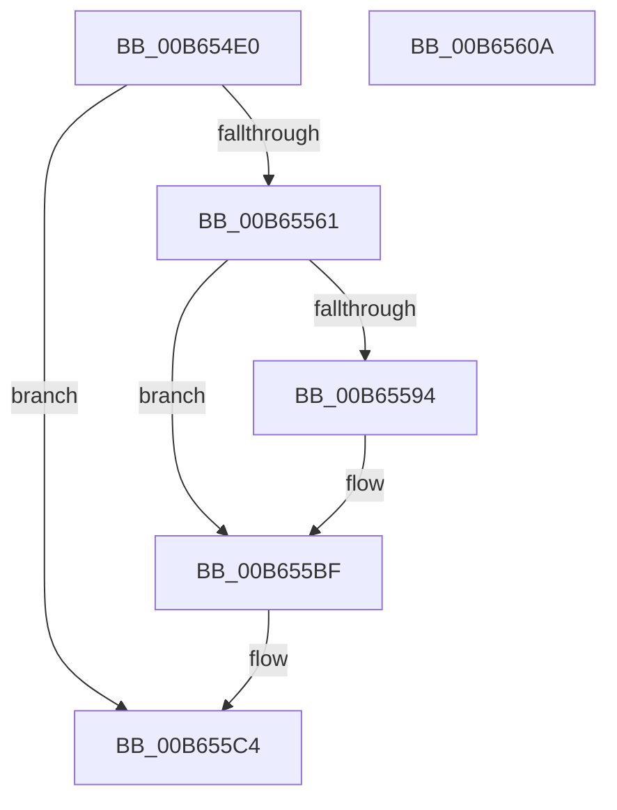

# PnprQuiesceWorker

- RVA: `0x00B654E0`–`0x00B6560B` (길이 `299` bytes)
- VA: `0x0000000140B654E0`
- 실행 섹션: `PAGELK`
- PDB 이름 있음: `예`; PDB Function 태그: `아니요`
- unwind 정보 RVA: `0x000C8E54`
- 디코드: `65`개 명령, `299/299` bytes 표시
- 미해석 바이트: `0` (있으면 어셈블리에 `.byte`로 보존)

> 이 문서는 커널 이미지의 기계어와 PDB 기호를 분석해 생성했습니다. 4번과 5번은 함수 원형과 자료형을 바이너리 사용 방식에서 추정한 C 해석이며 원본 소스 복구 결과는 아닙니다.

## 1. Dependencies

- 직접 호출 지점: **11**; 고유 호출 대상: **10**
- 직접 호출자로 확인된 함수: **0**
- RIP 상대 이미지 참조: **2**

### Outgoing calls
- `0x00B6550D` → [memset](../../text/6C/memset_function_006C6C40.md) (function, `0x006C6C40`)
- `0x00B65557` → [KeWaitForMultipleObjects](../../text/20/KeWaitForMultipleObjects_function_0020D110.md) (function, `0x0020D110`)
- `0x00B65561` → [PnprLockPagesForReplace](../../page/73/PnprLockPagesForReplace_function_0073A150.md) (function, `0x0073A150`)
- `0x00B6556B` → [PnprQuiesceDevices](PnprQuiesceDevices_function_00B649E4.md) (function, `0x00B649E4`)
- `0x00B6558B` → [KeSetEvent](../../text/33/KeSetEvent_function_0033F310.md) (function, `0x0033F310`)
- `0x00B655B0` → [KeWaitForSingleObject](../../text/20/KeWaitForSingleObject_function_0020E6B0.md) (function, `0x0020E6B0`)
- `0x00B655BA` → [PnprWakeDevices](PnprWakeDevices_function_00B65614.md) (function, `0x00B65614`)
- `0x00B655BF` → [PnprCompleteWake](../../text/5A/PnprCompleteWake_function_005A884C.md) (function, `0x005A884C`)
- `0x00B655D7` → [KeSetEvent](../../text/33/KeSetEvent_function_0033F310.md) (function, `0x0033F310`)
- `0x00B655E4` → [ExFreePoolWithTag](../../poolcode/B8/ExFreePoolWithTag_function_00B82870.md) (function, `0x00B82870`)
- `0x00B655F4` → [_security_check_cookie](../../text/6A/_security_check_cookie_function_006AC640.md) (function, `0x006AC640`)

### Direct callers
- 이 함수 시작 RVA로 연결되는 직접 call은 확인되지 않았습니다. 간접 호출은 완전히 역산할 수 없습니다.

### Static image references
- `0x00B654ED` → RVA `0x00E0A740` (`.data`; read)
- `0x00B65512` → RVA `0x00F8AC38` (`.data`; read)

## 2. Other-region calls and transfers

- 다른 실행 섹션으로 향하는 call: **9**
  - `0x00B6550D` → [memset](../../text/6C/memset_function_006C6C40.md) (`PAGELK` → `.text`)
  - `0x00B65557` → [KeWaitForMultipleObjects](../../text/20/KeWaitForMultipleObjects_function_0020D110.md) (`PAGELK` → `.text`)
  - `0x00B65561` → [PnprLockPagesForReplace](../../page/73/PnprLockPagesForReplace_function_0073A150.md) (`PAGELK` → `PAGE`)
  - `0x00B6558B` → [KeSetEvent](../../text/33/KeSetEvent_function_0033F310.md) (`PAGELK` → `.text`)
  - `0x00B655B0` → [KeWaitForSingleObject](../../text/20/KeWaitForSingleObject_function_0020E6B0.md) (`PAGELK` → `.text`)
  - `0x00B655BF` → [PnprCompleteWake](../../text/5A/PnprCompleteWake_function_005A884C.md) (`PAGELK` → `.text`)
  - `0x00B655D7` → [KeSetEvent](../../text/33/KeSetEvent_function_0033F310.md) (`PAGELK` → `.text`)
  - `0x00B655E4` → [ExFreePoolWithTag](../../poolcode/B8/ExFreePoolWithTag_function_00B82870.md) (`PAGELK` → `POOLCODE`)
  - `0x00B655F4` → [_security_check_cookie](../../text/6A/_security_check_cookie_function_006AC640.md) (`PAGELK` → `.text`)
- 별도 외부 분기/꼬리 이동을 확인하지 못했습니다.

## 3. Assembly (complete function range)

```asm
00B654E0  48 89 5C 24 10                  mov qword ptr [rsp + 0x10], rbx
00B654E5  57                              push rdi
00B654E6  48 81 EC B0 00 00 00            sub rsp, 0xb0
00B654ED  48 8B 05 4C 52 2A 00            mov rax, qword ptr [rip + 0x2a524c]
00B654F4  48 33 C4                        xor rax, rsp
00B654F7  48 89 84 24 A0 00 00 00         mov qword ptr [rsp + 0xa0], rax
00B654FF  33 D2                           xor edx, edx
00B65501  48 8B F9                        mov rdi, rcx
00B65504  48 8D 4C 24 50                  lea rcx, [rsp + 0x50]
00B65509  44 8D 42 50                     lea r8d, [rdx + 0x50]
00B6550D  E8 2E 17 B6 FF                  call 0x1406c6c40
00B65512  48 8B 0D 1F 57 42 00            mov rcx, qword ptr [rip + 0x42571f]
00B65519  48 8D 54 24 40                  lea rdx, [rsp + 0x40]
00B6551E  48 83 64 24 38 00               and qword ptr [rsp + 0x38], 0
00B65524  45 33 C9                        xor r9d, r9d
00B65527  48 83 64 24 30 00               and qword ptr [rsp + 0x30], 0
00B6552D  C6 44 24 28 00                  mov byte ptr [rsp + 0x28], 0
00B65532  48 8D 81 28 81 00 00            lea rax, [rcx + 0x8128]
00B65539  C6 44 24 20 00                  mov byte ptr [rsp + 0x20], 0
00B6553E  48 89 44 24 40                  mov qword ptr [rsp + 0x40], rax
00B65543  45 8D 41 01                     lea r8d, [r9 + 1]
00B65547  48 8D 81 58 81 00 00            lea rax, [rcx + 0x8158]
00B6554E  41 8D 49 02                     lea ecx, [r9 + 2]
00B65552  48 89 44 24 48                  mov qword ptr [rsp + 0x48], rax
00B65557  E8 B4 7B 6A FF                  call 0x14020d110
00B6555C  83 F8 01                        cmp eax, 1
00B6555F  74 63                           je 0x140b655c4
00B65561  E8 EA 4B BD FF                  call 0x14073a150
00B65566  48 8D 4C 24 50                  lea rcx, [rsp + 0x50]
00B6556B  E8 74 F4 FF FF                  call 0x140b649e4
00B65570  48 8B 0D C1 56 42 00            mov rcx, qword ptr [rip + 0x4256c1]
00B65577  45 33 C0                        xor r8d, r8d
00B6557A  33 D2                           xor edx, edx
00B6557C  8B D8                           mov ebx, eax
00B6557E  89 81 88 81 00 00               mov dword ptr [rcx + 0x8188], eax
00B65584  48 81 C1 40 81 00 00            add rcx, 0x8140
00B6558B  E8 80 9D 7D FF                  call 0x14033f310
00B65590  85 DB                           test ebx, ebx
00B65592  78 2B                           js 0x140b655bf
00B65594  48 8B 0D 9D 56 42 00            mov rcx, qword ptr [rip + 0x42569d]
00B6559B  45 33 C9                        xor r9d, r9d
00B6559E  48 83 64 24 20 00               and qword ptr [rsp + 0x20], 0
00B655A4  48 81 C1 58 81 00 00            add rcx, 0x8158
00B655AB  45 33 C0                        xor r8d, r8d
00B655AE  33 D2                           xor edx, edx
00B655B0  E8 FB 90 6A FF                  call 0x14020e6b0
00B655B5  48 8D 4C 24 50                  lea rcx, [rsp + 0x50]
00B655BA  E8 55 00 00 00                  call 0x140b65614
00B655BF  E8 88 32 A4 FF                  call 0x1405a884c
00B655C4  48 8B 0D 6D 56 42 00            mov rcx, qword ptr [rip + 0x42566d]
00B655CB  45 33 C0                        xor r8d, r8d
00B655CE  48 81 C1 70 81 00 00            add rcx, 0x8170
00B655D5  33 D2                           xor edx, edx
00B655D7  E8 34 9D 7D FF                  call 0x14033f310
00B655DC  BA 50 6E 70 51                  mov edx, 0x51706e50
00B655E1  48 8B CF                        mov rcx, rdi
00B655E4  E8 87 D2 01 00                  call 0x140b82870
00B655E9  48 8B 8C 24 A0 00 00 00         mov rcx, qword ptr [rsp + 0xa0]
00B655F1  48 33 CC                        xor rcx, rsp
00B655F4  E8 47 70 B4 FF                  call 0x1406ac640
00B655F9  48 8B 9C 24 C8 00 00 00         mov rbx, qword ptr [rsp + 0xc8]
00B65601  48 81 C4 B0 00 00 00            add rsp, 0xb0
00B65608  5F                              pop rdi
00B65609  C3                              ret
00B6560A  CC                              int3
```

## 4. C-style interpretation (structured pseudocode)

```c
__int64 __fastcall PnprQuiesceWorker(__int64 a1, int a2, __int64 a3, int a4)
{
    __int64 result;
    __int64 v_rsp;
    unsigned __int64 v_stack_m18;
    unsigned __int64 v_stack_m68;
    unsigned __int64 v_stack_m70;
    unsigned __int64 v_stack_m78;
    unsigned __int64 v_stack_m80;
    unsigned __int64 v_stack_m88;
    unsigned __int8 v_stack_m90;
    unsigned __int8 v_stack_m98;
    unsigned __int64 v_stack_p10;

    v_stack_p10 = v_rbx;
    v_rsp = (v_rsp) - (176);
    result = (*(unsigned __int64 *)(v_rip + 2773580)) ^ (v_rsp);
    v_stack_m18 = result;
    a2 = 0;
    result = memset(v_stack_m68, a2, a2 + 80, a4);
    a4 = 0;
    v_stack_m90 = 0;
    v_stack_m98 = 0;
    v_stack_m78 = *(unsigned __int64 *)(v_rip + 4347679) + 33064;
    v_stack_m70 = *(unsigned __int64 *)(v_rip + 4347679) + 33112;
    result = KeWaitForMultipleObjects(a4 + 2, v_stack_m78, a4 + 1, a4);
    if (((unsigned int)(result)) == 1) goto loc_00B655C4;
    result = PnprLockPagesForReplace(a4 + 2, v_stack_m78, a4 + 1, a4);
    result = PnprQuiesceDevices(v_stack_m68, v_stack_m78, a4 + 1, a4);
    a3 = 0;
    a2 = 0;
    *(unsigned int *)(*(unsigned __int64 *)(v_rip + 4347585) + 33160) = (unsigned int)(result);
    a1 = (*(unsigned __int64 *)(v_rip + 4347585)) + (0x8140ULL);
    result = KeSetEvent(a1, a2, a3, a4);
    if (!(sign_flag)) {
        a1 = *(unsigned __int64 *)(v_rip + 4347549);
        a4 = 0;
        a1 = (a1) + (0x8158ULL);
        a3 = 0;
        a2 = 0;
        result = KeWaitForSingleObject(a1, a2, a3, a4);
        a1 = v_stack_m68;
        result = PnprWakeDevices(a1, a2, a3, a4);
    }
    result = PnprCompleteWake(a1, a2, a3, a4);
loc_00B655C4:
    a3 = 0;
    a1 = (*(unsigned __int64 *)(v_rip + 4347501)) + (0x8170ULL);
    a2 = 0;
    result = KeSetEvent(a1, a2, a3, a4);
    result = ExFreePoolWithTag(a1, (unsigned int)(0x51706E50ULL), a3, a4);
    a1 = (v_stack_m18) ^ (v_rsp);
    result = _security_check_cookie(a1, (unsigned int)(0x51706E50ULL), a3, a4);
    v_rsp = (v_rsp) + (176);
    return result;
}
```

## 5. (Beta) C Style

```c
int64_t PnprQuiesceWorker(int64_t Arg1, int32_t Arg2, int64_t Arg3, int32_t Arg4)
{
    int64_t result;
    int64_t local_rsp;
    uint64_t v_stack_m18;
    uint64_t v_stack_m68;
    uint64_t v_stack_m70;
    uint64_t v_stack_m78;
    uint64_t v_stack_m80;
    uint64_t v_stack_m88;
    uint8_t v_stack_m90;
    uint8_t v_stack_m98;
    uint64_t v_stack_p10;

    v_stack_p10 = local_rbx;
    local_rsp = (local_rsp) - (176);
    result = (*(uint64_t *)(v_rip + 0x2A524C)) ^ (local_rsp);
    v_stack_m18 = result;
    Arg2 = 0;
    result = memset(v_stack_m68, Arg2, Arg2 + 80, Arg4);
    Arg4 = 0;
    v_stack_m90 = 0;
    v_stack_m98 = 0;
    v_stack_m78 = *(uint64_t *)(v_rip + 0x42571F) + 33064;
    v_stack_m70 = *(uint64_t *)(v_rip + 0x42571F) + 33112;
    result = KeWaitForMultipleObjects(Arg4 + 2, v_stack_m78, Arg4 + 1, Arg4);
    if (((uint32_t)(result)) == 1) goto loc_00B655C4;
    result = PnprLockPagesForReplace(Arg4 + 2, v_stack_m78, Arg4 + 1, Arg4);
    result = PnprQuiesceDevices(v_stack_m68, v_stack_m78, Arg4 + 1, Arg4);
    Arg3 = 0;
    Arg2 = 0;
    *(uint32_t *)(*(uint64_t *)(v_rip + 0x4256C1) + 0x8188) = (uint32_t)(result);
    Arg1 = (*(uint64_t *)(v_rip + 0x4256C1)) + (0x8140ULL);
    result = KeSetEvent(Arg1, Arg2, Arg3, Arg4);
    if (!(sign_flag)) {
        Arg1 = *(uint64_t *)(v_rip + 0x42569D);
        Arg4 = 0;
        Arg1 = (Arg1) + (0x8158ULL);
        Arg3 = 0;
        Arg2 = 0;
        result = KeWaitForSingleObject(Arg1, Arg2, Arg3, Arg4);
        Arg1 = v_stack_m68;
        result = PnprWakeDevices(Arg1, Arg2, Arg3, Arg4);
    }
    result = PnprCompleteWake(Arg1, Arg2, Arg3, Arg4);
loc_00B655C4:
    Arg3 = 0;
    Arg1 = (*(uint64_t *)(v_rip + 0x42566D)) + (0x8170ULL);
    Arg2 = 0;
    result = KeSetEvent(Arg1, Arg2, Arg3, Arg4);
    result = ExFreePoolWithTag(Arg1, (uint32_t)(0x51706E50ULL), Arg3, Arg4);
    Arg1 = (v_stack_m18) ^ (local_rsp);
    result = _security_check_cookie(Arg1, (uint32_t)(0x51706E50ULL), Arg3, Arg4);
    local_rsp = (local_rsp) + (176);
    return result;
}
```

## 6. Execution-region graph

[열기: 2D/3D 그래프와 함수 탐색 컨트롤 패널](../../../control-panel.html?section=pagelk&rva=0x00B654E0&view=graph)

- 2D 그래프는 위에서 아래로 흐르고, 3D 그래프는 빈 공간을 드래그해 회전합니다. Shift+드래그는 이동, 휠은 확대·축소, 함수 노드 선택은 대상 보고서 이동입니다.

### Static fallback


