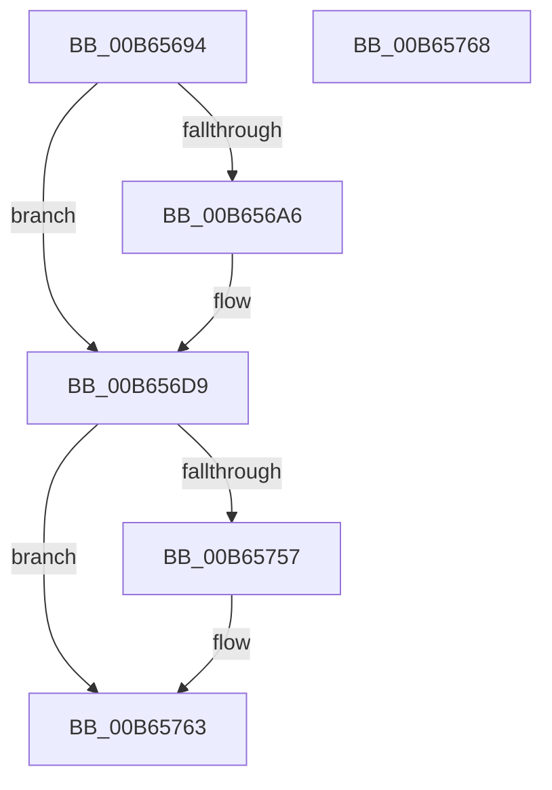

# PnprWakeProcessors

- RVA: `0x00B65694`–`0x00B65769` (길이 `213` bytes)
- VA: `0x0000000140B65694`
- 실행 섹션: `PAGELK`
- PDB 이름 있음: `예`; PDB Function 태그: `아니요`
- unwind 정보 RVA: `0x0005C788`
- 디코드: `43`개 명령, `213/213` bytes 표시
- 미해석 바이트: `0` (있으면 어셈블리에 `.byte`로 보존)

> 이 문서는 커널 이미지의 기계어와 PDB 기호를 분석해 생성했습니다. 4번과 5번은 함수 원형과 자료형을 바이너리 사용 방식에서 추정한 C 해석이며 원본 소스 복구 결과는 아닙니다.

## 1. Dependencies

- 직접 호출 지점: **8**; 고유 호출 대상: **4**
- 직접 호출자로 확인된 함수: **2**
- RIP 상대 이미지 참조: **4**

### Outgoing calls
- `0x00B656B6` → [guard_dispatch_icall](../../text/6B/guard_dispatch_icall_function_006BAAD0.md) (function, `0x006BAAD0`)
- `0x00B656BD` → [PnprGetMillisecondCounter](PnprGetMillisecondCounter_function_00B63FD4.md) (function, `0x00B63FD4`)
- `0x00B656D9` → [KeRestoreMtrrBroadcast](KeRestoreMtrrBroadcast_function_00B67C90.md) (function, `0x00B67C90`)
- `0x00B656E9` → [guard_dispatch_icall](../../text/6B/guard_dispatch_icall_function_006BAAD0.md) (function, `0x006BAAD0`)
- `0x00B656EE` → [KeResumeClockTimerSafe](../../text/5B/KeResumeClockTimerSafe_function_005BB334.md) (function, `0x005BB334`)
- `0x00B6570D` → [guard_dispatch_icall](../../text/6B/guard_dispatch_icall_function_006BAAD0.md) (function, `0x006BAAD0`)
- `0x00B65714` → [PnprGetMillisecondCounter](PnprGetMillisecondCounter_function_00B63FD4.md) (function, `0x00B63FD4`)
- `0x00B6575E` → [guard_dispatch_icall](../../text/6B/guard_dispatch_icall_function_006BAAD0.md) (function, `0x006BAAD0`)

### Direct callers
- [PnprEndMirroring](PnprEndMirroring_function_00B63F60.md) at `0x00B63FB2`
- [PnprEndMirroring](PnprEndMirroring_function_00B63F60.md) at `0x00B63FB9`
- [PnprInitiateReplaceOperation](PnprInitiateReplaceOperation_function_00B64034.md) at `0x00B642A8`

### Static image references
- `0x00B65698` → RVA `0x00F8AC38` (`.data`; read)
- `0x00B656DE` → RVA `0x00E00910` (`.data`; read)
- `0x00B656FF` → RVA `0x00E008E8` (`.data`; read)
- `0x00B65757` → RVA `0x00E00940` (`.data`; read)

## 2. Other-region calls and transfers

- 다른 실행 섹션으로 향하는 call: **5**
  - `0x00B656B6` → [guard_dispatch_icall](../../text/6B/guard_dispatch_icall_function_006BAAD0.md) (`PAGELK` → `.text`)
  - `0x00B656E9` → [guard_dispatch_icall](../../text/6B/guard_dispatch_icall_function_006BAAD0.md) (`PAGELK` → `.text`)
  - `0x00B656EE` → [KeResumeClockTimerSafe](../../text/5B/KeResumeClockTimerSafe_function_005BB334.md) (`PAGELK` → `.text`)
  - `0x00B6570D` → [guard_dispatch_icall](../../text/6B/guard_dispatch_icall_function_006BAAD0.md) (`PAGELK` → `.text`)
  - `0x00B6575E` → [guard_dispatch_icall](../../text/6B/guard_dispatch_icall_function_006BAAD0.md) (`PAGELK` → `.text`)
- 별도 외부 분기/꼬리 이동을 확인하지 못했습니다.

## 3. Assembly (complete function range)

```asm
00B65694  48 83 EC 28                     sub rsp, 0x28
00B65698  48 8B 0D 99 55 42 00            mov rcx, qword ptr [rip + 0x425599]
00B6569F  8B 41 40                        mov eax, dword ptr [rcx + 0x40]
00B656A2  A8 20                           test al, 0x20
00B656A4  74 33                           je 0x140b656d9
00B656A6  48 8B 81 00 82 00 00            mov rax, qword ptr [rcx + 0x8200]
00B656AD  33 D2                           xor edx, edx
00B656AF  48 8B 89 A0 81 00 00            mov rcx, qword ptr [rcx + 0x81a0]
00B656B6  E8 15 54 B5 FF                  call 0x1406baad0
00B656BB  33 C9                           xor ecx, ecx
00B656BD  E8 12 E9 FF FF                  call 0x140b63fd4
00B656C2  48 8B 0D 6F 55 42 00            mov rcx, qword ptr [rip + 0x42556f]
00B656C9  89 81 2C 82 00 00               mov dword ptr [rcx + 0x822c], eax
00B656CF  C7 81 C8 00 00 00 06 00 00 00   mov dword ptr [rcx + 0xc8], 6
00B656D9  E8 B2 25 00 00                  call 0x140b67c90
00B656DE  48 8B 05 2B B2 29 00            mov rax, qword ptr [rip + 0x29b22b]
00B656E5  33 D2                           xor edx, edx
00B656E7  33 C9                           xor ecx, ecx
00B656E9  E8 E2 53 B5 FF                  call 0x1406baad0
00B656EE  E8 41 5C A5 FF                  call 0x1405bb334
00B656F3  48 8B 15 3E 55 42 00            mov rdx, qword ptr [rip + 0x42553e]
00B656FA  B9 02 00 00 00                  mov ecx, 2
00B656FF  48 8B 05 E2 B1 29 00            mov rax, qword ptr [rip + 0x29b1e2]
00B65706  48 8B 92 98 81 00 00            mov rdx, qword ptr [rdx + 0x8198]
00B6570D  E8 BE 53 B5 FF                  call 0x1406baad0
00B65712  33 C9                           xor ecx, ecx
00B65714  E8 BB E8 FF FF                  call 0x140b63fd4
00B65719  48 8B 0D 18 55 42 00            mov rcx, qword ptr [rip + 0x425518]
00B65720  8B C0                           mov eax, eax
00B65722  48 2B 81 10 82 00 00            sub rax, qword ptr [rcx + 0x8210]
00B65729  48 69 C0 10 27 00 00            imul rax, rax, 0x2710
00B65730  48 89 81 10 82 00 00            mov qword ptr [rcx + 0x8210], rax
00B65737  C7 81 C8 00 00 00 07 00 00 00   mov dword ptr [rcx + 0xc8], 7
00B65741  F0 FF 81 BC 00 00 00            lock inc dword ptr [rcx + 0xbc]
00B65748  48 8B 05 E9 54 42 00            mov rax, qword ptr [rip + 0x4254e9]
00B6574F  8B 48 40                        mov ecx, dword ptr [rax + 0x40]
00B65752  F6 C1 20                        test cl, 0x20
00B65755  74 0C                           je 0x140b65763
00B65757  48 8B 05 E2 B1 29 00            mov rax, qword ptr [rip + 0x29b1e2]
00B6575E  E8 6D 53 B5 FF                  call 0x1406baad0
00B65763  48 83 C4 28                     add rsp, 0x28
00B65767  C3                              ret
00B65768  CC                              int3
```

## 4. C-style interpretation (structured pseudocode)

```c
__int64 __fastcall PnprWakeProcessors(__int64 a1, int a2)
{
    __int64 result;
    __int64 v_rsp;

    v_rsp = (v_rsp) - (40);
    result = (unsigned int)(*(unsigned int *)(*(unsigned __int64 *)(v_rip + 4347289) + 64));
    if ((((unsigned __int8)((unsigned int)(*(unsigned int *)(*(unsigned __int64 *)(v_rip + 4347289) + 64)))) & (32)) != 0) {
        result = *(unsigned __int64 *)(*(unsigned __int64 *)(v_rip + 4347289) + 33280);
        a2 = 0;
        a1 = *(unsigned __int64 *)(*(unsigned __int64 *)(v_rip + 4347289) + 33184);
        result = guard_dispatch_icall(a1, a2, a3, a4);
        a1 = 0;
        result = PnprGetMillisecondCounter(a1, a2, a3, a4);
        a1 = *(unsigned __int64 *)(v_rip + 4347247);
        *(unsigned int *)(a1 + 33324) = (unsigned int)(result);
        *(unsigned int *)(a1 + 200) = 6;
    }
    result = KeRestoreMtrrBroadcast(a1, a2, a3, a4);
    a2 = 0;
    a1 = 0;
    result = guard_dispatch_icall(a1, a2, a3, a4);
    result = KeResumeClockTimerSafe(a1, a2, a3, a4);
    result = guard_dispatch_icall(2, *(unsigned __int64 *)(*(unsigned __int64 *)(v_rip + 4347198) + 33176), a3, a4);
    a1 = 0;
    result = PnprGetMillisecondCounter(a1, *(unsigned __int64 *)(*(unsigned __int64 *)(v_rip + 4347198) + 33176), a3, a4);
    result = ((unsigned int)((unsigned int)(result))) - (*(unsigned __int64 *)(*(unsigned __int64 *)(v_rip + 4347160) + 33296));
    result = (result) * (result);
    *(unsigned __int64 *)(*(unsigned __int64 *)(v_rip + 4347160) + 33296) = result;
    *(unsigned int *)(*(unsigned __int64 *)(v_rip + 4347160) + 200) = 7;
    result = *(unsigned __int64 *)(v_rip + 4347113);
    if ((((unsigned __int8)((unsigned int)(*(unsigned int *)(*(unsigned __int64 *)(v_rip + 4347113) + 64)))) & (32)) != 0) {
        result = *(unsigned __int64 *)(v_rip + 2732514);
        result = guard_dispatch_icall((unsigned int)(*(unsigned int *)(*(unsigned __int64 *)(v_rip + 4347113) + 64)), *(unsigned __int64 *)(*(unsigned __int64 *)(v_rip + 4347198) + 33176), a3, a4);
    }
    v_rsp = (v_rsp) + (40);
    return result;
}
```

## 5. (Beta) C Style

```c
int64_t PnprWakeProcessors(int64_t Arg1, int32_t Arg2)
{
    int64_t result;
    int64_t local_rsp;

    local_rsp = (local_rsp) - (40);
    result = (uint32_t)(*(uint32_t *)(*(uint64_t *)(v_rip + 0x425599) + 0x40));
    if ((((uint8_t)((uint32_t)(*(uint32_t *)(*(uint64_t *)(v_rip + 0x425599) + 0x40)))) & (32)) != 0) {
        result = *(uint64_t *)(*(uint64_t *)(v_rip + 0x425599) + 0x8200);
        Arg2 = 0;
        Arg1 = *(uint64_t *)(*(uint64_t *)(v_rip + 0x425599) + 0x81A0);
        result = guard_dispatch_icall(Arg1, Arg2, a3, a4);
        Arg1 = 0;
        result = PnprGetMillisecondCounter(Arg1, Arg2, a3, a4);
        Arg1 = *(uint64_t *)(v_rip + 0x42556F);
        *(uint32_t *)(Arg1 + 0x822C) = (uint32_t)(result);
        *(uint32_t *)(Arg1 + 0xC8) = 6;
    }
    result = KeRestoreMtrrBroadcast(Arg1, Arg2, a3, a4);
    Arg2 = 0;
    Arg1 = 0;
    result = guard_dispatch_icall(Arg1, Arg2, a3, a4);
    result = KeResumeClockTimerSafe(Arg1, Arg2, a3, a4);
    result = guard_dispatch_icall(2, *(uint64_t *)(*(uint64_t *)(v_rip + 0x42553E) + 0x8198), a3, a4);
    Arg1 = 0;
    result = PnprGetMillisecondCounter(Arg1, *(uint64_t *)(*(uint64_t *)(v_rip + 0x42553E) + 0x8198), a3, a4);
    result = ((uint32_t)((uint32_t)(result))) - (*(uint64_t *)(*(uint64_t *)(v_rip + 0x425518) + 0x8210));
    result = (result) * (result);
    *(uint64_t *)(*(uint64_t *)(v_rip + 0x425518) + 0x8210) = result;
    *(uint32_t *)(*(uint64_t *)(v_rip + 0x425518) + 0xC8) = 7;
    result = *(uint64_t *)(v_rip + 0x4254E9);
    if ((((uint8_t)((uint32_t)(*(uint32_t *)(*(uint64_t *)(v_rip + 0x4254E9) + 0x40)))) & (32)) != 0) {
        result = *(uint64_t *)(v_rip + 0x29B1E2);
        result = guard_dispatch_icall((uint32_t)(*(uint32_t *)(*(uint64_t *)(v_rip + 0x4254E9) + 0x40)), *(uint64_t *)(*(uint64_t *)(v_rip + 0x42553E) + 0x8198), a3, a4);
    }
    local_rsp = (local_rsp) + (40);
    return result;
}
```

## 6. Execution-region graph

[열기: 2D/3D 그래프와 함수 탐색 컨트롤 패널](../../../control-panel.html?section=pagelk&rva=0x00B65694&view=graph)

- 2D 그래프는 위에서 아래로 흐르고, 3D 그래프는 빈 공간을 드래그해 회전합니다. Shift+드래그는 이동, 휠은 확대·축소, 함수 노드 선택은 대상 보고서 이동입니다.

### Static fallback


