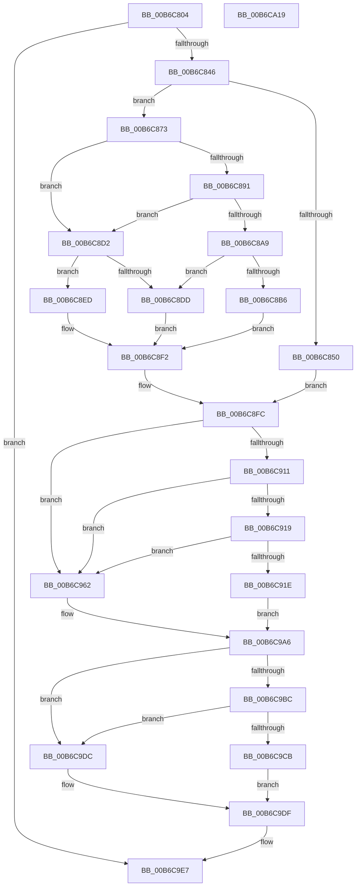

# PopAddPagesToCompressedPageSet

- RVA: `0x00B6C804`–`0x00B6CA1A` (길이 `534` bytes)
- VA: `0x0000000140B6C804`
- 실행 섹션: `PAGELK`
- PDB 이름 있음: `예`; PDB Function 태그: `아니요`
- unwind 정보 RVA: `0x000C5198`
- 디코드: `148`개 명령, `534/534` bytes 표시
- 미해석 바이트: `0` (있으면 어셈블리에 `.byte`로 보존)

> 이 문서는 커널 이미지의 기계어와 PDB 기호를 분석해 생성했습니다. 4번과 5번은 함수 원형과 자료형을 바이너리 사용 방식에서 추정한 C 해석이며 원본 소스 복구 결과는 아닙니다.

## 1. Dependencies

- 직접 호출 지점: **3**; 고유 호출 대상: **3**
- 직접 호출자로 확인된 함수: **2**
- RIP 상대 이미지 참조: **3**

### Outgoing calls
- `0x00B6C862` → [memcpy](../../text/6C/memcpy_function_006C6840.md) (function, `0x006C6840`)
- `0x00B6C95B` → [RtlCompressBuffer](../../text/26/RtlCompressBuffer_function_0026A220.md) (function, `0x0026A220`)
- `0x00B6C9A1` → [RtlCompressBufferProgress](../../text/5E/RtlCompressBufferProgress_function_005EF3C0.md) (function, `0x005EF3C0`)

### Direct callers
- [PopCompressHiberBlocks](PopCompressHiberBlocks_function_00B6CD74.md) at `0x00B6CE09`
- [PopWriteHiberImage](PopWriteHiberImage_function_00B6FE30.md) at `0x00B6FF04`

### Static image references
- `0x00B6C873` → RVA `0x00F0BFC8` (`.data`; read)
- `0x00B6C8A1` → RVA `0x00F0BF64` (`.data`; read)
- `0x00B6C92F` → RVA `0x00029238` (`.rdata`; read)

## 2. Other-region calls and transfers

- 다른 실행 섹션으로 향하는 call: **3**
  - `0x00B6C862` → [memcpy](../../text/6C/memcpy_function_006C6840.md) (`PAGELK` → `.text`)
  - `0x00B6C95B` → [RtlCompressBuffer](../../text/26/RtlCompressBuffer_function_0026A220.md) (`PAGELK` → `.text`)
  - `0x00B6C9A1` → [RtlCompressBufferProgress](../../text/5E/RtlCompressBufferProgress_function_005EF3C0.md) (`PAGELK` → `.text`)
- 별도 외부 분기/꼬리 이동을 확인하지 못했습니다.

## 3. Assembly (complete function range)

```asm
00B6C804  4C 8B DC                        mov r11, rsp
00B6C807  49 89 5B 08                     mov qword ptr [r11 + 8], rbx
00B6C80B  4D 89 43 18                     mov qword ptr [r11 + 0x18], r8
00B6C80F  55                              push rbp
00B6C810  56                              push rsi
00B6C811  57                              push rdi
00B6C812  41 54                           push r12
00B6C814  41 55                           push r13
00B6C816  41 56                           push r14
00B6C818  41 57                           push r15
00B6C81A  48 83 EC 50                     sub rsp, 0x50
00B6C81E  8B BC 24 B8 00 00 00            mov edi, dword ptr [rsp + 0xb8]
00B6C825  33 ED                           xor ebp, ebp
00B6C827  4C 8B 62 18                     mov r12, qword ptr [rdx + 0x18]
00B6C82B  49 8B C0                        mov rax, r8
00B6C82E  C1 E7 0C                        shl edi, 0xc
00B6C831  48 8B F2                        mov rsi, rdx
00B6C834  41 89 6B 10                     mov dword ptr [r11 + 0x10], ebp
00B6C838  4C 8B F1                        mov r14, rcx
00B6C83B  8B DD                           mov ebx, ebp
00B6C83D  4D 85 E4                        test r12, r12
00B6C840  0F 84 A1 01 00 00               je 0x140b6c9e7
00B6C846  40 38 AC 24 B0 00 00 00         cmp byte ptr [rsp + 0xb0], bpl
00B6C84E  74 23                           je 0x140b6c873
00B6C850  4C 8B 3A                        mov r15, qword ptr [rdx]
00B6C853  49 8B D1                        mov rdx, r9
00B6C856  8A 99 EB 01 00 00               mov bl, byte ptr [rcx + 0x1eb]
00B6C85C  49 8B CF                        mov rcx, r15
00B6C85F  44 8B C7                        mov r8d, edi
00B6C862  E8 D9 9F B5 FF                  call 0x1406c6840
00B6C867  F6 DB                           neg bl
00B6C869  1B DB                           sbb ebx, ebx
00B6C86B  83 E3 04                        and ebx, 4
00B6C86E  E9 89 00 00 00                  jmp 0x140b6c8fc
00B6C873  48 8B 0D 4E F7 39 00            mov rcx, qword ptr [rip + 0x39f74e]
00B6C87A  4D 8B F9                        mov r15, r9
00B6C87D  44 8B 8A A0 00 00 00            mov r9d, dword ptr [rdx + 0xa0]
00B6C884  4C 8B 41 28                     mov r8, qword ptr [rcx + 0x28]
00B6C888  4C 2B 41 38                     sub r8, qword ptr [rcx + 0x38]
00B6C88C  45 85 C9                        test r9d, r9d
00B6C88F  74 41                           je 0x140b6c8d2
00B6C891  44 8B 92 A4 00 00 00            mov r10d, dword ptr [rdx + 0xa4]
00B6C898  33 D2                           xor edx, edx
00B6C89A  41 6B C2 64                     imul eax, r10d, 0x64
00B6C89E  41 F7 F1                        div r9d
00B6C8A1  3B 05 BD F6 39 00               cmp eax, dword ptr [rip + 0x39f6bd]
00B6C8A7  7F 29                           jg 0x140b6c8d2
00B6C8A9  8B 51 08                        mov edx, dword ptr [rcx + 8]
00B6C8AC  8B C2                           mov eax, edx
00B6C8AE  48 D1 E8                        shr rax, 1
00B6C8B1  4C 3B C0                        cmp r8, rax
00B6C8B4  7C 27                           jl 0x140b6c8dd
00B6C8B6  8D 0C 52                        lea ecx, [rdx + rdx*2]
00B6C8B9  48 C1 E9 02                     shr rcx, 2
00B6C8BD  41 8D 42 01                     lea eax, [r10 + 1]
00B6C8C1  4C 3B C1                        cmp r8, rcx
00B6C8C4  89 86 A4 00 00 00               mov dword ptr [rsi + 0xa4], eax
00B6C8CA  0F 9D C3                        setge bl
00B6C8CD  83 C3 02                        add ebx, 2
00B6C8D0  EB 20                           jmp 0x140b6c8f2
00B6C8D2  8B 41 08                        mov eax, dword ptr [rcx + 8]
00B6C8D5  48 D1 E8                        shr rax, 1
00B6C8D8  4C 3B C0                        cmp r8, rax
00B6C8DB  7D 10                           jge 0x140b6c8ed
00B6C8DD  41 8A 86 EC 01 00 00            mov al, byte ptr [r14 + 0x1ec]
00B6C8E4  F6 D8                           neg al
00B6C8E6  1B DB                           sbb ebx, ebx
00B6C8E8  83 E3 04                        and ebx, 4
00B6C8EB  EB 05                           jmp 0x140b6c8f2
00B6C8ED  BB 01 00 00 00                  mov ebx, 1
00B6C8F2  41 8D 41 01                     lea eax, [r9 + 1]
00B6C8F6  89 86 A0 00 00 00               mov dword ptr [rsi + 0xa0], eax
00B6C8FC  0F 31                           rdtsc
00B6C8FE  48 C1 E2 20                     shl rdx, 0x20
00B6C902  48 0B C2                        or rax, rdx
00B6C905  4C 8B E8                        mov r13, rax
00B6C908  41 38 AE EA 01 00 00            cmp byte ptr [r14 + 0x1ea], bpl
00B6C90F  74 51                           je 0x140b6c962
00B6C911  F7 C3 FA FF FF FF               test ebx, 0xfffffffa
00B6C917  75 49                           jne 0x140b6c962
00B6C919  83 FB 05                        cmp ebx, 5
00B6C91C  74 44                           je 0x140b6c962
00B6C91E  48 8B 4E 10                     mov rcx, qword ptr [rsi + 0x10]
00B6C922  48 8D 84 24 98 00 00 00         lea rax, [rsp + 0x98]
00B6C92A  48 89 4C 24 38                  mov qword ptr [rsp + 0x38], rcx
00B6C92F  4C 8D 15 02 C9 4B FF            lea r10, [rip - 0xb436fe]
00B6C936  48 89 44 24 30                  mov qword ptr [rsp + 0x30], rax
00B6C93B  4D 8B CC                        mov r9, r12
00B6C93E  8B EB                           mov ebp, ebx
00B6C940  44 8B C7                        mov r8d, edi
00B6C943  C7 44 24 28 00 10 00 00         mov dword ptr [rsp + 0x28], 0x1000
00B6C94B  49 8B D7                        mov rdx, r15
00B6C94E  C7 44 24 20 00 00 01 00         mov dword ptr [rsp + 0x20], 0x10000
00B6C956  41 0F B7 0C 6A                  movzx ecx, word ptr [r10 + rbp*2]
00B6C95B  E8 C0 D8 6F FF                  call 0x14026a220
00B6C960  EB 44                           jmp 0x140b6c9a6
00B6C962  48 8B 84 24 C0 00 00 00         mov rax, qword ptr [rsp + 0xc0]
00B6C96A  4C 8D 15 C7 C8 4B FF            lea r10, [rip - 0xb43739]
00B6C971  4C 89 74 24 40                  mov qword ptr [rsp + 0x40], r14
00B6C976  4D 8B CC                        mov r9, r12
00B6C979  48 89 44 24 38                  mov qword ptr [rsp + 0x38], rax
00B6C97E  44 8B C7                        mov r8d, edi
00B6C981  48 8B 46 10                     mov rax, qword ptr [rsi + 0x10]
00B6C985  49 8B D7                        mov rdx, r15
00B6C988  48 89 44 24 30                  mov qword ptr [rsp + 0x30], rax
00B6C98D  48 8D 84 24 98 00 00 00         lea rax, [rsp + 0x98]
00B6C995  8B EB                           mov ebp, ebx
00B6C997  48 89 44 24 28                  mov qword ptr [rsp + 0x28], rax
00B6C99C  41 0F B7 0C 6A                  movzx ecx, word ptr [r10 + rbp*2]
00B6C9A1  E8 1A 2A A8 FF                  call 0x1405ef3c0
00B6C9A6  8B C8                           mov ecx, eax
00B6C9A8  0F 31                           rdtsc
00B6C9AA  48 C1 E2 20                     shl rdx, 0x20
00B6C9AE  48 0B C2                        or rax, rdx
00B6C9B1  49 2B C5                        sub rax, r13
00B6C9B4  48 01 46 28                     add qword ptr [rsi + 0x28], rax
00B6C9B8  85 C9                           test ecx, ecx
00B6C9BA  78 20                           js 0x140b6c9dc
00B6C9BC  6B C7 07                        imul eax, edi, 7
00B6C9BF  C1 E8 03                        shr eax, 3
00B6C9C2  39 84 24 98 00 00 00            cmp dword ptr [rsp + 0x98], eax
00B6C9C9  73 11                           jae 0x140b6c9dc
00B6C9CB  48 FF 44 EE 58                  inc qword ptr [rsi + rbp*8 + 0x58]
00B6C9D0  4D 8B CC                        mov r9, r12
00B6C9D3  8B BC 24 98 00 00 00            mov edi, dword ptr [rsp + 0x98]
00B6C9DA  EB 03                           jmp 0x140b6c9df
00B6C9DC  4D 8B CF                        mov r9, r15
00B6C9DF  48 8B 84 24 A0 00 00 00         mov rax, qword ptr [rsp + 0xa0]
00B6C9E7  8B 08                           mov ecx, dword ptr [rax]
00B6C9E9  C1 E7 08                        shl edi, 8
00B6C9EC  C1 E3 1D                        shl ebx, 0x1d
00B6C9EF  0F B6 D1                        movzx edx, cl
00B6C9F2  33 D7                           xor edx, edi
00B6C9F4  81 E2 FF FF FF 1F               and edx, 0x1fffffff
00B6C9FA  0B D3                           or edx, ebx
00B6C9FC  48 8B 9C 24 90 00 00 00         mov rbx, qword ptr [rsp + 0x90]
00B6CA04  89 10                           mov dword ptr [rax], edx
00B6CA06  49 8B C1                        mov rax, r9
00B6CA09  48 83 C4 50                     add rsp, 0x50
00B6CA0D  41 5F                           pop r15
00B6CA0F  41 5E                           pop r14
00B6CA11  41 5D                           pop r13
00B6CA13  41 5C                           pop r12
00B6CA15  5F                              pop rdi
00B6CA16  5E                              pop rsi
00B6CA17  5D                              pop rbp
00B6CA18  C3                              ret
00B6CA19  CC                              int3
```

## 4. C-style interpretation (structured pseudocode)

```c
__int64 __fastcall PopAddPagesToCompressedPageSet(__int64 a1, __int64 a2, __int64 a3, __int64 a4, unsigned __int8 a5, unsigned int a6, __int64 a7)
{
    __int64 result;
    __int64 v_rbp;
    __int64 v_rbx;
    __int64 v_rdi;
    __int64 v_rsp;
    unsigned __int64 v_stack_m48;
    unsigned __int64 v_stack_m50;
    unsigned __int64 v_stack_m58;
    unsigned int v_stack_m60;
    unsigned int v_stack_m68;
    unsigned __int64 v_stack_p10;
    unsigned __int64 v_stack_p18;
    unsigned __int64 v_stack_p8;

    *(unsigned __int64 *)(v_rsp + 8) = v_rbx;
    *(unsigned __int64 *)(v_rsp + 24) = a3;
    v_rsp = (v_rsp) - (80);
    v_rbp = 0;
    v_rdi = (unsigned int)(((unsigned int)(a6)) << (12));
    *(unsigned int *)(v_rsp + 16) = 0;
    if (*(unsigned __int64 *)(a2 + 24) == 0) goto loc_00B6C9E7;
    if (a5 == 0) goto loc_00B6C873;
    result = memcpy(*(unsigned __int64 *)(a2), a4, (unsigned int)((unsigned int)(v_rdi)), a4);
    v_rbx = (unsigned __int8)(-(*(unsigned __int8 *)(a1 + 491)));
    v_rbx = (unsigned int)((v_rbx) & (4));
    goto loc_00B6C8FC;
loc_00B6C873:
    a3 = (*(unsigned __int64 *)(*(unsigned __int64 *)(v_rip + 3798862) + 40)) - (*(unsigned __int64 *)(*(unsigned __int64 *)(v_rip + 3798862) + 56));
    if ((unsigned int)((unsigned int)(*(unsigned int *)(a4 + 160))) == 0) goto loc_00B6C8D2;
    a2 = 0;
    result = (unsigned int)((result) * ((unsigned int)((unsigned int)(*(unsigned int *)(a4 + 164)))));
    if (((unsigned int)(result)) > (*(unsigned int *)(v_rip + 3798717))) goto loc_00B6C8D2;
    result = ((unsigned int)((unsigned int)((unsigned int)(*(unsigned int *)(*(unsigned __int64 *)(v_rip + 3798862) + 8))))) >> (1);
    if (a3 < result) goto loc_00B6C8DD;
    a1 = ((unsigned int)(*(unsigned int *)(*(unsigned __int64 *)(v_rip + 3798862) + 8)) + (unsigned int)(*(unsigned int *)(*(unsigned __int64 *)(v_rip + 3798862) + 8)) * 2) >> (2);
    *(unsigned int *)(a2 + 164) = (unsigned int)((unsigned int)(*(unsigned int *)(a4 + 164)) + 1);
    v_rbx = (a3 >= a1) ? 1 : 0;
    v_rbx = (unsigned int)((v_rbx) + (2));
    goto loc_00B6C8F2;
loc_00B6C8D2:
    result = ((unsigned int)(*(unsigned int *)(a1 + 8))) >> (1);
    if (a3 >= result) goto loc_00B6C8ED;
loc_00B6C8DD:
    result = (unsigned __int8)(-(*(unsigned __int8 *)(a1 + 492)));
    v_rbx = (unsigned int)((v_rbx) & (4));
    goto loc_00B6C8F2;
loc_00B6C8ED:
loc_00B6C8F2:
    *(unsigned int *)(a2 + 160) = (unsigned int)((unsigned int)(*(unsigned int *)(a4 + 160)) + 1);
loc_00B6C8FC:
    a2 = ((unsigned int)(*(unsigned int *)(*(unsigned __int64 *)(v_rip + 3798862) + 8))) << (32);
    result = ((unsigned int)(*(unsigned int *)(a4 + 160)) + 1) | (a2);
    if ((*(unsigned __int8 *)(a1 + 490)) == 0) goto loc_00B6C962;
    if (((1) & (0xFFFFFFFAULL)) != 0) goto loc_00B6C962;
    if (1 == 5) goto loc_00B6C962;
    v_stack_m50 = *(unsigned __int64 *)(a2 + 16);
    v_stack_m58 = v_stack_p10;
    v_stack_m60 = 0x1000ULL;
    v_stack_m68 = 0x10000ULL;
    result = RtlCompressBuffer(*(unsigned __int16 *)(v_rip - 11810558 + 1 * 2), a4, (unsigned int)((unsigned int)(v_rdi)), *(unsigned __int64 *)(a2 + 24));
    goto loc_00B6C9A6;
loc_00B6C962:
    v_stack_m48 = a1;
    v_stack_m50 = a7;
    v_stack_m58 = *(unsigned __int64 *)(a2 + 16);
    v_stack_m60 = v_stack_p10;
    result = RtlCompressBufferProgress(*(unsigned __int16 *)(v_rip - 11810617 + 1 * 2), a4, (unsigned int)((unsigned int)(v_rdi)), *(unsigned __int64 *)(a2 + 24));
loc_00B6C9A6:
    a2 = (a4) << (32);
    result = (result) | (a2);
    result = (result) - (result);
    if (sign_flag) goto loc_00B6C9DC;
    result = (unsigned int)((result) * ((unsigned int)(v_rdi)));
    result = (unsigned int)((result) >> (3));
    if (v_stack_p10 >= ((unsigned int)(result))) goto loc_00B6C9DC;
    goto loc_00B6C9DF;
loc_00B6C9DC:
loc_00B6C9DF:
loc_00B6C9E7:
    v_rdi = (unsigned int)(((unsigned int)(v_stack_p10)) << (8));
    v_rbx = (unsigned int)((1) << (29));
    a2 = (unsigned int)(((unsigned __int8)((unsigned int)(*(unsigned int *)(v_stack_p18)))) ^ ((unsigned int)(v_rdi)));
    a2 = (unsigned int)((a2) & (0x1FFFFFFFULL));
    a2 = (unsigned int)((a2) | ((unsigned int)(v_rbx)));
    *(unsigned int *)(v_stack_p18) = (unsigned int)(a2);
    v_rsp = (v_rsp) + (80);
    return a4;
}
```

## 5. (Beta) C Style

```c
int64_t PopAddPagesToCompressedPageSet(void *Arg1, void *Arg2, int64_t Arg3, int64_t Arg4, uint8_t Arg5, uint32_t Arg6, int64_t Arg7)
{
    uint8_t *arg1 = (uint8_t *)Arg1;
    uint8_t *arg2 = (uint8_t *)Arg2;

    int64_t result;
    int64_t local_rbp;
    int64_t local_rbx;
    int64_t local_rdi;
    int64_t local_rsp;
    uint64_t v_stack_m48;
    uint64_t v_stack_m50;
    uint64_t v_stack_m58;
    uint32_t v_stack_m60;
    uint32_t v_stack_m68;
    uint64_t v_stack_p10;
    uint64_t v_stack_p18;
    uint64_t v_stack_p8;

    *(uint64_t *)(local_rsp + 0x8) = local_rbx;
    *(uint64_t *)(local_rsp + 0x18) = Arg3;
    local_rsp = (local_rsp) - (80);
    local_rbp = 0;
    local_rdi = (uint32_t)(((uint32_t)(Arg6)) << (12));
    *(uint32_t *)(local_rsp + 0x10) = 0;
    if (*(uint64_t *)(arg2 + 0x18) == 0) goto loc_00B6C9E7;
    if (Arg5 == 0) goto loc_00B6C873;
    result = memcpy(*(uint64_t *)(arg2), Arg4, (uint32_t)((uint32_t)(local_rdi)), Arg4);
    local_rbx = (uint8_t)(-(*(uint8_t *)(arg1 + 0x1EB)));
    local_rbx = (uint32_t)((local_rbx) & (4));
    goto loc_00B6C8FC;
loc_00B6C873:
    Arg3 = (*(uint64_t *)(*(uint64_t *)(v_rip + 0x39F74E) + 0x28)) - (*(uint64_t *)(*(uint64_t *)(v_rip + 0x39F74E) + 0x38));
    if ((uint32_t)((uint32_t)(*(uint32_t *)(Arg4 + 0xA0))) == 0) goto loc_00B6C8D2;
    Arg2 = 0;
    result = (uint32_t)((result) * ((uint32_t)((uint32_t)(*(uint32_t *)(Arg4 + 0xA4)))));
    if (((uint32_t)(result)) > (*(uint32_t *)(v_rip + 0x39F6BD))) goto loc_00B6C8D2;
    result = ((uint32_t)((uint32_t)((uint32_t)(*(uint32_t *)(*(uint64_t *)(v_rip + 0x39F74E) + 0x8))))) >> (1);
    if (Arg3 < result) goto loc_00B6C8DD;
    Arg1 = ((uint32_t)(*(uint32_t *)(*(uint64_t *)(v_rip + 0x39F74E) + 0x8)) + (uint32_t)(*(uint32_t *)(*(uint64_t *)(v_rip + 0x39F74E) + 0x8)) * 2) >> (2);
    *(uint32_t *)(arg2 + 0xA4) = (uint32_t)((uint32_t)(*(uint32_t *)(Arg4 + 0xA4)) + 1);
    local_rbx = (Arg3 >= Arg1) ? 1 : 0;
    local_rbx = (uint32_t)((local_rbx) + (2));
    goto loc_00B6C8F2;
loc_00B6C8D2:
    result = ((uint32_t)(*(uint32_t *)(arg1 + 0x8))) >> (1);
    if (Arg3 >= result) goto loc_00B6C8ED;
loc_00B6C8DD:
    result = (uint8_t)(-(*(uint8_t *)(arg1 + 0x1EC)));
    local_rbx = (uint32_t)((local_rbx) & (4));
    goto loc_00B6C8F2;
loc_00B6C8ED:
loc_00B6C8F2:
    *(uint32_t *)(arg2 + 0xA0) = (uint32_t)((uint32_t)(*(uint32_t *)(Arg4 + 0xA0)) + 1);
loc_00B6C8FC:
    Arg2 = ((uint32_t)(*(uint32_t *)(*(uint64_t *)(v_rip + 0x39F74E) + 0x8))) << (32);
    result = ((uint32_t)(*(uint32_t *)(Arg4 + 0xA0)) + 1) | (Arg2);
    if ((*(uint8_t *)(arg1 + 0x1EA)) == 0) goto loc_00B6C962;
    if (((1) & (0xFFFFFFFAULL)) != 0) goto loc_00B6C962;
    if (1 == 5) goto loc_00B6C962;
    v_stack_m50 = *(uint64_t *)(arg2 + 0x10);
    v_stack_m58 = v_stack_p10;
    v_stack_m60 = 0x1000ULL;
    v_stack_m68 = 0x10000ULL;
    result = RtlCompressBuffer(*(uint16_t *)(v_rip - 0xB436FE + 0x1 * 2), Arg4, (uint32_t)((uint32_t)(local_rdi)), *(uint64_t *)(arg2 + 0x18));
    goto loc_00B6C9A6;
loc_00B6C962:
    v_stack_m48 = Arg1;
    v_stack_m50 = Arg7;
    v_stack_m58 = *(uint64_t *)(arg2 + 0x10);
    v_stack_m60 = v_stack_p10;
    result = RtlCompressBufferProgress(*(uint16_t *)(v_rip - 0xB43739 + 0x1 * 2), Arg4, (uint32_t)((uint32_t)(local_rdi)), *(uint64_t *)(arg2 + 0x18));
loc_00B6C9A6:
    Arg2 = (Arg4) << (32);
    result = (result) | (Arg2);
    result = (result) - (result);
    if (sign_flag) goto loc_00B6C9DC;
    result = (uint32_t)((result) * ((uint32_t)(local_rdi)));
    result = (uint32_t)((result) >> (3));
    if (v_stack_p10 >= ((uint32_t)(result))) goto loc_00B6C9DC;
    goto loc_00B6C9DF;
loc_00B6C9DC:
loc_00B6C9DF:
loc_00B6C9E7:
    local_rdi = (uint32_t)(((uint32_t)(v_stack_p10)) << (8));
    local_rbx = (uint32_t)((1) << (29));
    Arg2 = (uint32_t)(((uint8_t)((uint32_t)(*(uint32_t *)(v_stack_p18)))) ^ ((uint32_t)(local_rdi)));
    Arg2 = (uint32_t)((Arg2) & (0x1FFFFFFFULL));
    Arg2 = (uint32_t)((Arg2) | ((uint32_t)(local_rbx)));
    *(uint32_t *)(v_stack_p18) = (uint32_t)(Arg2);
    local_rsp = (local_rsp) + (80);
    return Arg4;
}
```

### 관측된 메모리 오프셋

구조체 형식이 확인되지 않은 접근은 인자 기준의 오프셋으로만 기록했습니다.

| 기준 인자 | 오프셋 표현 | 폭 (bit) | 접근 |
|---|---:|---:|---|
| `Arg1` | `+ 0x1EA` | `8` | `R` |
| `Arg1` | `+ 0x1EB` | `8` | `R` |
| `Arg1` | `+ 0x1EC` | `8` | `R` |
| `Arg2` | `+ 0x0` | `64` | `R` |
| `Arg2` | `+ 0x10` | `64` | `R` |
| `Arg2` | `+ 0x18` | `64` | `R` |
| `Arg2` | `+ 0x28` | `64` | `R/W` |
| `Arg2` | `+ 0x58 + rbp*8` | `64` | `R/W` |
| `Arg2` | `+ 0xA0` | `32` | `R` |
| `Arg2` | `+ 0xA0` | `32` | `W` |
| `Arg2` | `+ 0xA4` | `32` | `R` |
| `Arg2` | `+ 0xA4` | `32` | `W` |

## 6. Execution-region graph

[열기: 2D/3D 그래프와 함수 탐색 컨트롤 패널](../../../control-panel.html?section=pagelk&rva=0x00B6C804&view=graph)

- 2D 그래프는 위에서 아래로 흐르고, 3D 그래프는 빈 공간을 드래그해 회전합니다. Shift+드래그는 이동, 휠은 확대·축소, 함수 노드 선택은 대상 보고서 이동입니다.

### Static fallback


