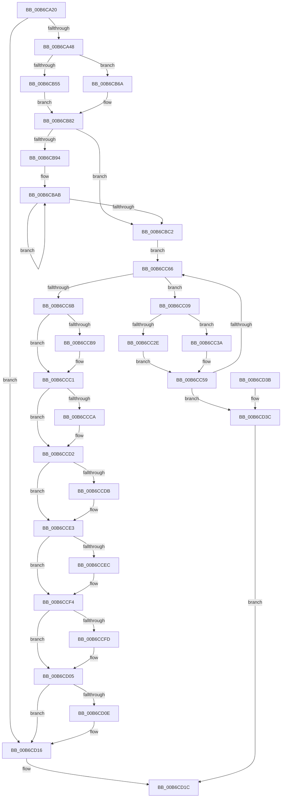

# PopBuildMemoryImageHeader

- RVA: `0x00B6CA20`–`0x00B6CD43` (길이 `803` bytes)
- VA: `0x0000000140B6CA20`
- 실행 섹션: `PAGELK`
- PDB 이름 있음: `예`; PDB Function 태그: `아니요`
- unwind 정보 RVA: `0x000CC474`
- 디코드: `194`개 명령, `803/803` bytes 표시
- 미해석 바이트: `0` (있으면 어셈블리에 `.byte`로 보존)

> 이 문서는 커널 이미지의 기계어와 PDB 기호를 분석해 생성했습니다. 4번과 5번은 함수 원형과 자료형을 바이너리 사용 방식에서 추정한 C 해석이며 원본 소스 복구 결과는 아닙니다.

## 1. Dependencies

- 직접 호출 지점: **14**; 고유 호출 대상: **12**
- 직접 호출자로 확인된 함수: **1**
- RIP 상대 이미지 참조: **10**

### Outgoing calls
- `0x00B6CA66` → [PoSetHiberRange](../../text/47/PoSetHiberRange_function_0047C580.md) (function, `0x0047C580`)
- `0x00B6CA78` → [memset](../../text/6C/memset_function_006C6C40.md) (function, `0x006C6C40`)
- `0x00B6CA86` → [MmGetPhysicalAddress](../../text/23/MmGetPhysicalAddress_function_0023A500.md) (function, `0x0023A500`)
- `0x00B6CB00` → [MmGetHighestPhysicalPage](../../text/47/MmGetHighestPhysicalPage_function_00479040.md) (function, `0x00479040`)
- `0x00B6CBEF` → [PopBootLoaderTraceCopyPfnList](../B5/PopBootLoaderTraceCopyPfnList_function_00B5B24C.md) (function, `0x00B5B24C`)
- `0x00B6CBFA` → [PopCopyFirmwareRuntimeInformationPfnList](../B7/PopCopyFirmwareRuntimeInformationPfnList_function_00B7E774.md) (function, `0x00B7E774`)
- `0x00B6CC21` → [PopAllocatePages](../B7/PopAllocatePages_function_00B7E3FC.md) (function, `0x00B7E3FC`)
- `0x00B6CC54` → [PoSetHiberRange](../../text/47/PoSetHiberRange_function_0047C580.md) (function, `0x0047C580`)
- `0x00B6CCB0` → [Feature_PlutonDynamicUpgrade__private_IsEnabledDeviceUsageNoInline](../../text/5D/Feature_PlutonDynamicUpgrade__private_IsEnabledDeviceUsageNoInline_function_005D4AB0.md) (function, `0x005D4AB0`)
- `0x00B6CCC1` → [Feature_PlutonNvidiaDriver__private_IsEnabledDeviceUsageNoInline](../../text/5D/Feature_PlutonNvidiaDriver__private_IsEnabledDeviceUsageNoInline_function_005D4B58.md) (function, `0x005D4B58`)
- `0x00B6CCD2` → [Feature_PlutonNvidiaN1c__private_IsEnabledDeviceUsageNoInline](../../text/5D/Feature_PlutonNvidiaN1c__private_IsEnabledDeviceUsageNoInline_function_005D4BAC.md) (function, `0x005D4BAC`)
- `0x00B6CCE3` → [Feature_PlutonNvidiaDriver__private_IsEnabledDeviceUsageNoInline](../../text/5D/Feature_PlutonNvidiaDriver__private_IsEnabledDeviceUsageNoInline_function_005D4B58.md) (function, `0x005D4B58`)
- `0x00B6CCF4` → [Feature_PlutonDynamicUpgradeStxTpmEnabledFix__private_IsEnabledDeviceUsageNoInline](../../text/5D/Feature_PlutonDynamicUpgradeStxTpmEnabledFix__private_IsEnabledDeviceUsageNoInline_function_005D4A5C.md) (function, `0x005D4A5C`)
- `0x00B6CD05` → [Feature_PlutonMdsMeasurement__private_IsEnabledDeviceUsageNoInline](../../text/5D/Feature_PlutonMdsMeasurement__private_IsEnabledDeviceUsageNoInline_function_005D4B04.md) (function, `0x005D4B04`)

### Direct callers
- [PopEndMirroring](../B7/PopEndMirroring_function_00B75E50.md) at `0x00B75EE9`
- [PopEndMirroring](../B7/PopEndMirroring_function_00B75E50.md) at `0x00B75F41`

### Static image references
- `0x00B6CAB1` → RVA `0x00F0BF50` (`.data`; read)
- `0x00B6CAC3` → RVA `0x00FC6B30` (`ALMOSTRO`; read)
- `0x00B6CACE` → RVA `0x00FC5078` (`ALMOSTRO`; read)
- `0x00B6CAE7` → RVA `0x00F0BF60` (`.data`; read)
- `0x00B6CB05` → RVA `0x00F0DE80` (`.data`; read)
- `0x00B6CB13` → RVA `0x00F0DE60` (`.data`; read)
- `0x00B6CB4C` → RVA `0x00F0C9E4` (`.data`; read)
- `0x00B6CB6A` → RVA `0x00F0C9E8` (`.data`; read)
- `0x00B6CBC2` → RVA `0x00FC6A90` (`ALMOSTRO`; read)
- `0x00B6CC97` → RVA `0x00FC6B44` (`ALMOSTRO`; read)

## 2. Other-region calls and transfers

- 다른 실행 섹션으로 향하는 call: **11**
  - `0x00B6CA66` → [PoSetHiberRange](../../text/47/PoSetHiberRange_function_0047C580.md) (`PAGELK` → `.text`)
  - `0x00B6CA78` → [memset](../../text/6C/memset_function_006C6C40.md) (`PAGELK` → `.text`)
  - `0x00B6CA86` → [MmGetPhysicalAddress](../../text/23/MmGetPhysicalAddress_function_0023A500.md) (`PAGELK` → `.text`)
  - `0x00B6CB00` → [MmGetHighestPhysicalPage](../../text/47/MmGetHighestPhysicalPage_function_00479040.md) (`PAGELK` → `.text`)
  - `0x00B6CC54` → [PoSetHiberRange](../../text/47/PoSetHiberRange_function_0047C580.md) (`PAGELK` → `.text`)
  - `0x00B6CCB0` → [Feature_PlutonDynamicUpgrade__private_IsEnabledDeviceUsageNoInline](../../text/5D/Feature_PlutonDynamicUpgrade__private_IsEnabledDeviceUsageNoInline_function_005D4AB0.md) (`PAGELK` → `.text`)
  - `0x00B6CCC1` → [Feature_PlutonNvidiaDriver__private_IsEnabledDeviceUsageNoInline](../../text/5D/Feature_PlutonNvidiaDriver__private_IsEnabledDeviceUsageNoInline_function_005D4B58.md) (`PAGELK` → `.text`)
  - `0x00B6CCD2` → [Feature_PlutonNvidiaN1c__private_IsEnabledDeviceUsageNoInline](../../text/5D/Feature_PlutonNvidiaN1c__private_IsEnabledDeviceUsageNoInline_function_005D4BAC.md) (`PAGELK` → `.text`)
  - `0x00B6CCE3` → [Feature_PlutonNvidiaDriver__private_IsEnabledDeviceUsageNoInline](../../text/5D/Feature_PlutonNvidiaDriver__private_IsEnabledDeviceUsageNoInline_function_005D4B58.md) (`PAGELK` → `.text`)
  - `0x00B6CCF4` → [Feature_PlutonDynamicUpgradeStxTpmEnabledFix__private_IsEnabledDeviceUsageNoInline](../../text/5D/Feature_PlutonDynamicUpgradeStxTpmEnabledFix__private_IsEnabledDeviceUsageNoInline_function_005D4A5C.md) (`PAGELK` → `.text`)
  - `0x00B6CD05` → [Feature_PlutonMdsMeasurement__private_IsEnabledDeviceUsageNoInline](../../text/5D/Feature_PlutonMdsMeasurement__private_IsEnabledDeviceUsageNoInline_function_005D4B04.md) (`PAGELK` → `.text`)
- 별도 외부 분기/꼬리 이동을 확인하지 못했습니다.

## 3. Assembly (complete function range)

```asm
00B6CA20  48 8B C4                        mov rax, rsp
00B6CA23  48 89 58 08                     mov qword ptr [rax + 8], rbx
00B6CA27  48 89 68 10                     mov qword ptr [rax + 0x10], rbp
00B6CA2B  48 89 70 18                     mov qword ptr [rax + 0x18], rsi
00B6CA2F  48 89 78 20                     mov qword ptr [rax + 0x20], rdi
00B6CA33  41 54                           push r12
00B6CA35  41 56                           push r14
00B6CA37  41 57                           push r15
00B6CA39  48 83 EC 30                     sub rsp, 0x30
00B6CA3D  48 8B F9                        mov rdi, rcx
00B6CA40  85 D2                           test edx, edx
00B6CA42  0F 85 CE 02 00 00               jne 0x140b6cd16
00B6CA48  48 8B 99 D8 00 00 00            mov rbx, qword ptr [rcx + 0xd8]
00B6CA4F  BD F0 04 00 00                  mov ebp, 0x4f0
00B6CA54  44 8B CD                        mov r9d, ebp
00B6CA57  C7 40 D8 4D 69 6D 67            mov dword ptr [rax - 0x28], 0x676d694d
00B6CA5E  4C 8B C3                        mov r8, rbx
00B6CA61  BA 00 80 00 00                  mov edx, 0x8000
00B6CA66  E8 15 FB 90 FF                  call 0x14047c580
00B6CA6B  BE 00 10 00 00                  mov esi, 0x1000
00B6CA70  33 D2                           xor edx, edx
00B6CA72  44 8B C6                        mov r8d, esi
00B6CA75  48 8B CB                        mov rcx, rbx
00B6CA78  E8 C3 A1 B5 FF                  call 0x1406c6c40
00B6CA7D  48 8B CB                        mov rcx, rbx
00B6CA80  89 73 18                        mov dword ptr [rbx + 0x18], esi
00B6CA83  89 6B 0C                        mov dword ptr [rbx + 0xc], ebp
00B6CA86  E8 75 DA 6C FF                  call 0x14023a500
00B6CA8B  48 C1 E8 0C                     shr rax, 0xc
00B6CA8F  33 C9                           xor ecx, ecx
00B6CA91  48 89 43 10                     mov qword ptr [rbx + 0x10], rax
00B6CA95  48 A1 14 00 00 00 80 F7 FF FF   movabs rax, qword ptr [0xfffff78000000014]
00B6CA9F  48 89 43 20                     mov qword ptr [rbx + 0x20], rax
00B6CAA3  48 A1 08 00 00 00 80 F7 FF FF   movabs rax, qword ptr [0xfffff78000000008]
00B6CAAD  48 89 43 28                     mov qword ptr [rbx + 0x28], rax
00B6CAB1  48 8B 05 98 F4 39 00            mov rax, qword ptr [rip + 0x39f498]
00B6CAB8  48 89 43 40                     mov qword ptr [rbx + 0x40], rax
00B6CABC  C7 43 3C 0A 00 00 00            mov dword ptr [rbx + 0x3c], 0xa
00B6CAC3  48 8B 05 66 A0 45 00            mov rax, qword ptr [rip + 0x45a066]
00B6CACA  48 89 43 30                     mov qword ptr [rbx + 0x30], rax
00B6CACE  0F B7 05 A3 85 45 00            movzx eax, word ptr [rip + 0x4585a3]
00B6CAD5  89 43 04                        mov dword ptr [rbx + 4], eax
00B6CAD8  8A 07                           mov al, byte ptr [rdi]
00B6CADA  88 43 38                        mov byte ptr [rbx + 0x38], al
00B6CADD  8B 83 7C 04 00 00               mov eax, dword ptr [rbx + 0x47c]
00B6CAE3  C6 43 39 CA                     mov byte ptr [rbx + 0x39], 0xca
00B6CAE7  44 0F B6 05 71 F4 39 00         movzx r8d, byte ptr [rip + 0x39f471]
00B6CAEF  44 33 C0                        xor r8d, eax
00B6CAF2  41 83 E0 01                     and r8d, 1
00B6CAF6  44 33 C0                        xor r8d, eax
00B6CAF9  44 89 83 7C 04 00 00            mov dword ptr [rbx + 0x47c], r8d
00B6CB00  E8 3B C5 90 FF                  call 0x140479040
00B6CB05  0F B6 15 74 13 3A 00            movzx edx, byte ptr [rip + 0x3a1374]
00B6CB0C  48 89 83 B0 04 00 00            mov qword ptr [rbx + 0x4b0], rax
00B6CB13  0F B6 05 46 13 3A 00            movzx eax, byte ptr [rip + 0x3a1346]
00B6CB1A  03 C0                           add eax, eax
00B6CB1C  C1 E2 03                        shl edx, 3
00B6CB1F  41 33 C0                        xor eax, r8d
00B6CB22  83 E0 02                        and eax, 2
00B6CB25  41 33 C0                        xor eax, r8d
00B6CB28  89 83 7C 04 00 00               mov dword ptr [rbx + 0x47c], eax
00B6CB2E  0F B6 8F E9 01 00 00            movzx ecx, byte ptr [rdi + 0x1e9]
00B6CB35  C1 E1 02                        shl ecx, 2
00B6CB38  33 C8                           xor ecx, eax
00B6CB3A  83 E1 04                        and ecx, 4
00B6CB3D  33 C8                           xor ecx, eax
00B6CB3F  33 D1                           xor edx, ecx
00B6CB41  83 E2 08                        and edx, 8
00B6CB44  33 D1                           xor edx, ecx
00B6CB46  89 93 7C 04 00 00               mov dword ptr [rbx + 0x47c], edx
00B6CB4C  83 3D 91 FE 39 00 FF            cmp dword ptr [rip + 0x39fe91], -1
00B6CB53  75 15                           jne 0x140b6cb6a
00B6CB55  0F B6 87 E8 01 00 00            movzx eax, byte ptr [rdi + 0x1e8]
00B6CB5C  C1 E0 08                        shl eax, 8
00B6CB5F  33 C2                           xor eax, edx
00B6CB61  25 00 01 00 00                  and eax, 0x100
00B6CB66  33 C2                           xor eax, edx
00B6CB68  EB 18                           jmp 0x140b6cb82
00B6CB6A  8B 05 78 FE 39 00               mov eax, dword ptr [rip + 0x39fe78]
00B6CB70  F7 D8                           neg eax
00B6CB72  8B C2                           mov eax, edx
00B6CB74  1B C9                           sbb ecx, ecx
00B6CB76  0F BA F0 08                     btr eax, 8
00B6CB7A  81 E1 00 01 00 00               and ecx, 0x100
00B6CB80  0B C1                           or eax, ecx
00B6CB82  89 83 7C 04 00 00               mov dword ptr [rbx + 0x47c], eax
00B6CB88  48 8B 87 58 01 00 00            mov rax, qword ptr [rdi + 0x158]
00B6CB8F  48 85 C0                        test rax, rax
00B6CB92  74 2E                           je 0x140b6cbc2
00B6CB94  48 8D 8B B8 04 00 00            lea rcx, [rbx + 0x4b8]
00B6CB9B  41 B8 03 00 00 00               mov r8d, 3
00B6CBA1  48 89 01                        mov qword ptr [rcx], rax
00B6CBA4  48 8D 93 C0 04 00 00            lea rdx, [rbx + 0x4c0]
00B6CBAB  48 8B 01                        mov rax, qword ptr [rcx]
00B6CBAE  48 8D 49 08                     lea rcx, [rcx + 8]
00B6CBB2  48 FF C0                        inc rax
00B6CBB5  48 89 02                        mov qword ptr [rdx], rax
00B6CBB8  48 8D 52 08                     lea rdx, [rdx + 8]
00B6CBBC  49 83 E8 01                     sub r8, 1
00B6CBC0  75 E9                           jne 0x140b6cbab
00B6CBC2  8B 0D C8 9E 45 00               mov ecx, dword ptr [rip + 0x459ec8]
00B6CBC8  48 8B D3                        mov rdx, rbx
00B6CBCB  8B 83 7C 04 00 00               mov eax, dword ptr [rbx + 0x47c]
00B6CBD1  48 83 A3 A8 04 00 00 00         and qword ptr [rbx + 0x4a8], 0
00B6CBD9  C1 E1 09                        shl ecx, 9
00B6CBDC  33 C8                           xor ecx, eax
00B6CBDE  81 E1 00 04 00 00               and ecx, 0x400
00B6CBE4  33 C8                           xor ecx, eax
00B6CBE6  89 8B 7C 04 00 00               mov dword ptr [rbx + 0x47c], ecx
00B6CBEC  48 8B CF                        mov rcx, rdi
00B6CBEF  E8 58 E6 FE FF                  call 0x140b5b24c
00B6CBF4  48 8B D3                        mov rdx, rbx
00B6CBF7  48 8B CF                        mov rcx, rdi
00B6CBFA  E8 75 1B 01 00                  call 0x140b7e774
00B6CBFF  4C 8D 67 50                     lea r12, [rdi + 0x50]
00B6CC03  4D 8B 34 24                     mov r14, qword ptr [r12]
00B6CC07  EB 5D                           jmp 0x140b6cc66
00B6CC09  4D 8D 3E                        lea r15, [r14]
00B6CC0C  4D 8B 36                        mov r14, qword ptr [r14]
00B6CC0F  41 8B 77 20                     mov esi, dword ptr [r15 + 0x20]
00B6CC13  41 2B 77 18                     sub esi, dword ptr [r15 + 0x18]
00B6CC17  C1 E6 0C                        shl esi, 0xc
00B6CC1A  48 C1 EE 0C                     shr rsi, 0xc
00B6CC1E  48 8B CE                        mov rcx, rsi
00B6CC21  E8 D6 17 01 00                  call 0x140b7e3fc
00B6CC26  48 8B E8                        mov rbp, rax
00B6CC29  48 85 C0                        test rax, rax
00B6CC2C  75 0C                           jne 0x140b6cc3a
00B6CC2E  C7 87 CC 00 00 00 9A 00 00 C0   mov dword ptr [rdi + 0xcc], 0xc000009a
00B6CC38  EB 1F                           jmp 0x140b6cc59
00B6CC3A  48 C1 E6 0C                     shl rsi, 0xc
00B6CC3E  4C 8B C5                        mov r8, rbp
00B6CC41  4C 8B CE                        mov r9, rsi
00B6CC44  C7 44 24 20 6E 6F 6C 43         mov dword ptr [rsp + 0x20], 0x436c6f6e
00B6CC4C  BA 00 80 00 00                  mov edx, 0x8000
00B6CC51  48 8B CF                        mov rcx, rdi
00B6CC54  E8 27 F9 90 FF                  call 0x14047c580
00B6CC59  49 89 6F 28                     mov qword ptr [r15 + 0x28], rbp
00B6CC5D  48 85 ED                        test rbp, rbp
00B6CC60  0F 84 D6 00 00 00               je 0x140b6cd3c
00B6CC66  4D 3B F4                        cmp r14, r12
00B6CC69  75 9E                           jne 0x140b6cc09
00B6CC6B  8B 83 7C 04 00 00               mov eax, dword ptr [rbx + 0x47c]
00B6CC71  0F B6 8F E0 01 00 00            movzx ecx, byte ptr [rdi + 0x1e0]
00B6CC78  C1 E1 09                        shl ecx, 9
00B6CC7B  33 C8                           xor ecx, eax
00B6CC7D  81 E1 00 02 00 00               and ecx, 0x200
00B6CC83  33 C8                           xor ecx, eax
00B6CC85  89 8B 7C 04 00 00               mov dword ptr [rbx + 0x47c], ecx
00B6CC8B  8B 87 E4 01 00 00               mov eax, dword ptr [rdi + 0x1e4]
00B6CC91  89 83 D8 04 00 00               mov dword ptr [rbx + 0x4d8], eax
00B6CC97  0F B6 05 A6 9E 45 00            movzx eax, byte ptr [rip + 0x459ea6]
00B6CC9E  C1 E0 07                        shl eax, 7
00B6CCA1  33 C1                           xor eax, ecx
00B6CCA3  25 80 00 00 00                  and eax, 0x80
00B6CCA8  33 C1                           xor eax, ecx
00B6CCAA  89 83 7C 04 00 00               mov dword ptr [rbx + 0x47c], eax
00B6CCB0  E8 FB 7D A6 FF                  call 0x1405d4ab0
00B6CCB5  85 C0                           test eax, eax
00B6CCB7  74 08                           je 0x140b6ccc1
00B6CCB9  0F BA AB 7C 04 00 00 0B         bts dword ptr [rbx + 0x47c], 0xb
00B6CCC1  E8 92 7E A6 FF                  call 0x1405d4b58
00B6CCC6  85 C0                           test eax, eax
00B6CCC8  74 08                           je 0x140b6ccd2
00B6CCCA  0F BA AB 7C 04 00 00 0D         bts dword ptr [rbx + 0x47c], 0xd
00B6CCD2  E8 D5 7E A6 FF                  call 0x1405d4bac
00B6CCD7  85 C0                           test eax, eax
00B6CCD9  74 08                           je 0x140b6cce3
00B6CCDB  0F BA AB 7C 04 00 00 0E         bts dword ptr [rbx + 0x47c], 0xe
00B6CCE3  E8 70 7E A6 FF                  call 0x1405d4b58
00B6CCE8  85 C0                           test eax, eax
00B6CCEA  74 08                           je 0x140b6ccf4
00B6CCEC  0F BA AB 7C 04 00 00 0F         bts dword ptr [rbx + 0x47c], 0xf
00B6CCF4  E8 63 7D A6 FF                  call 0x1405d4a5c
00B6CCF9  85 C0                           test eax, eax
00B6CCFB  74 08                           je 0x140b6cd05
00B6CCFD  0F BA AB 7C 04 00 00 10         bts dword ptr [rbx + 0x47c], 0x10
00B6CD05  E8 FA 7D A6 FF                  call 0x1405d4b04
00B6CD0A  85 C0                           test eax, eax
00B6CD0C  74 08                           je 0x140b6cd16
00B6CD0E  0F BA AB 7C 04 00 00 11         bts dword ptr [rbx + 0x47c], 0x11
00B6CD16  8B 87 CC 00 00 00               mov eax, dword ptr [rdi + 0xcc]
00B6CD1C  48 8B 5C 24 50                  mov rbx, qword ptr [rsp + 0x50]
00B6CD21  48 8B 6C 24 58                  mov rbp, qword ptr [rsp + 0x58]
00B6CD26  48 8B 74 24 60                  mov rsi, qword ptr [rsp + 0x60]
00B6CD2B  48 8B 7C 24 68                  mov rdi, qword ptr [rsp + 0x68]
00B6CD30  48 83 C4 30                     add rsp, 0x30
00B6CD34  41 5F                           pop r15
00B6CD36  41 5E                           pop r14
00B6CD38  41 5C                           pop r12
00B6CD3A  C3                              ret
00B6CD3B  CC                              int3
00B6CD3C  B8 9A 00 00 C0                  mov eax, 0xc000009a
00B6CD41  EB D9                           jmp 0x140b6cd1c
```

## 4. C-style interpretation (structured pseudocode)

```c
__int64 __fastcall PopBuildMemoryImageHeader(__int64 a1, int a2)
{
    __int64 result;
    __int64 v_rsi;
    __int64 v_rsp;
    unsigned int v_stack_m28;
    unsigned __int64 v_stack_p10;
    unsigned __int64 v_stack_p18;
    unsigned __int64 v_stack_p20;
    unsigned __int64 v_stack_p8;

    *(unsigned __int64 *)(v_rsp + 8) = v_rbx;
    *(unsigned __int64 *)(v_rsp + 16) = v_rbp;
    *(unsigned __int64 *)(v_rsp + 24) = v_rsi;
    *(unsigned __int64 *)(v_rsp + 32) = v_rdi;
    v_rsp = (v_rsp) - (48);
    if (a2 != 0) goto loc_00B6CD16;
    *(unsigned int *)(v_rsp - 40) = 0x676D694DULL;
    result = PoSetHiberRange(a1, (unsigned int)(0x8000ULL), *(unsigned __int64 *)(a1 + 216), (unsigned int)((unsigned int)((unsigned int)(0x4F0ULL))));
    a2 = 0;
    result = memset(*(unsigned __int64 *)(a1 + 216), a2, (unsigned int)((unsigned int)((unsigned int)(0x1000ULL))), (unsigned int)((unsigned int)((unsigned int)(0x4F0ULL))));
    *(unsigned int *)(*(unsigned __int64 *)(a1 + 216) + 24) = (unsigned int)((unsigned int)(0x1000ULL));
    *(unsigned int *)(*(unsigned __int64 *)(a1 + 216) + 12) = (unsigned int)((unsigned int)(0x4F0ULL));
    result = MmGetPhysicalAddress(*(unsigned __int64 *)(a1 + 216), a2, (unsigned int)((unsigned int)((unsigned int)(0x1000ULL))), (unsigned int)((unsigned int)((unsigned int)(0x4F0ULL))));
    result = (result) >> (12);
    a1 = 0;
    *(unsigned __int64 *)(*(unsigned __int64 *)(a1 + 216) + 16) = result;
    *(unsigned __int64 *)(*(unsigned __int64 *)(a1 + 216) + 32) = result;
    *(unsigned __int64 *)(*(unsigned __int64 *)(a1 + 216) + 40) = result;
    *(unsigned __int64 *)(*(unsigned __int64 *)(a1 + 216) + 64) = *(unsigned __int64 *)(v_rip + 3798168);
    *(unsigned int *)(*(unsigned __int64 *)(a1 + 216) + 60) = 10;
    *(unsigned __int64 *)(*(unsigned __int64 *)(a1 + 216) + 48) = *(unsigned __int64 *)(v_rip + 4563046);
    *(unsigned int *)(*(unsigned __int64 *)(a1 + 216) + 4) = (unsigned int)(*(unsigned __int16 *)(v_rip + 4556195));
    *(unsigned __int8 *)(*(unsigned __int64 *)(a1 + 216) + 56) = (unsigned __int8)(*(unsigned __int8 *)(a1));
    *(unsigned __int8 *)(*(unsigned __int64 *)(a1 + 216) + 57) = 202;
    a3 = (unsigned int)((*(unsigned __int8 *)(v_rip + 3798129)) ^ ((unsigned int)((unsigned int)(*(unsigned int *)(*(unsigned __int64 *)(a1 + 216) + 1148)))));
    a3 = (unsigned int)((a3) & (1));
    a3 = (unsigned int)((a3) ^ ((unsigned int)((unsigned int)(*(unsigned int *)(*(unsigned __int64 *)(a1 + 216) + 1148)))));
    *(unsigned int *)(*(unsigned __int64 *)(a1 + 216) + 1148) = (unsigned int)(a3);
    result = MmGetHighestPhysicalPage(a1, a2, a3, (unsigned int)((unsigned int)((unsigned int)(0x4F0ULL))));
    *(unsigned __int64 *)(*(unsigned __int64 *)(a1 + 216) + 1200) = result;
    result = (unsigned int)((*(unsigned __int8 *)(v_rip + 3806022)) + ((unsigned int)(*(unsigned __int8 *)(v_rip + 3806022))));
    a2 = (unsigned int)((*(unsigned __int8 *)(v_rip + 3806068)) << (3));
    result = (unsigned int)((result) ^ ((unsigned int)(a3)));
    result = (unsigned int)((result) & (2));
    result = (unsigned int)((result) ^ ((unsigned int)(a3)));
    *(unsigned int *)(*(unsigned __int64 *)(a1 + 216) + 1148) = (unsigned int)(result);
    a1 = (unsigned int)((*(unsigned __int8 *)(a1 + 489)) << (2));
    a1 = (unsigned int)((a1) ^ ((unsigned int)(result)));
    a1 = (unsigned int)((a1) & (4));
    a1 = (unsigned int)((a1) ^ ((unsigned int)(result)));
    a2 = (unsigned int)((a2) ^ ((unsigned int)(a1)));
    a2 = (unsigned int)((a2) & (8));
    a2 = (unsigned int)((a2) ^ ((unsigned int)(a1)));
    *(unsigned int *)(*(unsigned __int64 *)(a1 + 216) + 1148) = a2;
    if ((*(unsigned int *)(v_rip + 3800721)) != -1) goto loc_00B6CB6A;
    result = (unsigned int)((*(unsigned __int8 *)(a1 + 488)) << (8));
    result = (unsigned int)((result) ^ (a2));
    result = (unsigned int)((result) & (256));
    result = (unsigned int)((result) ^ (a2));
    goto loc_00B6CB82;
loc_00B6CB6A:
    result = (unsigned int)(-((unsigned int)(*(unsigned int *)(v_rip + 3800696))));
    a1 = (unsigned int)((a1) & (256));
    result = (unsigned int)(((unsigned int)(a2)) | ((unsigned int)(a1)));
loc_00B6CB82:
    *(unsigned int *)(*(unsigned __int64 *)(a1 + 216) + 1148) = (unsigned int)(result);
    if (*(unsigned __int64 *)(a1 + 344) == 0) goto loc_00B6CBC2;
    *(unsigned __int64 *)(*(unsigned __int64 *)(a1 + 216) + 1208) = *(unsigned __int64 *)(a1 + 344);
loc_00B6CBAB:
    result = (*(unsigned __int64 *)(*(unsigned __int64 *)(a1 + 216) + 1208)) + 1;
    *(unsigned __int64 *)(*(unsigned __int64 *)(a1 + 216) + 1216) = result;
    a3 = (3) - (1);
    if (condition_is_not_equal) goto loc_00B6CBAB;
loc_00B6CBC2:
    a1 = (unsigned int)(((unsigned int)(*(unsigned int *)(v_rip + 4562632))) << (9));
    a1 = (unsigned int)((a1) ^ ((unsigned int)((unsigned int)(*(unsigned int *)(*(unsigned __int64 *)(a1 + 216) + 1148)))));
    a1 = (unsigned int)((a1) & (0x400ULL));
    a1 = (unsigned int)((a1) ^ ((unsigned int)((unsigned int)(*(unsigned int *)(*(unsigned __int64 *)(a1 + 216) + 1148)))));
    *(unsigned int *)(*(unsigned __int64 *)(a1 + 216) + 1148) = (unsigned int)(a1);
    result = PopBootLoaderTraceCopyPfnList(a1, *(unsigned __int64 *)(a1 + 216), a3, (unsigned int)((unsigned int)((unsigned int)(0x4F0ULL))));
    result = PopCopyFirmwareRuntimeInformationPfnList(a1, *(unsigned __int64 *)(a1 + 216), a3, (unsigned int)((unsigned int)((unsigned int)(0x4F0ULL))));
    goto loc_00B6CC66;
loc_00B6CC09:
    v_rsi = (unsigned int)(((unsigned int)(*(unsigned int *)(*(unsigned __int64 *)(a1 + 80) + 32))) - (*(unsigned int *)(*(unsigned __int64 *)(a1 + 80) + 24)));
    v_rsi = (unsigned int)((v_rsi) << (12));
    v_rsi = (v_rsi) >> (12);
    result = PopAllocatePages(v_rsi, *(unsigned __int64 *)(a1 + 216), a3, (unsigned int)((unsigned int)((unsigned int)(0x4F0ULL))));
    if (result != 0) goto loc_00B6CC3A;
    *(unsigned int *)(a1 + 204) = 0xC000009AULL;
    goto loc_00B6CC59;
loc_00B6CC3A:
    v_rsi = (v_rsi) << (12);
    v_stack_m28 = 0x436C6F6EULL;
    result = PoSetHiberRange(a1, (unsigned int)(0x8000ULL), result, v_rsi);
loc_00B6CC59:
    *(unsigned __int64 *)(*(unsigned __int64 *)(a1 + 80) + 40) = result;
    if (result == 0) goto loc_00B6CD3C;
loc_00B6CC66:
    if ((*(unsigned __int64 *)(*(unsigned __int64 *)(a1 + 80))) != (a1 + 80)) goto loc_00B6CC09;
    a1 = (unsigned int)((*(unsigned __int8 *)(a1 + 480)) << (9));
    a1 = (unsigned int)((a1) ^ ((unsigned int)((unsigned int)(*(unsigned int *)(*(unsigned __int64 *)(a1 + 216) + 1148)))));
    a1 = (unsigned int)((a1) & (512));
    a1 = (unsigned int)((a1) ^ ((unsigned int)((unsigned int)(*(unsigned int *)(*(unsigned __int64 *)(a1 + 216) + 1148)))));
    *(unsigned int *)(*(unsigned __int64 *)(a1 + 216) + 1148) = (unsigned int)(a1);
    *(unsigned int *)(*(unsigned __int64 *)(a1 + 216) + 1240) = (unsigned int)((unsigned int)(*(unsigned int *)(a1 + 484)));
    result = (unsigned int)((*(unsigned __int8 *)(v_rip + 4562598)) << (7));
    result = (unsigned int)((result) ^ ((unsigned int)(a1)));
    result = (unsigned int)((result) & (128));
    result = (unsigned int)((result) ^ ((unsigned int)(a1)));
    *(unsigned int *)(*(unsigned __int64 *)(a1 + 216) + 1148) = (unsigned int)(result);
    result = Feature_PlutonDynamicUpgrade__private_IsEnabledDeviceUsageNoInline(a1, (unsigned int)(0x8000ULL), result, v_rsi);
    if ((unsigned int)(result) != 0) {
    }
    result = Feature_PlutonNvidiaDriver__private_IsEnabledDeviceUsageNoInline(a1, (unsigned int)(0x8000ULL), result, v_rsi);
    if ((unsigned int)(result) != 0) {
    }
    result = Feature_PlutonNvidiaN1c__private_IsEnabledDeviceUsageNoInline(a1, (unsigned int)(0x8000ULL), result, v_rsi);
    if ((unsigned int)(result) != 0) {
    }
    result = Feature_PlutonNvidiaDriver__private_IsEnabledDeviceUsageNoInline(a1, (unsigned int)(0x8000ULL), result, v_rsi);
    if ((unsigned int)(result) != 0) {
    }
    result = Feature_PlutonDynamicUpgradeStxTpmEnabledFix__private_IsEnabledDeviceUsageNoInline(a1, (unsigned int)(0x8000ULL), result, v_rsi);
    if ((unsigned int)(result) != 0) {
    }
    result = Feature_PlutonMdsMeasurement__private_IsEnabledDeviceUsageNoInline(a1, (unsigned int)(0x8000ULL), result, v_rsi);
    if ((unsigned int)(result) != 0) {
    }
loc_00B6CD1C:
    v_rsp = (v_rsp) + (48);
    return (unsigned int)(*(unsigned int *)(a1 + 204));
loc_00B6CD3C:
    goto loc_00B6CD1C;
}
```

## 5. (Beta) C Style

```c
int64_t PopBuildMemoryImageHeader(void *Arg1, int32_t Arg2)
{
    uint8_t *arg1 = (uint8_t *)Arg1;

    int64_t result;
    int64_t local_rsi;
    int64_t local_rsp;
    uint32_t v_stack_m28;
    uint64_t v_stack_p10;
    uint64_t v_stack_p18;
    uint64_t v_stack_p20;
    uint64_t v_stack_p8;

    *(uint64_t *)(local_rsp + 0x8) = local_rbx;
    *(uint64_t *)(local_rsp + 0x10) = local_rbp;
    *(uint64_t *)(local_rsp + 0x18) = local_rsi;
    *(uint64_t *)(local_rsp + 0x20) = local_rdi;
    local_rsp = (local_rsp) - (48);
    if (Arg2 != 0) goto loc_00B6CD16;
    *(uint32_t *)(local_rsp - 0x28) = 0x676D694DULL;
    result = PoSetHiberRange(Arg1, (uint32_t)(0x8000ULL), *(uint64_t *)(arg1 + 0xD8), (uint32_t)((uint32_t)((uint32_t)(0x4F0ULL))));
    Arg2 = 0;
    result = memset(*(uint64_t *)(arg1 + 0xD8), Arg2, (uint32_t)((uint32_t)((uint32_t)(0x1000ULL))), (uint32_t)((uint32_t)((uint32_t)(0x4F0ULL))));
    *(uint32_t *)(*(uint64_t *)(arg1 + 0xD8) + 0x18) = (uint32_t)((uint32_t)(0x1000ULL));
    *(uint32_t *)(*(uint64_t *)(arg1 + 0xD8) + 0xC) = (uint32_t)((uint32_t)(0x4F0ULL));
    result = MmGetPhysicalAddress(*(uint64_t *)(arg1 + 0xD8), Arg2, (uint32_t)((uint32_t)((uint32_t)(0x1000ULL))), (uint32_t)((uint32_t)((uint32_t)(0x4F0ULL))));
    result = (result) >> (12);
    Arg1 = 0;
    *(uint64_t *)(*(uint64_t *)(arg1 + 0xD8) + 0x10) = result;
    *(uint64_t *)(*(uint64_t *)(arg1 + 0xD8) + 0x20) = result;
    *(uint64_t *)(*(uint64_t *)(arg1 + 0xD8) + 0x28) = result;
    *(uint64_t *)(*(uint64_t *)(arg1 + 0xD8) + 0x40) = *(uint64_t *)(v_rip + 0x39F498);
    *(uint32_t *)(*(uint64_t *)(arg1 + 0xD8) + 0x3C) = 10;
    *(uint64_t *)(*(uint64_t *)(arg1 + 0xD8) + 0x30) = *(uint64_t *)(v_rip + 0x45A066);
    *(uint32_t *)(*(uint64_t *)(arg1 + 0xD8) + 0x4) = (uint32_t)(*(uint16_t *)(v_rip + 0x4585A3));
    *(uint8_t *)(*(uint64_t *)(arg1 + 0xD8) + 0x38) = (uint8_t)(*(uint8_t *)(arg1));
    *(uint8_t *)(*(uint64_t *)(arg1 + 0xD8) + 0x39) = 202;
    a3 = (uint32_t)((*(uint8_t *)(v_rip + 0x39F471)) ^ ((uint32_t)((uint32_t)(*(uint32_t *)(*(uint64_t *)(arg1 + 0xD8) + 0x47C)))));
    a3 = (uint32_t)((a3) & (1));
    a3 = (uint32_t)((a3) ^ ((uint32_t)((uint32_t)(*(uint32_t *)(*(uint64_t *)(arg1 + 0xD8) + 0x47C)))));
    *(uint32_t *)(*(uint64_t *)(arg1 + 0xD8) + 0x47C) = (uint32_t)(a3);
    result = MmGetHighestPhysicalPage(Arg1, Arg2, a3, (uint32_t)((uint32_t)((uint32_t)(0x4F0ULL))));
    *(uint64_t *)(*(uint64_t *)(arg1 + 0xD8) + 0x4B0) = result;
    result = (uint32_t)((*(uint8_t *)(v_rip + 0x3A1346)) + ((uint32_t)(*(uint8_t *)(v_rip + 0x3A1346))));
    Arg2 = (uint32_t)((*(uint8_t *)(v_rip + 0x3A1374)) << (3));
    result = (uint32_t)((result) ^ ((uint32_t)(a3)));
    result = (uint32_t)((result) & (2));
    result = (uint32_t)((result) ^ ((uint32_t)(a3)));
    *(uint32_t *)(*(uint64_t *)(arg1 + 0xD8) + 0x47C) = (uint32_t)(result);
    Arg1 = (uint32_t)((*(uint8_t *)(arg1 + 0x1E9)) << (2));
    Arg1 = (uint32_t)((Arg1) ^ ((uint32_t)(result)));
    Arg1 = (uint32_t)((Arg1) & (4));
    Arg1 = (uint32_t)((Arg1) ^ ((uint32_t)(result)));
    Arg2 = (uint32_t)((Arg2) ^ ((uint32_t)(Arg1)));
    Arg2 = (uint32_t)((Arg2) & (8));
    Arg2 = (uint32_t)((Arg2) ^ ((uint32_t)(Arg1)));
    *(uint32_t *)(*(uint64_t *)(arg1 + 0xD8) + 0x47C) = Arg2;
    if ((*(uint32_t *)(v_rip + 0x39FE91)) != -1) goto loc_00B6CB6A;
    result = (uint32_t)((*(uint8_t *)(arg1 + 0x1E8)) << (8));
    result = (uint32_t)((result) ^ (Arg2));
    result = (uint32_t)((result) & (256));
    result = (uint32_t)((result) ^ (Arg2));
    goto loc_00B6CB82;
loc_00B6CB6A:
    result = (uint32_t)(-((uint32_t)(*(uint32_t *)(v_rip + 0x39FE78))));
    Arg1 = (uint32_t)((Arg1) & (256));
    result = (uint32_t)(((uint32_t)(Arg2)) | ((uint32_t)(Arg1)));
loc_00B6CB82:
    *(uint32_t *)(*(uint64_t *)(arg1 + 0xD8) + 0x47C) = (uint32_t)(result);
    if (*(uint64_t *)(arg1 + 0x158) == 0) goto loc_00B6CBC2;
    *(uint64_t *)(*(uint64_t *)(arg1 + 0xD8) + 0x4B8) = *(uint64_t *)(arg1 + 0x158);
loc_00B6CBAB:
    result = (*(uint64_t *)(*(uint64_t *)(arg1 + 0xD8) + 0x4B8)) + 1;
    *(uint64_t *)(*(uint64_t *)(arg1 + 0xD8) + 0x4C0) = result;
    a3 = (3) - (1);
    if (condition_is_not_equal) goto loc_00B6CBAB;
loc_00B6CBC2:
    Arg1 = (uint32_t)(((uint32_t)(*(uint32_t *)(v_rip + 0x459EC8))) << (9));
    Arg1 = (uint32_t)((Arg1) ^ ((uint32_t)((uint32_t)(*(uint32_t *)(*(uint64_t *)(arg1 + 0xD8) + 0x47C)))));
    Arg1 = (uint32_t)((Arg1) & (0x400ULL));
    Arg1 = (uint32_t)((Arg1) ^ ((uint32_t)((uint32_t)(*(uint32_t *)(*(uint64_t *)(arg1 + 0xD8) + 0x47C)))));
    *(uint32_t *)(*(uint64_t *)(arg1 + 0xD8) + 0x47C) = (uint32_t)(Arg1);
    result = PopBootLoaderTraceCopyPfnList(Arg1, *(uint64_t *)(arg1 + 0xD8), a3, (uint32_t)((uint32_t)((uint32_t)(0x4F0ULL))));
    result = PopCopyFirmwareRuntimeInformationPfnList(Arg1, *(uint64_t *)(arg1 + 0xD8), a3, (uint32_t)((uint32_t)((uint32_t)(0x4F0ULL))));
    goto loc_00B6CC66;
loc_00B6CC09:
    local_rsi = (uint32_t)(((uint32_t)(*(uint32_t *)(*(uint64_t *)(arg1 + 0x50) + 0x20))) - (*(uint32_t *)(*(uint64_t *)(arg1 + 0x50) + 0x18)));
    local_rsi = (uint32_t)((local_rsi) << (12));
    local_rsi = (local_rsi) >> (12);
    result = PopAllocatePages(local_rsi, *(uint64_t *)(arg1 + 0xD8), a3, (uint32_t)((uint32_t)((uint32_t)(0x4F0ULL))));
    if (result != 0) goto loc_00B6CC3A;
    *(uint32_t *)(arg1 + 0xCC) = 0xC000009AULL;
    goto loc_00B6CC59;
loc_00B6CC3A:
    local_rsi = (local_rsi) << (12);
    v_stack_m28 = 0x436C6F6EULL;
    result = PoSetHiberRange(Arg1, (uint32_t)(0x8000ULL), result, local_rsi);
loc_00B6CC59:
    *(uint64_t *)(*(uint64_t *)(arg1 + 0x50) + 0x28) = result;
    if (result == 0) goto loc_00B6CD3C;
loc_00B6CC66:
    if ((*(uint64_t *)(*(uint64_t *)(arg1 + 0x50))) != (Arg1 + 80)) goto loc_00B6CC09;
    Arg1 = (uint32_t)((*(uint8_t *)(arg1 + 0x1E0)) << (9));
    Arg1 = (uint32_t)((Arg1) ^ ((uint32_t)((uint32_t)(*(uint32_t *)(*(uint64_t *)(arg1 + 0xD8) + 0x47C)))));
    Arg1 = (uint32_t)((Arg1) & (512));
    Arg1 = (uint32_t)((Arg1) ^ ((uint32_t)((uint32_t)(*(uint32_t *)(*(uint64_t *)(arg1 + 0xD8) + 0x47C)))));
    *(uint32_t *)(*(uint64_t *)(arg1 + 0xD8) + 0x47C) = (uint32_t)(Arg1);
    *(uint32_t *)(*(uint64_t *)(arg1 + 0xD8) + 0x4D8) = (uint32_t)((uint32_t)(*(uint32_t *)(arg1 + 0x1E4)));
    result = (uint32_t)((*(uint8_t *)(v_rip + 0x459EA6)) << (7));
    result = (uint32_t)((result) ^ ((uint32_t)(Arg1)));
    result = (uint32_t)((result) & (128));
    result = (uint32_t)((result) ^ ((uint32_t)(Arg1)));
    *(uint32_t *)(*(uint64_t *)(arg1 + 0xD8) + 0x47C) = (uint32_t)(result);
    result = Feature_PlutonDynamicUpgrade__private_IsEnabledDeviceUsageNoInline(Arg1, (uint32_t)(0x8000ULL), result, local_rsi);
    if ((uint32_t)(result) != 0) {
    }
    result = Feature_PlutonNvidiaDriver__private_IsEnabledDeviceUsageNoInline(Arg1, (uint32_t)(0x8000ULL), result, local_rsi);
    if ((uint32_t)(result) != 0) {
    }
    result = Feature_PlutonNvidiaN1c__private_IsEnabledDeviceUsageNoInline(Arg1, (uint32_t)(0x8000ULL), result, local_rsi);
    if ((uint32_t)(result) != 0) {
    }
    result = Feature_PlutonNvidiaDriver__private_IsEnabledDeviceUsageNoInline(Arg1, (uint32_t)(0x8000ULL), result, local_rsi);
    if ((uint32_t)(result) != 0) {
    }
    result = Feature_PlutonDynamicUpgradeStxTpmEnabledFix__private_IsEnabledDeviceUsageNoInline(Arg1, (uint32_t)(0x8000ULL), result, local_rsi);
    if ((uint32_t)(result) != 0) {
    }
    result = Feature_PlutonMdsMeasurement__private_IsEnabledDeviceUsageNoInline(Arg1, (uint32_t)(0x8000ULL), result, local_rsi);
    if ((uint32_t)(result) != 0) {
    }
loc_00B6CD1C:
    local_rsp = (local_rsp) + (48);
    return (uint32_t)(*(uint32_t *)(arg1 + 0xCC));
loc_00B6CD3C:
    goto loc_00B6CD1C;
}
```

### 관측된 메모리 오프셋

구조체 형식이 확인되지 않은 접근은 인자 기준의 오프셋으로만 기록했습니다.

| 기준 인자 | 오프셋 표현 | 폭 (bit) | 접근 |
|---|---:|---:|---|
| `Arg1` | `+ 0x0` | `8` | `R` |
| `Arg1` | `+ 0x0` | `64` | `R` |
| `Arg1` | `+ 0x50` | `64` | `R` |
| `Arg1` | `+ 0xCC` | `32` | `R` |
| `Arg1` | `+ 0xCC` | `32` | `W` |
| `Arg1` | `+ 0xD8` | `64` | `R` |
| `Arg1` | `+ 0x158` | `64` | `R` |
| `Arg1` | `+ 0x1E0` | `8` | `R` |
| `Arg1` | `+ 0x1E4` | `32` | `R` |
| `Arg1` | `+ 0x1E8` | `8` | `R` |
| `Arg1` | `+ 0x1E9` | `8` | `R` |

## 6. Execution-region graph

[열기: 2D/3D 그래프와 함수 탐색 컨트롤 패널](../../../control-panel.html?section=pagelk&rva=0x00B6CA20&view=graph)

- 2D 그래프는 위에서 아래로 흐르고, 3D 그래프는 빈 공간을 드래그해 회전합니다. Shift+드래그는 이동, 휠은 확대·축소, 함수 노드 선택은 대상 보고서 이동입니다.

### Static fallback


