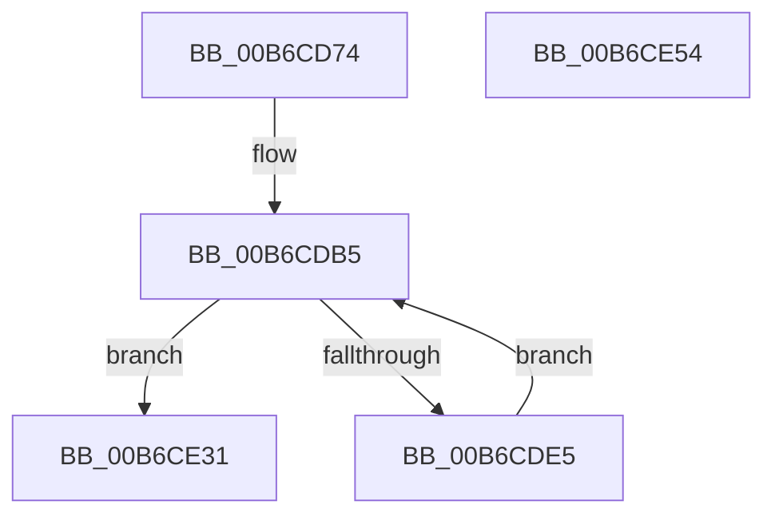

# PopCompressHiberBlocks

- RVA: `0x00B6CD74`–`0x00B6CE55` (길이 `225` bytes)
- VA: `0x0000000140B6CD74`
- 실행 섹션: `PAGELK`
- PDB 이름 있음: `예`; PDB Function 태그: `아니요`
- unwind 정보 RVA: `0x000CC3A4`
- 디코드: `54`개 명령, `225/225` bytes 표시
- 미해석 바이트: `0` (있으면 어셈블리에 `.byte`로 보존)

> 이 문서는 커널 이미지의 기계어와 PDB 기호를 분석해 생성했습니다. 4번과 5번은 함수 원형과 자료형을 바이너리 사용 방식에서 추정한 C 해석이며 원본 소스 복구 결과는 아닙니다.

## 1. Dependencies

- 직접 호출 지점: **5**; 고유 호출 대상: **5**
- 직접 호출자로 확인된 함수: **1**
- RIP 상대 이미지 참조: **1**

### Outgoing calls
- `0x00B6CDAB` → [memset](../../text/6C/memset_function_006C6C40.md) (function, `0x006C6C40`)
- `0x00B6CDD8` → [PopGetNextTable](../../text/5D/PopGetNextTable_function_005D4C54.md) (function, `0x005D4C54`)
- `0x00B6CE09` → [PopAddPagesToCompressedPageSet](PopAddPagesToCompressedPageSet_function_00B6C804.md) (function, `0x00B6C804`)
- `0x00B6CE2A` → [PopCountDataAsProduced](PopCountDataAsProduced_function_00B6CE5C.md) (function, `0x00B6CE5C`)
- `0x00B6CE3C` → [_security_check_cookie](../../text/6A/_security_check_cookie_function_006AC640.md) (function, `0x006AC640`)

### Direct callers
- [PopSaveHiberContext](PopSaveHiberContext_function_00B6F050.md) at `0x00B6F19F`
- [PopSaveHiberContext](PopSaveHiberContext_function_00B6F050.md) at `0x00B6F1C5`

### Static image references
- `0x00B6CD83` → RVA `0x00E0A740` (`.data`; read)

## 2. Other-region calls and transfers

- 다른 실행 섹션으로 향하는 call: **3**
  - `0x00B6CDAB` → [memset](../../text/6C/memset_function_006C6C40.md) (`PAGELK` → `.text`)
  - `0x00B6CDD8` → [PopGetNextTable](../../text/5D/PopGetNextTable_function_005D4C54.md) (`PAGELK` → `.text`)
  - `0x00B6CE3C` → [_security_check_cookie](../../text/6A/_security_check_cookie_function_006AC640.md) (`PAGELK` → `.text`)
- 별도 외부 분기/꼬리 이동을 확인하지 못했습니다.

## 3. Assembly (complete function range)

```asm
00B6CD74  48 89 5C 24 20                  mov qword ptr [rsp + 0x20], rbx
00B6CD79  55                              push rbp
00B6CD7A  56                              push rsi
00B6CD7B  57                              push rdi
00B6CD7C  48 81 EC 90 01 00 00            sub rsp, 0x190
00B6CD83  48 8B 05 B6 D9 29 00            mov rax, qword ptr [rip + 0x29d9b6]
00B6CD8A  48 33 C4                        xor rax, rsp
00B6CD8D  48 89 84 24 80 01 00 00         mov qword ptr [rsp + 0x180], rax
00B6CD95  41 8A E8                        mov bpl, r8b
00B6CD98  48 8B DA                        mov rbx, rdx
00B6CD9B  48 8B F1                        mov rsi, rcx
00B6CD9E  33 D2                           xor edx, edx
00B6CDA0  41 B8 B0 00 00 00               mov r8d, 0xb0
00B6CDA6  48 8D 4C 24 50                  lea rcx, [rsp + 0x50]
00B6CDAB  E8 90 9E B5 FF                  call 0x1406c6c40
00B6CDB0  83 64 24 40 00                  and dword ptr [rsp + 0x40], 0
00B6CDB5  48 8B 43 08                     mov rax, qword ptr [rbx + 8]
00B6CDB9  4C 8D 4C 24 50                  lea r9, [rsp + 0x50]
00B6CDBE  48 89 44 24 28                  mov qword ptr [rsp + 0x28], rax
00B6CDC3  4C 8D 84 24 00 01 00 00         lea r8, [rsp + 0x100]
00B6CDCB  48 8D 54 24 40                  lea rdx, [rsp + 0x40]
00B6CDD0  40 88 6C 24 20                  mov byte ptr [rsp + 0x20], bpl
00B6CDD5  48 8B CE                        mov rcx, rsi
00B6CDD8  E8 77 7E A6 FF                  call 0x1405d4c54
00B6CDDD  48 8B F8                        mov rdi, rax
00B6CDE0  48 85 C0                        test rax, rax
00B6CDE3  74 4C                           je 0x140b6ce31
00B6CDE5  48 83 64 24 30 00               and qword ptr [rsp + 0x30], 0
00B6CDEB  4C 8D 44 24 40                  lea r8, [rsp + 0x40]
00B6CDF0  4C 8B 4C 24 68                  mov r9, qword ptr [rsp + 0x68]
00B6CDF5  48 8B D3                        mov rdx, rbx
00B6CDF8  48 01 43 38                     add qword ptr [rbx + 0x38], rax
00B6CDFC  48 8B CE                        mov rcx, rsi
00B6CDFF  48 89 44 24 28                  mov qword ptr [rsp + 0x28], rax
00B6CE04  40 88 6C 24 20                  mov byte ptr [rsp + 0x20], bpl
00B6CE09  E8 F6 F9 FF FF                  call 0x140b6c804
00B6CE0E  83 64 24 28 00                  and dword ptr [rsp + 0x28], 0
00B6CE13  4C 8D 8C 24 00 01 00 00         lea r9, [rsp + 0x100]
00B6CE1B  4C 8D 44 24 40                  lea r8, [rsp + 0x40]
00B6CE20  89 7C 24 20                     mov dword ptr [rsp + 0x20], edi
00B6CE24  48 8B D0                        mov rdx, rax
00B6CE27  48 8B CB                        mov rcx, rbx
00B6CE2A  E8 2D 00 00 00                  call 0x140b6ce5c
00B6CE2F  EB 84                           jmp 0x140b6cdb5
00B6CE31  48 8B 8C 24 80 01 00 00         mov rcx, qword ptr [rsp + 0x180]
00B6CE39  48 33 CC                        xor rcx, rsp
00B6CE3C  E8 FF F7 B3 FF                  call 0x1406ac640
00B6CE41  48 8B 9C 24 C8 01 00 00         mov rbx, qword ptr [rsp + 0x1c8]
00B6CE49  48 81 C4 90 01 00 00            add rsp, 0x190
00B6CE50  5F                              pop rdi
00B6CE51  5E                              pop rsi
00B6CE52  5D                              pop rbp
00B6CE53  C3                              ret
00B6CE54  CC                              int3
```

## 4. C-style interpretation (structured pseudocode)

```c
__int64 __fastcall PopCompressHiberBlocks(__int64 a1, __int64 a2, unsigned __int8 a3)
{
    __int64 result;
    __int64 v_rsp;
    unsigned __int64 v_stack_m140;
    unsigned __int64 v_stack_m158;
    unsigned int v_stack_m168;
    unsigned __int64 v_stack_m178;
    unsigned __int64 v_stack_m180;
    unsigned __int8 v_stack_m188;
    unsigned __int64 v_stack_m28;
    unsigned __int64 v_stack_mA8;
    unsigned __int64 v_stack_p20;

    v_stack_p20 = v_rbx;
    v_rsp = (v_rsp) - (400);
    result = (*(unsigned __int64 *)(v_rip + 2742710)) ^ (v_rsp);
    v_stack_m28 = result;
    a2 = 0;
    result = memset(v_stack_m158, a2, 176, a4);
loc_00B6CDB5:
    v_stack_m180 = *(unsigned __int64 *)(a2 + 8);
    v_stack_m188 = a3;
    result = PopGetNextTable(a1, v_stack_m168, v_stack_mA8, v_stack_m158);
    if (result == 0) goto loc_00B6CE31;
    v_stack_m180 = result;
    v_stack_m188 = a3;
    result = PopAddPagesToCompressedPageSet(a1, 0, v_stack_m168, v_stack_m140);
    v_stack_m188 = (unsigned int)(result);
    result = PopCountDataAsProduced(0, result, v_stack_m168, v_stack_mA8);
    goto loc_00B6CDB5;
loc_00B6CE31:
    a1 = (v_stack_m28) ^ (v_rsp);
    result = _security_check_cookie(a1, result, v_stack_m168, v_stack_mA8);
    v_rsp = (v_rsp) + (400);
    return result;
}
```

## 5. (Beta) C Style

```c
int64_t PopCompressHiberBlocks(int64_t Arg1, void *Arg2, uint8_t Arg3)
{
    uint8_t *arg2 = (uint8_t *)Arg2;

    int64_t result;
    int64_t local_rsp;
    uint64_t v_stack_m140;
    uint64_t v_stack_m158;
    uint32_t v_stack_m168;
    uint64_t v_stack_m178;
    uint64_t v_stack_m180;
    uint8_t v_stack_m188;
    uint64_t v_stack_m28;
    uint64_t v_stack_mA8;
    uint64_t v_stack_p20;

    v_stack_p20 = local_rbx;
    local_rsp = (local_rsp) - (400);
    result = (*(uint64_t *)(v_rip + 0x29D9B6)) ^ (local_rsp);
    v_stack_m28 = result;
    Arg2 = 0;
    result = memset(v_stack_m158, Arg2, 176, a4);
loc_00B6CDB5:
    v_stack_m180 = *(uint64_t *)(arg2 + 0x8);
    v_stack_m188 = Arg3;
    result = PopGetNextTable(Arg1, v_stack_m168, v_stack_mA8, v_stack_m158);
    if (result == 0) goto loc_00B6CE31;
    v_stack_m180 = result;
    v_stack_m188 = Arg3;
    result = PopAddPagesToCompressedPageSet(Arg1, 0, v_stack_m168, v_stack_m140);
    v_stack_m188 = (uint32_t)(result);
    result = PopCountDataAsProduced(0, result, v_stack_m168, v_stack_mA8);
    goto loc_00B6CDB5;
loc_00B6CE31:
    Arg1 = (v_stack_m28) ^ (local_rsp);
    result = _security_check_cookie(Arg1, result, v_stack_m168, v_stack_mA8);
    local_rsp = (local_rsp) + (400);
    return result;
}
```

### 관측된 메모리 오프셋

구조체 형식이 확인되지 않은 접근은 인자 기준의 오프셋으로만 기록했습니다.

| 기준 인자 | 오프셋 표현 | 폭 (bit) | 접근 |
|---|---:|---:|---|
| `Arg2` | `+ 0x8` | `64` | `R` |
| `Arg2` | `+ 0x38` | `64` | `R/W` |

## 6. Execution-region graph

[열기: 2D/3D 그래프와 함수 탐색 컨트롤 패널](../../../control-panel.html?section=pagelk&rva=0x00B6CD74&view=graph)

- 2D 그래프는 위에서 아래로 흐르고, 3D 그래프는 빈 공간을 드래그해 회전합니다. Shift+드래그는 이동, 휠은 확대·축소, 함수 노드 선택은 대상 보고서 이동입니다.

### Static fallback


