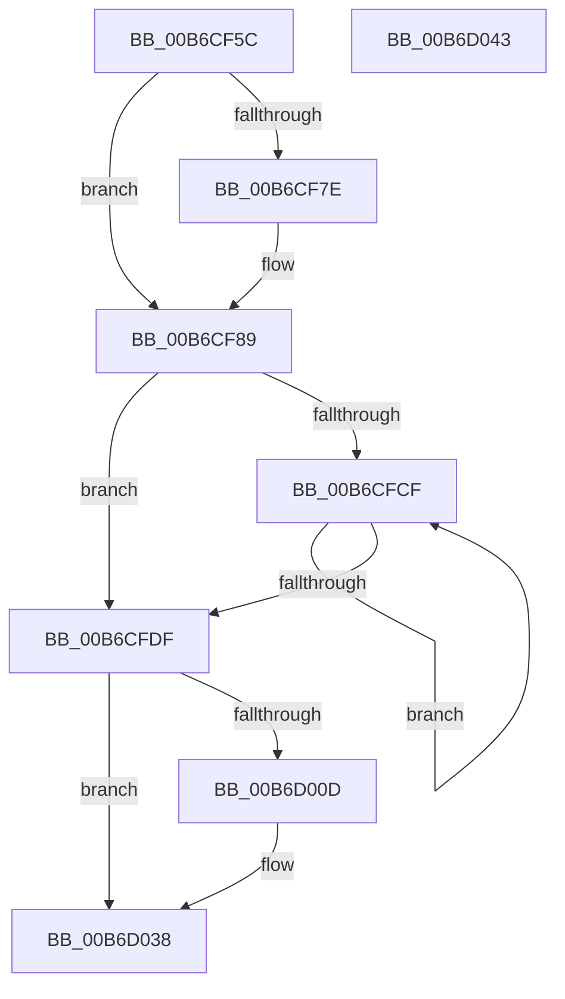

# PopCreateDumpMdl

- RVA: `0x00B6CF5C`–`0x00B6D044` (길이 `232` bytes)
- VA: `0x0000000140B6CF5C`
- 실행 섹션: `PAGELK`
- PDB 이름 있음: `예`; PDB Function 태그: `아니요`
- unwind 정보 RVA: `0x0006E5F8`
- 디코드: `62`개 명령, `232/232` bytes 표시
- 미해석 바이트: `0` (있으면 어셈블리에 `.byte`로 보존)

> 이 문서는 커널 이미지의 기계어와 PDB 기호를 분석해 생성했습니다. 4번과 5번은 함수 원형과 자료형을 바이너리 사용 방식에서 추정한 C 해석이며 원본 소스 복구 결과는 아닙니다.

## 1. Dependencies

- 직접 호출 지점: **4**; 고유 호출 대상: **4**
- 직접 호출자로 확인된 함수: **1**
- RIP 상대 이미지 참조: **0**

### Outgoing calls
- `0x00B6CF83` → [PopInternalError](../../text/5C/PopInternalError_function_005CEBD0.md) (function, `0x005CEBD0`)
- `0x00B6CFFF` → [MmMapMemoryDumpMdlEx](../../text/67/MmMapMemoryDumpMdlEx_function_0067DD30.md) (function, `0x0067DD30`)
- `0x00B6D017` → [PopInternalAddToDumpFile](../../text/5C/PopInternalAddToDumpFile_function_005CE634.md) (function, `0x005CE634`)
- `0x00B6D032` → [KeBugCheckEx](../../text/4F/KeBugCheckEx_function_004FD660.md) (function, `0x004FD660`)

### Direct callers
- [PopSaveHiberContext](PopSaveHiberContext_function_00B6F050.md) at `0x00B6F5E8`

### Static image references
- 디코드된 RIP-relative 메모리 참조가 없습니다.

## 2. Other-region calls and transfers

- 다른 실행 섹션으로 향하는 call: **4**
  - `0x00B6CF83` → [PopInternalError](../../text/5C/PopInternalError_function_005CEBD0.md) (`PAGELK` → `.text`)
  - `0x00B6CFFF` → [MmMapMemoryDumpMdlEx](../../text/67/MmMapMemoryDumpMdlEx_function_0067DD30.md) (`PAGELK` → `.text`)
  - `0x00B6D017` → [PopInternalAddToDumpFile](../../text/5C/PopInternalAddToDumpFile_function_005CE634.md) (`PAGELK` → `.text`)
  - `0x00B6D032` → [KeBugCheckEx](../../text/4F/KeBugCheckEx_function_004FD660.md) (`PAGELK` → `.text`)
- 별도 외부 분기/꼬리 이동을 확인하지 못했습니다.

## 3. Assembly (complete function range)

```asm
00B6CF5C  48 89 5C 24 08                  mov qword ptr [rsp + 8], rbx
00B6CF61  57                              push rdi
00B6CF62  48 83 EC 30                     sub rsp, 0x30
00B6CF66  65 48 8B 04 25 20 00 00 00      mov rax, qword ptr gs:[0x20]
00B6CF6F  48 8B DA                        mov rbx, rdx
00B6CF72  4C 8B D9                        mov r11, rcx
00B6CF75  44 8B 50 24                     mov r10d, dword ptr [rax + 0x24]
00B6CF79  4D 3B C1                        cmp r8, r9
00B6CF7C  72 0B                           jb 0x140b6cf89
00B6CF7E  B9 4E 19 0A 00                  mov ecx, 0xa194e
00B6CF83  E8 48 1C A6 FF                  call 0x1405cebd0
00B6CF88  CC                              int3
00B6CF89  8B 81 3C 01 00 00               mov eax, dword ptr [rcx + 0x13c]
00B6CF8F  4D 2B C8                        sub r9, r8
00B6CF92  4C 3B C8                        cmp r9, rax
00B6CF95  4C 0F 43 C8                     cmovae r9, rax
00B6CF99  33 FF                           xor edi, edi
00B6CF9B  49 8B C9                        mov rcx, r9
00B6CF9E  48 89 3A                        mov qword ptr [rdx], rdi
00B6CFA1  48 C1 E1 0C                     shl rcx, 0xc
00B6CFA5  48 8B C1                        mov rax, rcx
00B6CFA8  66 89 7A 0A                     mov word ptr [rdx + 0xa], di
00B6CFAC  48 C1 E8 0C                     shr rax, 0xc
00B6CFB0  66 83 C0 06                     add ax, 6
00B6CFB4  48 89 7A 20                     mov qword ptr [rdx + 0x20], rdi
00B6CFB8  66 C1 E0 03                     shl ax, 3
00B6CFBC  66 89 42 08                     mov word ptr [rdx + 8], ax
00B6CFC0  48 8D 42 30                     lea rax, [rdx + 0x30]
00B6CFC4  89 7A 2C                        mov dword ptr [rdx + 0x2c], edi
00B6CFC7  89 4A 28                        mov dword ptr [rdx + 0x28], ecx
00B6CFCA  4D 85 C9                        test r9, r9
00B6CFCD  74 10                           je 0x140b6cfdf
00B6CFCF  4C 89 00                        mov qword ptr [rax], r8
00B6CFD2  49 FF C0                        inc r8
00B6CFD5  48 8D 40 08                     lea rax, [rax + 8]
00B6CFD9  49 83 E9 01                     sub r9, 1
00B6CFDD  75 F0                           jne 0x140b6cfcf
00B6CFDF  49 8B 8B 28 01 00 00            mov rcx, qword ptr [r11 + 0x128]
00B6CFE6  45 33 C9                        xor r9d, r9d
00B6CFE9  41 8B 93 3C 01 00 00            mov edx, dword ptr [r11 + 0x13c]
00B6CFF0  4C 8B C3                        mov r8, rbx
00B6CFF3  4D 69 D2 A8 00 00 00            imul r10, r10, 0xa8
00B6CFFA  49 8B 4C 0A 08                  mov rcx, qword ptr [r10 + rcx + 8]
00B6CFFF  E8 2C 0D B1 FF                  call 0x14067dd30
00B6D004  F7 43 28 FF 0F 00 00            test dword ptr [rbx + 0x28], 0xfff
00B6D00B  74 2B                           je 0x140b6d038
00B6D00D  45 33 C0                        xor r8d, r8d
00B6D010  48 8B CB                        mov rcx, rbx
00B6D013  41 8D 50 30                     lea edx, [r8 + 0x30]
00B6D017  E8 18 16 A6 FF                  call 0x1405ce634
00B6D01C  BA 06 01 00 00                  mov edx, 0x106
00B6D021  48 89 7C 24 20                  mov qword ptr [rsp + 0x20], rdi
00B6D026  4C 8B CB                        mov r9, rbx
00B6D029  41 B8 0A 00 00 00               mov r8d, 0xa
00B6D02F  8D 4A 9A                        lea ecx, [rdx - 0x66]
00B6D032  E8 29 06 99 FF                  call 0x1404fd660
00B6D037  CC                              int3
00B6D038  48 8B 5C 24 40                  mov rbx, qword ptr [rsp + 0x40]
00B6D03D  48 83 C4 30                     add rsp, 0x30
00B6D041  5F                              pop rdi
00B6D042  C3                              ret
00B6D043  CC                              int3
```

## 4. C-style interpretation (structured pseudocode)

```c
__int64 __fastcall PopCreateDumpMdl(__int64 a1, __int64 a2, __int64 a3, __int64 a4)
{
    __int64 result;
    __int64 v_r10;
    __int64 v_rdi;
    __int64 v_rsp;
    unsigned __int64 v_stack_m18;
    unsigned __int64 v_stack_p8;

    v_stack_p8 = v_rbx;
    v_rsp = (v_rsp) - (48);
    result = *(unsigned __int64 *)(gs_base + (0 + 32));
    if (a3 >= a4) {
        a1 = 0xA194EULL;
        result = PopInternalError(a1, a2, a3, a4);
    }
    a4 = (a4) - (a3);
    if (a4 >= ((unsigned int)(*(unsigned int *)(a1 + 316)))) { a4 = (unsigned int)(*(unsigned int *)(a1 + 316)); }
    v_rdi = 0;
    *(unsigned __int64 *)(a2) = 0;
    a1 = (a4) << (12);
    *(unsigned __int16 *)(a2 + 10) = 0;
    result = (a1) >> (12);
    result = (unsigned __int16)((result) + (6));
    *(unsigned __int64 *)(a2 + 32) = 0;
    result = (unsigned __int16)((result) << (3));
    *(unsigned __int16 *)(a2 + 8) = (unsigned __int16)(result);
    *(unsigned int *)(a2 + 44) = 0;
    *(unsigned int *)(a2 + 40) = (unsigned int)(a1);
    if (a4 == 0) goto loc_00B6CFDF;
loc_00B6CFCF:
    *(unsigned __int64 *)(a2 + 48) = a3;
    a3 = (a3) + 1;
    a4 = (a4) - (1);
    if (condition_is_not_equal) goto loc_00B6CFCF;
loc_00B6CFDF:
    a4 = 0;
    v_r10 = ((unsigned int)(*(unsigned int *)(*(unsigned __int64 *)(gs_base + (0 + 32)) + 36))) * ((unsigned int)(*(unsigned int *)(*(unsigned __int64 *)(gs_base + (0 + 32)) + 36)));
    result = MmMapMemoryDumpMdlEx(*(unsigned __int64 *)(v_r10 + *(unsigned __int64 *)(a1 + 296) * 1 + 8), (unsigned int)(*(unsigned int *)(a1 + 316)), a2, a4);
    if (((*(unsigned int *)(a2 + 40)) & (0xFFFULL)) != 0) {
        a3 = 0;
        a1 = a2;
        a2 = a3 + 48;
        result = PopInternalAddToDumpFile(a1, a2, a3, a4);
        a2 = 262;
        v_stack_m18 = 0;
        a4 = a2;
        a3 = 10;
        a1 = a2 - 102;
        result = KeBugCheckEx(a1, a2, a3, a4);
    }
    v_rsp = (v_rsp) + (48);
    return result;
}
```

## 5. (Beta) C Style

```c
int64_t PopCreateDumpMdl(int64_t Arg1, void *Arg2, int64_t Arg3, int64_t Arg4)
{
    uint8_t *arg2 = (uint8_t *)Arg2;

    int64_t result;
    int64_t local_r10;
    int64_t local_rdi;
    int64_t local_rsp;
    uint64_t v_stack_m18;
    uint64_t v_stack_p8;

    v_stack_p8 = local_rbx;
    local_rsp = (local_rsp) - (48);
    result = *(uint64_t *)(gs_base + (0 + 0x20));
    if (Arg3 >= Arg4) {
        Arg1 = 0xA194EULL;
        result = PopInternalError(Arg1, Arg2, Arg3, Arg4);
    }
    Arg4 = (Arg4) - (Arg3);
    if (Arg4 >= ((uint32_t)(*(uint32_t *)(Arg1 + 0x13C)))) { Arg4 = (uint32_t)(*(uint32_t *)(Arg1 + 0x13C)); }
    local_rdi = 0;
    *(uint64_t *)(arg2) = 0;
    Arg1 = (Arg4) << (12);
    *(uint16_t *)(arg2 + 0xA) = 0;
    result = (Arg1) >> (12);
    result = (uint16_t)((result) + (6));
    *(uint64_t *)(arg2 + 0x20) = 0;
    result = (uint16_t)((result) << (3));
    *(uint16_t *)(arg2 + 0x8) = (uint16_t)(result);
    *(uint32_t *)(arg2 + 0x2C) = 0;
    *(uint32_t *)(arg2 + 0x28) = (uint32_t)(Arg1);
    if (Arg4 == 0) goto loc_00B6CFDF;
loc_00B6CFCF:
    *(uint64_t *)(arg2 + 0x30) = Arg3;
    Arg3 = (Arg3) + 1;
    Arg4 = (Arg4) - (1);
    if (condition_is_not_equal) goto loc_00B6CFCF;
loc_00B6CFDF:
    Arg4 = 0;
    local_r10 = ((uint32_t)(*(uint32_t *)(*(uint64_t *)(gs_base + (0 + 0x20)) + 0x24))) * ((uint32_t)(*(uint32_t *)(*(uint64_t *)(gs_base + (0 + 0x20)) + 0x24)));
    result = MmMapMemoryDumpMdlEx(*(uint64_t *)(local_r10 + *(uint64_t *)(Arg1 + 0x128) * 1 + 0x8), (uint32_t)(*(uint32_t *)(Arg1 + 0x13C)), Arg2, Arg4);
    if (((*(uint32_t *)(arg2 + 0x28)) & (0xFFFULL)) != 0) {
        Arg3 = 0;
        Arg1 = Arg2;
        Arg2 = Arg3 + 48;
        result = PopInternalAddToDumpFile(Arg1, Arg2, Arg3, Arg4);
        Arg2 = 262;
        v_stack_m18 = 0;
        Arg4 = Arg2;
        Arg3 = 10;
        Arg1 = Arg2 - 102;
        result = KeBugCheckEx(Arg1, Arg2, Arg3, Arg4);
    }
    local_rsp = (local_rsp) + (48);
    return result;
}
```

### 관측된 메모리 오프셋

구조체 형식이 확인되지 않은 접근은 인자 기준의 오프셋으로만 기록했습니다.

| 기준 인자 | 오프셋 표현 | 폭 (bit) | 접근 |
|---|---:|---:|---|
| `Arg2` | `+ 0x28` | `32` | `R` |

## 6. Execution-region graph

[열기: 2D/3D 그래프와 함수 탐색 컨트롤 패널](../../../control-panel.html?section=pagelk&rva=0x00B6CF5C&view=graph)

- 2D 그래프는 위에서 아래로 흐르고, 3D 그래프는 빈 공간을 드래그해 회전합니다. Shift+드래그는 이동, 휠은 확대·축소, 함수 노드 선택은 대상 보고서 이동입니다.

### Static fallback


