# PopDecompressHiberBlocks

- RVA: `0x00B6D074`–`0x00B6D59C` (길이 `1,320` bytes)
- VA: `0x0000000140B6D074`
- 실행 섹션: `PAGELK`
- PDB 이름 있음: `예`; PDB Function 태그: `아니요`
- unwind 정보 RVA: `0x000CC31C`
- 디코드: `338`개 명령, `1,320/1,320` bytes 표시
- 미해석 바이트: `0` (있으면 어셈블리에 `.byte`로 보존)

> 이 문서는 커널 이미지의 기계어와 PDB 기호를 분석해 생성했습니다. 4번과 5번은 함수 원형과 자료형을 바이너리 사용 방식에서 추정한 C 해석이며 원본 소스 복구 결과는 아닙니다.

## 1. Dependencies

- 직접 호출 지점: **22**; 고유 호출 대상: **16**
- 직접 호출자로 확인된 함수: **1**
- RIP 상대 이미지 참조: **12**

### Outgoing calls
- `0x00B6D0CA` → [memset](../../text/6C/memset_function_006C6C40.md) (function, `0x006C6C40`)
- `0x00B6D0E9` → [PopHiberCheckForDebugBreak](../B7/PopHiberCheckForDebugBreak_function_00B78258.md) (function, `0x00B78258`)
- `0x00B6D117` → [KeQueryPerformanceCounter](../../text/37/KeQueryPerformanceCounter_function_0037E7E0.md) (function, `0x0037E7E0`)
- `0x00B6D16D` → [BgDisplayProgressIndicator](../../pagebgfx/BC/BgDisplayProgressIndicator_function_00BC0628.md) (function, `0x00BC0628`)
- `0x00B6D1A4` → [ConsumerPeekAndConsumeBuffer](../B7/ConsumerPeekAndConsumeBuffer_function_00B78124.md) (function, `0x00B78124`)
- `0x00B6D1CF` → [PopReadProducerConsumerBuffer](PopReadProducerConsumerBuffer_function_00B6E570.md) (function, `0x00B6E570`)
- `0x00B6D1F8` → [PopReadProducerConsumerBuffer](PopReadProducerConsumerBuffer_function_00B6E570.md) (function, `0x00B6E570`)
- `0x00B6D2A4` → [MmMapMemoryDumpMdlEx2](../../text/4F/MmMapMemoryDumpMdlEx2_function_004F98D4.md) (function, `0x004F98D4`)
- `0x00B6D2E5` → [ProducerConsumerCopyFromContextBuffer](../B7/ProducerConsumerCopyFromContextBuffer_function_00B705B8.md) (function, `0x00B705B8`)
- `0x00B6D31E` → [ProducerConsumerBufferComplete](../B7/ProducerConsumerBufferComplete_function_00B704E4.md) (function, `0x00B704E4`)
- `0x00B6D348` → [ProducerConsumerCopyFromContextBuffer](../B7/ProducerConsumerCopyFromContextBuffer_function_00B705B8.md) (function, `0x00B705B8`)
- `0x00B6D37E` → [ProducerConsumerBufferComplete](../B7/ProducerConsumerBufferComplete_function_00B704E4.md) (function, `0x00B704E4`)
- `0x00B6D3AC` → [guard_dispatch_icall](../../text/6B/guard_dispatch_icall_function_006BAAD0.md) (function, `0x006BAAD0`)
- `0x00B6D429` → [RtlDecompressBufferEx](../../text/3A/RtlDecompressBufferEx_function_003A4C60.md) (function, `0x003A4C60`)
- `0x00B6D476` → [RtlDecompressBufferProgress](../../text/5E/RtlDecompressBufferProgress_function_005EF580.md) (function, `0x005EF580`)
- `0x00B6D503` → [PopCheckpointSystemSleep](../B7/PopCheckpointSystemSleep_function_00B77C90.md) (function, `0x00B77C90`)
- `0x00B6D513` → [PopInternalAddToDumpFile](../../text/5C/PopInternalAddToDumpFile_function_005CE634.md) (function, `0x005CE634`)
- `0x00B6D52E` → [KeBugCheckEx](../../text/4F/KeBugCheckEx_function_004FD660.md) (function, `0x004FD660`)
- `0x00B6D539` → [PopCheckpointSystemSleep](../B7/PopCheckpointSystemSleep_function_00B77C90.md) (function, `0x00B77C90`)
- `0x00B6D549` → [PopInternalAddToDumpFile](../../text/5C/PopInternalAddToDumpFile_function_005CE634.md) (function, `0x005CE634`)
- `0x00B6D564` → [KeBugCheckEx](../../text/4F/KeBugCheckEx_function_004FD660.md) (function, `0x004FD660`)
- `0x00B6D57B` → [_security_check_cookie](../../text/6A/_security_check_cookie_function_006AC640.md) (function, `0x006AC640`)

### Direct callers
- [PopRestoreHiberContext](../B7/PopRestoreHiberContext_function_00B777F0.md) at `0x00B77A34`
- [PopRestoreHiberContext](../B7/PopRestoreHiberContext_function_00B777F0.md) at `0x00B77A65`
- [PopRestoreHiberContext](../B7/PopRestoreHiberContext_function_00B777F0.md) at `0x00B77A9C`

### Static image references
- `0x00B6D093` → RVA `0x00E0A740` (`.data`; read)
- `0x00B6D0CF` → RVA `0x00F0BFC8` (`.data`; read)
- `0x00B6D0EE` → RVA `0x00F0C518` (`.data`; read)
- `0x00B6D10C` → RVA `0x00F0BF60` (`.data`; read)
- `0x00B6D11C` → RVA `0x00F0C518` (`.data`; write)
- `0x00B6D138` → RVA `0x00F0BF61` (`.data`; read)
- `0x00B6D14A` → RVA `0x00F0BF44` (`.data`; read)
- `0x00B6D15F` → RVA `0x00E65EB9` (`.data`; read)
- `0x00B6D172` → RVA `0x00E65EB8` (`.data`; write)
- `0x00B6D185` → RVA `0x00F0C500` (`.data`; read/write)
- `0x00B6D3B1` → RVA `0x00F0C4F0` (`.data`; read)
- `0x00B6D416` → RVA `0x00029238` (`.rdata`; read)

## 2. Other-region calls and transfers

- 다른 실행 섹션으로 향하는 call: **12**
  - `0x00B6D0CA` → [memset](../../text/6C/memset_function_006C6C40.md) (`PAGELK` → `.text`)
  - `0x00B6D117` → [KeQueryPerformanceCounter](../../text/37/KeQueryPerformanceCounter_function_0037E7E0.md) (`PAGELK` → `.text`)
  - `0x00B6D16D` → [BgDisplayProgressIndicator](../../pagebgfx/BC/BgDisplayProgressIndicator_function_00BC0628.md) (`PAGELK` → `PAGEBGFX`)
  - `0x00B6D2A4` → [MmMapMemoryDumpMdlEx2](../../text/4F/MmMapMemoryDumpMdlEx2_function_004F98D4.md) (`PAGELK` → `.text`)
  - `0x00B6D3AC` → [guard_dispatch_icall](../../text/6B/guard_dispatch_icall_function_006BAAD0.md) (`PAGELK` → `.text`)
  - `0x00B6D429` → [RtlDecompressBufferEx](../../text/3A/RtlDecompressBufferEx_function_003A4C60.md) (`PAGELK` → `.text`)
  - `0x00B6D476` → [RtlDecompressBufferProgress](../../text/5E/RtlDecompressBufferProgress_function_005EF580.md) (`PAGELK` → `.text`)
  - `0x00B6D513` → [PopInternalAddToDumpFile](../../text/5C/PopInternalAddToDumpFile_function_005CE634.md) (`PAGELK` → `.text`)
  - `0x00B6D52E` → [KeBugCheckEx](../../text/4F/KeBugCheckEx_function_004FD660.md) (`PAGELK` → `.text`)
  - `0x00B6D549` → [PopInternalAddToDumpFile](../../text/5C/PopInternalAddToDumpFile_function_005CE634.md) (`PAGELK` → `.text`)
  - `0x00B6D564` → [KeBugCheckEx](../../text/4F/KeBugCheckEx_function_004FD660.md) (`PAGELK` → `.text`)
  - `0x00B6D57B` → [_security_check_cookie](../../text/6A/_security_check_cookie_function_006AC640.md) (`PAGELK` → `.text`)
- 별도 외부 분기/꼬리 이동을 확인하지 못했습니다.

## 3. Assembly (complete function range)

```asm
00B6D074  48 89 5C 24 20                  mov qword ptr [rsp + 0x20], rbx
00B6D079  55                              push rbp
00B6D07A  56                              push rsi
00B6D07B  57                              push rdi
00B6D07C  41 54                           push r12
00B6D07E  41 55                           push r13
00B6D080  41 56                           push r14
00B6D082  41 57                           push r15
00B6D084  48 8D AC 24 20 FF FF FF         lea rbp, [rsp - 0xe0]
00B6D08C  48 81 EC E0 01 00 00            sub rsp, 0x1e0
00B6D093  48 8B 05 A6 D6 29 00            mov rax, qword ptr [rip + 0x29d6a6]
00B6D09A  48 33 C4                        xor rax, rsp
00B6D09D  48 89 85 D0 00 00 00            mov qword ptr [rbp + 0xd0], rax
00B6D0A4  48 8B 85 40 01 00 00            mov rax, qword ptr [rbp + 0x140]
00B6D0AB  41 8B D8                        mov ebx, r8d
00B6D0AE  4C 8B F2                        mov r14, rdx
00B6D0B1  48 89 44 24 78                  mov qword ptr [rsp + 0x78], rax
00B6D0B6  4C 8B F9                        mov r15, rcx
00B6D0B9  44 88 4C 24 50                  mov byte ptr [rsp + 0x50], r9b
00B6D0BE  33 D2                           xor edx, edx
00B6D0C0  48 8D 4D A0                     lea rcx, [rbp - 0x60]
00B6D0C4  41 B8 B0 00 00 00               mov r8d, 0xb0
00B6D0CA  E8 71 9B B5 FF                  call 0x1406c6c40
00B6D0CF  4C 8B 25 F2 EE 39 00            mov r12, qword ptr [rip + 0x39eef2]
00B6D0D6  33 F6                           xor esi, esi
00B6D0D8  89 74 24 70                     mov dword ptr [rsp + 0x70], esi
00B6D0DC  48 89 75 88                     mov qword ptr [rbp - 0x78], rsi
00B6D0E0  89 74 24 54                     mov dword ptr [rsp + 0x54], esi
00B6D0E4  4C 89 64 24 60                  mov qword ptr [rsp + 0x60], r12
00B6D0E9  E8 6A B1 00 00                  call 0x140b78258
00B6D0EE  48 39 35 23 F4 39 00            cmp qword ptr [rip + 0x39f423], rsi
00B6D0F5  75 2C                           jne 0x140b6d123
00B6D0F7  65 48 8B 04 25 20 00 00 00      mov rax, qword ptr gs:[0x20]
00B6D100  8B 48 24                        mov ecx, dword ptr [rax + 0x24]
00B6D103  41 39 8F D0 00 00 00            cmp dword ptr [r15 + 0xd0], ecx
00B6D10A  75 17                           jne 0x140b6d123
00B6D10C  40 38 35 4D EE 39 00            cmp byte ptr [rip + 0x39ee4d], sil
00B6D113  74 0E                           je 0x140b6d123
00B6D115  33 C9                           xor ecx, ecx
00B6D117  E8 C4 16 81 FF                  call 0x14037e7e0
00B6D11C  48 89 05 F5 F3 39 00            mov qword ptr [rip + 0x39f3f5], rax
00B6D123  65 48 8B 04 25 20 00 00 00      mov rax, qword ptr gs:[0x20]
00B6D12C  8B 48 24                        mov ecx, dword ptr [rax + 0x24]
00B6D12F  41 39 8F D0 00 00 00            cmp dword ptr [r15 + 0xd0], ecx
00B6D136  75 54                           jne 0x140b6d18c
00B6D138  40 38 35 22 EE 39 00            cmp byte ptr [rip + 0x39ee22], sil
00B6D13F  75 4B                           jne 0x140b6d18c
00B6D141  40 38 35 18 EE 39 00            cmp byte ptr [rip + 0x39ee18], sil
00B6D148  74 0C                           je 0x140b6d156
00B6D14A  81 3D F0 ED 39 00 40 06 00 00   cmp dword ptr [rip + 0x39edf0], 0x640
00B6D154  76 36                           jbe 0x140b6d18c
00B6D156  0F 31                           rdtsc
00B6D158  48 C1 E2 20                     shl rdx, 0x20
00B6D15C  48 0B C2                        or rax, rdx
00B6D15F  40 38 35 53 8D 2F 00            cmp byte ptr [rip + 0x2f8d53], sil
00B6D166  48 8B F8                        mov rdi, rax
00B6D169  74 0E                           je 0x140b6d179
00B6D16B  B1 01                           mov cl, 1
00B6D16D  E8 B6 34 05 00                  call 0x140bc0628
00B6D172  C6 05 3F 8D 2F 00 01            mov byte ptr [rip + 0x2f8d3f], 1
00B6D179  0F 31                           rdtsc
00B6D17B  48 C1 E2 20                     shl rdx, 0x20
00B6D17F  48 0B C2                        or rax, rdx
00B6D182  48 2B C7                        sub rax, rdi
00B6D185  48 01 05 74 F3 39 00            add qword ptr [rip + 0x39f374], rax
00B6D18C  44 8B C3                        mov r8d, ebx
00B6D18F  C7 44 24 58 04 00 00 00         mov dword ptr [rsp + 0x58], 4
00B6D197  48 8D 54 24 58                  lea rdx, [rsp + 0x58]
00B6D19C  4C 89 74 24 20                  mov qword ptr [rsp + 0x20], r14
00B6D1A1  49 8B CC                        mov rcx, r12
00B6D1A4  E8 7B AF 00 00                  call 0x140b78124
00B6D1A9  4C 8B E8                        mov r13, rax
00B6D1AC  48 85 C0                        test rax, rax
00B6D1AF  0F 84 B5 03 00 00               je 0x140b6d56a
00B6D1B5  C6 44 24 28 01                  mov byte ptr [rsp + 0x28], 1
00B6D1BA  4C 8D 44 24 70                  lea r8, [rsp + 0x70]
00B6D1BF  4D 8B CC                        mov r9, r12
00B6D1C2  4C 89 74 24 20                  mov qword ptr [rsp + 0x20], r14
00B6D1C7  BA 04 00 00 00                  mov edx, 4
00B6D1CC  48 8B C8                        mov rcx, rax
00B6D1CF  E8 9C 13 00 00                  call 0x140b6e570
00B6D1D4  4C 8B 4C 24 60                  mov r9, qword ptr [rsp + 0x60]
00B6D1D9  49 8D 4D 04                     lea rcx, [r13 + 4]
00B6D1DD  4C 8B E0                        mov r12, rax
00B6D1E0  C6 44 24 28 01                  mov byte ptr [rsp + 0x28], 1
00B6D1E5  4C 8D 45 50                     lea r8, [rbp + 0x50]
00B6D1E9  4C 89 74 24 20                  mov qword ptr [rsp + 0x20], r14
00B6D1EE  8B 00                           mov eax, dword ptr [rax]
00B6D1F0  0F B6 F8                        movzx edi, al
00B6D1F3  C1 E7 03                        shl edi, 3
00B6D1F6  8B D7                           mov edx, edi
00B6D1F8  E8 73 13 00 00                  call 0x140b6e570
00B6D1FD  8B CF                           mov ecx, edi
00B6D1FF  4C 8D 4D D0                     lea r9, [rbp - 0x30]
00B6D203  48 83 C1 04                     add rcx, 4
00B6D207  4C 8B C0                        mov r8, rax
00B6D20A  41 8B 04 24                     mov eax, dword ptr [r12]
00B6D20E  49 03 CD                        add rcx, r13
00B6D211  48 89 4C 24 68                  mov qword ptr [rsp + 0x68], rcx
00B6D216  48 8B FE                        mov rdi, rsi
00B6D219  0F B6 C8                        movzx ecx, al
00B6D21C  84 C0                           test al, al
00B6D21E  74 3B                           je 0x140b6d25b
00B6D220  44 8B D1                        mov r10d, ecx
00B6D223  49 8B 00                        mov rax, qword ptr [r8]
00B6D226  48 8B C8                        mov rcx, rax
00B6D229  83 E0 0F                        and eax, 0xf
00B6D22C  48 C1 E9 04                     shr rcx, 4
00B6D230  48 8D 50 01                     lea rdx, [rax + 1]
00B6D234  48 03 D1                        add rdx, rcx
00B6D237  48 8B C2                        mov rax, rdx
00B6D23A  48 2B C1                        sub rax, rcx
00B6D23D  48 03 F8                        add rdi, rax
00B6D240  EB 0A                           jmp 0x140b6d24c
00B6D242  49 89 09                        mov qword ptr [r9], rcx
00B6D245  48 FF C1                        inc rcx
00B6D248  49 83 C1 08                     add r9, 8
00B6D24C  48 3B CA                        cmp rcx, rdx
00B6D24F  72 F1                           jb 0x140b6d242
00B6D251  49 83 C0 08                     add r8, 8
00B6D255  49 83 EA 01                     sub r10, 1
00B6D259  75 C8                           jne 0x140b6d223
00B6D25B  41 8B 87 3C 01 00 00            mov eax, dword ptr [r15 + 0x13c]
00B6D262  48 3B F8                        cmp rdi, rax
00B6D265  0F 87 C9 02 00 00               ja 0x140b6d534
00B6D26B  49 8B 4E 08                     mov rcx, qword ptr [r14 + 8]
00B6D26F  4C 8D 45 A0                     lea r8, [rbp - 0x60]
00B6D273  C1 E7 0C                        shl edi, 0xc
00B6D276  41 B9 01 00 00 00               mov r9d, 1
00B6D27C  8B C7                           mov eax, edi
00B6D27E  48 89 45 98                     mov qword ptr [rbp - 0x68], rax
00B6D282  48 C1 E8 0C                     shr rax, 0xc
00B6D286  66 83 C0 06                     add ax, 6
00B6D28A  48 89 75 A0                     mov qword ptr [rbp - 0x60], rsi
00B6D28E  66 C1 E0 03                     shl ax, 3
00B6D292  66 89 45 A8                     mov word ptr [rbp - 0x58], ax
00B6D296  66 89 75 AA                     mov word ptr [rbp - 0x56], si
00B6D29A  48 89 75 C0                     mov qword ptr [rbp - 0x40], rsi
00B6D29E  89 75 CC                        mov dword ptr [rbp - 0x34], esi
00B6D2A1  89 7D C8                        mov dword ptr [rbp - 0x38], edi
00B6D2A4  E8 2B C6 98 FF                  call 0x1404f98d4
00B6D2A9  41 8B 0C 24                     mov ecx, dword ptr [r12]
00B6D2AD  C1 E9 08                        shr ecx, 8
00B6D2B0  81 E1 FF FF 1F 00               and ecx, 0x1fffff
00B6D2B6  0F 31                           rdtsc
00B6D2B8  4C 8B 4C 24 68                  mov r9, qword ptr [rsp + 0x68]
00B6D2BD  48 C1 E2 20                     shl rdx, 0x20
00B6D2C1  48 0B C2                        or rax, rdx
00B6D2C4  48 89 45 80                     mov qword ptr [rbp - 0x80], rax
00B6D2C8  48 8B 44 24 60                  mov rax, qword ptr [rsp + 0x60]
00B6D2CD  48 8D 50 30                     lea rdx, [rax + 0x30]
00B6D2D1  48 89 55 90                     mov qword ptr [rbp - 0x70], rdx
00B6D2D5  3B CF                           cmp ecx, edi
00B6D2D7  75 66                           jne 0x140b6d33f
00B6D2D9  48 8B 4D B8                     mov rcx, qword ptr [rbp - 0x48]
00B6D2DD  4C 8B C0                        mov r8, rax
00B6D2E0  8B D7                           mov edx, edi
00B6D2E2  4C 8B E0                        mov r12, rax
00B6D2E5  E8 CE 32 00 00                  call 0x140b705b8
00B6D2EA  0F 31                           rdtsc
00B6D2EC  49 8B 4E 48                     mov rcx, qword ptr [r14 + 0x48]
00B6D2F0  48 2B 4D 80                     sub rcx, qword ptr [rbp - 0x80]
00B6D2F4  48 C1 E2 20                     shl rdx, 0x20
00B6D2F8  48 0B C2                        or rax, rdx
00B6D2FB  48 03 C8                        add rcx, rax
00B6D2FE  49 89 4E 48                     mov qword ptr [r14 + 0x48], rcx
00B6D302  0F 31                           rdtsc
00B6D304  44 8B 4C 24 58                  mov r9d, dword ptr [rsp + 0x58]
00B6D309  4D 8B C5                        mov r8, r13
00B6D30C  48 C1 E2 20                     shl rdx, 0x20
00B6D310  49 8B CC                        mov rcx, r12
00B6D313  48 0B C2                        or rax, rdx
00B6D316  49 8D 54 24 30                  lea rdx, [r12 + 0x30]
00B6D31B  48 8B F8                        mov rdi, rax
00B6D31E  E8 C1 31 00 00                  call 0x140b704e4
00B6D323  0F 31                           rdtsc
00B6D325  49 8B 4E 50                     mov rcx, qword ptr [r14 + 0x50]
00B6D329  48 C1 E2 20                     shl rdx, 0x20
00B6D32D  48 2B CF                        sub rcx, rdi
00B6D330  48 0B C2                        or rax, rdx
00B6D333  48 03 C8                        add rcx, rax
00B6D336  49 89 4E 50                     mov qword ptr [r14 + 0x50], rcx
00B6D33A  E9 A7 01 00 00                  jmp 0x140b6d4e6
00B6D33F  8B D1                           mov edx, ecx
00B6D341  4C 8B C0                        mov r8, rax
00B6D344  49 8B 4E 18                     mov rcx, qword ptr [r14 + 0x18]
00B6D348  E8 6B 32 00 00                  call 0x140b705b8
00B6D34D  0F 31                           rdtsc
00B6D34F  44 8B 4C 24 58                  mov r9d, dword ptr [rsp + 0x58]
00B6D354  4D 8B C5                        mov r8, r13
00B6D357  48 C1 E2 20                     shl rdx, 0x20
00B6D35B  48 0B C2                        or rax, rdx
00B6D35E  48 8B 55 90                     mov rdx, qword ptr [rbp - 0x70]
00B6D362  48 8B C8                        mov rcx, rax
00B6D365  48 89 44 24 68                  mov qword ptr [rsp + 0x68], rax
00B6D36A  49 8B 46 48                     mov rax, qword ptr [r14 + 0x48]
00B6D36E  48 2B 45 80                     sub rax, qword ptr [rbp - 0x80]
00B6D372  48 03 C1                        add rax, rcx
00B6D375  48 8B 4C 24 60                  mov rcx, qword ptr [rsp + 0x60]
00B6D37A  49 89 46 48                     mov qword ptr [r14 + 0x48], rax
00B6D37E  E8 61 31 00 00                  call 0x140b704e4
00B6D383  0F 31                           rdtsc
00B6D385  49 8B 4E 50                     mov rcx, qword ptr [r14 + 0x50]
00B6D389  48 2B 4C 24 68                  sub rcx, qword ptr [rsp + 0x68]
00B6D38E  4C 8B 44 24 78                  mov r8, qword ptr [rsp + 0x78]
00B6D393  48 C1 E2 20                     shl rdx, 0x20
00B6D397  48 0B C2                        or rax, rdx
00B6D39A  48 03 C8                        add rcx, rax
00B6D39D  49 89 4E 50                     mov qword ptr [r14 + 0x50], rcx
00B6D3A1  4D 85 C0                        test r8, r8
00B6D3A4  74 1B                           je 0x140b6d3c1
00B6D3A6  49 8B CF                        mov rcx, r15
00B6D3A9  49 8B C0                        mov rax, r8
00B6D3AC  E8 1F D7 B4 FF                  call 0x1406baad0
00B6D3B1  48 8B 05 38 F1 39 00            mov rax, qword ptr [rip + 0x39f138]
00B6D3B8  4C 8B 44 24 78                  mov r8, qword ptr [rsp + 0x78]
00B6D3BD  48 89 45 88                     mov qword ptr [rbp - 0x78], rax
00B6D3C1  0F 31                           rdtsc
00B6D3C3  41 8B 0C 24                     mov ecx, dword ptr [r12]
00B6D3C7  48 C1 E2 20                     shl rdx, 0x20
00B6D3CB  48 0B C2                        or rax, rdx
00B6D3CE  4C 8B E8                        mov r13, rax
00B6D3D1  41 38 B7 EA 01 00 00            cmp byte ptr [r15 + 0x1ea], sil
00B6D3D8  74 56                           je 0x140b6d430
00B6D3DA  8B C1                           mov eax, ecx
00B6D3DC  C1 E8 1D                        shr eax, 0x1d
00B6D3DF  85 C0                           test eax, eax
00B6D3E1  74 0A                           je 0x140b6d3ed
00B6D3E3  83 F8 01                        cmp eax, 1
00B6D3E6  74 05                           je 0x140b6d3ed
00B6D3E8  83 F8 04                        cmp eax, 4
00B6D3EB  75 43                           jne 0x140b6d430
00B6D3ED  49 8B 46 10                     mov rax, qword ptr [r14 + 0x10]
00B6D3F1  8B D1                           mov edx, ecx
00B6D3F3  4D 8B 4E 18                     mov r9, qword ptr [r14 + 0x18]
00B6D3F7  44 8B C7                        mov r8d, edi
00B6D3FA  48 89 44 24 30                  mov qword ptr [rsp + 0x30], rax
00B6D3FF  48 8D 44 24 54                  lea rax, [rsp + 0x54]
00B6D404  C1 EA 08                        shr edx, 8
00B6D407  48 89 44 24 28                  mov qword ptr [rsp + 0x28], rax
00B6D40C  81 E2 FF FF 1F 00               and edx, 0x1fffff
00B6D412  48 C1 E9 1D                     shr rcx, 0x1d
00B6D416  48 8D 05 1B BE 4B FF            lea rax, [rip - 0xb441e5]
00B6D41D  89 54 24 20                     mov dword ptr [rsp + 0x20], edx
00B6D421  48 8B 55 B8                     mov rdx, qword ptr [rbp - 0x48]
00B6D425  0F B7 0C 48                     movzx ecx, word ptr [rax + rcx*2]
00B6D429  E8 32 78 83 FF                  call 0x1403a4c60
00B6D42E  EB 4B                           jmp 0x140b6d47b
00B6D430  49 8B 46 10                     mov rax, qword ptr [r14 + 0x10]
00B6D434  8B D1                           mov edx, ecx
00B6D436  4D 8B 4E 18                     mov r9, qword ptr [r14 + 0x18]
00B6D43A  4C 89 7C 24 40                  mov qword ptr [rsp + 0x40], r15
00B6D43F  4C 89 44 24 38                  mov qword ptr [rsp + 0x38], r8
00B6D444  44 8B C7                        mov r8d, edi
00B6D447  48 89 44 24 30                  mov qword ptr [rsp + 0x30], rax
00B6D44C  48 8D 44 24 54                  lea rax, [rsp + 0x54]
00B6D451  C1 EA 08                        shr edx, 8
00B6D454  48 89 44 24 28                  mov qword ptr [rsp + 0x28], rax
00B6D459  81 E2 FF FF 1F 00               and edx, 0x1fffff
00B6D45F  48 C1 E9 1D                     shr rcx, 0x1d
00B6D463  48 8D 05 CE BD 4B FF            lea rax, [rip - 0xb44232]
00B6D46A  89 54 24 20                     mov dword ptr [rsp + 0x20], edx
00B6D46E  48 8B 55 B8                     mov rdx, qword ptr [rbp - 0x48]
00B6D472  0F B7 0C 48                     movzx ecx, word ptr [rax + rcx*2]
00B6D476  E8 05 21 A8 FF                  call 0x1405ef580
00B6D47B  8B C8                           mov ecx, eax
00B6D47D  0F 31                           rdtsc
00B6D47F  48 C1 E2 20                     shl rdx, 0x20
00B6D483  48 0B D0                        or rdx, rax
00B6D486  85 C9                           test ecx, ecx
00B6D488  78 69                           js 0x140b6d4f3
00B6D48A  39 7C 24 54                     cmp dword ptr [rsp + 0x54], edi
00B6D48E  75 63                           jne 0x140b6d4f3
00B6D490  49 8B 4E 40                     mov rcx, qword ptr [r14 + 0x40]
00B6D494  49 2B CD                        sub rcx, r13
00B6D497  48 03 CA                        add rcx, rdx
00B6D49A  49 89 4E 40                     mov qword ptr [r14 + 0x40], rcx
00B6D49E  48 39 74 24 78                  cmp qword ptr [rsp + 0x78], rsi
00B6D4A3  74 0F                           je 0x140b6d4b4
00B6D4A5  48 2B 0D 44 F0 39 00            sub rcx, qword ptr [rip + 0x39f044]
00B6D4AC  48 03 4D 88                     add rcx, qword ptr [rbp - 0x78]
00B6D4B0  49 89 4E 40                     mov qword ptr [r14 + 0x40], rcx
00B6D4B4  41 8B 04 24                     mov eax, dword ptr [r12]
00B6D4B8  48 8B CE                        mov rcx, rsi
00B6D4BB  4C 8B 64 24 60                  mov r12, qword ptr [rsp + 0x60]
00B6D4C0  25 00 00 00 E0                  and eax, 0xe0000000
00B6D4C5  3D 00 00 00 40                  cmp eax, 0x40000000
00B6D4CA  48 8B 45 98                     mov rax, qword ptr [rbp - 0x68]
00B6D4CE  0F 93 C1                        setae cl
00B6D4D1  48 2B 54 24 68                  sub rdx, qword ptr [rsp + 0x68]
00B6D4D6  49 01 84 CE 90 00 00 00         add qword ptr [r14 + rcx*8 + 0x90], rax
00B6D4DE  49 01 94 CE 80 00 00 00         add qword ptr [r14 + rcx*8 + 0x80], rdx
00B6D4E6  40 38 74 24 50                  cmp byte ptr [rsp + 0x50], sil
00B6D4EB  0F 85 F8 FB FF FF               jne 0x140b6d0e9
00B6D4F1  EB 7C                           jmp 0x140b6d56f
00B6D4F3  B9 1F 00 00 00                  mov ecx, 0x1f
00B6D4F8  41 C7 87 CC 00 00 00 42 02 00 C0  mov dword ptr [r15 + 0xcc], 0xc0000242
00B6D503  E8 88 A7 00 00                  call 0x140b77c90
00B6D508  45 33 C0                        xor r8d, r8d
00B6D50B  BA F0 01 00 00                  mov edx, 0x1f0
00B6D510  49 8B CF                        mov rcx, r15
00B6D513  E8 1C 11 A6 FF                  call 0x1405ce634
00B6D518  BA 07 01 00 00                  mov edx, 0x107
00B6D51D  48 89 74 24 20                  mov qword ptr [rsp + 0x20], rsi
00B6D522  4D 8B CF                        mov r9, r15
00B6D525  41 B8 0A 00 00 00               mov r8d, 0xa
00B6D52B  8D 4A 99                        lea ecx, [rdx - 0x67]
00B6D52E  E8 2D 01 99 FF                  call 0x1404fd660
00B6D533  CC                              int3
00B6D534  B9 1F 00 00 00                  mov ecx, 0x1f
00B6D539  E8 52 A7 00 00                  call 0x140b77c90
00B6D53E  45 33 C0                        xor r8d, r8d
00B6D541  BA F0 01 00 00                  mov edx, 0x1f0
00B6D546  49 8B CF                        mov rcx, r15
00B6D549  E8 E6 10 A6 FF                  call 0x1405ce634
00B6D54E  BA 07 01 00 00                  mov edx, 0x107
00B6D553  48 89 74 24 20                  mov qword ptr [rsp + 0x20], rsi
00B6D558  4D 8B CF                        mov r9, r15
00B6D55B  41 B8 0A 00 00 00               mov r8d, 0xa
00B6D561  8D 4A 99                        lea ecx, [rdx - 0x67]
00B6D564  E8 F7 00 99 FF                  call 0x1404fd660
00B6D569  CC                              int3
00B6D56A  BE 22 00 00 80                  mov esi, 0x80000022
00B6D56F  8B C6                           mov eax, esi
00B6D571  48 8B 8D D0 00 00 00            mov rcx, qword ptr [rbp + 0xd0]
00B6D578  48 33 CC                        xor rcx, rsp
00B6D57B  E8 C0 F0 B3 FF                  call 0x1406ac640
00B6D580  48 8B 9C 24 38 02 00 00         mov rbx, qword ptr [rsp + 0x238]
00B6D588  48 81 C4 E0 01 00 00            add rsp, 0x1e0
00B6D58F  41 5F                           pop r15
00B6D591  41 5E                           pop r14
00B6D593  41 5D                           pop r13
00B6D595  41 5C                           pop r12
00B6D597  5F                              pop rdi
00B6D598  5E                              pop rsi
00B6D599  5D                              pop rbp
00B6D59A  C3                              ret
00B6D59B  CC                              int3
```

## 4. C-style interpretation (structured pseudocode)

```c
__int64 __fastcall PopDecompressHiberBlocks(__int64 a1, __int64 a2, int a3, unsigned __int8 a4, __int64 a5)
{
    __int64 result;
    __int64 v_r10;
    __int64 v_rdi;
    __int64 v_rsi;
    __int64 v_rsp;
    unsigned __int64 v_stack_m118;
    unsigned __int64 v_stack_m148;
    unsigned int v_stack_m14C;
    unsigned int v_stack_m150;
    unsigned __int64 v_stack_m158;
    unsigned __int64 v_stack_m160;
    unsigned __int16 v_stack_m16E;
    unsigned __int16 v_stack_m170;
    unsigned __int64 v_stack_m178;
    unsigned __int64 v_stack_m180;
    unsigned __int64 v_stack_m188;
    unsigned __int64 v_stack_m190;
    unsigned __int64 v_stack_m198;
    unsigned __int64 v_stack_m1A0;
    unsigned int v_stack_m1A8;
    unsigned __int64 v_stack_m1B0;
    unsigned __int64 v_stack_m1B8;
    unsigned int v_stack_m1C0;
    unsigned int v_stack_m1C4;
    unsigned __int8 v_stack_m1C8;
    unsigned __int64 v_stack_m1D8;
    unsigned __int64 v_stack_m1E0;
    unsigned __int64 v_stack_m1E8;
    unsigned __int8 v_stack_m1F0;
    unsigned __int64 v_stack_m1F8;
    unsigned __int64 v_stack_m48;
    unsigned __int64 v_stack_mC8;
    unsigned __int64 v_stack_p20;

    v_stack_p20 = v_rbx;
    v_rsp = (v_rsp) - (480);
    result = (*(unsigned __int64 *)(v_rip + 2741926)) ^ (v_rsp);
    v_stack_m48 = result;
    v_stack_m1A0 = a5;
    v_stack_m1C8 = a4;
    a2 = 0;
    result = memset(v_stack_m178, a2, 176, a4);
    v_rsi = 0;
    v_stack_m1A8 = 0;
    v_stack_m190 = 0;
    v_stack_m1C4 = 0;
    v_stack_m1B8 = *(unsigned __int64 *)(v_rip + 3796722);
loc_00B6D0E9:
    result = PopHiberCheckForDebugBreak(v_stack_m178, a2, 176, a4);
    if ((*(unsigned __int64 *)(v_rip + 3798051)) != 0) goto loc_00B6D123;
    if ((*(unsigned int *)(a1 + 208)) != ((unsigned int)((unsigned int)(*(unsigned int *)(*(unsigned __int64 *)(gs_base + (0 + 32)) + 36))))) goto loc_00B6D123;
    result = *(unsigned __int64 *)(gs_base + (0 + 32));
    if ((*(unsigned __int8 *)(v_rip + 3796557)) != 0) {
        a1 = 0;
        result = KeQueryPerformanceCounter(a1, a2, 176, a4);
        *(unsigned __int64 *)(v_rip + 3798005) = result;
    }
    if ((*(unsigned int *)(a1 + 208)) != ((unsigned int)((unsigned int)(*(unsigned int *)(*(unsigned __int64 *)(gs_base + (0 + 32)) + 36))))) goto loc_00B6D18C;
    if ((*(unsigned __int8 *)(v_rip + 3796514)) != 0) goto loc_00B6D18C;
    if ((*(unsigned __int8 *)(v_rip + 3796504)) == 0) goto loc_00B6D156;
    if ((*(unsigned int *)(v_rip + 3796464)) <= 0x640ULL) goto loc_00B6D18C;
loc_00B6D156:
    a2 = (a2) << (32);
    result = (*(unsigned __int64 *)(gs_base + (0 + 32))) | (a2);
    if ((*(unsigned __int8 *)(v_rip + 3116371)) != 0) {
        a1 = 1;
        result = BgDisplayProgressIndicator(a1, a2, 176, a4);
        *(unsigned __int8 *)(v_rip + 3116351) = 1;
    }
    a2 = (a2) << (32);
    result = (result) | (a2);
    result = (result) - (result);
loc_00B6D18C:
    v_stack_m1C0 = 4;
    v_stack_m1F8 = a2;
    result = ConsumerPeekAndConsumeBuffer(*(unsigned __int64 *)(v_rip + 3796722), v_stack_m1C0, (unsigned int)((unsigned int)((unsigned int)(a3))), a4);
    if (result == 0) goto loc_00B6D56A;
    v_stack_m1F0 = 1;
    v_stack_m1F8 = a2;
    result = PopReadProducerConsumerBuffer(result, 4, v_stack_m1A8, *(unsigned __int64 *)(v_rip + 3796722));
    v_stack_m1F0 = 1;
    v_stack_m1F8 = a2;
    v_rdi = (unsigned int)(((unsigned __int8)((unsigned int)(*(unsigned int *)(result)))) << (3));
    result = PopReadProducerConsumerBuffer(result + 4, (unsigned int)((unsigned int)(v_rdi)), v_stack_mC8, v_stack_m1B8);
    a1 = ((unsigned int)((unsigned int)(v_rdi))) + (4);
    a1 = (a1) + (result);
    v_stack_m1B0 = a1;
    if ((unsigned __int8)((unsigned int)(*(unsigned int *)(result))) == 0) goto loc_00B6D25B;
loc_00B6D223:
    result = (unsigned int)((*(unsigned __int64 *)(result)) & (15));
    a1 = (*(unsigned __int64 *)(result)) >> (4);
    a2 = (result + 1) + (a1);
    result = (a2) - (a1);
    v_rdi = (0) + (result);
    goto loc_00B6D24C;
loc_00B6D242:
    *(unsigned __int64 *)(v_stack_m148) = a1;
    a1 = (a1) + 1;
    a4 = (v_stack_m148) + (8);
loc_00B6D24C:
    if (a1 < a2) goto loc_00B6D242;
    a3 = (result) + (8);
    v_r10 = ((unsigned int)((unsigned int)((unsigned __int8)((unsigned int)(*(unsigned int *)(result)))))) - (1);
    if (condition_is_not_equal) goto loc_00B6D223;
loc_00B6D25B:
    if (v_rdi > ((unsigned int)(*(unsigned int *)(a1 + 316)))) goto loc_00B6D534;
    v_rdi = (unsigned int)((v_rdi) << (12));
    v_stack_m180 = (unsigned int)((unsigned int)(v_rdi));
    result = ((unsigned int)((unsigned int)(v_rdi))) >> (12);
    result = (unsigned __int16)((result) + (6));
    v_stack_m178 = 0;
    result = (unsigned __int16)((result) << (3));
    v_stack_m170 = (unsigned __int16)(result);
    v_stack_m16E = 0;
    v_stack_m158 = 0;
    v_stack_m14C = 0;
    v_stack_m150 = (unsigned int)(v_rdi);
    result = MmMapMemoryDumpMdlEx2(*(unsigned __int64 *)(a2 + 8), a2, v_stack_m178, 1);
    a1 = (unsigned int)(((unsigned int)(*(unsigned int *)(result))) >> (8));
    a1 = (unsigned int)((a1) & (0x1FFFFFULL));
    a2 = (a2) << (32);
    result = (result) | (a2);
    v_stack_m198 = result;
    v_stack_m188 = v_stack_m1B8 + 48;
    if (((unsigned int)(a1)) != ((unsigned int)(v_rdi))) goto loc_00B6D33F;
    result = ProducerConsumerCopyFromContextBuffer(v_stack_m160, (unsigned int)((unsigned int)(v_rdi)), v_stack_m1B8, v_stack_m1B0);
    a1 = (*(unsigned __int64 *)(a2 + 72)) - (v_stack_m198);
    a2 = ((unsigned int)((unsigned int)(v_rdi))) << (32);
    result = (result) | (a2);
    a1 = (a1) + (result);
    *(unsigned __int64 *)(a2 + 72) = a1;
    a2 = (a2) << (32);
    result = (result) | (a2);
    result = ProducerConsumerBufferComplete(v_stack_m1B8, v_stack_m1B8 + 48, result, (unsigned int)(v_stack_m1C0));
    a2 = (v_stack_m1B8 + 48) << (32);
    a1 = (*(unsigned __int64 *)(a2 + 80)) - (result);
    result = (result) | (a2);
    a1 = (a1) + (result);
    *(unsigned __int64 *)(a2 + 80) = a1;
    goto loc_00B6D4E6;
loc_00B6D33F:
    result = ProducerConsumerCopyFromContextBuffer(*(unsigned __int64 *)(a2 + 24), (unsigned int)((unsigned int)(a1)), result, (unsigned int)(v_stack_m1C0));
    a2 = ((unsigned int)((unsigned int)(a1))) << (32);
    result = (result) | (a2);
    v_stack_m1B0 = result;
    result = (*(unsigned __int64 *)(a2 + 72)) - (v_stack_m198);
    result = (result) + (result);
    *(unsigned __int64 *)(a2 + 72) = result;
    result = ProducerConsumerBufferComplete(v_stack_m1B8, v_stack_m188, result, (unsigned int)(v_stack_m1C0));
    a1 = (*(unsigned __int64 *)(a2 + 80)) - (v_stack_m1B0);
    a2 = (v_stack_m188) << (32);
    result = (result) | (a2);
    a1 = (a1) + (result);
    *(unsigned __int64 *)(a2 + 80) = a1;
    if (v_stack_m1A0 != 0) {
        a1 = a1;
        result = v_stack_m1A0;
        result = guard_dispatch_icall(a1, a2, v_stack_m1A0, (unsigned int)(v_stack_m1C0));
        result = *(unsigned __int64 *)(v_rip + 3797304);
        a3 = v_stack_m1A0;
        v_stack_m190 = result;
    }
    a2 = (a2) << (32);
    result = (result) | (a2);
    if ((*(unsigned __int8 *)(a1 + 490)) == 0) goto loc_00B6D430;
    result = (unsigned int)(((unsigned int)((unsigned int)((unsigned int)(*(unsigned int *)(v_stack_m1B8))))) >> (29));
    if ((unsigned int)(result) == 0) goto loc_00B6D3ED;
    if (((unsigned int)(result)) == 1) goto loc_00B6D3ED;
    if (((unsigned int)(result)) != 4) goto loc_00B6D430;
loc_00B6D3ED:
    v_stack_m1E8 = *(unsigned __int64 *)(a2 + 16);
    a2 = (unsigned int)(((unsigned int)((unsigned int)((unsigned int)(*(unsigned int *)(v_stack_m1B8))))) >> (8));
    v_stack_m1F0 = v_stack_m1C4;
    a2 = (unsigned int)((a2) & (0x1FFFFFULL));
    a1 = ((unsigned int)(*(unsigned int *)(v_stack_m1B8))) >> (29);
    v_stack_m1F8 = (unsigned int)(a2);
    result = RtlDecompressBufferEx(*(unsigned __int16 *)(v_rip - 11813349 + a1 * 2), v_stack_m160, (unsigned int)((unsigned int)(result)), *(unsigned __int64 *)(a2 + 24));
    goto loc_00B6D47B;
loc_00B6D430:
    v_stack_m1D8 = a1;
    v_stack_m1E0 = (unsigned int)((unsigned int)(result));
    v_stack_m1E8 = *(unsigned __int64 *)(a2 + 16);
    a2 = (unsigned int)(((unsigned int)((unsigned int)(*(unsigned __int16 *)(v_rip - 11813349 + a1 * 2)))) >> (8));
    v_stack_m1F0 = v_stack_m1C4;
    a2 = (unsigned int)((a2) & (0x1FFFFFULL));
    a1 = (*(unsigned __int16 *)(v_rip - 11813349 + a1 * 2)) >> (29);
    v_stack_m1F8 = (unsigned int)(a2);
    result = RtlDecompressBufferProgress(*(unsigned __int16 *)(v_rip - 11813426 + a1 * 2), v_stack_m160, (unsigned int)((unsigned int)(result)), *(unsigned __int64 *)(a2 + 24));
loc_00B6D47B:
    a2 = (v_stack_m160) << (32);
    a2 = (a2) | (result);
    if (sign_flag) goto loc_00B6D4F3;
    if (v_stack_m1C4 != ((unsigned int)(result))) goto loc_00B6D4F3;
    a1 = (*(unsigned __int64 *)(a2 + 64)) - (result);
    a1 = (a1) + (a2);
    *(unsigned __int64 *)(a2 + 64) = a1;
    if (v_stack_m1A0 != 0) {
        a1 = (a1) - (*(unsigned __int64 *)(v_rip + 3797060));
        a1 = (a1) + (v_stack_m190);
        *(unsigned __int64 *)(a2 + 64) = a1;
    }
    result = (unsigned int)(((unsigned int)(*(unsigned int *)(v_stack_m1B8))) & (0xE0000000ULL));
    a1 = (((unsigned int)(result)) >= 0x40000000ULL) ? 1 : 0;
    a2 = (a2) - (v_stack_m1B0);
loc_00B6D4E6:
    if (v_stack_m1C8 != 0) goto loc_00B6D0E9;
    goto loc_00B6D56F;
loc_00B6D4F3:
    *(unsigned int *)(a1 + 204) = 0xC0000242ULL;
    result = PopCheckpointSystemSleep(31, a2, (unsigned int)((unsigned int)(result)), *(unsigned __int64 *)(a2 + 24));
    a3 = 0;
    result = PopInternalAddToDumpFile(a1, 496, a3, *(unsigned __int64 *)(a2 + 24));
    v_stack_m1F8 = 0;
    result = KeBugCheckEx(263 - 103, 263, 10, a1);
loc_00B6D534:
    result = PopCheckpointSystemSleep(31, 263, 10, a1);
    a3 = 0;
    result = PopInternalAddToDumpFile(a1, 496, a3, a1);
    v_stack_m1F8 = 0;
    result = KeBugCheckEx(263 - 103, 263, 10, a1);
loc_00B6D56A:
loc_00B6D56F:
    a1 = (v_stack_m48) ^ (v_rsp);
    result = _security_check_cookie(a1, 263, 10, a1);
    v_rsp = (v_rsp) + (480);
    return result;
}
```

## 5. (Beta) C Style

```c
int64_t PopDecompressHiberBlocks(void *Arg1, void *Arg2, int32_t Arg3, uint8_t Arg4, int64_t Arg5)
{
    uint8_t *arg1 = (uint8_t *)Arg1;
    uint8_t *arg2 = (uint8_t *)Arg2;

    int64_t result;
    int64_t local_r10;
    int64_t local_rdi;
    int64_t local_rsi;
    int64_t local_rsp;
    uint64_t v_stack_m118;
    uint64_t v_stack_m148;
    uint32_t v_stack_m14C;
    uint32_t v_stack_m150;
    uint64_t v_stack_m158;
    uint64_t v_stack_m160;
    uint16_t v_stack_m16E;
    uint16_t v_stack_m170;
    uint64_t v_stack_m178;
    uint64_t v_stack_m180;
    uint64_t v_stack_m188;
    uint64_t v_stack_m190;
    uint64_t v_stack_m198;
    uint64_t v_stack_m1A0;
    uint32_t v_stack_m1A8;
    uint64_t v_stack_m1B0;
    uint64_t v_stack_m1B8;
    uint32_t v_stack_m1C0;
    uint32_t v_stack_m1C4;
    uint8_t v_stack_m1C8;
    uint64_t v_stack_m1D8;
    uint64_t v_stack_m1E0;
    uint64_t v_stack_m1E8;
    uint8_t v_stack_m1F0;
    uint64_t v_stack_m1F8;
    uint64_t v_stack_m48;
    uint64_t v_stack_mC8;
    uint64_t v_stack_p20;

    v_stack_p20 = local_rbx;
    local_rsp = (local_rsp) - (480);
    result = (*(uint64_t *)(v_rip + 0x29D6A6)) ^ (local_rsp);
    v_stack_m48 = result;
    v_stack_m1A0 = Arg5;
    v_stack_m1C8 = Arg4;
    Arg2 = 0;
    result = memset(v_stack_m178, Arg2, 176, Arg4);
    local_rsi = 0;
    v_stack_m1A8 = 0;
    v_stack_m190 = 0;
    v_stack_m1C4 = 0;
    v_stack_m1B8 = *(uint64_t *)(v_rip + 0x39EEF2);
loc_00B6D0E9:
    result = PopHiberCheckForDebugBreak(v_stack_m178, Arg2, 176, Arg4);
    if ((*(uint64_t *)(v_rip + 0x39F423)) != 0) goto loc_00B6D123;
    if ((*(uint32_t *)(arg1 + 0xD0)) != ((uint32_t)((uint32_t)(*(uint32_t *)(*(uint64_t *)(gs_base + (0 + 0x20)) + 0x24))))) goto loc_00B6D123;
    result = *(uint64_t *)(gs_base + (0 + 0x20));
    if ((*(uint8_t *)(v_rip + 0x39EE4D)) != 0) {
        Arg1 = 0;
        result = KeQueryPerformanceCounter(Arg1, Arg2, 176, Arg4);
        *(uint64_t *)(v_rip + 0x39F3F5) = result;
    }
    if ((*(uint32_t *)(arg1 + 0xD0)) != ((uint32_t)((uint32_t)(*(uint32_t *)(*(uint64_t *)(gs_base + (0 + 0x20)) + 0x24))))) goto loc_00B6D18C;
    if ((*(uint8_t *)(v_rip + 0x39EE22)) != 0) goto loc_00B6D18C;
    if ((*(uint8_t *)(v_rip + 0x39EE18)) == 0) goto loc_00B6D156;
    if ((*(uint32_t *)(v_rip + 0x39EDF0)) <= 0x640ULL) goto loc_00B6D18C;
loc_00B6D156:
    Arg2 = (Arg2) << (32);
    result = (*(uint64_t *)(gs_base + (0 + 0x20))) | (Arg2);
    if ((*(uint8_t *)(v_rip + 0x2F8D53)) != 0) {
        Arg1 = 1;
        result = BgDisplayProgressIndicator(Arg1, Arg2, 176, Arg4);
        *(uint8_t *)(v_rip + 0x2F8D3F) = 1;
    }
    Arg2 = (Arg2) << (32);
    result = (result) | (Arg2);
    result = (result) - (result);
loc_00B6D18C:
    v_stack_m1C0 = 4;
    v_stack_m1F8 = Arg2;
    result = ConsumerPeekAndConsumeBuffer(*(uint64_t *)(v_rip + 0x39EEF2), v_stack_m1C0, (uint32_t)((uint32_t)((uint32_t)(Arg3))), Arg4);
    if (result == 0) goto loc_00B6D56A;
    v_stack_m1F0 = 1;
    v_stack_m1F8 = Arg2;
    result = PopReadProducerConsumerBuffer(result, 4, v_stack_m1A8, *(uint64_t *)(v_rip + 0x39EEF2));
    v_stack_m1F0 = 1;
    v_stack_m1F8 = Arg2;
    local_rdi = (uint32_t)(((uint8_t)((uint32_t)(*(uint32_t *)(result)))) << (3));
    result = PopReadProducerConsumerBuffer(result + 4, (uint32_t)((uint32_t)(local_rdi)), v_stack_mC8, v_stack_m1B8);
    Arg1 = ((uint32_t)((uint32_t)(local_rdi))) + (4);
    Arg1 = (Arg1) + (result);
    v_stack_m1B0 = Arg1;
    if ((uint8_t)((uint32_t)(*(uint32_t *)(result))) == 0) goto loc_00B6D25B;
loc_00B6D223:
    result = (uint32_t)((*(uint64_t *)(result)) & (15));
    Arg1 = (*(uint64_t *)(result)) >> (4);
    Arg2 = (result + 1) + (Arg1);
    result = (Arg2) - (Arg1);
    local_rdi = (0) + (result);
    goto loc_00B6D24C;
loc_00B6D242:
    *(void **)(v_stack_m148) = Arg1;
    Arg1 = (Arg1) + 1;
    Arg4 = (v_stack_m148) + (8);
loc_00B6D24C:
    if (Arg1 < Arg2) goto loc_00B6D242;
    Arg3 = (result) + (8);
    local_r10 = ((uint32_t)((uint32_t)((uint8_t)((uint32_t)(*(uint32_t *)(result)))))) - (1);
    if (condition_is_not_equal) goto loc_00B6D223;
loc_00B6D25B:
    if (local_rdi > ((uint32_t)(*(uint32_t *)(arg1 + 0x13C)))) goto loc_00B6D534;
    local_rdi = (uint32_t)((local_rdi) << (12));
    v_stack_m180 = (uint32_t)((uint32_t)(local_rdi));
    result = ((uint32_t)((uint32_t)(local_rdi))) >> (12);
    result = (uint16_t)((result) + (6));
    v_stack_m178 = 0;
    result = (uint16_t)((result) << (3));
    v_stack_m170 = (uint16_t)(result);
    v_stack_m16E = 0;
    v_stack_m158 = 0;
    v_stack_m14C = 0;
    v_stack_m150 = (uint32_t)(local_rdi);
    result = MmMapMemoryDumpMdlEx2(*(uint64_t *)(arg2 + 0x8), Arg2, v_stack_m178, 1);
    Arg1 = (uint32_t)(((uint32_t)(*(uint32_t *)(result))) >> (8));
    Arg1 = (uint32_t)((Arg1) & (0x1FFFFFULL));
    Arg2 = (Arg2) << (32);
    result = (result) | (Arg2);
    v_stack_m198 = result;
    v_stack_m188 = v_stack_m1B8 + 48;
    if (((uint32_t)(Arg1)) != ((uint32_t)(local_rdi))) goto loc_00B6D33F;
    result = ProducerConsumerCopyFromContextBuffer(v_stack_m160, (uint32_t)((uint32_t)(local_rdi)), v_stack_m1B8, v_stack_m1B0);
    Arg1 = (*(uint64_t *)(arg2 + 0x48)) - (v_stack_m198);
    Arg2 = ((uint32_t)((uint32_t)(local_rdi))) << (32);
    result = (result) | (Arg2);
    Arg1 = (Arg1) + (result);
    *(void **)(arg2 + 0x48) = Arg1;
    Arg2 = (Arg2) << (32);
    result = (result) | (Arg2);
    result = ProducerConsumerBufferComplete(v_stack_m1B8, v_stack_m1B8 + 48, result, (uint32_t)(v_stack_m1C0));
    Arg2 = (v_stack_m1B8 + 48) << (32);
    Arg1 = (*(uint64_t *)(arg2 + 0x50)) - (result);
    result = (result) | (Arg2);
    Arg1 = (Arg1) + (result);
    *(void **)(arg2 + 0x50) = Arg1;
    goto loc_00B6D4E6;
loc_00B6D33F:
    result = ProducerConsumerCopyFromContextBuffer(*(uint64_t *)(arg2 + 0x18), (uint32_t)((uint32_t)(Arg1)), result, (uint32_t)(v_stack_m1C0));
    Arg2 = ((uint32_t)((uint32_t)(Arg1))) << (32);
    result = (result) | (Arg2);
    v_stack_m1B0 = result;
    result = (*(uint64_t *)(arg2 + 0x48)) - (v_stack_m198);
    result = (result) + (result);
    *(uint64_t *)(arg2 + 0x48) = result;
    result = ProducerConsumerBufferComplete(v_stack_m1B8, v_stack_m188, result, (uint32_t)(v_stack_m1C0));
    Arg1 = (*(uint64_t *)(arg2 + 0x50)) - (v_stack_m1B0);
    Arg2 = (v_stack_m188) << (32);
    result = (result) | (Arg2);
    Arg1 = (Arg1) + (result);
    *(void **)(arg2 + 0x50) = Arg1;
    if (v_stack_m1A0 != 0) {
        Arg1 = Arg1;
        result = v_stack_m1A0;
        result = guard_dispatch_icall(Arg1, Arg2, v_stack_m1A0, (uint32_t)(v_stack_m1C0));
        result = *(uint64_t *)(v_rip + 0x39F138);
        Arg3 = v_stack_m1A0;
        v_stack_m190 = result;
    }
    Arg2 = (Arg2) << (32);
    result = (result) | (Arg2);
    if ((*(uint8_t *)(arg1 + 0x1EA)) == 0) goto loc_00B6D430;
    result = (uint32_t)(((uint32_t)((uint32_t)((uint32_t)(*(uint32_t *)(v_stack_m1B8))))) >> (29));
    if ((uint32_t)(result) == 0) goto loc_00B6D3ED;
    if (((uint32_t)(result)) == 1) goto loc_00B6D3ED;
    if (((uint32_t)(result)) != 4) goto loc_00B6D430;
loc_00B6D3ED:
    v_stack_m1E8 = *(uint64_t *)(arg2 + 0x10);
    Arg2 = (uint32_t)(((uint32_t)((uint32_t)((uint32_t)(*(uint32_t *)(v_stack_m1B8))))) >> (8));
    v_stack_m1F0 = v_stack_m1C4;
    Arg2 = (uint32_t)((Arg2) & (0x1FFFFFULL));
    Arg1 = ((uint32_t)(*(uint32_t *)(v_stack_m1B8))) >> (29);
    v_stack_m1F8 = (uint32_t)(Arg2);
    result = RtlDecompressBufferEx(*(uint16_t *)(v_rip - 0xB441E5 + arg1 * 2), v_stack_m160, (uint32_t)((uint32_t)(result)), *(uint64_t *)(arg2 + 0x18));
    goto loc_00B6D47B;
loc_00B6D430:
    v_stack_m1D8 = Arg1;
    v_stack_m1E0 = (uint32_t)((uint32_t)(result));
    v_stack_m1E8 = *(uint64_t *)(arg2 + 0x10);
    Arg2 = (uint32_t)(((uint32_t)((uint32_t)(*(uint16_t *)(v_rip - 0xB441E5 + arg1 * 2)))) >> (8));
    v_stack_m1F0 = v_stack_m1C4;
    Arg2 = (uint32_t)((Arg2) & (0x1FFFFFULL));
    Arg1 = (*(uint16_t *)(v_rip - 0xB441E5 + arg1 * 2)) >> (29);
    v_stack_m1F8 = (uint32_t)(Arg2);
    result = RtlDecompressBufferProgress(*(uint16_t *)(v_rip - 0xB44232 + arg1 * 2), v_stack_m160, (uint32_t)((uint32_t)(result)), *(uint64_t *)(arg2 + 0x18));
loc_00B6D47B:
    Arg2 = (v_stack_m160) << (32);
    Arg2 = (Arg2) | (result);
    if (sign_flag) goto loc_00B6D4F3;
    if (v_stack_m1C4 != ((uint32_t)(result))) goto loc_00B6D4F3;
    Arg1 = (*(uint64_t *)(arg2 + 0x40)) - (result);
    Arg1 = (Arg1) + (Arg2);
    *(void **)(arg2 + 0x40) = Arg1;
    if (v_stack_m1A0 != 0) {
        Arg1 = (Arg1) - (*(uint64_t *)(v_rip + 0x39F044));
        Arg1 = (Arg1) + (v_stack_m190);
        *(void **)(arg2 + 0x40) = Arg1;
    }
    result = (uint32_t)(((uint32_t)(*(uint32_t *)(v_stack_m1B8))) & (0xE0000000ULL));
    Arg1 = (((uint32_t)(result)) >= 0x40000000ULL) ? 1 : 0;
    Arg2 = (Arg2) - (v_stack_m1B0);
loc_00B6D4E6:
    if (v_stack_m1C8 != 0) goto loc_00B6D0E9;
    goto loc_00B6D56F;
loc_00B6D4F3:
    *(uint32_t *)(arg1 + 0xCC) = 0xC0000242ULL;
    result = PopCheckpointSystemSleep(31, Arg2, (uint32_t)((uint32_t)(result)), *(uint64_t *)(arg2 + 0x18));
    Arg3 = 0;
    result = PopInternalAddToDumpFile(Arg1, 496, Arg3, *(uint64_t *)(arg2 + 0x18));
    v_stack_m1F8 = 0;
    result = KeBugCheckEx(263 - 103, 263, 10, Arg1);
loc_00B6D534:
    result = PopCheckpointSystemSleep(31, 263, 10, Arg1);
    Arg3 = 0;
    result = PopInternalAddToDumpFile(Arg1, 496, Arg3, Arg1);
    v_stack_m1F8 = 0;
    result = KeBugCheckEx(263 - 103, 263, 10, Arg1);
loc_00B6D56A:
loc_00B6D56F:
    Arg1 = (v_stack_m48) ^ (local_rsp);
    result = _security_check_cookie(Arg1, 263, 10, Arg1);
    local_rsp = (local_rsp) + (480);
    return result;
}
```

### 관측된 메모리 오프셋

구조체 형식이 확인되지 않은 접근은 인자 기준의 오프셋으로만 기록했습니다.

| 기준 인자 | 오프셋 표현 | 폭 (bit) | 접근 |
|---|---:|---:|---|
| `Arg1` | `+ 0xCC` | `32` | `W` |
| `Arg1` | `+ 0xD0` | `32` | `R` |
| `Arg1` | `+ 0x13C` | `32` | `R` |
| `Arg1` | `+ 0x1EA` | `8` | `R` |
| `Arg2` | `+ 0x8` | `64` | `R` |
| `Arg2` | `+ 0x10` | `64` | `R` |
| `Arg2` | `+ 0x18` | `64` | `R` |
| `Arg2` | `+ 0x40` | `64` | `R` |
| `Arg2` | `+ 0x40` | `64` | `W` |
| `Arg2` | `+ 0x48` | `64` | `R` |
| `Arg2` | `+ 0x48` | `64` | `W` |
| `Arg2` | `+ 0x50` | `64` | `R` |
| `Arg2` | `+ 0x50` | `64` | `W` |
| `Arg2` | `+ 0x80 + rcx*8` | `64` | `R/W` |
| `Arg2` | `+ 0x90 + rcx*8` | `64` | `R/W` |

## 6. Execution-region graph

[열기: 2D/3D 그래프와 함수 탐색 컨트롤 패널](../../../control-panel.html?section=pagelk&rva=0x00B6D074&view=graph)

- 2D 그래프는 위에서 아래로 흐르고, 3D 그래프는 빈 공간을 드래그해 회전합니다. Shift+드래그는 이동, 휠은 확대·축소, 함수 노드 선택은 대상 보고서 이동입니다.

### Static fallback

```mermaid
flowchart TD
  bb_00B6D074[BB_00B6D074]
  bb_00B6D0E9[BB_00B6D0E9]
  bb_00B6D0F7[BB_00B6D0F7]
  bb_00B6D10C[BB_00B6D10C]
  bb_00B6D115[BB_00B6D115]
  bb_00B6D123[BB_00B6D123]
  bb_00B6D138[BB_00B6D138]
  bb_00B6D141[BB_00B6D141]
  bb_00B6D14A[BB_00B6D14A]
  bb_00B6D156[BB_00B6D156]
  bb_00B6D16B[BB_00B6D16B]
  bb_00B6D179[BB_00B6D179]
  bb_00B6D18C[BB_00B6D18C]
  bb_00B6D1B5[BB_00B6D1B5]
  bb_00B6D220[BB_00B6D220]
  bb_00B6D223[BB_00B6D223]
  bb_00B6D242[BB_00B6D242]
  bb_00B6D24C[BB_00B6D24C]
  bb_00B6D251[BB_00B6D251]
  bb_00B6D25B[BB_00B6D25B]
  bb_00B6D26B[BB_00B6D26B]
  bb_00B6D2D9[BB_00B6D2D9]
  bb_00B6D33F[BB_00B6D33F]
  bb_00B6D3A6[BB_00B6D3A6]
  bb_00B6D3C1[BB_00B6D3C1]
  bb_00B6D3DA[BB_00B6D3DA]
  bb_00B6D3E3[BB_00B6D3E3]
  bb_00B6D3E8[BB_00B6D3E8]
  bb_00B6D3ED[BB_00B6D3ED]
  bb_00B6D430[BB_00B6D430]
  bb_00B6D47B[BB_00B6D47B]
  bb_00B6D48A[BB_00B6D48A]
  bb_00B6D490[BB_00B6D490]
  bb_00B6D4A5[BB_00B6D4A5]
  bb_00B6D4B4[BB_00B6D4B4]
  bb_00B6D4E6[BB_00B6D4E6]
  bb_00B6D4F1[BB_00B6D4F1]
  bb_00B6D4F3[BB_00B6D4F3]
  bb_00B6D534[BB_00B6D534]
  bb_00B6D56A[BB_00B6D56A]
  bb_00B6D56F[BB_00B6D56F]
  bb_00B6D59B[BB_00B6D59B]
  bb_00B6D074 -->|flow| bb_00B6D0E9
  bb_00B6D0E9 -->|branch| bb_00B6D123
  bb_00B6D0E9 -->|fallthrough| bb_00B6D0F7
  bb_00B6D0F7 -->|branch| bb_00B6D123
  bb_00B6D0F7 -->|fallthrough| bb_00B6D10C
  bb_00B6D10C -->|branch| bb_00B6D123
  bb_00B6D10C -->|fallthrough| bb_00B6D115
  bb_00B6D115 -->|flow| bb_00B6D123
  bb_00B6D123 -->|branch| bb_00B6D18C
  bb_00B6D123 -->|fallthrough| bb_00B6D138
  bb_00B6D138 -->|branch| bb_00B6D18C
  bb_00B6D138 -->|fallthrough| bb_00B6D141
  bb_00B6D141 -->|branch| bb_00B6D156
  bb_00B6D141 -->|fallthrough| bb_00B6D14A
  bb_00B6D14A -->|branch| bb_00B6D18C
  bb_00B6D14A -->|fallthrough| bb_00B6D156
  bb_00B6D156 -->|branch| bb_00B6D179
  bb_00B6D156 -->|fallthrough| bb_00B6D16B
  bb_00B6D16B -->|flow| bb_00B6D179
  bb_00B6D179 -->|flow| bb_00B6D18C
  bb_00B6D18C -->|branch| bb_00B6D56A
  bb_00B6D18C -->|fallthrough| bb_00B6D1B5
  bb_00B6D1B5 -->|branch| bb_00B6D25B
  bb_00B6D1B5 -->|fallthrough| bb_00B6D220
  bb_00B6D220 -->|flow| bb_00B6D223
  bb_00B6D223 -->|branch| bb_00B6D24C
  bb_00B6D242 -->|flow| bb_00B6D24C
  bb_00B6D24C -->|branch| bb_00B6D242
  bb_00B6D24C -->|fallthrough| bb_00B6D251
  bb_00B6D251 -->|branch| bb_00B6D223
  bb_00B6D251 -->|fallthrough| bb_00B6D25B
  bb_00B6D25B -->|branch| bb_00B6D534
  bb_00B6D25B -->|fallthrough| bb_00B6D26B
  bb_00B6D26B -->|branch| bb_00B6D33F
  bb_00B6D26B -->|fallthrough| bb_00B6D2D9
  bb_00B6D2D9 -->|branch| bb_00B6D4E6
  bb_00B6D33F -->|branch| bb_00B6D3C1
  bb_00B6D33F -->|fallthrough| bb_00B6D3A6
  bb_00B6D3A6 -->|flow| bb_00B6D3C1
  bb_00B6D3C1 -->|branch| bb_00B6D430
  bb_00B6D3C1 -->|fallthrough| bb_00B6D3DA
  bb_00B6D3DA -->|branch| bb_00B6D3ED
  bb_00B6D3DA -->|fallthrough| bb_00B6D3E3
  bb_00B6D3E3 -->|branch| bb_00B6D3ED
  bb_00B6D3E3 -->|fallthrough| bb_00B6D3E8
  bb_00B6D3E8 -->|branch| bb_00B6D430
  bb_00B6D3E8 -->|fallthrough| bb_00B6D3ED
  bb_00B6D3ED -->|branch| bb_00B6D47B
  bb_00B6D430 -->|flow| bb_00B6D47B
  bb_00B6D47B -->|branch| bb_00B6D4F3
  bb_00B6D47B -->|fallthrough| bb_00B6D48A
  bb_00B6D48A -->|branch| bb_00B6D4F3
  bb_00B6D48A -->|fallthrough| bb_00B6D490
  bb_00B6D490 -->|branch| bb_00B6D4B4
  bb_00B6D490 -->|fallthrough| bb_00B6D4A5
  bb_00B6D4A5 -->|flow| bb_00B6D4B4
  bb_00B6D4B4 -->|flow| bb_00B6D4E6
  bb_00B6D4E6 -->|branch| bb_00B6D0E9
  bb_00B6D4E6 -->|fallthrough| bb_00B6D4F1
  bb_00B6D4F1 -->|branch| bb_00B6D56F
  bb_00B6D4F3 -->|flow| bb_00B6D534
  bb_00B6D534 -->|flow| bb_00B6D56A
  bb_00B6D56A -->|flow| bb_00B6D56F
```


