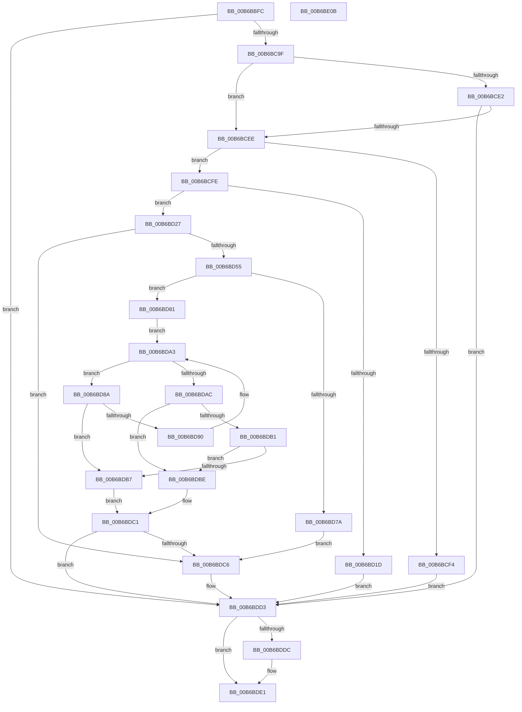

# PopGetBitlockerKeyLocation

- RVA: `0x00B6BBFC`–`0x00B6BE0C` (길이 `528` bytes)
- VA: `0x0000000140B6BBFC`
- 실행 섹션: `PAGELK`
- PDB 이름 있음: `예`; PDB Function 태그: `아니요`
- unwind 정보 RVA: `0x000CBD84`
- 디코드: `142`개 명령, `528/528` bytes 표시
- 미해석 바이트: `0` (있으면 어셈블리에 `.byte`로 보존)

> 이 문서는 커널 이미지의 기계어와 PDB 기호를 분석해 생성했습니다. 4번과 5번은 함수 원형과 자료형을 바이너리 사용 방식에서 추정한 C 해석이며 원본 소스 복구 결과는 아닙니다.

## 1. Dependencies

- 직접 호출 지점: **10**; 고유 호출 대상: **8**
- 직접 호출자로 확인된 함수: **1**
- RIP 상대 이미지 참조: **4**

### Outgoing calls
- `0x00B6BC5B` → [RtlInitUnicodeString](../../text/42/RtlInitUnicodeString_function_0042A780.md) (function, `0x0042A780`)
- `0x00B6BC90` → [ZwOpenKey](../../text/6A/ZwOpenKey_function_006AD310.md) (function, `0x006AD310`)
- `0x00B6BCAA` → [RtlInitUnicodeString](../../text/42/RtlInitUnicodeString_function_0042A780.md) (function, `0x0042A780`)
- `0x00B6BCD0` → [ZwQueryValueKey](../../text/6A/ZwQueryValueKey_function_006AD3B0.md) (function, `0x006AD3B0`)
- `0x00B6BD10` → [ExAllocatePool2](../../poolcode/B8/ExAllocatePool2_function_00B820F0.md) (function, `0x00B820F0`)
- `0x00B6BD45` → [ZwQueryValueKey](../../text/6A/ZwQueryValueKey_function_006AD3B0.md) (function, `0x006AD3B0`)
- `0x00B6BD6A` → [wcsstr](../../text/50/wcsstr_function_00501F80.md) (function, `0x00501F80`)
- `0x00B6BDCE` → [ExFreePoolWithTag](../../poolcode/B8/ExFreePoolWithTag_function_00B82870.md) (function, `0x00B82870`)
- `0x00B6BDDC` → [ZwClose](../../text/6A/ZwClose_function_006AD2B0.md) (function, `0x006AD2B0`)
- `0x00B6BDEA` → [_security_check_cookie](../../text/6A/_security_check_cookie_function_006AC640.md) (function, `0x006AC640`)

### Direct callers
- [PopAllocateHiberContext](../../page/AD/PopAllocateHiberContext_function_00ADC05C.md) at `0x00ADC393`

### Static image references
- `0x00B6BC1A` → RVA `0x00E0A740` (`.data`; read)
- `0x00B6BC2B` → RVA `0x00B7FD80` (` ?? ::OKHAJAOM::`string'`; read)
- `0x00B6BC9F` → RVA `0x00B7FD50` (` ?? ::OKHAJAOM::`string'`; read)
- `0x00B6BD58` → RVA `0x00B7FD30` (` ?? ::OKHAJAOM::`string'`; read)

## 2. Other-region calls and transfers

- 다른 실행 섹션으로 향하는 call: **10**
  - `0x00B6BC5B` → [RtlInitUnicodeString](../../text/42/RtlInitUnicodeString_function_0042A780.md) (`PAGELK` → `.text`)
  - `0x00B6BC90` → [ZwOpenKey](../../text/6A/ZwOpenKey_function_006AD310.md) (`PAGELK` → `.text`)
  - `0x00B6BCAA` → [RtlInitUnicodeString](../../text/42/RtlInitUnicodeString_function_0042A780.md) (`PAGELK` → `.text`)
  - `0x00B6BCD0` → [ZwQueryValueKey](../../text/6A/ZwQueryValueKey_function_006AD3B0.md) (`PAGELK` → `.text`)
  - `0x00B6BD10` → [ExAllocatePool2](../../poolcode/B8/ExAllocatePool2_function_00B820F0.md) (`PAGELK` → `POOLCODE`)
  - `0x00B6BD45` → [ZwQueryValueKey](../../text/6A/ZwQueryValueKey_function_006AD3B0.md) (`PAGELK` → `.text`)
  - `0x00B6BD6A` → [wcsstr](../../text/50/wcsstr_function_00501F80.md) (`PAGELK` → `.text`)
  - `0x00B6BDCE` → [ExFreePoolWithTag](../../poolcode/B8/ExFreePoolWithTag_function_00B82870.md) (`PAGELK` → `POOLCODE`)
  - `0x00B6BDDC` → [ZwClose](../../text/6A/ZwClose_function_006AD2B0.md) (`PAGELK` → `.text`)
  - `0x00B6BDEA` → [_security_check_cookie](../../text/6A/_security_check_cookie_function_006AC640.md) (`PAGELK` → `.text`)
- 별도 외부 분기/꼬리 이동을 확인하지 못했습니다.

## 3. Assembly (complete function range)

```asm
00B6BBFC  48 89 5C 24 10                  mov qword ptr [rsp + 0x10], rbx
00B6BC01  48 89 74 24 18                  mov qword ptr [rsp + 0x18], rsi
00B6BC06  55                              push rbp
00B6BC07  57                              push rdi
00B6BC08  41 55                           push r13
00B6BC0A  41 56                           push r14
00B6BC0C  41 57                           push r15
00B6BC0E  48 8D 6C 24 C9                  lea rbp, [rsp - 0x37]
00B6BC13  48 81 EC B0 00 00 00            sub rsp, 0xb0
00B6BC1A  48 8B 05 1F EB 29 00            mov rax, qword ptr [rip + 0x29eb1f]
00B6BC21  48 33 C4                        xor rax, rsp
00B6BC24  48 89 45 27                     mov qword ptr [rbp + 0x27], rax
00B6BC28  45 33 FF                        xor r15d, r15d
00B6BC2B  48 8D 15 4E 41 01 00            lea rdx, [rip + 0x1414e]
00B6BC32  0F 57 C0                        xorps xmm0, xmm0
00B6BC35  44 89 7D EB                     mov dword ptr [rbp - 0x15], r15d
00B6BC39  4C 8B F1                        mov r14, rcx
00B6BC3C  44 89 7D 03                     mov dword ptr [rbp + 3], r15d
00B6BC40  0F 57 C9                        xorps xmm1, xmm1
00B6BC43  44 89 7D B7                     mov dword ptr [rbp - 0x49], r15d
00B6BC47  48 8D 4D D7                     lea rcx, [rbp - 0x29]
00B6BC4B  4C 89 7D BF                     mov qword ptr [rbp - 0x41], r15
00B6BC4F  0F 11 45 D7                     movups xmmword ptr [rbp - 0x29], xmm0
00B6BC53  0F 11 4D 17                     movups xmmword ptr [rbp + 0x17], xmm1
00B6BC57  0F 11 45 C7                     movups xmmword ptr [rbp - 0x39], xmm0
00B6BC5B  E8 20 EB 8B FF                  call 0x14042a780
00B6BC60  48 8D 45 D7                     lea rax, [rbp - 0x29]
00B6BC64  4C 89 7D EF                     mov qword ptr [rbp - 0x11], r15
00B6BC68  0F 57 C0                        xorps xmm0, xmm0
00B6BC6B  48 89 45 F7                     mov qword ptr [rbp - 9], rax
00B6BC6F  45 8D 6F 30                     lea r13d, [r15 + 0x30]
00B6BC73  C7 45 FF 40 02 00 00            mov dword ptr [rbp - 1], 0x240
00B6BC7A  4C 8D 45 E7                     lea r8, [rbp - 0x19]
00B6BC7E  44 89 6D E7                     mov dword ptr [rbp - 0x19], r13d
00B6BC82  BA 19 00 02 00                  mov edx, 0x20019
00B6BC87  48 8D 4D BF                     lea rcx, [rbp - 0x41]
00B6BC8B  F3 0F 7F 45 07                  movdqu xmmword ptr [rbp + 7], xmm0
00B6BC90  E8 7B 16 B4 FF                  call 0x1406ad310
00B6BC95  8B D8                           mov ebx, eax
00B6BC97  85 C0                           test eax, eax
00B6BC99  0F 88 34 01 00 00               js 0x140b6bdd3
00B6BC9F  48 8D 15 AA 40 01 00            lea rdx, [rip + 0x140aa]
00B6BCA6  48 8D 4D C7                     lea rcx, [rbp - 0x39]
00B6BCAA  E8 D1 EA 8B FF                  call 0x14042a780
00B6BCAF  48 8B 4D BF                     mov rcx, qword ptr [rbp - 0x41]
00B6BCB3  48 8D 45 B7                     lea rax, [rbp - 0x49]
00B6BCB7  48 89 44 24 28                  mov qword ptr [rsp + 0x28], rax
00B6BCBC  4C 8D 4D 17                     lea r9, [rbp + 0x17]
00B6BCC0  45 8D 47 02                     lea r8d, [r15 + 2]
00B6BCC4  C7 44 24 20 10 00 00 00         mov dword ptr [rsp + 0x20], 0x10
00B6BCCC  48 8D 55 C7                     lea rdx, [rbp - 0x39]
00B6BCD0  E8 DB 16 B4 FF                  call 0x1406ad3b0
00B6BCD5  B9 00 00 00 80                  mov ecx, 0x80000000
00B6BCDA  8B D8                           mov ebx, eax
00B6BCDC  03 C1                           add eax, ecx
00B6BCDE  85 C1                           test ecx, eax
00B6BCE0  75 0C                           jne 0x140b6bcee
00B6BCE2  81 FB 05 00 00 80               cmp ebx, 0x80000005
00B6BCE8  0F 85 E5 00 00 00               jne 0x140b6bdd3
00B6BCEE  83 7D 1B 01                     cmp dword ptr [rbp + 0x1b], 1
00B6BCF2  74 0A                           je 0x140b6bcfe
00B6BCF4  BB 0D 00 00 C0                  mov ebx, 0xc000000d
00B6BCF9  E9 D5 00 00 00                  jmp 0x140b6bdd3
00B6BCFE  8B 5D B7                        mov ebx, dword ptr [rbp - 0x49]
00B6BD01  B9 40 00 00 00                  mov ecx, 0x40
00B6BD06  41 B8 63 62 75 66               mov r8d, 0x66756263
00B6BD0C  48 8D 53 02                     lea rdx, [rbx + 2]
00B6BD10  E8 DB 63 01 00                  call 0x140b820f0
00B6BD15  48 8B F8                        mov rdi, rax
00B6BD18  48 85 C0                        test rax, rax
00B6BD1B  75 0A                           jne 0x140b6bd27
00B6BD1D  BB 17 00 00 C0                  mov ebx, 0xc0000017
00B6BD22  E9 AC 00 00 00                  jmp 0x140b6bdd3
00B6BD27  48 8B 4D BF                     mov rcx, qword ptr [rbp - 0x41]
00B6BD2B  48 8D 45 B7                     lea rax, [rbp - 0x49]
00B6BD2F  48 89 44 24 28                  mov qword ptr [rsp + 0x28], rax
00B6BD34  48 8D 55 C7                     lea rdx, [rbp - 0x39]
00B6BD38  4C 8B CF                        mov r9, rdi
00B6BD3B  89 5C 24 20                     mov dword ptr [rsp + 0x20], ebx
00B6BD3F  41 B8 02 00 00 00               mov r8d, 2
00B6BD45  E8 66 16 B4 FF                  call 0x1406ad3b0
00B6BD4A  8B F0                           mov esi, eax
00B6BD4C  4C 8B C7                        mov r8, rdi
00B6BD4F  8B D8                           mov ebx, eax
00B6BD51  85 C0                           test eax, eax
00B6BD53  78 71                           js 0x140b6bdc6
00B6BD55  8B 4F 08                        mov ecx, dword ptr [rdi + 8]
00B6BD58  48 8D 15 D1 3F 01 00            lea rdx, [rip + 0x13fd1]
00B6BD5F  33 C0                           xor eax, eax
00B6BD61  66 89 44 39 0C                  mov word ptr [rcx + rdi + 0xc], ax
00B6BD66  48 8D 4F 0C                     lea rcx, [rdi + 0xc]
00B6BD6A  E8 11 62 99 FF                  call 0x140501f80
00B6BD6F  48 8B D0                        mov rdx, rax
00B6BD72  4C 8B C7                        mov r8, rdi
00B6BD75  48 85 C0                        test rax, rax
00B6BD78  75 07                           jne 0x140b6bd81
00B6BD7A  BB 01 00 00 C0                  mov ebx, 0xc0000001
00B6BD7F  EB 45                           jmp 0x140b6bdc6
00B6BD81  48 83 C2 10                     add rdx, 0x10
00B6BD85  49 8B CF                        mov rcx, r15
00B6BD88  EB 19                           jmp 0x140b6bda3
00B6BD8A  66 83 F8 39                     cmp ax, 0x39
00B6BD8E  77 27                           ja 0x140b6bdb7
00B6BD90  48 8D 0C 89                     lea rcx, [rcx + rcx*4]
00B6BD94  0F B7 C0                        movzx eax, ax
00B6BD97  48 8D 49 E8                     lea rcx, [rcx - 0x18]
00B6BD9B  48 83 C2 02                     add rdx, 2
00B6BD9F  48 8D 0C 48                     lea rcx, [rax + rcx*2]
00B6BDA3  0F B7 02                        movzx eax, word ptr [rdx]
00B6BDA6  66 41 3B C5                     cmp ax, r13w
00B6BDAA  73 DE                           jae 0x140b6bd8a
00B6BDAC  66 85 C0                        test ax, ax
00B6BDAF  74 0D                           je 0x140b6bdbe
00B6BDB1  66 83 F8 20                     cmp ax, 0x20
00B6BDB5  74 07                           je 0x140b6bdbe
00B6BDB7  BB 01 00 00 C0                  mov ebx, 0xc0000001
00B6BDBC  EB 03                           jmp 0x140b6bdc1
00B6BDBE  49 89 0E                        mov qword ptr [r14], rcx
00B6BDC1  4D 85 C0                        test r8, r8
00B6BDC4  74 0D                           je 0x140b6bdd3
00B6BDC6  BA 63 62 75 66                  mov edx, 0x66756263
00B6BDCB  49 8B C8                        mov rcx, r8
00B6BDCE  E8 9D 6A 01 00                  call 0x140b82870
00B6BDD3  48 8B 4D BF                     mov rcx, qword ptr [rbp - 0x41]
00B6BDD7  48 85 C9                        test rcx, rcx
00B6BDDA  74 05                           je 0x140b6bde1
00B6BDDC  E8 CF 14 B4 FF                  call 0x1406ad2b0
00B6BDE1  8B C3                           mov eax, ebx
00B6BDE3  48 8B 4D 27                     mov rcx, qword ptr [rbp + 0x27]
00B6BDE7  48 33 CC                        xor rcx, rsp
00B6BDEA  E8 51 08 B4 FF                  call 0x1406ac640
00B6BDEF  4C 8D 9C 24 B0 00 00 00         lea r11, [rsp + 0xb0]
00B6BDF7  49 8B 5B 38                     mov rbx, qword ptr [r11 + 0x38]
00B6BDFB  49 8B 73 40                     mov rsi, qword ptr [r11 + 0x40]
00B6BDFF  49 8B E3                        mov rsp, r11
00B6BE02  41 5F                           pop r15
00B6BE04  41 5E                           pop r14
00B6BE06  41 5D                           pop r13
00B6BE08  5F                              pop rdi
00B6BE09  5D                              pop rbp
00B6BE0A  C3                              ret
00B6BE0B  CC                              int3
```

## 4. C-style interpretation (structured pseudocode)

```c
__int64 __fastcall PopGetBitlockerKeyLocation(__int64 a1)
{
    __int64 result;
    __int64 v_r15;
    __int64 v_rsp;
    unsigned __int64 v_stack_m28;
    unsigned __int64 v_stack_m38;
    unsigned int v_stack_m44;
    unsigned __int64 v_stack_m48;
    unsigned __int64 v_stack_m58;
    unsigned int v_stack_m5C;
    unsigned __int64 v_stack_m5F;
    unsigned int v_stack_m60;
    unsigned __int64 v_stack_m68;
    unsigned __int64 v_stack_m70;
    unsigned int v_stack_m74;
    unsigned __int64 v_stack_m78;
    unsigned __int64 v_stack_m88;
    unsigned __int64 v_stack_m98;
    unsigned __int64 v_stack_mA0;
    unsigned int v_stack_mA8;
    unsigned __int64 v_stack_mB0;
    unsigned int v_stack_mB8;
    unsigned __int64 v_stack_p10;
    unsigned __int64 v_stack_p18;

    v_stack_p10 = v_rbx;
    v_stack_p18 = v_rsi;
    v_rsp = (v_rsp) - (176);
    result = (*(unsigned __int64 *)(v_rip + 2747167)) ^ (v_rsp);
    v_stack_m38 = result;
    v_r15 = 0;
    v_stack_m74 = 0;
    v_stack_m5C = 0;
    v_stack_mA8 = 0;
    v_stack_mA0 = 0;
    v_stack_m88 = v_xmm0;
    v_stack_m48 = v_xmm1;
    v_stack_m98 = v_xmm0;
    result = RtlInitUnicodeString(v_stack_m88, v_rip + 82254, a3, a4);
    v_stack_m70 = 0;
    v_stack_m68 = v_stack_m88;
    v_stack_m60 = 576;
    v_stack_m78 = (unsigned int)(v_r15 + 48);
    v_stack_m58 = v_xmm0;
    result = ZwOpenKey(v_stack_mA0, (unsigned int)(0x20019ULL), v_stack_m78, a4);
    if (sign_flag) goto loc_00B6BDD3;
    result = RtlInitUnicodeString(v_stack_m98, v_rip + 82090, v_stack_m78, a4);
    v_stack_mB0 = v_stack_mA8;
    v_stack_mB8 = 16;
    result = ZwQueryValueKey(v_stack_mA0, v_stack_m98, v_r15 + 2, v_stack_m48);
    result = (unsigned int)((result) + ((unsigned int)((unsigned int)(0x80000000ULL))));
    if ((((unsigned int)((unsigned int)(0x80000000ULL))) & ((unsigned int)(result))) != 0) goto loc_00B6BCEE;
    if (((unsigned int)((unsigned int)((unsigned int)(result)))) != 0x80000005ULL) goto loc_00B6BDD3;
loc_00B6BCEE:
    if (v_stack_m44 == 1) goto loc_00B6BCFE;
    goto loc_00B6BDD3;
loc_00B6BCFE:
    result = ExAllocatePool2(64, (unsigned int)(v_stack_mA8) + 2, (unsigned int)(0x66756263ULL), v_stack_m48);
    if (result != 0) goto loc_00B6BD27;
    goto loc_00B6BDD3;
loc_00B6BD27:
    v_stack_mB0 = v_stack_mA8;
    v_stack_mB8 = (unsigned int)((unsigned int)(0xC0000017ULL));
    result = ZwQueryValueKey(v_stack_mA0, v_stack_m98, 2, result);
    if (sign_flag) goto loc_00B6BDC6;
    result = 0;
    *(unsigned __int16 *)((unsigned int)(*(unsigned int *)(result + 8)) + result * 1 + 12) = 0;
    result = wcsstr(result + 12, v_rip + 81873, result, result);
    if (result != 0) goto loc_00B6BD81;
    goto loc_00B6BDC6;
loc_00B6BD81:
    a2 = (result) + (16);
    goto loc_00B6BDA3;
loc_00B6BD8A:
    if (((unsigned __int16)(result)) > 57) goto loc_00B6BDB7;
    a2 = (a2) + (2);
loc_00B6BDA3:
    if (((unsigned __int16)(*(unsigned __int16 *)(a2))) >= ((unsigned __int16)(v_r15 + 48))) goto loc_00B6BD8A;
    if ((unsigned __int16)(*(unsigned __int16 *)(a2)) == 0) goto loc_00B6BDBE;
    if (((unsigned __int16)(*(unsigned __int16 *)(a2))) == 32) goto loc_00B6BDBE;
loc_00B6BDB7:
    goto loc_00B6BDC1;
loc_00B6BDBE:
    *(unsigned __int64 *)(a1) = (unsigned __int16)(result) + 0 + 0 * 4 - 24 * 2;
loc_00B6BDC1:
    result = *(unsigned __int16 *)(a2);
    if (result != 0) {
        a2 = 0x66756263ULL;
        a1 = result;
        result = ExFreePoolWithTag(a1, a2, result, result);
    }
    if (v_stack_mA0 != 0) {
        result = ZwClose(v_stack_mA0, a2, result, result);
    }
    a1 = (v_stack_m38) ^ (v_rsp);
    result = _security_check_cookie(a1, a2, result, result);
    return result;
}
```

## 5. (Beta) C Style

```c
int64_t PopGetBitlockerKeyLocation(void *Arg1)
{
    uint8_t *arg1 = (uint8_t *)Arg1;

    int64_t result;
    int64_t local_r15;
    int64_t local_rsp;
    uint64_t v_stack_m28;
    uint64_t v_stack_m38;
    uint32_t v_stack_m44;
    uint64_t v_stack_m48;
    uint64_t v_stack_m58;
    uint32_t v_stack_m5C;
    uint64_t v_stack_m5F;
    uint32_t v_stack_m60;
    uint64_t v_stack_m68;
    uint64_t v_stack_m70;
    uint32_t v_stack_m74;
    uint64_t v_stack_m78;
    uint64_t v_stack_m88;
    uint64_t v_stack_m98;
    uint64_t v_stack_mA0;
    uint32_t v_stack_mA8;
    uint64_t v_stack_mB0;
    uint32_t v_stack_mB8;
    uint64_t v_stack_p10;
    uint64_t v_stack_p18;

    v_stack_p10 = local_rbx;
    v_stack_p18 = local_rsi;
    local_rsp = (local_rsp) - (176);
    result = (*(uint64_t *)(v_rip + 0x29EB1F)) ^ (local_rsp);
    v_stack_m38 = result;
    local_r15 = 0;
    v_stack_m74 = 0;
    v_stack_m5C = 0;
    v_stack_mA8 = 0;
    v_stack_mA0 = 0;
    v_stack_m88 = v_xmm0;
    v_stack_m48 = v_xmm1;
    v_stack_m98 = v_xmm0;
    result = RtlInitUnicodeString(v_stack_m88, v_rip + 82254, a3, a4);
    v_stack_m70 = 0;
    v_stack_m68 = v_stack_m88;
    v_stack_m60 = 576;
    v_stack_m78 = (uint32_t)(local_r15 + 48);
    v_stack_m58 = v_xmm0;
    result = ZwOpenKey(v_stack_mA0, (uint32_t)(0x20019ULL), v_stack_m78, a4);
    if (sign_flag) goto loc_00B6BDD3;
    result = RtlInitUnicodeString(v_stack_m98, v_rip + 82090, v_stack_m78, a4);
    v_stack_mB0 = v_stack_mA8;
    v_stack_mB8 = 16;
    result = ZwQueryValueKey(v_stack_mA0, v_stack_m98, local_r15 + 2, v_stack_m48);
    result = (uint32_t)((result) + ((uint32_t)((uint32_t)(0x80000000ULL))));
    if ((((uint32_t)((uint32_t)(0x80000000ULL))) & ((uint32_t)(result))) != 0) goto loc_00B6BCEE;
    if (((uint32_t)((uint32_t)((uint32_t)(result)))) != 0x80000005ULL) goto loc_00B6BDD3;
loc_00B6BCEE:
    if (v_stack_m44 == 1) goto loc_00B6BCFE;
    goto loc_00B6BDD3;
loc_00B6BCFE:
    result = ExAllocatePool2(64, (uint32_t)(v_stack_mA8) + 2, (uint32_t)(0x66756263ULL), v_stack_m48);
    if (result != 0) goto loc_00B6BD27;
    goto loc_00B6BDD3;
loc_00B6BD27:
    v_stack_mB0 = v_stack_mA8;
    v_stack_mB8 = (uint32_t)((uint32_t)(0xC0000017ULL));
    result = ZwQueryValueKey(v_stack_mA0, v_stack_m98, 2, result);
    if (sign_flag) goto loc_00B6BDC6;
    result = 0;
    *(uint16_t *)((uint32_t)(*(uint32_t *)(result + 0x8)) + result * 1 + 0xC) = 0;
    result = wcsstr(result + 12, v_rip + 81873, result, result);
    if (result != 0) goto loc_00B6BD81;
    goto loc_00B6BDC6;
loc_00B6BD81:
    a2 = (result) + (16);
    goto loc_00B6BDA3;
loc_00B6BD8A:
    if (((uint16_t)(result)) > 57) goto loc_00B6BDB7;
    a2 = (a2) + (2);
loc_00B6BDA3:
    if (((uint16_t)(*(uint16_t *)(a2))) >= ((uint16_t)(local_r15 + 48))) goto loc_00B6BD8A;
    if ((uint16_t)(*(uint16_t *)(a2)) == 0) goto loc_00B6BDBE;
    if (((uint16_t)(*(uint16_t *)(a2))) == 32) goto loc_00B6BDBE;
loc_00B6BDB7:
    goto loc_00B6BDC1;
loc_00B6BDBE:
    *(uint64_t *)(arg1) = (uint16_t)(result) + 0 + 0 * 4 - 24 * 2;
loc_00B6BDC1:
    result = *(uint16_t *)(a2);
    if (result != 0) {
        a2 = 0x66756263ULL;
        Arg1 = result;
        result = ExFreePoolWithTag(Arg1, a2, result, result);
    }
    if (v_stack_mA0 != 0) {
        result = ZwClose(v_stack_mA0, a2, result, result);
    }
    Arg1 = (v_stack_m38) ^ (local_rsp);
    result = _security_check_cookie(Arg1, a2, result, result);
    return result;
}
```

### 관측된 메모리 오프셋

구조체 형식이 확인되지 않은 접근은 인자 기준의 오프셋으로만 기록했습니다.

| 기준 인자 | 오프셋 표현 | 폭 (bit) | 접근 |
|---|---:|---:|---|
| `Arg1` | `+ 0x0` | `64` | `W` |

## 6. Execution-region graph

[열기: 2D/3D 그래프와 함수 탐색 컨트롤 패널](../../../control-panel.html?section=pagelk&rva=0x00B6BBFC&view=graph)

- 2D 그래프는 위에서 아래로 흐르고, 3D 그래프는 빈 공간을 드래그해 회전합니다. Shift+드래그는 이동, 휠은 확대·축소, 함수 노드 선택은 대상 보고서 이동입니다.

### Static fallback


