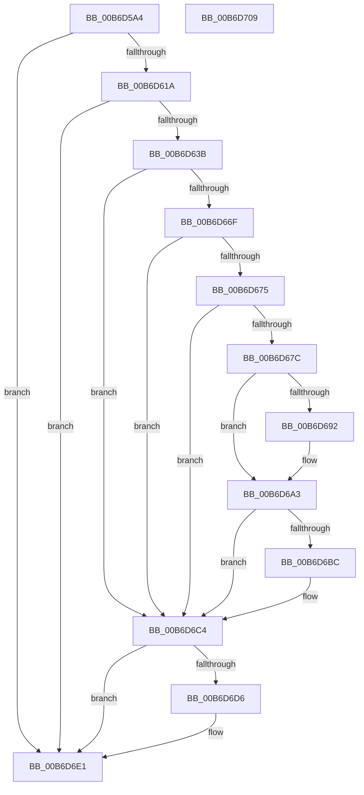

# PopGetHwConfigurationSignature

- RVA: `0x00B6D5A4`–`0x00B6D70A` (길이 `358` bytes)
- VA: `0x0000000140B6D5A4`
- 실행 섹션: `PAGELK`
- PDB 이름 있음: `예`; PDB Function 태그: `아니요`
- unwind 정보 RVA: `0x000CC450`
- 디코드: `100`개 명령, `358/358` bytes 표시
- 미해석 바이트: `0` (있으면 어셈블리에 `.byte`로 보존)

> 이 문서는 커널 이미지의 기계어와 PDB 기호를 분석해 생성했습니다. 4번과 5번은 함수 원형과 자료형을 바이너리 사용 방식에서 추정한 C 해석이며 원본 소스 복구 결과는 아닙니다.

## 1. Dependencies

- 직접 호출 지점: **8**; 고유 호출 대상: **7**
- 직접 호출자로 확인된 함수: **1**
- RIP 상대 이미지 참조: **1**

### Outgoing calls
- `0x00B6D60A` → [ZwQuerySystemInformation](../../text/6A/ZwQuerySystemInformation_function_006AD790.md) (function, `0x006AD790`)
- `0x00B6D62A` → [ExAllocatePool2](../../poolcode/B8/ExAllocatePool2_function_00B820F0.md) (function, `0x00B820F0`)
- `0x00B6D666` → [ZwQuerySystemInformation](../../text/6A/ZwQuerySystemInformation_function_006AD790.md) (function, `0x006AD790`)
- `0x00B6D687` → [HalGetMemoryCachingRequirements](../../text/48/HalGetMemoryCachingRequirements_function_0048B480.md) (function, `0x0048B480`)
- `0x00B6D6AC` → [MmMapIoSpaceEx](../../text/32/MmMapIoSpaceEx_function_00327830.md) (function, `0x00327830`)
- `0x00B6D6CC` → [ExFreePoolWithTag](../../poolcode/B8/ExFreePoolWithTag_function_00B82870.md) (function, `0x00B82870`)
- `0x00B6D6DC` → [MmUnmapIoSpace](../../text/3F/MmUnmapIoSpace_function_003F78F0.md) (function, `0x003F78F0`)
- `0x00B6D6EB` → [_security_check_cookie](../../text/6A/_security_check_cookie_function_006AC640.md) (function, `0x006AC640`)

### Direct callers
- [PopAllocateHiberContext](../../page/AD/PopAllocateHiberContext_function_00ADC05C.md) at `0x00ADC37C`

### Static image references
- `0x00B6D5BD` → RVA `0x00E0A740` (`.data`; read)

## 2. Other-region calls and transfers

- 다른 실행 섹션으로 향하는 call: **8**
  - `0x00B6D60A` → [ZwQuerySystemInformation](../../text/6A/ZwQuerySystemInformation_function_006AD790.md) (`PAGELK` → `.text`)
  - `0x00B6D62A` → [ExAllocatePool2](../../poolcode/B8/ExAllocatePool2_function_00B820F0.md) (`PAGELK` → `POOLCODE`)
  - `0x00B6D666` → [ZwQuerySystemInformation](../../text/6A/ZwQuerySystemInformation_function_006AD790.md) (`PAGELK` → `.text`)
  - `0x00B6D687` → [HalGetMemoryCachingRequirements](../../text/48/HalGetMemoryCachingRequirements_function_0048B480.md) (`PAGELK` → `.text`)
  - `0x00B6D6AC` → [MmMapIoSpaceEx](../../text/32/MmMapIoSpaceEx_function_00327830.md) (`PAGELK` → `.text`)
  - `0x00B6D6CC` → [ExFreePoolWithTag](../../poolcode/B8/ExFreePoolWithTag_function_00B82870.md) (`PAGELK` → `POOLCODE`)
  - `0x00B6D6DC` → [MmUnmapIoSpace](../../text/3F/MmUnmapIoSpace_function_003F78F0.md) (`PAGELK` → `.text`)
  - `0x00B6D6EB` → [_security_check_cookie](../../text/6A/_security_check_cookie_function_006AC640.md) (`PAGELK` → `.text`)
- 별도 외부 분기/꼬리 이동을 확인하지 못했습니다.

## 3. Assembly (complete function range)

```asm
00B6D5A4  48 89 5C 24 10                  mov qword ptr [rsp + 0x10], rbx
00B6D5A9  48 89 74 24 18                  mov qword ptr [rsp + 0x18], rsi
00B6D5AE  55                              push rbp
00B6D5AF  57                              push rdi
00B6D5B0  41 55                           push r13
00B6D5B2  41 56                           push r14
00B6D5B4  41 57                           push r15
00B6D5B6  48 8B EC                        mov rbp, rsp
00B6D5B9  48 83 EC 50                     sub rsp, 0x50
00B6D5BD  48 8B 05 7C D1 29 00            mov rax, qword ptr [rip + 0x29d17c]
00B6D5C4  48 33 C4                        xor rax, rsp
00B6D5C7  48 89 45 F0                     mov qword ptr [rbp - 0x10], rax
00B6D5CB  83 65 D4 00                     and dword ptr [rbp - 0x2c], 0
00B6D5CF  4C 8D 4D D0                     lea r9, [rbp - 0x30]
00B6D5D3  83 65 E8 00                     and dword ptr [rbp - 0x18], 0
00B6D5D7  48 8D 55 D8                     lea rdx, [rbp - 0x28]
00B6D5DB  33 DB                           xor ebx, ebx
00B6D5DD  C7 45 D8 49 50 43 41            mov dword ptr [rbp - 0x28], 0x41435049
00B6D5E4  21 5D E4                        and dword ptr [rbp - 0x1c], ebx
00B6D5E7  4C 8B F9                        mov r15, rcx
00B6D5EA  21 5D D0                        and dword ptr [rbp - 0x30], ebx
00B6D5ED  45 33 F6                        xor r14d, r14d
00B6D5F0  88 19                           mov byte ptr [rcx], bl
00B6D5F2  44 8D 43 14                     lea r8d, [rbx + 0x14]
00B6D5F6  C7 45 DC 01 00 00 00            mov dword ptr [rbp - 0x24], 1
00B6D5FD  8D 4B 4C                        lea ecx, [rbx + 0x4c]
00B6D600  C7 45 E0 46 41 43 50            mov dword ptr [rbp - 0x20], 0x50434146
00B6D607  8D 73 04                        lea esi, [rbx + 4]
00B6D60A  E8 81 01 B4 FF                  call 0x1406ad790
00B6D60F  3D 23 00 00 C0                  cmp eax, 0xc0000023
00B6D614  0F 85 C7 00 00 00               jne 0x140b6d6e1
00B6D61A  8B 55 D0                        mov edx, dword ptr [rbp - 0x30]
00B6D61D  44 8D 6B 40                     lea r13d, [rbx + 0x40]
00B6D621  41 8B CD                        mov ecx, r13d
00B6D624  41 B8 4D 65 6D 20               mov r8d, 0x206d654d
00B6D62A  E8 C1 4A 01 00                  call 0x140b820f0
00B6D62F  48 8B F8                        mov rdi, rax
00B6D632  48 85 C0                        test rax, rax
00B6D635  0F 84 A6 00 00 00               je 0x140b6d6e1
00B6D63B  C7 00 49 50 43 41               mov dword ptr [rax], 0x41435049
00B6D641  4C 8D 4D D0                     lea r9, [rbp - 0x30]
00B6D645  C7 40 04 01 00 00 00            mov dword ptr [rax + 4], 1
00B6D64C  8D 4B 4C                        lea ecx, [rbx + 0x4c]
00B6D64F  C7 40 08 46 41 43 50            mov dword ptr [rax + 8], 0x50434146
00B6D656  8B 55 D0                        mov edx, dword ptr [rbp - 0x30]
00B6D659  83 C2 F0                        add edx, -0x10
00B6D65C  89 50 0C                        mov dword ptr [rax + 0xc], edx
00B6D65F  48 8B D0                        mov rdx, rax
00B6D662  44 8B 45 D0                     mov r8d, dword ptr [rbp - 0x30]
00B6D666  E8 25 01 B4 FF                  call 0x1406ad790
00B6D66B  85 C0                           test eax, eax
00B6D66D  78 55                           js 0x140b6d6c4
00B6D66F  80 7F 18 05                     cmp byte ptr [rdi + 0x18], 5
00B6D673  72 4F                           jb 0x140b6d6c4
00B6D675  8B 47 34                        mov eax, dword ptr [rdi + 0x34]
00B6D678  85 C0                           test eax, eax
00B6D67A  74 48                           je 0x140b6d6c4
00B6D67C  4C 8D 45 D4                     lea r8, [rbp - 0x2c]
00B6D680  41 8B D5                        mov edx, r13d
00B6D683  8B C8                           mov ecx, eax
00B6D685  8B D8                           mov ebx, eax
00B6D687  E8 F4 DD 91 FF                  call 0x14048b480
00B6D68C  83 7D D4 01                     cmp dword ptr [rbp - 0x2c], 1
00B6D690  74 11                           je 0x140b6d6a3
00B6D692  83 7D D4 02                     cmp dword ptr [rbp - 0x2c], 2
00B6D696  BE 04 02 00 00                  mov esi, 0x204
00B6D69B  B8 04 04 00 00                  mov eax, 0x404
00B6D6A0  0F 44 F0                        cmove esi, eax
00B6D6A3  44 8B C6                        mov r8d, esi
00B6D6A6  49 8B D5                        mov rdx, r13
00B6D6A9  48 8B CB                        mov rcx, rbx
00B6D6AC  E8 7F A1 7B FF                  call 0x140327830
00B6D6B1  48 8B D8                        mov rbx, rax
00B6D6B4  81 38 46 41 43 53               cmp dword ptr [rax], 0x53434146
00B6D6BA  75 08                           jne 0x140b6d6c4
00B6D6BC  44 8B 70 08                     mov r14d, dword ptr [rax + 8]
00B6D6C0  41 C6 07 01                     mov byte ptr [r15], 1
00B6D6C4  BA 4D 65 6D 20                  mov edx, 0x206d654d
00B6D6C9  48 8B CF                        mov rcx, rdi
00B6D6CC  E8 9F 51 01 00                  call 0x140b82870
00B6D6D1  48 85 DB                        test rbx, rbx
00B6D6D4  74 0B                           je 0x140b6d6e1
00B6D6D6  49 8B D5                        mov rdx, r13
00B6D6D9  48 8B CB                        mov rcx, rbx
00B6D6DC  E8 0F A2 88 FF                  call 0x1403f78f0
00B6D6E1  41 8B C6                        mov eax, r14d
00B6D6E4  48 8B 4D F0                     mov rcx, qword ptr [rbp - 0x10]
00B6D6E8  48 33 CC                        xor rcx, rsp
00B6D6EB  E8 50 EF B3 FF                  call 0x1406ac640
00B6D6F0  4C 8D 5C 24 50                  lea r11, [rsp + 0x50]
00B6D6F5  49 8B 5B 38                     mov rbx, qword ptr [r11 + 0x38]
00B6D6F9  49 8B 73 40                     mov rsi, qword ptr [r11 + 0x40]
00B6D6FD  49 8B E3                        mov rsp, r11
00B6D700  41 5F                           pop r15
00B6D702  41 5E                           pop r14
00B6D704  41 5D                           pop r13
00B6D706  5F                              pop rdi
00B6D707  5D                              pop rbp
00B6D708  C3                              ret
00B6D709  CC                              int3
```

## 4. C-style interpretation (structured pseudocode)

```c
__int64 __fastcall PopGetHwConfigurationSignature(__int64 a1)
{
    __int64 result;
    __int64 v_r14;
    __int64 v_rbx;
    __int64 v_rsi;
    __int64 v_rsp;
    unsigned __int64 v_stack_m28;
    unsigned __int64 v_stack_m38;
    unsigned int v_stack_m40;
    unsigned int v_stack_m44;
    unsigned int v_stack_m48;
    unsigned int v_stack_m4C;
    unsigned __int64 v_stack_m50;
    unsigned int v_stack_m54;
    unsigned __int64 v_stack_m58;
    unsigned __int64 v_stack_p10;
    unsigned __int64 v_stack_p18;

    v_stack_p10 = v_rbx;
    v_stack_p18 = v_rsi;
    v_rsp = (v_rsp) - (80);
    result = (*(unsigned __int64 *)(v_rip + 2740604)) ^ (v_rsp);
    v_stack_m38 = result;
    v_rbx = 0;
    v_stack_m50 = 0x41435049ULL;
    v_r14 = 0;
    *(unsigned __int8 *)(a1) = 0;
    v_stack_m4C = 1;
    v_stack_m48 = 0x50434146ULL;
    result = ZwQuerySystemInformation(v_rbx + 76, v_stack_m50, v_rbx + 20, v_stack_m58);
    if (((unsigned int)(result)) != 0xC0000023ULL) goto loc_00B6D6E1;
    result = ExAllocatePool2((unsigned int)((unsigned int)(v_rbx + 64)), (unsigned int)(v_stack_m58), (unsigned int)(0x206D654DULL), v_stack_m58);
    if (result == 0) goto loc_00B6D6E1;
    *(unsigned int *)(result) = 0x41435049ULL;
    *(unsigned int *)(result + 4) = 1;
    *(unsigned int *)(result + 8) = 0x50434146ULL;
    a2 = (unsigned int)(((unsigned int)(v_stack_m58)) + (-16));
    *(unsigned int *)(result + 12) = (unsigned int)(a2);
    result = ZwQuerySystemInformation(v_rbx + 76, result, (unsigned int)(v_stack_m58), v_stack_m58);
    if (sign_flag) goto loc_00B6D6C4;
    if ((*(unsigned __int8 *)(result + 24)) < 5) goto loc_00B6D6C4;
    if ((unsigned int)((unsigned int)(*(unsigned int *)(result + 52))) == 0) goto loc_00B6D6C4;
    result = HalGetMemoryCachingRequirements((unsigned int)((unsigned int)((unsigned int)(*(unsigned int *)(result + 52)))), (unsigned int)((unsigned int)(v_rbx + 64)), v_stack_m54, v_stack_m58);
    v_rsi = v_rbx + 4;
    if (v_stack_m54 != 1) {
        v_rsi = 516;
        result = 0x404ULL;
        if (v_stack_m54 == 2) { v_rsi = (unsigned int)(result); }
    }
    result = MmMapIoSpaceEx((unsigned int)((unsigned int)((unsigned int)(*(unsigned int *)(result + 52)))), v_rbx + 64, (unsigned int)((unsigned int)(v_rsi)), v_stack_m58);
    if ((*(unsigned int *)(result)) == 0x53434146ULL) {
        v_r14 = *(unsigned int *)(result + 8);
        *(unsigned __int8 *)(a1) = 1;
    }
    result = ExFreePoolWithTag(result, (unsigned int)(0x206D654DULL), (unsigned int)((unsigned int)(v_rsi)), v_stack_m58);
    if (result != 0) {
        a2 = v_rbx + 64;
        a1 = result;
        result = MmUnmapIoSpace(a1, a2, (unsigned int)((unsigned int)(v_rsi)), v_stack_m58);
    }
    a1 = (v_stack_m38) ^ (v_rsp);
    result = _security_check_cookie(a1, a2, (unsigned int)((unsigned int)(v_rsi)), v_stack_m58);
    return result;
}
```

## 5. (Beta) C Style

```c
int64_t PopGetHwConfigurationSignature(void *Arg1)
{
    uint8_t *arg1 = (uint8_t *)Arg1;

    int64_t result;
    int64_t local_r14;
    int64_t local_rbx;
    int64_t local_rsi;
    int64_t local_rsp;
    uint64_t v_stack_m28;
    uint64_t v_stack_m38;
    uint32_t v_stack_m40;
    uint32_t v_stack_m44;
    uint32_t v_stack_m48;
    uint32_t v_stack_m4C;
    uint64_t v_stack_m50;
    uint32_t v_stack_m54;
    uint64_t v_stack_m58;
    uint64_t v_stack_p10;
    uint64_t v_stack_p18;

    v_stack_p10 = local_rbx;
    v_stack_p18 = local_rsi;
    local_rsp = (local_rsp) - (80);
    result = (*(uint64_t *)(v_rip + 0x29D17C)) ^ (local_rsp);
    v_stack_m38 = result;
    local_rbx = 0;
    v_stack_m50 = 0x41435049ULL;
    local_r14 = 0;
    *(uint8_t *)(arg1) = 0;
    v_stack_m4C = 1;
    v_stack_m48 = 0x50434146ULL;
    result = ZwQuerySystemInformation(local_rbx + 76, v_stack_m50, local_rbx + 20, v_stack_m58);
    if (((uint32_t)(result)) != 0xC0000023ULL) goto loc_00B6D6E1;
    result = ExAllocatePool2((uint32_t)((uint32_t)(local_rbx + 64)), (uint32_t)(v_stack_m58), (uint32_t)(0x206D654DULL), v_stack_m58);
    if (result == 0) goto loc_00B6D6E1;
    *(uint32_t *)(result) = 0x41435049ULL;
    *(uint32_t *)(result + 0x4) = 1;
    *(uint32_t *)(result + 0x8) = 0x50434146ULL;
    a2 = (uint32_t)(((uint32_t)(v_stack_m58)) + (-16));
    *(uint32_t *)(result + 0xC) = (uint32_t)(a2);
    result = ZwQuerySystemInformation(local_rbx + 76, result, (uint32_t)(v_stack_m58), v_stack_m58);
    if (sign_flag) goto loc_00B6D6C4;
    if ((*(uint8_t *)(result + 0x18)) < 5) goto loc_00B6D6C4;
    if ((uint32_t)((uint32_t)(*(uint32_t *)(result + 0x34))) == 0) goto loc_00B6D6C4;
    result = HalGetMemoryCachingRequirements((uint32_t)((uint32_t)((uint32_t)(*(uint32_t *)(result + 0x34)))), (uint32_t)((uint32_t)(local_rbx + 64)), v_stack_m54, v_stack_m58);
    local_rsi = local_rbx + 4;
    if (v_stack_m54 != 1) {
        local_rsi = 516;
        result = 0x404ULL;
        if (v_stack_m54 == 2) { local_rsi = (uint32_t)(result); }
    }
    result = MmMapIoSpaceEx((uint32_t)((uint32_t)((uint32_t)(*(uint32_t *)(result + 0x34)))), local_rbx + 64, (uint32_t)((uint32_t)(local_rsi)), v_stack_m58);
    if ((*(uint32_t *)(result)) == 0x53434146ULL) {
        local_r14 = *(uint32_t *)(result + 0x8);
        *(uint8_t *)(arg1) = 1;
    }
    result = ExFreePoolWithTag(result, (uint32_t)(0x206D654DULL), (uint32_t)((uint32_t)(local_rsi)), v_stack_m58);
    if (result != 0) {
        a2 = local_rbx + 64;
        Arg1 = result;
        result = MmUnmapIoSpace(Arg1, a2, (uint32_t)((uint32_t)(local_rsi)), v_stack_m58);
    }
    Arg1 = (v_stack_m38) ^ (local_rsp);
    result = _security_check_cookie(Arg1, a2, (uint32_t)((uint32_t)(local_rsi)), v_stack_m58);
    return result;
}
```

### 관측된 메모리 오프셋

구조체 형식이 확인되지 않은 접근은 인자 기준의 오프셋으로만 기록했습니다.

| 기준 인자 | 오프셋 표현 | 폭 (bit) | 접근 |
|---|---:|---:|---|
| `Arg1` | `+ 0x0` | `8` | `W` |

## 6. Execution-region graph

[열기: 2D/3D 그래프와 함수 탐색 컨트롤 패널](../../../control-panel.html?section=pagelk&rva=0x00B6D5A4&view=graph)

- 2D 그래프는 위에서 아래로 흐르고, 3D 그래프는 빈 공간을 드래그해 회전합니다. Shift+드래그는 이동, 휠은 확대·축소, 함수 노드 선택은 대상 보고서 이동입니다.

### Static fallback


