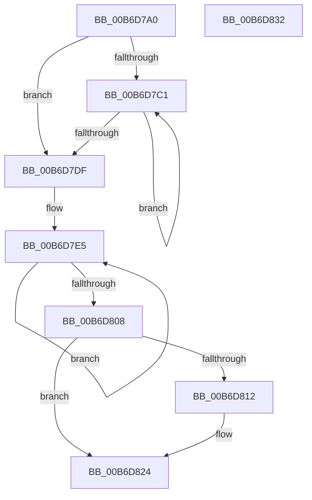

# PopGetRemainingHibernateRangeDataSize

- RVA: `0x00B6D7A0`–`0x00B6D833` (길이 `147` bytes)
- VA: `0x0000000140B6D7A0`
- 실행 섹션: `PAGELK`
- PDB 이름 있음: `예`; PDB Function 태그: `아니요`
- unwind 정보 RVA: `0x00068D5C`
- 디코드: `45`개 명령, `147/147` bytes 표시
- 미해석 바이트: `0` (있으면 어셈블리에 `.byte`로 보존)

> 이 문서는 커널 이미지의 기계어와 PDB 기호를 분석해 생성했습니다. 4번과 5번은 함수 원형과 자료형을 바이너리 사용 방식에서 추정한 C 해석이며 원본 소스 복구 결과는 아닙니다.

## 1. Dependencies

- 직접 호출 지점: **2**; 고유 호출 대상: **2**
- 직접 호출자로 확인된 함수: **2**
- RIP 상대 이미지 참조: **0**

### Outgoing calls
- `0x00B6D7EE` → [RtlFindNextForwardRunClear](../../text/3C/RtlFindNextForwardRunClear_function_003CF6A0.md) (function, `0x003CF6A0`)
- `0x00B6D816` → [RtlNumberOfClearBits](../../text/43/RtlNumberOfClearBits_function_00433F40.md) (function, `0x00433F40`)

### Direct callers
- [PopRequestWrite](PopRequestWrite_function_00B6EB14.md) at `0x00B6EFC3`
- [PopWriteHiberPages](PopWriteHiberPages_function_00B6FF78.md) at `0x00B7002E`

### Static image references
- 디코드된 RIP-relative 메모리 참조가 없습니다.

## 2. Other-region calls and transfers

- 다른 실행 섹션으로 향하는 call: **2**
  - `0x00B6D7EE` → [RtlFindNextForwardRunClear](../../text/3C/RtlFindNextForwardRunClear_function_003CF6A0.md) (`PAGELK` → `.text`)
  - `0x00B6D816` → [RtlNumberOfClearBits](../../text/43/RtlNumberOfClearBits_function_00433F40.md) (`PAGELK` → `.text`)
- 별도 외부 분기/꼬리 이동을 확인하지 못했습니다.

## 3. Assembly (complete function range)

```asm
00B6D7A0  48 89 5C 24 10                  mov qword ptr [rsp + 0x10], rbx
00B6D7A5  57                              push rdi
00B6D7A6  48 83 EC 20                     sub rsp, 0x20
00B6D7AA  83 64 24 30 00                  and dword ptr [rsp + 0x30], 0
00B6D7AF  4C 8D 41 50                     lea r8, [rcx + 0x50]
00B6D7B3  48 8B 51 78                     mov rdx, qword ptr [rcx + 0x78]
00B6D7B7  33 FF                           xor edi, edi
00B6D7B9  48 8B D9                        mov rbx, rcx
00B6D7BC  49 3B D0                        cmp rdx, r8
00B6D7BF  74 1E                           je 0x140b6d7df
00B6D7C1  48 8B 4A 20                     mov rcx, qword ptr [rdx + 0x20]
00B6D7C5  48 2B 4A 18                     sub rcx, qword ptr [rdx + 0x18]
00B6D7C9  48 8B 02                        mov rax, qword ptr [rdx]
00B6D7CC  48 C1 E1 0C                     shl rcx, 0xc
00B6D7D0  48 8B D0                        mov rdx, rax
00B6D7D3  48 03 F9                        add rdi, rcx
00B6D7D6  48 89 43 78                     mov qword ptr [rbx + 0x78], rax
00B6D7DA  49 3B C0                        cmp rax, r8
00B6D7DD  75 E2                           jne 0x140b6d7c1
00B6D7DF  8B 93 80 00 00 00               mov edx, dword ptr [rbx + 0x80]
00B6D7E5  48 8B 4B 70                     mov rcx, qword ptr [rbx + 0x70]
00B6D7E9  4C 8D 44 24 30                  lea r8, [rsp + 0x30]
00B6D7EE  E8 AD 1E 86 FF                  call 0x1403cf6a0
00B6D7F3  8B 54 24 30                     mov edx, dword ptr [rsp + 0x30]
00B6D7F7  8B C8                           mov ecx, eax
00B6D7F9  8B C0                           mov eax, eax
00B6D7FB  03 D1                           add edx, ecx
00B6D7FD  48 C1 E0 0C                     shl rax, 0xc
00B6D801  48 03 F8                        add rdi, rax
00B6D804  85 C9                           test ecx, ecx
00B6D806  75 DD                           jne 0x140b6d7e5
00B6D808  48 8D 4B 30                     lea rcx, [rbx + 0x30]
00B6D80C  48 39 4B 70                     cmp qword ptr [rbx + 0x70], rcx
00B6D810  75 12                           jne 0x140b6d824
00B6D812  48 8D 4B 40                     lea rcx, [rbx + 0x40]
00B6D816  E8 25 67 8C FF                  call 0x140433f40
00B6D81B  8B C8                           mov ecx, eax
00B6D81D  48 C1 E1 0C                     shl rcx, 0xc
00B6D821  48 03 F9                        add rdi, rcx
00B6D824  48 8B 5C 24 38                  mov rbx, qword ptr [rsp + 0x38]
00B6D829  48 8B C7                        mov rax, rdi
00B6D82C  48 83 C4 20                     add rsp, 0x20
00B6D830  5F                              pop rdi
00B6D831  C3                              ret
00B6D832  CC                              int3
```

## 4. C-style interpretation (structured pseudocode)

```c
__int64 __fastcall PopGetRemainingHibernateRangeDataSize(__int64 a1)
{
    __int64 result;
    __int64 v_rdi;
    __int64 v_rsp;
    unsigned __int64 v_stack_p10;
    unsigned int v_stack_p8;

    v_stack_p10 = v_rbx;
    v_rsp = (v_rsp) - (32);
    v_rdi = 0;
    if ((*(unsigned __int64 *)(a1 + 120)) == (a1 + 80)) goto loc_00B6D7DF;
loc_00B6D7C1:
    a1 = (*(unsigned __int64 *)(*(unsigned __int64 *)(a1 + 120) + 32)) - (*(unsigned __int64 *)(*(unsigned __int64 *)(a1 + 120) + 24));
    a1 = (a1) << (12);
    v_rdi = (v_rdi) + (a1);
    *(unsigned __int64 *)(a1 + 120) = *(unsigned __int64 *)(*(unsigned __int64 *)(a1 + 120));
    if ((*(unsigned __int64 *)(*(unsigned __int64 *)(a1 + 120))) != (a1 + 80)) goto loc_00B6D7C1;
loc_00B6D7DF:
loc_00B6D7E5:
    result = RtlFindNextForwardRunClear(*(unsigned __int64 *)(a1 + 112), (unsigned int)(*(unsigned int *)(a1 + 128)), v_stack_p8, a4);
    a2 = (unsigned int)(((unsigned int)(v_stack_p8)) + ((unsigned int)((unsigned int)((unsigned int)(result)))));
    result = ((unsigned int)((unsigned int)(result))) << (12);
    v_rdi = (v_rdi) + (result);
    if ((unsigned int)((unsigned int)((unsigned int)(result))) != 0) goto loc_00B6D7E5;
    if ((*(unsigned __int64 *)(a1 + 112)) == (a1 + 48)) {
        a1 = a1 + 64;
        result = RtlNumberOfClearBits(a1, a2, v_stack_p8, a4);
        a1 = (unsigned int)(result);
        a1 = (a1) << (12);
        v_rdi = (v_rdi) + (a1);
    }
    v_rsp = (v_rsp) + (32);
    return v_rdi;
}
```

## 5. (Beta) C Style

```c
int64_t PopGetRemainingHibernateRangeDataSize(void *Arg1)
{
    uint8_t *arg1 = (uint8_t *)Arg1;

    int64_t result;
    int64_t local_rdi;
    int64_t local_rsp;
    uint64_t v_stack_p10;
    uint32_t v_stack_p8;

    v_stack_p10 = local_rbx;
    local_rsp = (local_rsp) - (32);
    local_rdi = 0;
    if ((*(uint64_t *)(arg1 + 0x78)) == (Arg1 + 80)) goto loc_00B6D7DF;
loc_00B6D7C1:
    Arg1 = (*(uint64_t *)(*(uint64_t *)(arg1 + 0x78) + 0x20)) - (*(uint64_t *)(*(uint64_t *)(arg1 + 0x78) + 0x18));
    Arg1 = (Arg1) << (12);
    local_rdi = (local_rdi) + (Arg1);
    *(uint64_t *)(arg1 + 0x78) = *(uint64_t *)(*(uint64_t *)(arg1 + 0x78));
    if ((*(uint64_t *)(*(uint64_t *)(arg1 + 0x78))) != (Arg1 + 80)) goto loc_00B6D7C1;
loc_00B6D7DF:
loc_00B6D7E5:
    result = RtlFindNextForwardRunClear(*(uint64_t *)(arg1 + 0x70), (uint32_t)(*(uint32_t *)(arg1 + 0x80)), v_stack_p8, a4);
    a2 = (uint32_t)(((uint32_t)(v_stack_p8)) + ((uint32_t)((uint32_t)((uint32_t)(result)))));
    result = ((uint32_t)((uint32_t)(result))) << (12);
    local_rdi = (local_rdi) + (result);
    if ((uint32_t)((uint32_t)((uint32_t)(result))) != 0) goto loc_00B6D7E5;
    if ((*(uint64_t *)(arg1 + 0x70)) == (Arg1 + 48)) {
        Arg1 = Arg1 + 64;
        result = RtlNumberOfClearBits(Arg1, a2, v_stack_p8, a4);
        Arg1 = (uint32_t)(result);
        Arg1 = (Arg1) << (12);
        local_rdi = (local_rdi) + (Arg1);
    }
    local_rsp = (local_rsp) + (32);
    return local_rdi;
}
```

### 관측된 메모리 오프셋

구조체 형식이 확인되지 않은 접근은 인자 기준의 오프셋으로만 기록했습니다.

| 기준 인자 | 오프셋 표현 | 폭 (bit) | 접근 |
|---|---:|---:|---|
| `Arg1` | `+ 0x30` | `64` | `R` |
| `Arg1` | `+ 0x40` | `64` | `R` |
| `Arg1` | `+ 0x50` | `64` | `R` |
| `Arg1` | `+ 0x70` | `64` | `R` |
| `Arg1` | `+ 0x78` | `64` | `R` |
| `Arg1` | `+ 0x78` | `64` | `W` |
| `Arg1` | `+ 0x80` | `32` | `R` |

## 6. Execution-region graph

[열기: 2D/3D 그래프와 함수 탐색 컨트롤 패널](../../../control-panel.html?section=pagelk&rva=0x00B6D7A0&view=graph)

- 2D 그래프는 위에서 아래로 흐르고, 3D 그래프는 빈 공간을 드래그해 회전합니다. Shift+드래그는 이동, 휠은 확대·축소, 함수 노드 선택은 대상 보고서 이동입니다.

### Static fallback


