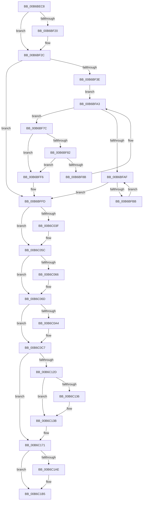

# PopGracefulShutdown

- RVA: `0x00B6BEC8`–`0x00B6C1C8` (길이 `768` bytes)
- VA: `0x0000000140B6BEC8`
- 실행 섹션: `PAGELK`
- PDB 이름 있음: `예`; PDB Function 태그: `아니요`
- unwind 정보 RVA: `0x000C8648`
- 디코드: `166`개 명령, `768/768` bytes 표시
- 미해석 바이트: `0` (있으면 어셈블리에 `.byte`로 보존)

> 이 문서는 커널 이미지의 기계어와 PDB 기호를 분석해 생성했습니다. 4번과 5번은 함수 원형과 자료형을 바이너리 사용 방식에서 추정한 C 해석이며 원본 소스 복구 결과는 아닙니다.

## 1. Dependencies

- 직접 호출 지점: **51**; 고유 호출 대상: **33**
- 직접 호출자로 확인된 함수: **1**
- RIP 상대 이미지 참조: **28**

### Outgoing calls
- `0x00B6BED6` → [PopTransitionCheckpoint](../../page/A8/PopTransitionCheckpoint_function_00A8F3E8.md) (function, `0x00A8F3E8`)
- `0x00B6BEDB` → [PopDiagTraceGracefulShutdown](../B7/PopDiagTraceGracefulShutdown_function_00B71334.md) (function, `0x00B71334`)
- `0x00B6BEE0` → [PopAdaptivePersistSystemInitatedRebootState](../../text/5D/PopAdaptivePersistSystemInitatedRebootState_function_005DC30C.md) (function, `0x005DC30C`)
- `0x00B6BF00` → [PopDiagTraceEventNoPayload](../../text/49/PopDiagTraceEventNoPayload_function_004982F8.md) (function, `0x004982F8`)
- `0x00B6BF05` → [MmZeroPageFileAtShutdown](../../page/7F/MmZeroPageFileAtShutdown_function_007F9164.md) (function, `0x007F9164`)
- `0x00B6BF11` → [PopDiagTraceEventNoPayload](../../text/49/PopDiagTraceEventNoPayload_function_004982F8.md) (function, `0x004982F8`)
- `0x00B6BF27` → [guard_dispatch_icall](../../text/6B/guard_dispatch_icall_function_006BAAD0.md) (function, `0x006BAAD0`)
- `0x00B6BF2C` → [VfShutdownScheduleWatchdog](../../text/61/VfShutdownScheduleWatchdog_function_00615F18.md) (function, `0x00615F18`)
- `0x00B6BF3E` → [PsShutdownSystem](../../page/78/PsShutdownSystem_function_00785E94.md) (function, `0x00785E94`)
- `0x00B6BF4F` → [KeSetEvent](../../text/33/KeSetEvent_function_0033F310.md) (function, `0x0033F310`)
- `0x00B6BF5B` → [ExAcquireFastMutex](../../text/20/ExAcquireFastMutex_function_0020E5A0.md) (function, `0x0020E5A0`)
- `0x00B6BF6E` → [ExReleaseFastMutex](../../text/25/ExReleaseFastMutex_function_002519C0.md) (function, `0x002519C0`)
- `0x00B6BF9E` → [guard_dispatch_icall](../../text/6B/guard_dispatch_icall_function_006BAAD0.md) (function, `0x006BAAD0`)
- `0x00B6BFD7` → [KeWaitForSingleObject](../../text/20/KeWaitForSingleObject_function_0020E6B0.md) (function, `0x0020E6B0`)
- `0x00B6BFE5` → [ObfDereferenceObjectWithTag](../../text/2F/ObfDereferenceObjectWithTag_function_002F78E0.md) (function, `0x002F78E0`)
- `0x00B6BFEF` → [ExFreePoolWithTag](../../poolcode/B8/ExFreePoolWithTag_function_00B82870.md) (function, `0x00B82870`)
- `0x00B6BFFD` → `ext-ms-win-ntos-tm-l1-1-0.dll!TmShutdownSystem` (import, 간접 대상; import `ext-ms-win-ntos-tm-l1-1-0.dll!TmShutdownSystem`)
- `0x00B6C00B` → [CmShutdownSystem](../../page/7E/CmShutdownSystem_function_007E5174.md) (function, `0x007E5174`)
- `0x00B6C012` → [ExShutdownSystem](../B7/ExShutdownSystem_function_00B7290C.md) (function, `0x00B7290C`)
- `0x00B6C01E` → [PopDiagTraceEventNoPayload](../../text/49/PopDiagTraceEventNoPayload_function_004982F8.md) (function, `0x004982F8`)
- `0x00B6C025` → [IoShutdownSystem](IoShutdownSystem_function_00B63B8C.md) (function, `0x00B63B8C`)
- `0x00B6C031` → [PopDiagTraceEventNoPayload](../../text/49/PopDiagTraceEventNoPayload_function_004982F8.md) (function, `0x004982F8`)
- `0x00B6C046` → [PopDiagTraceEventNoPayload](../../text/49/PopDiagTraceEventNoPayload_function_004982F8.md) (function, `0x004982F8`)
- `0x00B6C04B` → [PsWaitForAllProcesses](../../page/78/PsWaitForAllProcesses_function_00786318.md) (function, `0x00786318`)
- `0x00B6C057` → [PopDiagTraceEventNoPayload](../../text/49/PopDiagTraceEventNoPayload_function_004982F8.md) (function, `0x004982F8`)
- `0x00B6C068` → [ObShutdownSystem](../../page/74/ObShutdownSystem_function_0074DBB0.md) (function, `0x0074DBB0`)
- `0x00B6C074` → [PopDiagTraceEventNoPayload](../../text/49/PopDiagTraceEventNoPayload_function_004982F8.md) (function, `0x004982F8`)
- `0x00B6C07E` → [CmShutdownSystem](../../page/7E/CmShutdownSystem_function_007E5174.md) (function, `0x007E5174`)
- `0x00B6C08A` → [CmShutdownSystem](../../page/7E/CmShutdownSystem_function_007E5174.md) (function, `0x007E5174`)
- `0x00B6C096` → [PopDiagTraceEventNoPayload](../../text/49/PopDiagTraceEventNoPayload_function_004982F8.md) (function, `0x004982F8`)
- `0x00B6C0C2` → [EtwWriteEndScenario](../../page/A5/EtwWriteEndScenario_function_00A5B7F0.md) (function, `0x00A5B7F0`)
- `0x00B6C0C7` → [SshSessionManagerFlushBuffers](../../page/77/SshSessionManagerFlushBuffers_function_007736D8.md) (function, `0x007736D8`)
- `0x00B6C0CE` → [EtwShutdown](../../page/7B/EtwShutdown_function_007B50B0.md) (function, `0x007B50B0`)
- `0x00B6C0D8` → [ExShutdownSystem](../B7/ExShutdownSystem_function_00B7290C.md) (function, `0x00B7290C`)
- `0x00B6C0DF` → [MmShutdownSystem](../B7/MmShutdownSystem_function_00B73D80.md) (function, `0x00B73D80`)
- `0x00B6C0E4` → [PopSetCleanShutdownMarker](../../page/75/PopSetCleanShutdownMarker_function_00754644.md) (function, `0x00754644`)
- `0x00B6C0F0` → [PopTransitionCheckpoint](../../page/A8/PopTransitionCheckpoint_function_00A8F3E8.md) (function, `0x00A8F3E8`)
- `0x00B6C0F5` → [PnpWaitForEmptyDeviceActionQueue](../../page/73/PnpWaitForEmptyDeviceActionQueue_function_007375AC.md) (function, `0x007375AC`)
- `0x00B6C101` → [PopDiagTraceEventNoPayload](../../text/49/PopDiagTraceEventNoPayload_function_004982F8.md) (function, `0x004982F8`)
- `0x00B6C10B` → [IoShutdownSystem](IoShutdownSystem_function_00B63B8C.md) (function, `0x00B63B8C`)
- `0x00B6C117` → [PopDiagTraceEventNoPayload](../../text/49/PopDiagTraceEventNoPayload_function_004982F8.md) (function, `0x004982F8`)
- `0x00B6C11C` → [CcWaitForCurrentLazyWriterActivity](../../text/57/CcWaitForCurrentLazyWriterActivity_function_0057C5C0.md) (function, `0x0057C5C0`)
- `0x00B6C136` → [KeAttachProcess](../../text/48/KeAttachProcess_function_00486540.md) (function, `0x00486540`)
- `0x00B6C147` → [IoAddTriageDumpDataBlock](../../text/42/IoAddTriageDumpDataBlock_function_00428374.md) (function, `0x00428374`)
- `0x00B6C16B` → [KeBugCheckEx](../../text/4F/KeBugCheckEx_function_004FD660.md) (function, `0x004FD660`)
- `0x00B6C193` → [PopBuildDeviceNotifyList](../B7/PopBuildDeviceNotifyList_function_00B789E8.md) (function, `0x00B789E8`)
- `0x00B6C198` → [PopSetDevicesSystemState](../B7/PopSetDevicesSystemState_function_00B76110.md) (function, `0x00B76110`)
- `0x00B6C19F` → [ExShutdownSystem](../B7/ExShutdownSystem_function_00B7290C.md) (function, `0x00B7290C`)
- `0x00B6C1B0` → [ObShutdownSystem](../../page/74/ObShutdownSystem_function_0074DBB0.md) (function, `0x0074DBB0`)
- `0x00B6C1B7` → [MmShutdownSystem](../B7/MmShutdownSystem_function_00B73D80.md) (function, `0x00B73D80`)
- `0x00B6C1C2` → [PopShutdownSystem](../B7/PopShutdownSystem_function_00B71784.md) (function, `0x00B71784`)

### Direct callers
- [PopTransitionSystemPowerStateEx](../B7/PopTransitionSystemPowerStateEx_function_00B7E8C0.md) at `0x00B7FC18`

### Static image references
- `0x00B6BEEE` → RVA `0x00F0BD88` (`.data`; read)
- `0x00B6BEF9` → RVA `0x00021078` (`.rdata`; read)
- `0x00B6BF0A` → RVA `0x00020E08` (`.rdata`; read)
- `0x00B6BF16` → RVA `0x00F0BD80` (`.data`; read)
- `0x00B6BF20` → RVA `0x00E006C8` (`.data`; read)
- `0x00B6BF31` → RVA `0x00F0C8B0` (`.data`; read)
- `0x00B6BF46` → RVA `0x00F0E080` (`.data`; read)
- `0x00B6BF54` → RVA `0x00F0E0A0` (`.data`; read)
- `0x00B6BF67` → RVA `0x00E676D0` (`.data`; write)
- `0x00B6BF73` → RVA `0x00F0E0E0` (`.data`; read)
- `0x00B6BF8B` → RVA `0x00F0E0E0` (`.data`; write)
- `0x00B6BFAF` → RVA `0x00F0E0D8` (`.data`; read)
- `0x00B6BFCA` → RVA `0x00F0E0D8` (`.data`; write)
- `0x00B6BFFD` → RVA `0x00151508` (`ext-ms-win-ntos-tm-l1-1-0.dll!TmShutdownSystem (IAT)`; read)
- `0x00B6C017` → RVA `0x00021800` (`.rdata`; read)
- `0x00B6C02A` → RVA `0x00022E80` (`.rdata`; read)
- `0x00B6C03F` → RVA `0x00021FA0` (`.rdata`; read)
- `0x00B6C050` → RVA `0x00020EA8` (`.rdata`; read)
- `0x00B6C06D` → RVA `0x00021ED0` (`.rdata`; read)
- `0x00B6C08F` → RVA `0x000229B0` (`.rdata`; read)
- `0x00B6C09B` → RVA `0x00E67858` (`.data`; read)
- `0x00B6C0AA` → RVA `0x00029778` (`.rdata`; read)
- `0x00B6C0B1` → RVA `0x00F0B408` (`.data`; read)
- `0x00B6C0B8` → RVA `0x00022F50` (`.rdata`; read)
- `0x00B6C0FA` → RVA `0x00023120` (`.rdata`; read)
- `0x00B6C110` → RVA `0x00021740` (`.rdata`; read)
- `0x00B6C17A` → RVA `0x00E0B578` (`.data`; write)
- `0x00B6C1BC` → RVA `0x00F0BD44` (`.data`; read)

## 2. Other-region calls and transfers

- 다른 실행 섹션으로 향하는 call: **39**
  - `0x00B6BED6` → [PopTransitionCheckpoint](../../page/A8/PopTransitionCheckpoint_function_00A8F3E8.md) (`PAGELK` → `PAGE`)
  - `0x00B6BEE0` → [PopAdaptivePersistSystemInitatedRebootState](../../text/5D/PopAdaptivePersistSystemInitatedRebootState_function_005DC30C.md) (`PAGELK` → `.text`)
  - `0x00B6BF00` → [PopDiagTraceEventNoPayload](../../text/49/PopDiagTraceEventNoPayload_function_004982F8.md) (`PAGELK` → `.text`)
  - `0x00B6BF05` → [MmZeroPageFileAtShutdown](../../page/7F/MmZeroPageFileAtShutdown_function_007F9164.md) (`PAGELK` → `PAGE`)
  - `0x00B6BF11` → [PopDiagTraceEventNoPayload](../../text/49/PopDiagTraceEventNoPayload_function_004982F8.md) (`PAGELK` → `.text`)
  - `0x00B6BF27` → [guard_dispatch_icall](../../text/6B/guard_dispatch_icall_function_006BAAD0.md) (`PAGELK` → `.text`)
  - `0x00B6BF2C` → [VfShutdownScheduleWatchdog](../../text/61/VfShutdownScheduleWatchdog_function_00615F18.md) (`PAGELK` → `.text`)
  - `0x00B6BF3E` → [PsShutdownSystem](../../page/78/PsShutdownSystem_function_00785E94.md) (`PAGELK` → `PAGE`)
  - `0x00B6BF4F` → [KeSetEvent](../../text/33/KeSetEvent_function_0033F310.md) (`PAGELK` → `.text`)
  - `0x00B6BF5B` → [ExAcquireFastMutex](../../text/20/ExAcquireFastMutex_function_0020E5A0.md) (`PAGELK` → `.text`)
  - `0x00B6BF6E` → [ExReleaseFastMutex](../../text/25/ExReleaseFastMutex_function_002519C0.md) (`PAGELK` → `.text`)
  - `0x00B6BF9E` → [guard_dispatch_icall](../../text/6B/guard_dispatch_icall_function_006BAAD0.md) (`PAGELK` → `.text`)
  - `0x00B6BFD7` → [KeWaitForSingleObject](../../text/20/KeWaitForSingleObject_function_0020E6B0.md) (`PAGELK` → `.text`)
  - `0x00B6BFE5` → [ObfDereferenceObjectWithTag](../../text/2F/ObfDereferenceObjectWithTag_function_002F78E0.md) (`PAGELK` → `.text`)
  - `0x00B6BFEF` → [ExFreePoolWithTag](../../poolcode/B8/ExFreePoolWithTag_function_00B82870.md) (`PAGELK` → `POOLCODE`)
  - `0x00B6C00B` → [CmShutdownSystem](../../page/7E/CmShutdownSystem_function_007E5174.md) (`PAGELK` → `PAGE`)
  - `0x00B6C01E` → [PopDiagTraceEventNoPayload](../../text/49/PopDiagTraceEventNoPayload_function_004982F8.md) (`PAGELK` → `.text`)
  - `0x00B6C031` → [PopDiagTraceEventNoPayload](../../text/49/PopDiagTraceEventNoPayload_function_004982F8.md) (`PAGELK` → `.text`)
  - `0x00B6C046` → [PopDiagTraceEventNoPayload](../../text/49/PopDiagTraceEventNoPayload_function_004982F8.md) (`PAGELK` → `.text`)
  - `0x00B6C04B` → [PsWaitForAllProcesses](../../page/78/PsWaitForAllProcesses_function_00786318.md) (`PAGELK` → `PAGE`)
  - `0x00B6C057` → [PopDiagTraceEventNoPayload](../../text/49/PopDiagTraceEventNoPayload_function_004982F8.md) (`PAGELK` → `.text`)
  - `0x00B6C068` → [ObShutdownSystem](../../page/74/ObShutdownSystem_function_0074DBB0.md) (`PAGELK` → `PAGE`)
  - `0x00B6C074` → [PopDiagTraceEventNoPayload](../../text/49/PopDiagTraceEventNoPayload_function_004982F8.md) (`PAGELK` → `.text`)
  - `0x00B6C07E` → [CmShutdownSystem](../../page/7E/CmShutdownSystem_function_007E5174.md) (`PAGELK` → `PAGE`)
  - `0x00B6C08A` → [CmShutdownSystem](../../page/7E/CmShutdownSystem_function_007E5174.md) (`PAGELK` → `PAGE`)
  - `0x00B6C096` → [PopDiagTraceEventNoPayload](../../text/49/PopDiagTraceEventNoPayload_function_004982F8.md) (`PAGELK` → `.text`)
  - `0x00B6C0C2` → [EtwWriteEndScenario](../../page/A5/EtwWriteEndScenario_function_00A5B7F0.md) (`PAGELK` → `PAGE`)
  - `0x00B6C0C7` → [SshSessionManagerFlushBuffers](../../page/77/SshSessionManagerFlushBuffers_function_007736D8.md) (`PAGELK` → `PAGE`)
  - `0x00B6C0CE` → [EtwShutdown](../../page/7B/EtwShutdown_function_007B50B0.md) (`PAGELK` → `PAGE`)
  - `0x00B6C0E4` → [PopSetCleanShutdownMarker](../../page/75/PopSetCleanShutdownMarker_function_00754644.md) (`PAGELK` → `PAGE`)
  - `0x00B6C0F0` → [PopTransitionCheckpoint](../../page/A8/PopTransitionCheckpoint_function_00A8F3E8.md) (`PAGELK` → `PAGE`)
  - `0x00B6C0F5` → [PnpWaitForEmptyDeviceActionQueue](../../page/73/PnpWaitForEmptyDeviceActionQueue_function_007375AC.md) (`PAGELK` → `PAGE`)
  - `0x00B6C101` → [PopDiagTraceEventNoPayload](../../text/49/PopDiagTraceEventNoPayload_function_004982F8.md) (`PAGELK` → `.text`)
  - `0x00B6C117` → [PopDiagTraceEventNoPayload](../../text/49/PopDiagTraceEventNoPayload_function_004982F8.md) (`PAGELK` → `.text`)
  - `0x00B6C11C` → [CcWaitForCurrentLazyWriterActivity](../../text/57/CcWaitForCurrentLazyWriterActivity_function_0057C5C0.md) (`PAGELK` → `.text`)
  - `0x00B6C136` → [KeAttachProcess](../../text/48/KeAttachProcess_function_00486540.md) (`PAGELK` → `.text`)
  - `0x00B6C147` → [IoAddTriageDumpDataBlock](../../text/42/IoAddTriageDumpDataBlock_function_00428374.md) (`PAGELK` → `.text`)
  - `0x00B6C16B` → [KeBugCheckEx](../../text/4F/KeBugCheckEx_function_004FD660.md) (`PAGELK` → `.text`)
  - `0x00B6C1B0` → [ObShutdownSystem](../../page/74/ObShutdownSystem_function_0074DBB0.md) (`PAGELK` → `PAGE`)
- 별도 외부 분기/꼬리 이동을 확인하지 못했습니다.

## 3. Assembly (complete function range)

```asm
00B6BEC8  40 53                           push rbx
00B6BECA  48 83 EC 30                     sub rsp, 0x30
00B6BECE  BA 01 00 00 00                  mov edx, 1
00B6BED3  8D 4A 09                        lea ecx, [rdx + 9]
00B6BED6  E8 0D 35 F2 FF                  call 0x140a8f3e8
00B6BEDB  E8 54 54 00 00                  call 0x140b71334
00B6BEE0  E8 27 04 A7 FF                  call 0x1405dc30c
00B6BEE5  65 48 8B 0C 25 88 01 00 00      mov rcx, qword ptr gs:[0x188]
00B6BEEE  48 8B 05 93 FE 39 00            mov rax, qword ptr [rip + 0x39fe93]
00B6BEF5  48 89 48 10                     mov qword ptr [rax + 0x10], rcx
00B6BEF9  48 8D 0D 78 51 4B FF            lea rcx, [rip - 0xb4ae88]
00B6BF00  E8 F3 C3 92 FF                  call 0x1404982f8
00B6BF05  E8 5A D2 C8 FF                  call 0x1407f9164
00B6BF0A  48 8D 0D F7 4E 4B FF            lea rcx, [rip - 0xb4b109]
00B6BF11  E8 E2 C3 92 FF                  call 0x1404982f8
00B6BF16  48 83 3D 62 FE 39 00 00         cmp qword ptr [rip + 0x39fe62], 0
00B6BF1E  75 0C                           jne 0x140b6bf2c
00B6BF20  48 8B 05 A1 47 29 00            mov rax, qword ptr [rip + 0x2947a1]
00B6BF27  E8 A4 EB B4 FF                  call 0x1406baad0
00B6BF2C  E8 E7 9F AA FF                  call 0x140615f18
00B6BF31  83 3D 78 09 3A 00 00            cmp dword ptr [rip + 0x3a0978], 0
00B6BF38  0F 84 BF 00 00 00               je 0x140b6bffd
00B6BF3E  E8 51 9F C1 FF                  call 0x140785e94
00B6BF43  45 33 C0                        xor r8d, r8d
00B6BF46  48 8D 0D 33 21 3A 00            lea rcx, [rip + 0x3a2133]
00B6BF4D  33 D2                           xor edx, edx
00B6BF4F  E8 BC 33 7D FF                  call 0x14033f310
00B6BF54  48 8D 0D 45 21 3A 00            lea rcx, [rip + 0x3a2145]
00B6BF5B  E8 40 26 6A FF                  call 0x14020e5a0
00B6BF60  48 8D 0D 39 21 3A 00            lea rcx, [rip + 0x3a2139]
00B6BF67  C6 05 62 B7 2F 00 00            mov byte ptr [rip + 0x2fb762], 0
00B6BF6E  E8 4D 5A 6E FF                  call 0x1402519c0
00B6BF73  48 8D 1D 66 21 3A 00            lea rbx, [rip + 0x3a2166]
00B6BF7A  EB 27                           jmp 0x140b6bfa3
00B6BF7C  48 39 59 08                     cmp qword ptr [rcx + 8], rbx
00B6BF80  75 74                           jne 0x140b6bff6
00B6BF82  48 8B 01                        mov rax, qword ptr [rcx]
00B6BF85  48 39 48 08                     cmp qword ptr [rax + 8], rcx
00B6BF89  75 6B                           jne 0x140b6bff6
00B6BF8B  48 89 05 4E 21 3A 00            mov qword ptr [rip + 0x3a214e], rax
00B6BF92  48 89 58 08                     mov qword ptr [rax + 8], rbx
00B6BF96  48 8B 41 10                     mov rax, qword ptr [rcx + 0x10]
00B6BF9A  48 8B 49 18                     mov rcx, qword ptr [rcx + 0x18]
00B6BF9E  E8 2D EB B4 FF                  call 0x1406baad0
00B6BFA3  48 8B 0D 36 21 3A 00            mov rcx, qword ptr [rip + 0x3a2136]
00B6BFAA  48 3B CB                        cmp rcx, rbx
00B6BFAD  75 CD                           jne 0x140b6bf7c
00B6BFAF  48 8B 1D 22 21 3A 00            mov rbx, qword ptr [rip + 0x3a2122]
00B6BFB6  48 85 DB                        test rbx, rbx
00B6BFB9  74 42                           je 0x140b6bffd
00B6BFBB  48 8B 03                        mov rax, qword ptr [rbx]
00B6BFBE  45 33 C9                        xor r9d, r9d
00B6BFC1  48 83 64 24 20 00               and qword ptr [rsp + 0x20], 0
00B6BFC7  45 33 C0                        xor r8d, r8d
00B6BFCA  48 89 05 07 21 3A 00            mov qword ptr [rip + 0x3a2107], rax
00B6BFD1  33 D2                           xor edx, edx
00B6BFD3  48 8B 4B 08                     mov rcx, qword ptr [rbx + 8]
00B6BFD7  E8 D4 26 6A FF                  call 0x14020e6b0
00B6BFDC  48 8B 4B 08                     mov rcx, qword ptr [rbx + 8]
00B6BFE0  BA 50 6F 53 64                  mov edx, 0x64536f50
00B6BFE5  E8 F6 B8 78 FF                  call 0x1402f78e0
00B6BFEA  33 D2                           xor edx, edx
00B6BFEC  48 8B CB                        mov rcx, rbx
00B6BFEF  E8 7C 68 01 00                  call 0x140b82870
00B6BFF4  EB B9                           jmp 0x140b6bfaf
00B6BFF6  B9 03 00 00 00                  mov ecx, 3
00B6BFFB  CD 29                           int 0x29
00B6BFFD  48 FF 15 04 55 5E FF            call qword ptr [rip - 0xa1aafc]
00B6C004  0F 1F 44 00 00                  nop dword ptr [rax + rax]
00B6C009  33 C9                           xor ecx, ecx
00B6C00B  E8 64 91 C7 FF                  call 0x1407e5174
00B6C010  33 C9                           xor ecx, ecx
00B6C012  E8 F5 68 00 00                  call 0x140b7290c
00B6C017  48 8D 0D E2 57 4B FF            lea rcx, [rip - 0xb4a81e]
00B6C01E  E8 D5 C2 92 FF                  call 0x1404982f8
00B6C023  33 C9                           xor ecx, ecx
00B6C025  E8 62 7B FF FF                  call 0x140b63b8c
00B6C02A  48 8D 0D 4F 6E 4B FF            lea rcx, [rip - 0xb491b1]
00B6C031  E8 C2 C2 92 FF                  call 0x1404982f8
00B6C036  83 3D 73 08 3A 00 00            cmp dword ptr [rip + 0x3a0873], 0
00B6C03D  74 1D                           je 0x140b6c05c
00B6C03F  48 8D 0D 5A 5F 4B FF            lea rcx, [rip - 0xb4a0a6]
00B6C046  E8 AD C2 92 FF                  call 0x1404982f8
00B6C04B  E8 C8 A2 C1 FF                  call 0x140786318
00B6C050  48 8D 0D 51 4E 4B FF            lea rcx, [rip - 0xb4b1af]
00B6C057  E8 9C C2 92 FF                  call 0x1404982f8
00B6C05C  8B 05 4E 08 3A 00               mov eax, dword ptr [rip + 0x3a084e]
00B6C062  A8 10                           test al, 0x10
00B6C064  74 07                           je 0x140b6c06d
00B6C066  33 C9                           xor ecx, ecx
00B6C068  E8 43 1B BE FF                  call 0x14074dbb0
00B6C06D  48 8D 0D 5C 5E 4B FF            lea rcx, [rip - 0xb4a1a4]
00B6C074  E8 7F C2 92 FF                  call 0x1404982f8
00B6C079  B9 01 00 00 00                  mov ecx, 1
00B6C07E  E8 F1 90 C7 FF                  call 0x1407e5174
00B6C083  BB 02 00 00 00                  mov ebx, 2
00B6C088  8B CB                           mov ecx, ebx
00B6C08A  E8 E5 90 C7 FF                  call 0x1407e5174
00B6C08F  48 8D 0D 1A 69 4B FF            lea rcx, [rip - 0xb496e6]
00B6C096  E8 5D C2 92 FF                  call 0x1404982f8
00B6C09B  80 3D B6 B7 2F 00 00            cmp byte ptr [rip + 0x2fb7b6], 0
00B6C0A2  74 23                           je 0x140b6c0c7
00B6C0A4  48 83 64 24 20 00               and qword ptr [rsp + 0x20], 0
00B6C0AA  4C 8D 05 C7 D6 4B FF            lea r8, [rip - 0xb42939]
00B6C0B1  48 8B 0D 50 F3 39 00            mov rcx, qword ptr [rip + 0x39f350]
00B6C0B8  48 8D 15 91 6E 4B FF            lea rdx, [rip - 0xb4916f]
00B6C0BF  45 33 C9                        xor r9d, r9d
00B6C0C2  E8 29 F7 EE FF                  call 0x140a5b7f0
00B6C0C7  E8 0C 76 C0 FF                  call 0x1407736d8
00B6C0CC  33 C9                           xor ecx, ecx
00B6C0CE  E8 DD 8F C4 FF                  call 0x1407b50b0
00B6C0D3  B9 01 00 00 00                  mov ecx, 1
00B6C0D8  E8 2F 68 00 00                  call 0x140b7290c
00B6C0DD  33 C9                           xor ecx, ecx
00B6C0DF  E8 9C 7C 00 00                  call 0x140b73d80
00B6C0E4  E8 5B 85 BE FF                  call 0x140754644
00B6C0E9  8B D3                           mov edx, ebx
00B6C0EB  B9 0A 00 00 00                  mov ecx, 0xa
00B6C0F0  E8 F3 32 F2 FF                  call 0x140a8f3e8
00B6C0F5  E8 B2 B4 BC FF                  call 0x1407375ac
00B6C0FA  48 8D 0D 1F 70 4B FF            lea rcx, [rip - 0xb48fe1]
00B6C101  E8 F2 C1 92 FF                  call 0x1404982f8
00B6C106  B9 01 00 00 00                  mov ecx, 1
00B6C10B  E8 7C 7A FF FF                  call 0x140b63b8c
00B6C110  48 8D 0D 29 56 4B FF            lea rcx, [rip - 0xb4a9d7]
00B6C117  E8 DC C1 92 FF                  call 0x1404982f8
00B6C11C  E8 9F 04 A1 FF                  call 0x14057c5c0
00B6C121  48 8B 0D 58 FC 39 00            mov rcx, qword ptr [rip + 0x39fc58]
00B6C128  48 85 C9                        test rcx, rcx
00B6C12B  74 44                           je 0x140b6c171
00B6C12D  48 8B 49 08                     mov rcx, qword ptr [rcx + 8]
00B6C131  48 85 C9                        test rcx, rcx
00B6C134  74 05                           je 0x140b6c13b
00B6C136  E8 05 A4 91 FF                  call 0x140486540
00B6C13B  48 8B 0D 3E FC 39 00            mov rcx, qword ptr [rip + 0x39fc3e]
00B6C142  BA 48 00 00 00                  mov edx, 0x48
00B6C147  E8 28 C2 8B FF                  call 0x140428374
00B6C14C  48 8B 0D 2D FC 39 00            mov rcx, qword ptr [rip + 0x39fc2d]
00B6C153  48 8B 41 40                     mov rax, qword ptr [rcx + 0x40]
00B6C157  4C 8B 49 38                     mov r9, qword ptr [rcx + 0x38]
00B6C15B  4C 8B 41 30                     mov r8, qword ptr [rcx + 0x30]
00B6C15F  48 8B 51 28                     mov rdx, qword ptr [rcx + 0x28]
00B6C163  8B 49 20                        mov ecx, dword ptr [rcx + 0x20]
00B6C166  48 89 44 24 20                  mov qword ptr [rsp + 0x20], rax
00B6C16B  E8 F0 14 99 FF                  call 0x1404fd660
00B6C170  CC                              int3
00B6C171  48 8B 05 10 FC 39 00            mov rax, qword ptr [rip + 0x39fc10]
00B6C178  33 D2                           xor edx, edx
00B6C17A  C6 05 F7 F3 29 00 00            mov byte ptr [rip + 0x29f3f7], 0
00B6C181  83 A0 C0 01 00 00 00            and dword ptr [rax + 0x1c0], 0
00B6C188  48 8B 0D F9 FB 39 00            mov rcx, qword ptr [rip + 0x39fbf9]
00B6C18F  48 83 C1 30                     add rcx, 0x30
00B6C193  E8 50 C8 00 00                  call 0x140b789e8
00B6C198  E8 73 9F 00 00                  call 0x140b76110
00B6C19D  8B CB                           mov ecx, ebx
00B6C19F  E8 68 67 00 00                  call 0x140b7290c
00B6C1A4  8B 05 06 07 3A 00               mov eax, dword ptr [rip + 0x3a0706]
00B6C1AA  A8 10                           test al, 0x10
00B6C1AC  74 07                           je 0x140b6c1b5
00B6C1AE  8B CB                           mov ecx, ebx
00B6C1B0  E8 FB 19 BE FF                  call 0x14074dbb0
00B6C1B5  8B CB                           mov ecx, ebx
00B6C1B7  E8 C4 7B 00 00                  call 0x140b73d80
00B6C1BC  8B 0D 82 FB 39 00               mov ecx, dword ptr [rip + 0x39fb82]
00B6C1C2  E8 BD 55 00 00                  call 0x140b71784
00B6C1C7  CC                              int3
```

## 4. C-style interpretation (structured pseudocode)

```c
__int64 __fastcall PopGracefulShutdown(__int64 a1, __int64 a2, int a3, int a4)
{
    __int64 result;
    __int64 v_rsp;
    unsigned __int64 v_stack_m18;

    v_rsp = (v_rsp) - (48);
    result = PopTransitionCheckpoint(1 + 9, 1, a3, a4);
    result = PopDiagTraceGracefulShutdown(1 + 9, 1, a3, a4);
    result = PopAdaptivePersistSystemInitatedRebootState(1 + 9, 1, a3, a4);
    *(unsigned __int64 *)(*(unsigned __int64 *)(v_rip + 3800723) + 16) = *(unsigned __int64 *)(gs_base + (0 + 392));
    result = PopDiagTraceEventNoPayload(v_rip - 11841160, 1, a3, a4);
    result = MmZeroPageFileAtShutdown(v_rip - 11841160, 1, a3, a4);
    result = PopDiagTraceEventNoPayload(v_rip - 11841801, 1, a3, a4);
    if ((*(unsigned __int64 *)(v_rip + 3800674)) == 0) {
        result = *(unsigned __int64 *)(v_rip + 2705313);
        result = guard_dispatch_icall(v_rip - 11841801, 1, a3, a4);
    }
    result = VfShutdownScheduleWatchdog(v_rip - 11841801, 1, a3, a4);
    if ((*(unsigned int *)(v_rip + 3803512)) == 0) goto loc_00B6BFFD;
    result = PsShutdownSystem(v_rip - 11841801, 1, a3, a4);
    a3 = 0;
    a2 = 0;
    result = KeSetEvent(v_rip + 3809587, a2, a3, a4);
    result = ExAcquireFastMutex(v_rip + 3809605, a2, a3, a4);
    *(unsigned __int8 *)(v_rip + 3127138) = 0;
    result = ExReleaseFastMutex(v_rip + 3809593, a2, a3, a4);
    goto loc_00B6BFA3;
loc_00B6BF7C:
    if ((*(unsigned __int64 *)(v_rip + 3809593 + 8)) != (v_rip + 3809638)) goto loc_00B6BFF6;
    if ((*(unsigned __int64 *)(*(unsigned __int64 *)(v_rip + 3809593) + 8)) != (v_rip + 3809593)) goto loc_00B6BFF6;
    *(unsigned __int64 *)(v_rip + 3809614) = *(unsigned __int64 *)(v_rip + 3809593);
    *(unsigned __int64 *)(*(unsigned __int64 *)(v_rip + 3809593) + 8) = v_rip + 3809638;
    result = guard_dispatch_icall(*(unsigned __int64 *)(v_rip + 3809593 + 24), a2, a3, a4);
loc_00B6BFA3:
    if ((*(unsigned __int64 *)(v_rip + 3809590)) != (v_rip + 3809638)) goto loc_00B6BF7C;
loc_00B6BFAF:
    if (*(unsigned __int64 *)(v_rip + 3809570) == 0) goto loc_00B6BFFD;
    a4 = 0;
    a3 = 0;
    *(unsigned __int64 *)(v_rip + 3809543) = *(unsigned __int64 *)(*(unsigned __int64 *)(v_rip + 3809570));
    a2 = 0;
    result = KeWaitForSingleObject(*(unsigned __int64 *)(*(unsigned __int64 *)(v_rip + 3809570) + 8), a2, a3, a4);
    result = ObfDereferenceObjectWithTag(*(unsigned __int64 *)(*(unsigned __int64 *)(v_rip + 3809570) + 8), (unsigned int)(0x64536F50ULL), a3, a4);
    a2 = 0;
    result = ExFreePoolWithTag(*(unsigned __int64 *)(v_rip + 3809570), a2, a3, a4);
    goto loc_00B6BFAF;
loc_00B6BFF6:
loc_00B6BFFD:
    result = ext_ms_win_ntos_tm_l1_1_0_dll_TmShutdownSystem(3, a2, a3, a4);
    a1 = 0;
    result = CmShutdownSystem(a1, a2, a3, a4);
    a1 = 0;
    result = ExShutdownSystem(a1, a2, a3, a4);
    result = PopDiagTraceEventNoPayload(v_rip - 11839518, a2, a3, a4);
    a1 = 0;
    result = IoShutdownSystem(a1, a2, a3, a4);
    result = PopDiagTraceEventNoPayload(v_rip - 11833777, a2, a3, a4);
    if ((*(unsigned int *)(v_rip + 3803251)) != 0) {
        a1 = v_rip - 11837606;
        result = PopDiagTraceEventNoPayload(a1, a2, a3, a4);
        result = PsWaitForAllProcesses(a1, a2, a3, a4);
        a1 = v_rip - 11841967;
        result = PopDiagTraceEventNoPayload(a1, a2, a3, a4);
    }
    result = (unsigned int)(*(unsigned int *)(v_rip + 3803214));
    if ((((unsigned __int8)((unsigned int)(*(unsigned int *)(v_rip + 3803214)))) & (16)) != 0) {
        a1 = 0;
        result = ObShutdownSystem(a1, a2, a3, a4);
    }
    result = PopDiagTraceEventNoPayload(v_rip - 11837860, a2, a3, a4);
    result = CmShutdownSystem(1, a2, a3, a4);
    result = CmShutdownSystem(2, a2, a3, a4);
    result = PopDiagTraceEventNoPayload(v_rip - 11835110, a2, a3, a4);
    if ((*(unsigned __int8 *)(v_rip + 3127222)) != 0) {
        a3 = v_rip - 11807033;
        a1 = *(unsigned __int64 *)(v_rip + 3797840);
        a2 = v_rip - 11833711;
        a4 = 0;
        result = EtwWriteEndScenario(a1, a2, a3, a4);
    }
    result = SshSessionManagerFlushBuffers(a1, a2, a3, a4);
    a1 = 0;
    result = EtwShutdown(a1, a2, a3, a4);
    result = ExShutdownSystem(1, a2, a3, a4);
    a1 = 0;
    result = MmShutdownSystem(a1, a2, a3, a4);
    result = PopSetCleanShutdownMarker(a1, a2, a3, a4);
    result = PopTransitionCheckpoint(10, 2, a3, a4);
    result = PnpWaitForEmptyDeviceActionQueue(10, 2, a3, a4);
    result = PopDiagTraceEventNoPayload(v_rip - 11833313, 2, a3, a4);
    result = IoShutdownSystem(1, 2, a3, a4);
    result = PopDiagTraceEventNoPayload(v_rip - 11839959, 2, a3, a4);
    result = CcWaitForCurrentLazyWriterActivity(v_rip - 11839959, 2, a3, a4);
    if (*(unsigned __int64 *)(v_rip + 3800152) == 0) goto loc_00B6C171;
    if (*(unsigned __int64 *)(*(unsigned __int64 *)(v_rip + 3800152) + 8) != 0) {
        result = KeAttachProcess(*(unsigned __int64 *)(*(unsigned __int64 *)(v_rip + 3800152) + 8), 2, a3, a4);
    }
    result = IoAddTriageDumpDataBlock(*(unsigned __int64 *)(v_rip + 3800126), 72, a3, a4);
    v_stack_m18 = *(unsigned __int64 *)(*(unsigned __int64 *)(v_rip + 3800109) + 64);
    result = KeBugCheckEx((unsigned int)(*(unsigned int *)(*(unsigned __int64 *)(v_rip + 3800109) + 32)), *(unsigned __int64 *)(*(unsigned __int64 *)(v_rip + 3800109) + 40), *(unsigned __int64 *)(*(unsigned __int64 *)(v_rip + 3800109) + 48), *(unsigned __int64 *)(*(unsigned __int64 *)(v_rip + 3800109) + 56));
loc_00B6C171:
    a2 = 0;
    *(unsigned __int8 *)(v_rip + 2749431) = 0;
    a1 = (*(unsigned __int64 *)(v_rip + 3800057)) + (48);
    result = PopBuildDeviceNotifyList(a1, a2, *(unsigned __int64 *)(*(unsigned __int64 *)(v_rip + 3800109) + 48), *(unsigned __int64 *)(*(unsigned __int64 *)(v_rip + 3800109) + 56));
    result = PopSetDevicesSystemState(a1, a2, *(unsigned __int64 *)(*(unsigned __int64 *)(v_rip + 3800109) + 48), *(unsigned __int64 *)(*(unsigned __int64 *)(v_rip + 3800109) + 56));
    result = ExShutdownSystem(2, a2, *(unsigned __int64 *)(*(unsigned __int64 *)(v_rip + 3800109) + 48), *(unsigned __int64 *)(*(unsigned __int64 *)(v_rip + 3800109) + 56));
    result = (unsigned int)(*(unsigned int *)(v_rip + 3802886));
    if ((((unsigned __int8)((unsigned int)(*(unsigned int *)(v_rip + 3802886)))) & (16)) != 0) {
        a1 = 2;
        result = ObShutdownSystem(a1, a2, *(unsigned __int64 *)(*(unsigned __int64 *)(v_rip + 3800109) + 48), *(unsigned __int64 *)(*(unsigned __int64 *)(v_rip + 3800109) + 56));
    }
    result = MmShutdownSystem(2, a2, *(unsigned __int64 *)(*(unsigned __int64 *)(v_rip + 3800109) + 48), *(unsigned __int64 *)(*(unsigned __int64 *)(v_rip + 3800109) + 56));
    result = PopShutdownSystem((unsigned int)(*(unsigned int *)(v_rip + 3799938)), a2, *(unsigned __int64 *)(*(unsigned __int64 *)(v_rip + 3800109) + 48), *(unsigned __int64 *)(*(unsigned __int64 *)(v_rip + 3800109) + 56));
    return result;
}
```

## 5. (Beta) C Style

```c
int64_t PopGracefulShutdown(int64_t Arg1, int64_t Arg2, int32_t Arg3, int32_t Arg4)
{
    int64_t result;
    int64_t local_rsp;
    uint64_t v_stack_m18;

    local_rsp = (local_rsp) - (48);
    result = PopTransitionCheckpoint(1 + 9, 1, Arg3, Arg4);
    result = PopDiagTraceGracefulShutdown(1 + 9, 1, Arg3, Arg4);
    result = PopAdaptivePersistSystemInitatedRebootState(1 + 9, 1, Arg3, Arg4);
    *(uint64_t *)(*(uint64_t *)(v_rip + 0x39FE93) + 0x10) = *(uint64_t *)(gs_base + (0 + 0x188));
    result = PopDiagTraceEventNoPayload(v_rip - 11841160, 1, Arg3, Arg4);
    result = MmZeroPageFileAtShutdown(v_rip - 11841160, 1, Arg3, Arg4);
    result = PopDiagTraceEventNoPayload(v_rip - 11841801, 1, Arg3, Arg4);
    if ((*(uint64_t *)(v_rip + 0x39FE62)) == 0) {
        result = *(uint64_t *)(v_rip + 0x2947A1);
        result = guard_dispatch_icall(v_rip - 11841801, 1, Arg3, Arg4);
    }
    result = VfShutdownScheduleWatchdog(v_rip - 11841801, 1, Arg3, Arg4);
    if ((*(uint32_t *)(v_rip + 0x3A0978)) == 0) goto loc_00B6BFFD;
    result = PsShutdownSystem(v_rip - 11841801, 1, Arg3, Arg4);
    Arg3 = 0;
    Arg2 = 0;
    result = KeSetEvent(v_rip + 3809587, Arg2, Arg3, Arg4);
    result = ExAcquireFastMutex(v_rip + 3809605, Arg2, Arg3, Arg4);
    *(uint8_t *)(v_rip + 0x2FB762) = 0;
    result = ExReleaseFastMutex(v_rip + 3809593, Arg2, Arg3, Arg4);
    goto loc_00B6BFA3;
loc_00B6BF7C:
    if ((*(uint64_t *)(v_rip + 0x3A2139 + 0x8)) != (v_rip + 3809638)) goto loc_00B6BFF6;
    if ((*(uint64_t *)(*(uint64_t *)(v_rip + 0x3A2139) + 0x8)) != (v_rip + 3809593)) goto loc_00B6BFF6;
    *(uint64_t *)(v_rip + 0x3A214E) = *(uint64_t *)(v_rip + 0x3A2139);
    *(uint64_t *)(*(uint64_t *)(v_rip + 0x3A2139) + 0x8) = v_rip + 3809638;
    result = guard_dispatch_icall(*(uint64_t *)(v_rip + 0x3A2139 + 0x18), Arg2, Arg3, Arg4);
loc_00B6BFA3:
    if ((*(uint64_t *)(v_rip + 0x3A2136)) != (v_rip + 3809638)) goto loc_00B6BF7C;
loc_00B6BFAF:
    if (*(uint64_t *)(v_rip + 0x3A2122) == 0) goto loc_00B6BFFD;
    Arg4 = 0;
    Arg3 = 0;
    *(uint64_t *)(v_rip + 0x3A2107) = *(uint64_t *)(*(uint64_t *)(v_rip + 0x3A2122));
    Arg2 = 0;
    result = KeWaitForSingleObject(*(uint64_t *)(*(uint64_t *)(v_rip + 0x3A2122) + 0x8), Arg2, Arg3, Arg4);
    result = ObfDereferenceObjectWithTag(*(uint64_t *)(*(uint64_t *)(v_rip + 0x3A2122) + 0x8), (uint32_t)(0x64536F50ULL), Arg3, Arg4);
    Arg2 = 0;
    result = ExFreePoolWithTag(*(uint64_t *)(v_rip + 0x3A2122), Arg2, Arg3, Arg4);
    goto loc_00B6BFAF;
loc_00B6BFF6:
loc_00B6BFFD:
    result = kernel_indirect_call(3, Arg2, Arg3, Arg4);
    Arg1 = 0;
    result = CmShutdownSystem(Arg1, Arg2, Arg3, Arg4);
    Arg1 = 0;
    result = ExShutdownSystem(Arg1, Arg2, Arg3, Arg4);
    result = PopDiagTraceEventNoPayload(v_rip - 11839518, Arg2, Arg3, Arg4);
    Arg1 = 0;
    result = IoShutdownSystem(Arg1, Arg2, Arg3, Arg4);
    result = PopDiagTraceEventNoPayload(v_rip - 11833777, Arg2, Arg3, Arg4);
    if ((*(uint32_t *)(v_rip + 0x3A0873)) != 0) {
        Arg1 = v_rip - 11837606;
        result = PopDiagTraceEventNoPayload(Arg1, Arg2, Arg3, Arg4);
        result = PsWaitForAllProcesses(Arg1, Arg2, Arg3, Arg4);
        Arg1 = v_rip - 11841967;
        result = PopDiagTraceEventNoPayload(Arg1, Arg2, Arg3, Arg4);
    }
    result = (uint32_t)(*(uint32_t *)(v_rip + 0x3A084E));
    if ((((uint8_t)((uint32_t)(*(uint32_t *)(v_rip + 0x3A084E)))) & (16)) != 0) {
        Arg1 = 0;
        result = ObShutdownSystem(Arg1, Arg2, Arg3, Arg4);
    }
    result = PopDiagTraceEventNoPayload(v_rip - 11837860, Arg2, Arg3, Arg4);
    result = CmShutdownSystem(1, Arg2, Arg3, Arg4);
    result = CmShutdownSystem(2, Arg2, Arg3, Arg4);
    result = PopDiagTraceEventNoPayload(v_rip - 11835110, Arg2, Arg3, Arg4);
    if ((*(uint8_t *)(v_rip + 0x2FB7B6)) != 0) {
        Arg3 = v_rip - 11807033;
        Arg1 = *(uint64_t *)(v_rip + 0x39F350);
        Arg2 = v_rip - 11833711;
        Arg4 = 0;
        result = EtwWriteEndScenario(Arg1, Arg2, Arg3, Arg4);
    }
    result = SshSessionManagerFlushBuffers(Arg1, Arg2, Arg3, Arg4);
    Arg1 = 0;
    result = EtwShutdown(Arg1, Arg2, Arg3, Arg4);
    result = ExShutdownSystem(1, Arg2, Arg3, Arg4);
    Arg1 = 0;
    result = MmShutdownSystem(Arg1, Arg2, Arg3, Arg4);
    result = PopSetCleanShutdownMarker(Arg1, Arg2, Arg3, Arg4);
    result = PopTransitionCheckpoint(10, 2, Arg3, Arg4);
    result = PnpWaitForEmptyDeviceActionQueue(10, 2, Arg3, Arg4);
    result = PopDiagTraceEventNoPayload(v_rip - 11833313, 2, Arg3, Arg4);
    result = IoShutdownSystem(1, 2, Arg3, Arg4);
    result = PopDiagTraceEventNoPayload(v_rip - 11839959, 2, Arg3, Arg4);
    result = CcWaitForCurrentLazyWriterActivity(v_rip - 11839959, 2, Arg3, Arg4);
    if (*(uint64_t *)(v_rip + 0x39FC58) == 0) goto loc_00B6C171;
    if (*(uint64_t *)(*(uint64_t *)(v_rip + 0x39FC58) + 0x8) != 0) {
        result = KeAttachProcess(*(uint64_t *)(*(uint64_t *)(v_rip + 0x39FC58) + 0x8), 2, Arg3, Arg4);
    }
    result = IoAddTriageDumpDataBlock(*(uint64_t *)(v_rip + 0x39FC3E), 72, Arg3, Arg4);
    v_stack_m18 = *(uint64_t *)(*(uint64_t *)(v_rip + 0x39FC2D) + 0x40);
    result = KeBugCheckEx((uint32_t)(*(uint32_t *)(*(uint64_t *)(v_rip + 0x39FC2D) + 0x20)), *(uint64_t *)(*(uint64_t *)(v_rip + 0x39FC2D) + 0x28), *(uint64_t *)(*(uint64_t *)(v_rip + 0x39FC2D) + 0x30), *(uint64_t *)(*(uint64_t *)(v_rip + 0x39FC2D) + 0x38));
loc_00B6C171:
    Arg2 = 0;
    *(uint8_t *)(v_rip + 0x29F3F7) = 0;
    Arg1 = (*(uint64_t *)(v_rip + 0x39FBF9)) + (48);
    result = PopBuildDeviceNotifyList(Arg1, Arg2, *(uint64_t *)(*(uint64_t *)(v_rip + 0x39FC2D) + 0x30), *(uint64_t *)(*(uint64_t *)(v_rip + 0x39FC2D) + 0x38));
    result = PopSetDevicesSystemState(Arg1, Arg2, *(uint64_t *)(*(uint64_t *)(v_rip + 0x39FC2D) + 0x30), *(uint64_t *)(*(uint64_t *)(v_rip + 0x39FC2D) + 0x38));
    result = ExShutdownSystem(2, Arg2, *(uint64_t *)(*(uint64_t *)(v_rip + 0x39FC2D) + 0x30), *(uint64_t *)(*(uint64_t *)(v_rip + 0x39FC2D) + 0x38));
    result = (uint32_t)(*(uint32_t *)(v_rip + 0x3A0706));
    if ((((uint8_t)((uint32_t)(*(uint32_t *)(v_rip + 0x3A0706)))) & (16)) != 0) {
        Arg1 = 2;
        result = ObShutdownSystem(Arg1, Arg2, *(uint64_t *)(*(uint64_t *)(v_rip + 0x39FC2D) + 0x30), *(uint64_t *)(*(uint64_t *)(v_rip + 0x39FC2D) + 0x38));
    }
    result = MmShutdownSystem(2, Arg2, *(uint64_t *)(*(uint64_t *)(v_rip + 0x39FC2D) + 0x30), *(uint64_t *)(*(uint64_t *)(v_rip + 0x39FC2D) + 0x38));
    result = PopShutdownSystem((uint32_t)(*(uint32_t *)(v_rip + 0x39FB82)), Arg2, *(uint64_t *)(*(uint64_t *)(v_rip + 0x39FC2D) + 0x30), *(uint64_t *)(*(uint64_t *)(v_rip + 0x39FC2D) + 0x38));
    return result;
}
```

## 6. Execution-region graph

[열기: 2D/3D 그래프와 함수 탐색 컨트롤 패널](../../../control-panel.html?section=pagelk&rva=0x00B6BEC8&view=graph)

- 2D 그래프는 위에서 아래로 흐르고, 3D 그래프는 빈 공간을 드래그해 회전합니다. Shift+드래그는 이동, 휠은 확대·축소, 함수 노드 선택은 대상 보고서 이동입니다.

### Static fallback


