# PopHandleWakeSources

- RVA: `0x00B6C264`–`0x00B6C52B` (길이 `711` bytes)
- VA: `0x0000000140B6C264`
- 실행 섹션: `PAGELK`
- PDB 이름 있음: `예`; PDB Function 태그: `아니요`
- unwind 정보 RVA: `0x0007BA84`
- 디코드: `199`개 명령, `711/711` bytes 표시
- 미해석 바이트: `0` (있으면 어셈블리에 `.byte`로 보존)

> 이 문서는 커널 이미지의 기계어와 PDB 기호를 분석해 생성했습니다. 4번과 5번은 함수 원형과 자료형을 바이너리 사용 방식에서 추정한 C 해석이며 원본 소스 복구 결과는 아닙니다.

## 1. Dependencies

- 직접 호출 지점: **9**; 고유 호출 대상: **7**
- 직접 호출자로 확인된 함수: **1**
- RIP 상대 이미지 참조: **15**

### Outgoing calls
- `0x00B6C28D` → [PopAcquireWakeSourceSpinLock](../../text/4C/PopAcquireWakeSourceSpinLock_function_004C75D4.md) (function, `0x004C75D4`)
- `0x00B6C2BA` → [PopReleaseWakeSourceSpinLock](../../text/4D/PopReleaseWakeSourceSpinLock_function_004D4464.md) (function, `0x004D4464`)
- `0x00B6C304` → [PopValidateRTCWake](../B7/PopValidateRTCWake_function_00B7CDE4.md) (function, `0x00B7CDE4`)
- `0x00B6C37A` → [PopNewWakeSource](../../page/70/PopNewWakeSource_function_007026A4.md) (function, `0x007026A4`)
- `0x00B6C385` → [PopUnlinkWakeSources](../../page/AB/PopUnlinkWakeSources_function_00AB7148.md) (function, `0x00AB7148`)
- `0x00B6C3C6` → [ExCopyWakeTimerInfo](../../text/65/ExCopyWakeTimerInfo_function_006591F0.md) (function, `0x006591F0`)
- `0x00B6C3EF` → [PopAcquireWakeSourceSpinLock](../../text/4C/PopAcquireWakeSourceSpinLock_function_004C75D4.md) (function, `0x004C75D4`)
- `0x00B6C4FB` → [PopReleaseWakeSourceSpinLock](../../text/4D/PopReleaseWakeSourceSpinLock_function_004D4464.md) (function, `0x004D4464`)
- `0x00B6C50C` → [KeSetEvent](../../text/33/KeSetEvent_function_0033F310.md) (function, `0x0033F310`)

### Direct callers
- [PopTransitionSystemPowerStateEx](../B7/PopTransitionSystemPowerStateEx_function_00B7E8C0.md) at `0x00B7F8FF`

### Static image references
- `0x00B6C292` → RVA `0x00F0DEB0` (`.data`; read)
- `0x00B6C29B` → RVA `0x00F0DEF0` (`.data`; write)
- `0x00B6C2B3` → RVA `0x00F0DEB0` (`.data`; write)
- `0x00B6C2BF` → RVA `0x00F0CF0C` (`.data`; read)
- `0x00B6C2CA` → RVA `0x00F0DEF4` (`.data`; read)
- `0x00B6C333` → RVA `0x00F0BDB0` (`.data`; read)
- `0x00B6C348` → RVA `0x00F0BDC8` (`.data`; read)
- `0x00B6C3F4` → RVA `0x00F0DE90` (`.data`; read)
- `0x00B6C40F` → RVA `0x00F0DEA0` (`.data`; read/write)
- `0x00B6C425` → RVA `0x00F0DE90` (`.data`; write)
- `0x00B6C450` → RVA `0x00029228` (`.rdata`; read)
- `0x00B6C45D` → RVA `0x00029230` (`.rdata`; read)
- `0x00B6C46D` → RVA `0x000236B0` (`.rdata`; read)
- `0x00B6C47A` → RVA `0x000236B8` (`.rdata`; read)
- `0x00B6C503` → RVA `0x00F0DEC0` (`.data`; read)

## 2. Other-region calls and transfers

- 다른 실행 섹션으로 향하는 call: **8**
  - `0x00B6C28D` → [PopAcquireWakeSourceSpinLock](../../text/4C/PopAcquireWakeSourceSpinLock_function_004C75D4.md) (`PAGELK` → `.text`)
  - `0x00B6C2BA` → [PopReleaseWakeSourceSpinLock](../../text/4D/PopReleaseWakeSourceSpinLock_function_004D4464.md) (`PAGELK` → `.text`)
  - `0x00B6C37A` → [PopNewWakeSource](../../page/70/PopNewWakeSource_function_007026A4.md) (`PAGELK` → `PAGE`)
  - `0x00B6C385` → [PopUnlinkWakeSources](../../page/AB/PopUnlinkWakeSources_function_00AB7148.md) (`PAGELK` → `PAGE`)
  - `0x00B6C3C6` → [ExCopyWakeTimerInfo](../../text/65/ExCopyWakeTimerInfo_function_006591F0.md) (`PAGELK` → `.text`)
  - `0x00B6C3EF` → [PopAcquireWakeSourceSpinLock](../../text/4C/PopAcquireWakeSourceSpinLock_function_004C75D4.md) (`PAGELK` → `.text`)
  - `0x00B6C4FB` → [PopReleaseWakeSourceSpinLock](../../text/4D/PopReleaseWakeSourceSpinLock_function_004D4464.md) (`PAGELK` → `.text`)
  - `0x00B6C50C` → [KeSetEvent](../../text/33/KeSetEvent_function_0033F310.md) (`PAGELK` → `.text`)
- 별도 외부 분기/꼬리 이동을 확인하지 못했습니다.

## 3. Assembly (complete function range)

```asm
00B6C264  4C 8B DC                        mov r11, rsp
00B6C267  49 89 5B 10                     mov qword ptr [r11 + 0x10], rbx
00B6C26B  49 89 6B 18                     mov qword ptr [r11 + 0x18], rbp
00B6C26F  56                              push rsi
00B6C270  57                              push rdi
00B6C271  41 54                           push r12
00B6C273  41 56                           push r14
00B6C275  41 57                           push r15
00B6C277  48 83 EC 40                     sub rsp, 0x40
00B6C27B  0F 57 C0                        xorps xmm0, xmm0
00B6C27E  49 8D 4B B8                     lea rcx, [r11 - 0x48]
00B6C282  33 C0                           xor eax, eax
00B6C284  0F 11 44 24 20                  movups xmmword ptr [rsp + 0x20], xmm0
00B6C289  49 89 43 C8                     mov qword ptr [r11 - 0x38], rax
00B6C28D  E8 42 B3 95 FF                  call 0x1404c75d4
00B6C292  48 8B 35 17 1C 3A 00            mov rsi, qword ptr [rip + 0x3a1c17]
00B6C299  33 DB                           xor ebx, ebx
00B6C29B  C7 05 4B 1C 3A 00 03 00 00 00   mov dword ptr [rip + 0x3a1c4b], 3
00B6C2A5  48 85 F6                        test rsi, rsi
00B6C2A8  0F 84 3E 02 00 00               je 0x140b6c4ec
00B6C2AE  48 8D 4C 24 20                  lea rcx, [rsp + 0x20]
00B6C2B3  48 89 1D F6 1B 3A 00            mov qword ptr [rip + 0x3a1bf6], rbx
00B6C2BA  E8 A5 81 96 FF                  call 0x1404d4464
00B6C2BF  44 8B 05 46 0C 3A 00            mov r8d, dword ptr [rip + 0x3a0c46]
00B6C2C6  44 8D 7B 01                     lea r15d, [rbx + 1]
00B6C2CA  44 8B 0D 23 1C 3A 00            mov r9d, dword ptr [rip + 0x3a1c23]
00B6C2D1  41 0F BA E0 15                  bt r8d, 0x15
00B6C2D6  8A D3                           mov dl, bl
00B6C2D8  88 5C 24 70                     mov byte ptr [rsp + 0x70], bl
00B6C2DC  0F 93 C1                        setae cl
00B6C2DF  44 8D 63 02                     lea r12d, [rbx + 2]
00B6C2E3  45 84 CF                        test r15b, r9b
00B6C2E6  0F 94 C0                        sete al
00B6C2E9  84 C8                           test al, cl
00B6C2EB  74 43                           je 0x140b6c330
00B6C2ED  41 0F BA E0 16                  bt r8d, 0x16
00B6C2F2  0F 93 C1                        setae cl
00B6C2F5  45 84 CC                        test r12b, r9b
00B6C2F8  0F 94 C0                        sete al
00B6C2FB  84 C8                           test al, cl
00B6C2FD  74 2C                           je 0x140b6c32b
00B6C2FF  48 8D 4C 24 70                  lea rcx, [rsp + 0x70]
00B6C304  E8 DB 0A 01 00                  call 0x140b7cde4
00B6C309  84 C0                           test al, al
00B6C30B  0F 84 D9 00 00 00               je 0x140b6c3ea
00B6C311  F7 05 F1 0B 3A 00 00 00 10 00   test dword ptr [rip + 0x3a0bf1], 0x100000
00B6C31B  0F 85 C9 00 00 00               jne 0x140b6c3ea
00B6C321  8A 54 24 70                     mov dl, byte ptr [rsp + 0x70]
00B6C325  44 8D 73 04                     lea r14d, [rbx + 4]
00B6C329  EB 08                           jmp 0x140b6c333
00B6C32B  45 8B F4                        mov r14d, r12d
00B6C32E  EB 03                           jmp 0x140b6c333
00B6C330  45 8B F7                        mov r14d, r15d
00B6C333  48 63 05 76 FA 39 00            movsxd rax, dword ptr [rip + 0x39fa76]
00B6C33A  85 C0                           test eax, eax
00B6C33C  78 18                           js 0x140b6c356
00B6C33E  48 83 F8 03                     cmp rax, 3
00B6C342  73 12                           jae 0x140b6c356
00B6C344  48 8D 04 40                     lea rax, [rax + rax*2]
00B6C348  48 8D 2D 79 FA 39 00            lea rbp, [rip + 0x39fa79]
00B6C34F  48 8B 6C C5 00                  mov rbp, qword ptr [rbp + rax*8]
00B6C354  EB 03                           jmp 0x140b6c359
00B6C356  48 8B EB                        mov rbp, rbx
00B6C359  41 83 FE 04                     cmp r14d, 4
00B6C35D  75 18                           jne 0x140b6c377
00B6C35F  48 83 FD FC                     cmp rbp, -4
00B6C363  77 0B                           ja 0x140b6c370
00B6C365  F6 DA                           neg dl
00B6C367  1B C9                           sbb ecx, ecx
00B6C369  F7 D9                           neg ecx
00B6C36B  41 03 CC                        add ecx, r12d
00B6C36E  EB 0A                           jmp 0x140b6c37a
00B6C370  B9 04 00 00 00                  mov ecx, 4
00B6C375  EB 03                           jmp 0x140b6c37a
00B6C377  41 8B CF                        mov ecx, r15d
00B6C37A  E8 25 63 B9 FF                  call 0x1407026a4
00B6C37F  48 8B CE                        mov rcx, rsi
00B6C382  48 8B F8                        mov rdi, rax
00B6C385  E8 BE AD F4 FF                  call 0x140ab7148
00B6C38A  48 85 FF                        test rdi, rdi
00B6C38D  74 5B                           je 0x140b6c3ea
00B6C38F  8B 4F 10                        mov ecx, dword ptr [rdi + 0x10]
00B6C392  41 2B CC                        sub ecx, r12d
00B6C395  41 3B CF                        cmp ecx, r15d
00B6C398  76 25                           jbe 0x140b6c3bf
00B6C39A  48 83 FD FF                     cmp rbp, -1
00B6C39E  75 05                           jne 0x140b6c3a5
00B6C3A0  89 5F 18                        mov dword ptr [rdi + 0x18], ebx
00B6C3A3  EB 26                           jmp 0x140b6c3cb
00B6C3A5  48 83 FD FE                     cmp rbp, -2
00B6C3A9  75 06                           jne 0x140b6c3b1
00B6C3AB  44 89 7F 18                     mov dword ptr [rdi + 0x18], r15d
00B6C3AF  EB 1A                           jmp 0x140b6c3cb
00B6C3B1  48 83 FD FD                     cmp rbp, -3
00B6C3B5  45 0F 44 F4                     cmove r14d, r12d
00B6C3B9  44 89 77 18                     mov dword ptr [rdi + 0x18], r14d
00B6C3BD  EB 0C                           jmp 0x140b6c3cb
00B6C3BF  48 8D 57 18                     lea rdx, [rdi + 0x18]
00B6C3C3  48 8B CD                        mov rcx, rbp
00B6C3C6  E8 25 CE AE FF                  call 0x1406591f0
00B6C3CB  48 8D 46 18                     lea rax, [rsi + 0x18]
00B6C3CF  48 8B 48 08                     mov rcx, qword ptr [rax + 8]
00B6C3D3  48 39 01                        cmp qword ptr [rcx], rax
00B6C3D6  75 30                           jne 0x140b6c408
00B6C3D8  48 89 07                        mov qword ptr [rdi], rax
00B6C3DB  48 89 4F 08                     mov qword ptr [rdi + 8], rcx
00B6C3DF  48 89 39                        mov qword ptr [rcx], rdi
00B6C3E2  48 89 78 08                     mov qword ptr [rax + 8], rdi
00B6C3E6  44 89 7E 28                     mov dword ptr [rsi + 0x28], r15d
00B6C3EA  48 8D 4C 24 20                  lea rcx, [rsp + 0x20]
00B6C3EF  E8 E0 B1 95 FF                  call 0x1404c75d4
00B6C3F4  48 8B 05 95 1A 3A 00            mov rax, qword ptr [rip + 0x3a1a95]
00B6C3FB  48 8D 15 8E 1A 3A 00            lea rdx, [rip + 0x3a1a8e]
00B6C402  48 39 50 08                     cmp qword ptr [rax + 8], rdx
00B6C406  74 07                           je 0x140b6c40f
00B6C408  B9 03 00 00 00                  mov ecx, 3
00B6C40D  CD 29                           int 0x29
00B6C40F  44 01 3D 8A 1A 3A 00            add dword ptr [rip + 0x3a1a8a], r15d
00B6C416  48 89 06                        mov qword ptr [rsi], rax
00B6C419  48 89 56 08                     mov qword ptr [rsi + 8], rdx
00B6C41D  48 89 70 08                     mov qword ptr [rax + 8], rsi
00B6C421  48 8D 46 18                     lea rax, [rsi + 0x18]
00B6C425  48 89 35 64 1A 3A 00            mov qword ptr [rip + 0x3a1a64], rsi
00B6C42C  44 8B 4E 28                     mov r9d, dword ptr [rsi + 0x28]
00B6C430  45 85 C9                        test r9d, r9d
00B6C433  74 56                           je 0x140b6c48b
00B6C435  48 8B 08                        mov rcx, qword ptr [rax]
00B6C438  44 8A C3                        mov r8b, bl
00B6C43B  48 3B C8                        cmp rcx, rax
00B6C43E  74 4E                           je 0x140b6c48e
00B6C440  8B 51 10                        mov edx, dword ptr [rcx + 0x10]
00B6C443  41 3B D7                        cmp edx, r15d
00B6C446  74 43                           je 0x140b6c48b
00B6C448  85 D2                           test edx, edx
00B6C44A  75 3A                           jne 0x140b6c486
00B6C44C  48 8B 51 4C                     mov rdx, qword ptr [rcx + 0x4c]
00B6C450  48 2B 15 D1 CD 4B FF            sub rdx, qword ptr [rip - 0xb4322f]
00B6C457  75 0B                           jne 0x140b6c464
00B6C459  48 8B 51 54                     mov rdx, qword ptr [rcx + 0x54]
00B6C45D  48 2B 15 CC CD 4B FF            sub rdx, qword ptr [rip - 0xb43234]
00B6C464  48 85 D2                        test rdx, rdx
00B6C467  74 1D                           je 0x140b6c486
00B6C469  48 8B 51 4C                     mov rdx, qword ptr [rcx + 0x4c]
00B6C46D  48 2B 15 3C 72 4B FF            sub rdx, qword ptr [rip - 0xb48dc4]
00B6C474  75 0B                           jne 0x140b6c481
00B6C476  48 8B 51 54                     mov rdx, qword ptr [rcx + 0x54]
00B6C47A  48 2B 15 37 72 4B FF            sub rdx, qword ptr [rip - 0xb48dc9]
00B6C481  48 85 D2                        test rdx, rdx
00B6C484  75 05                           jne 0x140b6c48b
00B6C486  48 8B 09                        mov rcx, qword ptr [rcx]
00B6C489  EB B0                           jmp 0x140b6c43b
00B6C48B  45 8A C7                        mov r8b, r15b
00B6C48E  44 88 46 50                     mov byte ptr [rsi + 0x50], r8b
00B6C492  44 8A C3                        mov r8b, bl
00B6C495  45 85 C9                        test r9d, r9d
00B6C498  74 32                           je 0x140b6c4cc
00B6C49A  48 8B 08                        mov rcx, qword ptr [rax]
00B6C49D  48 3B C8                        cmp rcx, rax
00B6C4A0  74 2A                           je 0x140b6c4cc
00B6C4A2  39 59 10                        cmp dword ptr [rcx + 0x10], ebx
00B6C4A5  75 1D                           jne 0x140b6c4c4
00B6C4A7  48 8B 51 4C                     mov rdx, qword ptr [rcx + 0x4c]
00B6C4AB  48 2B 15 FE 71 4B FF            sub rdx, qword ptr [rip - 0xb48e02]
00B6C4B2  75 0B                           jne 0x140b6c4bf
00B6C4B4  48 8B 51 54                     mov rdx, qword ptr [rcx + 0x54]
00B6C4B8  48 2B 15 F9 71 4B FF            sub rdx, qword ptr [rip - 0xb48e07]
00B6C4BF  48 85 D2                        test rdx, rdx
00B6C4C2  74 05                           je 0x140b6c4c9
00B6C4C4  48 8B 09                        mov rcx, qword ptr [rcx]
00B6C4C7  EB D4                           jmp 0x140b6c49d
00B6C4C9  45 8A C7                        mov r8b, r15b
00B6C4CC  44 88 46 51                     mov byte ptr [rsi + 0x51], r8b
00B6C4D0  45 3B CF                        cmp r9d, r15d
00B6C4D3  75 14                           jne 0x140b6c4e9
00B6C4D5  48 8B 08                        mov rcx, qword ptr [rax]
00B6C4D8  83 79 10 04                     cmp dword ptr [rcx + 0x10], 4
00B6C4DC  75 0B                           jne 0x140b6c4e9
00B6C4DE  44 39 79 18                     cmp dword ptr [rcx + 0x18], r15d
00B6C4E2  0F B6 DB                        movzx ebx, bl
00B6C4E5  41 0F 44 DF                     cmove ebx, r15d
00B6C4E9  88 5E 52                        mov byte ptr [rsi + 0x52], bl
00B6C4EC  48 8D 4C 24 20                  lea rcx, [rsp + 0x20]
00B6C4F1  C7 05 F5 19 3A 00 04 00 00 00   mov dword ptr [rip + 0x3a19f5], 4
00B6C4FB  E8 64 7F 96 FF                  call 0x1404d4464
00B6C500  45 33 C0                        xor r8d, r8d
00B6C503  48 8D 0D B6 19 3A 00            lea rcx, [rip + 0x3a19b6]
00B6C50A  33 D2                           xor edx, edx
00B6C50C  E8 FF 2D 7D FF                  call 0x14033f310
00B6C511  4C 8D 5C 24 40                  lea r11, [rsp + 0x40]
00B6C516  49 8B 5B 38                     mov rbx, qword ptr [r11 + 0x38]
00B6C51A  49 8B 6B 40                     mov rbp, qword ptr [r11 + 0x40]
00B6C51E  49 8B E3                        mov rsp, r11
00B6C521  41 5F                           pop r15
00B6C523  41 5E                           pop r14
00B6C525  41 5C                           pop r12
00B6C527  5F                              pop rdi
00B6C528  5E                              pop rsi
00B6C529  C3                              ret
00B6C52A  CC                              int3
```

## 4. C-style interpretation (structured pseudocode)

```c
__int64 __fastcall PopHandleWakeSources(void)
{
    __int64 result;
    __int64 v_r14;
    __int64 v_rbx;
    __int64 v_rsp;
    unsigned __int64 v_stack_m28;
    unsigned __int64 v_stack_m48;
    unsigned __int8 v_stack_p8;

    *(unsigned __int64 *)(v_rsp + 16) = v_rbx;
    *(unsigned __int64 *)(v_rsp + 24) = v_rbp;
    v_rsp = (v_rsp) - (64);
    result = 0;
    v_stack_m48 = v_xmm0;
    *(unsigned __int64 *)(v_rsp - 56) = 0;
    result = PopAcquireWakeSourceSpinLock(v_rsp - 72, a2, a3, a4);
    v_rbx = 0;
    *(unsigned int *)(v_rip + 3808331) = 3;
    if (*(unsigned __int64 *)(v_rip + 3808279) == 0) goto loc_00B6C4EC;
    *(unsigned __int64 *)(v_rip + 3808246) = 0;
    result = PopReleaseWakeSourceSpinLock(v_stack_m48, a2, a3, a4);
    v_stack_p8 = 0;
    a1 = (condition_is_above_or_equal) ? 1 : 0;
    result = ((((unsigned __int8)(v_rbx + 1)) & ((unsigned __int8)((unsigned int)(*(unsigned int *)(v_rip + 3808291))))) == 0) ? 1 : 0;
    if ((((unsigned __int8)(result)) & ((unsigned __int8)(a1))) == 0) goto loc_00B6C330;
    a1 = (condition_is_above_or_equal) ? 1 : 0;
    result = ((((unsigned __int8)(v_rbx + 2)) & ((unsigned __int8)((unsigned int)(*(unsigned int *)(v_rip + 3808291))))) == 0) ? 1 : 0;
    if ((((unsigned __int8)(result)) & ((unsigned __int8)(a1))) == 0) goto loc_00B6C32B;
    result = PopValidateRTCWake(v_stack_p8, 0, (unsigned int)(*(unsigned int *)(v_rip + 3804230)), (unsigned int)(*(unsigned int *)(v_rip + 3808291)));
    if ((unsigned __int8)(result) == 0) goto loc_00B6C3EA;
    if (((*(unsigned int *)(v_rip + 3804145)) & (0x100000ULL)) != 0) goto loc_00B6C3EA;
    goto loc_00B6C333;
loc_00B6C32B:
    goto loc_00B6C333;
loc_00B6C330:
loc_00B6C333:
    if (sign_flag) goto loc_00B6C356;
    if (((int)(*(unsigned int *)(v_rip + 3799670))) >= 3) goto loc_00B6C356;
    goto loc_00B6C359;
loc_00B6C356:
loc_00B6C359:
    if (((unsigned int)((unsigned int)((unsigned int)(v_rbx + 1)))) != 4) goto loc_00B6C377;
    if (0 > -4) goto loc_00B6C370;
    a2 = (unsigned __int8)(-(v_stack_p8));
    a1 = (unsigned int)(-(v_stack_p8));
    a1 = (unsigned int)((a1) + ((unsigned int)(v_rbx + 2)));
    goto loc_00B6C37A;
loc_00B6C370:
    goto loc_00B6C37A;
loc_00B6C377:
loc_00B6C37A:
    result = PopNewWakeSource((unsigned int)((unsigned int)(v_rbx + 1)), a2, (unsigned int)(*(unsigned int *)(v_rip + 3804230)), (unsigned int)(*(unsigned int *)(v_rip + 3808291)));
    result = PopUnlinkWakeSources(*(unsigned __int64 *)(v_rip + 3808279), a2, (unsigned int)(*(unsigned int *)(v_rip + 3804230)), (unsigned int)(*(unsigned int *)(v_rip + 3808291)));
    if (result == 0) goto loc_00B6C3EA;
    a1 = (unsigned int)(((unsigned int)(*(unsigned int *)(result + 16))) - ((unsigned int)(v_rbx + 2)));
    if (((unsigned int)(a1)) <= ((unsigned int)(v_rbx + 1))) goto loc_00B6C3BF;
    if (0 != -1) goto loc_00B6C3A5;
    *(unsigned int *)(result + 24) = 0;
    goto loc_00B6C3CB;
loc_00B6C3A5:
    if (0 != -2) goto loc_00B6C3B1;
    *(unsigned int *)(result + 24) = (unsigned int)(v_rbx + 1);
    goto loc_00B6C3CB;
loc_00B6C3B1:
    v_r14 = (unsigned int)((unsigned int)(v_rbx + 1));
    if (0 == -3) { v_r14 = (unsigned int)(v_rbx + 2); }
    *(unsigned int *)(result + 24) = (unsigned int)(v_r14);
    goto loc_00B6C3CB;
loc_00B6C3BF:
    result = ExCopyWakeTimerInfo(0, result + 24, (unsigned int)(*(unsigned int *)(v_rip + 3804230)), (unsigned int)(*(unsigned int *)(v_rip + 3808291)));
loc_00B6C3CB:
    if ((*(unsigned __int64 *)(*(unsigned __int64 *)(*(unsigned __int64 *)(v_rip + 3808279) + 24 + 8))) != (*(unsigned __int64 *)(v_rip + 3808279) + 24)) goto loc_00B6C408;
    *(unsigned __int64 *)(result) = *(unsigned __int64 *)(v_rip + 3808279) + 24;
    *(unsigned __int64 *)(result + 8) = *(unsigned __int64 *)(*(unsigned __int64 *)(v_rip + 3808279) + 24 + 8);
    *(unsigned __int64 *)(*(unsigned __int64 *)(*(unsigned __int64 *)(v_rip + 3808279) + 24 + 8)) = result;
    *(unsigned __int64 *)(*(unsigned __int64 *)(v_rip + 3808279) + 24 + 8) = result;
    *(unsigned int *)(*(unsigned __int64 *)(v_rip + 3808279) + 40) = (unsigned int)(v_rbx + 1);
loc_00B6C3EA:
    result = PopAcquireWakeSourceSpinLock(v_stack_m48, result + 24, (unsigned int)(*(unsigned int *)(v_rip + 3804230)), (unsigned int)(*(unsigned int *)(v_rip + 3808291)));
    if ((*(unsigned __int64 *)(*(unsigned __int64 *)(v_rip + 3807893) + 8)) != (v_rip + 3807886)) {
        a1 = 3;
    }
    *(unsigned __int64 *)(*(unsigned __int64 *)(v_rip + 3808279)) = *(unsigned __int64 *)(v_rip + 3807893);
    *(unsigned __int64 *)(*(unsigned __int64 *)(v_rip + 3808279) + 8) = v_rip + 3807886;
    *(unsigned __int64 *)(*(unsigned __int64 *)(v_rip + 3807893) + 8) = *(unsigned __int64 *)(v_rip + 3808279);
    *(unsigned __int64 *)(v_rip + 3807844) = *(unsigned __int64 *)(v_rip + 3808279);
    if ((unsigned int)((unsigned int)(*(unsigned int *)(*(unsigned __int64 *)(v_rip + 3808279) + 40))) == 0) goto loc_00B6C48B;
loc_00B6C43B:
    if ((*(unsigned __int64 *)(*(unsigned __int64 *)(v_rip + 3808279) + 24)) == (*(unsigned __int64 *)(v_rip + 3808279) + 24)) goto loc_00B6C48E;
    if (((unsigned int)((unsigned int)(*(unsigned int *)(*(unsigned __int64 *)(*(unsigned __int64 *)(v_rip + 3808279) + 24) + 16)))) == ((unsigned int)(v_rbx + 1))) goto loc_00B6C48B;
    if ((unsigned int)((unsigned int)(*(unsigned int *)(*(unsigned __int64 *)(*(unsigned __int64 *)(v_rip + 3808279) + 24) + 16))) != 0) goto loc_00B6C486;
    a2 = (*(unsigned __int64 *)(*(unsigned __int64 *)(*(unsigned __int64 *)(v_rip + 3808279) + 24) + 76)) - (*(unsigned __int64 *)(v_rip - 11809327));
    if (!(condition_is_not_equal)) {
        a2 = *(unsigned __int64 *)(*(unsigned __int64 *)(*(unsigned __int64 *)(v_rip + 3808279) + 24) + 84);
        a2 = (a2) - (*(unsigned __int64 *)(v_rip - 11809332));
    }
    if (a2 == 0) goto loc_00B6C486;
    a2 = (*(unsigned __int64 *)(*(unsigned __int64 *)(*(unsigned __int64 *)(v_rip + 3808279) + 24) + 76)) - (*(unsigned __int64 *)(v_rip - 11832772));
    if (!(condition_is_not_equal)) {
        a2 = *(unsigned __int64 *)(*(unsigned __int64 *)(*(unsigned __int64 *)(v_rip + 3808279) + 24) + 84);
        a2 = (a2) - (*(unsigned __int64 *)(v_rip - 11832777));
    }
    if (a2 != 0) goto loc_00B6C48B;
loc_00B6C486:
    goto loc_00B6C43B;
loc_00B6C48B:
loc_00B6C48E:
    *(unsigned __int8 *)(*(unsigned __int64 *)(v_rip + 3808279) + 80) = (unsigned __int8)((unsigned __int8)(v_rbx + 1));
    if ((unsigned int)((unsigned int)(*(unsigned int *)(*(unsigned __int64 *)(v_rip + 3808279) + 40))) == 0) goto loc_00B6C4CC;
loc_00B6C49D:
    if ((*(unsigned __int64 *)(*(unsigned __int64 *)(v_rip + 3808279) + 24)) == (*(unsigned __int64 *)(v_rip + 3808279) + 24)) goto loc_00B6C4CC;
    if ((*(unsigned int *)(*(unsigned __int64 *)(*(unsigned __int64 *)(v_rip + 3808279) + 24) + 16)) != 0) goto loc_00B6C4C4;
    a2 = (*(unsigned __int64 *)(*(unsigned __int64 *)(*(unsigned __int64 *)(v_rip + 3808279) + 24) + 76)) - (*(unsigned __int64 *)(v_rip - 11832834));
    if (!(condition_is_not_equal)) {
        a2 = *(unsigned __int64 *)(*(unsigned __int64 *)(*(unsigned __int64 *)(v_rip + 3808279) + 24) + 84);
        a2 = (a2) - (*(unsigned __int64 *)(v_rip - 11832839));
    }
    if (a2 == 0) goto loc_00B6C4C9;
loc_00B6C4C4:
    goto loc_00B6C49D;
loc_00B6C4C9:
loc_00B6C4CC:
    *(unsigned __int8 *)(*(unsigned __int64 *)(v_rip + 3808279) + 81) = (unsigned __int8)((unsigned __int8)(v_rbx + 1));
    if (((unsigned int)((unsigned int)(*(unsigned int *)(*(unsigned __int64 *)(v_rip + 3808279) + 40)))) != ((unsigned int)(v_rbx + 1))) goto loc_00B6C4E9;
    if ((*(unsigned int *)(*(unsigned __int64 *)(*(unsigned __int64 *)(v_rip + 3808279) + 24) + 16)) == 4) {
        v_rbx = 0;
        if ((*(unsigned int *)(*(unsigned __int64 *)(*(unsigned __int64 *)(v_rip + 3808279) + 24) + 24)) == ((unsigned int)(v_rbx + 1))) { v_rbx = (unsigned int)(v_rbx + 1); }
    }
    *(unsigned __int8 *)(*(unsigned __int64 *)(v_rip + 3808279) + 82) = (unsigned __int8)(v_rbx);
loc_00B6C4EC:
    *(unsigned int *)(v_rip + 3807733) = 4;
    result = PopReleaseWakeSourceSpinLock(v_stack_m48, a2, (unsigned __int8)(v_rbx + 1), (unsigned int)(*(unsigned int *)(*(unsigned __int64 *)(v_rip + 3808279) + 40)));
    a3 = 0;
    a2 = 0;
    result = KeSetEvent(v_rip + 3807670, a2, a3, (unsigned int)(*(unsigned int *)(*(unsigned __int64 *)(v_rip + 3808279) + 40)));
    return result;
}
```

## 5. (Beta) C Style

```c
void PopHandleWakeSources(void)
{
    int64_t result;
    int64_t local_r14;
    int64_t local_rbx;
    int64_t local_rsp;
    uint64_t v_stack_m28;
    uint64_t v_stack_m48;
    uint8_t v_stack_p8;

    *(uint64_t *)(local_rsp + 0x10) = local_rbx;
    *(uint64_t *)(local_rsp + 0x18) = local_rbp;
    local_rsp = (local_rsp) - (64);
    result = 0;
    v_stack_m48 = v_xmm0;
    *(uint64_t *)(local_rsp - 0x38) = 0;
    result = PopAcquireWakeSourceSpinLock(local_rsp - 72, a2, a3, a4);
    local_rbx = 0;
    *(uint32_t *)(v_rip + 0x3A1C4B) = 3;
    if (*(uint64_t *)(v_rip + 0x3A1C17) == 0) goto loc_00B6C4EC;
    *(uint64_t *)(v_rip + 0x3A1BF6) = 0;
    result = PopReleaseWakeSourceSpinLock(v_stack_m48, a2, a3, a4);
    v_stack_p8 = 0;
    a1 = (condition_is_above_or_equal) ? 1 : 0;
    result = ((((uint8_t)(local_rbx + 1)) & ((uint8_t)((uint32_t)(*(uint32_t *)(v_rip + 0x3A1C23))))) == 0) ? 1 : 0;
    if ((((uint8_t)(result)) & ((uint8_t)(a1))) == 0) goto loc_00B6C330;
    a1 = (condition_is_above_or_equal) ? 1 : 0;
    result = ((((uint8_t)(local_rbx + 2)) & ((uint8_t)((uint32_t)(*(uint32_t *)(v_rip + 0x3A1C23))))) == 0) ? 1 : 0;
    if ((((uint8_t)(result)) & ((uint8_t)(a1))) == 0) goto loc_00B6C32B;
    result = PopValidateRTCWake(v_stack_p8, 0, (uint32_t)(*(uint32_t *)(v_rip + 0x3A0C46)), (uint32_t)(*(uint32_t *)(v_rip + 0x3A1C23)));
    if ((uint8_t)(result) == 0) goto loc_00B6C3EA;
    if (((*(uint32_t *)(v_rip + 0x3A0BF1)) & (0x100000ULL)) != 0) goto loc_00B6C3EA;
    goto loc_00B6C333;
loc_00B6C32B:
    goto loc_00B6C333;
loc_00B6C330:
loc_00B6C333:
    if (sign_flag) goto loc_00B6C356;
    if (((int32_t)(*(uint32_t *)(v_rip + 0x39FA76))) >= 3) goto loc_00B6C356;
    goto loc_00B6C359;
loc_00B6C356:
loc_00B6C359:
    if (((uint32_t)((uint32_t)((uint32_t)(local_rbx + 1)))) != 4) goto loc_00B6C377;
    if (0 > -4) goto loc_00B6C370;
    a2 = (uint8_t)(-(v_stack_p8));
    a1 = (uint32_t)(-(v_stack_p8));
    a1 = (uint32_t)((a1) + ((uint32_t)(local_rbx + 2)));
    goto loc_00B6C37A;
loc_00B6C370:
    goto loc_00B6C37A;
loc_00B6C377:
loc_00B6C37A:
    result = PopNewWakeSource((uint32_t)((uint32_t)(local_rbx + 1)), a2, (uint32_t)(*(uint32_t *)(v_rip + 0x3A0C46)), (uint32_t)(*(uint32_t *)(v_rip + 0x3A1C23)));
    result = PopUnlinkWakeSources(*(uint64_t *)(v_rip + 0x3A1C17), a2, (uint32_t)(*(uint32_t *)(v_rip + 0x3A0C46)), (uint32_t)(*(uint32_t *)(v_rip + 0x3A1C23)));
    if (result == 0) goto loc_00B6C3EA;
    a1 = (uint32_t)(((uint32_t)(*(uint32_t *)(result + 0x10))) - ((uint32_t)(local_rbx + 2)));
    if (((uint32_t)(a1)) <= ((uint32_t)(local_rbx + 1))) goto loc_00B6C3BF;
    if (0 != -1) goto loc_00B6C3A5;
    *(uint32_t *)(result + 0x18) = 0;
    goto loc_00B6C3CB;
loc_00B6C3A5:
    if (0 != -2) goto loc_00B6C3B1;
    *(uint32_t *)(result + 0x18) = (uint32_t)(local_rbx + 1);
    goto loc_00B6C3CB;
loc_00B6C3B1:
    local_r14 = (uint32_t)((uint32_t)(local_rbx + 1));
    if (0 == -3) { local_r14 = (uint32_t)(local_rbx + 2); }
    *(uint32_t *)(result + 0x18) = (uint32_t)(local_r14);
    goto loc_00B6C3CB;
loc_00B6C3BF:
    result = ExCopyWakeTimerInfo(0, result + 24, (uint32_t)(*(uint32_t *)(v_rip + 0x3A0C46)), (uint32_t)(*(uint32_t *)(v_rip + 0x3A1C23)));
loc_00B6C3CB:
    if ((*(uint64_t *)(*(uint64_t *)(*(uint64_t *)(v_rip + 0x3A1C17) + 0x18 + 0x8))) != (*(uint64_t *)(v_rip + 0x3A1C17) + 24)) goto loc_00B6C408;
    *(uint64_t *)(result) = *(uint64_t *)(v_rip + 0x3A1C17) + 24;
    *(uint64_t *)(result + 0x8) = *(uint64_t *)(*(uint64_t *)(v_rip + 0x3A1C17) + 0x18 + 0x8);
    *(uint64_t *)(*(uint64_t *)(*(uint64_t *)(v_rip + 0x3A1C17) + 0x18 + 0x8)) = result;
    *(uint64_t *)(*(uint64_t *)(v_rip + 0x3A1C17) + 0x18 + 0x8) = result;
    *(uint32_t *)(*(uint64_t *)(v_rip + 0x3A1C17) + 0x28) = (uint32_t)(local_rbx + 1);
loc_00B6C3EA:
    result = PopAcquireWakeSourceSpinLock(v_stack_m48, result + 24, (uint32_t)(*(uint32_t *)(v_rip + 0x3A0C46)), (uint32_t)(*(uint32_t *)(v_rip + 0x3A1C23)));
    if ((*(uint64_t *)(*(uint64_t *)(v_rip + 0x3A1A95) + 0x8)) != (v_rip + 3807886)) {
        a1 = 3;
    }
    *(uint64_t *)(*(uint64_t *)(v_rip + 0x3A1C17)) = *(uint64_t *)(v_rip + 0x3A1A95);
    *(uint64_t *)(*(uint64_t *)(v_rip + 0x3A1C17) + 0x8) = v_rip + 3807886;
    *(uint64_t *)(*(uint64_t *)(v_rip + 0x3A1A95) + 0x8) = *(uint64_t *)(v_rip + 0x3A1C17);
    *(uint64_t *)(v_rip + 0x3A1A64) = *(uint64_t *)(v_rip + 0x3A1C17);
    if ((uint32_t)((uint32_t)(*(uint32_t *)(*(uint64_t *)(v_rip + 0x3A1C17) + 0x28))) == 0) goto loc_00B6C48B;
loc_00B6C43B:
    if ((*(uint64_t *)(*(uint64_t *)(v_rip + 0x3A1C17) + 0x18)) == (*(uint64_t *)(v_rip + 0x3A1C17) + 24)) goto loc_00B6C48E;
    if (((uint32_t)((uint32_t)(*(uint32_t *)(*(uint64_t *)(*(uint64_t *)(v_rip + 0x3A1C17) + 0x18) + 0x10)))) == ((uint32_t)(local_rbx + 1))) goto loc_00B6C48B;
    if ((uint32_t)((uint32_t)(*(uint32_t *)(*(uint64_t *)(*(uint64_t *)(v_rip + 0x3A1C17) + 0x18) + 0x10))) != 0) goto loc_00B6C486;
    a2 = (*(uint64_t *)(*(uint64_t *)(*(uint64_t *)(v_rip + 0x3A1C17) + 0x18) + 0x4C)) - (*(uint64_t *)(v_rip - 0xB4322F));
    if (!(condition_is_not_equal)) {
        a2 = *(uint64_t *)(*(uint64_t *)(*(uint64_t *)(v_rip + 0x3A1C17) + 0x18) + 0x54);
        a2 = (a2) - (*(uint64_t *)(v_rip - 0xB43234));
    }
    if (a2 == 0) goto loc_00B6C486;
    a2 = (*(uint64_t *)(*(uint64_t *)(*(uint64_t *)(v_rip + 0x3A1C17) + 0x18) + 0x4C)) - (*(uint64_t *)(v_rip - 0xB48DC4));
    if (!(condition_is_not_equal)) {
        a2 = *(uint64_t *)(*(uint64_t *)(*(uint64_t *)(v_rip + 0x3A1C17) + 0x18) + 0x54);
        a2 = (a2) - (*(uint64_t *)(v_rip - 0xB48DC9));
    }
    if (a2 != 0) goto loc_00B6C48B;
loc_00B6C486:
    goto loc_00B6C43B;
loc_00B6C48B:
loc_00B6C48E:
    *(uint8_t *)(*(uint64_t *)(v_rip + 0x3A1C17) + 0x50) = (uint8_t)((uint8_t)(local_rbx + 1));
    if ((uint32_t)((uint32_t)(*(uint32_t *)(*(uint64_t *)(v_rip + 0x3A1C17) + 0x28))) == 0) goto loc_00B6C4CC;
loc_00B6C49D:
    if ((*(uint64_t *)(*(uint64_t *)(v_rip + 0x3A1C17) + 0x18)) == (*(uint64_t *)(v_rip + 0x3A1C17) + 24)) goto loc_00B6C4CC;
    if ((*(uint32_t *)(*(uint64_t *)(*(uint64_t *)(v_rip + 0x3A1C17) + 0x18) + 0x10)) != 0) goto loc_00B6C4C4;
    a2 = (*(uint64_t *)(*(uint64_t *)(*(uint64_t *)(v_rip + 0x3A1C17) + 0x18) + 0x4C)) - (*(uint64_t *)(v_rip - 0xB48E02));
    if (!(condition_is_not_equal)) {
        a2 = *(uint64_t *)(*(uint64_t *)(*(uint64_t *)(v_rip + 0x3A1C17) + 0x18) + 0x54);
        a2 = (a2) - (*(uint64_t *)(v_rip - 0xB48E07));
    }
    if (a2 == 0) goto loc_00B6C4C9;
loc_00B6C4C4:
    goto loc_00B6C49D;
loc_00B6C4C9:
loc_00B6C4CC:
    *(uint8_t *)(*(uint64_t *)(v_rip + 0x3A1C17) + 0x51) = (uint8_t)((uint8_t)(local_rbx + 1));
    if (((uint32_t)((uint32_t)(*(uint32_t *)(*(uint64_t *)(v_rip + 0x3A1C17) + 0x28)))) != ((uint32_t)(local_rbx + 1))) goto loc_00B6C4E9;
    if ((*(uint32_t *)(*(uint64_t *)(*(uint64_t *)(v_rip + 0x3A1C17) + 0x18) + 0x10)) == 4) {
        local_rbx = 0;
        if ((*(uint32_t *)(*(uint64_t *)(*(uint64_t *)(v_rip + 0x3A1C17) + 0x18) + 0x18)) == ((uint32_t)(local_rbx + 1))) { local_rbx = (uint32_t)(local_rbx + 1); }
    }
    *(uint8_t *)(*(uint64_t *)(v_rip + 0x3A1C17) + 0x52) = (uint8_t)(local_rbx);
loc_00B6C4EC:
    *(uint32_t *)(v_rip + 0x3A19F5) = 4;
    result = PopReleaseWakeSourceSpinLock(v_stack_m48, a2, (uint8_t)(local_rbx + 1), (uint32_t)(*(uint32_t *)(*(uint64_t *)(v_rip + 0x3A1C17) + 0x28)));
    a3 = 0;
    a2 = 0;
    result = KeSetEvent(v_rip + 3807670, a2, a3, (uint32_t)(*(uint32_t *)(*(uint64_t *)(v_rip + 0x3A1C17) + 0x28)));
    return result;
}
```

## 6. Execution-region graph

[열기: 2D/3D 그래프와 함수 탐색 컨트롤 패널](../../../control-panel.html?section=pagelk&rva=0x00B6C264&view=graph)

- 2D 그래프는 위에서 아래로 흐르고, 3D 그래프는 빈 공간을 드래그해 회전합니다. Shift+드래그는 이동, 휠은 확대·축소, 함수 노드 선택은 대상 보고서 이동입니다.

### Static fallback

```mermaid
flowchart TD
  bb_00B6C264[BB_00B6C264]
  bb_00B6C2AE[BB_00B6C2AE]
  bb_00B6C2ED[BB_00B6C2ED]
  bb_00B6C2FF[BB_00B6C2FF]
  bb_00B6C311[BB_00B6C311]
  bb_00B6C321[BB_00B6C321]
  bb_00B6C32B[BB_00B6C32B]
  bb_00B6C330[BB_00B6C330]
  bb_00B6C333[BB_00B6C333]
  bb_00B6C33E[BB_00B6C33E]
  bb_00B6C344[BB_00B6C344]
  bb_00B6C356[BB_00B6C356]
  bb_00B6C359[BB_00B6C359]
  bb_00B6C35F[BB_00B6C35F]
  bb_00B6C365[BB_00B6C365]
  bb_00B6C370[BB_00B6C370]
  bb_00B6C377[BB_00B6C377]
  bb_00B6C37A[BB_00B6C37A]
  bb_00B6C38F[BB_00B6C38F]
  bb_00B6C39A[BB_00B6C39A]
  bb_00B6C3A0[BB_00B6C3A0]
  bb_00B6C3A5[BB_00B6C3A5]
  bb_00B6C3AB[BB_00B6C3AB]
  bb_00B6C3B1[BB_00B6C3B1]
  bb_00B6C3BF[BB_00B6C3BF]
  bb_00B6C3CB[BB_00B6C3CB]
  bb_00B6C3D8[BB_00B6C3D8]
  bb_00B6C3EA[BB_00B6C3EA]
  bb_00B6C408[BB_00B6C408]
  bb_00B6C40F[BB_00B6C40F]
  bb_00B6C435[BB_00B6C435]
  bb_00B6C43B[BB_00B6C43B]
  bb_00B6C440[BB_00B6C440]
  bb_00B6C448[BB_00B6C448]
  bb_00B6C44C[BB_00B6C44C]
  bb_00B6C459[BB_00B6C459]
  bb_00B6C464[BB_00B6C464]
  bb_00B6C469[BB_00B6C469]
  bb_00B6C476[BB_00B6C476]
  bb_00B6C481[BB_00B6C481]
  bb_00B6C486[BB_00B6C486]
  bb_00B6C48B[BB_00B6C48B]
  bb_00B6C48E[BB_00B6C48E]
  bb_00B6C49A[BB_00B6C49A]
  bb_00B6C49D[BB_00B6C49D]
  bb_00B6C4A2[BB_00B6C4A2]
  bb_00B6C4A7[BB_00B6C4A7]
  bb_00B6C4B4[BB_00B6C4B4]
  bb_00B6C4BF[BB_00B6C4BF]
  bb_00B6C4C4[BB_00B6C4C4]
  bb_00B6C4C9[BB_00B6C4C9]
  bb_00B6C4CC[BB_00B6C4CC]
  bb_00B6C4D5[BB_00B6C4D5]
  bb_00B6C4DE[BB_00B6C4DE]
  bb_00B6C4E9[BB_00B6C4E9]
  bb_00B6C4EC[BB_00B6C4EC]
  bb_00B6C52A[BB_00B6C52A]
  bb_00B6C264 -->|branch| bb_00B6C4EC
  bb_00B6C264 -->|fallthrough| bb_00B6C2AE
  bb_00B6C2AE -->|branch| bb_00B6C330
  bb_00B6C2AE -->|fallthrough| bb_00B6C2ED
  bb_00B6C2ED -->|branch| bb_00B6C32B
  bb_00B6C2ED -->|fallthrough| bb_00B6C2FF
  bb_00B6C2FF -->|branch| bb_00B6C3EA
  bb_00B6C2FF -->|fallthrough| bb_00B6C311
  bb_00B6C311 -->|branch| bb_00B6C3EA
  bb_00B6C311 -->|fallthrough| bb_00B6C321
  bb_00B6C321 -->|branch| bb_00B6C333
  bb_00B6C32B -->|branch| bb_00B6C333
  bb_00B6C330 -->|flow| bb_00B6C333
  bb_00B6C333 -->|branch| bb_00B6C356
  bb_00B6C333 -->|fallthrough| bb_00B6C33E
  bb_00B6C33E -->|branch| bb_00B6C356
  bb_00B6C33E -->|fallthrough| bb_00B6C344
  bb_00B6C344 -->|branch| bb_00B6C359
  bb_00B6C356 -->|flow| bb_00B6C359
  bb_00B6C359 -->|branch| bb_00B6C377
  bb_00B6C359 -->|fallthrough| bb_00B6C35F
  bb_00B6C35F -->|branch| bb_00B6C370
  bb_00B6C35F -->|fallthrough| bb_00B6C365
  bb_00B6C365 -->|branch| bb_00B6C37A
  bb_00B6C370 -->|branch| bb_00B6C37A
  bb_00B6C377 -->|flow| bb_00B6C37A
  bb_00B6C37A -->|branch| bb_00B6C3EA
  bb_00B6C37A -->|fallthrough| bb_00B6C38F
  bb_00B6C38F -->|branch| bb_00B6C3BF
  bb_00B6C38F -->|fallthrough| bb_00B6C39A
  bb_00B6C39A -->|branch| bb_00B6C3A5
  bb_00B6C39A -->|fallthrough| bb_00B6C3A0
  bb_00B6C3A0 -->|branch| bb_00B6C3CB
  bb_00B6C3A5 -->|branch| bb_00B6C3B1
  bb_00B6C3A5 -->|fallthrough| bb_00B6C3AB
  bb_00B6C3AB -->|branch| bb_00B6C3CB
  bb_00B6C3B1 -->|branch| bb_00B6C3CB
  bb_00B6C3BF -->|flow| bb_00B6C3CB
  bb_00B6C3CB -->|branch| bb_00B6C408
  bb_00B6C3CB -->|fallthrough| bb_00B6C3D8
  bb_00B6C3D8 -->|flow| bb_00B6C3EA
  bb_00B6C3EA -->|branch| bb_00B6C40F
  bb_00B6C3EA -->|fallthrough| bb_00B6C408
  bb_00B6C408 -->|flow| bb_00B6C40F
  bb_00B6C40F -->|branch| bb_00B6C48B
  bb_00B6C40F -->|fallthrough| bb_00B6C435
  bb_00B6C435 -->|flow| bb_00B6C43B
  bb_00B6C43B -->|branch| bb_00B6C48E
  bb_00B6C43B -->|fallthrough| bb_00B6C440
  bb_00B6C440 -->|branch| bb_00B6C48B
  bb_00B6C440 -->|fallthrough| bb_00B6C448
  bb_00B6C448 -->|branch| bb_00B6C486
  bb_00B6C448 -->|fallthrough| bb_00B6C44C
  bb_00B6C44C -->|branch| bb_00B6C464
  bb_00B6C44C -->|fallthrough| bb_00B6C459
  bb_00B6C459 -->|flow| bb_00B6C464
  bb_00B6C464 -->|branch| bb_00B6C486
  bb_00B6C464 -->|fallthrough| bb_00B6C469
  bb_00B6C469 -->|branch| bb_00B6C481
  bb_00B6C469 -->|fallthrough| bb_00B6C476
  bb_00B6C476 -->|flow| bb_00B6C481
  bb_00B6C481 -->|branch| bb_00B6C48B
  bb_00B6C481 -->|fallthrough| bb_00B6C486
  bb_00B6C486 -->|branch| bb_00B6C43B
  bb_00B6C48B -->|flow| bb_00B6C48E
  bb_00B6C48E -->|branch| bb_00B6C4CC
  bb_00B6C48E -->|fallthrough| bb_00B6C49A
  bb_00B6C49A -->|flow| bb_00B6C49D
  bb_00B6C49D -->|branch| bb_00B6C4CC
  bb_00B6C49D -->|fallthrough| bb_00B6C4A2
  bb_00B6C4A2 -->|branch| bb_00B6C4C4
  bb_00B6C4A2 -->|fallthrough| bb_00B6C4A7
  bb_00B6C4A7 -->|branch| bb_00B6C4BF
  bb_00B6C4A7 -->|fallthrough| bb_00B6C4B4
  bb_00B6C4B4 -->|flow| bb_00B6C4BF
  bb_00B6C4BF -->|branch| bb_00B6C4C9
  bb_00B6C4BF -->|fallthrough| bb_00B6C4C4
  bb_00B6C4C4 -->|branch| bb_00B6C49D
  bb_00B6C4C9 -->|flow| bb_00B6C4CC
  bb_00B6C4CC -->|branch| bb_00B6C4E9
  bb_00B6C4CC -->|fallthrough| bb_00B6C4D5
  bb_00B6C4D5 -->|branch| bb_00B6C4E9
  bb_00B6C4D5 -->|fallthrough| bb_00B6C4DE
  bb_00B6C4DE -->|flow| bb_00B6C4E9
  bb_00B6C4E9 -->|flow| bb_00B6C4EC
```


