# PopHiberCheckResume

- RVA: `0x00B6D840`–`0x00B6DB07` (길이 `711` bytes)
- VA: `0x0000000140B6D840`
- 실행 섹션: `PAGELK`
- PDB 이름 있음: `예`; PDB Function 태그: `아니요`
- unwind 정보 RVA: `0x000CC418`
- 디코드: `166`개 명령, `711/711` bytes 표시
- 미해석 바이트: `0` (있으면 어셈블리에 `.byte`로 보존)

> 이 문서는 커널 이미지의 기계어와 PDB 기호를 분석해 생성했습니다. 4번과 5번은 함수 원형과 자료형을 바이너리 사용 방식에서 추정한 C 해석이며 원본 소스 복구 결과는 아닙니다.

## 1. Dependencies

- 직접 호출 지점: **17**; 고유 호출 대상: **12**
- 직접 호출자로 확인된 함수: **1**
- RIP 상대 이미지 참조: **23**

### Outgoing calls
- `0x00B6D876` → [memset](../../text/6C/memset_function_006C6C40.md) (function, `0x006C6C40`)
- `0x00B6D89A` → [PopCheckpointSystemSleep](../B7/PopCheckpointSystemSleep_function_00B77C90.md) (function, `0x00B77C90`)
- `0x00B6D8AE` → [guard_dispatch_icall](../../text/6B/guard_dispatch_icall_function_006BAAD0.md) (function, `0x006BAAD0`)
- `0x00B6D8D6` → [guard_dispatch_icall](../../text/6B/guard_dispatch_icall_function_006BAAD0.md) (function, `0x006BAAD0`)
- `0x00B6D8E5` → [guard_dispatch_icall](../../text/6B/guard_dispatch_icall_function_006BAAD0.md) (function, `0x006BAAD0`)
- `0x00B6D8F4` → [HvlRestoreEnlightenment](../../text/58/HvlRestoreEnlightenment_function_005843CC.md) (function, `0x005843CC`)
- `0x00B6D900` → [guard_dispatch_icall](../../text/6B/guard_dispatch_icall_function_006BAAD0.md) (function, `0x006BAAD0`)
- `0x00B6D917` → [guard_dispatch_icall](../../text/6B/guard_dispatch_icall_function_006BAAD0.md) (function, `0x006BAAD0`)
- `0x00B6D952` → [KdInitSystem](../../pagekd/B8/KdInitSystem_function_00B85E30.md) (function, `0x00B85E30`)
- `0x00B6D969` → [PopSstInvokeNotificationHandlers](PopSstInvokeNotificationHandlers_function_00B6C1D0.md) (function, `0x00B6C1D0`)
- `0x00B6D978` → [HvlConfigureMemoryZeroingOnReset](../../text/58/HvlConfigureMemoryZeroingOnReset_function_00583760.md) (function, `0x00583760`)
- `0x00B6D993` → [HvlNotifyDebugDeviceAvailable](../../text/58/HvlNotifyDebugDeviceAvailable_function_00588D80.md) (function, `0x00588D80`)
- `0x00B6D998` → [HvlNotifyAcpiReenabled](../../text/58/HvlNotifyAcpiReenabled_function_0058A64C.md) (function, `0x0058A64C`)
- `0x00B6D9D3` → [KdInitSystem](../../pagekd/B8/KdInitSystem_function_00B85E30.md) (function, `0x00B85E30`)
- `0x00B6DA04` → [HalInitializeOnResume](../../text/4F/HalInitializeOnResume_function_004F8220.md) (function, `0x004F8220`)
- `0x00B6DA09` → [Feature_CrashDumpOneMBTransferSize__private_IsEnabledDeviceUsageNoInline](../../text/5D/Feature_CrashDumpOneMBTransferSize__private_IsEnabledDeviceUsageNoInline_function_005D4A08.md) (function, `0x005D4A08`)
- `0x00B6DAE8` → [_security_check_cookie](../../text/6A/_security_check_cookie_function_006AC640.md) (function, `0x006AC640`)

### Direct callers
- [PopSaveHiberContextWrapper](../../text/6B/PopSaveHiberContextWrapper_function_006BA360.md) at `0x006BA3A2`

### Static image references
- `0x00B6D857` → RVA `0x00E0A740` (`.data`; read)
- `0x00B6D87B` → RVA `0x00F0BD90` (`.data`; read)
- `0x00B6D89F` → RVA `0x00E00A98` (`.data`; read)
- `0x00B6D8A8` → RVA `0x00F0BD20` (`.data`; write)
- `0x00B6D8BF` → RVA `0x00F0DDA4` (`.data`; write)
- `0x00B6D8C8` → RVA `0x00F0C680` (`.data`; write)
- `0x00B6D8CF` → RVA `0x00E00920` (`.data`; read)
- `0x00B6D8EA` → RVA `0x00FC6A97` (`ALMOSTRO`; read)
- `0x00B6D8F9` → RVA `0x00E00A08` (`.data`; read)
- `0x00B6D905` → RVA `0x00F0DE5C` (`.data`; write)
- `0x00B6D90B` → RVA `0x00E00A20` (`.data`; read)
- `0x00B6D924` → RVA `0x00F0C2E0` (`.data`; read)
- `0x00B6D930` → RVA `0x00F475F8` (`.data`; read)
- `0x00B6D938` → RVA `0x00E0AA1C` (`.data`; read)
- `0x00B6D940` → RVA `0x00F59CC8` (`.data`; read)
- `0x00B6D94A` → RVA `0x00F475F8` (`.data`; write)
- `0x00B6D97D` → RVA `0x00FC6A90` (`ALMOSTRO`; read)
- `0x00B6D987` → RVA `0x00FC6A84` (`ALMOSTRO`; read)
- `0x00B6D9E9` → RVA `0x00F0CF0C` (`.data`; read)
- `0x00B6DA4C` → RVA `0x00EFF058` (`.data`; write)
- `0x00B6DA53` → RVA `0x00F0C378` (`.data`; read)
- `0x00B6DA61` → RVA `0x00F07760` (`.data`; write)
- `0x00B6DAC3` → RVA `0x00F0C468` (`.data`; write)

## 2. Other-region calls and transfers

- 다른 실행 섹션으로 향하는 call: **15**
  - `0x00B6D876` → [memset](../../text/6C/memset_function_006C6C40.md) (`PAGELK` → `.text`)
  - `0x00B6D8AE` → [guard_dispatch_icall](../../text/6B/guard_dispatch_icall_function_006BAAD0.md) (`PAGELK` → `.text`)
  - `0x00B6D8D6` → [guard_dispatch_icall](../../text/6B/guard_dispatch_icall_function_006BAAD0.md) (`PAGELK` → `.text`)
  - `0x00B6D8E5` → [guard_dispatch_icall](../../text/6B/guard_dispatch_icall_function_006BAAD0.md) (`PAGELK` → `.text`)
  - `0x00B6D8F4` → [HvlRestoreEnlightenment](../../text/58/HvlRestoreEnlightenment_function_005843CC.md) (`PAGELK` → `.text`)
  - `0x00B6D900` → [guard_dispatch_icall](../../text/6B/guard_dispatch_icall_function_006BAAD0.md) (`PAGELK` → `.text`)
  - `0x00B6D917` → [guard_dispatch_icall](../../text/6B/guard_dispatch_icall_function_006BAAD0.md) (`PAGELK` → `.text`)
  - `0x00B6D952` → [KdInitSystem](../../pagekd/B8/KdInitSystem_function_00B85E30.md) (`PAGELK` → `PAGEKD`)
  - `0x00B6D978` → [HvlConfigureMemoryZeroingOnReset](../../text/58/HvlConfigureMemoryZeroingOnReset_function_00583760.md) (`PAGELK` → `.text`)
  - `0x00B6D993` → [HvlNotifyDebugDeviceAvailable](../../text/58/HvlNotifyDebugDeviceAvailable_function_00588D80.md) (`PAGELK` → `.text`)
  - `0x00B6D998` → [HvlNotifyAcpiReenabled](../../text/58/HvlNotifyAcpiReenabled_function_0058A64C.md) (`PAGELK` → `.text`)
  - `0x00B6D9D3` → [KdInitSystem](../../pagekd/B8/KdInitSystem_function_00B85E30.md) (`PAGELK` → `PAGEKD`)
  - `0x00B6DA04` → [HalInitializeOnResume](../../text/4F/HalInitializeOnResume_function_004F8220.md) (`PAGELK` → `.text`)
  - `0x00B6DA09` → [Feature_CrashDumpOneMBTransferSize__private_IsEnabledDeviceUsageNoInline](../../text/5D/Feature_CrashDumpOneMBTransferSize__private_IsEnabledDeviceUsageNoInline_function_005D4A08.md) (`PAGELK` → `.text`)
  - `0x00B6DAE8` → [_security_check_cookie](../../text/6A/_security_check_cookie_function_006AC640.md) (`PAGELK` → `.text`)
- 별도 외부 분기/꼬리 이동을 확인하지 못했습니다.

## 3. Assembly (complete function range)

```asm
00B6D840  48 89 5C 24 08                  mov qword ptr [rsp + 8], rbx
00B6D845  48 89 6C 24 10                  mov qword ptr [rsp + 0x10], rbp
00B6D84A  48 89 74 24 18                  mov qword ptr [rsp + 0x18], rsi
00B6D84F  57                              push rdi
00B6D850  48 81 EC 80 01 00 00            sub rsp, 0x180
00B6D857  48 8B 05 E2 CE 29 00            mov rax, qword ptr [rip + 0x29cee2]
00B6D85E  48 33 C4                        xor rax, rsp
00B6D861  48 89 84 24 70 01 00 00         mov qword ptr [rsp + 0x170], rax
00B6D869  33 D2                           xor edx, edx
00B6D86B  48 8D 4C 24 30                  lea rcx, [rsp + 0x30]
00B6D870  41 B8 38 01 00 00               mov r8d, 0x138
00B6D876  E8 C5 93 B5 FF                  call 0x1406c6c40
00B6D87B  48 8B 3D 0E E5 39 00            mov rdi, qword ptr [rip + 0x39e50e]
00B6D882  33 DB                           xor ebx, ebx
00B6D884  89 5C 24 20                     mov dword ptr [rsp + 0x20], ebx
00B6D888  48 8B B7 D8 00 00 00            mov rsi, qword ptr [rdi + 0xd8]
00B6D88F  39 1E                           cmp dword ptr [rsi], ebx
00B6D891  0F 84 44 02 00 00               je 0x140b6dadb
00B6D897  8D 4B 19                        lea ecx, [rbx + 0x19]
00B6D89A  E8 F1 A3 00 00                  call 0x140b77c90
00B6D89F  48 8B 05 F2 31 29 00            mov rax, qword ptr [rip + 0x2931f2]
00B6D8A6  33 C9                           xor ecx, ecx
00B6D8A8  88 1D 72 E4 39 00               mov byte ptr [rip + 0x39e472], bl
00B6D8AE  E8 1D D2 B4 FF                  call 0x1406baad0
00B6D8B3  0F 31                           rdtsc
00B6D8B5  48 C1 E2 20                     shl rdx, 0x20
00B6D8B9  8D 4B 05                        lea ecx, [rbx + 5]
00B6D8BC  48 0B C2                        or rax, rdx
00B6D8BF  89 1D DF 04 3A 00               mov dword ptr [rip + 0x3a04df], ebx
00B6D8C5  48 8B E8                        mov rbp, rax
00B6D8C8  C6 05 B1 ED 39 00 01            mov byte ptr [rip + 0x39edb1], 1
00B6D8CF  48 8B 05 4A 30 29 00            mov rax, qword ptr [rip + 0x29304a]
00B6D8D6  E8 F5 D1 B4 FF                  call 0x1406baad0
00B6D8DB  48 8B 05 B6 31 29 00            mov rax, qword ptr [rip + 0x2931b6]
00B6D8E2  8D 4B 01                        lea ecx, [rbx + 1]
00B6D8E5  E8 E6 D1 B4 FF                  call 0x1406baad0
00B6D8EA  38 1D A7 91 45 00               cmp byte ptr [rip + 0x4591a7], bl
00B6D8F0  74 19                           je 0x140b6d90b
00B6D8F2  B1 01                           mov cl, 1
00B6D8F4  E8 D3 6A A1 FF                  call 0x1405843cc
00B6D8F9  48 8B 05 08 31 29 00            mov rax, qword ptr [rip + 0x293108]
00B6D900  E8 CB D1 B4 FF                  call 0x1406baad0
00B6D905  89 1D 51 05 3A 00               mov dword ptr [rip + 0x3a0551], ebx
00B6D90B  48 8B 05 0E 31 29 00            mov rax, qword ptr [rip + 0x29310e]
00B6D912  B9 05 00 00 00                  mov ecx, 5
00B6D917  E8 B4 D1 B4 FF                  call 0x1406baad0
00B6D91C  38 9F ED 01 00 00               cmp byte ptr [rdi + 0x1ed], bl
00B6D922  74 4A                           je 0x140b6d96e
00B6D924  F7 05 B2 E9 39 00 00 10 00 00   test dword ptr [rip + 0x39e9b2], 0x1000
00B6D92E  74 27                           je 0x140b6d957
00B6D930  38 1D C2 9C 3D 00               cmp byte ptr [rip + 0x3d9cc2], bl
00B6D936  74 08                           je 0x140b6d940
00B6D938  38 1D DE D0 29 00               cmp byte ptr [rip + 0x29d0de], bl
00B6D93E  74 08                           je 0x140b6d948
00B6D940  38 1D 82 C3 3E 00               cmp byte ptr [rip + 0x3ec382], bl
00B6D946  74 0F                           je 0x140b6d957
00B6D948  33 D2                           xor edx, edx
00B6D94A  88 1D A8 9C 3D 00               mov byte ptr [rip + 0x3d9ca8], bl
00B6D950  33 C9                           xor ecx, ecx
00B6D952  E8 D9 84 01 00                  call 0x140b85e30
00B6D957  48 8D 54 24 20                  lea rdx, [rsp + 0x20]
00B6D95C  C7 44 24 20 05 00 00 00         mov dword ptr [rsp + 0x20], 5
00B6D964  B9 02 00 00 00                  mov ecx, 2
00B6D969  E8 62 E8 FF FF                  call 0x140b6c1d0
00B6D96E  38 1D 23 91 45 00               cmp byte ptr [rip + 0x459123], bl
00B6D974  74 27                           je 0x140b6d99d
00B6D976  B1 01                           mov cl, 1
00B6D978  E8 E3 5D A1 FF                  call 0x140583760
00B6D97D  8B 05 0D 91 45 00               mov eax, dword ptr [rip + 0x45910d]
00B6D983  D1 E8                           shr eax, 1
00B6D985  24 01                           and al, 1
00B6D987  38 1D F7 90 45 00               cmp byte ptr [rip + 0x4590f7], bl
00B6D98D  75 04                           jne 0x140b6d993
00B6D98F  84 C0                           test al, al
00B6D991  74 0A                           je 0x140b6d99d
00B6D993  E8 E8 B3 A1 FF                  call 0x140588d80
00B6D998  E8 AF CC A1 FF                  call 0x14058a64c
00B6D99D  38 9F ED 01 00 00               cmp byte ptr [rdi + 0x1ed], bl
00B6D9A3  74 0C                           je 0x140b6d9b1
00B6D9A5  F7 05 31 E9 39 00 00 10 00 00   test dword ptr [rip + 0x39e931], 0x1000
00B6D9AF  75 27                           jne 0x140b6d9d8
00B6D9B1  38 1D 41 9C 3D 00               cmp byte ptr [rip + 0x3d9c41], bl
00B6D9B7  74 08                           je 0x140b6d9c1
00B6D9B9  38 1D 5D D0 29 00               cmp byte ptr [rip + 0x29d05d], bl
00B6D9BF  74 08                           je 0x140b6d9c9
00B6D9C1  38 1D 01 C3 3E 00               cmp byte ptr [rip + 0x3ec301], bl
00B6D9C7  74 0F                           je 0x140b6d9d8
00B6D9C9  33 D2                           xor edx, edx
00B6D9CB  88 1D 27 9C 3D 00               mov byte ptr [rip + 0x3d9c27], bl
00B6D9D1  33 C9                           xor ecx, ecx
00B6D9D3  E8 58 84 01 00                  call 0x140b85e30
00B6D9D8  38 1D 1A 9C 3D 00               cmp byte ptr [rip + 0x3d9c1a], bl
00B6D9DE  74 09                           je 0x140b6d9e9
00B6D9E0  81 3E 42 52 4B 50               cmp dword ptr [rsi], 0x504b5242
00B6D9E6  75 01                           jne 0x140b6d9e9
00B6D9E8  CC                              int3
00B6D9E9  F7 05 19 F5 39 00 00 00 00 40   test dword ptr [rip + 0x39f519], 0x40000000
00B6D9F3  74 01                           je 0x140b6d9f6
00B6D9F5  CC                              int3
00B6D9F6  48 8B 97 F8 00 00 00            mov rdx, qword ptr [rdi + 0xf8]
00B6D9FD  48 8B 8F F0 00 00 00            mov rcx, qword ptr [rdi + 0xf0]
00B6DA04  E8 17 A8 98 FF                  call 0x1404f8220
00B6DA09  E8 FA 6F A6 FF                  call 0x1405d4a08
00B6DA0E  48 8D 4C 24 30                  lea rcx, [rsp + 0x30]
00B6DA13  85 C0                           test eax, eax
00B6DA15  74 07                           je 0x140b6da1e
00B6DA17  48 8B 8F 60 01 00 00            mov rcx, qword ptr [rdi + 0x160]
00B6DA1E  48 8D 86 B8 04 00 00            lea rax, [rsi + 0x4b8]
00B6DA25  41 B8 04 00 00 00               mov r8d, 4
00B6DA2B  48 8B 10                        mov rdx, qword ptr [rax]
00B6DA2E  48 85 D2                        test rdx, rdx
00B6DA31  74 04                           je 0x140b6da37
00B6DA33  48 89 51 30                     mov qword ptr [rcx + 0x30], rdx
00B6DA37  48 83 C0 08                     add rax, 8
00B6DA3B  49 83 E8 01                     sub r8, 1
00B6DA3F  75 EA                           jne 0x140b6da2b
00B6DA41  48 8B 86 A0 04 00 00            mov rax, qword ptr [rsi + 0x4a0]
00B6DA48  41 8D 50 06                     lea edx, [r8 + 6]
00B6DA4C  48 89 05 05 16 39 00            mov qword ptr [rip + 0x391605], rax
00B6DA53  48 8D 0D 1E E9 39 00            lea rcx, [rip + 0x39e91e]
00B6DA5A  48 8D 86 88 00 00 00            lea rax, [rsi + 0x88]
00B6DA61  48 89 2D F8 9C 39 00            mov qword ptr [rip + 0x399cf8], rbp
00B6DA68  44 8D 42 7A                     lea r8d, [rdx + 0x7a]
00B6DA6C  0F 10 00                        movups xmm0, xmmword ptr [rax]
00B6DA6F  0F 11 01                        movups xmmword ptr [rcx], xmm0
00B6DA72  0F 10 48 10                     movups xmm1, xmmword ptr [rax + 0x10]
00B6DA76  0F 11 49 10                     movups xmmword ptr [rcx + 0x10], xmm1
00B6DA7A  0F 10 40 20                     movups xmm0, xmmword ptr [rax + 0x20]
00B6DA7E  0F 11 41 20                     movups xmmword ptr [rcx + 0x20], xmm0
00B6DA82  0F 10 48 30                     movups xmm1, xmmword ptr [rax + 0x30]
00B6DA86  0F 11 49 30                     movups xmmword ptr [rcx + 0x30], xmm1
00B6DA8A  0F 10 40 40                     movups xmm0, xmmword ptr [rax + 0x40]
00B6DA8E  0F 11 41 40                     movups xmmword ptr [rcx + 0x40], xmm0
00B6DA92  0F 10 48 50                     movups xmm1, xmmword ptr [rax + 0x50]
00B6DA96  0F 11 49 50                     movups xmmword ptr [rcx + 0x50], xmm1
00B6DA9A  0F 10 40 60                     movups xmm0, xmmword ptr [rax + 0x60]
00B6DA9E  0F 11 41 60                     movups xmmword ptr [rcx + 0x60], xmm0
00B6DAA2  49 03 C8                        add rcx, r8
00B6DAA5  0F 10 48 70                     movups xmm1, xmmword ptr [rax + 0x70]
00B6DAA9  49 03 C0                        add rax, r8
00B6DAAC  0F 11 49 F0                     movups xmmword ptr [rcx - 0x10], xmm1
00B6DAB0  48 83 EA 01                     sub rdx, 1
00B6DAB4  75 B6                           jne 0x140b6da6c
00B6DAB6  88 5F 03                        mov byte ptr [rdi + 3], bl
00B6DAB9  8B 05 D1 8F 45 00               mov eax, dword ptr [rip + 0x458fd1]
00B6DABF  D1 E8                           shr eax, 1
00B6DAC1  24 01                           and al, 1
00B6DAC3  48 89 2D 9E E9 39 00            mov qword ptr [rip + 0x39e99e], rbp
00B6DACA  38 1D B4 8F 45 00               cmp byte ptr [rip + 0x458fb4], bl
00B6DAD0  75 04                           jne 0x140b6dad6
00B6DAD2  84 C0                           test al, al
00B6DAD4  74 03                           je 0x140b6dad9
00B6DAD6  89 5F 10                        mov dword ptr [rdi + 0x10], ebx
00B6DAD9  B3 01                           mov bl, 1
00B6DADB  8A C3                           mov al, bl
00B6DADD  48 8B 8C 24 70 01 00 00         mov rcx, qword ptr [rsp + 0x170]
00B6DAE5  48 33 CC                        xor rcx, rsp
00B6DAE8  E8 53 EB B3 FF                  call 0x1406ac640
00B6DAED  4C 8D 9C 24 80 01 00 00         lea r11, [rsp + 0x180]
00B6DAF5  49 8B 5B 10                     mov rbx, qword ptr [r11 + 0x10]
00B6DAF9  49 8B 6B 18                     mov rbp, qword ptr [r11 + 0x18]
00B6DAFD  49 8B 73 20                     mov rsi, qword ptr [r11 + 0x20]
00B6DB01  49 8B E3                        mov rsp, r11
00B6DB04  5F                              pop rdi
00B6DB05  C3                              ret
00B6DB06  CC                              int3
```

## 4. C-style interpretation (structured pseudocode)

```c
__int64 __fastcall PopHiberCheckResume(__int64 a1, int a2)
{
    __int64 result;
    __int64 v_rbx;
    __int64 v_rsp;
    unsigned __int64 v_stack_m158;
    unsigned int v_stack_m168;
    unsigned __int64 v_stack_m18;
    unsigned __int64 v_stack_m8;
    unsigned __int64 v_stack_p10;
    unsigned __int64 v_stack_p18;
    unsigned __int64 v_stack_p8;

    v_stack_p8 = v_rbx;
    v_stack_p10 = v_rbp;
    v_stack_p18 = v_rsi;
    v_rsp = (v_rsp) - (384);
    result = (*(unsigned __int64 *)(v_rip + 2739938)) ^ (v_rsp);
    v_stack_m18 = result;
    a2 = 0;
    result = memset(v_stack_m158, a2, 312, a4);
    v_rbx = 0;
    v_stack_m168 = 0;
    if ((*(unsigned int *)(*(unsigned __int64 *)(*(unsigned __int64 *)(v_rip + 3794190) + 216))) == 0) goto loc_00B6DADB;
    result = PopCheckpointSystemSleep(v_rbx + 25, a2, 312, a4);
    a1 = 0;
    *(unsigned __int8 *)(v_rip + 3794034) = 0;
    result = guard_dispatch_icall(a1, a2, 312, a4);
    a2 = (a2) << (32);
    result = (result) | (a2);
    *(unsigned int *)(v_rip + 3802335) = 0;
    *(unsigned __int8 *)(v_rip + 3796401) = 1;
    result = guard_dispatch_icall(v_rbx + 5, a2, 312, a4);
    result = guard_dispatch_icall(v_rbx + 1, a2, 312, a4);
    if ((*(unsigned __int8 *)(v_rip + 4559271)) != 0) {
        a1 = 1;
        result = HvlRestoreEnlightenment(a1, a2, 312, a4);
        result = *(unsigned __int64 *)(v_rip + 2699528);
        result = guard_dispatch_icall(a1, a2, 312, a4);
        *(unsigned int *)(v_rip + 3802449) = 0;
    }
    result = guard_dispatch_icall(5, a2, 312, a4);
    if ((*(unsigned __int8 *)(*(unsigned __int64 *)(v_rip + 3794190) + 493)) == 0) goto loc_00B6D96E;
    if (((*(unsigned int *)(v_rip + 3795378)) & (0x1000ULL)) == 0) goto loc_00B6D957;
    if ((*(unsigned __int8 *)(v_rip + 4037826)) == 0) goto loc_00B6D940;
    if ((*(unsigned __int8 *)(v_rip + 2740446)) == 0) goto loc_00B6D948;
loc_00B6D940:
    if ((*(unsigned __int8 *)(v_rip + 4113282)) != 0) {
        a2 = 0;
        *(unsigned __int8 *)(v_rip + 4037800) = 0;
        a1 = 0;
        result = KdInitSystem(a1, a2, 312, a4);
    }
    v_stack_m168 = 5;
    result = PopSstInvokeNotificationHandlers(2, v_stack_m168, 312, a4);
loc_00B6D96E:
    if ((*(unsigned __int8 *)(v_rip + 4559139)) == 0) goto loc_00B6D99D;
    result = HvlConfigureMemoryZeroingOnReset(1, v_stack_m168, 312, a4);
    result = (unsigned int)(((unsigned int)(*(unsigned int *)(v_rip + 4559117))) >> (1));
    result = (unsigned __int8)((result) & (1));
    if ((*(unsigned __int8 *)(v_rip + 4559095)) != 0) goto loc_00B6D993;
    if ((unsigned __int8)(result) != 0) {
        result = HvlNotifyDebugDeviceAvailable(1, v_stack_m168, 312, a4);
        result = HvlNotifyAcpiReenabled(1, v_stack_m168, 312, a4);
    }
    if ((*(unsigned __int8 *)(*(unsigned __int64 *)(v_rip + 3794190) + 493)) == 0) goto loc_00B6D9B1;
    if (((*(unsigned int *)(v_rip + 3795249)) & (0x1000ULL)) != 0) goto loc_00B6D9D8;
loc_00B6D9B1:
    if ((*(unsigned __int8 *)(v_rip + 4037697)) == 0) goto loc_00B6D9C1;
    if ((*(unsigned __int8 *)(v_rip + 2740317)) == 0) goto loc_00B6D9C9;
loc_00B6D9C1:
    if ((*(unsigned __int8 *)(v_rip + 4113153)) != 0) {
        a2 = 0;
        *(unsigned __int8 *)(v_rip + 4037671) = 0;
        a1 = 0;
        result = KdInitSystem(a1, a2, 312, a4);
    }
    if ((*(unsigned __int8 *)(v_rip + 4037658)) == 0) goto loc_00B6D9E9;
    if ((*(unsigned int *)(*(unsigned __int64 *)(*(unsigned __int64 *)(v_rip + 3794190) + 216))) == 0x504B5242ULL) {
    }
    if (((*(unsigned int *)(v_rip + 3798297)) & (0x40000000ULL)) != 0) {
    }
    result = HalInitializeOnResume(*(unsigned __int64 *)(*(unsigned __int64 *)(v_rip + 3794190) + 240), *(unsigned __int64 *)(*(unsigned __int64 *)(v_rip + 3794190) + 248), 312, a4);
    result = Feature_CrashDumpOneMBTransferSize__private_IsEnabledDeviceUsageNoInline(*(unsigned __int64 *)(*(unsigned __int64 *)(v_rip + 3794190) + 240), *(unsigned __int64 *)(*(unsigned __int64 *)(v_rip + 3794190) + 248), 312, a4);
    if ((unsigned int)(result) != 0) {
        a1 = *(unsigned __int64 *)(*(unsigned __int64 *)(v_rip + 3794190) + 352);
    }
loc_00B6DA2B:
    if (*(unsigned __int64 *)(*(unsigned __int64 *)(*(unsigned __int64 *)(v_rip + 3794190) + 216) + 1208) != 0) {
        *(unsigned __int64 *)(a1 + 48) = *(unsigned __int64 *)(*(unsigned __int64 *)(*(unsigned __int64 *)(v_rip + 3794190) + 216) + 1208);
    }
    result = (*(unsigned __int64 *)(*(unsigned __int64 *)(v_rip + 3794190) + 216) + 1208) + (8);
    a3 = (4) - (1);
    if (condition_is_not_equal) goto loc_00B6DA2B;
    *(unsigned __int64 *)(v_rip + 3741189) = *(unsigned __int64 *)(*(unsigned __int64 *)(*(unsigned __int64 *)(v_rip + 3794190) + 216) + 1184);
    *(unsigned __int64 *)(v_rip + 3775736) = result;
loc_00B6DA6C:
    *(unsigned __int64 *)(v_rip + 3795230) = v_xmm0;
    *(unsigned __int64 *)(v_rip + 3795230 + 16) = v_xmm1;
    *(unsigned __int64 *)(v_rip + 3795230 + 32) = v_xmm0;
    *(unsigned __int64 *)(v_rip + 3795230 + 48) = v_xmm1;
    *(unsigned __int64 *)(v_rip + 3795230 + 64) = v_xmm0;
    *(unsigned __int64 *)(v_rip + 3795230 + 80) = v_xmm1;
    *(unsigned __int64 *)(v_rip + 3795230 + 96) = v_xmm0;
    a1 = (v_rip + 3795230) + (a3 + 6 + 122);
    result = (*(unsigned __int64 *)(*(unsigned __int64 *)(v_rip + 3794190) + 216) + 136) + (a3 + 6 + 122);
    *(unsigned __int64 *)(a1 - 16) = v_xmm1;
    a2 = (a3 + 6) - (1);
    if (condition_is_not_equal) goto loc_00B6DA6C;
    *(unsigned __int8 *)(*(unsigned __int64 *)(v_rip + 3794190) + 3) = 0;
    result = (unsigned int)(((unsigned int)(*(unsigned int *)(v_rip + 4558801))) >> (1));
    result = (unsigned __int8)((result) & (1));
    *(unsigned __int64 *)(v_rip + 3795358) = result;
    if ((*(unsigned __int8 *)(v_rip + 4558772)) != 0) goto loc_00B6DAD6;
    if ((unsigned __int8)(result) != 0) {
        *(unsigned int *)(*(unsigned __int64 *)(v_rip + 3794190) + 16) = 0;
    }
loc_00B6DADB:
    a1 = (v_stack_m18) ^ (v_rsp);
    result = _security_check_cookie(a1, a2, a3 + 6 + 122, a4);
    return result;
}
```

## 5. (Beta) C Style

```c
int64_t PopHiberCheckResume(int64_t Arg1, int32_t Arg2)
{
    int64_t result;
    int64_t local_rbx;
    int64_t local_rsp;
    uint64_t v_stack_m158;
    uint32_t v_stack_m168;
    uint64_t v_stack_m18;
    uint64_t v_stack_m8;
    uint64_t v_stack_p10;
    uint64_t v_stack_p18;
    uint64_t v_stack_p8;

    v_stack_p8 = local_rbx;
    v_stack_p10 = local_rbp;
    v_stack_p18 = local_rsi;
    local_rsp = (local_rsp) - (384);
    result = (*(uint64_t *)(v_rip + 0x29CEE2)) ^ (local_rsp);
    v_stack_m18 = result;
    Arg2 = 0;
    result = memset(v_stack_m158, Arg2, 312, a4);
    local_rbx = 0;
    v_stack_m168 = 0;
    if ((*(uint32_t *)(*(uint64_t *)(*(uint64_t *)(v_rip + 0x39E50E) + 0xD8))) == 0) goto loc_00B6DADB;
    result = PopCheckpointSystemSleep(local_rbx + 25, Arg2, 312, a4);
    Arg1 = 0;
    *(uint8_t *)(v_rip + 0x39E472) = 0;
    result = guard_dispatch_icall(Arg1, Arg2, 312, a4);
    Arg2 = (Arg2) << (32);
    result = (result) | (Arg2);
    *(uint32_t *)(v_rip + 0x3A04DF) = 0;
    *(uint8_t *)(v_rip + 0x39EDB1) = 1;
    result = guard_dispatch_icall(local_rbx + 5, Arg2, 312, a4);
    result = guard_dispatch_icall(local_rbx + 1, Arg2, 312, a4);
    if ((*(uint8_t *)(v_rip + 0x4591A7)) != 0) {
        Arg1 = 1;
        result = HvlRestoreEnlightenment(Arg1, Arg2, 312, a4);
        result = *(uint64_t *)(v_rip + 0x293108);
        result = guard_dispatch_icall(Arg1, Arg2, 312, a4);
        *(uint32_t *)(v_rip + 0x3A0551) = 0;
    }
    result = guard_dispatch_icall(5, Arg2, 312, a4);
    if ((*(uint8_t *)(*(uint64_t *)(v_rip + 0x39E50E) + 0x1ED)) == 0) goto loc_00B6D96E;
    if (((*(uint32_t *)(v_rip + 0x39E9B2)) & (0x1000ULL)) == 0) goto loc_00B6D957;
    if ((*(uint8_t *)(v_rip + 0x3D9CC2)) == 0) goto loc_00B6D940;
    if ((*(uint8_t *)(v_rip + 0x29D0DE)) == 0) goto loc_00B6D948;
loc_00B6D940:
    if ((*(uint8_t *)(v_rip + 0x3EC382)) != 0) {
        Arg2 = 0;
        *(uint8_t *)(v_rip + 0x3D9CA8) = 0;
        Arg1 = 0;
        result = KdInitSystem(Arg1, Arg2, 312, a4);
    }
    v_stack_m168 = 5;
    result = PopSstInvokeNotificationHandlers(2, v_stack_m168, 312, a4);
loc_00B6D96E:
    if ((*(uint8_t *)(v_rip + 0x459123)) == 0) goto loc_00B6D99D;
    result = HvlConfigureMemoryZeroingOnReset(1, v_stack_m168, 312, a4);
    result = (uint32_t)(((uint32_t)(*(uint32_t *)(v_rip + 0x45910D))) >> (1));
    result = (uint8_t)((result) & (1));
    if ((*(uint8_t *)(v_rip + 0x4590F7)) != 0) goto loc_00B6D993;
    if ((uint8_t)(result) != 0) {
        result = HvlNotifyDebugDeviceAvailable(1, v_stack_m168, 312, a4);
        result = HvlNotifyAcpiReenabled(1, v_stack_m168, 312, a4);
    }
    if ((*(uint8_t *)(*(uint64_t *)(v_rip + 0x39E50E) + 0x1ED)) == 0) goto loc_00B6D9B1;
    if (((*(uint32_t *)(v_rip + 0x39E931)) & (0x1000ULL)) != 0) goto loc_00B6D9D8;
loc_00B6D9B1:
    if ((*(uint8_t *)(v_rip + 0x3D9C41)) == 0) goto loc_00B6D9C1;
    if ((*(uint8_t *)(v_rip + 0x29D05D)) == 0) goto loc_00B6D9C9;
loc_00B6D9C1:
    if ((*(uint8_t *)(v_rip + 0x3EC301)) != 0) {
        Arg2 = 0;
        *(uint8_t *)(v_rip + 0x3D9C27) = 0;
        Arg1 = 0;
        result = KdInitSystem(Arg1, Arg2, 312, a4);
    }
    if ((*(uint8_t *)(v_rip + 0x3D9C1A)) == 0) goto loc_00B6D9E9;
    if ((*(uint32_t *)(*(uint64_t *)(*(uint64_t *)(v_rip + 0x39E50E) + 0xD8))) == 0x504B5242ULL) {
    }
    if (((*(uint32_t *)(v_rip + 0x39F519)) & (0x40000000ULL)) != 0) {
    }
    result = HalInitializeOnResume(*(uint64_t *)(*(uint64_t *)(v_rip + 0x39E50E) + 0xF0), *(uint64_t *)(*(uint64_t *)(v_rip + 0x39E50E) + 0xF8), 312, a4);
    result = Feature_CrashDumpOneMBTransferSize__private_IsEnabledDeviceUsageNoInline(*(uint64_t *)(*(uint64_t *)(v_rip + 0x39E50E) + 0xF0), *(uint64_t *)(*(uint64_t *)(v_rip + 0x39E50E) + 0xF8), 312, a4);
    if ((uint32_t)(result) != 0) {
        Arg1 = *(uint64_t *)(*(uint64_t *)(v_rip + 0x39E50E) + 0x160);
    }
loc_00B6DA2B:
    if (*(uint64_t *)(*(uint64_t *)(*(uint64_t *)(v_rip + 0x39E50E) + 0xD8) + 0x4B8) != 0) {
        *(uint64_t *)(Arg1 + 0x30) = *(uint64_t *)(*(uint64_t *)(*(uint64_t *)(v_rip + 0x39E50E) + 0xD8) + 0x4B8);
    }
    result = (*(uint64_t *)(*(uint64_t *)(v_rip + 0x39E50E) + 0xD8) + 1208) + (8);
    a3 = (4) - (1);
    if (condition_is_not_equal) goto loc_00B6DA2B;
    *(uint64_t *)(v_rip + 0x391605) = *(uint64_t *)(*(uint64_t *)(*(uint64_t *)(v_rip + 0x39E50E) + 0xD8) + 0x4A0);
    *(uint64_t *)(v_rip + 0x399CF8) = result;
loc_00B6DA6C:
    *(uint64_t *)(v_rip + 0x39E91E) = v_xmm0;
    *(uint64_t *)(v_rip + 0x39E91E + 0x10) = v_xmm1;
    *(uint64_t *)(v_rip + 0x39E91E + 0x20) = v_xmm0;
    *(uint64_t *)(v_rip + 0x39E91E + 0x30) = v_xmm1;
    *(uint64_t *)(v_rip + 0x39E91E + 0x40) = v_xmm0;
    *(uint64_t *)(v_rip + 0x39E91E + 0x50) = v_xmm1;
    *(uint64_t *)(v_rip + 0x39E91E + 0x60) = v_xmm0;
    Arg1 = (v_rip + 3795230) + (a3 + 6 + 122);
    result = (*(uint64_t *)(*(uint64_t *)(v_rip + 0x39E50E) + 0xD8) + 136) + (a3 + 6 + 122);
    *(uint64_t *)(Arg1 - 0x10) = v_xmm1;
    Arg2 = (a3 + 6) - (1);
    if (condition_is_not_equal) goto loc_00B6DA6C;
    *(uint8_t *)(*(uint64_t *)(v_rip + 0x39E50E) + 0x3) = 0;
    result = (uint32_t)(((uint32_t)(*(uint32_t *)(v_rip + 0x458FD1))) >> (1));
    result = (uint8_t)((result) & (1));
    *(uint64_t *)(v_rip + 0x39E99E) = result;
    if ((*(uint8_t *)(v_rip + 0x458FB4)) != 0) goto loc_00B6DAD6;
    if ((uint8_t)(result) != 0) {
        *(uint32_t *)(*(uint64_t *)(v_rip + 0x39E50E) + 0x10) = 0;
    }
loc_00B6DADB:
    Arg1 = (v_stack_m18) ^ (local_rsp);
    result = _security_check_cookie(Arg1, Arg2, a3 + 6 + 122, a4);
    return result;
}
```

## 6. Execution-region graph

[열기: 2D/3D 그래프와 함수 탐색 컨트롤 패널](../../../control-panel.html?section=pagelk&rva=0x00B6D840&view=graph)

- 2D 그래프는 위에서 아래로 흐르고, 3D 그래프는 빈 공간을 드래그해 회전합니다. Shift+드래그는 이동, 휠은 확대·축소, 함수 노드 선택은 대상 보고서 이동입니다.

### Static fallback

```mermaid
flowchart TD
  bb_00B6D840[BB_00B6D840]
  bb_00B6D897[BB_00B6D897]
  bb_00B6D8F2[BB_00B6D8F2]
  bb_00B6D90B[BB_00B6D90B]
  bb_00B6D924[BB_00B6D924]
  bb_00B6D930[BB_00B6D930]
  bb_00B6D938[BB_00B6D938]
  bb_00B6D940[BB_00B6D940]
  bb_00B6D948[BB_00B6D948]
  bb_00B6D957[BB_00B6D957]
  bb_00B6D96E[BB_00B6D96E]
  bb_00B6D976[BB_00B6D976]
  bb_00B6D98F[BB_00B6D98F]
  bb_00B6D993[BB_00B6D993]
  bb_00B6D99D[BB_00B6D99D]
  bb_00B6D9A5[BB_00B6D9A5]
  bb_00B6D9B1[BB_00B6D9B1]
  bb_00B6D9B9[BB_00B6D9B9]
  bb_00B6D9C1[BB_00B6D9C1]
  bb_00B6D9C9[BB_00B6D9C9]
  bb_00B6D9D8[BB_00B6D9D8]
  bb_00B6D9E0[BB_00B6D9E0]
  bb_00B6D9E8[BB_00B6D9E8]
  bb_00B6D9E9[BB_00B6D9E9]
  bb_00B6D9F5[BB_00B6D9F5]
  bb_00B6D9F6[BB_00B6D9F6]
  bb_00B6DA17[BB_00B6DA17]
  bb_00B6DA1E[BB_00B6DA1E]
  bb_00B6DA2B[BB_00B6DA2B]
  bb_00B6DA33[BB_00B6DA33]
  bb_00B6DA37[BB_00B6DA37]
  bb_00B6DA41[BB_00B6DA41]
  bb_00B6DA6C[BB_00B6DA6C]
  bb_00B6DAB6[BB_00B6DAB6]
  bb_00B6DAD2[BB_00B6DAD2]
  bb_00B6DAD6[BB_00B6DAD6]
  bb_00B6DAD9[BB_00B6DAD9]
  bb_00B6DADB[BB_00B6DADB]
  bb_00B6DB06[BB_00B6DB06]
  bb_00B6D840 -->|branch| bb_00B6DADB
  bb_00B6D840 -->|fallthrough| bb_00B6D897
  bb_00B6D897 -->|branch| bb_00B6D90B
  bb_00B6D897 -->|fallthrough| bb_00B6D8F2
  bb_00B6D8F2 -->|flow| bb_00B6D90B
  bb_00B6D90B -->|branch| bb_00B6D96E
  bb_00B6D90B -->|fallthrough| bb_00B6D924
  bb_00B6D924 -->|branch| bb_00B6D957
  bb_00B6D924 -->|fallthrough| bb_00B6D930
  bb_00B6D930 -->|branch| bb_00B6D940
  bb_00B6D930 -->|fallthrough| bb_00B6D938
  bb_00B6D938 -->|branch| bb_00B6D948
  bb_00B6D938 -->|fallthrough| bb_00B6D940
  bb_00B6D940 -->|branch| bb_00B6D957
  bb_00B6D940 -->|fallthrough| bb_00B6D948
  bb_00B6D948 -->|flow| bb_00B6D957
  bb_00B6D957 -->|flow| bb_00B6D96E
  bb_00B6D96E -->|branch| bb_00B6D99D
  bb_00B6D96E -->|fallthrough| bb_00B6D976
  bb_00B6D976 -->|branch| bb_00B6D993
  bb_00B6D976 -->|fallthrough| bb_00B6D98F
  bb_00B6D98F -->|branch| bb_00B6D99D
  bb_00B6D98F -->|fallthrough| bb_00B6D993
  bb_00B6D993 -->|flow| bb_00B6D99D
  bb_00B6D99D -->|branch| bb_00B6D9B1
  bb_00B6D99D -->|fallthrough| bb_00B6D9A5
  bb_00B6D9A5 -->|branch| bb_00B6D9D8
  bb_00B6D9A5 -->|fallthrough| bb_00B6D9B1
  bb_00B6D9B1 -->|branch| bb_00B6D9C1
  bb_00B6D9B1 -->|fallthrough| bb_00B6D9B9
  bb_00B6D9B9 -->|branch| bb_00B6D9C9
  bb_00B6D9B9 -->|fallthrough| bb_00B6D9C1
  bb_00B6D9C1 -->|branch| bb_00B6D9D8
  bb_00B6D9C1 -->|fallthrough| bb_00B6D9C9
  bb_00B6D9C9 -->|flow| bb_00B6D9D8
  bb_00B6D9D8 -->|branch| bb_00B6D9E9
  bb_00B6D9D8 -->|fallthrough| bb_00B6D9E0
  bb_00B6D9E0 -->|branch| bb_00B6D9E9
  bb_00B6D9E0 -->|fallthrough| bb_00B6D9E8
  bb_00B6D9E8 -->|flow| bb_00B6D9E9
  bb_00B6D9E9 -->|branch| bb_00B6D9F6
  bb_00B6D9E9 -->|fallthrough| bb_00B6D9F5
  bb_00B6D9F5 -->|flow| bb_00B6D9F6
  bb_00B6D9F6 -->|branch| bb_00B6DA1E
  bb_00B6D9F6 -->|fallthrough| bb_00B6DA17
  bb_00B6DA17 -->|flow| bb_00B6DA1E
  bb_00B6DA1E -->|flow| bb_00B6DA2B
  bb_00B6DA2B -->|branch| bb_00B6DA37
  bb_00B6DA2B -->|fallthrough| bb_00B6DA33
  bb_00B6DA33 -->|flow| bb_00B6DA37
  bb_00B6DA37 -->|branch| bb_00B6DA2B
  bb_00B6DA37 -->|fallthrough| bb_00B6DA41
  bb_00B6DA41 -->|flow| bb_00B6DA6C
  bb_00B6DA6C -->|branch| bb_00B6DA6C
  bb_00B6DA6C -->|fallthrough| bb_00B6DAB6
  bb_00B6DAB6 -->|branch| bb_00B6DAD6
  bb_00B6DAB6 -->|fallthrough| bb_00B6DAD2
  bb_00B6DAD2 -->|branch| bb_00B6DAD9
  bb_00B6DAD2 -->|fallthrough| bb_00B6DAD6
  bb_00B6DAD6 -->|flow| bb_00B6DAD9
  bb_00B6DAD9 -->|flow| bb_00B6DADB
```


