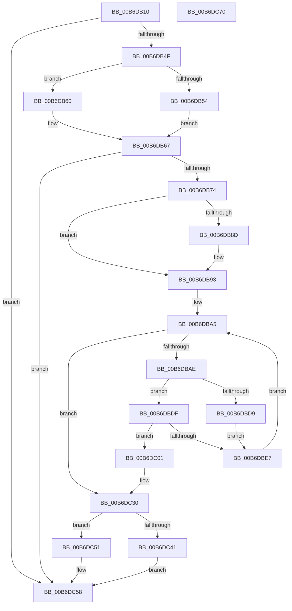

# PopHiberChecksumHiberFileData

- RVA: `0x00B6DB10`–`0x00B6DC71` (길이 `353` bytes)
- VA: `0x0000000140B6DB10`
- 실행 섹션: `PAGELK`
- PDB 이름 있음: `예`; PDB Function 태그: `아니요`
- unwind 정보 RVA: `0x000CC360`
- 디코드: `93`개 명령, `353/353` bytes 표시
- 미해석 바이트: `0` (있으면 어셈블리에 `.byte`로 보존)

> 이 문서는 커널 이미지의 기계어와 PDB 기호를 분석해 생성했습니다. 4번과 5번은 함수 원형과 자료형을 바이너리 사용 방식에서 추정한 C 해석이며 원본 소스 복구 결과는 아닙니다.

## 1. Dependencies

- 직접 호출 지점: **3**; 고유 호출 대상: **3**
- 직접 호출자로 확인된 함수: **2**
- RIP 상대 이미지 참조: **2**

### Outgoing calls
- `0x00B6DBCD` → [tcpxsum](../../text/6B/tcpxsum_function_006BA210.md) (function, `0x006BA210`)
- `0x00B6DC06` → [PopCheckpointSystemSleep](../B7/PopCheckpointSystemSleep_function_00B77C90.md) (function, `0x00B77C90`)
- `0x00B6DC2A` → [KeBugCheckEx](../../text/4F/KeBugCheckEx_function_004FD660.md) (function, `0x004FD660`)

### Direct callers
- [PopRequestRead](PopRequestRead_function_00B6E6DC.md) at `0x00B6E775`
- [PopRequestWrite](PopRequestWrite_function_00B6EB14.md) at `0x00B6ED27`

### Static image references
- `0x00B6DC48` → RVA `0x00F0C3B0` (`.data`; read/write)
- `0x00B6DC51` → RVA `0x00F0C508` (`.data`; read/write)

## 2. Other-region calls and transfers

- 다른 실행 섹션으로 향하는 call: **2**
  - `0x00B6DBCD` → [tcpxsum](../../text/6B/tcpxsum_function_006BA210.md) (`PAGELK` → `.text`)
  - `0x00B6DC2A` → [KeBugCheckEx](../../text/4F/KeBugCheckEx_function_004FD660.md) (`PAGELK` → `.text`)
- 별도 외부 분기/꼬리 이동을 확인하지 못했습니다.

## 3. Assembly (complete function range)

```asm
00B6DB10  48 89 5C 24 08                  mov qword ptr [rsp + 8], rbx
00B6DB15  48 89 74 24 10                  mov qword ptr [rsp + 0x10], rsi
00B6DB1A  4C 89 4C 24 20                  mov qword ptr [rsp + 0x20], r9
00B6DB1F  57                              push rdi
00B6DB20  41 54                           push r12
00B6DB22  41 55                           push r13
00B6DB24  41 56                           push r14
00B6DB26  41 57                           push r15
00B6DB28  48 83 EC 30                     sub rsp, 0x30
00B6DB2C  49 8B D8                        mov rbx, r8
00B6DB2F  44 8A F2                        mov r14b, dl
00B6DB32  48 8B F9                        mov rdi, rcx
00B6DB35  0F 31                           rdtsc
00B6DB37  48 C1 E2 20                     shl rdx, 0x20
00B6DB3B  48 0B C2                        or rax, rdx
00B6DB3E  48 83 B9 D0 01 00 00 00         cmp qword ptr [rcx + 0x1d0], 0
00B6DB46  4C 8B E0                        mov r12, rax
00B6DB49  0F 84 09 01 00 00               je 0x140b6dc58
00B6DB4F  45 84 F6                        test r14b, r14b
00B6DB52  74 0C                           je 0x140b6db60
00B6DB54  48 8B 89 D8 01 00 00            mov rcx, qword ptr [rcx + 0x1d8]
00B6DB5B  48 D1 E9                        shr rcx, 1
00B6DB5E  EB 07                           jmp 0x140b6db67
00B6DB60  48 8B 89 C0 01 00 00            mov rcx, qword ptr [rcx + 0x1c0]
00B6DB67  48 C1 EB 09                     shr rbx, 9
00B6DB6B  48 3B D9                        cmp rbx, rcx
00B6DB6E  0F 83 E4 00 00 00               jae 0x140b6dc58
00B6DB74  48 8B 84 24 80 00 00 00         mov rax, qword ptr [rsp + 0x80]
00B6DB7C  41 BA 00 02 00 00               mov r10d, 0x200
00B6DB82  48 8B D0                        mov rdx, rax
00B6DB85  81 E2 FF 01 00 00               and edx, 0x1ff
00B6DB8B  74 06                           je 0x140b6db93
00B6DB8D  48 2B C2                        sub rax, rdx
00B6DB90  49 03 C2                        add rax, r10
00B6DB93  48 C1 E8 09                     shr rax, 9
00B6DB97  4C 8D 2C 18                     lea r13, [rax + rbx]
00B6DB9B  4C 3B E9                        cmp r13, rcx
00B6DB9E  4C 0F 43 E9                     cmovae r13, rcx
00B6DBA2  45 33 FF                        xor r15d, r15d
00B6DBA5  49 3B DD                        cmp rbx, r13
00B6DBA8  0F 83 82 00 00 00               jae 0x140b6dc30
00B6DBAE  4C 8B 84 24 80 00 00 00         mov r8, qword ptr [rsp + 0x80]
00B6DBB6  4B 8D 14 0F                     lea rdx, [r15 + r9]
00B6DBBA  48 8B B7 D0 01 00 00            mov rsi, qword ptr [rdi + 0x1d0]
00B6DBC1  4D 2B C7                        sub r8, r15
00B6DBC4  4D 3B C2                        cmp r8, r10
00B6DBC7  4D 0F 47 C2                     cmova r8, r10
00B6DBCB  33 C9                           xor ecx, ecx
00B6DBCD  E8 3E C6 B4 FF                  call 0x1406ba210
00B6DBD2  8B C8                           mov ecx, eax
00B6DBD4  45 84 F6                        test r14b, r14b
00B6DBD7  74 06                           je 0x140b6dbdf
00B6DBD9  66 89 0C 5E                     mov word ptr [rsi + rbx*2], cx
00B6DBDD  EB 08                           jmp 0x140b6dbe7
00B6DBDF  0F B7 04 5E                     movzx eax, word ptr [rsi + rbx*2]
00B6DBE3  3B C1                           cmp eax, ecx
00B6DBE5  75 1A                           jne 0x140b6dc01
00B6DBE7  4C 8B 4C 24 78                  mov r9, qword ptr [rsp + 0x78]
00B6DBEC  41 BA 00 02 00 00               mov r10d, 0x200
00B6DBF2  4D 03 FA                        add r15, r10
00B6DBF5  66 89 87 C8 01 00 00            mov word ptr [rdi + 0x1c8], ax
00B6DBFC  48 FF C3                        inc rbx
00B6DBFF  EB A4                           jmp 0x140b6dba5
00B6DC01  B9 1E 00 00 00                  mov ecx, 0x1e
00B6DC06  E8 85 A0 00 00                  call 0x140b77c90
00B6DC0B  0F B7 87 C8 01 00 00            movzx eax, word ptr [rdi + 0x1c8]
00B6DC12  BA 0E 01 00 00                  mov edx, 0x10e
00B6DC17  44 0F B7 0C 5E                  movzx r9d, word ptr [rsi + rbx*2]
00B6DC1C  41 B8 0A 00 00 00               mov r8d, 0xa
00B6DC22  48 89 44 24 20                  mov qword ptr [rsp + 0x20], rax
00B6DC27  8D 4A 92                        lea ecx, [rdx - 0x6e]
00B6DC2A  E8 31 FA 98 FF                  call 0x1404fd660
00B6DC2F  CC                              int3
00B6DC30  0F 31                           rdtsc
00B6DC32  48 C1 E2 20                     shl rdx, 0x20
00B6DC36  48 0B C2                        or rax, rdx
00B6DC39  49 2B C4                        sub rax, r12
00B6DC3C  45 84 F6                        test r14b, r14b
00B6DC3F  74 10                           je 0x140b6dc51
00B6DC41  48 89 9F C0 01 00 00            mov qword ptr [rdi + 0x1c0], rbx
00B6DC48  48 01 05 61 E7 39 00            add qword ptr [rip + 0x39e761], rax
00B6DC4F  EB 07                           jmp 0x140b6dc58
00B6DC51  48 01 05 B0 E8 39 00            add qword ptr [rip + 0x39e8b0], rax
00B6DC58  48 8B 5C 24 60                  mov rbx, qword ptr [rsp + 0x60]
00B6DC5D  48 8B 74 24 68                  mov rsi, qword ptr [rsp + 0x68]
00B6DC62  48 83 C4 30                     add rsp, 0x30
00B6DC66  41 5F                           pop r15
00B6DC68  41 5E                           pop r14
00B6DC6A  41 5D                           pop r13
00B6DC6C  41 5C                           pop r12
00B6DC6E  5F                              pop rdi
00B6DC6F  C3                              ret
00B6DC70  CC                              int3
```

## 4. C-style interpretation (structured pseudocode)

```c
__int64 __fastcall PopHiberChecksumHiberFileData(__int64 a1, __int64 a2, __int64 a3, __int64 a4, __int64 a5)
{
    __int64 result;
    __int64 v_r13;
    __int64 v_r15;
    __int64 v_rbx;
    __int64 v_rsp;
    unsigned __int64 v_stack_m38;
    unsigned __int64 v_stack_p10;
    unsigned __int64 v_stack_p20;
    unsigned __int64 v_stack_p8;

    v_stack_p8 = v_rbx;
    v_stack_p10 = v_rsi;
    v_stack_p20 = a4;
    v_rsp = (v_rsp) - (48);
    a2 = (a2) << (32);
    result = (result) | (a2);
    if ((*(unsigned __int64 *)(a1 + 464)) == 0) goto loc_00B6DC58;
    if ((unsigned __int8)((unsigned __int8)(a2)) == 0) goto loc_00B6DB60;
    a1 = (*(unsigned __int64 *)(a1 + 472)) >> (1);
    goto loc_00B6DB67;
loc_00B6DB60:
loc_00B6DB67:
    v_rbx = (a3) >> (9);
    if (v_rbx >= (*(unsigned __int64 *)(a1 + 448))) goto loc_00B6DC58;
    a2 = (unsigned int)((a5) & (511));
    result = a5;
    if (!(condition_is_equal)) {
        result = (a5) - (a2);
        result = (result) + (512);
    }
    result = (result) >> (9);
    v_r13 = result + v_rbx * 1;
    if ((result + v_rbx * 1) >= (*(unsigned __int64 *)(a1 + 448))) { v_r13 = *(unsigned __int64 *)(a1 + 448); }
    v_r15 = 0;
loc_00B6DBA5:
    if (v_rbx >= v_r13) goto loc_00B6DC30;
    a3 = (a5) - (0);
    if (a3 > 512) { a3 = 512; }
    a1 = 0;
    result = tcpxsum(a1, v_r15 + a4 * 1, a3, a4);
    if ((unsigned __int8)((unsigned __int8)(a2)) == 0) goto loc_00B6DBDF;
    *(unsigned __int16 *)(*(unsigned __int64 *)(a1 + 464) + v_rbx * 2) = (unsigned __int16)((unsigned int)((unsigned int)(result)));
    goto loc_00B6DBE7;
loc_00B6DBDF:
    if (((unsigned int)(*(unsigned __int16 *)(*(unsigned __int64 *)(a1 + 464) + v_rbx * 2))) != ((unsigned int)((unsigned int)((unsigned int)(result))))) goto loc_00B6DC01;
loc_00B6DBE7:
    v_r15 = (v_r15) + (512);
    *(unsigned __int16 *)(a1 + 456) = (unsigned __int16)(*(unsigned __int16 *)(*(unsigned __int64 *)(a1 + 464) + v_rbx * 2));
    v_rbx = (v_rbx) + 1;
    goto loc_00B6DBA5;
loc_00B6DC01:
    result = PopCheckpointSystemSleep(30, v_r15 + a4 * 1, a3, v_stack_p20);
    v_stack_m38 = *(unsigned __int16 *)(a1 + 456);
    result = KeBugCheckEx(270 - 110, 270, 10, *(unsigned __int16 *)(*(unsigned __int64 *)(a1 + 464) + v_rbx * 2));
loc_00B6DC30:
    a2 = (270) << (32);
    result = (result) | (a2);
    result = (result) - (result);
    if ((unsigned __int8)((unsigned __int8)(a2)) == 0) goto loc_00B6DC51;
    *(unsigned __int64 *)(a1 + 448) = v_rbx;
    goto loc_00B6DC58;
loc_00B6DC51:
loc_00B6DC58:
    v_rsp = (v_rsp) + (48);
    return result;
}
```

## 5. (Beta) C Style

```c
int64_t PopHiberChecksumHiberFileData(void *Arg1, int64_t Arg2, int64_t Arg3, int64_t Arg4, int64_t Arg5)
{
    uint8_t *arg1 = (uint8_t *)Arg1;

    int64_t result;
    int64_t local_r13;
    int64_t local_r15;
    int64_t local_rbx;
    int64_t local_rsp;
    uint64_t v_stack_m38;
    uint64_t v_stack_p10;
    uint64_t v_stack_p20;
    uint64_t v_stack_p8;

    v_stack_p8 = local_rbx;
    v_stack_p10 = local_rsi;
    v_stack_p20 = Arg4;
    local_rsp = (local_rsp) - (48);
    Arg2 = (Arg2) << (32);
    result = (result) | (Arg2);
    if ((*(uint64_t *)(arg1 + 0x1D0)) == 0) goto loc_00B6DC58;
    if ((uint8_t)((uint8_t)(Arg2)) == 0) goto loc_00B6DB60;
    Arg1 = (*(uint64_t *)(arg1 + 0x1D8)) >> (1);
    goto loc_00B6DB67;
loc_00B6DB60:
loc_00B6DB67:
    local_rbx = (Arg3) >> (9);
    if (local_rbx >= (*(uint64_t *)(arg1 + 0x1C0))) goto loc_00B6DC58;
    Arg2 = (uint32_t)((Arg5) & (511));
    result = Arg5;
    if (!(condition_is_equal)) {
        result = (Arg5) - (Arg2);
        result = (result) + (512);
    }
    result = (result) >> (9);
    local_r13 = result + local_rbx * 1;
    if ((result + local_rbx * 1) >= (*(uint64_t *)(arg1 + 0x1C0))) { local_r13 = *(uint64_t *)(arg1 + 0x1C0); }
    local_r15 = 0;
loc_00B6DBA5:
    if (local_rbx >= local_r13) goto loc_00B6DC30;
    Arg3 = (Arg5) - (0);
    if (Arg3 > 512) { Arg3 = 512; }
    Arg1 = 0;
    result = tcpxsum(Arg1, local_r15 + Arg4 * 1, Arg3, Arg4);
    if ((uint8_t)((uint8_t)(Arg2)) == 0) goto loc_00B6DBDF;
    *(uint16_t *)(*(uint64_t *)(arg1 + 0x1D0) + local_rbx * 2) = (uint16_t)((uint32_t)((uint32_t)(result)));
    goto loc_00B6DBE7;
loc_00B6DBDF:
    if (((uint32_t)(*(uint16_t *)(*(uint64_t *)(arg1 + 0x1D0) + local_rbx * 2))) != ((uint32_t)((uint32_t)((uint32_t)(result))))) goto loc_00B6DC01;
loc_00B6DBE7:
    local_r15 = (local_r15) + (512);
    *(uint16_t *)(arg1 + 0x1C8) = (uint16_t)(*(uint16_t *)(*(uint64_t *)(arg1 + 0x1D0) + local_rbx * 2));
    local_rbx = (local_rbx) + 1;
    goto loc_00B6DBA5;
loc_00B6DC01:
    result = PopCheckpointSystemSleep(30, local_r15 + Arg4 * 1, Arg3, v_stack_p20);
    v_stack_m38 = *(uint16_t *)(arg1 + 0x1C8);
    result = KeBugCheckEx(270 - 110, 270, 10, *(uint16_t *)(*(uint64_t *)(arg1 + 0x1D0) + local_rbx * 2));
loc_00B6DC30:
    Arg2 = (270) << (32);
    result = (result) | (Arg2);
    result = (result) - (result);
    if ((uint8_t)((uint8_t)(Arg2)) == 0) goto loc_00B6DC51;
    *(uint64_t *)(arg1 + 0x1C0) = local_rbx;
    goto loc_00B6DC58;
loc_00B6DC51:
loc_00B6DC58:
    local_rsp = (local_rsp) + (48);
    return result;
}
```

### 관측된 메모리 오프셋

구조체 형식이 확인되지 않은 접근은 인자 기준의 오프셋으로만 기록했습니다.

| 기준 인자 | 오프셋 표현 | 폭 (bit) | 접근 |
|---|---:|---:|---|
| `Arg1` | `+ 0x1C0` | `64` | `R` |
| `Arg1` | `+ 0x1C0` | `64` | `W` |
| `Arg1` | `+ 0x1C8` | `16` | `R` |
| `Arg1` | `+ 0x1C8` | `16` | `W` |
| `Arg1` | `+ 0x1D0` | `64` | `R` |
| `Arg1` | `+ 0x1D8` | `64` | `R` |

## 6. Execution-region graph

[열기: 2D/3D 그래프와 함수 탐색 컨트롤 패널](../../../control-panel.html?section=pagelk&rva=0x00B6DB10&view=graph)

- 2D 그래프는 위에서 아래로 흐르고, 3D 그래프는 빈 공간을 드래그해 회전합니다. Shift+드래그는 이동, 휠은 확대·축소, 함수 노드 선택은 대상 보고서 이동입니다.

### Static fallback


