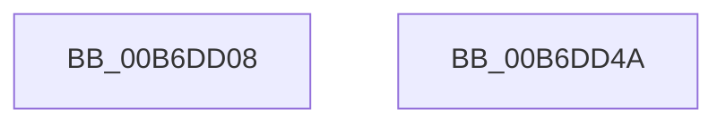

# PopHiberPeekRangeTable

- RVA: `0x00B6DD08`–`0x00B6DD4B` (길이 `67` bytes)
- VA: `0x0000000140B6DD08`
- 실행 섹션: `PAGELK`
- PDB 이름 있음: `예`; PDB Function 태그: `아니요`
- unwind 정보 RVA: `0x00097934`
- 디코드: `18`개 명령, `67/67` bytes 표시
- 미해석 바이트: `0` (있으면 어셈블리에 `.byte`로 보존)

> 이 문서는 커널 이미지의 기계어와 PDB 기호를 분석해 생성했습니다. 4번과 5번은 함수 원형과 자료형을 바이너리 사용 방식에서 추정한 C 해석이며 원본 소스 복구 결과는 아닙니다.

## 1. Dependencies

- 직접 호출 지점: **1**; 고유 호출 대상: **1**
- 직접 호출자로 확인된 함수: **1**
- RIP 상대 이미지 참조: **1**

### Outgoing calls
- `0x00B6DD26` → [PopReadProducerConsumerBuffer](PopReadProducerConsumerBuffer_function_00B6E570.md) (function, `0x00B6E570`)

### Direct callers
- [ConsumerPeekAndConsumeBuffer](../B7/ConsumerPeekAndConsumeBuffer_function_00B78124.md) at `0x00B78218`

### Static image references
- `0x00B6DD0F` → RVA `0x00F0BFC8` (`.data`; read)

## 2. Other-region calls and transfers

- 다른 실행 섹션으로 향하는 call: **0**
- 별도 외부 분기/꼬리 이동을 확인하지 못했습니다.

## 3. Assembly (complete function range)

```asm
00B6DD08  48 8B C4                        mov rax, rsp
00B6DD0B  48 83 EC 38                     sub rsp, 0x38
00B6DD0F  4C 8B 0D B2 E2 39 00            mov r9, qword ptr [rip + 0x39e2b2]
00B6DD16  83 60 18 00                     and dword ptr [rax + 0x18], 0
00B6DD1A  C6 40 F0 00                     mov byte ptr [rax - 0x10], 0
00B6DD1E  4C 89 40 E8                     mov qword ptr [rax - 0x18], r8
00B6DD22  4C 8D 40 18                     lea r8, [rax + 0x18]
00B6DD26  E8 45 08 00 00                  call 0x140b6e570
00B6DD2B  8B 08                           mov ecx, dword ptr [rax]
00B6DD2D  0F B6 C1                        movzx eax, cl
00B6DD30  8B D1                           mov edx, ecx
00B6DD32  48 C1 EA 08                     shr rdx, 8
00B6DD36  81 E2 FF FF 1F 00               and edx, 0x1fffff
00B6DD3C  8D 04 C5 04 00 00 00            lea eax, [rax*8 + 4]
00B6DD43  03 C2                           add eax, edx
00B6DD45  48 83 C4 38                     add rsp, 0x38
00B6DD49  C3                              ret
00B6DD4A  CC                              int3
```

## 4. C-style interpretation (structured pseudocode)

```c
__int64 __fastcall PopHiberPeekRangeTable(__int64 a1, __int64 a2, __int64 a3)
{
    __int64 result;
    __int64 v_rsp;

    v_rsp = (v_rsp) - (56);
    *(unsigned __int8 *)(v_rsp - 16) = 0;
    *(unsigned __int64 *)(v_rsp - 24) = a3;
    result = PopReadProducerConsumerBuffer(a1, a2, v_rsp + 24, *(unsigned __int64 *)(v_rip + 3793586));
    a2 = ((unsigned int)((unsigned int)((unsigned int)(*(unsigned int *)(result))))) >> (8);
    a2 = (unsigned int)((a2) & (0x1FFFFFULL));
    result = (unsigned int)(((unsigned __int8)((unsigned int)(*(unsigned int *)(result))) * 8 + 4) + ((unsigned int)(a2)));
    v_rsp = (v_rsp) + (56);
    return result;
}
```

## 5. (Beta) C Style

```c
int64_t PopHiberPeekRangeTable(int64_t Arg1, int64_t Arg2, int64_t Arg3)
{
    int64_t result;
    int64_t local_rsp;

    local_rsp = (local_rsp) - (56);
    *(uint8_t *)(local_rsp - 0x10) = 0;
    *(uint64_t *)(local_rsp - 0x18) = Arg3;
    result = PopReadProducerConsumerBuffer(Arg1, Arg2, local_rsp + 24, *(uint64_t *)(v_rip + 0x39E2B2));
    Arg2 = ((uint32_t)((uint32_t)((uint32_t)(*(uint32_t *)(result))))) >> (8);
    Arg2 = (uint32_t)((Arg2) & (0x1FFFFFULL));
    result = (uint32_t)(((uint8_t)((uint32_t)(*(uint32_t *)(result))) * 8 + 4) + ((uint32_t)(Arg2)));
    local_rsp = (local_rsp) + (56);
    return result;
}
```

## 6. Execution-region graph

[열기: 2D/3D 그래프와 함수 탐색 컨트롤 패널](../../../control-panel.html?section=pagelk&rva=0x00B6DD08&view=graph)

- 2D 그래프는 위에서 아래로 흐르고, 3D 그래프는 빈 공간을 드래그해 회전합니다. Shift+드래그는 이동, 휠은 확대·축소, 함수 노드 선택은 대상 보고서 이동입니다.

### Static fallback


