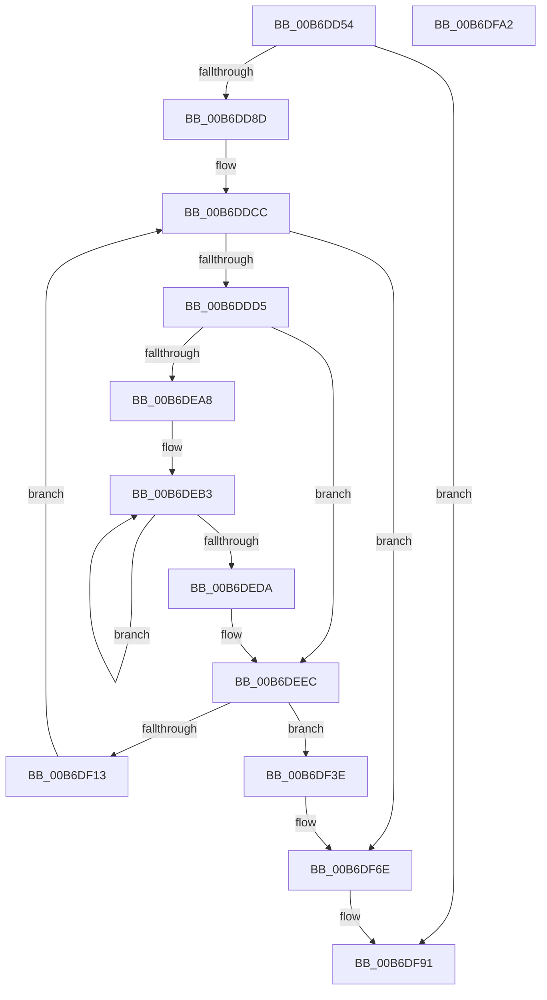

# PopHiberReadChecksums

- RVA: `0x00B6DD54`–`0x00B6DFA3` (길이 `591` bytes)
- VA: `0x0000000140B6DD54`
- 실행 섹션: `PAGELK`
- PDB 이름 있음: `예`; PDB Function 태그: `아니요`
- unwind 정보 RVA: `0x000C3C34`
- 디코드: `141`개 명령, `591/591` bytes 표시
- 미해석 바이트: `0` (있으면 어셈블리에 `.byte`로 보존)

> 이 문서는 커널 이미지의 기계어와 PDB 기호를 분석해 생성했습니다. 4번과 5번은 함수 원형과 자료형을 바이너리 사용 방식에서 추정한 C 해석이며 원본 소스 복구 결과는 아닙니다.

## 1. Dependencies

- 직접 호출 지점: **6**; 고유 호출 대상: **6**
- 직접 호출자로 확인된 함수: **1**
- RIP 상대 이미지 참조: **1**

### Outgoing calls
- `0x00B6DDE7` → [PopGetIoLocation](PopGetIoLocation_function_00B6D710.md) (function, `0x00B6D710`)
- `0x00B6DEC1` → [MmGetPhysicalAddress](../../text/23/MmGetPhysicalAddress_function_0023A500.md) (function, `0x0023A500`)
- `0x00B6DF07` → [guard_dispatch_icall](../../text/6B/guard_dispatch_icall_function_006BAAD0.md) (function, `0x006BAAD0`)
- `0x00B6DF20` → [memcpy](../../text/6C/memcpy_function_006C6840.md) (function, `0x006C6840`)
- `0x00B6DF4D` → [PopInternalAddToDumpFile](../../text/5C/PopInternalAddToDumpFile_function_005CE634.md) (function, `0x005CE634`)
- `0x00B6DF68` → [KeBugCheckEx](../../text/4F/KeBugCheckEx_function_004FD660.md) (function, `0x004FD660`)

### Direct callers
- [PopRestoreHiberContext](../B7/PopRestoreHiberContext_function_00B777F0.md) at `0x00B779CB`

### Static image references
- `0x00B6DF8A` → RVA `0x00F0C510` (`.data`; read/write)

## 2. Other-region calls and transfers

- 다른 실행 섹션으로 향하는 call: **5**
  - `0x00B6DEC1` → [MmGetPhysicalAddress](../../text/23/MmGetPhysicalAddress_function_0023A500.md) (`PAGELK` → `.text`)
  - `0x00B6DF07` → [guard_dispatch_icall](../../text/6B/guard_dispatch_icall_function_006BAAD0.md) (`PAGELK` → `.text`)
  - `0x00B6DF20` → [memcpy](../../text/6C/memcpy_function_006C6840.md) (`PAGELK` → `.text`)
  - `0x00B6DF4D` → [PopInternalAddToDumpFile](../../text/5C/PopInternalAddToDumpFile_function_005CE634.md) (`PAGELK` → `.text`)
  - `0x00B6DF68` → [KeBugCheckEx](../../text/4F/KeBugCheckEx_function_004FD660.md) (`PAGELK` → `.text`)
- 별도 외부 분기/꼬리 이동을 확인하지 못했습니다.

## 3. Assembly (complete function range)

```asm
00B6DD54  48 8B C4                        mov rax, rsp
00B6DD57  53                              push rbx
00B6DD58  55                              push rbp
00B6DD59  56                              push rsi
00B6DD5A  57                              push rdi
00B6DD5B  41 54                           push r12
00B6DD5D  41 55                           push r13
00B6DD5F  41 56                           push r14
00B6DD61  41 57                           push r15
00B6DD63  48 83 EC 58                     sub rsp, 0x58
00B6DD67  48 8B B1 D0 01 00 00            mov rsi, qword ptr [rcx + 0x1d0]
00B6DD6E  45 33 FF                        xor r15d, r15d
00B6DD71  4C 89 78 18                     mov qword ptr [rax + 0x18], r15
00B6DD75  48 8B D9                        mov rbx, rcx
00B6DD78  4C 89 78 10                     mov qword ptr [rax + 0x10], r15
00B6DD7C  48 89 B4 24 B8 00 00 00         mov qword ptr [rsp + 0xb8], rsi
00B6DD84  48 85 F6                        test rsi, rsi
00B6DD87  0F 84 04 02 00 00               je 0x140b6df91
00B6DD8D  0F 31                           rdtsc
00B6DD8F  4C 8B A9 D8 00 00 00            mov r13, qword ptr [rcx + 0xd8]
00B6DD96  4C 8B A1 60 01 00 00            mov r12, qword ptr [rcx + 0x160]
00B6DD9D  48 C1 E2 20                     shl rdx, 0x20
00B6DDA1  48 0B C2                        or rax, rdx
00B6DDA4  4C 89 6C 24 40                  mov qword ptr [rsp + 0x40], r13
00B6DDA9  49 8B 8D 80 00 00 00            mov rcx, qword ptr [r13 + 0x80]
00B6DDB0  4D 8B 75 78                     mov r14, qword ptr [r13 + 0x78]
00B6DDB4  49 C1 E6 0C                     shl r14, 0xc
00B6DDB8  48 89 44 24 48                  mov qword ptr [rsp + 0x48], rax
00B6DDBD  48 8D 3C 4D FF 0F 00 00         lea rdi, [rcx*2 + 0xfff]
00B6DDC5  48 81 E7 00 F0 FF FF            and rdi, 0xfffffffffffff000
00B6DDCC  48 85 FF                        test rdi, rdi
00B6DDCF  0F 84 99 01 00 00               je 0x140b6df6e
00B6DDD5  48 8B 8B B0 00 00 00            mov rcx, qword ptr [rbx + 0xb0]
00B6DDDC  4C 8D 84 24 A8 00 00 00         lea r8, [rsp + 0xa8]
00B6DDE4  49 8B D6                        mov rdx, r14
00B6DDE7  E8 24 F9 FF FF                  call 0x140b6d710
00B6DDEC  48 8B 93 A0 00 00 00            mov rdx, qword ptr [rbx + 0xa0]
00B6DDF3  41 BA FF 0F 00 00               mov r10d, 0xfff
00B6DDF9  8B 8B A8 00 00 00               mov ecx, dword ptr [rbx + 0xa8]
00B6DDFF  44 8B C2                        mov r8d, edx
00B6DE02  8B AB B8 01 00 00               mov ebp, dword ptr [rbx + 0x1b8]
00B6DE08  44 8B 8B A0 00 00 00            mov r9d, dword ptr [rbx + 0xa0]
00B6DE0F  48 89 84 24 B0 00 00 00         mov qword ptr [rsp + 0xb0], rax
00B6DE17  48 8B 84 24 A8 00 00 00         mov rax, qword ptr [rsp + 0xa8]
00B6DE1F  48 3B F8                        cmp rdi, rax
00B6DE22  66 45 89 7C 24 0A               mov word ptr [r12 + 0xa], r15w
00B6DE28  4D 89 3C 24                     mov qword ptr [r12], r15
00B6DE2C  48 0F 42 C7                     cmovb rax, rdi
00B6DE30  48 C1 E1 0C                     shl rcx, 0xc
00B6DE34  48 3B C1                        cmp rax, rcx
00B6DE37  48 0F 42 C8                     cmovb rcx, rax
00B6DE3B  48 C1 E5 0C                     shl rbp, 0xc
00B6DE3F  48 3B CD                        cmp rcx, rbp
00B6DE42  48 0F 42 E9                     cmovb rbp, rcx
00B6DE46  4D 23 CA                        and r9, r10
00B6DE49  4D 03 CA                        add r9, r10
00B6DE4C  41 89 6C 24 28                  mov dword ptr [r12 + 0x28], ebp
00B6DE51  41 8B C8                        mov ecx, r8d
00B6DE54  48 89 6C 24 38                  mov qword ptr [rsp + 0x38], rbp
00B6DE59  49 23 CA                        and rcx, r10
00B6DE5C  4C 03 CD                        add r9, rbp
00B6DE5F  49 03 CA                        add rcx, r10
00B6DE62  49 C1 E9 0C                     shr r9, 0xc
00B6DE66  48 03 CD                        add rcx, rbp
00B6DE69  48 81 E2 00 F0 FF FF            and rdx, 0xfffffffffffff000
00B6DE70  48 C1 E9 0C                     shr rcx, 0xc
00B6DE74  45 23 C2                        and r8d, r10d
00B6DE77  66 83 C1 06                     add cx, 6
00B6DE7B  49 89 54 24 20                  mov qword ptr [r12 + 0x20], rdx
00B6DE80  66 C1 E1 03                     shl cx, 3
00B6DE84  66 41 89 4C 24 08               mov word ptr [r12 + 8], cx
00B6DE8A  45 89 44 24 2C                  mov dword ptr [r12 + 0x2c], r8d
00B6DE8F  48 8B 83 A0 00 00 00            mov rax, qword ptr [rbx + 0xa0]
00B6DE96  49 89 44 24 18                  mov qword ptr [r12 + 0x18], rax
00B6DE9B  66 41 C7 44 24 0A 01 00         mov word ptr [r12 + 0xa], 1
00B6DEA3  4D 85 C9                        test r9, r9
00B6DEA6  74 44                           je 0x140b6deec
00B6DEA8  45 8B EF                        mov r13d, r15d
00B6DEAB  49 8B E9                        mov rbp, r9
00B6DEAE  BE 01 00 00 00                  mov esi, 1
00B6DEB3  49 8B CF                        mov rcx, r15
00B6DEB6  48 C1 E1 0C                     shl rcx, 0xc
00B6DEBA  48 03 8B A0 00 00 00            add rcx, qword ptr [rbx + 0xa0]
00B6DEC1  E8 3A C6 6C FF                  call 0x14023a500
00B6DEC6  48 C1 E8 0C                     shr rax, 0xc
00B6DECA  44 03 EE                        add r13d, esi
00B6DECD  4B 89 44 FC 30                  mov qword ptr [r12 + r15*8 + 0x30], rax
00B6DED2  45 8B FD                        mov r15d, r13d
00B6DED5  4C 3B FD                        cmp r15, rbp
00B6DED8  72 D9                           jb 0x140b6deb3
00B6DEDA  48 8B B4 24 B8 00 00 00         mov rsi, qword ptr [rsp + 0xb8]
00B6DEE2  48 8B 6C 24 38                  mov rbp, qword ptr [rsp + 0x38]
00B6DEE7  4C 8B 6C 24 40                  mov r13, qword ptr [rsp + 0x40]
00B6DEEC  48 8B 83 B8 00 00 00            mov rax, qword ptr [rbx + 0xb8]
00B6DEF3  48 8D 94 24 B0 00 00 00         lea rdx, [rsp + 0xb0]
00B6DEFB  4D 8B C4                        mov r8, r12
00B6DEFE  33 C9                           xor ecx, ecx
00B6DF00  48 8B 80 A0 00 00 00            mov rax, qword ptr [rax + 0xa0]
00B6DF07  E8 C4 CB B4 FF                  call 0x1406baad0
00B6DF0C  4C 63 F8                        movsxd r15, eax
00B6DF0F  85 C0                           test eax, eax
00B6DF11  78 2B                           js 0x140b6df3e
00B6DF13  48 8B 93 A0 00 00 00            mov rdx, qword ptr [rbx + 0xa0]
00B6DF1A  4C 8B C5                        mov r8, rbp
00B6DF1D  48 8B CE                        mov rcx, rsi
00B6DF20  E8 1B 89 B5 FF                  call 0x1406c6840
00B6DF25  48 03 F5                        add rsi, rbp
00B6DF28  48 2B FD                        sub rdi, rbp
00B6DF2B  4C 03 F5                        add r14, rbp
00B6DF2E  48 89 B4 24 B8 00 00 00         mov qword ptr [rsp + 0xb8], rsi
00B6DF36  45 33 FF                        xor r15d, r15d
00B6DF39  E9 8E FE FF FF                  jmp 0x140b6ddcc
00B6DF3E  48 8B 8B B8 00 00 00            mov rcx, qword ptr [rbx + 0xb8]
00B6DF45  45 33 C0                        xor r8d, r8d
00B6DF48  BA 78 01 00 00                  mov edx, 0x178
00B6DF4D  E8 E2 06 A6 FF                  call 0x1405ce634
00B6DF52  BA 0A 01 00 00                  mov edx, 0x10a
00B6DF57  4C 89 7C 24 20                  mov qword ptr [rsp + 0x20], r15
00B6DF5C  4C 8B CB                        mov r9, rbx
00B6DF5F  41 B8 0A 00 00 00               mov r8d, 0xa
00B6DF65  8D 4A 96                        lea ecx, [rdx - 0x6a]
00B6DF68  E8 F3 F6 98 FF                  call 0x1404fd660
00B6DF6D  CC                              int3
00B6DF6E  49 8B 85 80 00 00 00            mov rax, qword ptr [r13 + 0x80]
00B6DF75  48 89 83 C0 01 00 00            mov qword ptr [rbx + 0x1c0], rax
00B6DF7C  0F 31                           rdtsc
00B6DF7E  48 C1 E2 20                     shl rdx, 0x20
00B6DF82  48 0B C2                        or rax, rdx
00B6DF85  48 2B 44 24 48                  sub rax, qword ptr [rsp + 0x48]
00B6DF8A  48 01 05 7F E5 39 00            add qword ptr [rip + 0x39e57f], rax
00B6DF91  48 83 C4 58                     add rsp, 0x58
00B6DF95  41 5F                           pop r15
00B6DF97  41 5E                           pop r14
00B6DF99  41 5D                           pop r13
00B6DF9B  41 5C                           pop r12
00B6DF9D  5F                              pop rdi
00B6DF9E  5E                              pop rsi
00B6DF9F  5D                              pop rbp
00B6DFA0  5B                              pop rbx
00B6DFA1  C3                              ret
00B6DFA2  CC                              int3
```

## 4. C-style interpretation (structured pseudocode)

```c
__int64 __fastcall PopHiberReadChecksums(__int64 a1, __int64 a2)
{
    __int64 result;
    __int64 v_r13;
    __int64 v_r14;
    __int64 v_r15;
    __int64 v_rbp;
    __int64 v_rdi;
    __int64 v_rsi;
    __int64 v_rsp;
    unsigned __int64 v_stack_m50;
    unsigned __int64 v_stack_m58;
    unsigned __int64 v_stack_m60;
    unsigned __int64 v_stack_m78;
    unsigned __int64 v_stack_p10;
    unsigned __int64 v_stack_p18;
    unsigned __int64 v_stack_p20;

    v_rsp = (v_rsp) - (88);
    v_r15 = 0;
    *(unsigned __int64 *)(v_rsp + 24) = 0;
    *(unsigned __int64 *)(v_rsp + 16) = 0;
    v_stack_p20 = *(unsigned __int64 *)(a1 + 464);
    if (*(unsigned __int64 *)(a1 + 464) == 0) goto loc_00B6DF91;
    a2 = (a2) << (32);
    result = (v_rsp) | (a2);
    v_stack_m58 = *(unsigned __int64 *)(a1 + 216);
    v_r14 = (*(unsigned __int64 *)(*(unsigned __int64 *)(a1 + 216) + 120)) << (12);
    v_stack_m50 = result;
    v_rdi = (*(unsigned __int64 *)(*(unsigned __int64 *)(a1 + 216) + 128) * 2 + 4095) & (0xFFFFFFFFFFFFF000ULL);
loc_00B6DDCC:
    if (v_rdi == 0) goto loc_00B6DF6E;
    result = PopGetIoLocation(*(unsigned __int64 *)(a1 + 176), v_r14, v_stack_p10, a4);
    v_stack_p18 = result;
    *(unsigned __int16 *)(*(unsigned __int64 *)(a1 + 352) + 10) = 0;
    *(unsigned __int64 *)(*(unsigned __int64 *)(a1 + 352)) = 0;
    result = v_stack_p10;
    if (v_rdi < v_stack_p10) { result = v_rdi; }
    a1 = ((unsigned int)(*(unsigned int *)(a1 + 168))) << (12);
    if (result < a1) { a1 = result; }
    v_rbp = ((unsigned int)(*(unsigned int *)(a1 + 440))) << (12);
    if (a1 < v_rbp) { v_rbp = a1; }
    a4 = ((unsigned int)(*(unsigned int *)(a1 + 160))) & ((unsigned int)(0xFFFULL));
    a4 = (a4) + ((unsigned int)(0xFFFULL));
    *(unsigned int *)(*(unsigned __int64 *)(a1 + 352) + 40) = (unsigned int)(v_rbp);
    v_stack_m60 = v_rbp;
    a1 = ((unsigned int)((unsigned int)((unsigned int)((unsigned int)(*(unsigned __int64 *)(a1 + 160)))))) & ((unsigned int)(0xFFFULL));
    a4 = (a4) + (v_rbp);
    a1 = (a1) + ((unsigned int)(0xFFFULL));
    a4 = (a4) >> (12);
    a1 = (a1) + (v_rbp);
    a2 = (*(unsigned __int64 *)(a1 + 160)) & (0xFFFFFFFFFFFFF000ULL);
    a1 = (a1) >> (12);
    a3 = (unsigned int)(((unsigned int)((unsigned int)(*(unsigned __int64 *)(a1 + 160)))) & ((unsigned int)((unsigned int)(0xFFFULL))));
    a1 = (unsigned __int16)((a1) + (6));
    *(unsigned __int64 *)(*(unsigned __int64 *)(a1 + 352) + 32) = a2;
    a1 = (unsigned __int16)((a1) << (3));
    *(unsigned __int16 *)(*(unsigned __int64 *)(a1 + 352) + 8) = (unsigned __int16)(a1);
    *(unsigned int *)(*(unsigned __int64 *)(a1 + 352) + 44) = (unsigned int)(a3);
    *(unsigned __int64 *)(*(unsigned __int64 *)(a1 + 352) + 24) = *(unsigned __int64 *)(a1 + 160);
    *(unsigned __int16 *)(*(unsigned __int64 *)(a1 + 352) + 10) = 1;
    if (a4 == 0) goto loc_00B6DEEC;
loc_00B6DEB3:
    a1 = (0) << (12);
    a1 = (a1) + (*(unsigned __int64 *)(a1 + 160));
    result = MmGetPhysicalAddress(a1, a2, a3, a4);
    result = (result) >> (12);
    v_r13 = (unsigned int)((0) + (1));
    *(unsigned __int64 *)(*(unsigned __int64 *)(a1 + 352) + v_r15 * 8 + 48) = result;
    if (((unsigned int)((unsigned int)(v_r13))) < a4) goto loc_00B6DEB3;
loc_00B6DEEC:
    a1 = 0;
    result = guard_dispatch_icall(a1, v_stack_p18, *(unsigned __int64 *)(a1 + 352), a4);
    if (sign_flag) goto loc_00B6DF3E;
    result = memcpy(v_stack_p20, *(unsigned __int64 *)(a1 + 160), v_stack_m60, a4);
    v_rsi = (v_stack_p20) + (v_stack_m60);
    v_rdi = (v_rdi) - (v_stack_m60);
    v_r14 = (v_r14) + (v_stack_m60);
    v_stack_p20 = v_rsi;
    v_r15 = 0;
    goto loc_00B6DDCC;
loc_00B6DF3E:
    a3 = 0;
    result = PopInternalAddToDumpFile(*(unsigned __int64 *)(a1 + 184), 376, a3, a4);
    v_stack_m78 = 0;
    result = KeBugCheckEx(266 - 106, 266, 10, 0);
loc_00B6DF6E:
    *(unsigned __int64 *)(a1 + 448) = *(unsigned __int64 *)(v_stack_m58 + 128);
    a2 = (266) << (32);
    result = (*(unsigned __int64 *)(v_stack_m58 + 128)) | (a2);
    result = (result) - (v_stack_m50);
loc_00B6DF91:
    v_rsp = (v_rsp) + (88);
    return result;
}
```

## 5. (Beta) C Style

```c
int64_t PopHiberReadChecksums(void *Arg1, int64_t Arg2)
{
    uint8_t *arg1 = (uint8_t *)Arg1;

    int64_t result;
    int64_t local_r13;
    int64_t local_r14;
    int64_t local_r15;
    int64_t local_rbp;
    int64_t local_rdi;
    int64_t local_rsi;
    int64_t local_rsp;
    uint64_t v_stack_m50;
    uint64_t v_stack_m58;
    uint64_t v_stack_m60;
    uint64_t v_stack_m78;
    uint64_t v_stack_p10;
    uint64_t v_stack_p18;
    uint64_t v_stack_p20;

    local_rsp = (local_rsp) - (88);
    local_r15 = 0;
    *(uint64_t *)(local_rsp + 0x18) = 0;
    *(uint64_t *)(local_rsp + 0x10) = 0;
    v_stack_p20 = *(uint64_t *)(arg1 + 0x1D0);
    if (*(uint64_t *)(arg1 + 0x1D0) == 0) goto loc_00B6DF91;
    Arg2 = (Arg2) << (32);
    result = (local_rsp) | (Arg2);
    v_stack_m58 = *(uint64_t *)(arg1 + 0xD8);
    local_r14 = (*(uint64_t *)(*(uint64_t *)(arg1 + 0xD8) + 0x78)) << (12);
    v_stack_m50 = result;
    local_rdi = (*(uint64_t *)(*(uint64_t *)(arg1 + 0xD8) + 0x80) * 2 + 4095) & (0xFFFFFFFFFFFFF000ULL);
loc_00B6DDCC:
    if (local_rdi == 0) goto loc_00B6DF6E;
    result = PopGetIoLocation(*(uint64_t *)(arg1 + 0xB0), local_r14, v_stack_p10, a4);
    v_stack_p18 = result;
    *(uint16_t *)(*(uint64_t *)(arg1 + 0x160) + 0xA) = 0;
    *(uint64_t *)(*(uint64_t *)(arg1 + 0x160)) = 0;
    result = v_stack_p10;
    if (local_rdi < v_stack_p10) { result = local_rdi; }
    Arg1 = ((uint32_t)(*(uint32_t *)(arg1 + 0xA8))) << (12);
    if (result < Arg1) { Arg1 = result; }
    local_rbp = ((uint32_t)(*(uint32_t *)(arg1 + 0x1B8))) << (12);
    if (Arg1 < local_rbp) { local_rbp = Arg1; }
    a4 = ((uint32_t)(*(uint32_t *)(arg1 + 0xA0))) & ((uint32_t)(0xFFFULL));
    a4 = (a4) + ((uint32_t)(0xFFFULL));
    *(uint32_t *)(*(uint64_t *)(arg1 + 0x160) + 0x28) = (uint32_t)(local_rbp);
    v_stack_m60 = local_rbp;
    Arg1 = ((uint32_t)((uint32_t)((uint32_t)((uint32_t)(*(uint64_t *)(arg1 + 0xA0)))))) & ((uint32_t)(0xFFFULL));
    a4 = (a4) + (local_rbp);
    Arg1 = (Arg1) + ((uint32_t)(0xFFFULL));
    a4 = (a4) >> (12);
    Arg1 = (Arg1) + (local_rbp);
    Arg2 = (*(uint64_t *)(arg1 + 0xA0)) & (0xFFFFFFFFFFFFF000ULL);
    Arg1 = (Arg1) >> (12);
    a3 = (uint32_t)(((uint32_t)((uint32_t)(*(uint64_t *)(arg1 + 0xA0)))) & ((uint32_t)((uint32_t)(0xFFFULL))));
    Arg1 = (uint16_t)((Arg1) + (6));
    *(uint64_t *)(*(uint64_t *)(arg1 + 0x160) + 0x20) = Arg2;
    Arg1 = (uint16_t)((Arg1) << (3));
    *(uint16_t *)(*(uint64_t *)(arg1 + 0x160) + 0x8) = (uint16_t)(Arg1);
    *(uint32_t *)(*(uint64_t *)(arg1 + 0x160) + 0x2C) = (uint32_t)(a3);
    *(uint64_t *)(*(uint64_t *)(arg1 + 0x160) + 0x18) = *(uint64_t *)(arg1 + 0xA0);
    *(uint16_t *)(*(uint64_t *)(arg1 + 0x160) + 0xA) = 1;
    if (a4 == 0) goto loc_00B6DEEC;
loc_00B6DEB3:
    Arg1 = (0) << (12);
    Arg1 = (Arg1) + (*(uint64_t *)(arg1 + 0xA0));
    result = MmGetPhysicalAddress(Arg1, Arg2, a3, a4);
    result = (result) >> (12);
    local_r13 = (uint32_t)((0) + (1));
    *(uint64_t *)(*(uint64_t *)(arg1 + 0x160) + local_r15 * 8 + 0x30) = result;
    if (((uint32_t)((uint32_t)(local_r13))) < a4) goto loc_00B6DEB3;
loc_00B6DEEC:
    Arg1 = 0;
    result = guard_dispatch_icall(Arg1, v_stack_p18, *(uint64_t *)(arg1 + 0x160), a4);
    if (sign_flag) goto loc_00B6DF3E;
    result = memcpy(v_stack_p20, *(uint64_t *)(arg1 + 0xA0), v_stack_m60, a4);
    local_rsi = (v_stack_p20) + (v_stack_m60);
    local_rdi = (local_rdi) - (v_stack_m60);
    local_r14 = (local_r14) + (v_stack_m60);
    v_stack_p20 = local_rsi;
    local_r15 = 0;
    goto loc_00B6DDCC;
loc_00B6DF3E:
    a3 = 0;
    result = PopInternalAddToDumpFile(*(uint64_t *)(arg1 + 0xB8), 376, a3, a4);
    v_stack_m78 = 0;
    result = KeBugCheckEx(266 - 106, 266, 10, 0);
loc_00B6DF6E:
    *(uint64_t *)(arg1 + 0x1C0) = *(uint64_t *)(v_stack_m58 + 0x80);
    Arg2 = (266) << (32);
    result = (*(uint64_t *)(v_stack_m58 + 0x80)) | (Arg2);
    result = (result) - (v_stack_m50);
loc_00B6DF91:
    local_rsp = (local_rsp) + (88);
    return result;
}
```

### 관측된 메모리 오프셋

구조체 형식이 확인되지 않은 접근은 인자 기준의 오프셋으로만 기록했습니다.

| 기준 인자 | 오프셋 표현 | 폭 (bit) | 접근 |
|---|---:|---:|---|
| `Arg1` | `+ 0xA0` | `32` | `R` |
| `Arg1` | `+ 0xA0` | `64` | `R` |
| `Arg1` | `+ 0xA8` | `32` | `R` |
| `Arg1` | `+ 0xB0` | `64` | `R` |
| `Arg1` | `+ 0xB8` | `64` | `R` |
| `Arg1` | `+ 0xD8` | `64` | `R` |
| `Arg1` | `+ 0x160` | `64` | `R` |
| `Arg1` | `+ 0x1B8` | `32` | `R` |
| `Arg1` | `+ 0x1C0` | `64` | `W` |
| `Arg1` | `+ 0x1D0` | `64` | `R` |

## 6. Execution-region graph

[열기: 2D/3D 그래프와 함수 탐색 컨트롤 패널](../../../control-panel.html?section=pagelk&rva=0x00B6DD54&view=graph)

- 2D 그래프는 위에서 아래로 흐르고, 3D 그래프는 빈 공간을 드래그해 회전합니다. Shift+드래그는 이동, 휠은 확대·축소, 함수 노드 선택은 대상 보고서 이동입니다.

### Static fallback


