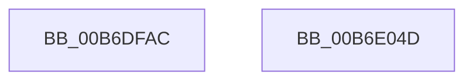

# PopHiberWriteBootFreePageMap

- RVA: `0x00B6DFAC`–`0x00B6E04E` (길이 `162` bytes)
- VA: `0x0000000140B6DFAC`
- 실행 섹션: `PAGELK`
- PDB 이름 있음: `예`; PDB Function 태그: `아니요`
- unwind 정보 RVA: `0x0005C954`
- 디코드: `42`개 명령, `162/162` bytes 표시
- 미해석 바이트: `0` (있으면 어셈블리에 `.byte`로 보존)

> 이 문서는 커널 이미지의 기계어와 PDB 기호를 분석해 생성했습니다. 4번과 5번은 함수 원형과 자료형을 바이너리 사용 방식에서 추정한 C 해석이며 원본 소스 복구 결과는 아닙니다.

## 1. Dependencies

- 직접 호출 지점: **4**; 고유 호출 대상: **4**
- 직접 호출자로 확인된 함수: **1**
- RIP 상대 이미지 참조: **0**

### Outgoing calls
- `0x00B6DFD8` → [RtlIntersectBitMaps](../../text/5E/RtlIntersectBitMaps_function_005E6280.md) (function, `0x005E6280`)
- `0x00B6DFF2` → [memcpy](../../text/6C/memcpy_function_006C6840.md) (function, `0x006C6840`)
- `0x00B6E008` → [tcpxsum](../../text/6B/tcpxsum_function_006BA210.md) (function, `0x006BA210`)
- `0x00B6E033` → [PopWriteHiberPages](PopWriteHiberPages_function_00B6FF78.md) (function, `0x00B6FF78`)

### Direct callers
- [PopSaveHiberContext](PopSaveHiberContext_function_00B6F050.md) at `0x00B6F9AB`

### Static image references
- 디코드된 RIP-relative 메모리 참조가 없습니다.

## 2. Other-region calls and transfers

- 다른 실행 섹션으로 향하는 call: **3**
  - `0x00B6DFD8` → [RtlIntersectBitMaps](../../text/5E/RtlIntersectBitMaps_function_005E6280.md) (`PAGELK` → `.text`)
  - `0x00B6DFF2` → [memcpy](../../text/6C/memcpy_function_006C6840.md) (`PAGELK` → `.text`)
  - `0x00B6E008` → [tcpxsum](../../text/6B/tcpxsum_function_006BA210.md) (`PAGELK` → `.text`)
- 별도 외부 분기/꼬리 이동을 확인하지 못했습니다.

## 3. Assembly (complete function range)

```asm
00B6DFAC  48 89 5C 24 08                  mov qword ptr [rsp + 8], rbx
00B6DFB1  48 89 6C 24 10                  mov qword ptr [rsp + 0x10], rbp
00B6DFB6  48 89 74 24 18                  mov qword ptr [rsp + 0x18], rsi
00B6DFBB  57                              push rdi
00B6DFBC  48 83 EC 20                     sub rsp, 0x20
00B6DFC0  83 A1 C8 00 00 00 00            and dword ptr [rcx + 0xc8], 0
00B6DFC7  48 8D 79 20                     lea rdi, [rcx + 0x20]
00B6DFCB  48 8B DA                        mov rbx, rdx
00B6DFCE  48 8B E9                        mov rbp, rcx
00B6DFD1  48 8D 51 40                     lea rdx, [rcx + 0x40]
00B6DFD5  48 8B CF                        mov rcx, rdi
00B6DFD8  E8 A3 82 A7 FF                  call 0x1405e6280
00B6DFDD  44 8B 07                        mov r8d, dword ptr [rdi]
00B6DFE0  48 8B B5 A0 00 00 00            mov rsi, qword ptr [rbp + 0xa0]
00B6DFE7  48 8B 57 08                     mov rdx, qword ptr [rdi + 8]
00B6DFEB  48 8B CE                        mov rcx, rsi
00B6DFEE  49 C1 E8 03                     shr r8, 3
00B6DFF2  E8 49 88 B5 FF                  call 0x1406c6840
00B6DFF7  8B 07                           mov eax, dword ptr [rdi]
00B6DFF9  48 8B D6                        mov rdx, rsi
00B6DFFC  89 43 48                        mov dword ptr [rbx + 0x48], eax
00B6DFFF  33 C9                           xor ecx, ecx
00B6E001  44 8B 07                        mov r8d, dword ptr [rdi]
00B6E004  49 C1 E8 03                     shr r8, 3
00B6E008  E8 03 C2 B4 FF                  call 0x1406ba210
00B6E00D  89 43 4C                        mov dword ptr [rbx + 0x4c], eax
00B6E010  48 8B D6                        mov rdx, rsi
00B6E013  44 8B 07                        mov r8d, dword ptr [rdi]
00B6E016  48 8B CD                        mov rcx, rbp
00B6E019  44 8B 8D 18 01 00 00            mov r9d, dword ptr [rbp + 0x118]
00B6E020  41 C1 E8 03                     shr r8d, 3
00B6E024  41 83 C1 02                     add r9d, 2
00B6E028  41 81 C0 FF 0F 00 00            add r8d, 0xfff
00B6E02F  49 C1 E8 0C                     shr r8, 0xc
00B6E033  E8 40 1F 00 00                  call 0x140b6ff78
00B6E038  48 8B 5C 24 30                  mov rbx, qword ptr [rsp + 0x30]
00B6E03D  48 8B 6C 24 38                  mov rbp, qword ptr [rsp + 0x38]
00B6E042  48 8B 74 24 40                  mov rsi, qword ptr [rsp + 0x40]
00B6E047  48 83 C4 20                     add rsp, 0x20
00B6E04B  5F                              pop rdi
00B6E04C  C3                              ret
00B6E04D  CC                              int3
```

## 4. C-style interpretation (structured pseudocode)

```c
__int64 __fastcall PopHiberWriteBootFreePageMap(__int64 a1, __int64 a2)
{
    __int64 result;
    __int64 v_rsp;
    unsigned __int64 v_stack_p10;
    unsigned __int64 v_stack_p18;
    unsigned __int64 v_stack_p8;

    v_stack_p8 = v_rbx;
    v_stack_p10 = v_rbp;
    v_stack_p18 = v_rsi;
    v_rsp = (v_rsp) - (32);
    result = RtlIntersectBitMaps(a1 + 32, a1 + 64, a3, a4);
    a3 = ((unsigned int)(*(unsigned int *)(a1 + 32))) >> (3);
    result = memcpy(*(unsigned __int64 *)(a1 + 160), *(unsigned __int64 *)(a1 + 32 + 8), a3, a4);
    *(unsigned int *)(a2 + 72) = (unsigned int)((unsigned int)(*(unsigned int *)(a1 + 32)));
    a1 = 0;
    a3 = ((unsigned int)(*(unsigned int *)(a1 + 32))) >> (3);
    result = tcpxsum(a1, *(unsigned __int64 *)(a1 + 160), a3, a4);
    *(unsigned int *)(a2 + 76) = (unsigned int)(result);
    a3 = (unsigned int)(((unsigned int)(*(unsigned int *)(a1 + 32))) >> (3));
    a4 = (unsigned int)(((unsigned int)(*(unsigned int *)(a1 + 280))) + (2));
    a3 = (unsigned int)((a3) + (0xFFFULL));
    a3 = (a3) >> (12);
    result = PopWriteHiberPages(0, *(unsigned __int64 *)(a1 + 160), a3, a4);
    v_rsp = (v_rsp) + (32);
    return result;
}
```

## 5. (Beta) C Style

```c
int64_t PopHiberWriteBootFreePageMap(void *Arg1, void *Arg2)
{
    uint8_t *arg1 = (uint8_t *)Arg1;
    uint8_t *arg2 = (uint8_t *)Arg2;

    int64_t result;
    int64_t local_rsp;
    uint64_t v_stack_p10;
    uint64_t v_stack_p18;
    uint64_t v_stack_p8;

    v_stack_p8 = local_rbx;
    v_stack_p10 = local_rbp;
    v_stack_p18 = local_rsi;
    local_rsp = (local_rsp) - (32);
    result = RtlIntersectBitMaps(Arg1 + 32, Arg1 + 64, a3, a4);
    a3 = ((uint32_t)(*(uint32_t *)(arg1 + 0x20))) >> (3);
    result = memcpy(*(uint64_t *)(arg1 + 0xA0), *(uint64_t *)(arg1 + 0x20 + 0x8), a3, a4);
    *(uint32_t *)(arg2 + 0x48) = (uint32_t)((uint32_t)(*(uint32_t *)(arg1 + 0x20)));
    Arg1 = 0;
    a3 = ((uint32_t)(*(uint32_t *)(arg1 + 0x20))) >> (3);
    result = tcpxsum(Arg1, *(uint64_t *)(arg1 + 0xA0), a3, a4);
    *(uint32_t *)(arg2 + 0x4C) = (uint32_t)(result);
    a3 = (uint32_t)(((uint32_t)(*(uint32_t *)(arg1 + 0x20))) >> (3));
    a4 = (uint32_t)(((uint32_t)(*(uint32_t *)(arg1 + 0x118))) + (2));
    a3 = (uint32_t)((a3) + (0xFFFULL));
    a3 = (a3) >> (12);
    result = PopWriteHiberPages(0, *(uint64_t *)(arg1 + 0xA0), a3, a4);
    local_rsp = (local_rsp) + (32);
    return result;
}
```

### 관측된 메모리 오프셋

구조체 형식이 확인되지 않은 접근은 인자 기준의 오프셋으로만 기록했습니다.

| 기준 인자 | 오프셋 표현 | 폭 (bit) | 접근 |
|---|---:|---:|---|
| `Arg1` | `+ 0x0` | `32` | `R` |
| `Arg1` | `+ 0x8` | `64` | `R` |
| `Arg1` | `+ 0x20` | `64` | `R` |
| `Arg1` | `+ 0x40` | `64` | `R` |
| `Arg1` | `+ 0xA0` | `64` | `R` |
| `Arg1` | `+ 0xC8` | `32` | `R/W` |
| `Arg1` | `+ 0x118` | `32` | `R` |
| `Arg2` | `+ 0x48` | `32` | `W` |
| `Arg2` | `+ 0x4C` | `32` | `W` |

## 6. Execution-region graph

[열기: 2D/3D 그래프와 함수 탐색 컨트롤 패널](../../../control-panel.html?section=pagelk&rva=0x00B6DFAC&view=graph)

- 2D 그래프는 위에서 아래로 흐르고, 3D 그래프는 빈 공간을 드래그해 회전합니다. Shift+드래그는 이동, 휠은 확대·축소, 함수 노드 선택은 대상 보고서 이동입니다.

### Static fallback


