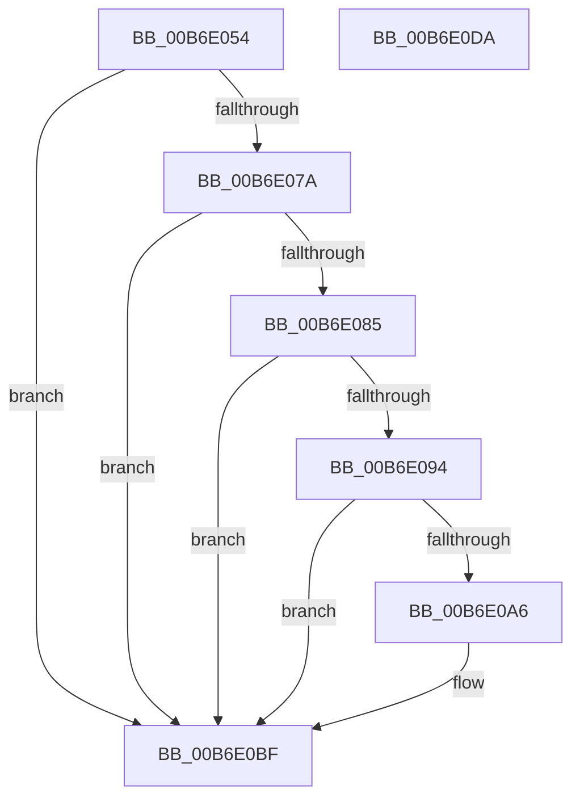

# PopIsMktmeEnabled

- RVA: `0x00B6E054`–`0x00B6E0DB` (길이 `135` bytes)
- VA: `0x0000000140B6E054`
- 실행 섹션: `PAGELK`
- PDB 이름 있음: `예`; PDB Function 태그: `아니요`
- unwind 정보 RVA: `0x000BE218`
- 디코드: `40`개 명령, `135/135` bytes 표시
- 미해석 바이트: `0` (있으면 어셈블리에 `.byte`로 보존)

> 이 문서는 커널 이미지의 기계어와 PDB 기호를 분석해 생성했습니다. 4번과 5번은 함수 원형과 자료형을 바이너리 사용 방식에서 추정한 C 해석이며 원본 소스 복구 결과는 아닙니다.

## 1. Dependencies

- 직접 호출 지점: **2**; 고유 호출 대상: **2**
- 직접 호출자로 확인된 함수: **1**
- RIP 상대 이미지 참조: **1**

### Outgoing calls
- `0x00B6E070` → [KiGetCpuVendor](../B7/KiGetCpuVendor_function_00B7D5B4.md) (function, `0x00B7D5B4`)
- `0x00B6E0CA` → [_security_check_cookie](../../text/6A/_security_check_cookie_function_006AC640.md) (function, `0x006AC640`)

### Direct callers
- [PopSaveHiberContext](PopSaveHiberContext_function_00B6F050.md) at `0x00B6F247`

### Static image references
- `0x00B6E05E` → RVA `0x00E0A740` (`.data`; read)

## 2. Other-region calls and transfers

- 다른 실행 섹션으로 향하는 call: **1**
  - `0x00B6E0CA` → [_security_check_cookie](../../text/6A/_security_check_cookie_function_006AC640.md) (`PAGELK` → `.text`)
- 별도 외부 분기/꼬리 이동을 확인하지 못했습니다.

## 3. Assembly (complete function range)

```asm
00B6E054  48 89 5C 24 08                  mov qword ptr [rsp + 8], rbx
00B6E059  57                              push rdi
00B6E05A  48 83 EC 40                     sub rsp, 0x40
00B6E05E  48 8B 05 DB C6 29 00            mov rax, qword ptr [rip + 0x29c6db]
00B6E065  48 33 C4                        xor rax, rsp
00B6E068  48 89 44 24 30                  mov qword ptr [rsp + 0x30], rax
00B6E06D  40 32 FF                        xor dil, dil
00B6E070  E8 3F F5 00 00                  call 0x140b7d5b4
00B6E075  83 F8 02                        cmp eax, 2
00B6E078  75 45                           jne 0x140b6e0bf
00B6E07A  33 C0                           xor eax, eax
00B6E07C  33 C9                           xor ecx, ecx
00B6E07E  0F A2                           cpuid
00B6E080  83 F8 07                        cmp eax, 7
00B6E083  72 3A                           jb 0x140b6e0bf
00B6E085  33 C9                           xor ecx, ecx
00B6E087  B8 07 00 00 00                  mov eax, 7
00B6E08C  0F A2                           cpuid
00B6E08E  0F BA E1 0D                     bt ecx, 0xd
00B6E092  73 2B                           jae 0x140b6e0bf
00B6E094  B9 82 09 00 00                  mov ecx, 0x982
00B6E099  0F 32                           rdmsr
00B6E09B  48 C1 E2 20                     shl rdx, 0x20
00B6E09F  48 0B C2                        or rax, rdx
00B6E0A2  A8 02                           test al, 2
00B6E0A4  74 19                           je 0x140b6e0bf
00B6E0A6  48 B9 00 00 00 00 0F 00 00 00   movabs rcx, 0xf00000000
00B6E0B0  40 0F B6 FF                     movzx edi, dil
00B6E0B4  48 85 C1                        test rcx, rax
00B6E0B7  B8 01 00 00 00                  mov eax, 1
00B6E0BC  0F 47 F8                        cmova edi, eax
00B6E0BF  40 8A C7                        mov al, dil
00B6E0C2  48 8B 4C 24 30                  mov rcx, qword ptr [rsp + 0x30]
00B6E0C7  48 33 CC                        xor rcx, rsp
00B6E0CA  E8 71 E5 B3 FF                  call 0x1406ac640
00B6E0CF  48 8B 5C 24 50                  mov rbx, qword ptr [rsp + 0x50]
00B6E0D4  48 83 C4 40                     add rsp, 0x40
00B6E0D8  5F                              pop rdi
00B6E0D9  C3                              ret
00B6E0DA  CC                              int3
```

## 4. C-style interpretation (structured pseudocode)

```c
__int64 __fastcall PopIsMktmeEnabled(int a1, __int64 a2)
{
    __int64 result;
    __int64 v_rdi;
    __int64 v_rsp;
    unsigned __int64 v_stack_m18;
    unsigned __int64 v_stack_p8;

    v_stack_p8 = v_rbx;
    v_rsp = (v_rsp) - (64);
    result = (*(unsigned __int64 *)(v_rip + 2737883)) ^ (v_rsp);
    v_stack_m18 = result;
    v_rdi = 0;
    result = KiGetCpuVendor(a1, a2, a3, a4);
    if (((unsigned int)(result)) != 2) goto loc_00B6E0BF;
    result = 0;
    a1 = 0;
    if (0 < 7) goto loc_00B6E0BF;
    a1 = 0;
    if (condition_is_above_or_equal) goto loc_00B6E0BF;
    a2 = (a2) << (32);
    result = (7) | (a2);
    if ((((unsigned __int8)(result)) & (2)) != 0) {
        v_rdi = 0;
        result = 1;
        if (condition_is_above) { v_rdi = (unsigned int)(result); }
    }
    a1 = (v_stack_m18) ^ (v_rsp);
    result = _security_check_cookie(a1, a2, a3, a4);
    v_rsp = (v_rsp) + (64);
    return result;
}
```

## 5. (Beta) C Style

```c
int64_t PopIsMktmeEnabled(int32_t Arg1, int64_t Arg2)
{
    int64_t result;
    int64_t local_rdi;
    int64_t local_rsp;
    uint64_t v_stack_m18;
    uint64_t v_stack_p8;

    v_stack_p8 = local_rbx;
    local_rsp = (local_rsp) - (64);
    result = (*(uint64_t *)(v_rip + 0x29C6DB)) ^ (local_rsp);
    v_stack_m18 = result;
    local_rdi = 0;
    result = KiGetCpuVendor(Arg1, Arg2, a3, a4);
    if (((uint32_t)(result)) != 2) goto loc_00B6E0BF;
    result = 0;
    Arg1 = 0;
    if (0 < 7) goto loc_00B6E0BF;
    Arg1 = 0;
    if (condition_is_above_or_equal) goto loc_00B6E0BF;
    Arg2 = (Arg2) << (32);
    result = (7) | (Arg2);
    if ((((uint8_t)(result)) & (2)) != 0) {
        local_rdi = 0;
        result = 1;
        if (condition_is_above) { local_rdi = (uint32_t)(result); }
    }
    Arg1 = (v_stack_m18) ^ (local_rsp);
    result = _security_check_cookie(Arg1, Arg2, a3, a4);
    local_rsp = (local_rsp) + (64);
    return result;
}
```

## 6. Execution-region graph

[열기: 2D/3D 그래프와 함수 탐색 컨트롤 패널](../../../control-panel.html?section=pagelk&rva=0x00B6E054&view=graph)

- 2D 그래프는 위에서 아래로 흐르고, 3D 그래프는 빈 공간을 드래그해 회전합니다. Shift+드래그는 이동, 휠은 확대·축소, 함수 노드 선택은 대상 보고서 이동입니다.

### Static fallback


