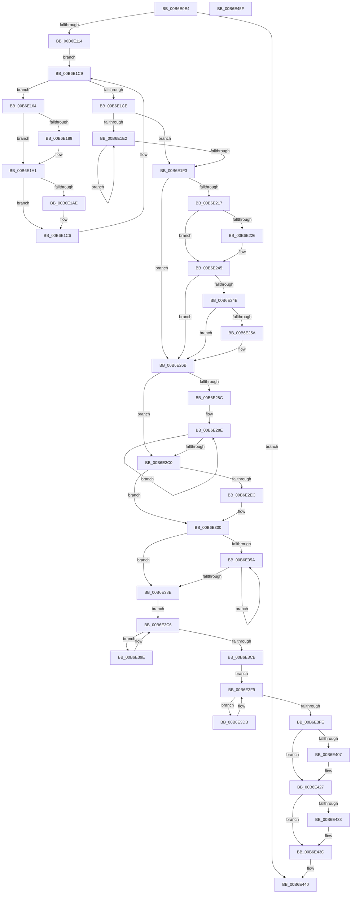

# PopMarkComponentsBootPhase

- RVA: `0x00B6E0E4`–`0x00B6E460` (길이 `892` bytes)
- VA: `0x0000000140B6E0E4`
- 실행 섹션: `PAGELK`
- PDB 이름 있음: `예`; PDB Function 태그: `아니요`
- unwind 정보 RVA: `0x000B5F04`
- 디코드: `215`개 명령, `892/892` bytes 표시
- 미해석 바이트: `0` (있으면 어셈블리에 `.byte`로 보존)

> 이 문서는 커널 이미지의 기계어와 PDB 기호를 분석해 생성했습니다. 4번과 5번은 함수 원형과 자료형을 바이너리 사용 방식에서 추정한 C 해석이며 원본 소스 복구 결과는 아닙니다.

## 1. Dependencies

- 직접 호출 지점: **33**; 고유 호출 대상: **17**
- 직접 호출자로 확인된 함수: **1**
- RIP 상대 이미지 참조: **22**

### Outgoing calls
- `0x00B6E133` → [PoSetHiberRange](../../text/47/PoSetHiberRange_function_0047C580.md) (function, `0x0047C580`)
- `0x00B6E14F` → [PoSetHiberRange](../../text/47/PoSetHiberRange_function_0047C580.md) (function, `0x0047C580`)
- `0x00B6E177` → [PoSetHiberRange](../../text/47/PoSetHiberRange_function_0047C580.md) (function, `0x0047C580`)
- `0x00B6E180` → [MmIsAddressValid](../../text/27/MmIsAddressValid_function_0027EC50.md) (function, `0x0027EC50`)
- `0x00B6E19C` → [PoSetHiberRange](../../text/47/PoSetHiberRange_function_0047C580.md) (function, `0x0047C580`)
- `0x00B6E1A5` → [MmIsAddressValid](../../text/27/MmIsAddressValid_function_0027EC50.md) (function, `0x0027EC50`)
- `0x00B6E1C1` → [PoSetHiberRange](../../text/47/PoSetHiberRange_function_0047C580.md) (function, `0x0047C580`)
- `0x00B6E1D5` → [FirstEntrySList](../../text/6B/FirstEntrySList_function_006BA560.md) (function, `0x006BA560`)
- `0x00B6E1E6` → [KeMarkPcrHiberPhase](KeMarkPcrHiberPhase_function_00B65800.md) (function, `0x00B65800`)
- `0x00B6E1FC` → [guard_dispatch_icall](../../text/6B/guard_dispatch_icall_function_006BAAD0.md) (function, `0x006BAAD0`)
- `0x00B6E204` → [PopMarkHiberPhase](PopMarkHiberPhase_function_00B6E468.md) (function, `0x00B6E468`)
- `0x00B6E209` → [KdMarkHiberPhase](KdMarkHiberPhase_function_00B65770.md) (function, `0x00B65770`)
- `0x00B6E20E` → [VfIsVerifierEnabled](../../text/4C/VfIsVerifierEnabled_function_004C72F0.md) (function, `0x004C72F0`)
- `0x00B6E240` → [PoSetHiberRange](../../text/47/PoSetHiberRange_function_0047C580.md) (function, `0x0047C580`)
- `0x00B6E245` → [VfIsVerifierExtensionEnabled](../../text/61/VfIsVerifierExtensionEnabled_function_006121FC.md) (function, `0x006121FC`)
- `0x00B6E266` → [PoSetHiberRange](../../text/47/PoSetHiberRange_function_0047C580.md) (function, `0x0047C580`)
- `0x00B6E26B` → [DifMarkHiberPhase](../../text/61/DifMarkHiberPhase_function_0061A8FC.md) (function, `0x0061A8FC`)
- `0x00B6E272` → [BgkResumePrepare](BgkResumePrepare_function_00B63ACC.md) (function, `0x00B63ACC`)
- `0x00B6E277` → [RtlMarkHiberPhase](../../text/5F/RtlMarkHiberPhase_function_005F03E0.md) (function, `0x005F03E0`)
- `0x00B6E27C` → [HvlMarkHiberPhase](../../text/58/HvlMarkHiberPhase_function_0058A5EC.md) (function, `0x0058A5EC`)
- `0x00B6E2AB` → [PoSetHiberRange](../../text/47/PoSetHiberRange_function_0047C580.md) (function, `0x0047C580`)
- `0x00B6E2DB` → [PoSetHiberRange](../../text/47/PoSetHiberRange_function_0047C580.md) (function, `0x0047C580`)
- `0x00B6E2FB` → [PoSetHiberRange](../../text/47/PoSetHiberRange_function_0047C580.md) (function, `0x0047C580`)
- `0x00B6E321` → [PoSetHiberRange](../../text/47/PoSetHiberRange_function_0047C580.md) (function, `0x0047C580`)
- `0x00B6E341` → [PoSetHiberRange](../../text/47/PoSetHiberRange_function_0047C580.md) (function, `0x0047C580`)
- `0x00B6E346` → [KeMarkDynamicTracingHiberPhase](../../text/5C/KeMarkDynamicTracingHiberPhase_function_005CA9DC.md) (function, `0x005CA9DC`)
- `0x00B6E34B` → [MmMarkHiberPhase](../B7/MmMarkHiberPhase_function_00B74578.md) (function, `0x00B74578`)
- `0x00B6E37F` → [PoSetHiberRange](../../text/47/PoSetHiberRange_function_0047C580.md) (function, `0x0047C580`)
- `0x00B6E3B1` → [PoSetHiberRange](../../text/47/PoSetHiberRange_function_0047C580.md) (function, `0x0047C580`)
- `0x00B6E3BE` → [guard_dispatch_icall](../../text/6B/guard_dispatch_icall_function_006BAAD0.md) (function, `0x006BAAD0`)
- `0x00B6E3F1` → [PoSetHiberRange](../../text/47/PoSetHiberRange_function_0047C580.md) (function, `0x0047C580`)
- `0x00B6E422` → [PopSstInvokeNotificationHandlers](PopSstInvokeNotificationHandlers_function_00B6C1D0.md) (function, `0x00B6C1D0`)
- `0x00B6E437` → [MiConvertHiberPhasePages](../B7/MiConvertHiberPhasePages_function_00B73E24.md) (function, `0x00B73E24`)

### Direct callers
- [PopSaveHiberContext](PopSaveHiberContext_function_00B6F050.md) at `0x00B6F5A5`

### Static image references
- `0x00B6E0FD` → RVA `0x00F0BF61` (`.data`; read)
- `0x00B6E11A` → RVA `0x00B6F050` (`PopSaveHiberContext`; read)
- `0x00B6E143` → RVA `0x0053F5D0` (`HalAllocateCrashDumpRegisters`; read)
- `0x00B6E154` → RVA `0x00EF54C0` (`.data`; read)
- `0x00B6E1CE` → RVA `0x00E27700` (`.data`; read)
- `0x00B6E1F3` → RVA `0x00E00808` (`.data`; read)
- `0x00B6E217` → RVA `0x00FFDA68` (`PAGEVRFD`; read)
- `0x00B6E226` → RVA `0x00FF401C` (`PAGEVRFD`; read)
- `0x00B6E24E` → RVA `0x00FFDAD0` (`PAGEVRFD`; read)
- `0x00B6E283` → RVA `0x00F8EC40` (`.data`; read)
- `0x00B6E28E` → RVA `0x00F8EC38` (`.data`; read)
- `0x00B6E2C5` → RVA `0x00FC6D08` (`ALMOSTRO`; read)
- `0x00B6E300` → RVA `0x00FC5014` (`ALMOSTRO`; read)
- `0x00B6E30D` → RVA `0x00F231B8` (`.data`; read)
- `0x00B6E326` → RVA `0x00FC6AE8` (`ALMOSTRO`; read)
- `0x00B6E330` → RVA `0x00F231B0` (`.data`; read)
- `0x00B6E352` → RVA `0x00F8E8E0` (`.data`; read)
- `0x00B6E35A` → RVA `0x00F8D8E0` (`.data`; read)
- `0x00B6E38E` → RVA `0x00F092D0` (`.data`; read)
- `0x00B6E3CB` → RVA `0x00F0CE80` (`.data`; read)
- `0x00B6E407` → RVA `0x00B6DCE0` (`PopHiberNotificationMarkBootPhaseCallback`; read)
- `0x00B6E427` → RVA `0x00F0C2E0` (`.data`; read)

## 2. Other-region calls and transfers

- 다른 실행 섹션으로 향하는 call: **26**
  - `0x00B6E133` → [PoSetHiberRange](../../text/47/PoSetHiberRange_function_0047C580.md) (`PAGELK` → `.text`)
  - `0x00B6E14F` → [PoSetHiberRange](../../text/47/PoSetHiberRange_function_0047C580.md) (`PAGELK` → `.text`)
  - `0x00B6E177` → [PoSetHiberRange](../../text/47/PoSetHiberRange_function_0047C580.md) (`PAGELK` → `.text`)
  - `0x00B6E180` → [MmIsAddressValid](../../text/27/MmIsAddressValid_function_0027EC50.md) (`PAGELK` → `.text`)
  - `0x00B6E19C` → [PoSetHiberRange](../../text/47/PoSetHiberRange_function_0047C580.md) (`PAGELK` → `.text`)
  - `0x00B6E1A5` → [MmIsAddressValid](../../text/27/MmIsAddressValid_function_0027EC50.md) (`PAGELK` → `.text`)
  - `0x00B6E1C1` → [PoSetHiberRange](../../text/47/PoSetHiberRange_function_0047C580.md) (`PAGELK` → `.text`)
  - `0x00B6E1D5` → [FirstEntrySList](../../text/6B/FirstEntrySList_function_006BA560.md) (`PAGELK` → `.text`)
  - `0x00B6E1FC` → [guard_dispatch_icall](../../text/6B/guard_dispatch_icall_function_006BAAD0.md) (`PAGELK` → `.text`)
  - `0x00B6E20E` → [VfIsVerifierEnabled](../../text/4C/VfIsVerifierEnabled_function_004C72F0.md) (`PAGELK` → `.text`)
  - `0x00B6E240` → [PoSetHiberRange](../../text/47/PoSetHiberRange_function_0047C580.md) (`PAGELK` → `.text`)
  - `0x00B6E245` → [VfIsVerifierExtensionEnabled](../../text/61/VfIsVerifierExtensionEnabled_function_006121FC.md) (`PAGELK` → `.text`)
  - `0x00B6E266` → [PoSetHiberRange](../../text/47/PoSetHiberRange_function_0047C580.md) (`PAGELK` → `.text`)
  - `0x00B6E26B` → [DifMarkHiberPhase](../../text/61/DifMarkHiberPhase_function_0061A8FC.md) (`PAGELK` → `.text`)
  - `0x00B6E277` → [RtlMarkHiberPhase](../../text/5F/RtlMarkHiberPhase_function_005F03E0.md) (`PAGELK` → `.text`)
  - `0x00B6E27C` → [HvlMarkHiberPhase](../../text/58/HvlMarkHiberPhase_function_0058A5EC.md) (`PAGELK` → `.text`)
  - `0x00B6E2AB` → [PoSetHiberRange](../../text/47/PoSetHiberRange_function_0047C580.md) (`PAGELK` → `.text`)
  - `0x00B6E2DB` → [PoSetHiberRange](../../text/47/PoSetHiberRange_function_0047C580.md) (`PAGELK` → `.text`)
  - `0x00B6E2FB` → [PoSetHiberRange](../../text/47/PoSetHiberRange_function_0047C580.md) (`PAGELK` → `.text`)
  - `0x00B6E321` → [PoSetHiberRange](../../text/47/PoSetHiberRange_function_0047C580.md) (`PAGELK` → `.text`)
  - `0x00B6E341` → [PoSetHiberRange](../../text/47/PoSetHiberRange_function_0047C580.md) (`PAGELK` → `.text`)
  - `0x00B6E346` → [KeMarkDynamicTracingHiberPhase](../../text/5C/KeMarkDynamicTracingHiberPhase_function_005CA9DC.md) (`PAGELK` → `.text`)
  - `0x00B6E37F` → [PoSetHiberRange](../../text/47/PoSetHiberRange_function_0047C580.md) (`PAGELK` → `.text`)
  - `0x00B6E3B1` → [PoSetHiberRange](../../text/47/PoSetHiberRange_function_0047C580.md) (`PAGELK` → `.text`)
  - `0x00B6E3BE` → [guard_dispatch_icall](../../text/6B/guard_dispatch_icall_function_006BAAD0.md) (`PAGELK` → `.text`)
  - `0x00B6E3F1` → [PoSetHiberRange](../../text/47/PoSetHiberRange_function_0047C580.md) (`PAGELK` → `.text`)
- 별도 외부 분기/꼬리 이동을 확인하지 못했습니다.

## 3. Assembly (complete function range)

```asm
00B6E0E4  48 8B C4                        mov rax, rsp
00B6E0E7  48 89 58 08                     mov qword ptr [rax + 8], rbx
00B6E0EB  48 89 70 10                     mov qword ptr [rax + 0x10], rsi
00B6E0EF  48 89 78 18                     mov qword ptr [rax + 0x18], rdi
00B6E0F3  4C 89 70 20                     mov qword ptr [rax + 0x20], r14
00B6E0F7  41 57                           push r15
00B6E0F9  48 83 EC 40                     sub rsp, 0x40
00B6E0FD  80 3D 5D DE 39 00 00            cmp byte ptr [rip + 0x39de5d], 0
00B6E104  0F 57 C0                        xorps xmm0, xmm0
00B6E107  0F 11 40 E8                     movups xmmword ptr [rax - 0x18], xmm0
00B6E10B  48 8B F9                        mov rdi, rcx
00B6E10E  0F 85 2C 03 00 00               jne 0x140b6e440
00B6E114  41 BE 00 00 01 00               mov r14d, 0x10000
00B6E11A  4C 8D 05 2F 0F 00 00            lea r8, [rip + 0xf2f]
00B6E121  41 BF 4B 65 72 6E               mov r15d, 0x6e72654b
00B6E127  41 8B D6                        mov edx, r14d
00B6E12A  45 33 C9                        xor r9d, r9d
00B6E12D  44 89 78 D8                     mov dword ptr [rax - 0x28], r15d
00B6E131  33 C9                           xor ecx, ecx
00B6E133  E8 48 E4 90 FF                  call 0x14047c580
00B6E138  45 33 C9                        xor r9d, r9d
00B6E13B  C7 44 24 20 6C 61 48 63         mov dword ptr [rsp + 0x20], 0x6348616c
00B6E143  4C 8D 05 86 14 9D FF            lea r8, [rip - 0x62eb7a]
00B6E14A  41 8B D6                        mov edx, r14d
00B6E14D  33 C9                           xor ecx, ecx
00B6E14F  E8 2C E4 90 FF                  call 0x14047c580
00B6E154  48 8B 1D 65 73 38 00            mov rbx, qword ptr [rip + 0x387365]
00B6E15B  48 8D 35 5E 73 38 00            lea rsi, [rip + 0x38735e]
00B6E162  EB 65                           jmp 0x140b6e1c9
00B6E164  41 B9 A0 00 00 00               mov r9d, 0xa0
00B6E16A  44 89 7C 24 20                  mov dword ptr [rsp + 0x20], r15d
00B6E16F  4C 8B C3                        mov r8, rbx
00B6E172  41 8B D6                        mov edx, r14d
00B6E175  33 C9                           xor ecx, ecx
00B6E177  E8 04 E4 90 FF                  call 0x14047c580
00B6E17C  48 8B 4B 60                     mov rcx, qword ptr [rbx + 0x60]
00B6E180  E8 CB 0A 71 FF                  call 0x14027ec50
00B6E185  84 C0                           test al, al
00B6E187  74 18                           je 0x140b6e1a1
00B6E189  44 0F B7 4B 5A                  movzx r9d, word ptr [rbx + 0x5a]
00B6E18E  41 8B D6                        mov edx, r14d
00B6E191  4C 8B 43 60                     mov r8, qword ptr [rbx + 0x60]
00B6E195  33 C9                           xor ecx, ecx
00B6E197  44 89 7C 24 20                  mov dword ptr [rsp + 0x20], r15d
00B6E19C  E8 DF E3 90 FF                  call 0x14047c580
00B6E1A1  48 8B 4B 50                     mov rcx, qword ptr [rbx + 0x50]
00B6E1A5  E8 A6 0A 71 FF                  call 0x14027ec50
00B6E1AA  84 C0                           test al, al
00B6E1AC  74 18                           je 0x140b6e1c6
00B6E1AE  44 0F B7 4B 4A                  movzx r9d, word ptr [rbx + 0x4a]
00B6E1B3  41 8B D6                        mov edx, r14d
00B6E1B6  4C 8B 43 50                     mov r8, qword ptr [rbx + 0x50]
00B6E1BA  33 C9                           xor ecx, ecx
00B6E1BC  44 89 7C 24 20                  mov dword ptr [rsp + 0x20], r15d
00B6E1C1  E8 BA E3 90 FF                  call 0x14047c580
00B6E1C6  48 8B 1B                        mov rbx, qword ptr [rbx]
00B6E1C9  48 3B DE                        cmp rbx, rsi
00B6E1CC  75 96                           jne 0x140b6e164
00B6E1CE  48 8D 0D 2B 95 2B 00            lea rcx, [rip + 0x2b952b]
00B6E1D5  E8 86 C3 B4 FF                  call 0x1406ba560
00B6E1DA  48 8B D8                        mov rbx, rax
00B6E1DD  48 85 C0                        test rax, rax
00B6E1E0  74 11                           je 0x140b6e1f3
00B6E1E2  48 8B 4B F0                     mov rcx, qword ptr [rbx - 0x10]
00B6E1E6  E8 15 76 FF FF                  call 0x140b65800
00B6E1EB  48 8B 1B                        mov rbx, qword ptr [rbx]
00B6E1EE  48 85 DB                        test rbx, rbx
00B6E1F1  75 EF                           jne 0x140b6e1e2
00B6E1F3  48 8B 05 0E 26 29 00            mov rax, qword ptr [rip + 0x29260e]
00B6E1FA  33 C9                           xor ecx, ecx
00B6E1FC  E8 CF C8 B4 FF                  call 0x1406baad0
00B6E201  48 8B CF                        mov rcx, rdi
00B6E204  E8 5F 02 00 00                  call 0x140b6e468
00B6E209  E8 62 75 FF FF                  call 0x140b65770
00B6E20E  E8 DD 90 95 FF                  call 0x1404c72f0
00B6E213  85 C0                           test eax, eax
00B6E215  74 54                           je 0x140b6e26b
00B6E217  48 83 3D 49 F8 48 00 00         cmp qword ptr [rip + 0x48f849], 0
00B6E21F  BB 56 66 69 72                  mov ebx, 0x72696656
00B6E224  74 1F                           je 0x140b6e245
00B6E226  8B 05 F0 5D 48 00               mov eax, dword ptr [rip + 0x485df0]
00B6E22C  41 8B D6                        mov edx, r14d
00B6E22F  4C 8B 05 32 F8 48 00            mov r8, qword ptr [rip + 0x48f832]
00B6E236  33 C9                           xor ecx, ecx
00B6E238  4C 6B C8 38                     imul r9, rax, 0x38
00B6E23C  89 5C 24 20                     mov dword ptr [rsp + 0x20], ebx
00B6E240  E8 3B E3 90 FF                  call 0x14047c580
00B6E245  E8 B2 3F AA FF                  call 0x1406121fc
00B6E24A  85 C0                           test eax, eax
00B6E24C  74 1D                           je 0x140b6e26b
00B6E24E  4C 8B 05 7B F8 48 00            mov r8, qword ptr [rip + 0x48f87b]
00B6E255  4D 85 C0                        test r8, r8
00B6E258  74 11                           je 0x140b6e26b
00B6E25A  45 33 C9                        xor r9d, r9d
00B6E25D  89 5C 24 20                     mov dword ptr [rsp + 0x20], ebx
00B6E261  41 8B D6                        mov edx, r14d
00B6E264  33 C9                           xor ecx, ecx
00B6E266  E8 15 E3 90 FF                  call 0x14047c580
00B6E26B  E8 8C C6 AA FF                  call 0x14061a8fc
00B6E270  33 C9                           xor ecx, ecx
00B6E272  E8 55 58 FF FF                  call 0x140b63acc
00B6E277  E8 64 21 A8 FF                  call 0x1405f03e0
00B6E27C  E8 6B C3 A1 FF                  call 0x14058a5ec
00B6E281  33 F6                           xor esi, esi
00B6E283  48 39 35 B6 09 42 00            cmp qword ptr [rip + 0x4209b6], rsi
00B6E28A  76 34                           jbe 0x140b6e2c0
00B6E28C  33 DB                           xor ebx, ebx
00B6E28E  4C 8B 05 A3 09 42 00            mov r8, qword ptr [rip + 0x4209a3]
00B6E295  41 8B D6                        mov edx, r14d
00B6E298  33 C9                           xor ecx, ecx
00B6E29A  C7 44 24 20 53 6B 70 52         mov dword ptr [rsp + 0x20], 0x52706b53
00B6E2A2  4E 8B 4C 03 08                  mov r9, qword ptr [rbx + r8 + 8]
00B6E2A7  4E 8B 04 03                     mov r8, qword ptr [rbx + r8]
00B6E2AB  E8 D0 E2 90 FF                  call 0x14047c580
00B6E2B0  48 FF C6                        inc rsi
00B6E2B3  48 8D 5B 10                     lea rbx, [rbx + 0x10]
00B6E2B7  48 3B 35 82 09 42 00            cmp rsi, qword ptr [rip + 0x420982]
00B6E2BE  72 CE                           jb 0x140b6e28e
00B6E2C0  BB 50 49 75 6D                  mov ebx, 0x6d754950
00B6E2C5  4C 8D 05 3C 8A 45 00            lea r8, [rip + 0x458a3c]
00B6E2CC  41 B9 08 00 00 00               mov r9d, 8
00B6E2D2  89 5C 24 20                     mov dword ptr [rsp + 0x20], ebx
00B6E2D6  41 8B D6                        mov edx, r14d
00B6E2D9  33 C9                           xor ecx, ecx
00B6E2DB  E8 A0 E2 90 FF                  call 0x14047c580
00B6E2E0  4C 8B 05 21 8A 45 00            mov r8, qword ptr [rip + 0x458a21]
00B6E2E7  4D 85 C0                        test r8, r8
00B6E2EA  74 14                           je 0x140b6e300
00B6E2EC  41 B9 00 20 00 00               mov r9d, 0x2000
00B6E2F2  89 5C 24 20                     mov dword ptr [rsp + 0x20], ebx
00B6E2F6  41 8B D6                        mov edx, r14d
00B6E2F9  33 C9                           xor ecx, ecx
00B6E2FB  E8 80 E2 90 FF                  call 0x14047c580
00B6E300  44 0F B7 0D 0C 6D 45 00         movzx r9d, word ptr [rip + 0x456d0c]
00B6E308  BB 4B 65 67 64                  mov ebx, 0x6467654b
00B6E30D  4C 8B 05 A4 4E 3B 00            mov r8, qword ptr [rip + 0x3b4ea4]
00B6E314  41 8B D6                        mov edx, r14d
00B6E317  41 C1 E1 08                     shl r9d, 8
00B6E31B  33 C9                           xor ecx, ecx
00B6E31D  89 5C 24 20                     mov dword ptr [rsp + 0x20], ebx
00B6E321  E8 5A E2 90 FF                  call 0x14047c580
00B6E326  44 8B 0D BB 87 45 00            mov r9d, dword ptr [rip + 0x4587bb]
00B6E32D  41 8B D6                        mov edx, r14d
00B6E330  4C 8B 05 79 4E 3B 00            mov r8, qword ptr [rip + 0x3b4e79]
00B6E337  33 C9                           xor ecx, ecx
00B6E339  41 C1 E1 02                     shl r9d, 2
00B6E33D  89 5C 24 20                     mov dword ptr [rsp + 0x20], ebx
00B6E341  E8 3A E2 90 FF                  call 0x14047c580
00B6E346  E8 91 C6 A5 FF                  call 0x1405ca9dc
00B6E34B  E8 28 62 00 00                  call 0x140b74578
00B6E350  33 DB                           xor ebx, ebx
00B6E352  39 1D 88 05 42 00               cmp dword ptr [rip + 0x420588], ebx
00B6E358  76 34                           jbe 0x140b6e38e
00B6E35A  48 8D 0D 7F F5 41 00            lea rcx, [rip + 0x41f57f]
00B6E361  8B C3                           mov eax, ebx
00B6E363  48 03 C0                        add rax, rax
00B6E366  C7 44 24 20 44 6D 70 42         mov dword ptr [rsp + 0x20], 0x42706d44
00B6E36E  41 8B D6                        mov edx, r14d
00B6E371  4C 8B 4C C1 08                  mov r9, qword ptr [rcx + rax*8 + 8]
00B6E376  4C 8B 04 C1                     mov r8, qword ptr [rcx + rax*8]
00B6E37A  33 C9                           xor ecx, ecx
00B6E37C  4D 2B C8                        sub r9, r8
00B6E37F  E8 FC E1 90 FF                  call 0x14047c580
00B6E384  FF C3                           inc ebx
00B6E386  3B 1D 54 05 42 00               cmp ebx, dword ptr [rip + 0x420554]
00B6E38C  72 CC                           jb 0x140b6e35a
00B6E38E  48 8B 1D 3B AF 39 00            mov rbx, qword ptr [rip + 0x39af3b]
00B6E395  48 8D 35 34 AF 39 00            lea rsi, [rip + 0x39af34]
00B6E39C  EB 28                           jmp 0x140b6e3c6
00B6E39E  41 B9 28 00 00 00               mov r9d, 0x28
00B6E3A4  44 89 7C 24 20                  mov dword ptr [rsp + 0x20], r15d
00B6E3A9  4C 8B C3                        mov r8, rbx
00B6E3AC  41 8B D6                        mov edx, r14d
00B6E3AF  33 C9                           xor ecx, ecx
00B6E3B1  E8 CA E1 90 FF                  call 0x14047c580
00B6E3B6  48 8B 43 10                     mov rax, qword ptr [rbx + 0x10]
00B6E3BA  48 8B 4B 20                     mov rcx, qword ptr [rbx + 0x20]
00B6E3BE  E8 0D C7 B4 FF                  call 0x1406baad0
00B6E3C3  48 8B 1B                        mov rbx, qword ptr [rbx]
00B6E3C6  48 3B DE                        cmp rbx, rsi
00B6E3C9  75 D3                           jne 0x140b6e39e
00B6E3CB  48 8B 1D AE EA 39 00            mov rbx, qword ptr [rip + 0x39eaae]
00B6E3D2  48 8D 35 A7 EA 39 00            lea rsi, [rip + 0x39eaa7]
00B6E3D9  EB 1E                           jmp 0x140b6e3f9
00B6E3DB  41 B9 20 04 00 00               mov r9d, 0x420
00B6E3E1  C7 44 24 20 54 68 72 6D         mov dword ptr [rsp + 0x20], 0x6d726854
00B6E3E9  4C 8B C3                        mov r8, rbx
00B6E3EC  41 8B D6                        mov edx, r14d
00B6E3EF  33 C9                           xor ecx, ecx
00B6E3F1  E8 8A E1 90 FF                  call 0x14047c580
00B6E3F6  48 8B 1B                        mov rbx, qword ptr [rbx]
00B6E3F9  48 3B DE                        cmp rbx, rsi
00B6E3FC  75 DD                           jne 0x140b6e3db
00B6E3FE  80 BF ED 01 00 00 00            cmp byte ptr [rdi + 0x1ed], 0
00B6E405  74 20                           je 0x140b6e427
00B6E407  48 8D 05 D2 F8 FF FF            lea rax, [rip - 0x72e]
00B6E40E  48 89 7C 24 30                  mov qword ptr [rsp + 0x30], rdi
00B6E413  48 8D 54 24 30                  lea rdx, [rsp + 0x30]
00B6E418  48 89 44 24 38                  mov qword ptr [rsp + 0x38], rax
00B6E41D  B9 01 00 00 00                  mov ecx, 1
00B6E422  E8 A9 DD FF FF                  call 0x140b6c1d0
00B6E427  F7 05 AF DE 39 00 00 01 00 00   test dword ptr [rip + 0x39deaf], 0x100
00B6E431  75 09                           jne 0x140b6e43c
00B6E433  48 8D 4F 30                     lea rcx, [rdi + 0x30]
00B6E437  E8 E8 59 00 00                  call 0x140b73e24
00B6E43C  C6 47 02 01                     mov byte ptr [rdi + 2], 1
00B6E440  48 8B 5C 24 50                  mov rbx, qword ptr [rsp + 0x50]
00B6E445  48 8B 74 24 58                  mov rsi, qword ptr [rsp + 0x58]
00B6E44A  4C 8B 74 24 68                  mov r14, qword ptr [rsp + 0x68]
00B6E44F  C6 47 18 01                     mov byte ptr [rdi + 0x18], 1
00B6E453  48 8B 7C 24 60                  mov rdi, qword ptr [rsp + 0x60]
00B6E458  48 83 C4 40                     add rsp, 0x40
00B6E45C  41 5F                           pop r15
00B6E45E  C3                              ret
00B6E45F  CC                              int3
```

## 4. C-style interpretation (structured pseudocode)

```c
__int64 __fastcall PopMarkComponentsBootPhase(__int64 a1, __int64 a2, __int64 a3, int a4)
{
    __int64 result;
    __int64 v_rbx;
    __int64 v_rsi;
    __int64 v_rsp;
    unsigned __int64 v_stack_m10;
    unsigned __int64 v_stack_m18;
    unsigned int v_stack_m28;
    unsigned __int64 v_stack_p10;
    unsigned __int64 v_stack_p18;
    unsigned __int64 v_stack_p20;
    unsigned __int64 v_stack_p8;

    *(unsigned __int64 *)(v_rsp + 8) = v_rbx;
    *(unsigned __int64 *)(v_rsp + 16) = v_rsi;
    *(unsigned __int64 *)(v_rsp + 24) = v_rdi;
    *(unsigned __int64 *)(v_rsp + 32) = v_r14;
    v_rsp = (v_rsp) - (64);
    *(unsigned __int64 *)(v_rsp - 24) = v_xmm0;
    if ((*(unsigned __int8 *)(v_rip + 3792477)) != 0) goto loc_00B6E440;
    a4 = 0;
    *(unsigned int *)(v_rsp - 40) = (unsigned int)((unsigned int)(0x6E72654BULL));
    a1 = 0;
    result = PoSetHiberRange(a1, (unsigned int)((unsigned int)((unsigned int)(0x10000ULL))), v_rip + 3887, a4);
    a4 = 0;
    v_stack_m28 = 0x6348616CULL;
    a1 = 0;
    result = PoSetHiberRange(a1, (unsigned int)((unsigned int)((unsigned int)(0x10000ULL))), v_rip - 6482810, a4);
    goto loc_00B6E1C9;
loc_00B6E164:
    v_stack_m28 = (unsigned int)((unsigned int)(0x6E72654BULL));
    a1 = 0;
    result = PoSetHiberRange(a1, (unsigned int)((unsigned int)((unsigned int)(0x10000ULL))), *(unsigned __int64 *)(v_rip + 3699557), 160);
    result = MmIsAddressValid(*(unsigned __int64 *)(*(unsigned __int64 *)(v_rip + 3699557) + 96), (unsigned int)((unsigned int)((unsigned int)(0x10000ULL))), *(unsigned __int64 *)(v_rip + 3699557), 160);
    if ((unsigned __int8)(result) != 0) {
        a4 = *(unsigned __int16 *)(*(unsigned __int64 *)(v_rip + 3699557) + 90);
        a2 = (unsigned int)((unsigned int)(0x10000ULL));
        a3 = *(unsigned __int64 *)(*(unsigned __int64 *)(v_rip + 3699557) + 96);
        a1 = 0;
        v_stack_m28 = (unsigned int)((unsigned int)(0x6E72654BULL));
        result = PoSetHiberRange(a1, a2, a3, a4);
    }
    result = MmIsAddressValid(*(unsigned __int64 *)(*(unsigned __int64 *)(v_rip + 3699557) + 80), a2, a3, a4);
    if ((unsigned __int8)(result) != 0) {
        a4 = *(unsigned __int16 *)(*(unsigned __int64 *)(v_rip + 3699557) + 74);
        a2 = (unsigned int)((unsigned int)(0x10000ULL));
        a3 = *(unsigned __int64 *)(*(unsigned __int64 *)(v_rip + 3699557) + 80);
        a1 = 0;
        v_stack_m28 = (unsigned int)((unsigned int)(0x6E72654BULL));
        result = PoSetHiberRange(a1, a2, a3, a4);
    }
loc_00B6E1C9:
    if ((*(unsigned __int64 *)(*(unsigned __int64 *)(v_rip + 3699557))) != (v_rip + 3699550)) goto loc_00B6E164;
    result = FirstEntrySList(v_rip + 2856235, a2, a3, a4);
    if (result == 0) goto loc_00B6E1F3;
loc_00B6E1E2:
    result = KeMarkPcrHiberPhase(*(unsigned __int64 *)(result - 16), a2, a3, a4);
    if (*(unsigned __int64 *)(result) != 0) goto loc_00B6E1E2;
loc_00B6E1F3:
    a1 = 0;
    result = guard_dispatch_icall(a1, a2, a3, a4);
    result = PopMarkHiberPhase(0, a2, a3, a4);
    result = KdMarkHiberPhase(0, a2, a3, a4);
    result = VfIsVerifierEnabled(0, a2, a3, a4);
    if ((unsigned int)(result) == 0) goto loc_00B6E26B;
    if ((*(unsigned __int64 *)(v_rip + 4782153)) != 0) {
        result = *(unsigned int *)(v_rip + 4742640);
        a2 = (unsigned int)((unsigned int)(0x10000ULL));
        a3 = *(unsigned __int64 *)(v_rip + 4782130);
        a1 = 0;
        a4 = (a4) * (result);
        v_stack_m28 = (unsigned int)((unsigned int)(0x72696656ULL));
        result = PoSetHiberRange(a1, a2, a3, a4);
    }
    result = VfIsVerifierExtensionEnabled(a1, a2, a3, a4);
    if ((unsigned int)(result) == 0) goto loc_00B6E26B;
    if (*(unsigned __int64 *)(v_rip + 4782203) != 0) {
        a4 = 0;
        v_stack_m28 = (unsigned int)((unsigned int)(0x72696656ULL));
        a2 = (unsigned int)((unsigned int)(0x10000ULL));
        a1 = 0;
        result = PoSetHiberRange(a1, a2, *(unsigned __int64 *)(v_rip + 4782203), a4);
    }
    result = DifMarkHiberPhase(a1, a2, *(unsigned __int64 *)(v_rip + 4782203), a4);
    a1 = 0;
    result = BgkResumePrepare(a1, a2, *(unsigned __int64 *)(v_rip + 4782203), a4);
    result = RtlMarkHiberPhase(a1, a2, *(unsigned __int64 *)(v_rip + 4782203), a4);
    result = HvlMarkHiberPhase(a1, a2, *(unsigned __int64 *)(v_rip + 4782203), a4);
    v_rsi = 0;
    if ((*(unsigned __int64 *)(v_rip + 4327862)) <= 0) goto loc_00B6E2C0;
    v_rbx = 0;
loc_00B6E28E:
    a1 = 0;
    v_stack_m28 = 0x52706B53ULL;
    result = PoSetHiberRange(a1, (unsigned int)((unsigned int)((unsigned int)(0x10000ULL))), *(unsigned __int64 *)(v_rbx + *(unsigned __int64 *)(v_rip + 4327843) * 1), *(unsigned __int64 *)(v_rbx + *(unsigned __int64 *)(v_rip + 4327843) * 1 + 8));
    v_rsi = (v_rsi) + 1;
    if (v_rsi < (*(unsigned __int64 *)(v_rip + 4327810))) goto loc_00B6E28E;
loc_00B6E2C0:
    v_stack_m28 = (unsigned int)((unsigned int)(0x6D754950ULL));
    a1 = 0;
    result = PoSetHiberRange(a1, (unsigned int)((unsigned int)((unsigned int)(0x10000ULL))), v_rip + 4557372, 8);
    if (*(unsigned __int64 *)(v_rip + 4557345) != 0) {
        a4 = 0x2000ULL;
        v_stack_m28 = (unsigned int)((unsigned int)(0x6D754950ULL));
        a2 = (unsigned int)((unsigned int)(0x10000ULL));
        a1 = 0;
        result = PoSetHiberRange(a1, a2, *(unsigned __int64 *)(v_rip + 4557345), a4);
    }
    a4 = (unsigned int)((*(unsigned __int16 *)(v_rip + 4549900)) << (8));
    a1 = 0;
    v_stack_m28 = (unsigned int)((unsigned int)(0x6467654BULL));
    result = PoSetHiberRange(a1, (unsigned int)((unsigned int)((unsigned int)(0x10000ULL))), *(unsigned __int64 *)(v_rip + 3886756), a4);
    a1 = 0;
    a4 = (unsigned int)(((unsigned int)(*(unsigned int *)(v_rip + 4556731))) << (2));
    v_stack_m28 = (unsigned int)((unsigned int)(0x6467654BULL));
    result = PoSetHiberRange(a1, (unsigned int)((unsigned int)((unsigned int)(0x10000ULL))), *(unsigned __int64 *)(v_rip + 3886713), a4);
    result = KeMarkDynamicTracingHiberPhase(a1, (unsigned int)((unsigned int)((unsigned int)(0x10000ULL))), *(unsigned __int64 *)(v_rip + 3886713), a4);
    result = MmMarkHiberPhase(a1, (unsigned int)((unsigned int)((unsigned int)(0x10000ULL))), *(unsigned __int64 *)(v_rip + 3886713), a4);
    v_rbx = 0;
    if ((*(unsigned int *)(v_rip + 4326792)) <= 0) goto loc_00B6E38E;
loc_00B6E35A:
    result = (0) + (0);
    v_stack_m28 = 0x42706D44ULL;
    a1 = 0;
    a4 = (*(unsigned __int64 *)(v_rip + 4322687 + result * 8 + 8)) - (*(unsigned __int64 *)(v_rip + 4322687 + result * 8));
    result = PoSetHiberRange(a1, (unsigned int)((unsigned int)((unsigned int)(0x10000ULL))), *(unsigned __int64 *)(v_rip + 4322687 + result * 8), a4);
    v_rbx = (unsigned int)((v_rbx) + 1);
    if (((unsigned int)(v_rbx)) < (*(unsigned int *)(v_rip + 4326740))) goto loc_00B6E35A;
loc_00B6E38E:
    goto loc_00B6E3C6;
loc_00B6E39E:
    v_stack_m28 = (unsigned int)((unsigned int)(0x6E72654BULL));
    a1 = 0;
    result = PoSetHiberRange(a1, (unsigned int)((unsigned int)((unsigned int)(0x10000ULL))), *(unsigned __int64 *)(v_rip + 3780411), 40);
    result = guard_dispatch_icall(*(unsigned __int64 *)(*(unsigned __int64 *)(v_rip + 3780411) + 32), (unsigned int)((unsigned int)((unsigned int)(0x10000ULL))), *(unsigned __int64 *)(v_rip + 3780411), 40);
loc_00B6E3C6:
    if ((*(unsigned __int64 *)(*(unsigned __int64 *)(v_rip + 3780411))) != (v_rip + 3780404)) goto loc_00B6E39E;
    goto loc_00B6E3F9;
loc_00B6E3DB:
    v_stack_m28 = 0x6D726854ULL;
    a1 = 0;
    result = PoSetHiberRange(a1, (unsigned int)((unsigned int)((unsigned int)(0x10000ULL))), *(unsigned __int64 *)(v_rip + 3795630), (unsigned int)(0x420ULL));
loc_00B6E3F9:
    if ((*(unsigned __int64 *)(*(unsigned __int64 *)(v_rip + 3795630))) != (v_rip + 3795623)) goto loc_00B6E3DB;
    if ((*(unsigned __int8 *)(a1 + 493)) != 0) {
        result = v_rip - 1838;
        v_stack_m18 = 0;
        a2 = v_stack_m18;
        v_stack_m10 = result;
        a1 = 1;
        result = PopSstInvokeNotificationHandlers(a1, a2, *(unsigned __int64 *)(v_rip + 3795630), (unsigned int)(0x420ULL));
    }
    if (((*(unsigned int *)(v_rip + 3792559)) & (256)) == 0) {
        a1 = a1 + 48;
        result = MiConvertHiberPhasePages(a1, a2, *(unsigned __int64 *)(v_rip + 3795630), (unsigned int)(0x420ULL));
    }
    *(unsigned __int8 *)(a1 + 2) = 1;
loc_00B6E440:
    *(unsigned __int8 *)(a1 + 24) = 1;
    v_rsp = (v_rsp) + (64);
    return result;
}
```

## 5. (Beta) C Style

```c
int64_t PopMarkComponentsBootPhase(void *Arg1, int64_t Arg2, int64_t Arg3, int32_t Arg4)
{
    uint8_t *arg1 = (uint8_t *)Arg1;

    int64_t result;
    int64_t local_rbx;
    int64_t local_rsi;
    int64_t local_rsp;
    uint64_t v_stack_m10;
    uint64_t v_stack_m18;
    uint32_t v_stack_m28;
    uint64_t v_stack_p10;
    uint64_t v_stack_p18;
    uint64_t v_stack_p20;
    uint64_t v_stack_p8;

    *(uint64_t *)(local_rsp + 0x8) = local_rbx;
    *(uint64_t *)(local_rsp + 0x10) = local_rsi;
    *(uint64_t *)(local_rsp + 0x18) = local_rdi;
    *(uint64_t *)(local_rsp + 0x20) = local_r14;
    local_rsp = (local_rsp) - (64);
    *(uint64_t *)(local_rsp - 0x18) = v_xmm0;
    if ((*(uint8_t *)(v_rip + 0x39DE5D)) != 0) goto loc_00B6E440;
    Arg4 = 0;
    *(uint32_t *)(local_rsp - 0x28) = (uint32_t)((uint32_t)(0x6E72654BULL));
    Arg1 = 0;
    result = PoSetHiberRange(Arg1, (uint32_t)((uint32_t)((uint32_t)(0x10000ULL))), v_rip + 3887, Arg4);
    Arg4 = 0;
    v_stack_m28 = 0x6348616CULL;
    Arg1 = 0;
    result = PoSetHiberRange(Arg1, (uint32_t)((uint32_t)((uint32_t)(0x10000ULL))), v_rip - 6482810, Arg4);
    goto loc_00B6E1C9;
loc_00B6E164:
    v_stack_m28 = (uint32_t)((uint32_t)(0x6E72654BULL));
    Arg1 = 0;
    result = PoSetHiberRange(Arg1, (uint32_t)((uint32_t)((uint32_t)(0x10000ULL))), *(uint64_t *)(v_rip + 0x387365), 160);
    result = MmIsAddressValid(*(uint64_t *)(*(uint64_t *)(v_rip + 0x387365) + 0x60), (uint32_t)((uint32_t)((uint32_t)(0x10000ULL))), *(uint64_t *)(v_rip + 0x387365), 160);
    if ((uint8_t)(result) != 0) {
        Arg4 = *(uint16_t *)(*(uint64_t *)(v_rip + 0x387365) + 0x5A);
        Arg2 = (uint32_t)((uint32_t)(0x10000ULL));
        Arg3 = *(uint64_t *)(*(uint64_t *)(v_rip + 0x387365) + 0x60);
        Arg1 = 0;
        v_stack_m28 = (uint32_t)((uint32_t)(0x6E72654BULL));
        result = PoSetHiberRange(Arg1, Arg2, Arg3, Arg4);
    }
    result = MmIsAddressValid(*(uint64_t *)(*(uint64_t *)(v_rip + 0x387365) + 0x50), Arg2, Arg3, Arg4);
    if ((uint8_t)(result) != 0) {
        Arg4 = *(uint16_t *)(*(uint64_t *)(v_rip + 0x387365) + 0x4A);
        Arg2 = (uint32_t)((uint32_t)(0x10000ULL));
        Arg3 = *(uint64_t *)(*(uint64_t *)(v_rip + 0x387365) + 0x50);
        Arg1 = 0;
        v_stack_m28 = (uint32_t)((uint32_t)(0x6E72654BULL));
        result = PoSetHiberRange(Arg1, Arg2, Arg3, Arg4);
    }
loc_00B6E1C9:
    if ((*(uint64_t *)(*(uint64_t *)(v_rip + 0x387365))) != (v_rip + 3699550)) goto loc_00B6E164;
    result = FirstEntrySList(v_rip + 2856235, Arg2, Arg3, Arg4);
    if (result == 0) goto loc_00B6E1F3;
loc_00B6E1E2:
    result = KeMarkPcrHiberPhase(*(uint64_t *)(result - 0x10), Arg2, Arg3, Arg4);
    if (*(uint64_t *)(result) != 0) goto loc_00B6E1E2;
loc_00B6E1F3:
    Arg1 = 0;
    result = guard_dispatch_icall(Arg1, Arg2, Arg3, Arg4);
    result = PopMarkHiberPhase(0, Arg2, Arg3, Arg4);
    result = KdMarkHiberPhase(0, Arg2, Arg3, Arg4);
    result = VfIsVerifierEnabled(0, Arg2, Arg3, Arg4);
    if ((uint32_t)(result) == 0) goto loc_00B6E26B;
    if ((*(uint64_t *)(v_rip + 0x48F849)) != 0) {
        result = *(uint32_t *)(v_rip + 0x485DF0);
        Arg2 = (uint32_t)((uint32_t)(0x10000ULL));
        Arg3 = *(uint64_t *)(v_rip + 0x48F832);
        Arg1 = 0;
        Arg4 = (Arg4) * (result);
        v_stack_m28 = (uint32_t)((uint32_t)(0x72696656ULL));
        result = PoSetHiberRange(Arg1, Arg2, Arg3, Arg4);
    }
    result = VfIsVerifierExtensionEnabled(Arg1, Arg2, Arg3, Arg4);
    if ((uint32_t)(result) == 0) goto loc_00B6E26B;
    if (*(uint64_t *)(v_rip + 0x48F87B) != 0) {
        Arg4 = 0;
        v_stack_m28 = (uint32_t)((uint32_t)(0x72696656ULL));
        Arg2 = (uint32_t)((uint32_t)(0x10000ULL));
        Arg1 = 0;
        result = PoSetHiberRange(Arg1, Arg2, *(uint64_t *)(v_rip + 0x48F87B), Arg4);
    }
    result = DifMarkHiberPhase(Arg1, Arg2, *(uint64_t *)(v_rip + 0x48F87B), Arg4);
    Arg1 = 0;
    result = BgkResumePrepare(Arg1, Arg2, *(uint64_t *)(v_rip + 0x48F87B), Arg4);
    result = RtlMarkHiberPhase(Arg1, Arg2, *(uint64_t *)(v_rip + 0x48F87B), Arg4);
    result = HvlMarkHiberPhase(Arg1, Arg2, *(uint64_t *)(v_rip + 0x48F87B), Arg4);
    local_rsi = 0;
    if ((*(uint64_t *)(v_rip + 0x4209B6)) <= 0) goto loc_00B6E2C0;
    local_rbx = 0;
loc_00B6E28E:
    Arg1 = 0;
    v_stack_m28 = 0x52706B53ULL;
    result = PoSetHiberRange(Arg1, (uint32_t)((uint32_t)((uint32_t)(0x10000ULL))), *(uint64_t *)(local_rbx + *(uint64_t *)(v_rip + 0x4209A3) * 1), *(uint64_t *)(local_rbx + *(uint64_t *)(v_rip + 0x4209A3) * 1 + 0x8));
    local_rsi = (local_rsi) + 1;
    if (local_rsi < (*(uint64_t *)(v_rip + 0x420982))) goto loc_00B6E28E;
loc_00B6E2C0:
    v_stack_m28 = (uint32_t)((uint32_t)(0x6D754950ULL));
    Arg1 = 0;
    result = PoSetHiberRange(Arg1, (uint32_t)((uint32_t)((uint32_t)(0x10000ULL))), v_rip + 4557372, 8);
    if (*(uint64_t *)(v_rip + 0x458A21) != 0) {
        Arg4 = 0x2000ULL;
        v_stack_m28 = (uint32_t)((uint32_t)(0x6D754950ULL));
        Arg2 = (uint32_t)((uint32_t)(0x10000ULL));
        Arg1 = 0;
        result = PoSetHiberRange(Arg1, Arg2, *(uint64_t *)(v_rip + 0x458A21), Arg4);
    }
    Arg4 = (uint32_t)((*(uint16_t *)(v_rip + 0x456D0C)) << (8));
    Arg1 = 0;
    v_stack_m28 = (uint32_t)((uint32_t)(0x6467654BULL));
    result = PoSetHiberRange(Arg1, (uint32_t)((uint32_t)((uint32_t)(0x10000ULL))), *(uint64_t *)(v_rip + 0x3B4EA4), Arg4);
    Arg1 = 0;
    Arg4 = (uint32_t)(((uint32_t)(*(uint32_t *)(v_rip + 0x4587BB))) << (2));
    v_stack_m28 = (uint32_t)((uint32_t)(0x6467654BULL));
    result = PoSetHiberRange(Arg1, (uint32_t)((uint32_t)((uint32_t)(0x10000ULL))), *(uint64_t *)(v_rip + 0x3B4E79), Arg4);
    result = KeMarkDynamicTracingHiberPhase(Arg1, (uint32_t)((uint32_t)((uint32_t)(0x10000ULL))), *(uint64_t *)(v_rip + 0x3B4E79), Arg4);
    result = MmMarkHiberPhase(Arg1, (uint32_t)((uint32_t)((uint32_t)(0x10000ULL))), *(uint64_t *)(v_rip + 0x3B4E79), Arg4);
    local_rbx = 0;
    if ((*(uint32_t *)(v_rip + 0x420588)) <= 0) goto loc_00B6E38E;
loc_00B6E35A:
    result = (0) + (0);
    v_stack_m28 = 0x42706D44ULL;
    Arg1 = 0;
    Arg4 = (*(uint64_t *)(v_rip + 0x41F57F + result * 8 + 0x8)) - (*(uint64_t *)(v_rip + 0x41F57F + result * 8));
    result = PoSetHiberRange(Arg1, (uint32_t)((uint32_t)((uint32_t)(0x10000ULL))), *(uint64_t *)(v_rip + 0x41F57F + result * 8), Arg4);
    local_rbx = (uint32_t)((local_rbx) + 1);
    if (((uint32_t)(local_rbx)) < (*(uint32_t *)(v_rip + 0x420554))) goto loc_00B6E35A;
loc_00B6E38E:
    goto loc_00B6E3C6;
loc_00B6E39E:
    v_stack_m28 = (uint32_t)((uint32_t)(0x6E72654BULL));
    Arg1 = 0;
    result = PoSetHiberRange(Arg1, (uint32_t)((uint32_t)((uint32_t)(0x10000ULL))), *(uint64_t *)(v_rip + 0x39AF3B), 40);
    result = guard_dispatch_icall(*(uint64_t *)(*(uint64_t *)(v_rip + 0x39AF3B) + 0x20), (uint32_t)((uint32_t)((uint32_t)(0x10000ULL))), *(uint64_t *)(v_rip + 0x39AF3B), 40);
loc_00B6E3C6:
    if ((*(uint64_t *)(*(uint64_t *)(v_rip + 0x39AF3B))) != (v_rip + 3780404)) goto loc_00B6E39E;
    goto loc_00B6E3F9;
loc_00B6E3DB:
    v_stack_m28 = 0x6D726854ULL;
    Arg1 = 0;
    result = PoSetHiberRange(Arg1, (uint32_t)((uint32_t)((uint32_t)(0x10000ULL))), *(uint64_t *)(v_rip + 0x39EAAE), (uint32_t)(0x420ULL));
loc_00B6E3F9:
    if ((*(uint64_t *)(*(uint64_t *)(v_rip + 0x39EAAE))) != (v_rip + 3795623)) goto loc_00B6E3DB;
    if ((*(uint8_t *)(arg1 + 0x1ED)) != 0) {
        result = v_rip - 1838;
        v_stack_m18 = 0;
        Arg2 = v_stack_m18;
        v_stack_m10 = result;
        Arg1 = 1;
        result = PopSstInvokeNotificationHandlers(Arg1, Arg2, *(uint64_t *)(v_rip + 0x39EAAE), (uint32_t)(0x420ULL));
    }
    if (((*(uint32_t *)(v_rip + 0x39DEAF)) & (256)) == 0) {
        Arg1 = Arg1 + 48;
        result = MiConvertHiberPhasePages(Arg1, Arg2, *(uint64_t *)(v_rip + 0x39EAAE), (uint32_t)(0x420ULL));
    }
    *(uint8_t *)(arg1 + 0x2) = 1;
loc_00B6E440:
    *(uint8_t *)(arg1 + 0x18) = 1;
    local_rsp = (local_rsp) + (64);
    return result;
}
```

### 관측된 메모리 오프셋

구조체 형식이 확인되지 않은 접근은 인자 기준의 오프셋으로만 기록했습니다.

| 기준 인자 | 오프셋 표현 | 폭 (bit) | 접근 |
|---|---:|---:|---|
| `Arg1` | `+ 0x2` | `8` | `W` |
| `Arg1` | `+ 0x18` | `8` | `W` |
| `Arg1` | `+ 0x30` | `64` | `R` |
| `Arg1` | `+ 0x1ED` | `8` | `R` |

## 6. Execution-region graph

[열기: 2D/3D 그래프와 함수 탐색 컨트롤 패널](../../../control-panel.html?section=pagelk&rva=0x00B6E0E4&view=graph)

- 2D 그래프는 위에서 아래로 흐르고, 3D 그래프는 빈 공간을 드래그해 회전합니다. Shift+드래그는 이동, 휠은 확대·축소, 함수 노드 선택은 대상 보고서 이동입니다.

### Static fallback


