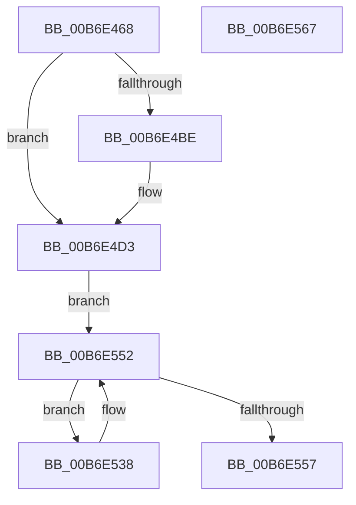

# PopMarkHiberPhase

- RVA: `0x00B6E468`–`0x00B6E568` (길이 `256` bytes)
- VA: `0x0000000140B6E468`
- 실행 섹션: `PAGELK`
- PDB 이름 있음: `예`; PDB Function 태그: `아니요`
- unwind 정보 RVA: `0x000CC43C`
- 디코드: `64`개 명령, `256/256` bytes 표시
- 미해석 바이트: `0` (있으면 어셈블리에 `.byte`로 보존)

> 이 문서는 커널 이미지의 기계어와 PDB 기호를 분석해 생성했습니다. 4번과 5번은 함수 원형과 자료형을 바이너리 사용 방식에서 추정한 C 해석이며 원본 소스 복구 결과는 아닙니다.

## 1. Dependencies

- 직접 호출 지점: **7**; 고유 호출 대상: **1**
- 직접 호출자로 확인된 함수: **1**
- RIP 상대 이미지 참조: **4**

### Outgoing calls
- `0x00B6E491` → [PoSetHiberRange](../../text/47/PoSetHiberRange_function_0047C580.md) (function, `0x0047C580`)
- `0x00B6E4AD` → [PoSetHiberRange](../../text/47/PoSetHiberRange_function_0047C580.md) (function, `0x0047C580`)
- `0x00B6E4CE` → [PoSetHiberRange](../../text/47/PoSetHiberRange_function_0047C580.md) (function, `0x0047C580`)
- `0x00B6E4EE` → [PoSetHiberRange](../../text/47/PoSetHiberRange_function_0047C580.md) (function, `0x0047C580`)
- `0x00B6E50E` → [PoSetHiberRange](../../text/47/PoSetHiberRange_function_0047C580.md) (function, `0x0047C580`)
- `0x00B6E52A` → [PoSetHiberRange](../../text/47/PoSetHiberRange_function_0047C580.md) (function, `0x0047C580`)
- `0x00B6E54D` → [PoSetHiberRange](../../text/47/PoSetHiberRange_function_0047C580.md) (function, `0x0047C580`)

### Direct callers
- [PopMarkComponentsBootPhase](PopMarkComponentsBootPhase_function_00B6E0E4.md) at `0x00B6E204`

### Static image references
- `0x00B6E496` → RVA `0x00F0BF78` (`.data`; read)
- `0x00B6E49F` → RVA `0x00F0BF70` (`.data`; read)
- `0x00B6E513` → RVA `0x00F0BF40` (`.data`; read)
- `0x00B6E51C` → RVA `0x00F0BF38` (`.data`; read)

## 2. Other-region calls and transfers

- 다른 실행 섹션으로 향하는 call: **7**
  - `0x00B6E491` → [PoSetHiberRange](../../text/47/PoSetHiberRange_function_0047C580.md) (`PAGELK` → `.text`)
  - `0x00B6E4AD` → [PoSetHiberRange](../../text/47/PoSetHiberRange_function_0047C580.md) (`PAGELK` → `.text`)
  - `0x00B6E4CE` → [PoSetHiberRange](../../text/47/PoSetHiberRange_function_0047C580.md) (`PAGELK` → `.text`)
  - `0x00B6E4EE` → [PoSetHiberRange](../../text/47/PoSetHiberRange_function_0047C580.md) (`PAGELK` → `.text`)
  - `0x00B6E50E` → [PoSetHiberRange](../../text/47/PoSetHiberRange_function_0047C580.md) (`PAGELK` → `.text`)
  - `0x00B6E52A` → [PoSetHiberRange](../../text/47/PoSetHiberRange_function_0047C580.md) (`PAGELK` → `.text`)
  - `0x00B6E54D` → [PoSetHiberRange](../../text/47/PoSetHiberRange_function_0047C580.md) (`PAGELK` → `.text`)
- 별도 외부 분기/꼬리 이동을 확인하지 못했습니다.

## 3. Assembly (complete function range)

```asm
00B6E468  48 89 5C 24 08                  mov qword ptr [rsp + 8], rbx
00B6E46D  48 89 6C 24 10                  mov qword ptr [rsp + 0x10], rbp
00B6E472  57                              push rdi
00B6E473  48 83 EC 30                     sub rsp, 0x30
00B6E477  83 64 24 20 00                  and dword ptr [rsp + 0x20], 0
00B6E47C  48 8B D9                        mov rbx, rcx
00B6E47F  4C 8B C1                        mov r8, rcx
00B6E482  BD 00 00 01 00                  mov ebp, 0x10000
00B6E487  8B D5                           mov edx, ebp
00B6E489  41 B9 F0 01 00 00               mov r9d, 0x1f0
00B6E48F  33 C9                           xor ecx, ecx
00B6E491  E8 EA E0 90 FF                  call 0x14047c580
00B6E496  4C 8B 0D DB DA 39 00            mov r9, qword ptr [rip + 0x39dadb]
00B6E49D  8B D5                           mov edx, ebp
00B6E49F  4C 8B 05 CA DA 39 00            mov r8, qword ptr [rip + 0x39daca]
00B6E4A6  33 C9                           xor ecx, ecx
00B6E4A8  83 64 24 20 00                  and dword ptr [rsp + 0x20], 0
00B6E4AD  E8 CE E0 90 FF                  call 0x14047c580
00B6E4B2  4C 8B 83 40 01 00 00            mov r8, qword ptr [rbx + 0x140]
00B6E4B9  4D 85 C0                        test r8, r8
00B6E4BC  74 15                           je 0x140b6e4d3
00B6E4BE  83 64 24 20 00                  and dword ptr [rsp + 0x20], 0
00B6E4C3  8B D5                           mov edx, ebp
00B6E4C5  4C 8B 8B 48 01 00 00            mov r9, qword ptr [rbx + 0x148]
00B6E4CC  33 C9                           xor ecx, ecx
00B6E4CE  E8 AD E0 90 FF                  call 0x14047c580
00B6E4D3  44 8B 8B A8 00 00 00            mov r9d, dword ptr [rbx + 0xa8]
00B6E4DA  8B D5                           mov edx, ebp
00B6E4DC  4C 8B 83 A0 00 00 00            mov r8, qword ptr [rbx + 0xa0]
00B6E4E3  33 C9                           xor ecx, ecx
00B6E4E5  83 64 24 20 00                  and dword ptr [rsp + 0x20], 0
00B6E4EA  49 C1 E1 0C                     shl r9, 0xc
00B6E4EE  E8 8D E0 90 FF                  call 0x14047c580
00B6E4F3  44 8B 8B 18 01 00 00            mov r9d, dword ptr [rbx + 0x118]
00B6E4FA  8B D5                           mov edx, ebp
00B6E4FC  4C 8B 83 10 01 00 00            mov r8, qword ptr [rbx + 0x110]
00B6E503  33 C9                           xor ecx, ecx
00B6E505  83 64 24 20 00                  and dword ptr [rsp + 0x20], 0
00B6E50A  49 C1 E1 0C                     shl r9, 0xc
00B6E50E  E8 6D E0 90 FF                  call 0x14047c580
00B6E513  44 8B 0D 26 DA 39 00            mov r9d, dword ptr [rip + 0x39da26]
00B6E51A  8B D5                           mov edx, ebp
00B6E51C  4C 8B 05 15 DA 39 00            mov r8, qword ptr [rip + 0x39da15]
00B6E523  33 C9                           xor ecx, ecx
00B6E525  83 64 24 20 00                  and dword ptr [rsp + 0x20], 0
00B6E52A  E8 51 E0 90 FF                  call 0x14047c580
00B6E52F  48 8D 7B 50                     lea rdi, [rbx + 0x50]
00B6E533  48 8B 1F                        mov rbx, qword ptr [rdi]
00B6E536  EB 1A                           jmp 0x140b6e552
00B6E538  83 64 24 20 00                  and dword ptr [rsp + 0x20], 0
00B6E53D  4C 8B C3                        mov r8, rbx
00B6E540  48 8B 1B                        mov rbx, qword ptr [rbx]
00B6E543  41 B9 30 00 00 00               mov r9d, 0x30
00B6E549  8B D5                           mov edx, ebp
00B6E54B  33 C9                           xor ecx, ecx
00B6E54D  E8 2E E0 90 FF                  call 0x14047c580
00B6E552  48 3B DF                        cmp rbx, rdi
00B6E555  75 E1                           jne 0x140b6e538
00B6E557  48 8B 5C 24 40                  mov rbx, qword ptr [rsp + 0x40]
00B6E55C  48 8B 6C 24 48                  mov rbp, qword ptr [rsp + 0x48]
00B6E561  48 83 C4 30                     add rsp, 0x30
00B6E565  5F                              pop rdi
00B6E566  C3                              ret
00B6E567  CC                              int3
```

## 4. C-style interpretation (structured pseudocode)

```c
__int64 __fastcall PopMarkHiberPhase(__int64 a1)
{
    __int64 result;
    __int64 v_rsp;
    unsigned int v_stack_m18;
    unsigned __int64 v_stack_p10;
    unsigned __int64 v_stack_p8;

    v_stack_p8 = v_rbx;
    v_stack_p10 = v_rbp;
    v_rsp = (v_rsp) - (48);
    a1 = 0;
    result = PoSetHiberRange(a1, (unsigned int)((unsigned int)((unsigned int)(0x10000ULL))), a1, 496);
    a1 = 0;
    result = PoSetHiberRange(a1, (unsigned int)((unsigned int)((unsigned int)(0x10000ULL))), *(unsigned __int64 *)(v_rip + 3791562), *(unsigned __int64 *)(v_rip + 3791579));
    if (*(unsigned __int64 *)(a1 + 320) != 0) {
        a2 = (unsigned int)((unsigned int)(0x10000ULL));
        a4 = *(unsigned __int64 *)(a1 + 328);
        a1 = 0;
        result = PoSetHiberRange(a1, a2, *(unsigned __int64 *)(a1 + 320), a4);
    }
    a1 = 0;
    a4 = ((unsigned int)(*(unsigned int *)(a1 + 168))) << (12);
    result = PoSetHiberRange(a1, (unsigned int)((unsigned int)((unsigned int)(0x10000ULL))), *(unsigned __int64 *)(a1 + 160), a4);
    a1 = 0;
    a4 = ((unsigned int)(*(unsigned int *)(a1 + 280))) << (12);
    result = PoSetHiberRange(a1, (unsigned int)((unsigned int)((unsigned int)(0x10000ULL))), *(unsigned __int64 *)(a1 + 272), a4);
    a1 = 0;
    result = PoSetHiberRange(a1, (unsigned int)((unsigned int)((unsigned int)(0x10000ULL))), *(unsigned __int64 *)(v_rip + 3791381), (unsigned int)(*(unsigned int *)(v_rip + 3791398)));
    goto loc_00B6E552;
loc_00B6E538:
    a1 = 0;
    result = PoSetHiberRange(a1, (unsigned int)((unsigned int)((unsigned int)(0x10000ULL))), *(unsigned __int64 *)(a1 + 80), 48);
loc_00B6E552:
    if ((*(unsigned __int64 *)(*(unsigned __int64 *)(a1 + 80))) != (a1 + 80)) goto loc_00B6E538;
    v_rsp = (v_rsp) + (48);
    return result;
}
```

## 5. (Beta) C Style

```c
int64_t PopMarkHiberPhase(void *Arg1)
{
    uint8_t *arg1 = (uint8_t *)Arg1;

    int64_t result;
    int64_t local_rsp;
    uint32_t v_stack_m18;
    uint64_t v_stack_p10;
    uint64_t v_stack_p8;

    v_stack_p8 = local_rbx;
    v_stack_p10 = local_rbp;
    local_rsp = (local_rsp) - (48);
    Arg1 = 0;
    result = PoSetHiberRange(Arg1, (uint32_t)((uint32_t)((uint32_t)(0x10000ULL))), Arg1, 496);
    Arg1 = 0;
    result = PoSetHiberRange(Arg1, (uint32_t)((uint32_t)((uint32_t)(0x10000ULL))), *(uint64_t *)(v_rip + 0x39DACA), *(uint64_t *)(v_rip + 0x39DADB));
    if (*(uint64_t *)(arg1 + 0x140) != 0) {
        a2 = (uint32_t)((uint32_t)(0x10000ULL));
        a4 = *(uint64_t *)(arg1 + 0x148);
        Arg1 = 0;
        result = PoSetHiberRange(Arg1, a2, *(uint64_t *)(arg1 + 0x140), a4);
    }
    Arg1 = 0;
    a4 = ((uint32_t)(*(uint32_t *)(arg1 + 0xA8))) << (12);
    result = PoSetHiberRange(Arg1, (uint32_t)((uint32_t)((uint32_t)(0x10000ULL))), *(uint64_t *)(arg1 + 0xA0), a4);
    Arg1 = 0;
    a4 = ((uint32_t)(*(uint32_t *)(arg1 + 0x118))) << (12);
    result = PoSetHiberRange(Arg1, (uint32_t)((uint32_t)((uint32_t)(0x10000ULL))), *(uint64_t *)(arg1 + 0x110), a4);
    Arg1 = 0;
    result = PoSetHiberRange(Arg1, (uint32_t)((uint32_t)((uint32_t)(0x10000ULL))), *(uint64_t *)(v_rip + 0x39DA15), (uint32_t)(*(uint32_t *)(v_rip + 0x39DA26)));
    goto loc_00B6E552;
loc_00B6E538:
    Arg1 = 0;
    result = PoSetHiberRange(Arg1, (uint32_t)((uint32_t)((uint32_t)(0x10000ULL))), *(uint64_t *)(arg1 + 0x50), 48);
loc_00B6E552:
    if ((*(uint64_t *)(*(uint64_t *)(arg1 + 0x50))) != (Arg1 + 80)) goto loc_00B6E538;
    local_rsp = (local_rsp) + (48);
    return result;
}
```

### 관측된 메모리 오프셋

구조체 형식이 확인되지 않은 접근은 인자 기준의 오프셋으로만 기록했습니다.

| 기준 인자 | 오프셋 표현 | 폭 (bit) | 접근 |
|---|---:|---:|---|
| `Arg1` | `+ 0x0` | `64` | `R` |
| `Arg1` | `+ 0x50` | `64` | `R` |
| `Arg1` | `+ 0xA0` | `64` | `R` |
| `Arg1` | `+ 0xA8` | `32` | `R` |
| `Arg1` | `+ 0x110` | `64` | `R` |
| `Arg1` | `+ 0x118` | `32` | `R` |
| `Arg1` | `+ 0x140` | `64` | `R` |
| `Arg1` | `+ 0x148` | `64` | `R` |

## 6. Execution-region graph

[열기: 2D/3D 그래프와 함수 탐색 컨트롤 패널](../../../control-panel.html?section=pagelk&rva=0x00B6E468&view=graph)

- 2D 그래프는 위에서 아래로 흐르고, 3D 그래프는 빈 공간을 드래그해 회전합니다. Shift+드래그는 이동, 휠은 확대·축소, 함수 노드 선택은 대상 보고서 이동입니다.

### Static fallback


