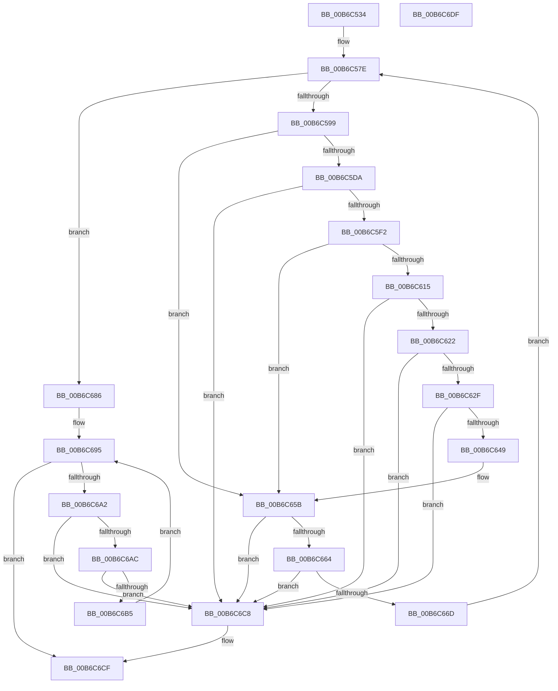

# PopProcessDeviceWakeSource

- RVA: `0x00B6C534`–`0x00B6C6E0` (길이 `428` bytes)
- VA: `0x0000000140B6C534`
- 실행 섹션: `PAGELK`
- PDB 이름 있음: `예`; PDB Function 태그: `아니요`
- unwind 정보 RVA: `0x000CC2F0`
- 디코드: `109`개 명령, `428/428` bytes 표시
- 미해석 바이트: `0` (있으면 어셈블리에 `.byte`로 보존)

> 이 문서는 커널 이미지의 기계어와 PDB 기호를 분석해 생성했습니다. 4번과 5번은 함수 원형과 자료형을 바이너리 사용 방식에서 추정한 C 해석이며 원본 소스 복구 결과는 아닙니다.

## 1. Dependencies

- 직접 호출 지점: **8**; 고유 호출 대상: **6**
- 직접 호출자로 확인된 함수: **1**
- RIP 상대 이미지 참조: **3**

### Outgoing calls
- `0x00B6C56F` → [PopAcquireWakeSourceSpinLock](../../text/4C/PopAcquireWakeSourceSpinLock_function_004C75D4.md) (function, `0x004C75D4`)
- `0x00B6C5A3` → [PopReleaseWakeSourceSpinLock](../../text/4D/PopReleaseWakeSourceSpinLock_function_004D4464.md) (function, `0x004D4464`)
- `0x00B6C5B4` → [PopProcessWakeSourceWork](../B7/PopProcessWakeSourceWork_function_00B7C488.md) (function, `0x00B7C488`)
- `0x00B6C5C4` → [ObfDereferenceObjectWithTag](../../text/2F/ObfDereferenceObjectWithTag_function_002F78E0.md) (function, `0x002F78E0`)
- `0x00B6C5CD` → [PopAcquireWakeSourceSpinLock](../../text/4C/PopAcquireWakeSourceSpinLock_function_004C75D4.md) (function, `0x004C75D4`)
- `0x00B6C67C` → [ExFreePoolWithTag](../../poolcode/B8/ExFreePoolWithTag_function_00B82870.md) (function, `0x00B82870`)
- `0x00B6C690` → [PopReleaseWakeSourceSpinLock](../../text/4D/PopReleaseWakeSourceSpinLock_function_004D4464.md) (function, `0x004D4464`)
- `0x00B6C6C1` → [PopFreeWakeSource](../../page/AB/PopFreeWakeSource_function_00AB719C.md) (function, `0x00AB719C`)

### Direct callers
- [PopTransitionSystemPowerStateEx](../B7/PopTransitionSystemPowerStateEx_function_00B7E8C0.md) at `0x00B7F899`

### Static image references
- `0x00B6C574` → RVA `0x00F0DEF0` (`.data`; write)
- `0x00B6C57E` → RVA `0x00F0DEE0` (`.data`; read)
- `0x00B6C599` → RVA `0x00F0DEB0` (`.data`; read)

## 2. Other-region calls and transfers

- 다른 실행 섹션으로 향하는 call: **7**
  - `0x00B6C56F` → [PopAcquireWakeSourceSpinLock](../../text/4C/PopAcquireWakeSourceSpinLock_function_004C75D4.md) (`PAGELK` → `.text`)
  - `0x00B6C5A3` → [PopReleaseWakeSourceSpinLock](../../text/4D/PopReleaseWakeSourceSpinLock_function_004D4464.md) (`PAGELK` → `.text`)
  - `0x00B6C5C4` → [ObfDereferenceObjectWithTag](../../text/2F/ObfDereferenceObjectWithTag_function_002F78E0.md) (`PAGELK` → `.text`)
  - `0x00B6C5CD` → [PopAcquireWakeSourceSpinLock](../../text/4C/PopAcquireWakeSourceSpinLock_function_004C75D4.md) (`PAGELK` → `.text`)
  - `0x00B6C67C` → [ExFreePoolWithTag](../../poolcode/B8/ExFreePoolWithTag_function_00B82870.md) (`PAGELK` → `POOLCODE`)
  - `0x00B6C690` → [PopReleaseWakeSourceSpinLock](../../text/4D/PopReleaseWakeSourceSpinLock_function_004D4464.md) (`PAGELK` → `.text`)
  - `0x00B6C6C1` → [PopFreeWakeSource](../../page/AB/PopFreeWakeSource_function_00AB719C.md) (`PAGELK` → `PAGE`)
- 별도 외부 분기/꼬리 이동을 확인하지 못했습니다.

## 3. Assembly (complete function range)

```asm
00B6C534  48 89 5C 24 18                  mov qword ptr [rsp + 0x18], rbx
00B6C539  48 89 7C 24 20                  mov qword ptr [rsp + 0x20], rdi
00B6C53E  55                              push rbp
00B6C53F  48 8B EC                        mov rbp, rsp
00B6C542  48 83 EC 50                     sub rsp, 0x50
00B6C546  33 C0                           xor eax, eax
00B6C548  48 8D 4D E0                     lea rcx, [rbp - 0x20]
00B6C54C  48 21 45 18                     and qword ptr [rbp + 0x18], rax
00B6C550  0F 57 C0                        xorps xmm0, xmm0
00B6C553  48 21 45 10                     and qword ptr [rbp + 0x10], rax
00B6C557  48 89 45 F0                     mov qword ptr [rbp - 0x10], rax
00B6C55B  48 8D 45 D0                     lea rax, [rbp - 0x30]
00B6C55F  48 89 45 D8                     mov qword ptr [rbp - 0x28], rax
00B6C563  48 8D 45 D0                     lea rax, [rbp - 0x30]
00B6C567  48 89 45 D0                     mov qword ptr [rbp - 0x30], rax
00B6C56B  0F 11 45 E0                     movups xmmword ptr [rbp - 0x20], xmm0
00B6C56F  E8 60 B0 95 FF                  call 0x1404c75d4
00B6C574  C7 05 72 19 3A 00 01 00 00 00   mov dword ptr [rip + 0x3a1972], 1
00B6C57E  48 8B 3D 5B 19 3A 00            mov rdi, qword ptr [rip + 0x3a195b]
00B6C585  48 8D 05 54 19 3A 00            lea rax, [rip + 0x3a1954]
00B6C58C  48 8D 4D E0                     lea rcx, [rbp - 0x20]
00B6C590  48 3B F8                        cmp rdi, rax
00B6C593  0F 84 ED 00 00 00               je 0x140b6c686
00B6C599  48 8B 05 10 19 3A 00            mov rax, qword ptr [rip + 0x3a1910]
00B6C5A0  FF 40 54                        inc dword ptr [rax + 0x54]
00B6C5A3  E8 BC 7E 96 FF                  call 0x1404d4464
00B6C5A8  48 8B 4F 10                     mov rcx, qword ptr [rdi + 0x10]
00B6C5AC  4C 8D 45 18                     lea r8, [rbp + 0x18]
00B6C5B0  48 8D 55 10                     lea rdx, [rbp + 0x10]
00B6C5B4  E8 CF FE 00 00                  call 0x140b7c488
00B6C5B9  48 8B 4F 10                     mov rcx, qword ptr [rdi + 0x10]
00B6C5BD  BA 50 6F 44 67                  mov edx, 0x67446f50
00B6C5C2  8B D8                           mov ebx, eax
00B6C5C4  E8 17 B3 78 FF                  call 0x1402f78e0
00B6C5C9  48 8D 4D E0                     lea rcx, [rbp - 0x20]
00B6C5CD  E8 02 B0 95 FF                  call 0x1404c75d4
00B6C5D2  85 DB                           test ebx, ebx
00B6C5D4  0F 88 81 00 00 00               js 0x140b6c65b
00B6C5DA  48 8B 0D CF 18 3A 00            mov rcx, qword ptr [rip + 0x3a18cf]
00B6C5E1  48 8D 51 18                     lea rdx, [rcx + 0x18]
00B6C5E5  4C 8B 42 08                     mov r8, qword ptr [rdx + 8]
00B6C5E9  49 39 10                        cmp qword ptr [r8], rdx
00B6C5EC  0F 85 D6 00 00 00               jne 0x140b6c6c8
00B6C5F2  48 8B 45 10                     mov rax, qword ptr [rbp + 0x10]
00B6C5F6  48 83 65 10 00                  and qword ptr [rbp + 0x10], 0
00B6C5FB  48 89 10                        mov qword ptr [rax], rdx
00B6C5FE  4C 89 40 08                     mov qword ptr [rax + 8], r8
00B6C602  49 89 00                        mov qword ptr [r8], rax
00B6C605  48 89 42 08                     mov qword ptr [rdx + 8], rax
00B6C609  FF 41 28                        inc dword ptr [rcx + 0x28]
00B6C60C  48 8B 45 18                     mov rax, qword ptr [rbp + 0x18]
00B6C610  48 85 C0                        test rax, rax
00B6C613  74 46                           je 0x140b6c65b
00B6C615  48 8B 10                        mov rdx, qword ptr [rax]
00B6C618  48 39 42 08                     cmp qword ptr [rdx + 8], rax
00B6C61C  0F 85 A6 00 00 00               jne 0x140b6c6c8
00B6C622  4C 8B 40 08                     mov r8, qword ptr [rax + 8]
00B6C626  49 39 00                        cmp qword ptr [r8], rax
00B6C629  0F 85 99 00 00 00               jne 0x140b6c6c8
00B6C62F  49 89 10                        mov qword ptr [r8], rdx
00B6C632  4C 89 42 08                     mov qword ptr [rdx + 8], r8
00B6C636  48 8D 55 D0                     lea rdx, [rbp - 0x30]
00B6C63A  FF 49 28                        dec dword ptr [rcx + 0x28]
00B6C63D  FF 49 54                        dec dword ptr [rcx + 0x54]
00B6C640  48 8B 4D D8                     mov rcx, qword ptr [rbp - 0x28]
00B6C644  48 39 11                        cmp qword ptr [rcx], rdx
00B6C647  75 7F                           jne 0x140b6c6c8
00B6C649  48 89 48 08                     mov qword ptr [rax + 8], rcx
00B6C64D  48 8D 55 D0                     lea rdx, [rbp - 0x30]
00B6C651  48 89 10                        mov qword ptr [rax], rdx
00B6C654  48 89 01                        mov qword ptr [rcx], rax
00B6C657  48 89 45 D8                     mov qword ptr [rbp - 0x28], rax
00B6C65B  48 8B 0F                        mov rcx, qword ptr [rdi]
00B6C65E  48 39 79 08                     cmp qword ptr [rcx + 8], rdi
00B6C662  75 64                           jne 0x140b6c6c8
00B6C664  48 8B 47 08                     mov rax, qword ptr [rdi + 8]
00B6C668  48 39 38                        cmp qword ptr [rax], rdi
00B6C66B  75 5B                           jne 0x140b6c6c8
00B6C66D  48 89 08                        mov qword ptr [rax], rcx
00B6C670  BA 4D 65 6D 20                  mov edx, 0x206d654d
00B6C675  48 89 41 08                     mov qword ptr [rcx + 8], rax
00B6C679  48 8B CF                        mov rcx, rdi
00B6C67C  E8 EF 61 01 00                  call 0x140b82870
00B6C681  E9 F8 FE FF FF                  jmp 0x140b6c57e
00B6C686  C7 05 60 18 3A 00 02 00 00 00   mov dword ptr [rip + 0x3a1860], 2
00B6C690  E8 CF 7D 96 FF                  call 0x1404d4464
00B6C695  48 8B 4D D0                     mov rcx, qword ptr [rbp - 0x30]
00B6C699  48 8D 45 D0                     lea rax, [rbp - 0x30]
00B6C69D  48 3B C8                        cmp rcx, rax
00B6C6A0  74 2D                           je 0x140b6c6cf
00B6C6A2  48 8D 45 D0                     lea rax, [rbp - 0x30]
00B6C6A6  48 39 41 08                     cmp qword ptr [rcx + 8], rax
00B6C6AA  75 1C                           jne 0x140b6c6c8
00B6C6AC  48 8B 01                        mov rax, qword ptr [rcx]
00B6C6AF  48 39 48 08                     cmp qword ptr [rax + 8], rcx
00B6C6B3  75 13                           jne 0x140b6c6c8
00B6C6B5  48 8D 55 D0                     lea rdx, [rbp - 0x30]
00B6C6B9  48 89 45 D0                     mov qword ptr [rbp - 0x30], rax
00B6C6BD  48 89 50 08                     mov qword ptr [rax + 8], rdx
00B6C6C1  E8 D6 AA F4 FF                  call 0x140ab719c
00B6C6C6  EB CD                           jmp 0x140b6c695
00B6C6C8  B9 03 00 00 00                  mov ecx, 3
00B6C6CD  CD 29                           int 0x29
00B6C6CF  48 8B 5C 24 70                  mov rbx, qword ptr [rsp + 0x70]
00B6C6D4  48 8B 7C 24 78                  mov rdi, qword ptr [rsp + 0x78]
00B6C6D9  48 83 C4 50                     add rsp, 0x50
00B6C6DD  5D                              pop rbp
00B6C6DE  C3                              ret
00B6C6DF  CC                              int3
```

## 4. C-style interpretation (structured pseudocode)

```c
__int64 __fastcall PopProcessDeviceWakeSource(void)
{
    __int64 result;
    __int64 v_rsp;
    unsigned __int64 v_stack_m18;
    unsigned __int64 v_stack_m28;
    unsigned __int64 v_stack_m30;
    unsigned __int64 v_stack_m38;
    unsigned __int64 v_stack_p10;
    unsigned __int64 v_stack_p18;
    unsigned __int64 v_stack_p20;
    unsigned __int64 v_stack_p8;

    v_stack_p18 = v_rbx;
    v_stack_p20 = v_rdi;
    v_rsp = (v_rsp) - (80);
    result = 0;
    v_stack_m18 = 0;
    v_stack_m30 = v_stack_m38;
    v_stack_m38 = v_stack_m38;
    v_stack_m28 = v_xmm0;
    result = PopAcquireWakeSourceSpinLock(v_stack_m28, a2, a3, a4);
    *(unsigned int *)(v_rip + 3807602) = 1;
loc_00B6C57E:
    if ((*(unsigned __int64 *)(v_rip + 3807579)) == (v_rip + 3807572)) goto loc_00B6C686;
    result = PopReleaseWakeSourceSpinLock(v_stack_m28, a2, a3, a4);
    result = PopProcessWakeSourceWork(*(unsigned __int64 *)(*(unsigned __int64 *)(v_rip + 3807579) + 16), v_stack_p8, v_stack_p10, a4);
    result = ObfDereferenceObjectWithTag(*(unsigned __int64 *)(*(unsigned __int64 *)(v_rip + 3807579) + 16), (unsigned int)(0x67446F50ULL), v_stack_p10, a4);
    result = PopAcquireWakeSourceSpinLock(v_stack_m28, (unsigned int)(0x67446F50ULL), v_stack_p10, a4);
    if (sign_flag) goto loc_00B6C65B;
    if ((*(unsigned __int64 *)(*(unsigned __int64 *)(*(unsigned __int64 *)(v_rip + 3807439) + 24 + 8))) != (*(unsigned __int64 *)(v_rip + 3807439) + 24)) goto loc_00B6C6C8;
    *(unsigned __int64 *)(v_stack_p8) = *(unsigned __int64 *)(v_rip + 3807439) + 24;
    *(unsigned __int64 *)(v_stack_p8 + 8) = *(unsigned __int64 *)(*(unsigned __int64 *)(v_rip + 3807439) + 24 + 8);
    *(unsigned __int64 *)(*(unsigned __int64 *)(*(unsigned __int64 *)(v_rip + 3807439) + 24 + 8)) = v_stack_p8;
    *(unsigned __int64 *)(*(unsigned __int64 *)(v_rip + 3807439) + 24 + 8) = v_stack_p8;
    if (v_stack_p10 == 0) goto loc_00B6C65B;
    if ((*(unsigned __int64 *)(*(unsigned __int64 *)(v_stack_p10) + 8)) != v_stack_p10) goto loc_00B6C6C8;
    if ((*(unsigned __int64 *)(*(unsigned __int64 *)(v_stack_p10 + 8))) != v_stack_p10) goto loc_00B6C6C8;
    *(unsigned __int64 *)(*(unsigned __int64 *)(v_stack_p10 + 8)) = *(unsigned __int64 *)(v_stack_p10);
    *(unsigned __int64 *)(*(unsigned __int64 *)(v_stack_p10) + 8) = *(unsigned __int64 *)(v_stack_p10 + 8);
    if ((*(unsigned __int64 *)(v_stack_m30)) != v_stack_m38) goto loc_00B6C6C8;
    *(unsigned __int64 *)(v_stack_p10 + 8) = v_stack_m30;
    *(unsigned __int64 *)(v_stack_p10) = v_stack_m38;
    *(unsigned __int64 *)(v_stack_m30) = v_stack_p10;
    v_stack_m30 = v_stack_p10;
loc_00B6C65B:
    if ((*(unsigned __int64 *)(*(unsigned __int64 *)(*(unsigned __int64 *)(v_rip + 3807579)) + 8)) != (*(unsigned __int64 *)(v_rip + 3807579))) goto loc_00B6C6C8;
    if ((*(unsigned __int64 *)(*(unsigned __int64 *)(*(unsigned __int64 *)(v_rip + 3807579) + 8))) != (*(unsigned __int64 *)(v_rip + 3807579))) goto loc_00B6C6C8;
    *(unsigned __int64 *)(*(unsigned __int64 *)(*(unsigned __int64 *)(v_rip + 3807579) + 8)) = *(unsigned __int64 *)(*(unsigned __int64 *)(v_rip + 3807579));
    *(unsigned __int64 *)(*(unsigned __int64 *)(*(unsigned __int64 *)(v_rip + 3807579)) + 8) = *(unsigned __int64 *)(*(unsigned __int64 *)(v_rip + 3807579) + 8);
    result = ExFreePoolWithTag(*(unsigned __int64 *)(v_rip + 3807579), (unsigned int)(0x206D654DULL), *(unsigned __int64 *)(v_stack_p10 + 8), a4);
    goto loc_00B6C57E;
loc_00B6C686:
    *(unsigned int *)(v_rip + 3807328) = 2;
    result = PopReleaseWakeSourceSpinLock(*(unsigned __int64 *)(v_rip + 3807579), (unsigned int)(0x206D654DULL), *(unsigned __int64 *)(v_stack_p10 + 8), a4);
loc_00B6C695:
    if (v_stack_m38 == v_stack_m38) goto loc_00B6C6CF;
    if ((*(unsigned __int64 *)(v_stack_m38 + 8)) != v_stack_m38) goto loc_00B6C6C8;
    if ((*(unsigned __int64 *)(*(unsigned __int64 *)(v_stack_m38) + 8)) != v_stack_m38) goto loc_00B6C6C8;
    v_stack_m38 = *(unsigned __int64 *)(v_stack_m38);
    *(unsigned __int64 *)(*(unsigned __int64 *)(v_stack_m38) + 8) = v_stack_m38;
    result = PopFreeWakeSource(v_stack_m38, v_stack_m38, *(unsigned __int64 *)(v_stack_p10 + 8), a4);
    goto loc_00B6C695;
loc_00B6C6C8:
loc_00B6C6CF:
    v_rsp = (v_rsp) + (80);
    return result;
}
```

## 5. (Beta) C Style

```c
void PopProcessDeviceWakeSource(void)
{
    int64_t result;
    int64_t local_rsp;
    uint64_t v_stack_m18;
    uint64_t v_stack_m28;
    uint64_t v_stack_m30;
    uint64_t v_stack_m38;
    uint64_t v_stack_p10;
    uint64_t v_stack_p18;
    uint64_t v_stack_p20;
    uint64_t v_stack_p8;

    v_stack_p18 = local_rbx;
    v_stack_p20 = local_rdi;
    local_rsp = (local_rsp) - (80);
    result = 0;
    v_stack_m18 = 0;
    v_stack_m30 = v_stack_m38;
    v_stack_m38 = v_stack_m38;
    v_stack_m28 = v_xmm0;
    result = PopAcquireWakeSourceSpinLock(v_stack_m28, a2, a3, a4);
    *(uint32_t *)(v_rip + 0x3A1972) = 1;
loc_00B6C57E:
    if ((*(uint64_t *)(v_rip + 0x3A195B)) == (v_rip + 3807572)) goto loc_00B6C686;
    result = PopReleaseWakeSourceSpinLock(v_stack_m28, a2, a3, a4);
    result = PopProcessWakeSourceWork(*(uint64_t *)(*(uint64_t *)(v_rip + 0x3A195B) + 0x10), v_stack_p8, v_stack_p10, a4);
    result = ObfDereferenceObjectWithTag(*(uint64_t *)(*(uint64_t *)(v_rip + 0x3A195B) + 0x10), (uint32_t)(0x67446F50ULL), v_stack_p10, a4);
    result = PopAcquireWakeSourceSpinLock(v_stack_m28, (uint32_t)(0x67446F50ULL), v_stack_p10, a4);
    if (sign_flag) goto loc_00B6C65B;
    if ((*(uint64_t *)(*(uint64_t *)(*(uint64_t *)(v_rip + 0x3A18CF) + 0x18 + 0x8))) != (*(uint64_t *)(v_rip + 0x3A18CF) + 24)) goto loc_00B6C6C8;
    *(uint64_t *)(v_stack_p8) = *(uint64_t *)(v_rip + 0x3A18CF) + 24;
    *(uint64_t *)(v_stack_p8 + 0x8) = *(uint64_t *)(*(uint64_t *)(v_rip + 0x3A18CF) + 0x18 + 0x8);
    *(uint64_t *)(*(uint64_t *)(*(uint64_t *)(v_rip + 0x3A18CF) + 0x18 + 0x8)) = v_stack_p8;
    *(uint64_t *)(*(uint64_t *)(v_rip + 0x3A18CF) + 0x18 + 0x8) = v_stack_p8;
    if (v_stack_p10 == 0) goto loc_00B6C65B;
    if ((*(uint64_t *)(*(uint64_t *)(v_stack_p10) + 0x8)) != v_stack_p10) goto loc_00B6C6C8;
    if ((*(uint64_t *)(*(uint64_t *)(v_stack_p10 + 0x8))) != v_stack_p10) goto loc_00B6C6C8;
    *(uint64_t *)(*(uint64_t *)(v_stack_p10 + 0x8)) = *(uint64_t *)(v_stack_p10);
    *(uint64_t *)(*(uint64_t *)(v_stack_p10) + 0x8) = *(uint64_t *)(v_stack_p10 + 0x8);
    if ((*(uint64_t *)(v_stack_m30)) != v_stack_m38) goto loc_00B6C6C8;
    *(uint64_t *)(v_stack_p10 + 0x8) = v_stack_m30;
    *(uint64_t *)(v_stack_p10) = v_stack_m38;
    *(uint64_t *)(v_stack_m30) = v_stack_p10;
    v_stack_m30 = v_stack_p10;
loc_00B6C65B:
    if ((*(uint64_t *)(*(uint64_t *)(*(uint64_t *)(v_rip + 0x3A195B)) + 0x8)) != (*(uint64_t *)(v_rip + 0x3A195B))) goto loc_00B6C6C8;
    if ((*(uint64_t *)(*(uint64_t *)(*(uint64_t *)(v_rip + 0x3A195B) + 0x8))) != (*(uint64_t *)(v_rip + 0x3A195B))) goto loc_00B6C6C8;
    *(uint64_t *)(*(uint64_t *)(*(uint64_t *)(v_rip + 0x3A195B) + 0x8)) = *(uint64_t *)(*(uint64_t *)(v_rip + 0x3A195B));
    *(uint64_t *)(*(uint64_t *)(*(uint64_t *)(v_rip + 0x3A195B)) + 0x8) = *(uint64_t *)(*(uint64_t *)(v_rip + 0x3A195B) + 0x8);
    result = ExFreePoolWithTag(*(uint64_t *)(v_rip + 0x3A195B), (uint32_t)(0x206D654DULL), *(uint64_t *)(v_stack_p10 + 0x8), a4);
    goto loc_00B6C57E;
loc_00B6C686:
    *(uint32_t *)(v_rip + 0x3A1860) = 2;
    result = PopReleaseWakeSourceSpinLock(*(uint64_t *)(v_rip + 0x3A195B), (uint32_t)(0x206D654DULL), *(uint64_t *)(v_stack_p10 + 0x8), a4);
loc_00B6C695:
    if (v_stack_m38 == v_stack_m38) goto loc_00B6C6CF;
    if ((*(uint64_t *)(v_stack_m38 + 0x8)) != v_stack_m38) goto loc_00B6C6C8;
    if ((*(uint64_t *)(*(uint64_t *)(v_stack_m38) + 0x8)) != v_stack_m38) goto loc_00B6C6C8;
    v_stack_m38 = *(uint64_t *)(v_stack_m38);
    *(uint64_t *)(*(uint64_t *)(v_stack_m38) + 0x8) = v_stack_m38;
    result = PopFreeWakeSource(v_stack_m38, v_stack_m38, *(uint64_t *)(v_stack_p10 + 0x8), a4);
    goto loc_00B6C695;
loc_00B6C6C8:
loc_00B6C6CF:
    local_rsp = (local_rsp) + (80);
    return result;
}
```

## 6. Execution-region graph

[열기: 2D/3D 그래프와 함수 탐색 컨트롤 패널](../../../control-panel.html?section=pagelk&rva=0x00B6C534&view=graph)

- 2D 그래프는 위에서 아래로 흐르고, 3D 그래프는 빈 공간을 드래그해 회전합니다. Shift+드래그는 이동, 휠은 확대·축소, 함수 노드 선택은 대상 보고서 이동입니다.

### Static fallback


