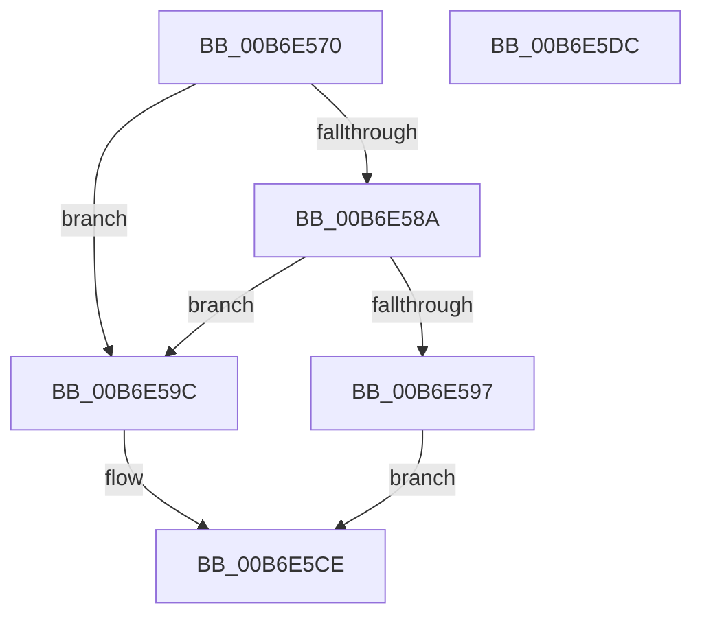

# PopReadProducerConsumerBuffer

- RVA: `0x00B6E570`–`0x00B6E5DD` (길이 `109` bytes)
- VA: `0x0000000140B6E570`
- 실행 섹션: `PAGELK`
- PDB 이름 있음: `예`; PDB Function 태그: `아니요`
- unwind 정보 RVA: `0x0005CAAC`
- 디코드: `36`개 명령, `109/109` bytes 표시
- 미해석 바이트: `0` (있으면 어셈블리에 `.byte`로 보존)

> 이 문서는 커널 이미지의 기계어와 PDB 기호를 분석해 생성했습니다. 4번과 5번은 함수 원형과 자료형을 바이너리 사용 방식에서 추정한 C 해석이며 원본 소스 복구 결과는 아닙니다.

## 1. Dependencies

- 직접 호출 지점: **1**; 고유 호출 대상: **1**
- 직접 호출자로 확인된 함수: **2**
- RIP 상대 이미지 참조: **0**

### Outgoing calls
- `0x00B6E5B4` → [ProducerConsumerCopyFromContextBuffer](../B7/ProducerConsumerCopyFromContextBuffer_function_00B705B8.md) (function, `0x00B705B8`)

### Direct callers
- [PopDecompressHiberBlocks](PopDecompressHiberBlocks_function_00B6D074.md) at `0x00B6D1CF`
- [PopDecompressHiberBlocks](PopDecompressHiberBlocks_function_00B6D074.md) at `0x00B6D1F8`
- [PopHiberPeekRangeTable](PopHiberPeekRangeTable_function_00B6DD08.md) at `0x00B6DD26`

### Static image references
- 디코드된 RIP-relative 메모리 참조가 없습니다.

## 2. Other-region calls and transfers

- 다른 실행 섹션으로 향하는 call: **0**
- 별도 외부 분기/꼬리 이동을 확인하지 못했습니다.

## 3. Assembly (complete function range)

```asm
00B6E570  48 89 5C 24 08                  mov qword ptr [rsp + 8], rbx
00B6E575  57                              push rdi
00B6E576  48 83 EC 20                     sub rsp, 0x20
00B6E57A  80 7C 24 58 00                  cmp byte ptr [rsp + 0x58], 0
00B6E57F  4D 8B D1                        mov r10, r9
00B6E582  49 8B F8                        mov rdi, r8
00B6E585  44 8B DA                        mov r11d, edx
00B6E588  75 12                           jne 0x140b6e59c
00B6E58A  8B C1                           mov eax, ecx
00B6E58C  41 2B 01                        sub eax, dword ptr [r9]
00B6E58F  03 C2                           add eax, edx
00B6E591  41 3B 41 08                     cmp eax, dword ptr [r9 + 8]
00B6E595  77 05                           ja 0x140b6e59c
00B6E597  48 8B F9                        mov rdi, rcx
00B6E59A  EB 32                           jmp 0x140b6e5ce
00B6E59C  0F 31                           rdtsc
00B6E59E  48 C1 E2 20                     shl rdx, 0x20
00B6E5A2  4C 8B C9                        mov r9, rcx
00B6E5A5  48 0B C2                        or rax, rdx
00B6E5A8  4D 8B C2                        mov r8, r10
00B6E5AB  41 8B D3                        mov edx, r11d
00B6E5AE  48 8B CF                        mov rcx, rdi
00B6E5B1  48 8B D8                        mov rbx, rax
00B6E5B4  E8 FF 1F 00 00                  call 0x140b705b8
00B6E5B9  0F 31                           rdtsc
00B6E5BB  48 8B 4C 24 50                  mov rcx, qword ptr [rsp + 0x50]
00B6E5C0  48 C1 E2 20                     shl rdx, 0x20
00B6E5C4  48 0B C2                        or rax, rdx
00B6E5C7  48 2B C3                        sub rax, rbx
00B6E5CA  48 01 41 48                     add qword ptr [rcx + 0x48], rax
00B6E5CE  48 8B 5C 24 30                  mov rbx, qword ptr [rsp + 0x30]
00B6E5D3  48 8B C7                        mov rax, rdi
00B6E5D6  48 83 C4 20                     add rsp, 0x20
00B6E5DA  5F                              pop rdi
00B6E5DB  C3                              ret
00B6E5DC  CC                              int3
```

## 4. C-style interpretation (structured pseudocode)

```c
__int64 __fastcall PopReadProducerConsumerBuffer(__int64 a1, __int64 a2, __int64 a3, __int64 a4, __int64 a5, unsigned __int8 a6)
{
    __int64 result;
    __int64 v_rsp;
    unsigned __int64 v_stack_p8;

    v_stack_p8 = v_rbx;
    v_rsp = (v_rsp) - (32);
    if (a6 != 0) goto loc_00B6E59C;
    result = (unsigned int)(((unsigned int)((unsigned int)(a1))) - (*(unsigned int *)(a4)));
    result = (unsigned int)((result) + ((unsigned int)(a2)));
    if (((unsigned int)(result)) > (*(unsigned int *)(a4 + 8))) goto loc_00B6E59C;
    goto loc_00B6E5CE;
loc_00B6E59C:
    a2 = (a2) << (32);
    result = (result) | (a2);
    result = ProducerConsumerCopyFromContextBuffer(a1, (unsigned int)((unsigned int)((unsigned int)((unsigned int)(a2)))), a4, a1);
    a2 = ((unsigned int)((unsigned int)((unsigned int)((unsigned int)(a2))))) << (32);
    result = (result) | (a2);
    result = (result) - (result);
loc_00B6E5CE:
    v_rsp = (v_rsp) + (32);
    return a1;
}
```

## 5. (Beta) C Style

```c
int64_t PopReadProducerConsumerBuffer(int64_t Arg1, int64_t Arg2, int64_t Arg3, void *Arg4, void *Arg5, uint8_t Arg6)
{
    uint8_t *arg4 = (uint8_t *)Arg4;
    uint8_t *arg5 = (uint8_t *)Arg5;

    int64_t result;
    int64_t local_rsp;
    uint64_t v_stack_p8;

    v_stack_p8 = local_rbx;
    local_rsp = (local_rsp) - (32);
    if (Arg6 != 0) goto loc_00B6E59C;
    result = (uint32_t)(((uint32_t)((uint32_t)(Arg1))) - (*(uint32_t *)(arg4)));
    result = (uint32_t)((result) + ((uint32_t)(Arg2)));
    if (((uint32_t)(result)) > (*(uint32_t *)(arg4 + 0x8))) goto loc_00B6E59C;
    goto loc_00B6E5CE;
loc_00B6E59C:
    Arg2 = (Arg2) << (32);
    result = (result) | (Arg2);
    result = ProducerConsumerCopyFromContextBuffer(Arg1, (uint32_t)((uint32_t)((uint32_t)((uint32_t)(Arg2)))), Arg4, Arg1);
    Arg2 = ((uint32_t)((uint32_t)((uint32_t)((uint32_t)(Arg2))))) << (32);
    result = (result) | (Arg2);
    result = (result) - (result);
loc_00B6E5CE:
    local_rsp = (local_rsp) + (32);
    return Arg1;
}
```

### 관측된 메모리 오프셋

구조체 형식이 확인되지 않은 접근은 인자 기준의 오프셋으로만 기록했습니다.

| 기준 인자 | 오프셋 표현 | 폭 (bit) | 접근 |
|---|---:|---:|---|
| `Arg4` | `+ 0x0` | `32` | `R` |
| `Arg4` | `+ 0x8` | `32` | `R` |
| `Arg5` | `+ 0x48` | `64` | `R/W` |

## 6. Execution-region graph

[열기: 2D/3D 그래프와 함수 탐색 컨트롤 패널](../../../control-panel.html?section=pagelk&rva=0x00B6E570&view=graph)

- 2D 그래프는 위에서 아래로 흐르고, 3D 그래프는 빈 공간을 드래그해 회전합니다. Shift+드래그는 이동, 휠은 확대·축소, 함수 노드 선택은 대상 보고서 이동입니다.

### Static fallback


