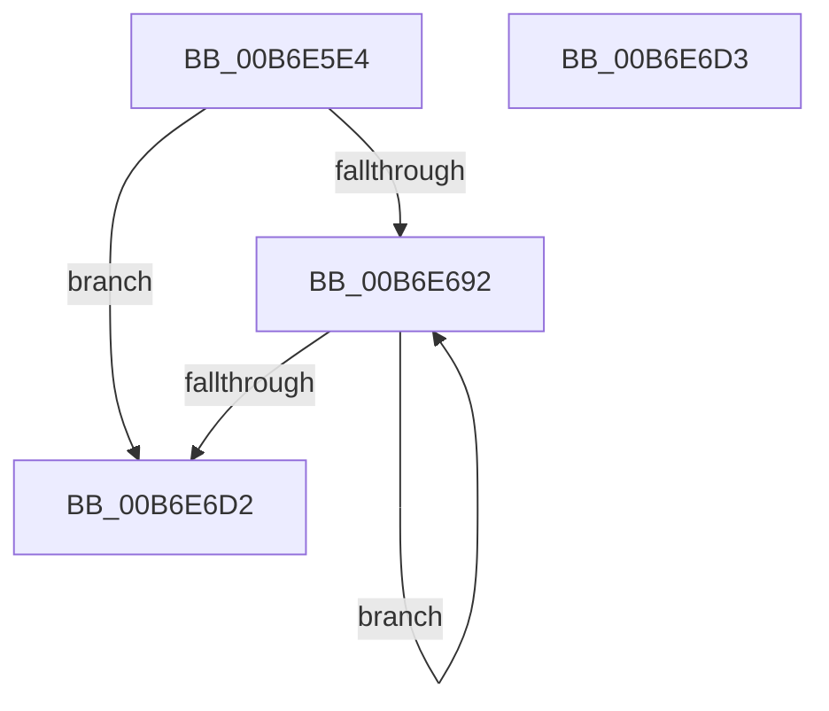

# PopRecordHibernateDiagnosticInfo

- RVA: `0x00B6E5E4`–`0x00B6E6D4` (길이 `240` bytes)
- VA: `0x0000000140B6E5E4`
- 실행 섹션: `PAGELK`
- PDB 이름 있음: `예`; PDB Function 태그: `아니요`
- unwind 정보 RVA: `0x000DB714`
- 디코드: `42`개 명령, `240/240` bytes 표시
- 미해석 바이트: `0` (있으면 어셈블리에 `.byte`로 보존)

> 이 문서는 커널 이미지의 기계어와 PDB 기호를 분석해 생성했습니다. 4번과 5번은 함수 원형과 자료형을 바이너리 사용 방식에서 추정한 C 해석이며 원본 소스 복구 결과는 아닙니다.

## 1. Dependencies

- 직접 호출 지점: **0**; 고유 호출 대상: **0**
- 직접 호출자로 확인된 함수: **2**
- RIP 상대 이미지 참조: **24**

### Outgoing calls
- 직접 디코드된 call 명령이 없습니다.

### Direct callers
- [PopRequestWrite](PopRequestWrite_function_00B6EB14.md) at `0x00B6EFE9`
- [PopWriteHiberPages](PopWriteHiberPages_function_00B6FF78.md) at `0x00B70054`

### Static image references
- `0x00B6E5E4` → RVA `0x00F0CED6` (`.data`; read)
- `0x00B6E5EC` → RVA `0x00F0DDC0` (`.data`; write)
- `0x00B6E5F5` → RVA `0x00F0C530` (`.data`; read)
- `0x00B6E5FF` → RVA `0x00F0DDE8` (`.data`; write)
- `0x00B6E609` → RVA `0x00F0C538` (`.data`; read)
- `0x00B6E610` → RVA `0x00F0DDF0` (`.data`; write)
- `0x00B6E617` → RVA `0x00F0C558` (`.data`; read)
- `0x00B6E61E` → RVA `0x00F0DDF8` (`.data`; write)
- `0x00B6E625` → RVA `0x00F0C548` (`.data`; read)
- `0x00B6E62C` → RVA `0x00F0DE00` (`.data`; write)
- `0x00B6E633` → RVA `0x00F0C540` (`.data`; read)
- `0x00B6E63A` → RVA `0x00F0DE08` (`.data`; write)
- `0x00B6E641` → RVA `0x00F0C560` (`.data`; read)
- `0x00B6E648` → RVA `0x00F0DE10` (`.data`; write)
- `0x00B6E64F` → RVA `0x00F0C550` (`.data`; read)
- `0x00B6E656` → RVA `0x00F0DE18` (`.data`; write)
- `0x00B6E65D` → RVA `0x00F0C568` (`.data`; read)
- `0x00B6E664` → RVA `0x00F0DE20` (`.data`; write)
- `0x00B6E66B` → RVA `0x00F0C570` (`.data`; read)
- `0x00B6E671` → RVA `0x00F0DE28` (`.data`; write)
- `0x00B6E677` → RVA `0x00F0BF64` (`.data`; read)
- `0x00B6E67D` → RVA `0x00F0DE34` (`.data`; write)
- `0x00B6E683` → RVA `0x00F0DE2C` (`.data`; write)
- `0x00B6E6C2` → RVA `0x00F0DE30` (`.data`; write)

## 2. Other-region calls and transfers

- 다른 실행 섹션으로 향하는 call: **0**
- 별도 외부 분기/꼬리 이동을 확인하지 못했습니다.

## 3. Assembly (complete function range)

```asm
00B6E5E4  8A 05 EC E8 39 00               mov al, byte ptr [rip + 0x39e8ec]
00B6E5EA  33 D2                           xor edx, edx
00B6E5EC  88 05 CE F7 39 00               mov byte ptr [rip + 0x39f7ce], al
00B6E5F2  4C 8B C9                        mov r9, rcx
00B6E5F5  48 8B 05 34 DF 39 00            mov rax, qword ptr [rip + 0x39df34]
00B6E5FC  44 8B D2                        mov r10d, edx
00B6E5FF  48 89 05 E2 F7 39 00            mov qword ptr [rip + 0x39f7e2], rax
00B6E606  44 8B C2                        mov r8d, edx
00B6E609  48 8B 05 28 DF 39 00            mov rax, qword ptr [rip + 0x39df28]
00B6E610  48 89 05 D9 F7 39 00            mov qword ptr [rip + 0x39f7d9], rax
00B6E617  48 8B 05 3A DF 39 00            mov rax, qword ptr [rip + 0x39df3a]
00B6E61E  48 89 05 D3 F7 39 00            mov qword ptr [rip + 0x39f7d3], rax
00B6E625  48 8B 05 1C DF 39 00            mov rax, qword ptr [rip + 0x39df1c]
00B6E62C  48 89 05 CD F7 39 00            mov qword ptr [rip + 0x39f7cd], rax
00B6E633  48 8B 05 06 DF 39 00            mov rax, qword ptr [rip + 0x39df06]
00B6E63A  48 89 05 C7 F7 39 00            mov qword ptr [rip + 0x39f7c7], rax
00B6E641  48 8B 05 18 DF 39 00            mov rax, qword ptr [rip + 0x39df18]
00B6E648  48 89 05 C1 F7 39 00            mov qword ptr [rip + 0x39f7c1], rax
00B6E64F  48 8B 05 FA DE 39 00            mov rax, qword ptr [rip + 0x39defa]
00B6E656  48 89 05 BB F7 39 00            mov qword ptr [rip + 0x39f7bb], rax
00B6E65D  48 8B 05 04 DF 39 00            mov rax, qword ptr [rip + 0x39df04]
00B6E664  48 89 05 B5 F7 39 00            mov qword ptr [rip + 0x39f7b5], rax
00B6E66B  8B 05 FF DE 39 00               mov eax, dword ptr [rip + 0x39deff]
00B6E671  89 05 B1 F7 39 00               mov dword ptr [rip + 0x39f7b1], eax
00B6E677  8B 05 E7 D8 39 00               mov eax, dword ptr [rip + 0x39d8e7]
00B6E67D  89 05 B1 F7 39 00               mov dword ptr [rip + 0x39f7b1], eax
00B6E683  48 89 15 A2 F7 39 00            mov qword ptr [rip + 0x39f7a2], rdx
00B6E68A  39 91 20 01 00 00               cmp dword ptr [rcx + 0x120], edx
00B6E690  76 40                           jbe 0x140b6e6d2
00B6E692  41 8B C0                        mov eax, r8d
00B6E695  41 FF C0                        inc r8d
00B6E698  48 69 C8 A8 00 00 00            imul rcx, rax, 0xa8
00B6E69F  49 8B 81 28 01 00 00            mov rax, qword ptr [r9 + 0x128]
00B6E6A6  03 94 08 A0 00 00 00            add edx, dword ptr [rax + rcx + 0xa0]
00B6E6AD  89 15 79 F7 39 00               mov dword ptr [rip + 0x39f779], edx
00B6E6B3  49 8B 81 28 01 00 00            mov rax, qword ptr [r9 + 0x128]
00B6E6BA  44 03 94 08 A4 00 00 00         add r10d, dword ptr [rax + rcx + 0xa4]
00B6E6C2  44 89 15 67 F7 39 00            mov dword ptr [rip + 0x39f767], r10d
00B6E6C9  45 3B 81 20 01 00 00            cmp r8d, dword ptr [r9 + 0x120]
00B6E6D0  72 C0                           jb 0x140b6e692
00B6E6D2  C3                              ret
00B6E6D3  CC                              int3
```

## 4. C-style interpretation (structured pseudocode)

```c
__int64 __fastcall PopRecordHibernateDiagnosticInfo(__int64 a1, int a2)
{
    __int64 v_r10;

    a2 = 0;
    *(unsigned __int8 *)(v_rip + 3798990) = (unsigned __int8)(*(unsigned __int8 *)(v_rip + 3795180));
    *(unsigned __int64 *)(v_rip + 3799010) = *(unsigned __int64 *)(v_rip + 3792692);
    *(unsigned __int64 *)(v_rip + 3799001) = *(unsigned __int64 *)(v_rip + 3792680);
    *(unsigned __int64 *)(v_rip + 3798995) = *(unsigned __int64 *)(v_rip + 3792698);
    *(unsigned __int64 *)(v_rip + 3798989) = *(unsigned __int64 *)(v_rip + 3792668);
    *(unsigned __int64 *)(v_rip + 3798983) = *(unsigned __int64 *)(v_rip + 3792646);
    *(unsigned __int64 *)(v_rip + 3798977) = *(unsigned __int64 *)(v_rip + 3792664);
    *(unsigned __int64 *)(v_rip + 3798971) = *(unsigned __int64 *)(v_rip + 3792634);
    *(unsigned __int64 *)(v_rip + 3798965) = *(unsigned __int64 *)(v_rip + 3792644);
    *(unsigned int *)(v_rip + 3798961) = (unsigned int)((unsigned int)(*(unsigned int *)(v_rip + 3792639)));
    *(unsigned int *)(v_rip + 3798961) = (unsigned int)((unsigned int)(*(unsigned int *)(v_rip + 3791079)));
    *(unsigned __int64 *)(v_rip + 3798946) = 0;
    if ((*(unsigned int *)(a1 + 288)) <= 0) goto loc_00B6E6D2;
loc_00B6E692:
    a3 = (unsigned int)((0) + 1);
    a1 = (a1) * (0);
    a2 = (unsigned int)((a2) + (*(unsigned int *)(*(unsigned __int64 *)(a1 + 296) + a1 * 1 + 160)));
    *(unsigned int *)(v_rip + 3798905) = a2;
    v_r10 = (unsigned int)((0) + (*(unsigned int *)(*(unsigned __int64 *)(a1 + 296) + a1 * 1 + 164)));
    *(unsigned int *)(v_rip + 3798887) = (unsigned int)(v_r10);
    if (((unsigned int)(a3)) < (*(unsigned int *)(a1 + 288))) goto loc_00B6E692;
loc_00B6E6D2:
    return *(unsigned __int64 *)(a1 + 296);
}
```

## 5. (Beta) C Style

```c
int64_t PopRecordHibernateDiagnosticInfo(void *Arg1, int32_t Arg2)
{
    uint8_t *arg1 = (uint8_t *)Arg1;

    int64_t local_r10;

    Arg2 = 0;
    *(uint8_t *)(v_rip + 0x39F7CE) = (uint8_t)(*(uint8_t *)(v_rip + 0x39E8EC));
    *(uint64_t *)(v_rip + 0x39F7E2) = *(uint64_t *)(v_rip + 0x39DF34);
    *(uint64_t *)(v_rip + 0x39F7D9) = *(uint64_t *)(v_rip + 0x39DF28);
    *(uint64_t *)(v_rip + 0x39F7D3) = *(uint64_t *)(v_rip + 0x39DF3A);
    *(uint64_t *)(v_rip + 0x39F7CD) = *(uint64_t *)(v_rip + 0x39DF1C);
    *(uint64_t *)(v_rip + 0x39F7C7) = *(uint64_t *)(v_rip + 0x39DF06);
    *(uint64_t *)(v_rip + 0x39F7C1) = *(uint64_t *)(v_rip + 0x39DF18);
    *(uint64_t *)(v_rip + 0x39F7BB) = *(uint64_t *)(v_rip + 0x39DEFA);
    *(uint64_t *)(v_rip + 0x39F7B5) = *(uint64_t *)(v_rip + 0x39DF04);
    *(uint32_t *)(v_rip + 0x39F7B1) = (uint32_t)((uint32_t)(*(uint32_t *)(v_rip + 0x39DEFF)));
    *(uint32_t *)(v_rip + 0x39F7B1) = (uint32_t)((uint32_t)(*(uint32_t *)(v_rip + 0x39D8E7)));
    *(uint64_t *)(v_rip + 0x39F7A2) = 0;
    if ((*(uint32_t *)(arg1 + 0x120)) <= 0) goto loc_00B6E6D2;
loc_00B6E692:
    a3 = (uint32_t)((0) + 1);
    Arg1 = (Arg1) * (0);
    Arg2 = (uint32_t)((Arg2) + (*(uint32_t *)(*(uint64_t *)(arg1 + 0x128) + arg1 * 1 + 0xA0)));
    *(uint32_t *)(v_rip + 0x39F779) = Arg2;
    local_r10 = (uint32_t)((0) + (*(uint32_t *)(*(uint64_t *)(arg1 + 0x128) + arg1 * 1 + 0xA4)));
    *(uint32_t *)(v_rip + 0x39F767) = (uint32_t)(local_r10);
    if (((uint32_t)(a3)) < (*(uint32_t *)(arg1 + 0x120))) goto loc_00B6E692;
loc_00B6E6D2:
    return *(uint64_t *)(arg1 + 0x128);
}
```

### 관측된 메모리 오프셋

구조체 형식이 확인되지 않은 접근은 인자 기준의 오프셋으로만 기록했습니다.

| 기준 인자 | 오프셋 표현 | 폭 (bit) | 접근 |
|---|---:|---:|---|
| `Arg1` | `+ 0x120` | `32` | `R` |
| `Arg1` | `+ 0x128` | `64` | `R` |

## 6. Execution-region graph

[열기: 2D/3D 그래프와 함수 탐색 컨트롤 패널](../../../control-panel.html?section=pagelk&rva=0x00B6E5E4&view=graph)

- 2D 그래프는 위에서 아래로 흐르고, 3D 그래프는 빈 공간을 드래그해 회전합니다. Shift+드래그는 이동, 휠은 확대·축소, 함수 노드 선택은 대상 보고서 이동입니다.

### Static fallback


