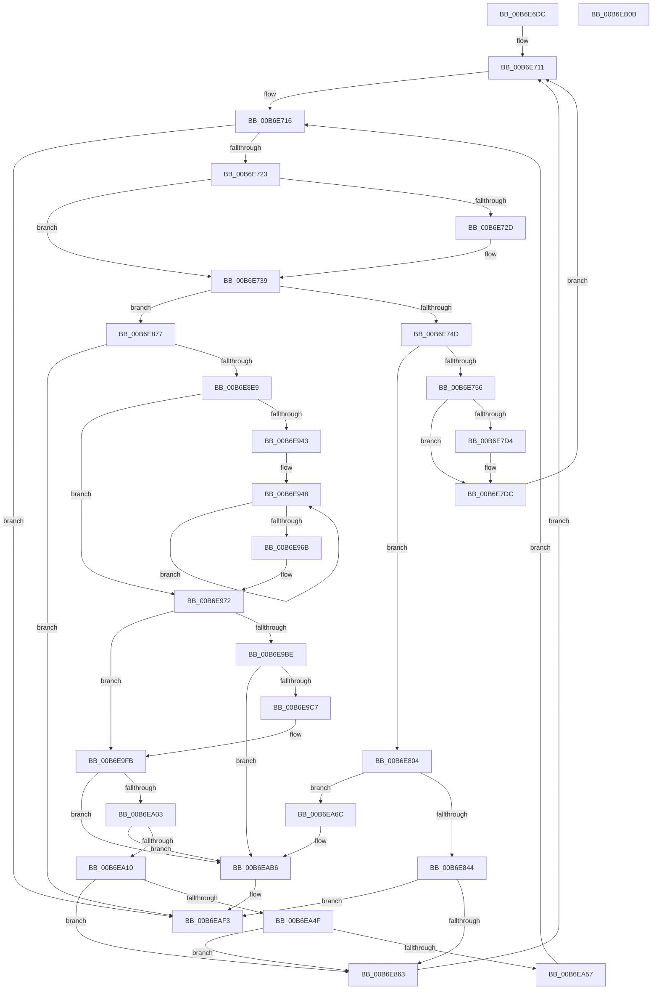

# PopRequestRead

- RVA: `0x00B6E6DC`–`0x00B6EB0C` (길이 `1,072` bytes)
- VA: `0x0000000140B6E6DC`
- 실행 섹션: `PAGELK`
- PDB 이름 있음: `예`; PDB Function 태그: `아니요`
- unwind 정보 RVA: `0x000CC344`
- 디코드: `246`개 명령, `1,072/1,072` bytes 표시
- 미해석 바이트: `0` (있으면 어셈블리에 `.byte`로 보존)

> 이 문서는 커널 이미지의 기계어와 PDB 기호를 분석해 생성했습니다. 4번과 5번은 함수 원형과 자료형을 바이너리 사용 방식에서 추정한 C 해석이며 원본 소스 복구 결과는 아닙니다.

## 1. Dependencies

- 직접 호출 지점: **17**; 고유 호출 대상: **10**
- 직접 호출자로 확인된 함수: **2**
- RIP 상대 이미지 참조: **8**

### Outgoing calls
- `0x00B6E734` → [guard_dispatch_icall](../../text/6B/guard_dispatch_icall_function_006BAAD0.md) (function, `0x006BAAD0`)
- `0x00B6E775` → [PopHiberChecksumHiberFileData](PopHiberChecksumHiberFileData_function_00B6DB10.md) (function, `0x00B6DB10`)
- `0x00B6E7AC` → [ProducerConsumerBufferComplete](../B7/ProducerConsumerBufferComplete_function_00B704E4.md) (function, `0x00B704E4`)
- `0x00B6E834` → [guard_dispatch_icall](../../text/6B/guard_dispatch_icall_function_006BAAD0.md) (function, `0x006BAAD0`)
- `0x00B6E877` → [PopHiberCheckForDebugBreak](../B7/PopHiberCheckForDebugBreak_function_00B78258.md) (function, `0x00B78258`)
- `0x00B6E88F` → [PopGetIoLocation](PopGetIoLocation_function_00B6D710.md) (function, `0x00B6D710`)
- `0x00B6E8D8` → [ProducerGetBuffer](../B7/ProducerGetBuffer_function_00B706C8.md) (function, `0x00B706C8`)
- `0x00B6E952` → [MmGetPhysicalAddress](../../text/23/MmGetPhysicalAddress_function_0023A500.md) (function, `0x0023A500`)
- `0x00B6E9B0` → [guard_dispatch_icall](../../text/6B/guard_dispatch_icall_function_006BAAD0.md) (function, `0x006BAAD0`)
- `0x00B6E9F4` → [guard_dispatch_icall](../../text/6B/guard_dispatch_icall_function_006BAAD0.md) (function, `0x006BAAD0`)
- `0x00B6EA71` → [PopCheckpointSystemSleep](../B7/PopCheckpointSystemSleep_function_00B77C90.md) (function, `0x00B77C90`)
- `0x00B6EA81` → [PopInternalAddToDumpFile](../../text/5C/PopInternalAddToDumpFile_function_005CE634.md) (function, `0x005CE634`)
- `0x00B6EA95` → [PopInternalAddToDumpFile](../../text/5C/PopInternalAddToDumpFile_function_005CE634.md) (function, `0x005CE634`)
- `0x00B6EAB0` → [KeBugCheckEx](../../text/4F/KeBugCheckEx_function_004FD660.md) (function, `0x004FD660`)
- `0x00B6EABB` → [PopCheckpointSystemSleep](../B7/PopCheckpointSystemSleep_function_00B77C90.md) (function, `0x00B77C90`)
- `0x00B6EACF` → [PopInternalAddToDumpFile](../../text/5C/PopInternalAddToDumpFile_function_005CE634.md) (function, `0x005CE634`)
- `0x00B6EAED` → [KeBugCheckEx](../../text/4F/KeBugCheckEx_function_004FD660.md) (function, `0x004FD660`)

### Direct callers
- [PopDecompressCallback](PopDecompressCallback_function_00B6D050.md) at `0x00B6D061`
- [PopRestoreHiberContext](../B7/PopRestoreHiberContext_function_00B777F0.md) at `0x00B77A17`

### Static image references
- `0x00B6E723` → RVA `0x00F0DDA4` (`.data`; read)
- `0x00B6E72D` → RVA `0x00E00B20` (`.data`; read)
- `0x00B6E739` → RVA `0x00F0DDA4` (`.data`; read/write)
- `0x00B6E794` → RVA `0x00F0C4C8` (`.data`; read/write)
- `0x00B6E7BD` → RVA `0x00F0C4F8` (`.data`; read/write)
- `0x00B6E804` → RVA `0x00F0C4D8` (`.data`; read/write)
- `0x00B6E850` → RVA `0x00F0C4F0` (`.data`; read/write)
- `0x00B6EA03` → RVA `0x00F0C2E0` (`.data`; read)

## 2. Other-region calls and transfers

- 다른 실행 섹션으로 향하는 call: **10**
  - `0x00B6E734` → [guard_dispatch_icall](../../text/6B/guard_dispatch_icall_function_006BAAD0.md) (`PAGELK` → `.text`)
  - `0x00B6E834` → [guard_dispatch_icall](../../text/6B/guard_dispatch_icall_function_006BAAD0.md) (`PAGELK` → `.text`)
  - `0x00B6E952` → [MmGetPhysicalAddress](../../text/23/MmGetPhysicalAddress_function_0023A500.md) (`PAGELK` → `.text`)
  - `0x00B6E9B0` → [guard_dispatch_icall](../../text/6B/guard_dispatch_icall_function_006BAAD0.md) (`PAGELK` → `.text`)
  - `0x00B6E9F4` → [guard_dispatch_icall](../../text/6B/guard_dispatch_icall_function_006BAAD0.md) (`PAGELK` → `.text`)
  - `0x00B6EA81` → [PopInternalAddToDumpFile](../../text/5C/PopInternalAddToDumpFile_function_005CE634.md) (`PAGELK` → `.text`)
  - `0x00B6EA95` → [PopInternalAddToDumpFile](../../text/5C/PopInternalAddToDumpFile_function_005CE634.md) (`PAGELK` → `.text`)
  - `0x00B6EAB0` → [KeBugCheckEx](../../text/4F/KeBugCheckEx_function_004FD660.md) (`PAGELK` → `.text`)
  - `0x00B6EACF` → [PopInternalAddToDumpFile](../../text/5C/PopInternalAddToDumpFile_function_005CE634.md) (`PAGELK` → `.text`)
  - `0x00B6EAED` → [KeBugCheckEx](../../text/4F/KeBugCheckEx_function_004FD660.md) (`PAGELK` → `.text`)
- 별도 외부 분기/꼬리 이동을 확인하지 못했습니다.

## 3. Assembly (complete function range)

```asm
00B6E6DC  48 8B C4                        mov rax, rsp
00B6E6DF  48 89 58 20                     mov qword ptr [rax + 0x20], rbx
00B6E6E3  44 89 40 18                     mov dword ptr [rax + 0x18], r8d
00B6E6E7  48 89 50 10                     mov qword ptr [rax + 0x10], rdx
00B6E6EB  55                              push rbp
00B6E6EC  56                              push rsi
00B6E6ED  57                              push rdi
00B6E6EE  41 54                           push r12
00B6E6F0  41 55                           push r13
00B6E6F2  41 56                           push r14
00B6E6F4  41 57                           push r15
00B6E6F6  48 83 EC 30                     sub rsp, 0x30
00B6E6FA  4C 8B B1 60 01 00 00            mov r14, qword ptr [rcx + 0x160]
00B6E701  45 33 ED                        xor r13d, r13d
00B6E704  4C 89 68 08                     mov qword ptr [rax + 8], r13
00B6E708  41 8B D8                        mov ebx, r8d
00B6E70B  48 8B EA                        mov rbp, rdx
00B6E70E  48 8B F1                        mov rsi, rcx
00B6E711  BF 01 00 00 00                  mov edi, 1
00B6E716  4C 39 AE B0 01 00 00            cmp qword ptr [rsi + 0x1b0], r13
00B6E71D  0F 84 D0 03 00 00               je 0x140b6eaf3
00B6E723  8B 05 7B F6 39 00               mov eax, dword ptr [rip + 0x39f67b]
00B6E729  A8 1F                           test al, 0x1f
00B6E72B  75 0C                           jne 0x140b6e739
00B6E72D  48 8B 05 EC 23 29 00            mov rax, qword ptr [rip + 0x2923ec]
00B6E734  E8 97 C3 B4 FF                  call 0x1406baad0
00B6E739  01 3D 65 F6 39 00               add dword ptr [rip + 0x39f665], edi
00B6E73F  8B 8E 68 01 00 00               mov ecx, dword ptr [rsi + 0x168]
00B6E745  85 C9                           test ecx, ecx
00B6E747  0F 84 2A 01 00 00               je 0x140b6e877
00B6E74D  83 F9 01                        cmp ecx, 1
00B6E750  0F 84 AE 00 00 00               je 0x140b6e804
00B6E756  48 8B 86 88 01 00 00            mov rax, qword ptr [rsi + 0x188]
00B6E75D  33 D2                           xor edx, edx
00B6E75F  4C 8B 8E A0 01 00 00            mov r9, qword ptr [rsi + 0x1a0]
00B6E766  48 8B CE                        mov rcx, rsi
00B6E769  4C 8B 86 98 01 00 00            mov r8, qword ptr [rsi + 0x198]
00B6E770  48 89 44 24 20                  mov qword ptr [rsp + 0x20], rax
00B6E775  E8 96 F3 FF FF                  call 0x140b6db10
00B6E77A  0F 31                           rdtsc
00B6E77C  48 C1 E2 20                     shl rdx, 0x20
00B6E780  48 0B C2                        or rax, rdx
00B6E783  48 8D 55 20                     lea rdx, [rbp + 0x20]
00B6E787  48 8B C8                        mov rcx, rax
00B6E78A  48 8B F8                        mov rdi, rax
00B6E78D  48 2B 8E 70 01 00 00            sub rcx, qword ptr [rsi + 0x170]
00B6E794  48 01 0D 2D DD 39 00            add qword ptr [rip + 0x39dd2d], rcx
00B6E79B  48 8B CD                        mov rcx, rbp
00B6E79E  44 8B 8E 88 01 00 00            mov r9d, dword ptr [rsi + 0x188]
00B6E7A5  4C 8B 86 A0 01 00 00            mov r8, qword ptr [rsi + 0x1a0]
00B6E7AC  E8 33 1D 00 00                  call 0x140b704e4
00B6E7B1  0F 31                           rdtsc
00B6E7B3  48 C1 E2 20                     shl rdx, 0x20
00B6E7B7  48 0B C2                        or rax, rdx
00B6E7BA  48 2B C7                        sub rax, rdi
00B6E7BD  48 01 05 34 DD 39 00            add qword ptr [rip + 0x39dd34], rax
00B6E7C4  48 8B 86 88 01 00 00            mov rax, qword ptr [rsi + 0x188]
00B6E7CB  48 29 86 B0 01 00 00            sub qword ptr [rsi + 0x1b0], rax
00B6E7D2  75 08                           jne 0x140b6e7dc
00B6E7D4  48 8B 45 28                     mov rax, qword ptr [rbp + 0x28]
00B6E7D8  48 89 45 20                     mov qword ptr [rbp + 0x20], rax
00B6E7DC  48 8B 86 80 01 00 00            mov rax, qword ptr [rsi + 0x180]
00B6E7E3  48 01 86 98 01 00 00            add qword ptr [rsi + 0x198], rax
00B6E7EA  48 01 86 78 01 00 00            add qword ptr [rsi + 0x178], rax
00B6E7F1  4C 89 AE 80 01 00 00            mov qword ptr [rsi + 0x180], r13
00B6E7F8  44 89 AE 68 01 00 00            mov dword ptr [rsi + 0x168], r13d
00B6E7FF  E9 0D FF FF FF                  jmp 0x140b6e711
00B6E804  48 01 3D CD DC 39 00            add qword ptr [rip + 0x39dccd], rdi
00B6E80B  0F 31                           rdtsc
00B6E80D  48 8B 8E B8 00 00 00            mov rcx, qword ptr [rsi + 0xb8]
00B6E814  4D 8B C6                        mov r8, r14
00B6E817  48 C1 E2 20                     shl rdx, 0x20
00B6E81B  48 0B C2                        or rax, rdx
00B6E81E  48 8D 96 90 01 00 00            lea rdx, [rsi + 0x190]
00B6E825  48 8B E8                        mov rbp, rax
00B6E828  48 8B 81 A0 00 00 00            mov rax, qword ptr [rcx + 0xa0]
00B6E82F  B9 02 00 00 00                  mov ecx, 2
00B6E834  E8 97 C2 B4 FF                  call 0x1406baad0
00B6E839  48 63 F8                        movsxd rdi, eax
00B6E83C  85 C0                           test eax, eax
00B6E83E  0F 88 28 02 00 00               js 0x140b6ea6c
00B6E844  0F 31                           rdtsc
00B6E846  48 C1 E2 20                     shl rdx, 0x20
00B6E84A  48 0B C2                        or rax, rdx
00B6E84D  48 2B C5                        sub rax, rbp
00B6E850  48 01 05 99 DC 39 00            add qword ptr [rip + 0x39dc99], rax
00B6E857  81 FF 03 01 00 00               cmp edi, 0x103
00B6E85D  0F 84 90 02 00 00               je 0x140b6eaf3
00B6E863  48 8B 6C 24 78                  mov rbp, qword ptr [rsp + 0x78]
00B6E868  C7 86 68 01 00 00 02 00 00 00   mov dword ptr [rsi + 0x168], 2
00B6E872  E9 9A FE FF FF                  jmp 0x140b6e711
00B6E877  E8 DC 99 00 00                  call 0x140b78258
00B6E87C  48 8B 96 98 01 00 00            mov rdx, qword ptr [rsi + 0x198]
00B6E883  4C 8D 44 24 70                  lea r8, [rsp + 0x70]
00B6E888  48 8B 8E B0 00 00 00            mov rcx, qword ptr [rsi + 0xb0]
00B6E88F  E8 7C EE FF FF                  call 0x140b6d710
00B6E894  8B BE B8 01 00 00               mov edi, dword ptr [rsi + 0x1b8]
00B6E89A  33 D2                           xor edx, edx
00B6E89C  48 C1 E7 0C                     shl rdi, 0xc
00B6E8A0  44 8B CB                        mov r9d, ebx
00B6E8A3  48 89 86 90 01 00 00            mov qword ptr [rsi + 0x190], rax
00B6E8AA  48 8B CD                        mov rcx, rbp
00B6E8AD  48 8B 86 78 01 00 00            mov rax, qword ptr [rsi + 0x178]
00B6E8B4  48 F7 F7                        div rdi
00B6E8B7  48 8B 86 B0 01 00 00            mov rax, qword ptr [rsi + 0x1b0]
00B6E8BE  48 2B FA                        sub rdi, rdx
00B6E8C1  48 3B 7C 24 70                  cmp rdi, qword ptr [rsp + 0x70]
00B6E8C6  48 0F 43 7C 24 70               cmovae rdi, qword ptr [rsp + 0x70]
00B6E8CC  48 3B F8                        cmp rdi, rax
00B6E8CF  44 8B C7                        mov r8d, edi
00B6E8D2  8B D7                           mov edx, edi
00B6E8D4  44 0F 43 C0                     cmovae r8d, eax
00B6E8D8  E8 EB 1D 00 00                  call 0x140b706c8
00B6E8DD  4C 8B E0                        mov r12, rax
00B6E8E0  48 85 C0                        test rax, rax
00B6E8E3  0F 84 0A 02 00 00               je 0x140b6eaf3
00B6E8E9  48 89 86 A0 01 00 00            mov qword ptr [rsi + 0x1a0], rax
00B6E8F0  41 8B D4                        mov edx, r12d
00B6E8F3  44 8B FA                        mov r15d, edx
00B6E8F6  4D 89 2E                        mov qword ptr [r14], r13
00B6E8F9  41 81 E7 FF 0F 00 00            and r15d, 0xfff
00B6E900  41 89 7E 28                     mov dword ptr [r14 + 0x28], edi
00B6E904  49 81 C7 FF 0F 00 00            add r15, 0xfff
00B6E90B  4D 89 66 18                     mov qword ptr [r14 + 0x18], r12
00B6E90F  4C 03 FF                        add r15, rdi
00B6E912  66 41 C7 46 0A 01 00            mov word ptr [r14 + 0xa], 1
00B6E919  49 C1 EF 0C                     shr r15, 0xc
00B6E91D  48 25 00 F0 FF FF               and rax, 0xfffffffffffff000
00B6E923  81 E2 FF 0F 00 00               and edx, 0xfff
00B6E929  49 89 46 20                     mov qword ptr [r14 + 0x20], rax
00B6E92D  41 89 56 2C                     mov dword ptr [r14 + 0x2c], edx
00B6E931  41 8D 4F 06                     lea ecx, [r15 + 6]
00B6E935  66 C1 E1 03                     shl cx, 3
00B6E939  66 41 89 4E 08                  mov word ptr [r14 + 8], cx
00B6E93E  4D 85 FF                        test r15, r15
00B6E941  74 2F                           je 0x140b6e972
00B6E943  33 ED                           xor ebp, ebp
00B6E945  8D 5D 01                        lea ebx, [rbp + 1]
00B6E948  48 8B CD                        mov rcx, rbp
00B6E94B  48 C1 E1 0C                     shl rcx, 0xc
00B6E94F  49 03 CC                        add rcx, r12
00B6E952  E8 A9 BB 6C FF                  call 0x14023a500
00B6E957  48 C1 E8 0C                     shr rax, 0xc
00B6E95B  44 03 EB                        add r13d, ebx
00B6E95E  49 89 44 EE 30                  mov qword ptr [r14 + rbp*8 + 0x30], rax
00B6E963  41 8B ED                        mov ebp, r13d
00B6E966  49 3B EF                        cmp rbp, r15
00B6E969  72 DD                           jb 0x140b6e948
00B6E96B  8B 9C 24 80 00 00 00            mov ebx, dword ptr [rsp + 0x80]
00B6E972  44 8A BE A8 01 00 00            mov r15b, byte ptr [rsi + 0x1a8]
00B6E979  0F 31                           rdtsc
00B6E97B  48 C1 E2 20                     shl rdx, 0x20
00B6E97F  4C 8D A6 90 01 00 00            lea r12, [rsi + 0x190]
00B6E986  48 0B C2                        or rax, rdx
00B6E989  45 33 ED                        xor r13d, r13d
00B6E98C  48 89 86 70 01 00 00            mov qword ptr [rsi + 0x170], rax
00B6E993  41 8B CD                        mov ecx, r13d
00B6E996  48 8B 86 B8 00 00 00            mov rax, qword ptr [rsi + 0xb8]
00B6E99D  45 84 FF                        test r15b, r15b
00B6E9A0  4D 8B C6                        mov r8, r14
00B6E9A3  49 8B D4                        mov rdx, r12
00B6E9A6  0F 95 C1                        setne cl
00B6E9A9  48 8B 80 A0 00 00 00            mov rax, qword ptr [rax + 0xa0]
00B6E9B0  E8 1B C1 B4 FF                  call 0x1406baad0
00B6E9B5  8B E8                           mov ebp, eax
00B6E9B7  3D BB 00 00 C0                  cmp eax, 0xc00000bb
00B6E9BC  75 3D                           jne 0x140b6e9fb
00B6E9BE  45 84 FF                        test r15b, r15b
00B6E9C1  0F 84 EF 00 00 00               je 0x140b6eab6
00B6E9C7  44 88 AE A8 01 00 00            mov byte ptr [rsi + 0x1a8], r13b
00B6E9CE  0F 31                           rdtsc
00B6E9D0  48 C1 E2 20                     shl rdx, 0x20
00B6E9D4  4D 8B C6                        mov r8, r14
00B6E9D7  48 0B C2                        or rax, rdx
00B6E9DA  33 C9                           xor ecx, ecx
00B6E9DC  48 89 86 70 01 00 00            mov qword ptr [rsi + 0x170], rax
00B6E9E3  49 8B D4                        mov rdx, r12
00B6E9E6  48 8B 86 B8 00 00 00            mov rax, qword ptr [rsi + 0xb8]
00B6E9ED  48 8B 80 A0 00 00 00            mov rax, qword ptr [rax + 0xa0]
00B6E9F4  E8 D7 C0 B4 FF                  call 0x1406baad0
00B6E9F9  8B E8                           mov ebp, eax
00B6E9FB  85 ED                           test ebp, ebp
00B6E9FD  0F 88 B3 00 00 00               js 0x140b6eab6
00B6EA03  83 3D D6 D8 39 00 08            cmp dword ptr [rip + 0x39d8d6], 8
00B6EA0A  0F 84 A6 00 00 00               je 0x140b6eab6
00B6EA10  0F 31                           rdtsc
00B6EA12  48 C1 E2 20                     shl rdx, 0x20
00B6EA16  48 0B C2                        or rax, rdx
00B6EA19  48 2B 86 70 01 00 00            sub rax, qword ptr [rsi + 0x170]
00B6EA20  48 01 05 C9 DA 39 00            add qword ptr [rip + 0x39dac9], rax
00B6EA27  48 8B C7                        mov rax, rdi
00B6EA2A  48 8B 8E B0 01 00 00            mov rcx, qword ptr [rsi + 0x1b0]
00B6EA31  48 3B F9                        cmp rdi, rcx
00B6EA34  48 89 BE 80 01 00 00            mov qword ptr [rsi + 0x180], rdi
00B6EA3B  48 0F 43 C1                     cmovae rax, rcx
00B6EA3F  48 89 86 88 01 00 00            mov qword ptr [rsi + 0x188], rax
00B6EA46  45 84 FF                        test r15b, r15b
00B6EA49  0F 84 14 FE FF FF               je 0x140b6e863
00B6EA4F  85 ED                           test ebp, ebp
00B6EA51  0F 84 0C FE FF FF               je 0x140b6e863
00B6EA57  48 8B 6C 24 78                  mov rbp, qword ptr [rsp + 0x78]
00B6EA5C  BF 01 00 00 00                  mov edi, 1
00B6EA61  89 BE 68 01 00 00               mov dword ptr [rsi + 0x168], edi
00B6EA67  E9 AA FC FF FF                  jmp 0x140b6e716
00B6EA6C  B9 1D 00 00 00                  mov ecx, 0x1d
00B6EA71  E8 1A 92 00 00                  call 0x140b77c90
00B6EA76  45 33 C0                        xor r8d, r8d
00B6EA79  BA F0 01 00 00                  mov edx, 0x1f0
00B6EA7E  48 8B CE                        mov rcx, rsi
00B6EA81  E8 AE FB A5 FF                  call 0x1405ce634
00B6EA86  48 8B 8E B8 00 00 00            mov rcx, qword ptr [rsi + 0xb8]
00B6EA8D  45 33 C0                        xor r8d, r8d
00B6EA90  BA 78 01 00 00                  mov edx, 0x178
00B6EA95  E8 9A FB A5 FF                  call 0x1405ce634
00B6EA9A  BA 0A 01 00 00                  mov edx, 0x10a
00B6EA9F  48 89 7C 24 20                  mov qword ptr [rsp + 0x20], rdi
00B6EAA4  4C 8B CE                        mov r9, rsi
00B6EAA7  41 B8 0A 00 00 00               mov r8d, 0xa
00B6EAAD  8D 4A 96                        lea ecx, [rdx - 0x6a]
00B6EAB0  E8 AB EB 98 FF                  call 0x1404fd660
00B6EAB5  CC                              int3
00B6EAB6  B9 1D 00 00 00                  mov ecx, 0x1d
00B6EABB  E8 D0 91 00 00                  call 0x140b77c90
00B6EAC0  48 8B 8E B8 00 00 00            mov rcx, qword ptr [rsi + 0xb8]
00B6EAC7  45 33 C0                        xor r8d, r8d
00B6EACA  BA 78 01 00 00                  mov edx, 0x178
00B6EACF  E8 60 FB A5 FF                  call 0x1405ce634
00B6EAD4  BA 0A 01 00 00                  mov edx, 0x10a
00B6EAD9  48 63 C5                        movsxd rax, ebp
00B6EADC  4C 8B CE                        mov r9, rsi
00B6EADF  48 89 44 24 20                  mov qword ptr [rsp + 0x20], rax
00B6EAE4  41 B8 0A 00 00 00               mov r8d, 0xa
00B6EAEA  8D 4A 96                        lea ecx, [rdx - 0x6a]
00B6EAED  E8 6E EB 98 FF                  call 0x1404fd660
00B6EAF2  CC                              int3
00B6EAF3  48 8B 9C 24 88 00 00 00         mov rbx, qword ptr [rsp + 0x88]
00B6EAFB  48 83 C4 30                     add rsp, 0x30
00B6EAFF  41 5F                           pop r15
00B6EB01  41 5E                           pop r14
00B6EB03  41 5D                           pop r13
00B6EB05  41 5C                           pop r12
00B6EB07  5F                              pop rdi
00B6EB08  5E                              pop rsi
00B6EB09  5D                              pop rbp
00B6EB0A  C3                              ret
00B6EB0B  CC                              int3
```

## 4. C-style interpretation (structured pseudocode)

```c
__int64 __fastcall PopRequestRead(__int64 a1, __int64 a2, int a3)
{
    __int64 result;
    __int64 v_r13;
    __int64 v_r15;
    __int64 v_rbp;
    __int64 v_rdi;
    __int64 v_rsp;
    unsigned __int64 v_stack_m48;
    unsigned __int64 v_stack_p10;
    unsigned int v_stack_p18;
    unsigned __int64 v_stack_p20;
    unsigned __int64 v_stack_p8;

    *(unsigned __int64 *)(v_rsp + 32) = v_rbx;
    *(unsigned int *)(v_rsp + 24) = a3;
    *(unsigned __int64 *)(v_rsp + 16) = a2;
    v_rsp = (v_rsp) - (48);
    v_r13 = 0;
    *(unsigned __int64 *)(v_rsp + 8) = 0;
loc_00B6E711:
loc_00B6E716:
    if ((*(unsigned __int64 *)(a1 + 432)) == 0) goto loc_00B6EAF3;
    result = (unsigned int)(*(unsigned int *)(v_rip + 3798651));
    if ((((unsigned __int8)((unsigned int)(*(unsigned int *)(v_rip + 3798651)))) & (31)) == 0) {
        result = *(unsigned __int64 *)(v_rip + 2696172);
        result = guard_dispatch_icall(a1, a2, a3, a4);
    }
    if ((unsigned int)((unsigned int)(*(unsigned int *)(a1 + 360))) == 0) goto loc_00B6E877;
    if (((unsigned int)((unsigned int)(*(unsigned int *)(a1 + 360)))) == 1) goto loc_00B6E804;
    a2 = 0;
    v_stack_m48 = *(unsigned __int64 *)(a1 + 392);
    result = PopHiberChecksumHiberFileData(a1, a2, *(unsigned __int64 *)(a1 + 408), *(unsigned __int64 *)(a1 + 416));
    a2 = (a2) << (32);
    result = (result) | (a2);
    a1 = (result) - (*(unsigned __int64 *)(a1 + 368));
    result = ProducerConsumerBufferComplete(a2, a2 + 32, *(unsigned __int64 *)(a1 + 416), (unsigned int)(*(unsigned int *)(a1 + 392)));
    a2 = (a2 + 32) << (32);
    result = (result) | (a2);
    result = (result) - (result);
    result = *(unsigned __int64 *)(a1 + 392);
    if (!(condition_is_not_equal)) {
        result = *(unsigned __int64 *)(a2 + 40);
        *(unsigned __int64 *)(a2 + 32) = result;
    }
    *(unsigned __int64 *)(a1 + 384) = 0;
    *(unsigned int *)(a1 + 360) = 0;
    goto loc_00B6E711;
loc_00B6E804:
    a2 = (a2) << (32);
    result = (*(unsigned __int64 *)(a1 + 384)) | (a2);
    result = guard_dispatch_icall(2, a1 + 400, *(unsigned __int64 *)(a1 + 352), (unsigned int)(*(unsigned int *)(a1 + 392)));
    if (sign_flag) goto loc_00B6EA6C;
    a2 = (a1 + 400) << (32);
    result = (result) | (a2);
    result = (result) - (result);
    if (((unsigned int)((int)((unsigned int)(result)))) == 259) goto loc_00B6EAF3;
loc_00B6E863:
    *(unsigned int *)(a1 + 360) = 2;
    goto loc_00B6E711;
loc_00B6E877:
    result = PopHiberCheckForDebugBreak(2, a2, *(unsigned __int64 *)(a1 + 352), (unsigned int)(*(unsigned int *)(a1 + 392)));
    result = PopGetIoLocation(*(unsigned __int64 *)(a1 + 176), *(unsigned __int64 *)(a1 + 408), v_stack_p8, (unsigned int)(*(unsigned int *)(a1 + 392)));
    a2 = 0;
    v_rdi = ((unsigned int)(*(unsigned int *)(a1 + 440))) << (12);
    *(unsigned __int64 *)(a1 + 400) = result;
    v_rdi = (v_rdi) - (0);
    if (v_rdi >= v_stack_p8) { v_rdi = v_stack_p8; }
    a3 = (unsigned int)((unsigned int)(v_rdi));
    if (v_rdi >= (*(unsigned __int64 *)(a1 + 432))) { a3 = (unsigned int)(*(unsigned __int64 *)(a1 + 432)); }
    result = ProducerGetBuffer(v_stack_p10, (unsigned int)((unsigned int)(v_rdi)), a3, (unsigned int)((unsigned int)((unsigned int)(a3))));
    if (result == 0) goto loc_00B6EAF3;
    *(unsigned __int64 *)(a1 + 416) = result;
    *(unsigned __int64 *)(*(unsigned __int64 *)(a1 + 352)) = 0;
    v_r15 = (unsigned int)(((unsigned int)((unsigned int)((unsigned int)((unsigned int)(result))))) & (0xFFFULL));
    *(unsigned int *)(*(unsigned __int64 *)(a1 + 352) + 40) = (unsigned int)(v_rdi);
    v_r15 = (v_r15) + (0xFFFULL);
    *(unsigned __int64 *)(*(unsigned __int64 *)(a1 + 352) + 24) = result;
    v_r15 = (v_r15) + (v_rdi);
    *(unsigned __int16 *)(*(unsigned __int64 *)(a1 + 352) + 10) = 1;
    v_r15 = (v_r15) >> (12);
    result = (result) & (0xFFFFFFFFFFFFF000ULL);
    a2 = (unsigned int)(((unsigned int)((unsigned int)(result))) & (0xFFFULL));
    *(unsigned __int64 *)(*(unsigned __int64 *)(a1 + 352) + 32) = result;
    *(unsigned int *)(*(unsigned __int64 *)(a1 + 352) + 44) = (unsigned int)(a2);
    a1 = (unsigned __int16)((v_r15 + 6) << (3));
    *(unsigned __int16 *)(*(unsigned __int64 *)(a1 + 352) + 8) = (unsigned __int16)(a1);
    if (v_r15 == 0) goto loc_00B6E972;
    v_rbp = 0;
loc_00B6E948:
    a1 = (0) << (12);
    a1 = (a1) + (result);
    result = MmGetPhysicalAddress(a1, a2, a3, (unsigned int)((unsigned int)((unsigned int)(a3))));
    result = (result) >> (12);
    v_r13 = (unsigned int)((v_r13) + ((unsigned int)(v_rbp + 1)));
    *(unsigned __int64 *)(*(unsigned __int64 *)(a1 + 352) + v_rbp * 8 + 48) = result;
    if (((unsigned int)((unsigned int)(v_r13))) < v_r15) goto loc_00B6E948;
loc_00B6E972:
    a2 = (a2) << (32);
    result = (result) | (a2);
    v_r13 = 0;
    *(unsigned __int64 *)(a1 + 368) = result;
    a1 = ((unsigned __int8)(*(unsigned __int8 *)(a1 + 424)) != 0) ? 1 : 0;
    result = guard_dispatch_icall(a1, a1 + 400, *(unsigned __int64 *)(a1 + 352), (unsigned int)((unsigned int)((unsigned int)(a3))));
    if (((unsigned int)(result)) != 0xC00000BBULL) goto loc_00B6E9FB;
    if ((unsigned __int8)(*(unsigned __int8 *)(a1 + 424)) == 0) goto loc_00B6EAB6;
    *(unsigned __int8 *)(a1 + 424) = 0;
    a2 = (a1 + 400) << (32);
    result = (result) | (a2);
    a1 = 0;
    *(unsigned __int64 *)(a1 + 368) = result;
    result = guard_dispatch_icall(a1, a1 + 400, *(unsigned __int64 *)(a1 + 352), (unsigned int)((unsigned int)((unsigned int)(a3))));
loc_00B6E9FB:
    if (sign_flag) goto loc_00B6EAB6;
    if ((*(unsigned int *)(v_rip + 3791062)) == 8) goto loc_00B6EAB6;
    a2 = (a1 + 400) << (32);
    result = (result) | (a2);
    result = (result) - (*(unsigned __int64 *)(a1 + 368));
    *(unsigned __int64 *)(a1 + 384) = v_rdi;
    result = v_rdi;
    if (v_rdi >= (*(unsigned __int64 *)(a1 + 432))) { result = *(unsigned __int64 *)(a1 + 432); }
    *(unsigned __int64 *)(a1 + 392) = result;
    if ((unsigned __int8)(*(unsigned __int8 *)(a1 + 424)) == 0) goto loc_00B6E863;
    if ((unsigned int)((unsigned int)((unsigned int)(result))) == 0) goto loc_00B6E863;
    *(unsigned int *)(a1 + 360) = 1;
    goto loc_00B6E716;
loc_00B6EA6C:
    result = PopCheckpointSystemSleep(29, a2, *(unsigned __int64 *)(a1 + 352), (unsigned int)((unsigned int)((unsigned int)(a3))));
    a3 = 0;
    result = PopInternalAddToDumpFile(0, 496, a3, (unsigned int)((unsigned int)((unsigned int)(a3))));
    a3 = 0;
    result = PopInternalAddToDumpFile(*(unsigned __int64 *)(a1 + 184), 376, a3, (unsigned int)((unsigned int)((unsigned int)(a3))));
    v_stack_m48 = 1;
    result = KeBugCheckEx(266 - 106, 266, 10, 0);
loc_00B6EAB6:
    result = PopCheckpointSystemSleep(29, 266, 10, 0);
    a3 = 0;
    result = PopInternalAddToDumpFile(*(unsigned __int64 *)(a1 + 184), 376, a3, 0);
    v_stack_m48 = (int)((unsigned int)(v_stack_p10));
    result = KeBugCheckEx(266 - 106, 266, 10, 0);
loc_00B6EAF3:
    v_rsp = (v_rsp) + (48);
    return result;
}
```

## 5. (Beta) C Style

```c
int64_t PopRequestRead(void *Arg1, int64_t Arg2, int32_t Arg3)
{
    uint8_t *arg1 = (uint8_t *)Arg1;

    int64_t result;
    int64_t local_r13;
    int64_t local_r15;
    int64_t local_rbp;
    int64_t local_rdi;
    int64_t local_rsp;
    uint64_t v_stack_m48;
    uint64_t v_stack_p10;
    uint32_t v_stack_p18;
    uint64_t v_stack_p20;
    uint64_t v_stack_p8;

    *(uint64_t *)(local_rsp + 0x20) = local_rbx;
    *(uint32_t *)(local_rsp + 0x18) = Arg3;
    *(uint64_t *)(local_rsp + 0x10) = Arg2;
    local_rsp = (local_rsp) - (48);
    local_r13 = 0;
    *(uint64_t *)(local_rsp + 0x8) = 0;
loc_00B6E711:
loc_00B6E716:
    if ((*(uint64_t *)(arg1 + 0x1B0)) == 0) goto loc_00B6EAF3;
    result = (uint32_t)(*(uint32_t *)(v_rip + 0x39F67B));
    if ((((uint8_t)((uint32_t)(*(uint32_t *)(v_rip + 0x39F67B)))) & (31)) == 0) {
        result = *(uint64_t *)(v_rip + 0x2923EC);
        result = guard_dispatch_icall(Arg1, Arg2, Arg3, a4);
    }
    if ((uint32_t)((uint32_t)(*(uint32_t *)(arg1 + 0x168))) == 0) goto loc_00B6E877;
    if (((uint32_t)((uint32_t)(*(uint32_t *)(arg1 + 0x168)))) == 1) goto loc_00B6E804;
    Arg2 = 0;
    v_stack_m48 = *(uint64_t *)(arg1 + 0x188);
    result = PopHiberChecksumHiberFileData(Arg1, Arg2, *(uint64_t *)(arg1 + 0x198), *(uint64_t *)(arg1 + 0x1A0));
    Arg2 = (Arg2) << (32);
    result = (result) | (Arg2);
    Arg1 = (result) - (*(uint64_t *)(arg1 + 0x170));
    result = ProducerConsumerBufferComplete(Arg2, Arg2 + 32, *(uint64_t *)(arg1 + 0x1A0), (uint32_t)(*(uint32_t *)(arg1 + 0x188)));
    Arg2 = (Arg2 + 32) << (32);
    result = (result) | (Arg2);
    result = (result) - (result);
    result = *(uint64_t *)(arg1 + 0x188);
    if (!(condition_is_not_equal)) {
        result = *(uint64_t *)(Arg2 + 0x28);
        *(uint64_t *)(Arg2 + 0x20) = result;
    }
    *(uint64_t *)(arg1 + 0x180) = 0;
    *(uint32_t *)(arg1 + 0x168) = 0;
    goto loc_00B6E711;
loc_00B6E804:
    Arg2 = (Arg2) << (32);
    result = (*(uint64_t *)(arg1 + 0x180)) | (Arg2);
    result = guard_dispatch_icall(2, Arg1 + 400, *(uint64_t *)(arg1 + 0x160), (uint32_t)(*(uint32_t *)(arg1 + 0x188)));
    if (sign_flag) goto loc_00B6EA6C;
    Arg2 = (Arg1 + 400) << (32);
    result = (result) | (Arg2);
    result = (result) - (result);
    if (((uint32_t)((int32_t)((uint32_t)(result)))) == 259) goto loc_00B6EAF3;
loc_00B6E863:
    *(uint32_t *)(arg1 + 0x168) = 2;
    goto loc_00B6E711;
loc_00B6E877:
    result = PopHiberCheckForDebugBreak(2, Arg2, *(uint64_t *)(arg1 + 0x160), (uint32_t)(*(uint32_t *)(arg1 + 0x188)));
    result = PopGetIoLocation(*(uint64_t *)(arg1 + 0xB0), *(uint64_t *)(arg1 + 0x198), v_stack_p8, (uint32_t)(*(uint32_t *)(arg1 + 0x188)));
    Arg2 = 0;
    local_rdi = ((uint32_t)(*(uint32_t *)(arg1 + 0x1B8))) << (12);
    *(uint64_t *)(arg1 + 0x190) = result;
    local_rdi = (local_rdi) - (0);
    if (local_rdi >= v_stack_p8) { local_rdi = v_stack_p8; }
    Arg3 = (uint32_t)((uint32_t)(local_rdi));
    if (local_rdi >= (*(uint64_t *)(arg1 + 0x1B0))) { Arg3 = (uint32_t)(*(uint64_t *)(arg1 + 0x1B0)); }
    result = ProducerGetBuffer(v_stack_p10, (uint32_t)((uint32_t)(local_rdi)), Arg3, (uint32_t)((uint32_t)((uint32_t)(Arg3))));
    if (result == 0) goto loc_00B6EAF3;
    *(uint64_t *)(arg1 + 0x1A0) = result;
    *(uint64_t *)(*(uint64_t *)(arg1 + 0x160)) = 0;
    local_r15 = (uint32_t)(((uint32_t)((uint32_t)((uint32_t)((uint32_t)(result))))) & (0xFFFULL));
    *(uint32_t *)(*(uint64_t *)(arg1 + 0x160) + 0x28) = (uint32_t)(local_rdi);
    local_r15 = (local_r15) + (0xFFFULL);
    *(uint64_t *)(*(uint64_t *)(arg1 + 0x160) + 0x18) = result;
    local_r15 = (local_r15) + (local_rdi);
    *(uint16_t *)(*(uint64_t *)(arg1 + 0x160) + 0xA) = 1;
    local_r15 = (local_r15) >> (12);
    result = (result) & (0xFFFFFFFFFFFFF000ULL);
    Arg2 = (uint32_t)(((uint32_t)((uint32_t)(result))) & (0xFFFULL));
    *(uint64_t *)(*(uint64_t *)(arg1 + 0x160) + 0x20) = result;
    *(uint32_t *)(*(uint64_t *)(arg1 + 0x160) + 0x2C) = (uint32_t)(Arg2);
    Arg1 = (uint16_t)((local_r15 + 6) << (3));
    *(uint16_t *)(*(uint64_t *)(arg1 + 0x160) + 0x8) = (uint16_t)(Arg1);
    if (local_r15 == 0) goto loc_00B6E972;
    local_rbp = 0;
loc_00B6E948:
    Arg1 = (0) << (12);
    Arg1 = (Arg1) + (result);
    result = MmGetPhysicalAddress(Arg1, Arg2, Arg3, (uint32_t)((uint32_t)((uint32_t)(Arg3))));
    result = (result) >> (12);
    local_r13 = (uint32_t)((local_r13) + ((uint32_t)(local_rbp + 1)));
    *(uint64_t *)(*(uint64_t *)(arg1 + 0x160) + local_rbp * 8 + 0x30) = result;
    if (((uint32_t)((uint32_t)(local_r13))) < local_r15) goto loc_00B6E948;
loc_00B6E972:
    Arg2 = (Arg2) << (32);
    result = (result) | (Arg2);
    local_r13 = 0;
    *(uint64_t *)(arg1 + 0x170) = result;
    Arg1 = ((uint8_t)(*(uint8_t *)(arg1 + 0x1A8)) != 0) ? 1 : 0;
    result = guard_dispatch_icall(Arg1, Arg1 + 400, *(uint64_t *)(arg1 + 0x160), (uint32_t)((uint32_t)((uint32_t)(Arg3))));
    if (((uint32_t)(result)) != 0xC00000BBULL) goto loc_00B6E9FB;
    if ((uint8_t)(*(uint8_t *)(arg1 + 0x1A8)) == 0) goto loc_00B6EAB6;
    *(uint8_t *)(arg1 + 0x1A8) = 0;
    Arg2 = (Arg1 + 400) << (32);
    result = (result) | (Arg2);
    Arg1 = 0;
    *(uint64_t *)(arg1 + 0x170) = result;
    result = guard_dispatch_icall(Arg1, Arg1 + 400, *(uint64_t *)(arg1 + 0x160), (uint32_t)((uint32_t)((uint32_t)(Arg3))));
loc_00B6E9FB:
    if (sign_flag) goto loc_00B6EAB6;
    if ((*(uint32_t *)(v_rip + 0x39D8D6)) == 8) goto loc_00B6EAB6;
    Arg2 = (Arg1 + 400) << (32);
    result = (result) | (Arg2);
    result = (result) - (*(uint64_t *)(arg1 + 0x170));
    *(uint64_t *)(arg1 + 0x180) = local_rdi;
    result = local_rdi;
    if (local_rdi >= (*(uint64_t *)(arg1 + 0x1B0))) { result = *(uint64_t *)(arg1 + 0x1B0); }
    *(uint64_t *)(arg1 + 0x188) = result;
    if ((uint8_t)(*(uint8_t *)(arg1 + 0x1A8)) == 0) goto loc_00B6E863;
    if ((uint32_t)((uint32_t)((uint32_t)(result))) == 0) goto loc_00B6E863;
    *(uint32_t *)(arg1 + 0x168) = 1;
    goto loc_00B6E716;
loc_00B6EA6C:
    result = PopCheckpointSystemSleep(29, Arg2, *(uint64_t *)(arg1 + 0x160), (uint32_t)((uint32_t)((uint32_t)(Arg3))));
    Arg3 = 0;
    result = PopInternalAddToDumpFile(0, 496, Arg3, (uint32_t)((uint32_t)((uint32_t)(Arg3))));
    Arg3 = 0;
    result = PopInternalAddToDumpFile(*(uint64_t *)(arg1 + 0xB8), 376, Arg3, (uint32_t)((uint32_t)((uint32_t)(Arg3))));
    v_stack_m48 = 1;
    result = KeBugCheckEx(266 - 106, 266, 10, 0);
loc_00B6EAB6:
    result = PopCheckpointSystemSleep(29, 266, 10, 0);
    Arg3 = 0;
    result = PopInternalAddToDumpFile(*(uint64_t *)(arg1 + 0xB8), 376, Arg3, 0);
    v_stack_m48 = (int32_t)((uint32_t)(v_stack_p10));
    result = KeBugCheckEx(266 - 106, 266, 10, 0);
loc_00B6EAF3:
    local_rsp = (local_rsp) + (48);
    return result;
}
```

### 관측된 메모리 오프셋

구조체 형식이 확인되지 않은 접근은 인자 기준의 오프셋으로만 기록했습니다.

| 기준 인자 | 오프셋 표현 | 폭 (bit) | 접근 |
|---|---:|---:|---|
| `Arg1` | `+ 0xB0` | `64` | `R` |
| `Arg1` | `+ 0xB8` | `64` | `R` |
| `Arg1` | `+ 0x160` | `64` | `R` |
| `Arg1` | `+ 0x168` | `32` | `R` |
| `Arg1` | `+ 0x168` | `32` | `W` |
| `Arg1` | `+ 0x170` | `64` | `R` |
| `Arg1` | `+ 0x170` | `64` | `W` |
| `Arg1` | `+ 0x178` | `64` | `R` |
| `Arg1` | `+ 0x178` | `64` | `R/W` |
| `Arg1` | `+ 0x180` | `64` | `R` |
| `Arg1` | `+ 0x180` | `64` | `W` |
| `Arg1` | `+ 0x188` | `32` | `R` |
| `Arg1` | `+ 0x188` | `64` | `R` |
| `Arg1` | `+ 0x188` | `64` | `W` |
| `Arg1` | `+ 0x190` | `64` | `R` |
| `Arg1` | `+ 0x190` | `64` | `W` |
| `Arg1` | `+ 0x198` | `64` | `R` |
| `Arg1` | `+ 0x198` | `64` | `R/W` |
| `Arg1` | `+ 0x1A0` | `64` | `R` |
| `Arg1` | `+ 0x1A0` | `64` | `W` |
| `Arg1` | `+ 0x1A8` | `8` | `R` |
| `Arg1` | `+ 0x1A8` | `8` | `W` |
| `Arg1` | `+ 0x1B0` | `64` | `R` |
| `Arg1` | `+ 0x1B0` | `64` | `R/W` |
| `Arg1` | `+ 0x1B8` | `32` | `R` |

## 6. Execution-region graph

[열기: 2D/3D 그래프와 함수 탐색 컨트롤 패널](../../../control-panel.html?section=pagelk&rva=0x00B6E6DC&view=graph)

- 2D 그래프는 위에서 아래로 흐르고, 3D 그래프는 빈 공간을 드래그해 회전합니다. Shift+드래그는 이동, 휠은 확대·축소, 함수 노드 선택은 대상 보고서 이동입니다.

### Static fallback


