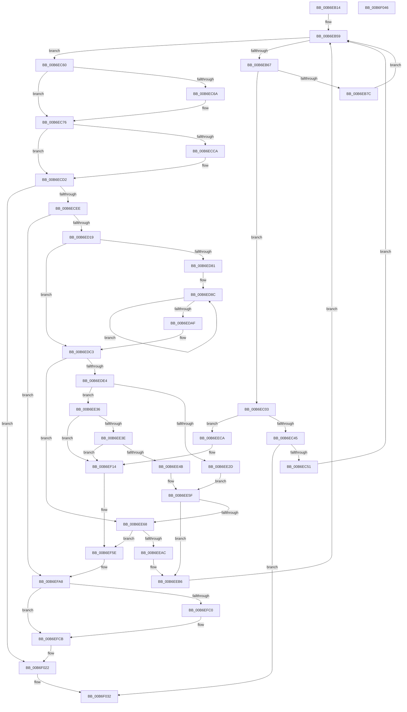

# PopRequestWrite

- RVA: `0x00B6EB14`–`0x00B6F047` (길이 `1,331` bytes)
- VA: `0x0000000140B6EB14`
- 실행 섹션: `PAGELK`
- PDB 이름 있음: `예`; PDB Function 태그: `아니요`
- unwind 정보 RVA: `0x000BECA4`
- 디코드: `308`개 명령, `1,331/1,331` bytes 표시
- 미해석 바이트: `0` (있으면 어셈블리에 `.byte`로 보존)

> 이 문서는 커널 이미지의 기계어와 PDB 기호를 분석해 생성했습니다. 4번과 5번은 함수 원형과 자료형을 바이너리 사용 방식에서 추정한 C 해석이며 원본 소스 복구 결과는 아닙니다.

## 1. Dependencies

- 직접 호출 지점: **28**; 고유 호출 대상: **13**
- 직접 호출자로 확인된 함수: **2**
- RIP 상대 이미지 참조: **11**

### Outgoing calls
- `0x00B6EB9F` → [ProducerConsumerBufferComplete](../B7/ProducerConsumerBufferComplete_function_00B704E4.md) (function, `0x00B704E4`)
- `0x00B6EC22` → [guard_dispatch_icall](../../text/6B/guard_dispatch_icall_function_006BAAD0.md) (function, `0x006BAAD0`)
- `0x00B6EC71` → [guard_dispatch_icall](../../text/6B/guard_dispatch_icall_function_006BAAD0.md) (function, `0x006BAAD0`)
- `0x00B6EC93` → [PopGetIoLocation](PopGetIoLocation_function_00B6D710.md) (function, `0x00B6D710`)
- `0x00B6ECDD` → [ConsumerGetBuffer](ConsumerGetBuffer_function_00B6C6E8.md) (function, `0x00B6C6E8`)
- `0x00B6ED27` → [PopHiberChecksumHiberFileData](PopHiberChecksumHiberFileData_function_00B6DB10.md) (function, `0x00B6DB10`)
- `0x00B6ED96` → [MmGetPhysicalAddress](../../text/23/MmGetPhysicalAddress_function_0023A500.md) (function, `0x0023A500`)
- `0x00B6EE0A` → [guard_dispatch_icall](../../text/6B/guard_dispatch_icall_function_006BAAD0.md) (function, `0x006BAAD0`)
- `0x00B6EE89` → [guard_dispatch_icall](../../text/6B/guard_dispatch_icall_function_006BAAD0.md) (function, `0x006BAAD0`)
- `0x00B6EECF` → [PopCheckpointSystemSleep](../B7/PopCheckpointSystemSleep_function_00B77C90.md) (function, `0x00B77C90`)
- `0x00B6EEDF` → [PopInternalAddToDumpFile](../../text/5C/PopInternalAddToDumpFile_function_005CE634.md) (function, `0x005CE634`)
- `0x00B6EEF3` → [PopInternalAddToDumpFile](../../text/5C/PopInternalAddToDumpFile_function_005CE634.md) (function, `0x005CE634`)
- `0x00B6EF0E` → [KeBugCheckEx](../../text/4F/KeBugCheckEx_function_004FD660.md) (function, `0x004FD660`)
- `0x00B6EF19` → [PopCheckpointSystemSleep](../B7/PopCheckpointSystemSleep_function_00B77C90.md) (function, `0x00B77C90`)
- `0x00B6EF29` → [PopInternalAddToDumpFile](../../text/5C/PopInternalAddToDumpFile_function_005CE634.md) (function, `0x005CE634`)
- `0x00B6EF3D` → [PopInternalAddToDumpFile](../../text/5C/PopInternalAddToDumpFile_function_005CE634.md) (function, `0x005CE634`)
- `0x00B6EF58` → [KeBugCheckEx](../../text/4F/KeBugCheckEx_function_004FD660.md) (function, `0x004FD660`)
- `0x00B6EF63` → [PopCheckpointSystemSleep](../B7/PopCheckpointSystemSleep_function_00B77C90.md) (function, `0x00B77C90`)
- `0x00B6EF73` → [PopInternalAddToDumpFile](../../text/5C/PopInternalAddToDumpFile_function_005CE634.md) (function, `0x005CE634`)
- `0x00B6EF87` → [PopInternalAddToDumpFile](../../text/5C/PopInternalAddToDumpFile_function_005CE634.md) (function, `0x005CE634`)
- `0x00B6EFA2` → [KeBugCheckEx](../../text/4F/KeBugCheckEx_function_004FD660.md) (function, `0x004FD660`)
- `0x00B6EFAD` → [PopCheckpointSystemSleep](../B7/PopCheckpointSystemSleep_function_00B77C90.md) (function, `0x00B77C90`)
- `0x00B6EFC3` → [PopGetRemainingHibernateRangeDataSize](PopGetRemainingHibernateRangeDataSize_function_00B6D7A0.md) (function, `0x00B6D7A0`)
- `0x00B6EFCD` → [MmGetNumberOfPhysicalPages](../../text/46/MmGetNumberOfPhysicalPages_function_00467F80.md) (function, `0x00467F80`)
- `0x00B6EFE1` → [IoAddTriageDumpDataBlock](../../text/42/IoAddTriageDumpDataBlock_function_00428374.md) (function, `0x00428374`)
- `0x00B6EFE9` → [PopRecordHibernateDiagnosticInfo](PopRecordHibernateDiagnosticInfo_function_00B6E5E4.md) (function, `0x00B6E5E4`)
- `0x00B6EFFA` → [IoAddTriageDumpDataBlock](../../text/42/IoAddTriageDumpDataBlock_function_00428374.md) (function, `0x00428374`)
- `0x00B6F01C` → [KeBugCheckEx](../../text/4F/KeBugCheckEx_function_004FD660.md) (function, `0x004FD660`)

### Direct callers
- [PopCompressCallback](PopCompressCallback_function_00B6CD50.md) at `0x00B6CD61`
- [PopWriteHiberImage](PopWriteHiberImage_function_00B6FE30.md) at `0x00B6FE9D`

### Static image references
- `0x00B6EB87` → RVA `0x00F0C378` (`.data`; read/write)
- `0x00B6EBB0` → RVA `0x00F0C3A8` (`.data`; read/write)
- `0x00B6EBBE` → RVA `0x00F0C568` (`.data`; read/write)
- `0x00B6EBD6` → RVA `0x00F0C570` (`.data`; read/write)
- `0x00B6EC36` → RVA `0x00F0C380` (`.data`; read/write)
- `0x00B6EC60` → RVA `0x00F0DDA4` (`.data`; read)
- `0x00B6EC6A` → RVA `0x00E00B20` (`.data`; read)
- `0x00B6EC8C` → RVA `0x00F0DDA4` (`.data`; read/write)
- `0x00B6ED0C` → RVA `0x00F0BF30` (`.data`; read)
- `0x00B6EE3E` → RVA `0x00F0C2E0` (`.data`; read)
- `0x00B6EFF3` → RVA `0x00F0DDC0` (`.data`; read)

## 2. Other-region calls and transfers

- 다른 실행 섹션으로 향하는 call: **18**
  - `0x00B6EC22` → [guard_dispatch_icall](../../text/6B/guard_dispatch_icall_function_006BAAD0.md) (`PAGELK` → `.text`)
  - `0x00B6EC71` → [guard_dispatch_icall](../../text/6B/guard_dispatch_icall_function_006BAAD0.md) (`PAGELK` → `.text`)
  - `0x00B6ED96` → [MmGetPhysicalAddress](../../text/23/MmGetPhysicalAddress_function_0023A500.md) (`PAGELK` → `.text`)
  - `0x00B6EE0A` → [guard_dispatch_icall](../../text/6B/guard_dispatch_icall_function_006BAAD0.md) (`PAGELK` → `.text`)
  - `0x00B6EE89` → [guard_dispatch_icall](../../text/6B/guard_dispatch_icall_function_006BAAD0.md) (`PAGELK` → `.text`)
  - `0x00B6EEDF` → [PopInternalAddToDumpFile](../../text/5C/PopInternalAddToDumpFile_function_005CE634.md) (`PAGELK` → `.text`)
  - `0x00B6EEF3` → [PopInternalAddToDumpFile](../../text/5C/PopInternalAddToDumpFile_function_005CE634.md) (`PAGELK` → `.text`)
  - `0x00B6EF0E` → [KeBugCheckEx](../../text/4F/KeBugCheckEx_function_004FD660.md) (`PAGELK` → `.text`)
  - `0x00B6EF29` → [PopInternalAddToDumpFile](../../text/5C/PopInternalAddToDumpFile_function_005CE634.md) (`PAGELK` → `.text`)
  - `0x00B6EF3D` → [PopInternalAddToDumpFile](../../text/5C/PopInternalAddToDumpFile_function_005CE634.md) (`PAGELK` → `.text`)
  - `0x00B6EF58` → [KeBugCheckEx](../../text/4F/KeBugCheckEx_function_004FD660.md) (`PAGELK` → `.text`)
  - `0x00B6EF73` → [PopInternalAddToDumpFile](../../text/5C/PopInternalAddToDumpFile_function_005CE634.md) (`PAGELK` → `.text`)
  - `0x00B6EF87` → [PopInternalAddToDumpFile](../../text/5C/PopInternalAddToDumpFile_function_005CE634.md) (`PAGELK` → `.text`)
  - `0x00B6EFA2` → [KeBugCheckEx](../../text/4F/KeBugCheckEx_function_004FD660.md) (`PAGELK` → `.text`)
  - `0x00B6EFCD` → [MmGetNumberOfPhysicalPages](../../text/46/MmGetNumberOfPhysicalPages_function_00467F80.md) (`PAGELK` → `.text`)
  - `0x00B6EFE1` → [IoAddTriageDumpDataBlock](../../text/42/IoAddTriageDumpDataBlock_function_00428374.md) (`PAGELK` → `.text`)
  - `0x00B6EFFA` → [IoAddTriageDumpDataBlock](../../text/42/IoAddTriageDumpDataBlock_function_00428374.md) (`PAGELK` → `.text`)
  - `0x00B6F01C` → [KeBugCheckEx](../../text/4F/KeBugCheckEx_function_004FD660.md) (`PAGELK` → `.text`)
- 별도 외부 분기/꼬리 이동을 확인하지 못했습니다.

## 3. Assembly (complete function range)

```asm
00B6EB14  48 8B C4                        mov rax, rsp
00B6EB17  44 89 40 18                     mov dword ptr [rax + 0x18], r8d
00B6EB1B  48 89 50 10                     mov qword ptr [rax + 0x10], rdx
00B6EB1F  48 89 48 08                     mov qword ptr [rax + 8], rcx
00B6EB23  53                              push rbx
00B6EB24  55                              push rbp
00B6EB25  56                              push rsi
00B6EB26  57                              push rdi
00B6EB27  41 54                           push r12
00B6EB29  41 55                           push r13
00B6EB2B  41 56                           push r14
00B6EB2D  41 57                           push r15
00B6EB2F  48 83 EC 58                     sub rsp, 0x58
00B6EB33  4C 8B B9 60 01 00 00            mov r15, qword ptr [rcx + 0x160]
00B6EB3A  33 F6                           xor esi, esi
00B6EB3C  41 8B D8                        mov ebx, r8d
00B6EB3F  48 89 70 A8                     mov qword ptr [rax - 0x58], rsi
00B6EB43  4C 8B F2                        mov r14, rdx
00B6EB46  48 89 70 20                     mov qword ptr [rax + 0x20], rsi
00B6EB4A  48 8B F9                        mov rdi, rcx
00B6EB4D  4C 89 7C 24 38                  mov qword ptr [rsp + 0x38], r15
00B6EB52  44 8D 66 01                     lea r12d, [rsi + 1]
00B6EB56  44 8B EE                        mov r13d, esi
00B6EB59  8B 8F 68 01 00 00               mov ecx, dword ptr [rdi + 0x168]
00B6EB5F  85 C9                           test ecx, ecx
00B6EB61  0F 84 F9 00 00 00               je 0x140b6ec60
00B6EB67  0F 31                           rdtsc
00B6EB69  48 C1 E2 20                     shl rdx, 0x20
00B6EB6D  48 0B C2                        or rax, rdx
00B6EB70  4C 8B E8                        mov r13, rax
00B6EB73  83 F9 01                        cmp ecx, 1
00B6EB76  0F 84 87 00 00 00               je 0x140b6ec03
00B6EB7C  48 2B 87 70 01 00 00            sub rax, qword ptr [rdi + 0x170]
00B6EB83  49 8D 56 30                     lea rdx, [r14 + 0x30]
00B6EB87  48 01 05 EA D7 39 00            add qword ptr [rip + 0x39d7ea], rax
00B6EB8E  49 8B CE                        mov rcx, r14
00B6EB91  44 8B 8F 88 01 00 00            mov r9d, dword ptr [rdi + 0x188]
00B6EB98  4C 8B 87 A0 01 00 00            mov r8, qword ptr [rdi + 0x1a0]
00B6EB9F  E8 40 19 00 00                  call 0x140b704e4
00B6EBA4  0F 31                           rdtsc
00B6EBA6  48 C1 E2 20                     shl rdx, 0x20
00B6EBAA  48 0B C2                        or rax, rdx
00B6EBAD  49 2B C5                        sub rax, r13
00B6EBB0  48 01 05 F1 D7 39 00            add qword ptr [rip + 0x39d7f1], rax
00B6EBB7  48 8B 87 88 01 00 00            mov rax, qword ptr [rdi + 0x188]
00B6EBBE  48 01 05 A3 D9 39 00            add qword ptr [rip + 0x39d9a3], rax
00B6EBC5  48 8B 87 80 01 00 00            mov rax, qword ptr [rdi + 0x180]
00B6EBCC  48 05 FF 0F 00 00               add rax, 0xfff
00B6EBD2  48 C1 E8 0C                     shr rax, 0xc
00B6EBD6  01 05 94 D9 39 00               add dword ptr [rip + 0x39d994], eax
00B6EBDC  48 8B 87 80 01 00 00            mov rax, qword ptr [rdi + 0x180]
00B6EBE3  48 01 87 98 01 00 00            add qword ptr [rdi + 0x198], rax
00B6EBEA  48 01 87 78 01 00 00            add qword ptr [rdi + 0x178], rax
00B6EBF1  48 89 B7 80 01 00 00            mov qword ptr [rdi + 0x180], rsi
00B6EBF8  89 B7 68 01 00 00               mov dword ptr [rdi + 0x168], esi
00B6EBFE  E9 56 FF FF FF                  jmp 0x140b6eb59
00B6EC03  48 8B 87 B8 00 00 00            mov rax, qword ptr [rdi + 0xb8]
00B6EC0A  48 8D 97 90 01 00 00            lea rdx, [rdi + 0x190]
00B6EC11  45 33 C9                        xor r9d, r9d
00B6EC14  4D 8B C7                        mov r8, r15
00B6EC17  48 8B 80 80 00 00 00            mov rax, qword ptr [rax + 0x80]
00B6EC1E  41 8D 49 02                     lea ecx, [r9 + 2]
00B6EC22  E8 A9 BE B4 FF                  call 0x1406baad0
00B6EC27  48 63 E8                        movsxd rbp, eax
00B6EC2A  0F 31                           rdtsc
00B6EC2C  48 C1 E2 20                     shl rdx, 0x20
00B6EC30  48 0B C2                        or rax, rdx
00B6EC33  49 2B C5                        sub rax, r13
00B6EC36  48 01 05 43 D7 39 00            add qword ptr [rip + 0x39d743], rax
00B6EC3D  85 ED                           test ebp, ebp
00B6EC3F  0F 88 85 02 00 00               js 0x140b6eeca
00B6EC45  81 FD 03 01 00 00               cmp ebp, 0x103
00B6EC4B  0F 84 E1 03 00 00               je 0x140b6f032
00B6EC51  C7 87 68 01 00 00 02 00 00 00   mov dword ptr [rdi + 0x168], 2
00B6EC5B  E9 F9 FE FF FF                  jmp 0x140b6eb59
00B6EC60  8B 05 3E F1 39 00               mov eax, dword ptr [rip + 0x39f13e]
00B6EC66  A8 1F                           test al, 0x1f
00B6EC68  75 0C                           jne 0x140b6ec76
00B6EC6A  48 8B 05 AF 1E 29 00            mov rax, qword ptr [rip + 0x291eaf]
00B6EC71  E8 5A BE B4 FF                  call 0x1406baad0
00B6EC76  48 8B 97 98 01 00 00            mov rdx, qword ptr [rdi + 0x198]
00B6EC7D  4C 8D 84 24 B8 00 00 00         lea r8, [rsp + 0xb8]
00B6EC85  48 8B 8F B0 00 00 00            mov rcx, qword ptr [rdi + 0xb0]
00B6EC8C  44 01 25 11 F1 39 00            add dword ptr [rip + 0x39f111], r12d
00B6EC93  E8 78 EA FF FF                  call 0x140b6d710
00B6EC98  8B AF B8 01 00 00               mov ebp, dword ptr [rdi + 0x1b8]
00B6EC9E  33 D2                           xor edx, edx
00B6ECA0  48 89 87 90 01 00 00            mov qword ptr [rdi + 0x190], rax
00B6ECA7  48 8B 87 78 01 00 00            mov rax, qword ptr [rdi + 0x178]
00B6ECAE  48 C1 E5 0C                     shl rbp, 0xc
00B6ECB2  48 F7 F5                        div rbp
00B6ECB5  48 8B 84 24 B8 00 00 00         mov rax, qword ptr [rsp + 0xb8]
00B6ECBD  48 2B EA                        sub rbp, rdx
00B6ECC0  48 89 6C 24 30                  mov qword ptr [rsp + 0x30], rbp
00B6ECC5  48 3B E8                        cmp rbp, rax
00B6ECC8  72 08                           jb 0x140b6ecd2
00B6ECCA  48 89 44 24 30                  mov qword ptr [rsp + 0x30], rax
00B6ECCF  48 8B E8                        mov rbp, rax
00B6ECD2  44 8B C3                        mov r8d, ebx
00B6ECD5  48 8D 54 24 30                  lea rdx, [rsp + 0x30]
00B6ECDA  49 8B CE                        mov rcx, r14
00B6ECDD  E8 06 DA FF FF                  call 0x140b6c6e8
00B6ECE2  4C 8B F0                        mov r14, rax
00B6ECE5  48 85 C0                        test rax, rax
00B6ECE8  0F 84 34 03 00 00               je 0x140b6f022
00B6ECEE  4C 8B 87 98 01 00 00            mov r8, qword ptr [rdi + 0x198]
00B6ECF5  48 8B 4C 24 30                  mov rcx, qword ptr [rsp + 0x30]
00B6ECFA  48 89 87 A0 01 00 00            mov qword ptr [rdi + 0x1a0], rax
00B6ED01  48 89 8F 88 01 00 00            mov qword ptr [rdi + 0x188], rcx
00B6ED08  49 8D 04 28                     lea rax, [r8 + rbp]
00B6ED0C  48 3B 05 1D D2 39 00            cmp rax, qword ptr [rip + 0x39d21d]
00B6ED13  0F 87 8F 02 00 00               ja 0x140b6efa8
00B6ED19  48 89 4C 24 20                  mov qword ptr [rsp + 0x20], rcx
00B6ED1E  4D 8B CE                        mov r9, r14
00B6ED21  48 8B CF                        mov rcx, rdi
00B6ED24  41 8A D4                        mov dl, r12b
00B6ED27  E8 E4 ED FF FF                  call 0x140b6db10
00B6ED2C  41 B8 FF 0F 00 00               mov r8d, 0xfff
00B6ED32  66 45 89 67 0A                  mov word ptr [r15 + 0xa], r12w
00B6ED37  41 8B CE                        mov ecx, r14d
00B6ED3A  49 89 37                        mov qword ptr [r15], rsi
00B6ED3D  8B D1                           mov edx, ecx
00B6ED3F  41 89 6F 28                     mov dword ptr [r15 + 0x28], ebp
00B6ED43  49 23 D0                        and rdx, r8
00B6ED46  4D 89 77 18                     mov qword ptr [r15 + 0x18], r14
00B6ED4A  49 03 D0                        add rdx, r8
00B6ED4D  41 23 C8                        and ecx, r8d
00B6ED50  48 03 D5                        add rdx, rbp
00B6ED53  41 89 4F 2C                     mov dword ptr [r15 + 0x2c], ecx
00B6ED57  48 C1 EA 0C                     shr rdx, 0xc
00B6ED5B  44 8B E6                        mov r12d, esi
00B6ED5E  48 89 54 24 48                  mov qword ptr [rsp + 0x48], rdx
00B6ED63  8D 42 06                        lea eax, [rdx + 6]
00B6ED66  66 C1 E0 03                     shl ax, 3
00B6ED6A  66 41 89 47 08                  mov word ptr [r15 + 8], ax
00B6ED6F  49 8B C6                        mov rax, r14
00B6ED72  48 25 00 F0 FF FF               and rax, 0xfffffffffffff000
00B6ED78  49 89 47 20                     mov qword ptr [r15 + 0x20], rax
00B6ED7C  48 85 D2                        test rdx, rdx
00B6ED7F  74 42                           je 0x140b6edc3
00B6ED81  48 8B 7C 24 38                  mov rdi, qword ptr [rsp + 0x38]
00B6ED86  4C 8B FE                        mov r15, rsi
00B6ED89  48 8B DA                        mov rbx, rdx
00B6ED8C  49 8B CF                        mov rcx, r15
00B6ED8F  48 C1 E1 0C                     shl rcx, 0xc
00B6ED93  49 03 CE                        add rcx, r14
00B6ED96  E8 65 B7 6C FF                  call 0x14023a500
00B6ED9B  48 C1 E8 0C                     shr rax, 0xc
00B6ED9F  41 FF C4                        inc r12d
00B6EDA2  4A 89 44 FF 30                  mov qword ptr [rdi + r15*8 + 0x30], rax
00B6EDA7  45 8B FC                        mov r15d, r12d
00B6EDAA  4C 3B FB                        cmp r15, rbx
00B6EDAD  72 DD                           jb 0x140b6ed8c
00B6EDAF  8B 9C 24 B0 00 00 00            mov ebx, dword ptr [rsp + 0xb0]
00B6EDB6  48 8B BC 24 A0 00 00 00         mov rdi, qword ptr [rsp + 0xa0]
00B6EDBE  4C 8B 7C 24 38                  mov r15, qword ptr [rsp + 0x38]
00B6EDC3  48 8D 8F 90 01 00 00            lea rcx, [rdi + 0x190]
00B6EDCA  48 89 AF 80 01 00 00            mov qword ptr [rdi + 0x180], rbp
00B6EDD1  41 BC 01 00 00 00               mov r12d, 1
00B6EDD7  40 38 B7 A8 01 00 00            cmp byte ptr [rdi + 0x1a8], sil
00B6EDDE  0F 84 84 00 00 00               je 0x140b6ee68
00B6EDE4  0F 31                           rdtsc
00B6EDE6  48 C1 E2 20                     shl rdx, 0x20
00B6EDEA  45 33 C9                        xor r9d, r9d
00B6EDED  48 0B C2                        or rax, rdx
00B6EDF0  4D 8B C7                        mov r8, r15
00B6EDF3  4C 8B E8                        mov r13, rax
00B6EDF6  48 8B D1                        mov rdx, rcx
00B6EDF9  48 8B 87 B8 00 00 00            mov rax, qword ptr [rdi + 0xb8]
00B6EE00  41 8B CC                        mov ecx, r12d
00B6EE03  48 8B 80 80 00 00 00            mov rax, qword ptr [rax + 0x80]
00B6EE0A  E8 C1 BC B4 FF                  call 0x1406baad0
00B6EE0F  48 63 E8                        movsxd rbp, eax
00B6EE12  0F 31                           rdtsc
00B6EE14  48 C1 E2 20                     shl rdx, 0x20
00B6EE18  48 0B C2                        or rax, rdx
00B6EE1B  49 2B C5                        sub rax, r13
00B6EE1E  48 01 05 5B D5 39 00            add qword ptr [rip + 0x39d55b], rax
00B6EE25  81 FD BB 00 00 C0               cmp ebp, 0xc00000bb
00B6EE2B  75 09                           jne 0x140b6ee36
00B6EE2D  40 88 B7 A8 01 00 00            mov byte ptr [rdi + 0x1a8], sil
00B6EE34  EB 29                           jmp 0x140b6ee5f
00B6EE36  85 ED                           test ebp, ebp
00B6EE38  0F 88 D6 00 00 00               js 0x140b6ef14
00B6EE3E  83 3D 9B D4 39 00 02            cmp dword ptr [rip + 0x39d49b], 2
00B6EE45  0F 84 C9 00 00 00               je 0x140b6ef14
00B6EE4B  81 FD 03 01 00 00               cmp ebp, 0x103
00B6EE51  8B C6                           mov eax, esi
00B6EE53  0F 95 C0                        setne al
00B6EE56  41 03 C4                        add eax, r12d
00B6EE59  89 87 68 01 00 00               mov dword ptr [rdi + 0x168], eax
00B6EE5F  40 38 B7 A8 01 00 00            cmp byte ptr [rdi + 0x1a8], sil
00B6EE66  75 4E                           jne 0x140b6eeb6
00B6EE68  0F 31                           rdtsc
00B6EE6A  48 C1 E2 20                     shl rdx, 0x20
00B6EE6E  48 8D 8F 90 01 00 00            lea rcx, [rdi + 0x190]
00B6EE75  48 0B C2                        or rax, rdx
00B6EE78  49 8B D7                        mov rdx, r15
00B6EE7B  4C 8B E8                        mov r13, rax
00B6EE7E  48 8B 87 B8 00 00 00            mov rax, qword ptr [rdi + 0xb8]
00B6EE85  48 8B 40 40                     mov rax, qword ptr [rax + 0x40]
00B6EE89  E8 42 BC B4 FF                  call 0x1406baad0
00B6EE8E  48 63 E8                        movsxd rbp, eax
00B6EE91  0F 31                           rdtsc
00B6EE93  48 C1 E2 20                     shl rdx, 0x20
00B6EE97  48 0B C2                        or rax, rdx
00B6EE9A  49 2B C5                        sub rax, r13
00B6EE9D  48 01 05 DC D4 39 00            add qword ptr [rip + 0x39d4dc], rax
00B6EEA4  85 ED                           test ebp, ebp
00B6EEA6  0F 88 B2 00 00 00               js 0x140b6ef5e
00B6EEAC  C7 87 68 01 00 00 02 00 00 00   mov dword ptr [rdi + 0x168], 2
00B6EEB6  4C 8B B4 24 A8 00 00 00         mov r14, qword ptr [rsp + 0xa8]
00B6EEBE  4C 89 AF 70 01 00 00            mov qword ptr [rdi + 0x170], r13
00B6EEC5  E9 8F FC FF FF                  jmp 0x140b6eb59
00B6EECA  B9 15 00 00 00                  mov ecx, 0x15
00B6EECF  E8 BC 8D 00 00                  call 0x140b77c90
00B6EED4  45 33 C0                        xor r8d, r8d
00B6EED7  BA F0 01 00 00                  mov edx, 0x1f0
00B6EEDC  48 8B CF                        mov rcx, rdi
00B6EEDF  E8 50 F7 A5 FF                  call 0x1405ce634
00B6EEE4  48 8B 8F B8 00 00 00            mov rcx, qword ptr [rdi + 0xb8]
00B6EEEB  45 33 C0                        xor r8d, r8d
00B6EEEE  BA 78 01 00 00                  mov edx, 0x178
00B6EEF3  E8 3C F7 A5 FF                  call 0x1405ce634
00B6EEF8  BA 0A 01 00 00                  mov edx, 0x10a
00B6EEFD  48 89 6C 24 20                  mov qword ptr [rsp + 0x20], rbp
00B6EF02  4C 8B CF                        mov r9, rdi
00B6EF05  41 B8 0A 00 00 00               mov r8d, 0xa
00B6EF0B  8D 4A 96                        lea ecx, [rdx - 0x6a]
00B6EF0E  E8 4D E7 98 FF                  call 0x1404fd660
00B6EF13  CC                              int3
00B6EF14  B9 15 00 00 00                  mov ecx, 0x15
00B6EF19  E8 72 8D 00 00                  call 0x140b77c90
00B6EF1E  45 33 C0                        xor r8d, r8d
00B6EF21  BA F0 01 00 00                  mov edx, 0x1f0
00B6EF26  48 8B CF                        mov rcx, rdi
00B6EF29  E8 06 F7 A5 FF                  call 0x1405ce634
00B6EF2E  48 8B 8F B8 00 00 00            mov rcx, qword ptr [rdi + 0xb8]
00B6EF35  45 33 C0                        xor r8d, r8d
00B6EF38  BA 78 01 00 00                  mov edx, 0x178
00B6EF3D  E8 F2 F6 A5 FF                  call 0x1405ce634
00B6EF42  BA 0A 01 00 00                  mov edx, 0x10a
00B6EF47  48 89 6C 24 20                  mov qword ptr [rsp + 0x20], rbp
00B6EF4C  4C 8B CF                        mov r9, rdi
00B6EF4F  41 B8 0A 00 00 00               mov r8d, 0xa
00B6EF55  8D 4A 96                        lea ecx, [rdx - 0x6a]
00B6EF58  E8 03 E7 98 FF                  call 0x1404fd660
00B6EF5D  CC                              int3
00B6EF5E  B9 15 00 00 00                  mov ecx, 0x15
00B6EF63  E8 28 8D 00 00                  call 0x140b77c90
00B6EF68  45 33 C0                        xor r8d, r8d
00B6EF6B  BA F0 01 00 00                  mov edx, 0x1f0
00B6EF70  48 8B CF                        mov rcx, rdi
00B6EF73  E8 BC F6 A5 FF                  call 0x1405ce634
00B6EF78  48 8B 8F B8 00 00 00            mov rcx, qword ptr [rdi + 0xb8]
00B6EF7F  45 33 C0                        xor r8d, r8d
00B6EF82  BA 78 01 00 00                  mov edx, 0x178
00B6EF87  E8 A8 F6 A5 FF                  call 0x1405ce634
00B6EF8C  BA 0A 01 00 00                  mov edx, 0x10a
00B6EF91  48 89 6C 24 20                  mov qword ptr [rsp + 0x20], rbp
00B6EF96  4C 8B CF                        mov r9, rdi
00B6EF99  41 B8 0A 00 00 00               mov r8d, 0xa
00B6EF9F  8D 4A 96                        lea ecx, [rdx - 0x6a]
00B6EFA2  E8 B9 E6 98 FF                  call 0x1404fd660
00B6EFA7  CC                              int3
00B6EFA8  B9 16 00 00 00                  mov ecx, 0x16
00B6EFAD  E8 DE 8C 00 00                  call 0x140b77c90
00B6EFB2  8B 87 C8 00 00 00               mov eax, dword ptr [rdi + 0xc8]
00B6EFB8  83 E8 04                        sub eax, 4
00B6EFBB  41 3B C4                        cmp eax, r12d
00B6EFBE  77 0B                           ja 0x140b6efcb
00B6EFC0  48 8B CF                        mov rcx, rdi
00B6EFC3  E8 D8 E7 FF FF                  call 0x140b6d7a0
00B6EFC8  48 8B F0                        mov rsi, rax
00B6EFCB  33 C9                           xor ecx, ecx
00B6EFCD  E8 AE 8F 8F FF                  call 0x140467f80
00B6EFD2  BA 08 00 00 00                  mov edx, 8
00B6EFD7  48 89 44 24 40                  mov qword ptr [rsp + 0x40], rax
00B6EFDC  48 8D 4C 24 40                  lea rcx, [rsp + 0x40]
00B6EFE1  E8 8E 93 8B FF                  call 0x140428374
00B6EFE6  48 8B CF                        mov rcx, rdi
00B6EFE9  E8 F6 F5 FF FF                  call 0x140b6e5e4
00B6EFEE  BA 80 00 00 00                  mov edx, 0x80
00B6EFF3  48 8D 0D C6 ED 39 00            lea rcx, [rip + 0x39edc6]
00B6EFFA  E8 75 93 8B FF                  call 0x140428374
00B6EFFF  44 8B 8F C8 00 00 00            mov r9d, dword ptr [rdi + 0xc8]
00B6F006  BA 0B 00 00 00                  mov edx, 0xb
00B6F00B  4C 8B 05 1E CF 39 00            mov r8, qword ptr [rip + 0x39cf1e]
00B6F012  B9 A0 00 00 00                  mov ecx, 0xa0
00B6F017  48 89 74 24 20                  mov qword ptr [rsp + 0x20], rsi
00B6F01C  E8 3F E6 98 FF                  call 0x1404fd660
00B6F021  CC                              int3
00B6F022  48 39 74 24 30                  cmp qword ptr [rsp + 0x30], rsi
00B6F027  40 0F B6 C6                     movzx eax, sil
00B6F02B  41 0F 44 C4                     cmove eax, r12d
00B6F02F  40 8A F0                        mov sil, al
00B6F032  40 8A C6                        mov al, sil
00B6F035  48 83 C4 58                     add rsp, 0x58
00B6F039  41 5F                           pop r15
00B6F03B  41 5E                           pop r14
00B6F03D  41 5D                           pop r13
00B6F03F  41 5C                           pop r12
00B6F041  5F                              pop rdi
00B6F042  5E                              pop rsi
00B6F043  5D                              pop rbp
00B6F044  5B                              pop rbx
00B6F045  C3                              ret
00B6F046  CC                              int3
```

## 4. C-style interpretation (structured pseudocode)

```c
__int64 __fastcall PopRequestWrite(__int64 a1, __int64 a2, int a3)
{
    __int64 result;
    __int64 v_r12;
    __int64 v_rbp;
    __int64 v_rsi;
    __int64 v_rsp;
    unsigned __int64 v_stack_m50;
    unsigned __int64 v_stack_m58;
    unsigned __int64 v_stack_m60;
    unsigned __int64 v_stack_m68;
    unsigned __int64 v_stack_m78;
    unsigned __int64 v_stack_p10;
    unsigned int v_stack_p18;
    unsigned __int64 v_stack_p20;
    unsigned __int64 v_stack_p8;

    *(unsigned int *)(v_rsp + 24) = a3;
    *(unsigned __int64 *)(v_rsp + 16) = a2;
    *(unsigned __int64 *)(v_rsp + 8) = a1;
    v_rsp = (v_rsp) - (88);
    v_rsi = 0;
    *(unsigned __int64 *)(v_rsp - 88) = 0;
    *(unsigned __int64 *)(v_rsp + 32) = 0;
    v_stack_m60 = *(unsigned __int64 *)(a1 + 352);
loc_00B6EB59:
    if ((unsigned int)((unsigned int)(*(unsigned int *)(a1 + 360))) == 0) goto loc_00B6EC60;
    a2 = (a2) << (32);
    result = (v_rsp) | (a2);
    if (((unsigned int)((unsigned int)(*(unsigned int *)(a1 + 360)))) == 1) goto loc_00B6EC03;
    result = (result) - (*(unsigned __int64 *)(a1 + 368));
    result = ProducerConsumerBufferComplete(a2, a2 + 48, *(unsigned __int64 *)(a1 + 416), (unsigned int)(*(unsigned int *)(a1 + 392)));
    a2 = (a2 + 48) << (32);
    result = (result) | (a2);
    result = (result) - (result);
    result = (*(unsigned __int64 *)(a1 + 384)) + (0xFFFULL);
    result = (result) >> (12);
    *(unsigned __int64 *)(a1 + 384) = 0;
    *(unsigned int *)(a1 + 360) = 0;
    goto loc_00B6EB59;
loc_00B6EC03:
    a4 = 0;
    result = guard_dispatch_icall(a4 + 2, a1 + 400, *(unsigned __int64 *)(a1 + 352), a4);
    a2 = (a1 + 400) << (32);
    result = (result) | (a2);
    result = (result) - (result);
    if (sign_flag) goto loc_00B6EECA;
    if (((unsigned int)((int)((unsigned int)(result)))) == 259) goto loc_00B6F032;
    *(unsigned int *)(a1 + 360) = 2;
    goto loc_00B6EB59;
loc_00B6EC60:
    result = (unsigned int)(*(unsigned int *)(v_rip + 3797310));
    if ((((unsigned __int8)((unsigned int)(*(unsigned int *)(v_rip + 3797310)))) & (31)) == 0) {
        result = *(unsigned __int64 *)(v_rip + 2694831);
        result = guard_dispatch_icall(a4 + 2, a2, *(unsigned __int64 *)(a1 + 352), a4);
    }
    result = PopGetIoLocation(*(unsigned __int64 *)(a1 + 176), *(unsigned __int64 *)(a1 + 408), v_stack_p20, a4);
    a2 = 0;
    *(unsigned __int64 *)(a1 + 400) = result;
    v_rbp = ((unsigned int)(*(unsigned int *)(a1 + 440))) << (12);
    v_rbp = (v_rbp) - (0);
    v_stack_m68 = v_rbp;
    if (v_rbp >= v_stack_p20) {
        v_stack_m68 = v_stack_p20;
        v_rbp = v_stack_p20;
    }
    result = ConsumerGetBuffer(0, v_stack_m68, (unsigned int)((unsigned int)((unsigned int)(a3))), a4);
    if (result == 0) goto loc_00B6F022;
    *(unsigned __int64 *)(a1 + 416) = result;
    *(unsigned __int64 *)(a1 + 392) = v_stack_m68;
    if ((*(unsigned __int64 *)(a1 + 408) + v_rbp * 1) > (*(unsigned __int64 *)(v_rip + 3789341))) goto loc_00B6EFA8;
    v_stack_m78 = v_stack_m68;
    result = PopHiberChecksumHiberFileData(a1, (unsigned __int8)(v_rsi + 1), *(unsigned __int64 *)(a1 + 408), result);
    *(unsigned __int16 *)(*(unsigned __int64 *)(a1 + 352) + 10) = (unsigned __int16)(v_rsi + 1);
    *(unsigned __int64 *)(*(unsigned __int64 *)(a1 + 352)) = 0;
    *(unsigned int *)(*(unsigned __int64 *)(a1 + 352) + 40) = (unsigned int)(v_rbp);
    a2 = ((unsigned int)((unsigned int)((unsigned int)((unsigned int)(result))))) & ((unsigned int)(0xFFFULL));
    *(unsigned __int64 *)(*(unsigned __int64 *)(a1 + 352) + 24) = result;
    a2 = (a2) + ((unsigned int)(0xFFFULL));
    a1 = (unsigned int)(((unsigned int)((unsigned int)(result))) & ((unsigned int)((unsigned int)(0xFFFULL))));
    a2 = (a2) + (v_rbp);
    *(unsigned int *)(*(unsigned __int64 *)(a1 + 352) + 44) = (unsigned int)(a1);
    a2 = (a2) >> (12);
    v_stack_m50 = a2;
    result = (unsigned __int16)((a2 + 6) << (3));
    *(unsigned __int16 *)(*(unsigned __int64 *)(a1 + 352) + 8) = (unsigned __int16)(result);
    result = (result) & (0xFFFFFFFFFFFFF000ULL);
    *(unsigned __int64 *)(*(unsigned __int64 *)(a1 + 352) + 32) = result;
    if (a2 == 0) goto loc_00B6EDC3;
loc_00B6ED8C:
    a1 = (0) << (12);
    a1 = (a1) + (result);
    result = MmGetPhysicalAddress(a1, a2, (unsigned int)(0xFFFULL), result);
    result = (result) >> (12);
    v_r12 = (unsigned int)((0) + 1);
    *(unsigned __int64 *)(v_stack_m60 + 0 * 8 + 48) = result;
    if (((unsigned int)((unsigned int)(v_r12))) < a2) goto loc_00B6ED8C;
loc_00B6EDC3:
    *(unsigned __int64 *)(v_stack_p8 + 384) = v_rbp;
    if ((*(unsigned __int8 *)(v_stack_p8 + 424)) == 0) goto loc_00B6EE68;
    a2 = (a2) << (32);
    a4 = 0;
    result = (result) | (a2);
    result = guard_dispatch_icall(1, v_stack_p8 + 400, v_stack_m60, a4);
    a2 = (v_stack_p8 + 400) << (32);
    result = (result) | (a2);
    result = (result) - (result);
    if (((unsigned int)((int)((unsigned int)(result)))) != 0xC00000BBULL) goto loc_00B6EE36;
    *(unsigned __int8 *)(v_stack_p8 + 424) = 0;
    goto loc_00B6EE5F;
loc_00B6EE36:
    if (sign_flag) goto loc_00B6EF14;
    if ((*(unsigned int *)(v_rip + 3789979)) == 2) goto loc_00B6EF14;
    result = (((unsigned int)((int)((unsigned int)(result)))) != 259) ? 1 : 0;
    result = (unsigned int)((result) + (1));
    *(unsigned int *)(v_stack_p8 + 360) = (unsigned int)(result);
loc_00B6EE5F:
    if ((*(unsigned __int8 *)(v_stack_p8 + 424)) != 0) goto loc_00B6EEB6;
loc_00B6EE68:
    a2 = (a2) << (32);
    result = (result) | (a2);
    result = guard_dispatch_icall(v_stack_p8 + 400, v_stack_m60, v_stack_m60, a4);
    a2 = (v_stack_m60) << (32);
    result = (result) | (a2);
    result = (result) - (result);
    if (sign_flag) goto loc_00B6EF5E;
    *(unsigned int *)(v_stack_p8 + 360) = 2;
loc_00B6EEB6:
    *(unsigned __int64 *)(v_stack_p8 + 368) = result;
    goto loc_00B6EB59;
loc_00B6EECA:
    result = PopCheckpointSystemSleep(21, a2, v_stack_m60, a4);
    a3 = 0;
    result = PopInternalAddToDumpFile(v_stack_p8, 496, a3, a4);
    a3 = 0;
    result = PopInternalAddToDumpFile(*(unsigned __int64 *)(v_stack_p8 + 184), 376, a3, a4);
    v_stack_m78 = (int)((unsigned int)(result));
    result = KeBugCheckEx(266 - 106, 266, 10, v_stack_p8);
loc_00B6EF14:
    result = PopCheckpointSystemSleep(21, 266, 10, v_stack_p8);
    a3 = 0;
    result = PopInternalAddToDumpFile(v_stack_p8, 496, a3, v_stack_p8);
    a3 = 0;
    result = PopInternalAddToDumpFile(*(unsigned __int64 *)(v_stack_p8 + 184), 376, a3, v_stack_p8);
    v_stack_m78 = (int)((unsigned int)(result));
    result = KeBugCheckEx(266 - 106, 266, 10, v_stack_p8);
loc_00B6EF5E:
    result = PopCheckpointSystemSleep(21, 266, 10, v_stack_p8);
    a3 = 0;
    result = PopInternalAddToDumpFile(v_stack_p8, 496, a3, v_stack_p8);
    a3 = 0;
    result = PopInternalAddToDumpFile(*(unsigned __int64 *)(v_stack_p8 + 184), 376, a3, v_stack_p8);
    v_stack_m78 = (int)((unsigned int)(result));
    result = KeBugCheckEx(266 - 106, 266, 10, v_stack_p8);
loc_00B6EFA8:
    result = PopCheckpointSystemSleep(22, 266, 10, v_stack_p8);
    result = (unsigned int)(((unsigned int)(*(unsigned int *)(v_stack_p8 + 200))) - (4));
    if (((unsigned int)(result)) <= 1) {
        a1 = v_stack_p8;
        result = PopGetRemainingHibernateRangeDataSize(a1, 266, 10, v_stack_p8);
        v_rsi = result;
    }
    a1 = 0;
    result = MmGetNumberOfPhysicalPages(a1, 266, 10, v_stack_p8);
    v_stack_m58 = result;
    result = IoAddTriageDumpDataBlock(v_stack_m58, 8, 10, v_stack_p8);
    result = PopRecordHibernateDiagnosticInfo(v_stack_p8, 8, 10, v_stack_p8);
    result = IoAddTriageDumpDataBlock(v_rip + 3796422, 128, 10, v_stack_p8);
    v_stack_m78 = v_rsi;
    result = KeBugCheckEx(160, 11, *(unsigned __int64 *)(v_rip + 3788574), (unsigned int)(*(unsigned int *)(v_stack_p8 + 200)));
loc_00B6F022:
    result = (unsigned __int8)(v_rsi);
    if (v_stack_m68 == v_rsi) { result = 1; }
loc_00B6F032:
    v_rsp = (v_rsp) + (88);
    return (unsigned __int8)((unsigned __int8)(result));
}
```

## 5. (Beta) C Style

```c
int64_t PopRequestWrite(void *Arg1, int64_t Arg2, int32_t Arg3)
{
    uint8_t *arg1 = (uint8_t *)Arg1;

    int64_t result;
    int64_t local_r12;
    int64_t local_rbp;
    int64_t local_rsi;
    int64_t local_rsp;
    uint64_t v_stack_m50;
    uint64_t v_stack_m58;
    uint64_t v_stack_m60;
    uint64_t v_stack_m68;
    uint64_t v_stack_m78;
    uint64_t v_stack_p10;
    uint32_t v_stack_p18;
    uint64_t v_stack_p20;
    uint64_t v_stack_p8;

    *(uint32_t *)(local_rsp + 0x18) = Arg3;
    *(uint64_t *)(local_rsp + 0x10) = Arg2;
    *(void **)(local_rsp + 0x8) = Arg1;
    local_rsp = (local_rsp) - (88);
    local_rsi = 0;
    *(uint64_t *)(local_rsp - 0x58) = 0;
    *(uint64_t *)(local_rsp + 0x20) = 0;
    v_stack_m60 = *(uint64_t *)(arg1 + 0x160);
loc_00B6EB59:
    if ((uint32_t)((uint32_t)(*(uint32_t *)(arg1 + 0x168))) == 0) goto loc_00B6EC60;
    Arg2 = (Arg2) << (32);
    result = (local_rsp) | (Arg2);
    if (((uint32_t)((uint32_t)(*(uint32_t *)(arg1 + 0x168)))) == 1) goto loc_00B6EC03;
    result = (result) - (*(uint64_t *)(arg1 + 0x170));
    result = ProducerConsumerBufferComplete(Arg2, Arg2 + 48, *(uint64_t *)(arg1 + 0x1A0), (uint32_t)(*(uint32_t *)(arg1 + 0x188)));
    Arg2 = (Arg2 + 48) << (32);
    result = (result) | (Arg2);
    result = (result) - (result);
    result = (*(uint64_t *)(arg1 + 0x180)) + (0xFFFULL);
    result = (result) >> (12);
    *(uint64_t *)(arg1 + 0x180) = 0;
    *(uint32_t *)(arg1 + 0x168) = 0;
    goto loc_00B6EB59;
loc_00B6EC03:
    a4 = 0;
    result = guard_dispatch_icall(a4 + 2, Arg1 + 400, *(uint64_t *)(arg1 + 0x160), a4);
    Arg2 = (Arg1 + 400) << (32);
    result = (result) | (Arg2);
    result = (result) - (result);
    if (sign_flag) goto loc_00B6EECA;
    if (((uint32_t)((int32_t)((uint32_t)(result)))) == 259) goto loc_00B6F032;
    *(uint32_t *)(arg1 + 0x168) = 2;
    goto loc_00B6EB59;
loc_00B6EC60:
    result = (uint32_t)(*(uint32_t *)(v_rip + 0x39F13E));
    if ((((uint8_t)((uint32_t)(*(uint32_t *)(v_rip + 0x39F13E)))) & (31)) == 0) {
        result = *(uint64_t *)(v_rip + 0x291EAF);
        result = guard_dispatch_icall(a4 + 2, Arg2, *(uint64_t *)(arg1 + 0x160), a4);
    }
    result = PopGetIoLocation(*(uint64_t *)(arg1 + 0xB0), *(uint64_t *)(arg1 + 0x198), v_stack_p20, a4);
    Arg2 = 0;
    *(uint64_t *)(arg1 + 0x190) = result;
    local_rbp = ((uint32_t)(*(uint32_t *)(arg1 + 0x1B8))) << (12);
    local_rbp = (local_rbp) - (0);
    v_stack_m68 = local_rbp;
    if (local_rbp >= v_stack_p20) {
        v_stack_m68 = v_stack_p20;
        local_rbp = v_stack_p20;
    }
    result = ConsumerGetBuffer(0, v_stack_m68, (uint32_t)((uint32_t)((uint32_t)(Arg3))), a4);
    if (result == 0) goto loc_00B6F022;
    *(uint64_t *)(arg1 + 0x1A0) = result;
    *(uint64_t *)(arg1 + 0x188) = v_stack_m68;
    if ((*(uint64_t *)(arg1 + 0x198) + local_rbp * 1) > (*(uint64_t *)(v_rip + 0x39D21D))) goto loc_00B6EFA8;
    v_stack_m78 = v_stack_m68;
    result = PopHiberChecksumHiberFileData(Arg1, (uint8_t)(local_rsi + 1), *(uint64_t *)(arg1 + 0x198), result);
    *(uint16_t *)(*(uint64_t *)(arg1 + 0x160) + 0xA) = (uint16_t)(local_rsi + 1);
    *(uint64_t *)(*(uint64_t *)(arg1 + 0x160)) = 0;
    *(uint32_t *)(*(uint64_t *)(arg1 + 0x160) + 0x28) = (uint32_t)(local_rbp);
    Arg2 = ((uint32_t)((uint32_t)((uint32_t)((uint32_t)(result))))) & ((uint32_t)(0xFFFULL));
    *(uint64_t *)(*(uint64_t *)(arg1 + 0x160) + 0x18) = result;
    Arg2 = (Arg2) + ((uint32_t)(0xFFFULL));
    Arg1 = (uint32_t)(((uint32_t)((uint32_t)(result))) & ((uint32_t)((uint32_t)(0xFFFULL))));
    Arg2 = (Arg2) + (local_rbp);
    *(uint32_t *)(*(uint64_t *)(arg1 + 0x160) + 0x2C) = (uint32_t)(Arg1);
    Arg2 = (Arg2) >> (12);
    v_stack_m50 = Arg2;
    result = (uint16_t)((Arg2 + 6) << (3));
    *(uint16_t *)(*(uint64_t *)(arg1 + 0x160) + 0x8) = (uint16_t)(result);
    result = (result) & (0xFFFFFFFFFFFFF000ULL);
    *(uint64_t *)(*(uint64_t *)(arg1 + 0x160) + 0x20) = result;
    if (Arg2 == 0) goto loc_00B6EDC3;
loc_00B6ED8C:
    Arg1 = (0) << (12);
    Arg1 = (Arg1) + (result);
    result = MmGetPhysicalAddress(Arg1, Arg2, (uint32_t)(0xFFFULL), result);
    result = (result) >> (12);
    local_r12 = (uint32_t)((0) + 1);
    *(uint64_t *)(v_stack_m60 + 0x0 * 8 + 0x30) = result;
    if (((uint32_t)((uint32_t)(local_r12))) < Arg2) goto loc_00B6ED8C;
loc_00B6EDC3:
    *(uint64_t *)(v_stack_p8 + 0x180) = local_rbp;
    if ((*(uint8_t *)(v_stack_p8 + 0x1A8)) == 0) goto loc_00B6EE68;
    Arg2 = (Arg2) << (32);
    a4 = 0;
    result = (result) | (Arg2);
    result = guard_dispatch_icall(1, v_stack_p8 + 400, v_stack_m60, a4);
    Arg2 = (v_stack_p8 + 400) << (32);
    result = (result) | (Arg2);
    result = (result) - (result);
    if (((uint32_t)((int32_t)((uint32_t)(result)))) != 0xC00000BBULL) goto loc_00B6EE36;
    *(uint8_t *)(v_stack_p8 + 0x1A8) = 0;
    goto loc_00B6EE5F;
loc_00B6EE36:
    if (sign_flag) goto loc_00B6EF14;
    if ((*(uint32_t *)(v_rip + 0x39D49B)) == 2) goto loc_00B6EF14;
    result = (((uint32_t)((int32_t)((uint32_t)(result)))) != 259) ? 1 : 0;
    result = (uint32_t)((result) + (1));
    *(uint32_t *)(v_stack_p8 + 0x168) = (uint32_t)(result);
loc_00B6EE5F:
    if ((*(uint8_t *)(v_stack_p8 + 0x1A8)) != 0) goto loc_00B6EEB6;
loc_00B6EE68:
    Arg2 = (Arg2) << (32);
    result = (result) | (Arg2);
    result = guard_dispatch_icall(v_stack_p8 + 400, v_stack_m60, v_stack_m60, a4);
    Arg2 = (v_stack_m60) << (32);
    result = (result) | (Arg2);
    result = (result) - (result);
    if (sign_flag) goto loc_00B6EF5E;
    *(uint32_t *)(v_stack_p8 + 0x168) = 2;
loc_00B6EEB6:
    *(uint64_t *)(v_stack_p8 + 0x170) = result;
    goto loc_00B6EB59;
loc_00B6EECA:
    result = PopCheckpointSystemSleep(21, Arg2, v_stack_m60, a4);
    Arg3 = 0;
    result = PopInternalAddToDumpFile(v_stack_p8, 496, Arg3, a4);
    Arg3 = 0;
    result = PopInternalAddToDumpFile(*(uint64_t *)(v_stack_p8 + 0xB8), 376, Arg3, a4);
    v_stack_m78 = (int32_t)((uint32_t)(result));
    result = KeBugCheckEx(266 - 106, 266, 10, v_stack_p8);
loc_00B6EF14:
    result = PopCheckpointSystemSleep(21, 266, 10, v_stack_p8);
    Arg3 = 0;
    result = PopInternalAddToDumpFile(v_stack_p8, 496, Arg3, v_stack_p8);
    Arg3 = 0;
    result = PopInternalAddToDumpFile(*(uint64_t *)(v_stack_p8 + 0xB8), 376, Arg3, v_stack_p8);
    v_stack_m78 = (int32_t)((uint32_t)(result));
    result = KeBugCheckEx(266 - 106, 266, 10, v_stack_p8);
loc_00B6EF5E:
    result = PopCheckpointSystemSleep(21, 266, 10, v_stack_p8);
    Arg3 = 0;
    result = PopInternalAddToDumpFile(v_stack_p8, 496, Arg3, v_stack_p8);
    Arg3 = 0;
    result = PopInternalAddToDumpFile(*(uint64_t *)(v_stack_p8 + 0xB8), 376, Arg3, v_stack_p8);
    v_stack_m78 = (int32_t)((uint32_t)(result));
    result = KeBugCheckEx(266 - 106, 266, 10, v_stack_p8);
loc_00B6EFA8:
    result = PopCheckpointSystemSleep(22, 266, 10, v_stack_p8);
    result = (uint32_t)(((uint32_t)(*(uint32_t *)(v_stack_p8 + 0xC8))) - (4));
    if (((uint32_t)(result)) <= 1) {
        Arg1 = v_stack_p8;
        result = PopGetRemainingHibernateRangeDataSize(Arg1, 266, 10, v_stack_p8);
        local_rsi = result;
    }
    Arg1 = 0;
    result = MmGetNumberOfPhysicalPages(Arg1, 266, 10, v_stack_p8);
    v_stack_m58 = result;
    result = IoAddTriageDumpDataBlock(v_stack_m58, 8, 10, v_stack_p8);
    result = PopRecordHibernateDiagnosticInfo(v_stack_p8, 8, 10, v_stack_p8);
    result = IoAddTriageDumpDataBlock(v_rip + 3796422, 128, 10, v_stack_p8);
    v_stack_m78 = local_rsi;
    result = KeBugCheckEx(160, 11, *(uint64_t *)(v_rip + 0x39CF1E), (uint32_t)(*(uint32_t *)(v_stack_p8 + 0xC8)));
loc_00B6F022:
    result = (uint8_t)(local_rsi);
    if (v_stack_m68 == local_rsi) { result = 1; }
loc_00B6F032:
    local_rsp = (local_rsp) + (88);
    return (uint8_t)((uint8_t)(result));
}
```

### 관측된 메모리 오프셋

구조체 형식이 확인되지 않은 접근은 인자 기준의 오프셋으로만 기록했습니다.

| 기준 인자 | 오프셋 표현 | 폭 (bit) | 접근 |
|---|---:|---:|---|
| `Arg1` | `+ 0x160` | `64` | `R` |

## 6. Execution-region graph

[열기: 2D/3D 그래프와 함수 탐색 컨트롤 패널](../../../control-panel.html?section=pagelk&rva=0x00B6EB14&view=graph)

- 2D 그래프는 위에서 아래로 흐르고, 3D 그래프는 빈 공간을 드래그해 회전합니다. Shift+드래그는 이동, 휠은 확대·축소, 함수 노드 선택은 대상 보고서 이동입니다.

### Static fallback


