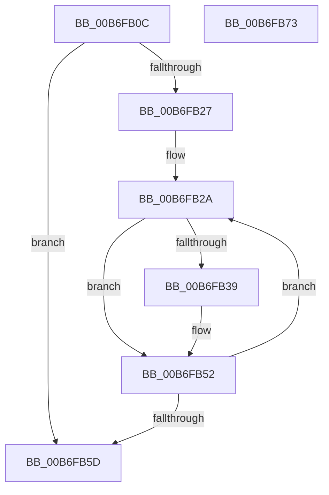

# PopSetBootPhaseRange

- RVA: `0x00B6FB0C`–`0x00B6FB74` (길이 `104` bytes)
- VA: `0x0000000140B6FB0C`
- 실행 섹션: `PAGELK`
- PDB 이름 있음: `예`; PDB Function 태그: `아니요`
- unwind 정보 RVA: `0x0005CAAC`
- 디코드: `35`개 명령, `104/104` bytes 표시
- 미해석 바이트: `0` (있으면 어셈블리에 `.byte`로 보존)

> 이 문서는 커널 이미지의 기계어와 PDB 기호를 분석해 생성했습니다. 4번과 5번은 함수 원형과 자료형을 바이너리 사용 방식에서 추정한 C 해석이며 원본 소스 복구 결과는 아닙니다.

## 1. Dependencies

- 직접 호출 지점: **1**; 고유 호출 대상: **1**
- 직접 호출자로 확인된 함수: **1**
- RIP 상대 이미지 참조: **0**

### Outgoing calls
- `0x00B6FB63` → [RtlSetBits](../../text/3E/RtlSetBits_function_003E1610.md) (function, `0x003E1610`)

### Direct callers
- [PopSetRange](../../text/47/PopSetRange_function_0047C750.md) at `0x0047C7CE`

### Static image references
- 디코드된 RIP-relative 메모리 참조가 없습니다.

## 2. Other-region calls and transfers

- 다른 실행 섹션으로 향하는 call: **1**
  - `0x00B6FB63` → [RtlSetBits](../../text/3E/RtlSetBits_function_003E1610.md) (`PAGELK` → `.text`)
- 별도 외부 분기/꼬리 이동을 확인하지 못했습니다.

## 3. Assembly (complete function range)

```asm
00B6FB0C  48 89 5C 24 08                  mov qword ptr [rsp + 8], rbx
00B6FB11  57                              push rdi
00B6FB12  48 83 EC 20                     sub rsp, 0x20
00B6FB16  44 8B CA                        mov r9d, edx
00B6FB19  48 8B DA                        mov rbx, rdx
00B6FB1C  4C 8B D9                        mov r11, rcx
00B6FB1F  43 8D 3C 08                     lea edi, [r8 + r9]
00B6FB23  3B D7                           cmp edx, edi
00B6FB25  73 36                           jae 0x140b6fb5d
00B6FB27  45 8B D1                        mov r10d, r9d
00B6FB2A  49 8B 43 38                     mov rax, qword ptr [r11 + 0x38]
00B6FB2E  4C 0F A3 10                     bt qword ptr [rax], r10
00B6FB32  0F 92 C0                        setb al
00B6FB35  84 C0                           test al, al
00B6FB37  75 19                           jne 0x140b6fb52
00B6FB39  49 8B D2                        mov rdx, r10
00B6FB3C  41 8B C1                        mov eax, r9d
00B6FB3F  48 C1 EA 03                     shr rdx, 3
00B6FB43  83 E0 07                        and eax, 7
00B6FB46  49 03 53 48                     add rdx, qword ptr [r11 + 0x48]
00B6FB4A  0F BE 0A                        movsx ecx, byte ptr [rdx]
00B6FB4D  0F B3 C1                        btr ecx, eax
00B6FB50  88 0A                           mov byte ptr [rdx], cl
00B6FB52  41 FF C1                        inc r9d
00B6FB55  49 FF C2                        inc r10
00B6FB58  44 3B CF                        cmp r9d, edi
00B6FB5B  72 CD                           jb 0x140b6fb2a
00B6FB5D  49 8D 4B 30                     lea rcx, [r11 + 0x30]
00B6FB61  8B D3                           mov edx, ebx
00B6FB63  E8 A8 1A 87 FF                  call 0x1403e1610
00B6FB68  48 8B 5C 24 30                  mov rbx, qword ptr [rsp + 0x30]
00B6FB6D  48 83 C4 20                     add rsp, 0x20
00B6FB71  5F                              pop rdi
00B6FB72  C3                              ret
00B6FB73  CC                              int3
```

## 4. C-style interpretation (structured pseudocode)

```c
__int64 __fastcall PopSetBootPhaseRange(__int64 a1, __int64 a2, __int64 a3)
{
    __int64 result;
    __int64 v_r10;
    __int64 v_rsp;
    unsigned __int64 v_stack_p8;

    v_stack_p8 = v_rbx;
    v_rsp = (v_rsp) - (32);
    if (((unsigned int)(a2)) >= ((unsigned int)(a3 + (unsigned int)((unsigned int)(a2)) * 1))) goto loc_00B6FB5D;
loc_00B6FB2A:
    result = (((unsigned int)(a2)) < ((unsigned int)(a3 + (unsigned int)((unsigned int)(a2)) * 1))) ? 1 : 0;
    if ((unsigned __int8)(result) == 0) {
        a2 = (unsigned int)((unsigned int)((unsigned int)((unsigned int)(a2))));
        result = (unsigned int)((unsigned int)((unsigned int)(a2)));
        a2 = (a2) >> (3);
        result = (unsigned int)((result) & (7));
        a2 = (a2) + (*(unsigned __int64 *)(a1 + 72));
        a1 = (__int8)(*(unsigned __int8 *)(a2));
        *(unsigned __int8 *)(a2) = (unsigned __int8)(a1);
    }
    a4 = (unsigned int)(((unsigned int)((unsigned int)(a2))) + 1);
    v_r10 = ((unsigned int)((unsigned int)((unsigned int)((unsigned int)(a2))))) + 1;
    if (((unsigned int)(a4)) < ((unsigned int)(a3 + (unsigned int)((unsigned int)(a2)) * 1))) goto loc_00B6FB2A;
loc_00B6FB5D:
    result = RtlSetBits(a1 + 48, (unsigned int)((unsigned int)(a2)), a3, a4);
    v_rsp = (v_rsp) + (32);
    return result;
}
```

## 5. (Beta) C Style

```c
int64_t PopSetBootPhaseRange(void *Arg1, int64_t Arg2, void *Arg3)
{
    uint8_t *arg1 = (uint8_t *)Arg1;
    uint8_t *arg3 = (uint8_t *)Arg3;

    int64_t result;
    int64_t local_r10;
    int64_t local_rsp;
    uint64_t v_stack_p8;

    v_stack_p8 = local_rbx;
    local_rsp = (local_rsp) - (32);
    if (((uint32_t)(Arg2)) >= ((uint32_t)(Arg3 + (uint32_t)((uint32_t)(Arg2)) * 1))) goto loc_00B6FB5D;
loc_00B6FB2A:
    result = (((uint32_t)(Arg2)) < ((uint32_t)(Arg3 + (uint32_t)((uint32_t)(Arg2)) * 1))) ? 1 : 0;
    if ((uint8_t)(result) == 0) {
        Arg2 = (uint32_t)((uint32_t)((uint32_t)((uint32_t)(Arg2))));
        result = (uint32_t)((uint32_t)((uint32_t)(Arg2)));
        Arg2 = (Arg2) >> (3);
        result = (uint32_t)((result) & (7));
        Arg2 = (Arg2) + (*(uint64_t *)(arg1 + 0x48));
        Arg1 = (int8_t)(*(uint8_t *)(Arg2));
        *(uint8_t *)(Arg2) = (uint8_t)(Arg1);
    }
    a4 = (uint32_t)(((uint32_t)((uint32_t)(Arg2))) + 1);
    local_r10 = ((uint32_t)((uint32_t)((uint32_t)((uint32_t)(Arg2))))) + 1;
    if (((uint32_t)(a4)) < ((uint32_t)(Arg3 + (uint32_t)((uint32_t)(Arg2)) * 1))) goto loc_00B6FB2A;
loc_00B6FB5D:
    result = RtlSetBits(Arg1 + 48, (uint32_t)((uint32_t)(Arg2)), Arg3, a4);
    local_rsp = (local_rsp) + (32);
    return result;
}
```

### 관측된 메모리 오프셋

구조체 형식이 확인되지 않은 접근은 인자 기준의 오프셋으로만 기록했습니다.

| 기준 인자 | 오프셋 표현 | 폭 (bit) | 접근 |
|---|---:|---:|---|
| `Arg1` | `+ 0x30` | `64` | `R` |
| `Arg1` | `+ 0x38` | `64` | `R` |
| `Arg1` | `+ 0x48` | `64` | `R` |
| `Arg3` | `+ 0x0 + r9*1` | `32` | `R` |

## 6. Execution-region graph

[열기: 2D/3D 그래프와 함수 탐색 컨트롤 패널](../../../control-panel.html?section=pagelk&rva=0x00B6FB0C&view=graph)

- 2D 그래프는 위에서 아래로 흐르고, 3D 그래프는 빈 공간을 드래그해 회전합니다. Shift+드래그는 이동, 휠은 확대·축소, 함수 노드 선택은 대상 보고서 이동입니다.

### Static fallback


