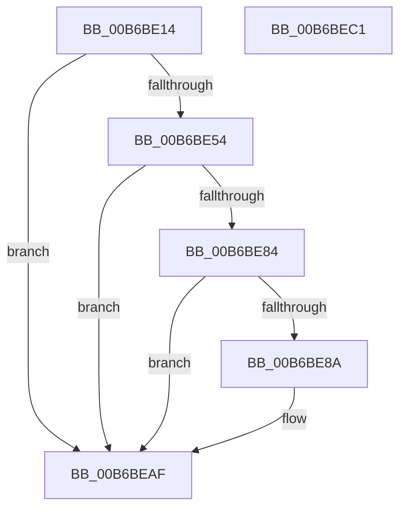

# PopSetMemoryOverwriteRequestAction

- RVA: `0x00B6BE14`–`0x00B6BEC2` (길이 `174` bytes)
- VA: `0x0000000140B6BE14`
- 실행 섹션: `PAGELK`
- PDB 이름 있음: `예`; PDB Function 태그: `아니요`
- unwind 정보 RVA: `0x000BDE20`
- 디코드: `41`개 명령, `174/174` bytes 표시
- 미해석 바이트: `0` (있으면 어셈블리에 `.byte`로 보존)

> 이 문서는 커널 이미지의 기계어와 PDB 기호를 분석해 생성했습니다. 4번과 5번은 함수 원형과 자료형을 바이너리 사용 방식에서 추정한 C 해석이며 원본 소스 복구 결과는 아닙니다.

## 1. Dependencies

- 직접 호출 지점: **3**; 고유 호출 대상: **3**
- 직접 호출자로 확인된 함수: **2**
- RIP 상대 이미지 참조: **3**

### Outgoing calls
- `0x00B6BE7B` → [HalGetEnvironmentVariableEx](../../text/44/HalGetEnvironmentVariableEx_function_00449100.md) (function, `0x00449100`)
- `0x00B6BEAA` → [HalSetEnvironmentVariableEx](../../text/44/HalSetEnvironmentVariableEx_function_00448EB0.md) (function, `0x00448EB0`)
- `0x00B6BEB6` → [_security_check_cookie](../../text/6A/_security_check_cookie_function_006AC640.md) (function, `0x006AC640`)

### Direct callers
- [PopSaveHiberContext](PopSaveHiberContext_function_00B6F050.md) at `0x00B6FA78`
- [PopShutdownSystem](../B7/PopShutdownSystem_function_00B71784.md) at `0x00B717A8`

### Static image references
- `0x00B6BE1D` → RVA `0x00E0A740` (`.data`; read)
- `0x00B6BE2F` → RVA `0x00F083F0` (`.data`; read)
- `0x00B6BE74` → RVA `0x00B7FCF0` (` ?? ::OKHAJAOM::`string'`; read)

## 2. Other-region calls and transfers

- 다른 실행 섹션으로 향하는 call: **3**
  - `0x00B6BE7B` → [HalGetEnvironmentVariableEx](../../text/44/HalGetEnvironmentVariableEx_function_00449100.md) (`PAGELK` → `.text`)
  - `0x00B6BEAA` → [HalSetEnvironmentVariableEx](../../text/44/HalSetEnvironmentVariableEx_function_00448EB0.md) (`PAGELK` → `.text`)
  - `0x00B6BEB6` → [_security_check_cookie](../../text/6A/_security_check_cookie_function_006AC640.md) (`PAGELK` → `.text`)
- 별도 외부 분기/꼬리 이동을 확인하지 못했습니다.

## 3. Assembly (complete function range)

```asm
00B6BE14  40 55                           push rbp
00B6BE16  48 8B EC                        mov rbp, rsp
00B6BE19  48 83 EC 60                     sub rsp, 0x60
00B6BE1D  48 8B 05 1C E9 29 00            mov rax, qword ptr [rip + 0x29e91c]
00B6BE24  48 33 C4                        xor rax, rsp
00B6BE27  48 89 45 F0                     mov qword ptr [rbp - 0x10], rax
00B6BE2B  83 65 D8 00                     and dword ptr [rbp - 0x28], 0
00B6BE2F  80 3D BA C5 39 00 00            cmp byte ptr [rip + 0x39c5ba], 0
00B6BE36  C7 45 E0 BE 39 09 E2            mov dword ptr [rbp - 0x20], 0xe20939be
00B6BE3D  C7 45 E4 D4 32 BE 41            mov dword ptr [rbp - 0x1c], 0x41be32d4
00B6BE44  C7 45 E8 A1 50 89 7F            mov dword ptr [rbp - 0x18], 0x7f8950a1
00B6BE4B  C7 45 EC 85 D4 98 29            mov dword ptr [rbp - 0x14], 0x2998d485
00B6BE52  75 5B                           jne 0x140b6beaf
00B6BE54  48 8D 45 D8                     lea rax, [rbp - 0x28]
00B6BE58  C6 45 D0 FF                     mov byte ptr [rbp - 0x30], 0xff
00B6BE5C  4C 8D 4D D4                     lea r9, [rbp - 0x2c]
00B6BE60  48 89 44 24 20                  mov qword ptr [rsp + 0x20], rax
00B6BE65  4C 8D 45 D0                     lea r8, [rbp - 0x30]
00B6BE69  C7 45 D4 01 00 00 00            mov dword ptr [rbp - 0x2c], 1
00B6BE70  48 8D 55 E0                     lea rdx, [rbp - 0x20]
00B6BE74  48 8D 0D 75 3E 01 00            lea rcx, [rip + 0x13e75]
00B6BE7B  E8 80 D2 8D FF                  call 0x140449100
00B6BE80  85 C0                           test eax, eax
00B6BE82  78 2B                           js 0x140b6beaf
00B6BE84  83 7D D4 01                     cmp dword ptr [rbp - 0x2c], 1
00B6BE88  75 25                           jne 0x140b6beaf
00B6BE8A  8B 45 D8                        mov eax, dword ptr [rbp - 0x28]
00B6BE8D  4C 8D 45 D0                     lea r8, [rbp - 0x30]
00B6BE91  80 65 D0 EE                     and byte ptr [rbp - 0x30], 0xee
00B6BE95  48 8D 55 E0                     lea rdx, [rbp - 0x20]
00B6BE99  41 B9 01 00 00 00               mov r9d, 1
00B6BE9F  89 44 24 20                     mov dword ptr [rsp + 0x20], eax
00B6BEA3  48 8D 0D 46 3E 01 00            lea rcx, [rip + 0x13e46]
00B6BEAA  E8 01 D0 8D FF                  call 0x140448eb0
00B6BEAF  48 8B 4D F0                     mov rcx, qword ptr [rbp - 0x10]
00B6BEB3  48 33 CC                        xor rcx, rsp
00B6BEB6  E8 85 07 B4 FF                  call 0x1406ac640
00B6BEBB  48 83 C4 60                     add rsp, 0x60
00B6BEBF  5D                              pop rbp
00B6BEC0  C3                              ret
00B6BEC1  CC                              int3
```

## 4. C-style interpretation (structured pseudocode)

```c
__int64 __fastcall PopSetMemoryOverwriteRequestAction(void)
{
    __int64 result;
    __int64 v_rsp;
    unsigned __int64 v_stack_m18;
    unsigned int v_stack_m1C;
    unsigned int v_stack_m20;
    unsigned int v_stack_m24;
    unsigned int v_stack_m28;
    unsigned int v_stack_m30;
    unsigned __int64 v_stack_m34;
    unsigned __int8 v_stack_m38;
    unsigned __int64 v_stack_m48;

    v_rsp = (v_rsp) - (96);
    result = (*(unsigned __int64 *)(v_rip + 2746652)) ^ (v_rsp);
    v_stack_m18 = result;
    v_stack_m28 = 0xE20939BEULL;
    v_stack_m24 = 0x41BE32D4ULL;
    v_stack_m20 = 0x7F8950A1ULL;
    v_stack_m1C = 0x2998D485ULL;
    if ((*(unsigned __int8 *)(v_rip + 3786170)) != 0) goto loc_00B6BEAF;
    v_stack_m38 = 255;
    v_stack_m48 = v_stack_m30;
    v_stack_m34 = 1;
    result = HalGetEnvironmentVariableEx(v_rip + 81525, v_stack_m28, v_stack_m38, v_stack_m34);
    if (sign_flag) goto loc_00B6BEAF;
    if (v_stack_m34 == 1) {
        result = v_stack_m30;
        a3 = v_stack_m38;
        a2 = v_stack_m28;
        a4 = 1;
        v_stack_m48 = (unsigned int)(result);
        a1 = v_rip + 81478;
        result = HalSetEnvironmentVariableEx(a1, a2, a3, a4);
    }
    a1 = (v_stack_m18) ^ (v_rsp);
    result = _security_check_cookie(a1, a2, a3, a4);
    v_rsp = (v_rsp) + (96);
    return result;
}
```

## 5. (Beta) C Style

```c
void PopSetMemoryOverwriteRequestAction(void)
{
    int64_t result;
    int64_t local_rsp;
    uint64_t v_stack_m18;
    uint32_t v_stack_m1C;
    uint32_t v_stack_m20;
    uint32_t v_stack_m24;
    uint32_t v_stack_m28;
    uint32_t v_stack_m30;
    uint64_t v_stack_m34;
    uint8_t v_stack_m38;
    uint64_t v_stack_m48;

    local_rsp = (local_rsp) - (96);
    result = (*(uint64_t *)(v_rip + 0x29E91C)) ^ (local_rsp);
    v_stack_m18 = result;
    v_stack_m28 = 0xE20939BEULL;
    v_stack_m24 = 0x41BE32D4ULL;
    v_stack_m20 = 0x7F8950A1ULL;
    v_stack_m1C = 0x2998D485ULL;
    if ((*(uint8_t *)(v_rip + 0x39C5BA)) != 0) goto loc_00B6BEAF;
    v_stack_m38 = 255;
    v_stack_m48 = v_stack_m30;
    v_stack_m34 = 1;
    result = HalGetEnvironmentVariableEx(v_rip + 81525, v_stack_m28, v_stack_m38, v_stack_m34);
    if (sign_flag) goto loc_00B6BEAF;
    if (v_stack_m34 == 1) {
        result = v_stack_m30;
        a3 = v_stack_m38;
        a2 = v_stack_m28;
        a4 = 1;
        v_stack_m48 = (uint32_t)(result);
        a1 = v_rip + 81478;
        result = HalSetEnvironmentVariableEx(a1, a2, a3, a4);
    }
    a1 = (v_stack_m18) ^ (local_rsp);
    result = _security_check_cookie(a1, a2, a3, a4);
    local_rsp = (local_rsp) + (96);
    return result;
}
```

## 6. Execution-region graph

[열기: 2D/3D 그래프와 함수 탐색 컨트롤 패널](../../../control-panel.html?section=pagelk&rva=0x00B6BE14&view=graph)

- 2D 그래프는 위에서 아래로 흐르고, 3D 그래프는 빈 공간을 드래그해 회전합니다. Shift+드래그는 이동, 휠은 확대·축소, 함수 노드 선택은 대상 보고서 이동입니다.

### Static fallback


