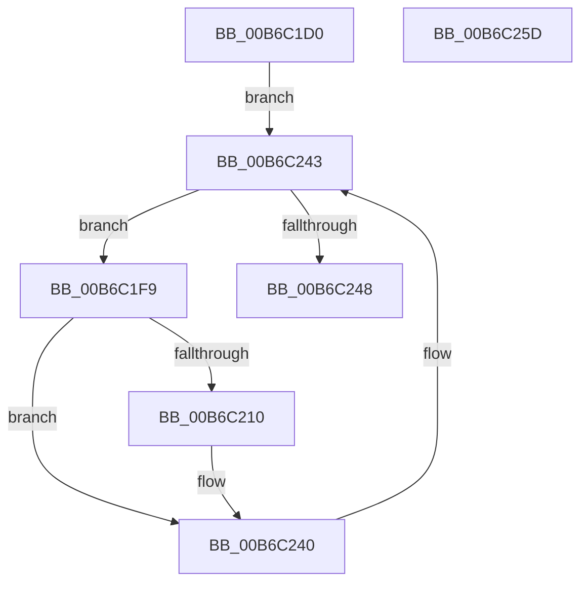

# PopSstInvokeNotificationHandlers

- RVA: `0x00B6C1D0`–`0x00B6C25E` (길이 `142` bytes)
- VA: `0x0000000140B6C1D0`
- 실행 섹션: `PAGELK`
- PDB 이름 있음: `예`; PDB Function 태그: `아니요`
- unwind 정보 RVA: `0x00066400`
- 디코드: `39`개 명령, `142/142` bytes 표시
- 미해석 바이트: `0` (있으면 어셈블리에 `.byte`로 보존)

> 이 문서는 커널 이미지의 기계어와 PDB 기호를 분석해 생성했습니다. 4번과 5번은 함수 원형과 자료형을 바이너리 사용 방식에서 추정한 C 해석이며 원본 소스 복구 결과는 아닙니다.

## 1. Dependencies

- 직접 호출 지점: **3**; 고유 호출 대상: **2**
- 직접 호출자로 확인된 함수: **3**
- RIP 상대 이미지 참조: **1**

### Outgoing calls
- `0x00B6C206` → [guard_dispatch_icall](../../text/6B/guard_dispatch_icall_function_006BAAD0.md) (function, `0x006BAAD0`)
- `0x00B6C223` → [PoSetHiberRange](../../text/47/PoSetHiberRange_function_0047C580.md) (function, `0x0047C580`)
- `0x00B6C23B` → [PoSetHiberRange](../../text/47/PoSetHiberRange_function_0047C580.md) (function, `0x0047C580`)

### Direct callers
- [PopHiberCheckResume](PopHiberCheckResume_function_00B6D840.md) at `0x00B6D969`
- [PopMarkComponentsBootPhase](PopMarkComponentsBootPhase_function_00B6E0E4.md) at `0x00B6E422`
- [PopSaveHiberContext](PopSaveHiberContext_function_00B6F050.md) at `0x00B6F48F`

### Static image references
- `0x00B6C1E4` → RVA `0x00F0DF30` (`.data`; read)

## 2. Other-region calls and transfers

- 다른 실행 섹션으로 향하는 call: **3**
  - `0x00B6C206` → [guard_dispatch_icall](../../text/6B/guard_dispatch_icall_function_006BAAD0.md) (`PAGELK` → `.text`)
  - `0x00B6C223` → [PoSetHiberRange](../../text/47/PoSetHiberRange_function_0047C580.md) (`PAGELK` → `.text`)
  - `0x00B6C23B` → [PoSetHiberRange](../../text/47/PoSetHiberRange_function_0047C580.md) (`PAGELK` → `.text`)
- 별도 외부 분기/꼬리 이동을 확인하지 못했습니다.

## 3. Assembly (complete function range)

```asm
00B6C1D0  48 89 5C 24 08                  mov qword ptr [rsp + 8], rbx
00B6C1D5  48 89 6C 24 10                  mov qword ptr [rsp + 0x10], rbp
00B6C1DA  48 89 74 24 18                  mov qword ptr [rsp + 0x18], rsi
00B6C1DF  57                              push rdi
00B6C1E0  48 83 EC 30                     sub rsp, 0x30
00B6C1E4  48 8B 1D 45 1D 3A 00            mov rbx, qword ptr [rip + 0x3a1d45]
00B6C1EB  48 8D 2D 3E 1D 3A 00            lea rbp, [rip + 0x3a1d3e]
00B6C1F2  48 8B F2                        mov rsi, rdx
00B6C1F5  8B F9                           mov edi, ecx
00B6C1F7  EB 4A                           jmp 0x140b6c243
00B6C1F9  48 8B 43 18                     mov rax, qword ptr [rbx + 0x18]
00B6C1FD  4C 8B C6                        mov r8, rsi
00B6C200  48 8B 4B 20                     mov rcx, qword ptr [rbx + 0x20]
00B6C204  8B D7                           mov edx, edi
00B6C206  E8 C5 E8 B4 FF                  call 0x1406baad0
00B6C20B  83 FF 01                        cmp edi, 1
00B6C20E  75 30                           jne 0x140b6c240
00B6C210  83 64 24 20 00                  and dword ptr [rsp + 0x20], 0
00B6C215  44 8D 4F 27                     lea r9d, [rdi + 0x27]
00B6C219  4C 8B C3                        mov r8, rbx
00B6C21C  BA 00 00 01 00                  mov edx, 0x10000
00B6C221  33 C9                           xor ecx, ecx
00B6C223  E8 58 03 91 FF                  call 0x14047c580
00B6C228  4C 8B 43 18                     mov r8, qword ptr [rbx + 0x18]
00B6C22C  45 33 C9                        xor r9d, r9d
00B6C22F  83 64 24 20 00                  and dword ptr [rsp + 0x20], 0
00B6C234  BA 00 00 01 00                  mov edx, 0x10000
00B6C239  33 C9                           xor ecx, ecx
00B6C23B  E8 40 03 91 FF                  call 0x14047c580
00B6C240  48 8B 1B                        mov rbx, qword ptr [rbx]
00B6C243  48 3B DD                        cmp rbx, rbp
00B6C246  75 B1                           jne 0x140b6c1f9
00B6C248  48 8B 5C 24 40                  mov rbx, qword ptr [rsp + 0x40]
00B6C24D  48 8B 6C 24 48                  mov rbp, qword ptr [rsp + 0x48]
00B6C252  48 8B 74 24 50                  mov rsi, qword ptr [rsp + 0x50]
00B6C257  48 83 C4 30                     add rsp, 0x30
00B6C25B  5F                              pop rdi
00B6C25C  C3                              ret
00B6C25D  CC                              int3
```

## 4. C-style interpretation (structured pseudocode)

```c
__int64 __fastcall PopSstInvokeNotificationHandlers(int a1, __int64 a2)
{
    __int64 result;
    __int64 v_rsp;
    unsigned int v_stack_m18;
    unsigned __int64 v_stack_p10;
    unsigned __int64 v_stack_p18;
    unsigned __int64 v_stack_p8;

    v_stack_p8 = v_rbx;
    v_stack_p10 = v_rbp;
    v_stack_p18 = v_rsi;
    v_rsp = (v_rsp) - (48);
    goto loc_00B6C243;
loc_00B6C1F9:
    result = guard_dispatch_icall(*(unsigned __int64 *)(*(unsigned __int64 *)(v_rip + 3808581) + 32), (unsigned int)((unsigned int)((unsigned int)(a1))), a2, a4);
    if (((unsigned int)((unsigned int)(a1))) == 1) {
        a4 = (unsigned int)(a1) + 39;
        a3 = *(unsigned __int64 *)(v_rip + 3808581);
        a2 = 0x10000ULL;
        a1 = 0;
        result = PoSetHiberRange(a1, a2, a3, a4);
        a3 = *(unsigned __int64 *)(*(unsigned __int64 *)(v_rip + 3808581) + 24);
        a4 = 0;
        a2 = 0x10000ULL;
        a1 = 0;
        result = PoSetHiberRange(a1, a2, a3, a4);
    }
loc_00B6C243:
    if ((*(unsigned __int64 *)(*(unsigned __int64 *)(v_rip + 3808581))) != (v_rip + 3808574)) goto loc_00B6C1F9;
    v_rsp = (v_rsp) + (48);
    return result;
}
```

## 5. (Beta) C Style

```c
int64_t PopSstInvokeNotificationHandlers(int32_t Arg1, int64_t Arg2)
{
    int64_t result;
    int64_t local_rsp;
    uint32_t v_stack_m18;
    uint64_t v_stack_p10;
    uint64_t v_stack_p18;
    uint64_t v_stack_p8;

    v_stack_p8 = local_rbx;
    v_stack_p10 = local_rbp;
    v_stack_p18 = local_rsi;
    local_rsp = (local_rsp) - (48);
    goto loc_00B6C243;
loc_00B6C1F9:
    result = guard_dispatch_icall(*(uint64_t *)(*(uint64_t *)(v_rip + 0x3A1D45) + 0x20), (uint32_t)((uint32_t)((uint32_t)(Arg1))), Arg2, a4);
    if (((uint32_t)((uint32_t)(Arg1))) == 1) {
        a4 = (uint32_t)(Arg1) + 39;
        a3 = *(uint64_t *)(v_rip + 0x3A1D45);
        Arg2 = 0x10000ULL;
        Arg1 = 0;
        result = PoSetHiberRange(Arg1, Arg2, a3, a4);
        a3 = *(uint64_t *)(*(uint64_t *)(v_rip + 0x3A1D45) + 0x18);
        a4 = 0;
        Arg2 = 0x10000ULL;
        Arg1 = 0;
        result = PoSetHiberRange(Arg1, Arg2, a3, a4);
    }
loc_00B6C243:
    if ((*(uint64_t *)(*(uint64_t *)(v_rip + 0x3A1D45))) != (v_rip + 3808574)) goto loc_00B6C1F9;
    local_rsp = (local_rsp) + (48);
    return result;
}
```

## 6. Execution-region graph

[열기: 2D/3D 그래프와 함수 탐색 컨트롤 패널](../../../control-panel.html?section=pagelk&rva=0x00B6C1D0&view=graph)

- 2D 그래프는 위에서 아래로 흐르고, 3D 그래프는 빈 공간을 드래그해 회전합니다. Shift+드래그는 이동, 휠은 확대·축소, 함수 노드 선택은 대상 보고서 이동입니다.

### Static fallback


