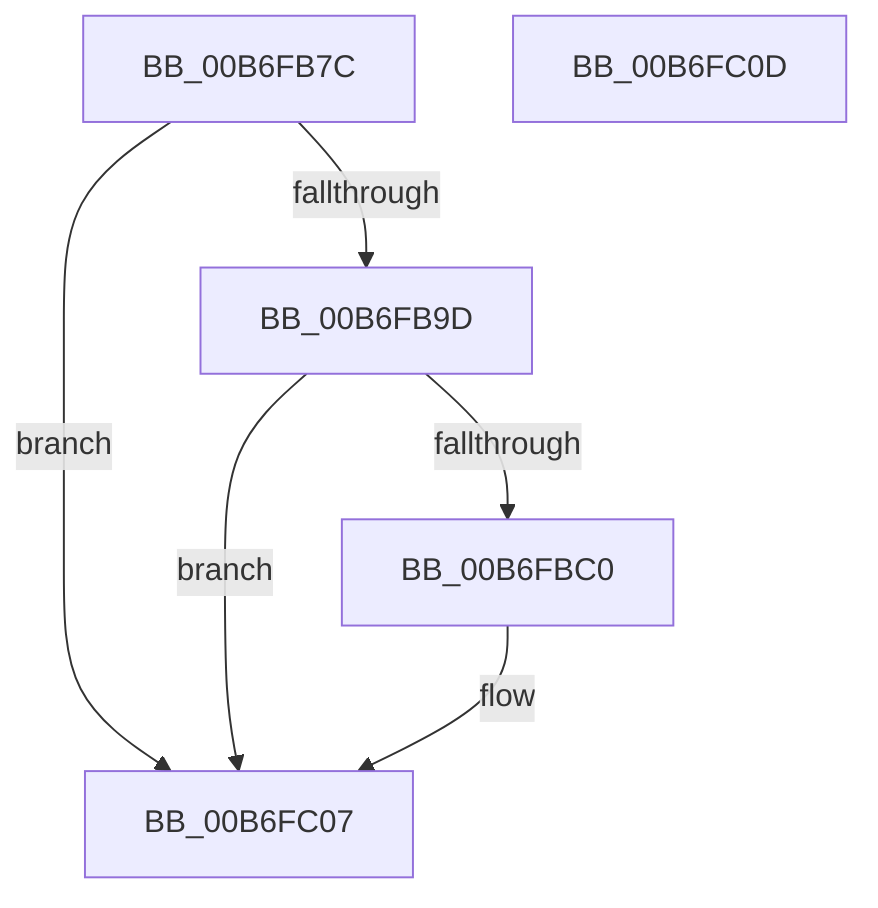

# PopWriteChecksumPages

- RVA: `0x00B6FB7C`–`0x00B6FC0E` (길이 `146` bytes)
- VA: `0x0000000140B6FB7C`
- 실행 섹션: `PAGELK`
- PDB 이름 있음: `예`; PDB Function 태그: `아니요`
- unwind 정보 RVA: `0x0005CF00`
- 디코드: `35`개 명령, `146/146` bytes 표시
- 미해석 바이트: `0` (있으면 어셈블리에 `.byte`로 보존)

> 이 문서는 커널 이미지의 기계어와 PDB 기호를 분석해 생성했습니다. 4번과 5번은 함수 원형과 자료형을 바이너리 사용 방식에서 추정한 C 해석이며 원본 소스 복구 결과는 아닙니다.

## 1. Dependencies

- 직접 호출 지점: **1**; 고유 호출 대상: **1**
- 직접 호출자로 확인된 함수: **1**
- RIP 상대 이미지 참조: **2**

### Outgoing calls
- `0x00B6FBEF` → [PopWriteHiberPages](PopWriteHiberPages_function_00B6FF78.md) (function, `0x00B6FF78`)

### Direct callers
- [PopSaveHiberContext](PopSaveHiberContext_function_00B6F050.md) at `0x00B6F9BE`

### Static image references
- `0x00B6FBB7` → RVA `0x00F0BF30` (`.data`; read)
- `0x00B6FC00` → RVA `0x00F0C3B8` (`.data`; read/write)

## 2. Other-region calls and transfers

- 다른 실행 섹션으로 향하는 call: **0**
- 별도 외부 분기/꼬리 이동을 확인하지 못했습니다.

## 3. Assembly (complete function range)

```asm
00B6FB7C  40 53                           push rbx
00B6FB7E  48 83 EC 20                     sub rsp, 0x20
00B6FB82  4C 8B 99 C0 01 00 00            mov r11, qword ptr [rcx + 0x1c0]
00B6FB89  4C 8B D1                        mov r10, rcx
00B6FB8C  4E 8D 04 5D FF 0F 00 00         lea r8, [r11*2 + 0xfff]
00B6FB94  49 C1 E8 0C                     shr r8, 0xc
00B6FB98  4D 85 C0                        test r8, r8
00B6FB9B  74 6A                           je 0x140b6fc07
00B6FB9D  4C 8B 89 98 01 00 00            mov r9, qword ptr [rcx + 0x198]
00B6FBA4  49 81 C1 FF 0F 00 00            add r9, 0xfff
00B6FBAB  49 C1 E9 0C                     shr r9, 0xc
00B6FBAF  4B 8D 04 01                     lea rax, [r9 + r8]
00B6FBB3  48 C1 E0 0C                     shl rax, 0xc
00B6FBB7  48 3B 05 72 C3 39 00            cmp rax, qword ptr [rip + 0x39c372]
00B6FBBE  77 47                           ja 0x140b6fc07
00B6FBC0  0F 31                           rdtsc
00B6FBC2  48 8B 89 D8 00 00 00            mov rcx, qword ptr [rcx + 0xd8]
00B6FBC9  48 C1 E2 20                     shl rdx, 0x20
00B6FBCD  48 0B C2                        or rax, rdx
00B6FBD0  48 8B D8                        mov rbx, rax
00B6FBD3  4C 89 99 80 00 00 00            mov qword ptr [rcx + 0x80], r11
00B6FBDA  49 8B 8A D8 00 00 00            mov rcx, qword ptr [r10 + 0xd8]
00B6FBE1  4C 89 49 78                     mov qword ptr [rcx + 0x78], r9
00B6FBE5  49 8B CA                        mov rcx, r10
00B6FBE8  49 8B 92 D0 01 00 00            mov rdx, qword ptr [r10 + 0x1d0]
00B6FBEF  E8 84 03 00 00                  call 0x140b6ff78
00B6FBF4  0F 31                           rdtsc
00B6FBF6  48 C1 E2 20                     shl rdx, 0x20
00B6FBFA  48 0B C2                        or rax, rdx
00B6FBFD  48 2B C3                        sub rax, rbx
00B6FC00  48 01 05 B1 C7 39 00            add qword ptr [rip + 0x39c7b1], rax
00B6FC07  48 83 C4 20                     add rsp, 0x20
00B6FC0B  5B                              pop rbx
00B6FC0C  C3                              ret
00B6FC0D  CC                              int3
```

## 4. C-style interpretation (structured pseudocode)

```c
__int64 __fastcall PopWriteChecksumPages(__int64 a1, __int64 a2)
{
    __int64 result;
    __int64 v_rbx;
    __int64 v_rsp;

    v_rsp = (v_rsp) - (32);
    a3 = (*(unsigned __int64 *)(a1 + 448) * 2 + 4095) >> (12);
    if (a3 == 0) goto loc_00B6FC07;
    a4 = (*(unsigned __int64 *)(a1 + 408)) + (0xFFFULL);
    a4 = (a4) >> (12);
    result = (a4 + a3 * 1) << (12);
    if (result <= (*(unsigned __int64 *)(v_rip + 3785586))) {
        a1 = *(unsigned __int64 *)(a1 + 216);
        a2 = (a2) << (32);
        result = (result) | (a2);
        v_rbx = result;
        *(unsigned __int64 *)(a1 + 128) = *(unsigned __int64 *)(a1 + 448);
        a1 = *(unsigned __int64 *)(a1 + 216);
        *(unsigned __int64 *)(a1 + 120) = a4;
        a1 = a1;
        a2 = *(unsigned __int64 *)(a1 + 464);
        result = PopWriteHiberPages(a1, a2, a3, a4);
        a2 = (a2) << (32);
        result = (result) | (a2);
        result = (result) - (v_rbx);
    }
    v_rsp = (v_rsp) + (32);
    return result;
}
```

## 5. (Beta) C Style

```c
int64_t PopWriteChecksumPages(void *Arg1, int64_t Arg2)
{
    uint8_t *arg1 = (uint8_t *)Arg1;

    int64_t result;
    int64_t local_rbx;
    int64_t local_rsp;

    local_rsp = (local_rsp) - (32);
    a3 = (*(uint64_t *)(arg1 + 0x1C0) * 2 + 4095) >> (12);
    if (a3 == 0) goto loc_00B6FC07;
    a4 = (*(uint64_t *)(arg1 + 0x198)) + (0xFFFULL);
    a4 = (a4) >> (12);
    result = (a4 + a3 * 1) << (12);
    if (result <= (*(uint64_t *)(v_rip + 0x39C372))) {
        Arg1 = *(uint64_t *)(arg1 + 0xD8);
        Arg2 = (Arg2) << (32);
        result = (result) | (Arg2);
        local_rbx = result;
        *(uint64_t *)(arg1 + 0x80) = *(uint64_t *)(arg1 + 0x1C0);
        Arg1 = *(uint64_t *)(arg1 + 0xD8);
        *(uint64_t *)(arg1 + 0x78) = a4;
        Arg1 = Arg1;
        Arg2 = *(uint64_t *)(arg1 + 0x1D0);
        result = PopWriteHiberPages(Arg1, Arg2, a3, a4);
        Arg2 = (Arg2) << (32);
        result = (result) | (Arg2);
        result = (result) - (local_rbx);
    }
    local_rsp = (local_rsp) + (32);
    return result;
}
```

### 관측된 메모리 오프셋

구조체 형식이 확인되지 않은 접근은 인자 기준의 오프셋으로만 기록했습니다.

| 기준 인자 | 오프셋 표현 | 폭 (bit) | 접근 |
|---|---:|---:|---|
| `Arg1` | `+ 0xD8` | `64` | `R` |
| `Arg1` | `+ 0x198` | `64` | `R` |
| `Arg1` | `+ 0x1C0` | `64` | `R` |
| `Arg1` | `+ 0x1D0` | `64` | `R` |

## 6. Execution-region graph

[열기: 2D/3D 그래프와 함수 탐색 컨트롤 패널](../../../control-panel.html?section=pagelk&rva=0x00B6FB7C&view=graph)

- 2D 그래프는 위에서 아래로 흐르고, 3D 그래프는 빈 공간을 드래그해 회전합니다. Shift+드래그는 이동, 휠은 확대·축소, 함수 노드 선택은 대상 보고서 이동입니다.

### Static fallback


