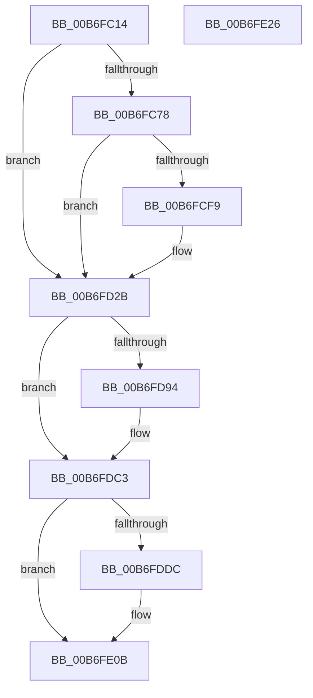

# PopWriteHeaderPages

- RVA: `0x00B6FC14`–`0x00B6FE27` (길이 `531` bytes)
- VA: `0x0000000140B6FC14`
- 실행 섹션: `PAGELK`
- PDB 이름 있음: `예`; PDB Function 태그: `아니요`
- unwind 정보 RVA: `0x00084C9C`
- 디코드: `131`개 명령, `531/531` bytes 표시
- 미해석 바이트: `0` (있으면 어셈블리에 `.byte`로 보존)

> 이 문서는 커널 이미지의 기계어와 PDB 기호를 분석해 생성했습니다. 4번과 5번은 함수 원형과 자료형을 바이너리 사용 방식에서 추정한 C 해석이며 원본 소스 복구 결과는 아닙니다.

## 1. Dependencies

- 직접 호출 지점: **17**; 고유 호출 대상: **6**
- 직접 호출자로 확인된 함수: **1**
- RIP 상대 이미지 참조: **4**

### Outgoing calls
- `0x00B6FC8B` → [memset](../../text/6C/memset_function_006C6C40.md) (function, `0x006C6C40`)
- `0x00B6FCA8` → [memcpy](../../text/6C/memcpy_function_006C6840.md) (function, `0x006C6840`)
- `0x00B6FCB5` → [tcpxsum](../../text/6B/tcpxsum_function_006BA210.md) (function, `0x006BA210`)
- `0x00B6FCDB` → [PopWriteHiberPages](PopWriteHiberPages_function_00B6FF78.md) (function, `0x00B6FF78`)
- `0x00B6FCE8` → [tcpxsum](../../text/6B/tcpxsum_function_006BA210.md) (function, `0x006BA210`)
- `0x00B6FD03` → [DbgPrint](../../text/35/DbgPrint_function_00358CB0.md) (function, `0x00358CB0`)
- `0x00B6FD25` → [KeBugCheckEx](../../text/4F/KeBugCheckEx_function_004FD660.md) (function, `0x004FD660`)
- `0x00B6FD3E` → [memset](../../text/6C/memset_function_006C6C40.md) (function, `0x006C6C40`)
- `0x00B6FD55` → [memcpy](../../text/6C/memcpy_function_006C6840.md) (function, `0x006C6840`)
- `0x00B6FD62` → [tcpxsum](../../text/6B/tcpxsum_function_006BA210.md) (function, `0x006BA210`)
- `0x00B6FD79` → [PopWriteHiberPages](PopWriteHiberPages_function_00B6FF78.md) (function, `0x00B6FF78`)
- `0x00B6FD86` → [tcpxsum](../../text/6B/tcpxsum_function_006BA210.md) (function, `0x006BA210`)
- `0x00B6FD9E` → [DbgPrint](../../text/35/DbgPrint_function_00358CB0.md) (function, `0x00358CB0`)
- `0x00B6FDBD` → [KeBugCheckEx](../../text/4F/KeBugCheckEx_function_004FD660.md) (function, `0x004FD660`)
- `0x00B6FDCE` → [tcpxsum](../../text/6B/tcpxsum_function_006BA210.md) (function, `0x006BA210`)
- `0x00B6FDE6` → [DbgPrint](../../text/35/DbgPrint_function_00358CB0.md) (function, `0x00358CB0`)
- `0x00B6FE05` → [KeBugCheckEx](../../text/4F/KeBugCheckEx_function_004FD660.md) (function, `0x004FD660`)

### Direct callers
- [PopSaveHiberContext](PopSaveHiberContext_function_00B6F050.md) at `0x00B6F650`

### Static image references
- `0x00B6FC39` → RVA `0x00F0DE81` (`.data`; read)
- `0x00B6FCFC` → RVA `0x00B7FDF0` (` ?? ::OKHAJAOM::`string'`; read)
- `0x00B6FD97` → RVA `0x00B7FE30` (` ?? ::OKHAJAOM::`string'`; read)
- `0x00B6FDDF` → RVA `0x00B7FE70` (` ?? ::OKHAJAOM::`string'`; read)

## 2. Other-region calls and transfers

- 다른 실행 섹션으로 향하는 call: **15**
  - `0x00B6FC8B` → [memset](../../text/6C/memset_function_006C6C40.md) (`PAGELK` → `.text`)
  - `0x00B6FCA8` → [memcpy](../../text/6C/memcpy_function_006C6840.md) (`PAGELK` → `.text`)
  - `0x00B6FCB5` → [tcpxsum](../../text/6B/tcpxsum_function_006BA210.md) (`PAGELK` → `.text`)
  - `0x00B6FCE8` → [tcpxsum](../../text/6B/tcpxsum_function_006BA210.md) (`PAGELK` → `.text`)
  - `0x00B6FD03` → [DbgPrint](../../text/35/DbgPrint_function_00358CB0.md) (`PAGELK` → `.text`)
  - `0x00B6FD25` → [KeBugCheckEx](../../text/4F/KeBugCheckEx_function_004FD660.md) (`PAGELK` → `.text`)
  - `0x00B6FD3E` → [memset](../../text/6C/memset_function_006C6C40.md) (`PAGELK` → `.text`)
  - `0x00B6FD55` → [memcpy](../../text/6C/memcpy_function_006C6840.md) (`PAGELK` → `.text`)
  - `0x00B6FD62` → [tcpxsum](../../text/6B/tcpxsum_function_006BA210.md) (`PAGELK` → `.text`)
  - `0x00B6FD86` → [tcpxsum](../../text/6B/tcpxsum_function_006BA210.md) (`PAGELK` → `.text`)
  - `0x00B6FD9E` → [DbgPrint](../../text/35/DbgPrint_function_00358CB0.md) (`PAGELK` → `.text`)
  - `0x00B6FDBD` → [KeBugCheckEx](../../text/4F/KeBugCheckEx_function_004FD660.md) (`PAGELK` → `.text`)
  - `0x00B6FDCE` → [tcpxsum](../../text/6B/tcpxsum_function_006BA210.md) (`PAGELK` → `.text`)
  - `0x00B6FDE6` → [DbgPrint](../../text/35/DbgPrint_function_00358CB0.md) (`PAGELK` → `.text`)
  - `0x00B6FE05` → [KeBugCheckEx](../../text/4F/KeBugCheckEx_function_004FD660.md) (`PAGELK` → `.text`)
- 별도 외부 분기/꼬리 이동을 확인하지 못했습니다.

## 3. Assembly (complete function range)

```asm
00B6FC14  48 89 5C 24 08                  mov qword ptr [rsp + 8], rbx
00B6FC19  48 89 6C 24 10                  mov qword ptr [rsp + 0x10], rbp
00B6FC1E  48 89 74 24 18                  mov qword ptr [rsp + 0x18], rsi
00B6FC23  57                              push rdi
00B6FC24  41 56                           push r14
00B6FC26  41 57                           push r15
00B6FC28  48 83 EC 30                     sub rsp, 0x30
00B6FC2C  8B 82 7C 04 00 00               mov eax, dword ptr [rdx + 0x47c]
00B6FC32  4C 8D B1 C8 00 00 00            lea r14, [rcx + 0xc8]
00B6FC39  44 0F B6 05 40 E2 39 00         movzx r8d, byte ptr [rip + 0x39e240]
00B6FC41  4C 8D B9 A8 00 00 00            lea r15, [rcx + 0xa8]
00B6FC48  48 8B A9 A0 00 00 00            mov rbp, qword ptr [rcx + 0xa0]
00B6FC4F  48 8B FA                        mov rdi, rdx
00B6FC52  41 C1 E0 04                     shl r8d, 4
00B6FC56  48 8B F1                        mov rsi, rcx
00B6FC59  44 33 C0                        xor r8d, eax
00B6FC5C  41 83 E0 10                     and r8d, 0x10
00B6FC60  44 33 C0                        xor r8d, eax
00B6FC63  44 89 82 7C 04 00 00            mov dword ptr [rdx + 0x47c], r8d
00B6FC6A  48 83 B9 10 01 00 00 00         cmp qword ptr [rcx + 0x110], 0
00B6FC72  0F 84 B3 00 00 00               je 0x140b6fd2b
00B6FC78  45 8B 07                        mov r8d, dword ptr [r15]
00B6FC7B  33 D2                           xor edx, edx
00B6FC7D  49 C1 E0 0C                     shl r8, 0xc
00B6FC81  48 8B CD                        mov rcx, rbp
00B6FC84  41 C7 06 01 00 00 00            mov dword ptr [r14], 1
00B6FC8B  E8 B0 6F B5 FF                  call 0x1406c6c40
00B6FC90  8B 86 18 01 00 00               mov eax, dword ptr [rsi + 0x118]
00B6FC96  48 8B CD                        mov rcx, rbp
00B6FC99  48 8B 96 10 01 00 00            mov rdx, qword ptr [rsi + 0x110]
00B6FCA0  C1 E0 0C                        shl eax, 0xc
00B6FCA3  44 8B C0                        mov r8d, eax
00B6FCA6  8B D8                           mov ebx, eax
00B6FCA8  E8 93 6B B5 FF                  call 0x1406c6840
00B6FCAD  44 8B C3                        mov r8d, ebx
00B6FCB0  48 8B D5                        mov rdx, rbp
00B6FCB3  33 C9                           xor ecx, ecx
00B6FCB5  E8 56 A5 B4 FF                  call 0x1406ba210
00B6FCBA  89 87 74 04 00 00               mov dword ptr [rdi + 0x474], eax
00B6FCC0  41 B9 02 00 00 00               mov r9d, 2
00B6FCC6  8B 86 18 01 00 00               mov eax, dword ptr [rsi + 0x118]
00B6FCCC  48 8B D5                        mov rdx, rbp
00B6FCCF  44 8B C0                        mov r8d, eax
00B6FCD2  89 87 78 04 00 00               mov dword ptr [rdi + 0x478], eax
00B6FCD8  48 8B CE                        mov rcx, rsi
00B6FCDB  E8 98 02 00 00                  call 0x140b6ff78
00B6FCE0  44 8B C3                        mov r8d, ebx
00B6FCE3  48 8B D5                        mov rdx, rbp
00B6FCE6  33 C9                           xor ecx, ecx
00B6FCE8  E8 23 A5 B4 FF                  call 0x1406ba210
00B6FCED  8B 97 74 04 00 00               mov edx, dword ptr [rdi + 0x474]
00B6FCF3  8B D8                           mov ebx, eax
00B6FCF5  3B D0                           cmp edx, eax
00B6FCF7  74 32                           je 0x140b6fd2b
00B6FCF9  44 8B C3                        mov r8d, ebx
00B6FCFC  48 8D 0D ED 00 01 00            lea rcx, [rip + 0x100ed]
00B6FD03  E8 A8 8F 7E FF                  call 0x140358cb0
00B6FD08  44 8B 87 74 04 00 00            mov r8d, dword ptr [rdi + 0x474]
00B6FD0F  44 8B CB                        mov r9d, ebx
00B6FD12  BA 03 00 00 00                  mov edx, 3
00B6FD17  48 C7 44 24 20 D8 22 00 00      mov qword ptr [rsp + 0x20], 0x22d8
00B6FD20  B9 A0 00 00 00                  mov ecx, 0xa0
00B6FD25  E8 36 D9 98 FF                  call 0x1404fd660
00B6FD2A  CC                              int3
00B6FD2B  45 8B 07                        mov r8d, dword ptr [r15]
00B6FD2E  33 D2                           xor edx, edx
00B6FD30  49 C1 E0 0C                     shl r8, 0xc
00B6FD34  48 8B CD                        mov rcx, rbp
00B6FD37  41 C7 06 02 00 00 00            mov dword ptr [r14], 2
00B6FD3E  E8 FD 6E B5 FF                  call 0x1406c6c40
00B6FD43  48 8B 96 C0 00 00 00            mov rdx, qword ptr [rsi + 0xc0]
00B6FD4A  BB C0 05 00 00                  mov ebx, 0x5c0
00B6FD4F  44 8B C3                        mov r8d, ebx
00B6FD52  48 8B CD                        mov rcx, rbp
00B6FD55  E8 E6 6A B5 FF                  call 0x1406c6840
00B6FD5A  44 8B C3                        mov r8d, ebx
00B6FD5D  48 8B D5                        mov rdx, rbp
00B6FD60  33 C9                           xor ecx, ecx
00B6FD62  E8 A9 A4 B4 FF                  call 0x1406ba210
00B6FD67  41 B9 01 00 00 00               mov r9d, 1
00B6FD6D  89 47 50                        mov dword ptr [rdi + 0x50], eax
00B6FD70  45 8B C1                        mov r8d, r9d
00B6FD73  48 8B D5                        mov rdx, rbp
00B6FD76  48 8B CE                        mov rcx, rsi
00B6FD79  E8 FA 01 00 00                  call 0x140b6ff78
00B6FD7E  44 8B C3                        mov r8d, ebx
00B6FD81  48 8B D5                        mov rdx, rbp
00B6FD84  33 C9                           xor ecx, ecx
00B6FD86  E8 85 A4 B4 FF                  call 0x1406ba210
00B6FD8B  8B 57 50                        mov edx, dword ptr [rdi + 0x50]
00B6FD8E  8B D8                           mov ebx, eax
00B6FD90  3B D0                           cmp edx, eax
00B6FD92  74 2F                           je 0x140b6fdc3
00B6FD94  44 8B C3                        mov r8d, ebx
00B6FD97  48 8D 0D 92 00 01 00            lea rcx, [rip + 0x10092]
00B6FD9E  E8 0D 8F 7E FF                  call 0x140358cb0
00B6FDA3  44 8B 47 50                     mov r8d, dword ptr [rdi + 0x50]
00B6FDA7  44 8B CB                        mov r9d, ebx
00B6FDAA  BA 03 00 00 00                  mov edx, 3
00B6FDAF  48 C7 44 24 20 EE 22 00 00      mov qword ptr [rsp + 0x20], 0x22ee
00B6FDB8  B9 A0 00 00 00                  mov ecx, 0xa0
00B6FDBD  E8 9E D8 98 FF                  call 0x1404fd660
00B6FDC2  CC                              int3
00B6FDC3  41 B8 00 10 00 00               mov r8d, 0x1000
00B6FDC9  48 8B D5                        mov rdx, rbp
00B6FDCC  33 C9                           xor ecx, ecx
00B6FDCE  E8 3D A4 B4 FF                  call 0x1406ba210
00B6FDD3  8B 57 50                        mov edx, dword ptr [rdi + 0x50]
00B6FDD6  8B D8                           mov ebx, eax
00B6FDD8  3B D0                           cmp edx, eax
00B6FDDA  74 2F                           je 0x140b6fe0b
00B6FDDC  44 8B C3                        mov r8d, ebx
00B6FDDF  48 8D 0D 8A 00 01 00            lea rcx, [rip + 0x1008a]
00B6FDE6  E8 C5 8E 7E FF                  call 0x140358cb0
00B6FDEB  44 8B 47 50                     mov r8d, dword ptr [rdi + 0x50]
00B6FDEF  44 8B CB                        mov r9d, ebx
00B6FDF2  BA 04 00 00 00                  mov edx, 4
00B6FDF7  48 C7 44 24 20 F5 22 00 00      mov qword ptr [rsp + 0x20], 0x22f5
00B6FE00  B9 A0 00 00 00                  mov ecx, 0xa0
00B6FE05  E8 56 D8 98 FF                  call 0x1404fd660
00B6FE0A  CC                              int3
00B6FE0B  48 8B 5C 24 50                  mov rbx, qword ptr [rsp + 0x50]
00B6FE10  33 C0                           xor eax, eax
00B6FE12  48 8B 6C 24 58                  mov rbp, qword ptr [rsp + 0x58]
00B6FE17  48 8B 74 24 60                  mov rsi, qword ptr [rsp + 0x60]
00B6FE1C  48 83 C4 30                     add rsp, 0x30
00B6FE20  41 5F                           pop r15
00B6FE22  41 5E                           pop r14
00B6FE24  5F                              pop rdi
00B6FE25  C3                              ret
00B6FE26  CC                              int3
```

## 4. C-style interpretation (structured pseudocode)

```c
__int64 __fastcall PopWriteHeaderPages(__int64 a1, __int64 a2)
{
    __int64 result;
    __int64 v_rsp;
    unsigned __int64 v_stack_m28;
    unsigned __int64 v_stack_p10;
    unsigned __int64 v_stack_p18;
    unsigned __int64 v_stack_p8;

    v_stack_p8 = v_rbx;
    v_stack_p10 = v_rbp;
    v_stack_p18 = v_rsi;
    v_rsp = (v_rsp) - (48);
    a3 = (unsigned int)((*(unsigned __int8 *)(v_rip + 3793472)) << (4));
    a3 = (unsigned int)((a3) ^ ((unsigned int)((unsigned int)(*(unsigned int *)(a2 + 1148)))));
    a3 = (unsigned int)((a3) & (16));
    a3 = (unsigned int)((a3) ^ ((unsigned int)((unsigned int)(*(unsigned int *)(a2 + 1148)))));
    *(unsigned int *)(a2 + 1148) = (unsigned int)(a3);
    if ((*(unsigned __int64 *)(a1 + 272)) == 0) goto loc_00B6FD2B;
    a2 = 0;
    a3 = ((unsigned int)(*(unsigned int *)(a1 + 168))) << (12);
    *(unsigned int *)(a1 + 200) = 1;
    result = memset(*(unsigned __int64 *)(a1 + 160), a2, a3, a4);
    result = (unsigned int)(((unsigned int)(*(unsigned int *)(a1 + 280))) << (12));
    result = memcpy(*(unsigned __int64 *)(a1 + 160), *(unsigned __int64 *)(a1 + 272), (unsigned int)((unsigned int)(result)), a4);
    a1 = 0;
    result = tcpxsum(a1, *(unsigned __int64 *)(a1 + 160), (unsigned int)((unsigned int)((unsigned int)((unsigned int)(result)))), a4);
    *(unsigned int *)(a2 + 1140) = (unsigned int)(result);
    *(unsigned int *)(a2 + 1144) = (unsigned int)((unsigned int)(*(unsigned int *)(a1 + 280)));
    result = PopWriteHiberPages(0, *(unsigned __int64 *)(a1 + 160), (unsigned int)((unsigned int)((unsigned int)(*(unsigned int *)(a1 + 280)))), 2);
    a1 = 0;
    result = tcpxsum(a1, *(unsigned __int64 *)(a1 + 160), (unsigned int)((unsigned int)((unsigned int)((unsigned int)(result)))), 2);
    if (((unsigned int)((unsigned int)(*(unsigned int *)(a2 + 1140)))) != ((unsigned int)(result))) {
        a3 = (unsigned int)((unsigned int)((unsigned int)(result)));
        a1 = v_rip + 65773;
        result = DbgPrint(a1, (unsigned int)(*(unsigned int *)(a2 + 1140)), a3, 2);
        a3 = *(unsigned int *)(a2 + 1140);
        a4 = (unsigned int)((unsigned int)((unsigned int)(result)));
        a2 = 3;
        v_stack_m28 = 0x22D8ULL;
        a1 = 160;
        result = KeBugCheckEx(a1, a2, a3, a4);
    }
    a2 = 0;
    a3 = ((unsigned int)(*(unsigned int *)(a1 + 168))) << (12);
    *(unsigned int *)(a1 + 200) = 2;
    result = memset(*(unsigned __int64 *)(a1 + 160), a2, a3, a4);
    result = memcpy(*(unsigned __int64 *)(a1 + 160), *(unsigned __int64 *)(a1 + 192), (unsigned int)((unsigned int)((unsigned int)(0x5C0ULL))), a4);
    a1 = 0;
    result = tcpxsum(a1, *(unsigned __int64 *)(a1 + 160), (unsigned int)((unsigned int)((unsigned int)(0x5C0ULL))), a4);
    *(unsigned int *)(a2 + 80) = (unsigned int)(result);
    result = PopWriteHiberPages(0, *(unsigned __int64 *)(a1 + 160), 1, 1);
    a1 = 0;
    result = tcpxsum(a1, *(unsigned __int64 *)(a1 + 160), (unsigned int)((unsigned int)((unsigned int)(0x5C0ULL))), 1);
    if (((unsigned int)((unsigned int)(*(unsigned int *)(a2 + 80)))) != ((unsigned int)(result))) {
        a3 = (unsigned int)((unsigned int)((unsigned int)(result)));
        a1 = v_rip + 65682;
        result = DbgPrint(a1, (unsigned int)(*(unsigned int *)(a2 + 80)), a3, 1);
        a3 = *(unsigned int *)(a2 + 80);
        a4 = (unsigned int)((unsigned int)((unsigned int)(result)));
        a2 = 3;
        v_stack_m28 = 0x22EEULL;
        a1 = 160;
        result = KeBugCheckEx(a1, a2, a3, a4);
    }
    a1 = 0;
    result = tcpxsum(a1, *(unsigned __int64 *)(a1 + 160), (unsigned int)(0x1000ULL), a4);
    if (((unsigned int)((unsigned int)(*(unsigned int *)(a2 + 80)))) != ((unsigned int)(result))) {
        a3 = (unsigned int)((unsigned int)((unsigned int)(result)));
        a1 = v_rip + 65674;
        result = DbgPrint(a1, (unsigned int)(*(unsigned int *)(a2 + 80)), a3, a4);
        a3 = *(unsigned int *)(a2 + 80);
        a4 = (unsigned int)((unsigned int)((unsigned int)(result)));
        a2 = 4;
        v_stack_m28 = 0x22F5ULL;
        a1 = 160;
        result = KeBugCheckEx(a1, a2, a3, a4);
    }
    result = 0;
    v_rsp = (v_rsp) + (48);
    return result;
}
```

## 5. (Beta) C Style

```c
int64_t PopWriteHeaderPages(void *Arg1, void *Arg2)
{
    uint8_t *arg1 = (uint8_t *)Arg1;
    uint8_t *arg2 = (uint8_t *)Arg2;

    int64_t result;
    int64_t local_rsp;
    uint64_t v_stack_m28;
    uint64_t v_stack_p10;
    uint64_t v_stack_p18;
    uint64_t v_stack_p8;

    v_stack_p8 = local_rbx;
    v_stack_p10 = local_rbp;
    v_stack_p18 = local_rsi;
    local_rsp = (local_rsp) - (48);
    a3 = (uint32_t)((*(uint8_t *)(v_rip + 0x39E240)) << (4));
    a3 = (uint32_t)((a3) ^ ((uint32_t)((uint32_t)(*(uint32_t *)(arg2 + 0x47C)))));
    a3 = (uint32_t)((a3) & (16));
    a3 = (uint32_t)((a3) ^ ((uint32_t)((uint32_t)(*(uint32_t *)(arg2 + 0x47C)))));
    *(uint32_t *)(arg2 + 0x47C) = (uint32_t)(a3);
    if ((*(uint64_t *)(arg1 + 0x110)) == 0) goto loc_00B6FD2B;
    Arg2 = 0;
    a3 = ((uint32_t)(*(uint32_t *)(arg1 + 0xA8))) << (12);
    *(uint32_t *)(arg1 + 0xC8) = 1;
    result = memset(*(uint64_t *)(arg1 + 0xA0), Arg2, a3, a4);
    result = (uint32_t)(((uint32_t)(*(uint32_t *)(arg1 + 0x118))) << (12));
    result = memcpy(*(uint64_t *)(arg1 + 0xA0), *(uint64_t *)(arg1 + 0x110), (uint32_t)((uint32_t)(result)), a4);
    Arg1 = 0;
    result = tcpxsum(Arg1, *(uint64_t *)(arg1 + 0xA0), (uint32_t)((uint32_t)((uint32_t)((uint32_t)(result)))), a4);
    *(uint32_t *)(arg2 + 0x474) = (uint32_t)(result);
    *(uint32_t *)(arg2 + 0x478) = (uint32_t)((uint32_t)(*(uint32_t *)(arg1 + 0x118)));
    result = PopWriteHiberPages(0, *(uint64_t *)(arg1 + 0xA0), (uint32_t)((uint32_t)((uint32_t)(*(uint32_t *)(arg1 + 0x118)))), 2);
    Arg1 = 0;
    result = tcpxsum(Arg1, *(uint64_t *)(arg1 + 0xA0), (uint32_t)((uint32_t)((uint32_t)((uint32_t)(result)))), 2);
    if (((uint32_t)((uint32_t)(*(uint32_t *)(arg2 + 0x474)))) != ((uint32_t)(result))) {
        a3 = (uint32_t)((uint32_t)((uint32_t)(result)));
        Arg1 = v_rip + 65773;
        result = DbgPrint(Arg1, (uint32_t)(*(uint32_t *)(arg2 + 0x474)), a3, 2);
        a3 = *(uint32_t *)(arg2 + 0x474);
        a4 = (uint32_t)((uint32_t)((uint32_t)(result)));
        Arg2 = 3;
        v_stack_m28 = 0x22D8ULL;
        Arg1 = 160;
        result = KeBugCheckEx(Arg1, Arg2, a3, a4);
    }
    Arg2 = 0;
    a3 = ((uint32_t)(*(uint32_t *)(arg1 + 0xA8))) << (12);
    *(uint32_t *)(arg1 + 0xC8) = 2;
    result = memset(*(uint64_t *)(arg1 + 0xA0), Arg2, a3, a4);
    result = memcpy(*(uint64_t *)(arg1 + 0xA0), *(uint64_t *)(arg1 + 0xC0), (uint32_t)((uint32_t)((uint32_t)(0x5C0ULL))), a4);
    Arg1 = 0;
    result = tcpxsum(Arg1, *(uint64_t *)(arg1 + 0xA0), (uint32_t)((uint32_t)((uint32_t)(0x5C0ULL))), a4);
    *(uint32_t *)(arg2 + 0x50) = (uint32_t)(result);
    result = PopWriteHiberPages(0, *(uint64_t *)(arg1 + 0xA0), 1, 1);
    Arg1 = 0;
    result = tcpxsum(Arg1, *(uint64_t *)(arg1 + 0xA0), (uint32_t)((uint32_t)((uint32_t)(0x5C0ULL))), 1);
    if (((uint32_t)((uint32_t)(*(uint32_t *)(arg2 + 0x50)))) != ((uint32_t)(result))) {
        a3 = (uint32_t)((uint32_t)((uint32_t)(result)));
        Arg1 = v_rip + 65682;
        result = DbgPrint(Arg1, (uint32_t)(*(uint32_t *)(arg2 + 0x50)), a3, 1);
        a3 = *(uint32_t *)(arg2 + 0x50);
        a4 = (uint32_t)((uint32_t)((uint32_t)(result)));
        Arg2 = 3;
        v_stack_m28 = 0x22EEULL;
        Arg1 = 160;
        result = KeBugCheckEx(Arg1, Arg2, a3, a4);
    }
    Arg1 = 0;
    result = tcpxsum(Arg1, *(uint64_t *)(arg1 + 0xA0), (uint32_t)(0x1000ULL), a4);
    if (((uint32_t)((uint32_t)(*(uint32_t *)(arg2 + 0x50)))) != ((uint32_t)(result))) {
        a3 = (uint32_t)((uint32_t)((uint32_t)(result)));
        Arg1 = v_rip + 65674;
        result = DbgPrint(Arg1, (uint32_t)(*(uint32_t *)(arg2 + 0x50)), a3, a4);
        a3 = *(uint32_t *)(arg2 + 0x50);
        a4 = (uint32_t)((uint32_t)((uint32_t)(result)));
        Arg2 = 4;
        v_stack_m28 = 0x22F5ULL;
        Arg1 = 160;
        result = KeBugCheckEx(Arg1, Arg2, a3, a4);
    }
    result = 0;
    local_rsp = (local_rsp) + (48);
    return result;
}
```

### 관측된 메모리 오프셋

구조체 형식이 확인되지 않은 접근은 인자 기준의 오프셋으로만 기록했습니다.

| 기준 인자 | 오프셋 표현 | 폭 (bit) | 접근 |
|---|---:|---:|---|
| `Arg1` | `+ 0x0` | `32` | `R` |
| `Arg1` | `+ 0x0` | `32` | `W` |
| `Arg1` | `+ 0xA0` | `64` | `R` |
| `Arg1` | `+ 0xA8` | `64` | `R` |
| `Arg1` | `+ 0xC0` | `64` | `R` |
| `Arg1` | `+ 0xC8` | `64` | `R` |
| `Arg1` | `+ 0x110` | `64` | `R` |
| `Arg1` | `+ 0x118` | `32` | `R` |
| `Arg2` | `+ 0x50` | `32` | `R` |
| `Arg2` | `+ 0x50` | `32` | `W` |
| `Arg2` | `+ 0x474` | `32` | `R` |
| `Arg2` | `+ 0x474` | `32` | `W` |
| `Arg2` | `+ 0x478` | `32` | `W` |
| `Arg2` | `+ 0x47C` | `32` | `R` |
| `Arg2` | `+ 0x47C` | `32` | `W` |

## 6. Execution-region graph

[열기: 2D/3D 그래프와 함수 탐색 컨트롤 패널](../../../control-panel.html?section=pagelk&rva=0x00B6FC14&view=graph)

- 2D 그래프는 위에서 아래로 흐르고, 3D 그래프는 빈 공간을 드래그해 회전합니다. Shift+드래그는 이동, 휠은 확대·축소, 함수 노드 선택은 대상 보고서 이동입니다.

### Static fallback


