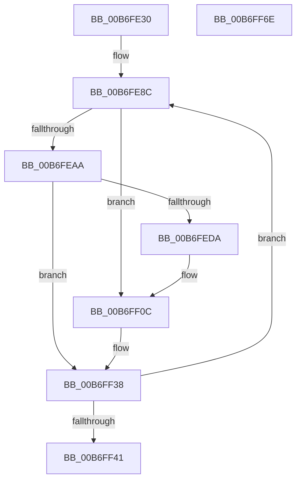

# PopWriteHiberImage

- RVA: `0x00B6FE30`–`0x00B6FF6F` (길이 `319` bytes)
- VA: `0x0000000140B6FE30`
- 실행 섹션: `PAGELK`
- PDB 이름 있음: `예`; PDB Function 태그: `아니요`
- unwind 정보 RVA: `0x000CC3C4`
- 디코드: `79`개 명령, `319/319` bytes 표시
- 미해석 바이트: `0` (있으면 어셈블리에 `.byte`로 보존)

> 이 문서는 커널 이미지의 기계어와 PDB 기호를 분석해 생성했습니다. 4번과 5번은 함수 원형과 자료형을 바이너리 사용 방식에서 추정한 C 해석이며 원본 소스 복구 결과는 아닙니다.

## 1. Dependencies

- 직접 호출 지점: **7**; 고유 호출 대상: **7**
- 직접 호출자로 확인된 함수: **1**
- RIP 상대 이미지 참조: **3**

### Outgoing calls
- `0x00B6FE6F` → [memset](../../text/6C/memset_function_006C6C40.md) (function, `0x006C6C40`)
- `0x00B6FE8C` → [PopHiberCheckForDebugBreak](../B7/PopHiberCheckForDebugBreak_function_00B78258.md) (function, `0x00B78258`)
- `0x00B6FE9D` → [PopRequestWrite](PopRequestWrite_function_00B6EB14.md) (function, `0x00B6EB14`)
- `0x00B6FECD` → [PopGetNextTable](../../text/5D/PopGetNextTable_function_005D4C54.md) (function, `0x005D4C54`)
- `0x00B6FF04` → [PopAddPagesToCompressedPageSet](PopAddPagesToCompressedPageSet_function_00B6C804.md) (function, `0x00B6C804`)
- `0x00B6FF2B` → [PopCountDataAsProduced](PopCountDataAsProduced_function_00B6CE5C.md) (function, `0x00B6CE5C`)
- `0x00B6FF4C` → [_security_check_cookie](../../text/6A/_security_check_cookie_function_006AC640.md) (function, `0x006AC640`)

### Direct callers
- [PopSaveHiberContext](PopSaveHiberContext_function_00B6F050.md) at `0x00B6F7AA`
- [PopSaveHiberContext](PopSaveHiberContext_function_00B6F050.md) at `0x00B6F97C`

### Static image references
- `0x00B6FE4A` → RVA `0x00E0A740` (`.data`; read)
- `0x00B6FE74` → RVA `0x00F0BFC8` (`.data`; read)
- `0x00B6FEE8` → RVA `0x00B6CD50` (`PopCompressCallback`; read)

## 2. Other-region calls and transfers

- 다른 실행 섹션으로 향하는 call: **3**
  - `0x00B6FE6F` → [memset](../../text/6C/memset_function_006C6C40.md) (`PAGELK` → `.text`)
  - `0x00B6FECD` → [PopGetNextTable](../../text/5D/PopGetNextTable_function_005D4C54.md) (`PAGELK` → `.text`)
  - `0x00B6FF4C` → [_security_check_cookie](../../text/6A/_security_check_cookie_function_006AC640.md) (`PAGELK` → `.text`)
- 별도 외부 분기/꼬리 이동을 확인하지 못했습니다.

## 3. Assembly (complete function range)

```asm
00B6FE30  48 89 6C 24 18                  mov qword ptr [rsp + 0x18], rbp
00B6FE35  48 89 74 24 20                  mov qword ptr [rsp + 0x20], rsi
00B6FE3A  57                              push rdi
00B6FE3B  41 54                           push r12
00B6FE3D  41 55                           push r13
00B6FE3F  41 56                           push r14
00B6FE41  41 57                           push r15
00B6FE43  48 81 EC 90 01 00 00            sub rsp, 0x190
00B6FE4A  48 8B 05 EF A8 29 00            mov rax, qword ptr [rip + 0x29a8ef]
00B6FE51  48 33 C4                        xor rax, rsp
00B6FE54  48 89 84 24 80 01 00 00         mov qword ptr [rsp + 0x180], rax
00B6FE5C  44 8A E2                        mov r12b, dl
00B6FE5F  4C 8B F1                        mov r14, rcx
00B6FE62  33 D2                           xor edx, edx
00B6FE64  48 8D 4C 24 50                  lea rcx, [rsp + 0x50]
00B6FE69  41 B8 B0 00 00 00               mov r8d, 0xb0
00B6FE6F  E8 CC 6D B5 FF                  call 0x1406c6c40
00B6FE74  4C 8B 2D 4D C1 39 00            mov r13, qword ptr [rip + 0x39c14d]
00B6FE7B  33 C0                           xor eax, eax
00B6FE7D  49 8B AE 28 01 00 00            mov rbp, qword ptr [r14 + 0x128]
00B6FE84  8B F0                           mov esi, eax
00B6FE86  89 44 24 40                     mov dword ptr [rsp + 0x40], eax
00B6FE8A  8B F8                           mov edi, eax
00B6FE8C  E8 C7 83 00 00                  call 0x140b78258
00B6FE91  41 B8 01 00 00 00               mov r8d, 1
00B6FE97  49 8B D5                        mov rdx, r13
00B6FE9A  49 8B CE                        mov rcx, r14
00B6FE9D  E8 72 EC FF FF                  call 0x140b6eb14
00B6FEA2  44 8A F8                        mov r15b, al
00B6FEA5  48 85 FF                        test rdi, rdi
00B6FEA8  75 62                           jne 0x140b6ff0c
00B6FEAA  48 8B 45 08                     mov rax, qword ptr [rbp + 8]
00B6FEAE  4C 8D 4C 24 50                  lea r9, [rsp + 0x50]
00B6FEB3  48 89 44 24 28                  mov qword ptr [rsp + 0x28], rax
00B6FEB8  4C 8D 84 24 00 01 00 00         lea r8, [rsp + 0x100]
00B6FEC0  48 8D 54 24 40                  lea rdx, [rsp + 0x40]
00B6FEC5  44 88 64 24 20                  mov byte ptr [rsp + 0x20], r12b
00B6FECA  49 8B CE                        mov rcx, r14
00B6FECD  E8 82 4D A6 FF                  call 0x1405d4c54
00B6FED2  48 8B F0                        mov rsi, rax
00B6FED5  48 85 C0                        test rax, rax
00B6FED8  74 5E                           je 0x140b6ff38
00B6FEDA  48 01 45 38                     add qword ptr [rbp + 0x38], rax
00B6FEDE  4C 8D 44 24 40                  lea r8, [rsp + 0x40]
00B6FEE3  4C 8B 4C 24 68                  mov r9, qword ptr [rsp + 0x68]
00B6FEE8  48 8D 05 61 CE FF FF            lea rax, [rip - 0x319f]
00B6FEEF  48 89 44 24 30                  mov qword ptr [rsp + 0x30], rax
00B6FEF4  48 8B D5                        mov rdx, rbp
00B6FEF7  48 89 74 24 28                  mov qword ptr [rsp + 0x28], rsi
00B6FEFC  49 8B CE                        mov rcx, r14
00B6FEFF  44 88 64 24 20                  mov byte ptr [rsp + 0x20], r12b
00B6FF04  E8 FB C8 FF FF                  call 0x140b6c804
00B6FF09  48 8B F8                        mov rdi, rax
00B6FF0C  C7 44 24 28 01 00 00 00         mov dword ptr [rsp + 0x28], 1
00B6FF14  4C 8D 8C 24 00 01 00 00         lea r9, [rsp + 0x100]
00B6FF1C  4C 8D 44 24 40                  lea r8, [rsp + 0x40]
00B6FF21  89 74 24 20                     mov dword ptr [rsp + 0x20], esi
00B6FF25  48 8B D7                        mov rdx, rdi
00B6FF28  48 8B CD                        mov rcx, rbp
00B6FF2B  E8 2C CF FF FF                  call 0x140b6ce5c
00B6FF30  33 C9                           xor ecx, ecx
00B6FF32  84 C0                           test al, al
00B6FF34  48 0F 45 F9                     cmovne rdi, rcx
00B6FF38  45 84 FF                        test r15b, r15b
00B6FF3B  0F 84 4B FF FF FF               je 0x140b6fe8c
00B6FF41  48 8B 8C 24 80 01 00 00         mov rcx, qword ptr [rsp + 0x180]
00B6FF49  48 33 CC                        xor rcx, rsp
00B6FF4C  E8 EF C6 B3 FF                  call 0x1406ac640
00B6FF51  4C 8D 9C 24 90 01 00 00         lea r11, [rsp + 0x190]
00B6FF59  49 8B 6B 40                     mov rbp, qword ptr [r11 + 0x40]
00B6FF5D  49 8B 73 48                     mov rsi, qword ptr [r11 + 0x48]
00B6FF61  49 8B E3                        mov rsp, r11
00B6FF64  41 5F                           pop r15
00B6FF66  41 5E                           pop r14
00B6FF68  41 5D                           pop r13
00B6FF6A  41 5C                           pop r12
00B6FF6C  5F                              pop rdi
00B6FF6D  C3                              ret
00B6FF6E  CC                              int3
```

## 4. C-style interpretation (structured pseudocode)

```c
__int64 __fastcall PopWriteHiberImage(__int64 a1, int a2)
{
    __int64 result;
    __int64 v_rdi;
    __int64 v_rsp;
    unsigned __int64 v_stack_m150;
    unsigned __int64 v_stack_m168;
    unsigned int v_stack_m178;
    unsigned __int64 v_stack_m188;
    unsigned __int64 v_stack_m190;
    unsigned __int8 v_stack_m198;
    unsigned __int64 v_stack_m28;
    unsigned __int64 v_stack_m38;
    unsigned __int64 v_stack_mB8;
    unsigned __int64 v_stack_p18;
    unsigned __int64 v_stack_p20;

    v_stack_p18 = v_rbp;
    v_stack_p20 = v_rsi;
    v_rsp = (v_rsp) - (400);
    result = (*(unsigned __int64 *)(v_rip + 2730223)) ^ (v_rsp);
    v_stack_m38 = result;
    a2 = 0;
    result = memset(v_stack_m168, a2, 176, a4);
    result = 0;
    v_stack_m178 = 0;
loc_00B6FE8C:
    result = PopHiberCheckForDebugBreak(v_stack_m168, a2, 176, a4);
    result = PopRequestWrite(a1, *(unsigned __int64 *)(v_rip + 3785037), 1, a4);
    if (0 != 0) goto loc_00B6FF0C;
    v_stack_m190 = *(unsigned __int64 *)(*(unsigned __int64 *)(a1 + 296) + 8);
    v_stack_m198 = (unsigned __int8)((unsigned __int8)(a2));
    result = PopGetNextTable(a1, v_stack_m178, v_stack_mB8, v_stack_m168);
    if (result == 0) goto loc_00B6FF38;
    v_stack_m188 = v_rip - 12703;
    v_stack_m190 = result;
    v_stack_m198 = (unsigned __int8)((unsigned __int8)(a2));
    result = PopAddPagesToCompressedPageSet(a1, *(unsigned __int64 *)(a1 + 296), v_stack_m178, v_stack_m150);
loc_00B6FF0C:
    v_stack_m190 = 1;
    v_stack_m198 = (unsigned int)(result);
    result = PopCountDataAsProduced(*(unsigned __int64 *)(a1 + 296), result, v_stack_m178, v_stack_mB8);
    a1 = 0;
    v_rdi = result;
    if ((unsigned __int8)(result) != 0) { v_rdi = 0; }
loc_00B6FF38:
    if ((unsigned __int8)((unsigned __int8)(result)) == 0) goto loc_00B6FE8C;
    a1 = (v_stack_m38) ^ (v_rsp);
    result = _security_check_cookie(a1, result, v_stack_m178, v_stack_mB8);
    return result;
}
```

## 5. (Beta) C Style

```c
int64_t PopWriteHiberImage(void *Arg1, int32_t Arg2)
{
    uint8_t *arg1 = (uint8_t *)Arg1;

    int64_t result;
    int64_t local_rdi;
    int64_t local_rsp;
    uint64_t v_stack_m150;
    uint64_t v_stack_m168;
    uint32_t v_stack_m178;
    uint64_t v_stack_m188;
    uint64_t v_stack_m190;
    uint8_t v_stack_m198;
    uint64_t v_stack_m28;
    uint64_t v_stack_m38;
    uint64_t v_stack_mB8;
    uint64_t v_stack_p18;
    uint64_t v_stack_p20;

    v_stack_p18 = local_rbp;
    v_stack_p20 = local_rsi;
    local_rsp = (local_rsp) - (400);
    result = (*(uint64_t *)(v_rip + 0x29A8EF)) ^ (local_rsp);
    v_stack_m38 = result;
    Arg2 = 0;
    result = memset(v_stack_m168, Arg2, 176, a4);
    result = 0;
    v_stack_m178 = 0;
loc_00B6FE8C:
    result = PopHiberCheckForDebugBreak(v_stack_m168, Arg2, 176, a4);
    result = PopRequestWrite(Arg1, *(uint64_t *)(v_rip + 0x39C14D), 1, a4);
    if (0 != 0) goto loc_00B6FF0C;
    v_stack_m190 = *(uint64_t *)(*(uint64_t *)(arg1 + 0x128) + 0x8);
    v_stack_m198 = (uint8_t)((uint8_t)(Arg2));
    result = PopGetNextTable(Arg1, v_stack_m178, v_stack_mB8, v_stack_m168);
    if (result == 0) goto loc_00B6FF38;
    v_stack_m188 = v_rip - 12703;
    v_stack_m190 = result;
    v_stack_m198 = (uint8_t)((uint8_t)(Arg2));
    result = PopAddPagesToCompressedPageSet(Arg1, *(uint64_t *)(arg1 + 0x128), v_stack_m178, v_stack_m150);
loc_00B6FF0C:
    v_stack_m190 = 1;
    v_stack_m198 = (uint32_t)(result);
    result = PopCountDataAsProduced(*(uint64_t *)(arg1 + 0x128), result, v_stack_m178, v_stack_mB8);
    Arg1 = 0;
    local_rdi = result;
    if ((uint8_t)(result) != 0) { local_rdi = 0; }
loc_00B6FF38:
    if ((uint8_t)((uint8_t)(result)) == 0) goto loc_00B6FE8C;
    Arg1 = (v_stack_m38) ^ (local_rsp);
    result = _security_check_cookie(Arg1, result, v_stack_m178, v_stack_mB8);
    return result;
}
```

### 관측된 메모리 오프셋

구조체 형식이 확인되지 않은 접근은 인자 기준의 오프셋으로만 기록했습니다.

| 기준 인자 | 오프셋 표현 | 폭 (bit) | 접근 |
|---|---:|---:|---|
| `Arg1` | `+ 0x128` | `64` | `R` |

## 6. Execution-region graph

[열기: 2D/3D 그래프와 함수 탐색 컨트롤 패널](../../../control-panel.html?section=pagelk&rva=0x00B6FE30&view=graph)

- 2D 그래프는 위에서 아래로 흐르고, 3D 그래프는 빈 공간을 드래그해 회전합니다. Shift+드래그는 이동, 휠은 확대·축소, 함수 노드 선택은 대상 보고서 이동입니다.

### Static fallback


