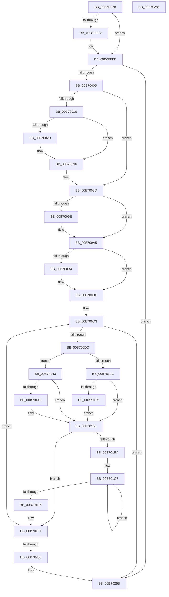

# PopWriteHiberPages

- RVA: `0x00B6FF78`–`0x00B70287` (길이 `783` bytes)
- VA: `0x0000000140B6FF78`
- 실행 섹션: `PAGELK`
- PDB 이름 있음: `예`; PDB Function 태그: `아니요`
- unwind 정보 RVA: `0x000CC37C`
- 디코드: `195`개 명령, `783/783` bytes 표시
- 미해석 바이트: `0` (있으면 어셈블리에 `.byte`로 보존)

> 이 문서는 커널 이미지의 기계어와 PDB 기호를 분석해 생성했습니다. 4번과 5번은 함수 원형과 자료형을 바이너리 사용 방식에서 추정한 C 해석이며 원본 소스 복구 결과는 아닙니다.

## 1. Dependencies

- 직접 호출 지점: **16**; 고유 호출 대상: **13**
- 직접 호출자로 확인된 함수: **6**
- RIP 상대 이미지 참조: **8**

### Outgoing calls
- `0x00B6FFC7` → [memset](../../text/6C/memset_function_006C6C40.md) (function, `0x006C6C40`)
- `0x00B6FFE9` → [guard_dispatch_icall](../../text/6B/guard_dispatch_icall_function_006BAAD0.md) (function, `0x006BAAD0`)
- `0x00B70019` → [PopCheckpointSystemSleep](../B7/PopCheckpointSystemSleep_function_00B77C90.md) (function, `0x00B77C90`)
- `0x00B7002E` → [PopGetRemainingHibernateRangeDataSize](PopGetRemainingHibernateRangeDataSize_function_00B6D7A0.md) (function, `0x00B6D7A0`)
- `0x00B70038` → [MmGetNumberOfPhysicalPages](../../text/46/MmGetNumberOfPhysicalPages_function_00467F80.md) (function, `0x00467F80`)
- `0x00B7004C` → [IoAddTriageDumpDataBlock](../../text/42/IoAddTriageDumpDataBlock_function_00428374.md) (function, `0x00428374`)
- `0x00B70054` → [PopRecordHibernateDiagnosticInfo](PopRecordHibernateDiagnosticInfo_function_00B6E5E4.md) (function, `0x00B6E5E4`)
- `0x00B70065` → [IoAddTriageDumpDataBlock](../../text/42/IoAddTriageDumpDataBlock_function_00428374.md) (function, `0x00428374`)
- `0x00B70087` → [KeBugCheckEx](../../text/4F/KeBugCheckEx_function_004FD660.md) (function, `0x004FD660`)
- `0x00B7008D` → [Feature_CrashDumpOneMBTransferSize__private_IsEnabledDeviceUsageNoInline](../../text/5D/Feature_CrashDumpOneMBTransferSize__private_IsEnabledDeviceUsageNoInline_function_005D4A08.md) (function, `0x005D4A08`)
- `0x00B700B9` → [PopInternalError](../../text/5C/PopInternalError_function_005CEBD0.md) (function, `0x005CEBD0`)
- `0x00B700E7` → [PopGetIoLocation](PopGetIoLocation_function_00B6D710.md) (function, `0x00B6D710`)
- `0x00B70123` → [Feature_CrashDumpOneMBTransferSize__private_IsEnabledDeviceUsageNoInline](../../text/5D/Feature_CrashDumpOneMBTransferSize__private_IsEnabledDeviceUsageNoInline_function_005D4A08.md) (function, `0x005D4A08`)
- `0x00B701D1` → [MmGetPhysicalAddress](../../text/23/MmGetPhysicalAddress_function_0023A500.md) (function, `0x0023A500`)
- `0x00B70210` → [guard_dispatch_icall](../../text/6B/guard_dispatch_icall_function_006BAAD0.md) (function, `0x006BAAD0`)
- `0x00B70266` → [_security_check_cookie](../../text/6A/_security_check_cookie_function_006AC640.md) (function, `0x006AC640`)

### Direct callers
- [PopWriteSecurePages](../../text/5D/PopWriteSecurePages_function_005D4F94.md) at `0x005D502A`
- [PopWriteSecurePagesCallback](../../text/5D/PopWriteSecurePagesCallback_function_005D5048.md) at `0x005D50F8`
- [PopHiberWriteBootFreePageMap](PopHiberWriteBootFreePageMap_function_00B6DFAC.md) at `0x00B6E033`
- [PopWriteChecksumPages](PopWriteChecksumPages_function_00B6FB7C.md) at `0x00B6FBEF`
- [PopWriteHeaderPages](PopWriteHeaderPages_function_00B6FC14.md) at `0x00B6FCDB`
- [PopWriteHeaderPages](PopWriteHeaderPages_function_00B6FC14.md) at `0x00B6FD79`
- [PopWriteImageHeader](../B7/PopWriteImageHeader_function_00B70290.md) at `0x00B704AB`

### Static image references
- `0x00B6FF8F` → RVA `0x00E0A740` (`.data`; read)
- `0x00B6FFCC` → RVA `0x00F0DDA4` (`.data`; read)
- `0x00B6FFE2` → RVA `0x00E00B20` (`.data`; read)
- `0x00B6FFF3` → RVA `0x00F0DDA4` (`.data`; read/write)
- `0x00B7000D` → RVA `0x00F0BF30` (`.data`; read)
- `0x00B7005E` → RVA `0x00F0DDC0` (`.data`; read)
- `0x00B7021E` → RVA `0x00F0C570` (`.data`; read/write)
- `0x00B7022E` → RVA `0x00F0C378` (`.data`; read/write)

## 2. Other-region calls and transfers

- 다른 실행 섹션으로 향하는 call: **12**
  - `0x00B6FFC7` → [memset](../../text/6C/memset_function_006C6C40.md) (`PAGELK` → `.text`)
  - `0x00B6FFE9` → [guard_dispatch_icall](../../text/6B/guard_dispatch_icall_function_006BAAD0.md) (`PAGELK` → `.text`)
  - `0x00B70038` → [MmGetNumberOfPhysicalPages](../../text/46/MmGetNumberOfPhysicalPages_function_00467F80.md) (`PAGELK` → `.text`)
  - `0x00B7004C` → [IoAddTriageDumpDataBlock](../../text/42/IoAddTriageDumpDataBlock_function_00428374.md) (`PAGELK` → `.text`)
  - `0x00B70065` → [IoAddTriageDumpDataBlock](../../text/42/IoAddTriageDumpDataBlock_function_00428374.md) (`PAGELK` → `.text`)
  - `0x00B70087` → [KeBugCheckEx](../../text/4F/KeBugCheckEx_function_004FD660.md) (`PAGELK` → `.text`)
  - `0x00B7008D` → [Feature_CrashDumpOneMBTransferSize__private_IsEnabledDeviceUsageNoInline](../../text/5D/Feature_CrashDumpOneMBTransferSize__private_IsEnabledDeviceUsageNoInline_function_005D4A08.md) (`PAGELK` → `.text`)
  - `0x00B700B9` → [PopInternalError](../../text/5C/PopInternalError_function_005CEBD0.md) (`PAGELK` → `.text`)
  - `0x00B70123` → [Feature_CrashDumpOneMBTransferSize__private_IsEnabledDeviceUsageNoInline](../../text/5D/Feature_CrashDumpOneMBTransferSize__private_IsEnabledDeviceUsageNoInline_function_005D4A08.md) (`PAGELK` → `.text`)
  - `0x00B701D1` → [MmGetPhysicalAddress](../../text/23/MmGetPhysicalAddress_function_0023A500.md) (`PAGELK` → `.text`)
  - `0x00B70210` → [guard_dispatch_icall](../../text/6B/guard_dispatch_icall_function_006BAAD0.md) (`PAGELK` → `.text`)
  - `0x00B70266` → [_security_check_cookie](../../text/6A/_security_check_cookie_function_006AC640.md) (`PAGELK` → `.text`)
- 별도 외부 분기/꼬리 이동을 확인하지 못했습니다.

## 3. Assembly (complete function range)

```asm
00B6FF78  48 89 5C 24 18                  mov qword ptr [rsp + 0x18], rbx
00B6FF7D  55                              push rbp
00B6FF7E  56                              push rsi
00B6FF7F  57                              push rdi
00B6FF80  41 54                           push r12
00B6FF82  41 55                           push r13
00B6FF84  41 56                           push r14
00B6FF86  41 57                           push r15
00B6FF88  48 81 EC D0 01 00 00            sub rsp, 0x1d0
00B6FF8F  48 8B 05 AA A7 29 00            mov rax, qword ptr [rip + 0x29a7aa]
00B6FF96  48 33 C4                        xor rax, rsp
00B6FF99  48 89 84 24 C0 01 00 00         mov qword ptr [rsp + 0x1c0], rax
00B6FFA1  4D 8B F0                        mov r14, r8
00B6FFA4  48 89 54 24 38                  mov qword ptr [rsp + 0x38], rdx
00B6FFA9  4C 8B EA                        mov r13, rdx
00B6FFAC  48 89 4C 24 60                  mov qword ptr [rsp + 0x60], rcx
00B6FFB1  48 8B F9                        mov rdi, rcx
00B6FFB4  33 D2                           xor edx, edx
00B6FFB6  41 B8 38 01 00 00               mov r8d, 0x138
00B6FFBC  48 8D 8C 24 80 00 00 00         lea rcx, [rsp + 0x80]
00B6FFC4  4D 8B E1                        mov r12, r9
00B6FFC7  E8 74 6C B5 FF                  call 0x1406c6c40
00B6FFCC  8B 05 D2 DD 39 00               mov eax, dword ptr [rip + 0x39ddd2]
00B6FFD2  33 F6                           xor esi, esi
00B6FFD4  48 89 74 24 30                  mov qword ptr [rsp + 0x30], rsi
00B6FFD9  48 89 74 24 40                  mov qword ptr [rsp + 0x40], rsi
00B6FFDE  A8 1F                           test al, 0x1f
00B6FFE0  75 0C                           jne 0x140b6ffee
00B6FFE2  48 8B 05 37 0B 29 00            mov rax, qword ptr [rip + 0x290b37]
00B6FFE9  E8 E2 AA B4 FF                  call 0x1406baad0
00B6FFEE  BB 01 00 00 00                  mov ebx, 1
00B6FFF3  01 1D AB DD 39 00               add dword ptr [rip + 0x39ddab], ebx
00B6FFF9  39 B7 CC 00 00 00               cmp dword ptr [rdi + 0xcc], esi
00B6FFFF  0F 8C 56 02 00 00               jl 0x140b7025b
00B70005  4B 8D 04 34                     lea rax, [r12 + r14]
00B70009  48 C1 E0 0C                     shl rax, 0xc
00B7000D  48 3B 05 1C BF 39 00            cmp rax, qword ptr [rip + 0x39bf1c]
00B70014  76 77                           jbe 0x140b7008d
00B70016  8D 4B 15                        lea ecx, [rbx + 0x15]
00B70019  E8 72 7C 00 00                  call 0x140b77c90
00B7001E  8B 87 C8 00 00 00               mov eax, dword ptr [rdi + 0xc8]
00B70024  83 E8 04                        sub eax, 4
00B70027  3B C3                           cmp eax, ebx
00B70029  77 0B                           ja 0x140b70036
00B7002B  48 8B CF                        mov rcx, rdi
00B7002E  E8 6D D7 FF FF                  call 0x140b6d7a0
00B70033  48 8B F0                        mov rsi, rax
00B70036  33 C9                           xor ecx, ecx
00B70038  E8 43 7F 8F FF                  call 0x140467f80
00B7003D  BA 08 00 00 00                  mov edx, 8
00B70042  48 89 44 24 48                  mov qword ptr [rsp + 0x48], rax
00B70047  48 8D 4C 24 48                  lea rcx, [rsp + 0x48]
00B7004C  E8 23 83 8B FF                  call 0x140428374
00B70051  48 8B CF                        mov rcx, rdi
00B70054  E8 8B E5 FF FF                  call 0x140b6e5e4
00B70059  BA 80 00 00 00                  mov edx, 0x80
00B7005E  48 8D 0D 5B DD 39 00            lea rcx, [rip + 0x39dd5b]
00B70065  E8 0A 83 8B FF                  call 0x140428374
00B7006A  44 8B 8F C8 00 00 00            mov r9d, dword ptr [rdi + 0xc8]
00B70071  BA 0B 00 00 00                  mov edx, 0xb
00B70076  4C 8B 05 B3 BE 39 00            mov r8, qword ptr [rip + 0x39beb3]
00B7007D  B9 A0 00 00 00                  mov ecx, 0xa0
00B70082  48 89 74 24 20                  mov qword ptr [rsp + 0x20], rsi
00B70087  E8 D4 D5 98 FF                  call 0x1404fd660
00B7008C  CC                              int3
00B7008D  E8 76 49 A6 FF                  call 0x1405d4a08
00B70092  4C 8D BC 24 80 00 00 00         lea r15, [rsp + 0x80]
00B7009A  85 C0                           test eax, eax
00B7009C  74 07                           je 0x140b700a5
00B7009E  4C 8B BF 60 01 00 00            mov r15, qword ptr [rdi + 0x160]
00B700A5  48 B8 FF FF FF FF FF FF 0F 00   movabs rax, 0xfffffffffffff
00B700AF  4C 3B F0                        cmp r14, rax
00B700B2  76 0B                           jbe 0x140b700bf
00B700B4  B9 AA 26 0A 00                  mov ecx, 0xa26aa
00B700B9  E8 12 EB A5 FF                  call 0x1405cebd0
00B700BE  CC                              int3
00B700BF  48 8B 87 B0 00 00 00            mov rax, qword ptr [rdi + 0xb0]
00B700C6  49 C1 E4 0C                     shl r12, 0xc
00B700CA  48 89 44 24 70                  mov qword ptr [rsp + 0x70], rax
00B700CF  49 C1 E6 0C                     shl r14, 0xc
00B700D3  4D 85 F6                        test r14, r14
00B700D6  0F 84 7F 01 00 00               je 0x140b7025b
00B700DC  4C 8D 44 24 30                  lea r8, [rsp + 0x30]
00B700E1  49 8B D4                        mov rdx, r12
00B700E4  48 8B C8                        mov rcx, rax
00B700E7  E8 24 D6 FF FF                  call 0x140b6d710
00B700EC  4C 3B 74 24 30                  cmp r14, qword ptr [rsp + 0x30]
00B700F1  41 8B DE                        mov ebx, r14d
00B700F4  48 89 44 24 40                  mov qword ptr [rsp + 0x40], rax
00B700F9  41 8B C5                        mov eax, r13d
00B700FC  0F 47 5C 24 30                  cmova ebx, dword ptr [rsp + 0x30]
00B70101  8B C8                           mov ecx, eax
00B70103  81 E1 FF 0F 00 00               and ecx, 0xfff
00B70109  48 89 44 24 58                  mov qword ptr [rsp + 0x58], rax
00B7010E  8B C3                           mov eax, ebx
00B70110  48 89 4C 24 50                  mov qword ptr [rsp + 0x50], rcx
00B70115  48 8D A9 FF 0F 00 00            lea rbp, [rcx + 0xfff]
00B7011C  48 03 E8                        add rbp, rax
00B7011F  48 C1 ED 0C                     shr rbp, 0xc
00B70123  E8 E0 48 A6 FF                  call 0x1405d4a08
00B70128  85 C0                           test eax, eax
00B7012A  75 17                           jne 0x140b70143
00B7012C  48 83 FD 10                     cmp rbp, 0x10
00B70130  76 2C                           jbe 0x140b7015e
00B70132  48 8D 45 F0                     lea rax, [rbp - 0x10]
00B70136  BD 10 00 00 00                  mov ebp, 0x10
00B7013B  48 C1 E0 0C                     shl rax, 0xc
00B7013F  2B D8                           sub ebx, eax
00B70141  EB 1B                           jmp 0x140b7015e
00B70143  8B 8F B8 01 00 00               mov ecx, dword ptr [rdi + 0x1b8]
00B70149  48 3B E9                        cmp rbp, rcx
00B7014C  76 10                           jbe 0x140b7015e
00B7014E  48 C1 E5 0C                     shl rbp, 0xc
00B70152  8B C1                           mov eax, ecx
00B70154  48 C1 E0 0C                     shl rax, 0xc
00B70158  2B C5                           sub eax, ebp
00B7015A  8B E9                           mov ebp, ecx
00B7015C  03 D8                           add ebx, eax
00B7015E  48 8B 4C 24 50                  mov rcx, qword ptr [rsp + 0x50]
00B70163  8B C3                           mov eax, ebx
00B70165  48 81 C1 FF 0F 00 00            add rcx, 0xfff
00B7016C  48 89 44 24 68                  mov qword ptr [rsp + 0x68], rax
00B70171  48 03 C1                        add rax, rcx
00B70174  48 C1 E8 0C                     shr rax, 0xc
00B70178  66 83 C0 06                     add ax, 6
00B7017C  4D 89 6F 18                     mov qword ptr [r15 + 0x18], r13
00B70180  66 C1 E0 03                     shl ax, 3
00B70184  66 41 89 47 08                  mov word ptr [r15 + 8], ax
00B70189  49 8B C5                        mov rax, r13
00B7018C  48 25 00 F0 FF FF               and rax, 0xfffffffffffff000
00B70192  49 89 37                        mov qword ptr [r15], rsi
00B70195  49 89 47 20                     mov qword ptr [r15 + 0x20], rax
00B70199  44 8B EE                        mov r13d, esi
00B7019C  48 8B 44 24 58                  mov rax, qword ptr [rsp + 0x58]
00B701A1  25 FF 0F 00 00                  and eax, 0xfff
00B701A6  41 89 5F 28                     mov dword ptr [r15 + 0x28], ebx
00B701AA  41 89 47 2C                     mov dword ptr [r15 + 0x2c], eax
00B701AE  66 41 C7 47 0A 01 00            mov word ptr [r15 + 0xa], 1
00B701B5  48 85 ED                        test rbp, rbp
00B701B8  74 37                           je 0x140b701f1
00B701BA  48 8B 7C 24 38                  mov rdi, qword ptr [rsp + 0x38]
00B701BF  48 8B DE                        mov rbx, rsi
00B701C2  BE 01 00 00 00                  mov esi, 1
00B701C7  48 8B CB                        mov rcx, rbx
00B701CA  48 C1 E1 0C                     shl rcx, 0xc
00B701CE  48 03 CF                        add rcx, rdi
00B701D1  E8 2A A3 6C FF                  call 0x14023a500
00B701D6  48 C1 E8 0C                     shr rax, 0xc
00B701DA  44 03 EE                        add r13d, esi
00B701DD  49 89 44 DF 30                  mov qword ptr [r15 + rbx*8 + 0x30], rax
00B701E2  41 8B DD                        mov ebx, r13d
00B701E5  48 3B DD                        cmp rbx, rbp
00B701E8  72 DD                           jb 0x140b701c7
00B701EA  48 8B 7C 24 60                  mov rdi, qword ptr [rsp + 0x60]
00B701EF  33 F6                           xor esi, esi
00B701F1  0F 31                           rdtsc
00B701F3  48 8B 8F B8 00 00 00            mov rcx, qword ptr [rdi + 0xb8]
00B701FA  48 C1 E2 20                     shl rdx, 0x20
00B701FE  48 0B C2                        or rax, rdx
00B70201  49 8B D7                        mov rdx, r15
00B70204  48 8B D8                        mov rbx, rax
00B70207  48 8B 41 40                     mov rax, qword ptr [rcx + 0x40]
00B7020B  48 8D 4C 24 40                  lea rcx, [rsp + 0x40]
00B70210  E8 BB A8 B4 FF                  call 0x1406baad0
00B70215  8B C8                           mov ecx, eax
00B70217  0F 31                           rdtsc
00B70219  4C 8B 6C 24 38                  mov r13, qword ptr [rsp + 0x38]
00B7021E  01 2D 4C C3 39 00               add dword ptr [rip + 0x39c34c], ebp
00B70224  48 C1 E2 20                     shl rdx, 0x20
00B70228  48 0B C2                        or rax, rdx
00B7022B  48 2B C3                        sub rax, rbx
00B7022E  48 01 05 43 C1 39 00            add qword ptr [rip + 0x39c143], rax
00B70235  48 8B 44 24 68                  mov rax, qword ptr [rsp + 0x68]
00B7023A  4C 03 E8                        add r13, rax
00B7023D  4C 2B F0                        sub r14, rax
00B70240  4C 03 E0                        add r12, rax
00B70243  4C 89 6C 24 38                  mov qword ptr [rsp + 0x38], r13
00B70248  48 8B 44 24 70                  mov rax, qword ptr [rsp + 0x70]
00B7024D  85 C9                           test ecx, ecx
00B7024F  0F 89 7E FE FF FF               jns 0x140b700d3
00B70255  89 8F CC 00 00 00               mov dword ptr [rdi + 0xcc], ecx
00B7025B  48 8B 8C 24 C0 01 00 00         mov rcx, qword ptr [rsp + 0x1c0]
00B70263  48 33 CC                        xor rcx, rsp
00B70266  E8 D5 C3 B3 FF                  call 0x1406ac640
00B7026B  48 8B 9C 24 20 02 00 00         mov rbx, qword ptr [rsp + 0x220]
00B70273  48 81 C4 D0 01 00 00            add rsp, 0x1d0
00B7027A  41 5F                           pop r15
00B7027C  41 5E                           pop r14
00B7027E  41 5D                           pop r13
00B70280  41 5C                           pop r12
00B70282  5F                              pop rdi
00B70283  5E                              pop rsi
00B70284  5D                              pop rbp
00B70285  C3                              ret
00B70286  CC                              int3
```

## 4. C-style interpretation (structured pseudocode)

```c
__int64 __fastcall PopWriteHiberPages(__int64 a1, __int64 a2, __int64 a3, __int64 a4)
{
    __int64 result;
    __int64 v_r12;
    __int64 v_r13;
    __int64 v_r14;
    __int64 v_r15;
    __int64 v_rbp;
    __int64 v_rbx;
    __int64 v_rsi;
    __int64 v_rsp;
    unsigned __int64 v_stack_m188;
    unsigned __int64 v_stack_m198;
    unsigned __int64 v_stack_m1A0;
    unsigned __int64 v_stack_m1A8;
    unsigned __int64 v_stack_m1B0;
    unsigned __int64 v_stack_m1B8;
    unsigned __int64 v_stack_m1C0;
    unsigned __int64 v_stack_m1C8;
    unsigned __int64 v_stack_m1D0;
    unsigned __int64 v_stack_m1D8;
    unsigned __int64 v_stack_m1E8;
    unsigned __int64 v_stack_m48;
    unsigned __int64 v_stack_p18;

    v_stack_p18 = v_rbx;
    v_rsp = (v_rsp) - (464);
    result = (*(unsigned __int64 *)(v_rip + 2729898)) ^ (v_rsp);
    v_stack_m48 = result;
    v_stack_m1D0 = a2;
    v_stack_m1A8 = a1;
    a2 = 0;
    result = memset(v_stack_m188, a2, 312, a4);
    v_rsi = 0;
    v_stack_m1D8 = 0;
    v_stack_m1C8 = 0;
    result = (unsigned int)(*(unsigned int *)(v_rip + 3792338));
    if ((((unsigned __int8)((unsigned int)(*(unsigned int *)(v_rip + 3792338)))) & (31)) == 0) {
        result = *(unsigned __int64 *)(v_rip + 2689847);
        result = guard_dispatch_icall(v_stack_m188, a2, 312, a4);
    }
    if ((*(unsigned int *)(a1 + 204)) < 0) goto loc_00B7025B;
    result = (a4 + a3 * 1) << (12);
    if (result <= (*(unsigned __int64 *)(v_rip + 3784476))) goto loc_00B7008D;
    result = PopCheckpointSystemSleep(1 + 21, a2, 312, a4);
    result = (unsigned int)(((unsigned int)(*(unsigned int *)(a1 + 200))) - (4));
    if (((unsigned int)(result)) <= 1) {
        a1 = a1;
        result = PopGetRemainingHibernateRangeDataSize(a1, a2, 312, a4);
        v_rsi = result;
    }
    a1 = 0;
    result = MmGetNumberOfPhysicalPages(a1, a2, 312, a4);
    v_stack_m1C0 = result;
    result = IoAddTriageDumpDataBlock(v_stack_m1C0, 8, 312, a4);
    result = PopRecordHibernateDiagnosticInfo(0, 8, 312, a4);
    result = IoAddTriageDumpDataBlock(v_rip + 3792219, 128, 312, a4);
    v_stack_m1E8 = v_rsi;
    result = KeBugCheckEx(160, 11, *(unsigned __int64 *)(v_rip + 3784371), (unsigned int)(*(unsigned int *)(a1 + 200)));
loc_00B7008D:
    result = Feature_CrashDumpOneMBTransferSize__private_IsEnabledDeviceUsageNoInline(160, 11, *(unsigned __int64 *)(v_rip + 3784371), (unsigned int)(*(unsigned int *)(a1 + 200)));
    v_r15 = v_stack_m188;
    if ((unsigned int)(result) != 0) {
        v_r15 = *(unsigned __int64 *)(a1 + 352);
    }
    if (a3 >= = result) {
        a1 = 0xA26AAULL;
        result = PopInternalError(a1, 11, *(unsigned __int64 *)(v_rip + 3784371), (unsigned int)(*(unsigned int *)(a1 + 200)));
    }
    v_r12 = (a4) << (12);
    v_stack_m198 = *(unsigned __int64 *)(a1 + 176);
    v_r14 = (a3) << (12);
loc_00B700D3:
    if (v_r14 == 0) goto loc_00B7025B;
    result = PopGetIoLocation(*(unsigned __int64 *)(a1 + 176), v_r12, v_stack_m1D8, (unsigned int)(*(unsigned int *)(a1 + 200)));
    v_stack_m1C8 = result;
    v_rbx = (unsigned int)((unsigned int)(v_r14));
    if (v_r14 > v_stack_m1D8) { v_rbx = v_stack_m1D8; }
    a1 = (unsigned int)((0) & (0xFFFULL));
    v_stack_m1B0 = 0;
    v_stack_m1B8 = a1;
    v_rbp = (a1 + 4095) + ((unsigned int)((unsigned int)(v_rbx)));
    v_rbp = (v_rbp) >> (12);
    result = Feature_CrashDumpOneMBTransferSize__private_IsEnabledDeviceUsageNoInline(a1, v_r12, v_stack_m1D8, (unsigned int)(*(unsigned int *)(a1 + 200)));
    if ((unsigned int)(result) != 0) goto loc_00B70143;
    if (v_rbp <= 16) goto loc_00B7015E;
    result = (v_rbp - 16) << (12);
    v_rbx = (unsigned int)((v_rbx) - ((unsigned int)(result)));
    goto loc_00B7015E;
loc_00B70143:
    v_rbp = 16;
    if (16 >= = ((unsigned int)(*(unsigned int *)(a1 + 440)))) {
        v_rbp = (16) << (12);
        result = (unsigned int)((unsigned int)(*(unsigned int *)(a1 + 440)));
        result = (result) << (12);
        result = (unsigned int)((result) - ((unsigned int)(v_rbp)));
        v_rbp = (unsigned int)((unsigned int)(*(unsigned int *)(a1 + 440)));
        v_rbx = (unsigned int)((v_rbx) + ((unsigned int)(result)));
    }
    a1 = (v_stack_m1B8) + (0xFFFULL);
    v_stack_m1A0 = (unsigned int)((unsigned int)(v_rbx));
    result = ((unsigned int)((unsigned int)(v_rbx))) + (a1);
    result = (result) >> (12);
    result = (unsigned __int16)((result) + (6));
    *(unsigned __int64 *)(v_r15 + 24) = 0;
    result = (unsigned __int16)((result) << (3));
    *(unsigned __int16 *)(v_r15 + 8) = (unsigned __int16)(result);
    result = (0) & (0xFFFFFFFFFFFFF000ULL);
    *(unsigned __int64 *)(v_r15) = v_rsi;
    *(unsigned __int64 *)(v_r15 + 32) = result;
    result = (unsigned int)((v_stack_m1B0) & (0xFFFULL));
    *(unsigned int *)(v_r15 + 40) = (unsigned int)(v_rbx);
    *(unsigned int *)(v_r15 + 44) = (unsigned int)(result);
    *(unsigned __int16 *)(v_r15 + 10) = 1;
    if (v_rbp == 0) goto loc_00B701F1;
loc_00B701C7:
    a1 = (v_rsi) << (12);
    a1 = (a1) + (v_stack_m1D0);
    result = MmGetPhysicalAddress(a1, v_r12, v_stack_m1D8, (unsigned int)(*(unsigned int *)(a1 + 200)));
    result = (result) >> (12);
    v_r13 = (unsigned int)(((unsigned int)((unsigned int)(v_rsi))) + (1));
    *(unsigned __int64 *)(v_r15 + v_rsi * 8 + 48) = result;
    if (((unsigned int)((unsigned int)(v_r13))) < v_rbp) goto loc_00B701C7;
    v_rsi = 0;
loc_00B701F1:
    a2 = (v_r12) << (32);
    result = (result) | (a2);
    result = guard_dispatch_icall(v_stack_m1C8, v_r15, v_stack_m1D8, (unsigned int)(*(unsigned int *)(a1 + 200)));
    a2 = (v_r15) << (32);
    result = (result) | (a2);
    result = (result) - (result);
    v_r13 = (v_stack_m1D0) + (v_stack_m1A0);
    v_r14 = (v_r14) - (v_stack_m1A0);
    v_r12 = (v_r12) + (v_stack_m1A0);
    v_stack_m1D0 = v_r13;
    if (!sign_flag) goto loc_00B700D3;
    *(unsigned int *)(v_stack_m1A8 + 204) = (unsigned int)((unsigned int)((unsigned int)(result)));
loc_00B7025B:
    a1 = (v_stack_m48) ^ (v_rsp);
    result = _security_check_cookie(a1, a2, v_stack_m1D8, (unsigned int)(*(unsigned int *)(a1 + 200)));
    v_rsp = (v_rsp) + (464);
    return result;
}
```

## 5. (Beta) C Style

```c
int64_t PopWriteHiberPages(void *Arg1, int64_t Arg2, int64_t Arg3, void *Arg4)
{
    uint8_t *arg1 = (uint8_t *)Arg1;
    uint8_t *arg4 = (uint8_t *)Arg4;

    int64_t result;
    int64_t local_r12;
    int64_t local_r13;
    int64_t local_r14;
    int64_t local_r15;
    int64_t local_rbp;
    int64_t local_rbx;
    int64_t local_rsi;
    int64_t local_rsp;
    uint64_t v_stack_m188;
    uint64_t v_stack_m198;
    uint64_t v_stack_m1A0;
    uint64_t v_stack_m1A8;
    uint64_t v_stack_m1B0;
    uint64_t v_stack_m1B8;
    uint64_t v_stack_m1C0;
    uint64_t v_stack_m1C8;
    uint64_t v_stack_m1D0;
    uint64_t v_stack_m1D8;
    uint64_t v_stack_m1E8;
    uint64_t v_stack_m48;
    uint64_t v_stack_p18;

    v_stack_p18 = local_rbx;
    local_rsp = (local_rsp) - (464);
    result = (*(uint64_t *)(v_rip + 0x29A7AA)) ^ (local_rsp);
    v_stack_m48 = result;
    v_stack_m1D0 = Arg2;
    v_stack_m1A8 = Arg1;
    Arg2 = 0;
    result = memset(v_stack_m188, Arg2, 312, Arg4);
    local_rsi = 0;
    v_stack_m1D8 = 0;
    v_stack_m1C8 = 0;
    result = (uint32_t)(*(uint32_t *)(v_rip + 0x39DDD2));
    if ((((uint8_t)((uint32_t)(*(uint32_t *)(v_rip + 0x39DDD2)))) & (31)) == 0) {
        result = *(uint64_t *)(v_rip + 0x290B37);
        result = guard_dispatch_icall(v_stack_m188, Arg2, 312, Arg4);
    }
    if ((*(uint32_t *)(arg1 + 0xCC)) < 0) goto loc_00B7025B;
    result = (Arg4 + Arg3 * 1) << (12);
    if (result <= (*(uint64_t *)(v_rip + 0x39BF1C))) goto loc_00B7008D;
    result = PopCheckpointSystemSleep(1 + 21, Arg2, 312, Arg4);
    result = (uint32_t)(((uint32_t)(*(uint32_t *)(arg1 + 0xC8))) - (4));
    if (((uint32_t)(result)) <= 1) {
        Arg1 = Arg1;
        result = PopGetRemainingHibernateRangeDataSize(Arg1, Arg2, 312, Arg4);
        local_rsi = result;
    }
    Arg1 = 0;
    result = MmGetNumberOfPhysicalPages(Arg1, Arg2, 312, Arg4);
    v_stack_m1C0 = result;
    result = IoAddTriageDumpDataBlock(v_stack_m1C0, 8, 312, Arg4);
    result = PopRecordHibernateDiagnosticInfo(0, 8, 312, Arg4);
    result = IoAddTriageDumpDataBlock(v_rip + 3792219, 128, 312, Arg4);
    v_stack_m1E8 = local_rsi;
    result = KeBugCheckEx(160, 11, *(uint64_t *)(v_rip + 0x39BEB3), (uint32_t)(*(uint32_t *)(arg1 + 0xC8)));
loc_00B7008D:
    result = Feature_CrashDumpOneMBTransferSize__private_IsEnabledDeviceUsageNoInline(160, 11, *(uint64_t *)(v_rip + 0x39BEB3), (uint32_t)(*(uint32_t *)(arg1 + 0xC8)));
    local_r15 = v_stack_m188;
    if ((uint32_t)(result) != 0) {
        local_r15 = *(uint64_t *)(arg1 + 0x160);
    }
    if (Arg3 >= = result) {
        Arg1 = 0xA26AAULL;
        result = PopInternalError(Arg1, 11, *(uint64_t *)(v_rip + 0x39BEB3), (uint32_t)(*(uint32_t *)(arg1 + 0xC8)));
    }
    local_r12 = (Arg4) << (12);
    v_stack_m198 = *(uint64_t *)(arg1 + 0xB0);
    local_r14 = (Arg3) << (12);
loc_00B700D3:
    if (local_r14 == 0) goto loc_00B7025B;
    result = PopGetIoLocation(*(uint64_t *)(arg1 + 0xB0), local_r12, v_stack_m1D8, (uint32_t)(*(uint32_t *)(arg1 + 0xC8)));
    v_stack_m1C8 = result;
    local_rbx = (uint32_t)((uint32_t)(local_r14));
    if (local_r14 > v_stack_m1D8) { local_rbx = v_stack_m1D8; }
    Arg1 = (uint32_t)((0) & (0xFFFULL));
    v_stack_m1B0 = 0;
    v_stack_m1B8 = Arg1;
    local_rbp = (Arg1 + 4095) + ((uint32_t)((uint32_t)(local_rbx)));
    local_rbp = (local_rbp) >> (12);
    result = Feature_CrashDumpOneMBTransferSize__private_IsEnabledDeviceUsageNoInline(Arg1, local_r12, v_stack_m1D8, (uint32_t)(*(uint32_t *)(arg1 + 0xC8)));
    if ((uint32_t)(result) != 0) goto loc_00B70143;
    if (local_rbp <= 16) goto loc_00B7015E;
    result = (local_rbp - 16) << (12);
    local_rbx = (uint32_t)((local_rbx) - ((uint32_t)(result)));
    goto loc_00B7015E;
loc_00B70143:
    local_rbp = 16;
    if (16 >= = ((uint32_t)(*(uint32_t *)(arg1 + 0x1B8)))) {
        local_rbp = (16) << (12);
        result = (uint32_t)((uint32_t)(*(uint32_t *)(arg1 + 0x1B8)));
        result = (result) << (12);
        result = (uint32_t)((result) - ((uint32_t)(local_rbp)));
        local_rbp = (uint32_t)((uint32_t)(*(uint32_t *)(arg1 + 0x1B8)));
        local_rbx = (uint32_t)((local_rbx) + ((uint32_t)(result)));
    }
    Arg1 = (v_stack_m1B8) + (0xFFFULL);
    v_stack_m1A0 = (uint32_t)((uint32_t)(local_rbx));
    result = ((uint32_t)((uint32_t)(local_rbx))) + (Arg1);
    result = (result) >> (12);
    result = (uint16_t)((result) + (6));
    *(uint64_t *)(local_r15 + 0x18) = 0;
    result = (uint16_t)((result) << (3));
    *(uint16_t *)(local_r15 + 0x8) = (uint16_t)(result);
    result = (0) & (0xFFFFFFFFFFFFF000ULL);
    *(uint64_t *)(local_r15) = local_rsi;
    *(uint64_t *)(local_r15 + 0x20) = result;
    result = (uint32_t)((v_stack_m1B0) & (0xFFFULL));
    *(uint32_t *)(local_r15 + 0x28) = (uint32_t)(local_rbx);
    *(uint32_t *)(local_r15 + 0x2C) = (uint32_t)(result);
    *(uint16_t *)(local_r15 + 0xA) = 1;
    if (local_rbp == 0) goto loc_00B701F1;
loc_00B701C7:
    Arg1 = (local_rsi) << (12);
    Arg1 = (Arg1) + (v_stack_m1D0);
    result = MmGetPhysicalAddress(Arg1, local_r12, v_stack_m1D8, (uint32_t)(*(uint32_t *)(arg1 + 0xC8)));
    result = (result) >> (12);
    local_r13 = (uint32_t)(((uint32_t)((uint32_t)(local_rsi))) + (1));
    *(uint64_t *)(local_r15 + local_rsi * 8 + 0x30) = result;
    if (((uint32_t)((uint32_t)(local_r13))) < local_rbp) goto loc_00B701C7;
    local_rsi = 0;
loc_00B701F1:
    Arg2 = (local_r12) << (32);
    result = (result) | (Arg2);
    result = guard_dispatch_icall(v_stack_m1C8, local_r15, v_stack_m1D8, (uint32_t)(*(uint32_t *)(arg1 + 0xC8)));
    Arg2 = (local_r15) << (32);
    result = (result) | (Arg2);
    result = (result) - (result);
    local_r13 = (v_stack_m1D0) + (v_stack_m1A0);
    local_r14 = (local_r14) - (v_stack_m1A0);
    local_r12 = (local_r12) + (v_stack_m1A0);
    v_stack_m1D0 = local_r13;
    if (!sign_flag) goto loc_00B700D3;
    *(uint32_t *)(v_stack_m1A8 + 0xCC) = (uint32_t)((uint32_t)((uint32_t)(result)));
loc_00B7025B:
    Arg1 = (v_stack_m48) ^ (local_rsp);
    result = _security_check_cookie(Arg1, Arg2, v_stack_m1D8, (uint32_t)(*(uint32_t *)(arg1 + 0xC8)));
    local_rsp = (local_rsp) + (464);
    return result;
}
```

### 관측된 메모리 오프셋

구조체 형식이 확인되지 않은 접근은 인자 기준의 오프셋으로만 기록했습니다.

| 기준 인자 | 오프셋 표현 | 폭 (bit) | 접근 |
|---|---:|---:|---|
| `Arg1` | `+ 0xB0` | `64` | `R` |
| `Arg1` | `+ 0xC8` | `32` | `R` |
| `Arg1` | `+ 0xCC` | `32` | `R` |
| `Arg1` | `+ 0x160` | `64` | `R` |
| `Arg4` | `+ 0x0 + r14*1` | `64` | `R` |

## 6. Execution-region graph

[열기: 2D/3D 그래프와 함수 탐색 컨트롤 패널](../../../control-panel.html?section=pagelk&rva=0x00B6FF78&view=graph)

- 2D 그래프는 위에서 아래로 흐르고, 3D 그래프는 빈 공간을 드래그해 회전합니다. Shift+드래그는 이동, 휠은 확대·축소, 함수 노드 선택은 대상 보고서 이동입니다.

### Static fallback


