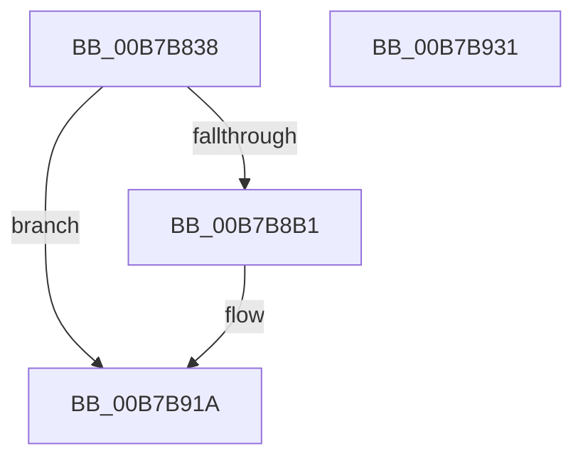

# BapdGetISRegistryKey

- RVA: `0x00B7B838`–`0x00B7B932` (길이 `250` bytes)
- VA: `0x0000000140B7B838`
- 실행 섹션: `PAGELK`
- PDB 이름 있음: `예`; PDB Function 태그: `아니요`
- unwind 정보 RVA: `0x000B9EF8`
- 디코드: `60`개 명령, `250/250` bytes 표시
- 미해석 바이트: `0` (있으면 어셈블리에 `.byte`로 보존)

> 이 문서는 커널 이미지의 기계어와 PDB 기호를 분석해 생성했습니다. 4번과 5번은 함수 원형과 자료형을 바이너리 사용 방식에서 추정한 C 해석이며 원본 소스 복구 결과는 아닙니다.

## 1. Dependencies

- 직접 호출 지점: **5**; 고유 호출 대상: **4**
- 직접 호출자로 확인된 함수: **3**
- RIP 상대 이미지 참조: **2**

### Outgoing calls
- `0x00B7B871` → [RtlInitUnicodeString](../../text/42/RtlInitUnicodeString_function_0042A780.md) (function, `0x0042A780`)
- `0x00B7B8A6` → [ZwOpenKey](../../text/6A/ZwOpenKey_function_006AD310.md) (function, `0x006AD310`)
- `0x00B7B8BC` → [RtlInitUnicodeString](../../text/42/RtlInitUnicodeString_function_0042A780.md) (function, `0x0042A780`)
- `0x00B7B90A` → [ZwCreateKey](../../text/6A/ZwCreateKey_function_006AD470.md) (function, `0x006AD470`)
- `0x00B7B915` → [ZwClose](../../text/6A/ZwClose_function_006AD2B0.md) (function, `0x006AD2B0`)

### Direct callers
- [BapdRemoveWbclData](../B5/BapdRemoveWbclData_function_00B5B2EC.md) at `0x00B5B305`
- [BapdRegisterSiData](BapdRegisterSiData_function_00B7B5B8.md) at `0x00B7B5F3`
- [BapdpProcessVsmKeyBlobs](../../init/C4/BapdpProcessVsmKeyBlobs_function_00C4FD60.md) at `0x00C4FE10`

### Static image references
- `0x00B7B84F` → RVA `0x00B800A0` (` ?? ::OKHAJAOM::`string'`; read)
- `0x00B7B8B1` → RVA `0x00B80120` (` ?? ::OKHAJAOM::`string'`; read)

## 2. Other-region calls and transfers

- 다른 실행 섹션으로 향하는 call: **5**
  - `0x00B7B871` → [RtlInitUnicodeString](../../text/42/RtlInitUnicodeString_function_0042A780.md) (`PAGELK` → `.text`)
  - `0x00B7B8A6` → [ZwOpenKey](../../text/6A/ZwOpenKey_function_006AD310.md) (`PAGELK` → `.text`)
  - `0x00B7B8BC` → [RtlInitUnicodeString](../../text/42/RtlInitUnicodeString_function_0042A780.md) (`PAGELK` → `.text`)
  - `0x00B7B90A` → [ZwCreateKey](../../text/6A/ZwCreateKey_function_006AD470.md) (`PAGELK` → `.text`)
  - `0x00B7B915` → [ZwClose](../../text/6A/ZwClose_function_006AD2B0.md) (`PAGELK` → `.text`)
- 별도 외부 분기/꼬리 이동을 확인하지 못했습니다.

## 3. Assembly (complete function range)

```asm
00B7B838  48 89 5C 24 08                  mov qword ptr [rsp + 8], rbx
00B7B83D  48 89 7C 24 18                  mov qword ptr [rsp + 0x18], rdi
00B7B842  55                              push rbp
00B7B843  48 8B EC                        mov rbp, rsp
00B7B846  48 81 EC 80 00 00 00            sub rsp, 0x80
00B7B84D  33 C0                           xor eax, eax
00B7B84F  48 8D 15 4A 48 00 00            lea rdx, [rip + 0x484a]
00B7B856  21 45 EC                        and dword ptr [rbp - 0x14], eax
00B7B859  48 8B F9                        mov rdi, rcx
00B7B85C  48 21 45 18                     and qword ptr [rbp + 0x18], rax
00B7B860  48 8D 4D C0                     lea rcx, [rbp - 0x40]
00B7B864  0F 57 C0                        xorps xmm0, xmm0
00B7B867  89 45 D4                        mov dword ptr [rbp - 0x2c], eax
00B7B86A  21 45 D4                        and dword ptr [rbp - 0x2c], eax
00B7B86D  0F 11 45 C0                     movups xmmword ptr [rbp - 0x40], xmm0
00B7B871  E8 0A EF 8A FF                  call 0x14042a780
00B7B876  48 83 65 D8 00                  and qword ptr [rbp - 0x28], 0
00B7B87B  48 8D 45 C0                     lea rax, [rbp - 0x40]
00B7B87F  0F 57 C0                        xorps xmm0, xmm0
00B7B882  48 89 45 E0                     mov qword ptr [rbp - 0x20], rax
00B7B886  4C 8D 45 D0                     lea r8, [rbp - 0x30]
00B7B88A  C7 45 D0 30 00 00 00            mov dword ptr [rbp - 0x30], 0x30
00B7B891  BA 19 00 02 00                  mov edx, 0x20019
00B7B896  C7 45 E8 40 02 00 00            mov dword ptr [rbp - 0x18], 0x240
00B7B89D  48 8D 4D 18                     lea rcx, [rbp + 0x18]
00B7B8A1  F3 0F 7F 45 F0                  movdqu xmmword ptr [rbp - 0x10], xmm0
00B7B8A6  E8 65 1A B3 FF                  call 0x1406ad310
00B7B8AB  8B D8                           mov ebx, eax
00B7B8AD  85 C0                           test eax, eax
00B7B8AF  78 69                           js 0x140b7b91a
00B7B8B1  48 8D 15 68 48 00 00            lea rdx, [rip + 0x4868]
00B7B8B8  48 8D 4D C0                     lea rcx, [rbp - 0x40]
00B7B8BC  E8 BF EE 8A FF                  call 0x14042a780
00B7B8C1  48 8B 45 18                     mov rax, qword ptr [rbp + 0x18]
00B7B8C5  4C 8D 45 D0                     lea r8, [rbp - 0x30]
00B7B8C9  48 83 64 24 30 00               and qword ptr [rsp + 0x30], 0
00B7B8CF  0F 57 C0                        xorps xmm0, xmm0
00B7B8D2  48 89 45 D8                     mov qword ptr [rbp - 0x28], rax
00B7B8D6  45 33 C9                        xor r9d, r9d
00B7B8D9  48 8D 45 C0                     lea rax, [rbp - 0x40]
00B7B8DD  C7 44 24 28 01 00 00 00         mov dword ptr [rsp + 0x28], 1
00B7B8E5  48 83 64 24 20 00               and qword ptr [rsp + 0x20], 0
00B7B8EB  BA 1F 00 06 00                  mov edx, 0x6001f
00B7B8F0  48 8B CF                        mov rcx, rdi
00B7B8F3  48 89 45 E0                     mov qword ptr [rbp - 0x20], rax
00B7B8F7  C7 45 D0 30 00 00 00            mov dword ptr [rbp - 0x30], 0x30
00B7B8FE  C7 45 E8 40 02 00 00            mov dword ptr [rbp - 0x18], 0x240
00B7B905  F3 0F 7F 45 F0                  movdqu xmmword ptr [rbp - 0x10], xmm0
00B7B90A  E8 61 1B B3 FF                  call 0x1406ad470
00B7B90F  48 8B 4D 18                     mov rcx, qword ptr [rbp + 0x18]
00B7B913  8B D8                           mov ebx, eax
00B7B915  E8 96 19 B3 FF                  call 0x1406ad2b0
00B7B91A  4C 8D 9C 24 80 00 00 00         lea r11, [rsp + 0x80]
00B7B922  8B C3                           mov eax, ebx
00B7B924  49 8B 5B 10                     mov rbx, qword ptr [r11 + 0x10]
00B7B928  49 8B 7B 20                     mov rdi, qword ptr [r11 + 0x20]
00B7B92C  49 8B E3                        mov rsp, r11
00B7B92F  5D                              pop rbp
00B7B930  C3                              ret
00B7B931  CC                              int3
```

## 4. C-style interpretation (structured pseudocode)

```c
__int64 __fastcall BapdGetISRegistryKey(__int64 a1, __int64 a2, __int64 a3, int a4)
{
    __int64 result;
    __int64 v_rbx;
    __int64 v_rsp;
    unsigned __int64 v_stack_m18;
    unsigned int v_stack_m1C;
    unsigned int v_stack_m20;
    unsigned __int64 v_stack_m28;
    unsigned __int64 v_stack_m30;
    unsigned int v_stack_m34;
    unsigned __int64 v_stack_m38;
    unsigned __int64 v_stack_m48;
    unsigned __int64 v_stack_m58;
    unsigned int v_stack_m60;
    unsigned __int64 v_stack_m68;
    unsigned __int64 v_stack_m8;
    unsigned __int64 v_stack_p10;
    unsigned __int64 v_stack_p18;
    unsigned __int64 v_stack_p8;

    v_stack_p8 = v_rbx;
    v_stack_p18 = v_rdi;
    v_rsp = (v_rsp) - (128);
    result = 0;
    v_stack_m34 = 0;
    v_stack_m48 = v_xmm0;
    result = RtlInitUnicodeString(v_stack_m48, v_rip + 18506, a3, a4);
    v_stack_m28 = v_stack_m48;
    v_stack_m38 = 48;
    v_stack_m20 = 576;
    v_stack_m18 = v_xmm0;
    result = ZwOpenKey(v_stack_p10, (unsigned int)(0x20019ULL), v_stack_m38, a4);
    v_rbx = (unsigned int)((unsigned int)(result));
    if (!(sign_flag)) {
        a2 = v_rip + 18536;
        a1 = v_stack_m48;
        result = RtlInitUnicodeString(a1, a2, v_stack_m38, a4);
        result = v_stack_p10;
        a3 = v_stack_m38;
        v_stack_m30 = result;
        a4 = 0;
        result = v_stack_m48;
        v_stack_m60 = 1;
        a2 = 0x6001FULL;
        a1 = a1;
        v_stack_m28 = result;
        v_stack_m38 = 48;
        v_stack_m20 = 576;
        v_stack_m18 = v_xmm0;
        result = ZwCreateKey(a1, a2, a3, a4);
        a1 = v_stack_p10;
        v_rbx = (unsigned int)(result);
        result = ZwClose(a1, a2, a3, a4);
    }
    return (unsigned int)((unsigned int)(v_rbx));
}
```

## 5. (Beta) C Style

```c
int64_t BapdGetISRegistryKey(int64_t Arg1, int64_t Arg2, int64_t Arg3, int32_t Arg4)
{
    int64_t result;
    int64_t local_rbx;
    int64_t local_rsp;
    uint64_t v_stack_m18;
    uint32_t v_stack_m1C;
    uint32_t v_stack_m20;
    uint64_t v_stack_m28;
    uint64_t v_stack_m30;
    uint32_t v_stack_m34;
    uint64_t v_stack_m38;
    uint64_t v_stack_m48;
    uint64_t v_stack_m58;
    uint32_t v_stack_m60;
    uint64_t v_stack_m68;
    uint64_t v_stack_m8;
    uint64_t v_stack_p10;
    uint64_t v_stack_p18;
    uint64_t v_stack_p8;

    v_stack_p8 = local_rbx;
    v_stack_p18 = local_rdi;
    local_rsp = (local_rsp) - (128);
    result = 0;
    v_stack_m34 = 0;
    v_stack_m48 = v_xmm0;
    result = RtlInitUnicodeString(v_stack_m48, v_rip + 18506, Arg3, Arg4);
    v_stack_m28 = v_stack_m48;
    v_stack_m38 = 48;
    v_stack_m20 = 576;
    v_stack_m18 = v_xmm0;
    result = ZwOpenKey(v_stack_p10, (uint32_t)(0x20019ULL), v_stack_m38, Arg4);
    local_rbx = (uint32_t)((uint32_t)(result));
    if (!(sign_flag)) {
        Arg2 = v_rip + 18536;
        Arg1 = v_stack_m48;
        result = RtlInitUnicodeString(Arg1, Arg2, v_stack_m38, Arg4);
        result = v_stack_p10;
        Arg3 = v_stack_m38;
        v_stack_m30 = result;
        Arg4 = 0;
        result = v_stack_m48;
        v_stack_m60 = 1;
        Arg2 = 0x6001FULL;
        Arg1 = Arg1;
        v_stack_m28 = result;
        v_stack_m38 = 48;
        v_stack_m20 = 576;
        v_stack_m18 = v_xmm0;
        result = ZwCreateKey(Arg1, Arg2, Arg3, Arg4);
        Arg1 = v_stack_p10;
        local_rbx = (uint32_t)(result);
        result = ZwClose(Arg1, Arg2, Arg3, Arg4);
    }
    return (uint32_t)((uint32_t)(local_rbx));
}
```

## 6. Execution-region graph

[열기: 2D/3D 그래프와 함수 탐색 컨트롤 패널](../../../control-panel.html?section=pagelk&rva=0x00B7B838&view=graph)

- 2D 그래프는 위에서 아래로 흐르고, 3D 그래프는 빈 공간을 드래그해 회전합니다. Shift+드래그는 이동, 휠은 확대·축소, 함수 노드 선택은 대상 보고서 이동입니다.

### Static fallback


