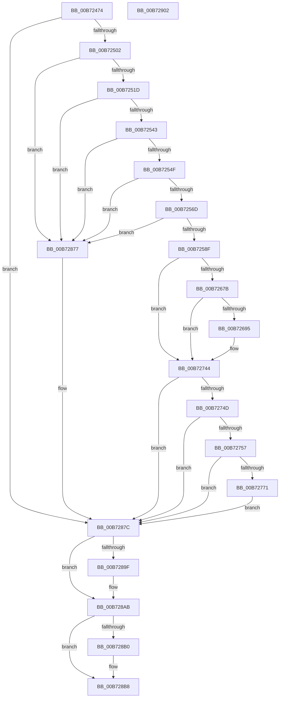

# BapdRecordFirmwareBootStats

- RVA: `0x00B72474`–`0x00B72903` (길이 `1,167` bytes)
- VA: `0x0000000140B72474`
- 실행 섹션: `PAGELK`
- PDB 이름 있음: `예`; PDB Function 태그: `아니요`
- unwind 정보 RVA: `0x000D48C4`
- 디코드: `256`개 명령, `1,167/1,167` bytes 표시
- 미해석 바이트: `0` (있으면 어셈블리에 `.byte`로 보존)

> 이 문서는 커널 이미지의 기계어와 PDB 기호를 분석해 생성했습니다. 4번과 5번은 함수 원형과 자료형을 바이너리 사용 방식에서 추정한 C 해석이며 원본 소스 복구 결과는 아닙니다.

## 1. Dependencies

- 직접 호출 지점: **17**; 고유 호출 대상: **13**
- 직접 호출자로 확인된 함수: **2**
- RIP 상대 이미지 참조: **11**

### Outgoing calls
- `0x00B724F0` → [TraceLoggingRegisterEx_EtwRegister_EtwSetInformation](../../page/92/TraceLoggingRegisterEx_EtwRegister_EtwSetInformation_function_009208A0.md) (function, `0x009208A0`)
- `0x00B724F5` → [ExIsSoftBoot](../../text/4F/ExIsSoftBoot_function_004FAE60.md) (function, `0x004FAE60`)
- `0x00B72510` → [BapdRegisterEtwProvider](../../text/4A/BapdRegisterEtwProvider_function_004AECF8.md) (function, `0x004AECF8`)
- `0x00B72533` → [guard_dispatch_icall](../../text/6B/guard_dispatch_icall_function_006BAAD0.md) (function, `0x006BAAD0`)
- `0x00B7255C` → [ExAllocatePool2](../../poolcode/B8/ExAllocatePool2_function_00B820F0.md) (function, `0x00B820F0`)
- `0x00B72582` → [guard_dispatch_icall](../../text/6B/guard_dispatch_icall_function_006BAAD0.md) (function, `0x006BAAD0`)
- `0x00B72665` → [EtwWrite](../../text/41/EtwWrite_function_0041C720.md) (function, `0x0041C720`)
- `0x00B72688` → [tlgKeywordOn](../../text/42/tlgKeywordOn_function_0042EAA0.md) (function, `0x0042EAA0`)
- `0x00B72738` → [tlgWriteTransfer_EtwWriteTransfer](../../text/42/tlgWriteTransfer_EtwWriteTransfer_function_004260E0.md) (function, `0x004260E0`)
- `0x00B72764` → [tlgKeywordOn](../../text/42/tlgKeywordOn_function_0042EAA0.md) (function, `0x0042EAA0`)
- `0x00B72870` → [tlgWriteTransfer_EtwWriteTransfer](../../text/42/tlgWriteTransfer_EtwWriteTransfer_function_004260E0.md) (function, `0x004260E0`)
- `0x00B72887` → [RtlInitUnicodeString](../../text/42/RtlInitUnicodeString_function_0042A780.md) (function, `0x0042A780`)
- `0x00B72895` → [BapdpWriteEventDataToRegistry](BapdpWriteEventDataToRegistry_function_00B7C1E8.md) (function, `0x00B7C1E8`)
- `0x00B728A6` → [ExFreePoolWithTag](../../poolcode/B8/ExFreePoolWithTag_function_00B82870.md) (function, `0x00B82870`)
- `0x00B728B3` → [EtwUnregister](../../page/A7/EtwUnregister_function_00A723D0.md) (function, `0x00A723D0`)
- `0x00B728CD` → [EtwUnregister](../../page/A7/EtwUnregister_function_00A723D0.md) (function, `0x00A723D0`)
- `0x00B728DC` → [_security_check_cookie](../../text/6A/_security_check_cookie_function_006AC640.md) (function, `0x006AC640`)

### Direct callers
- [PopBootLoaderTraceProcess](../../page/75/PopBootLoaderTraceProcess_function_0075CC3C.md) at `0x0075CC50`
- [IoInitSystemPreDrivers](../../init/C2/IoInitSystemPreDrivers_function_00C2AC3C.md) at `0x00C2B94C`

### Static image references
- `0x00B7249A` → RVA `0x00E0A740` (`.data`; read)
- `0x00B724AE` → RVA `0x00E09350` (`.data`; read)
- `0x00B72509` → RVA `0x0001BF70` (`.rdata`; read)
- `0x00B7251D` → RVA `0x00E00638` (`.data`; read)
- `0x00B7263D` → RVA `0x00021088` (`.rdata`; read)
- `0x00B7269A` → RVA `0x000554DD` (`.rdata`; read)
- `0x00B72848` → RVA `0x00055566` (`.rdata`; read)
- `0x00B7287C` → RVA `0x00B7FF60` (` ?? ::OKHAJAOM::`string'`; read)
- `0x00B728B8` → RVA `0x00E09370` (`.data`; read)
- `0x00B728BF` → RVA `0x00E09370` (`.data`; write)
- `0x00B728C6` → RVA `0x00E09350` (`.data`; write)

## 2. Other-region calls and transfers

- 다른 실행 섹션으로 향하는 call: **16**
  - `0x00B724F0` → [TraceLoggingRegisterEx_EtwRegister_EtwSetInformation](../../page/92/TraceLoggingRegisterEx_EtwRegister_EtwSetInformation_function_009208A0.md) (`PAGELK` → `PAGE`)
  - `0x00B724F5` → [ExIsSoftBoot](../../text/4F/ExIsSoftBoot_function_004FAE60.md) (`PAGELK` → `.text`)
  - `0x00B72510` → [BapdRegisterEtwProvider](../../text/4A/BapdRegisterEtwProvider_function_004AECF8.md) (`PAGELK` → `.text`)
  - `0x00B72533` → [guard_dispatch_icall](../../text/6B/guard_dispatch_icall_function_006BAAD0.md) (`PAGELK` → `.text`)
  - `0x00B7255C` → [ExAllocatePool2](../../poolcode/B8/ExAllocatePool2_function_00B820F0.md) (`PAGELK` → `POOLCODE`)
  - `0x00B72582` → [guard_dispatch_icall](../../text/6B/guard_dispatch_icall_function_006BAAD0.md) (`PAGELK` → `.text`)
  - `0x00B72665` → [EtwWrite](../../text/41/EtwWrite_function_0041C720.md) (`PAGELK` → `.text`)
  - `0x00B72688` → [tlgKeywordOn](../../text/42/tlgKeywordOn_function_0042EAA0.md) (`PAGELK` → `.text`)
  - `0x00B72738` → [tlgWriteTransfer_EtwWriteTransfer](../../text/42/tlgWriteTransfer_EtwWriteTransfer_function_004260E0.md) (`PAGELK` → `.text`)
  - `0x00B72764` → [tlgKeywordOn](../../text/42/tlgKeywordOn_function_0042EAA0.md) (`PAGELK` → `.text`)
  - `0x00B72870` → [tlgWriteTransfer_EtwWriteTransfer](../../text/42/tlgWriteTransfer_EtwWriteTransfer_function_004260E0.md) (`PAGELK` → `.text`)
  - `0x00B72887` → [RtlInitUnicodeString](../../text/42/RtlInitUnicodeString_function_0042A780.md) (`PAGELK` → `.text`)
  - `0x00B728A6` → [ExFreePoolWithTag](../../poolcode/B8/ExFreePoolWithTag_function_00B82870.md) (`PAGELK` → `POOLCODE`)
  - `0x00B728B3` → [EtwUnregister](../../page/A7/EtwUnregister_function_00A723D0.md) (`PAGELK` → `PAGE`)
  - `0x00B728CD` → [EtwUnregister](../../page/A7/EtwUnregister_function_00A723D0.md) (`PAGELK` → `PAGE`)
  - `0x00B728DC` → [_security_check_cookie](../../text/6A/_security_check_cookie_function_006AC640.md) (`PAGELK` → `.text`)
- 별도 외부 분기/꼬리 이동을 확인하지 못했습니다.

## 3. Assembly (complete function range)

```asm
00B72474  48 8B C4                        mov rax, rsp
00B72477  48 89 58 08                     mov qword ptr [rax + 8], rbx
00B7247B  48 89 70 10                     mov qword ptr [rax + 0x10], rsi
00B7247F  48 89 78 18                     mov qword ptr [rax + 0x18], rdi
00B72483  4C 89 60 20                     mov qword ptr [rax + 0x20], r12
00B72487  55                              push rbp
00B72488  41 56                           push r14
00B7248A  41 57                           push r15
00B7248C  48 8D A8 18 FF FF FF            lea rbp, [rax - 0xe8]
00B72493  48 81 EC D0 01 00 00            sub rsp, 0x1d0
00B7249A  48 8B 05 9F 82 29 00            mov rax, qword ptr [rip + 0x29829f]
00B724A1  48 33 C4                        xor rax, rsp
00B724A4  48 89 85 C0 00 00 00            mov qword ptr [rbp + 0xc0], rax
00B724AB  45 33 F6                        xor r14d, r14d
00B724AE  4C 8D 25 9B 6E 29 00            lea r12, [rip + 0x296e9b]
00B724B5  48 8B F1                        mov rsi, rcx
00B724B8  4C 89 74 24 58                  mov qword ptr [rsp + 0x58], r14
00B724BD  0F 57 C0                        xorps xmm0, xmm0
00B724C0  4C 89 74 24 60                  mov qword ptr [rsp + 0x60], r14
00B724C5  49 8B CC                        mov rcx, r12
00B724C8  4C 89 74 24 50                  mov qword ptr [rsp + 0x50], r14
00B724CD  45 33 C0                        xor r8d, r8d
00B724D0  4C 89 74 24 48                  mov qword ptr [rsp + 0x48], r14
00B724D5  33 D2                           xor edx, edx
00B724D7  4C 89 74 24 38                  mov qword ptr [rsp + 0x38], r14
00B724DC  0F 11 45 A8                     movups xmmword ptr [rbp - 0x58], xmm0
00B724E0  41 8B FE                        mov edi, r14d
00B724E3  44 89 74 24 30                  mov dword ptr [rsp + 0x30], r14d
00B724E8  41 8B DE                        mov ebx, r14d
00B724EB  4C 89 74 24 40                  mov qword ptr [rsp + 0x40], r14
00B724F0  E8 AB E3 DA FF                  call 0x1409208a0
00B724F5  E8 66 89 98 FF                  call 0x1404fae60
00B724FA  84 C0                           test al, al
00B724FC  0F 85 7A 03 00 00               jne 0x140b7287c
00B72502  4C 8D 44 24 38                  lea r8, [rsp + 0x38]
00B72507  B2 01                           mov dl, 1
00B72509  48 8D 0D 60 9A 4A FF            lea rcx, [rip - 0xb565a0]
00B72510  E8 E3 C7 93 FF                  call 0x1404aecf8
00B72515  85 C0                           test eax, eax
00B72517  0F 88 5A 03 00 00               js 0x140b72877
00B7251D  48 8B 05 14 E1 28 00            mov rax, qword ptr [rip + 0x28e114]
00B72524  4C 8D 4C 24 30                  lea r9, [rsp + 0x30]
00B72529  33 D2                           xor edx, edx
00B7252B  45 33 C0                        xor r8d, r8d
00B7252E  8D 7A 22                        lea edi, [rdx + 0x22]
00B72531  8B CF                           mov ecx, edi
00B72533  E8 98 85 B4 FF                  call 0x1406baad0
00B72538  3D 04 00 00 C0                  cmp eax, 0xc0000004
00B7253D  0F 85 34 03 00 00               jne 0x140b72877
00B72543  8B 44 24 30                     mov eax, dword ptr [rsp + 0x30]
00B72547  85 C0                           test eax, eax
00B72549  0F 84 28 03 00 00               je 0x140b72877
00B7254F  8B D0                           mov edx, eax
00B72551  B9 00 01 00 00                  mov ecx, 0x100
00B72556  41 B8 46 77 62 73               mov r8d, 0x73627746
00B7255C  E8 8F FB 00 00                  call 0x140b820f0
00B72561  48 8B D8                        mov rbx, rax
00B72564  48 85 C0                        test rax, rax
00B72567  0F 84 0A 03 00 00               je 0x140b72877
00B7256D  48 8B 05 C4 E0 28 00            mov rax, qword ptr [rip + 0x28e0c4]
00B72574  4C 8D 4C 24 30                  lea r9, [rsp + 0x30]
00B72579  8B 54 24 30                     mov edx, dword ptr [rsp + 0x30]
00B7257D  4C 8B C3                        mov r8, rbx
00B72580  8B CF                           mov ecx, edi
00B72582  E8 49 85 B4 FF                  call 0x1406baad0
00B72587  85 C0                           test eax, eax
00B72589  0F 88 E8 02 00 00               js 0x140b72877
00B7258F  48 8B 7C 24 38                  mov rdi, qword ptr [rsp + 0x38]
00B72594  45 8D 7E 08                     lea r15d, [r14 + 8]
00B72598  48 B9 DB 34 B6 D7 82 DE 1B 43   movabs rcx, 0x431bde82d7b634db
00B725A2  45 8D 4E 05                     lea r9d, [r14 + 5]
00B725A6  48 8B C1                        mov rax, rcx
00B725A9  45 33 C0                        xor r8d, r8d
00B725AC  48 F7 63 10                     mul qword ptr [rbx + 0x10]
00B725B0  48 8B C1                        mov rax, rcx
00B725B3  48 C1 EA 12                     shr rdx, 0x12
00B725B7  48 89 54 24 48                  mov qword ptr [rsp + 0x48], rdx
00B725BC  48 F7 63 18                     mul qword ptr [rbx + 0x18]
00B725C0  48 8B C1                        mov rax, rcx
00B725C3  48 C1 EA 12                     shr rdx, 0x12
00B725C7  48 89 54 24 50                  mov qword ptr [rsp + 0x50], rdx
00B725CC  48 F7 63 20                     mul qword ptr [rbx + 0x20]
00B725D0  48 8B C1                        mov rax, rcx
00B725D3  48 C1 EA 12                     shr rdx, 0x12
00B725D7  48 89 54 24 40                  mov qword ptr [rsp + 0x40], rdx
00B725DC  48 F7 63 28                     mul qword ptr [rbx + 0x28]
00B725E0  48 8B C1                        mov rax, rcx
00B725E3  48 8B CF                        mov rcx, rdi
00B725E6  48 C1 EA 12                     shr rdx, 0x12
00B725EA  48 89 54 24 58                  mov qword ptr [rsp + 0x58], rdx
00B725EF  48 F7 63 30                     mul qword ptr [rbx + 0x30]
00B725F3  48 8D 44 24 48                  lea rax, [rsp + 0x48]
00B725F8  4C 89 7D 78                     mov qword ptr [rbp + 0x78], r15
00B725FC  48 89 45 70                     mov qword ptr [rbp + 0x70], rax
00B72600  48 8D 44 24 50                  lea rax, [rsp + 0x50]
00B72605  48 89 85 80 00 00 00            mov qword ptr [rbp + 0x80], rax
00B7260C  48 8D 44 24 40                  lea rax, [rsp + 0x40]
00B72611  48 89 85 90 00 00 00            mov qword ptr [rbp + 0x90], rax
00B72618  48 8D 44 24 58                  lea rax, [rsp + 0x58]
00B7261D  48 89 85 A0 00 00 00            mov qword ptr [rbp + 0xa0], rax
00B72624  48 8D 44 24 60                  lea rax, [rsp + 0x60]
00B72629  48 C1 EA 12                     shr rdx, 0x12
00B7262D  48 89 85 B0 00 00 00            mov qword ptr [rbp + 0xb0], rax
00B72634  48 8D 45 70                     lea rax, [rbp + 0x70]
00B72638  48 89 54 24 60                  mov qword ptr [rsp + 0x60], rdx
00B7263D  48 8D 15 44 EA 4A FF            lea rdx, [rip - 0xb515bc]
00B72644  48 89 44 24 20                  mov qword ptr [rsp + 0x20], rax
00B72649  4C 89 BD 88 00 00 00            mov qword ptr [rbp + 0x88], r15
00B72650  4C 89 BD 98 00 00 00            mov qword ptr [rbp + 0x98], r15
00B72657  4C 89 BD A8 00 00 00            mov qword ptr [rbp + 0xa8], r15
00B7265E  4C 89 BD B8 00 00 00            mov qword ptr [rbp + 0xb8], r15
00B72665  E8 B6 A0 8A FF                  call 0x14041c720
00B7266A  44 8B 05 DF 6C 29 00            mov r8d, dword ptr [rip + 0x296cdf]
00B72671  41 83 F8 04                     cmp r8d, 4
00B72675  0F 86 C9 00 00 00               jbe 0x140b72744
00B7267B  48 BA 00 00 00 00 00 40 00 00   movabs rdx, 0x400000000000
00B72685  49 8B CC                        mov rcx, r12
00B72688  E8 13 C4 8B FF                  call 0x14042eaa0
00B7268D  84 C0                           test al, al
00B7268F  0F 84 AF 00 00 00               je 0x140b72744
00B72695  48 8B 44 24 48                  mov rax, qword ptr [rsp + 0x48]
00B7269A  48 8D 15 3C 2E 4E FF            lea rdx, [rip - 0xb1d1c4]
00B726A1  48 89 44 24 38                  mov qword ptr [rsp + 0x38], rax
00B726A6  45 33 C9                        xor r9d, r9d
00B726A9  48 8D 44 24 38                  lea rax, [rsp + 0x38]
00B726AE  4C 89 7D E8                     mov qword ptr [rbp - 0x18], r15
00B726B2  48 89 45 E0                     mov qword ptr [rbp - 0x20], rax
00B726B6  45 33 C0                        xor r8d, r8d
00B726B9  48 8B 44 24 50                  mov rax, qword ptr [rsp + 0x50]
00B726BE  49 8B CC                        mov rcx, r12
00B726C1  48 89 44 24 68                  mov qword ptr [rsp + 0x68], rax
00B726C6  48 8D 44 24 68                  lea rax, [rsp + 0x68]
00B726CB  48 89 45 F0                     mov qword ptr [rbp - 0x10], rax
00B726CF  48 8B 44 24 40                  mov rax, qword ptr [rsp + 0x40]
00B726D4  48 89 44 24 70                  mov qword ptr [rsp + 0x70], rax
00B726D9  48 8D 44 24 70                  lea rax, [rsp + 0x70]
00B726DE  48 89 45 00                     mov qword ptr [rbp], rax
00B726E2  48 8B 44 24 58                  mov rax, qword ptr [rsp + 0x58]
00B726E7  48 89 44 24 78                  mov qword ptr [rsp + 0x78], rax
00B726EC  48 8D 44 24 78                  lea rax, [rsp + 0x78]
00B726F1  48 89 45 10                     mov qword ptr [rbp + 0x10], rax
00B726F5  48 8B 44 24 60                  mov rax, qword ptr [rsp + 0x60]
00B726FA  48 89 45 80                     mov qword ptr [rbp - 0x80], rax
00B726FE  48 8D 45 80                     lea rax, [rbp - 0x80]
00B72702  48 89 45 20                     mov qword ptr [rbp + 0x20], rax
00B72706  48 8D 45 88                     lea rax, [rbp - 0x78]
00B7270A  48 89 45 30                     mov qword ptr [rbp + 0x30], rax
00B7270E  48 8D 45 C0                     lea rax, [rbp - 0x40]
00B72712  48 89 44 24 28                  mov qword ptr [rsp + 0x28], rax
00B72717  44 89 7C 24 20                  mov dword ptr [rsp + 0x20], r15d
00B7271C  4C 89 7D F8                     mov qword ptr [rbp - 8], r15
00B72720  4C 89 7D 08                     mov qword ptr [rbp + 8], r15
00B72724  4C 89 7D 18                     mov qword ptr [rbp + 0x18], r15
00B72728  4C 89 7D 28                     mov qword ptr [rbp + 0x28], r15
00B7272C  48 C7 45 88 00 00 00 01         mov qword ptr [rbp - 0x78], 0x1000000
00B72734  4C 89 7D 38                     mov qword ptr [rbp + 0x38], r15
00B72738  E8 A3 39 8B FF                  call 0x1404260e0
00B7273D  44 8B 05 0C 6C 29 00            mov r8d, dword ptr [rip + 0x296c0c]
00B72744  48 85 F6                        test rsi, rsi
00B72747  0F 84 2F 01 00 00               je 0x140b7287c
00B7274D  41 83 F8 04                     cmp r8d, 4
00B72751  0F 86 25 01 00 00               jbe 0x140b7287c
00B72757  48 BA 00 00 00 00 00 40 00 00   movabs rdx, 0x400000000000
00B72761  49 8B CC                        mov rcx, r12
00B72764  E8 37 C3 8B FF                  call 0x14042eaa0
00B72769  84 C0                           test al, al
00B7276B  0F 84 0B 01 00 00               je 0x140b7287c
00B72771  48 8B 96 F0 00 00 00            mov rdx, qword ptr [rsi + 0xf0]
00B72778  45 33 C9                        xor r9d, r9d
00B7277B  45 33 C0                        xor r8d, r8d
00B7277E  49 8B CC                        mov rcx, r12
00B72781  48 8B 82 88 00 00 00            mov rax, qword ptr [rdx + 0x88]
00B72788  48 89 45 88                     mov qword ptr [rbp - 0x78], rax
00B7278C  48 8D 45 88                     lea rax, [rbp - 0x78]
00B72790  48 89 45 E0                     mov qword ptr [rbp - 0x20], rax
00B72794  4C 89 7D E8                     mov qword ptr [rbp - 0x18], r15
00B72798  48 8B 82 90 00 00 00            mov rax, qword ptr [rdx + 0x90]
00B7279F  48 89 45 80                     mov qword ptr [rbp - 0x80], rax
00B727A3  48 8D 45 80                     lea rax, [rbp - 0x80]
00B727A7  48 89 45 F0                     mov qword ptr [rbp - 0x10], rax
00B727AB  4C 89 7D F8                     mov qword ptr [rbp - 8], r15
00B727AF  48 8B 82 98 00 00 00            mov rax, qword ptr [rdx + 0x98]
00B727B6  48 89 44 24 78                  mov qword ptr [rsp + 0x78], rax
00B727BB  48 8D 44 24 78                  lea rax, [rsp + 0x78]
00B727C0  48 89 45 00                     mov qword ptr [rbp], rax
00B727C4  4C 89 7D 08                     mov qword ptr [rbp + 8], r15
00B727C8  48 8B 82 A0 00 00 00            mov rax, qword ptr [rdx + 0xa0]
00B727CF  48 89 44 24 70                  mov qword ptr [rsp + 0x70], rax
00B727D4  48 8D 44 24 70                  lea rax, [rsp + 0x70]
00B727D9  48 89 45 10                     mov qword ptr [rbp + 0x10], rax
00B727DD  4C 89 7D 18                     mov qword ptr [rbp + 0x18], r15
00B727E1  48 8B 82 B8 00 00 00            mov rax, qword ptr [rdx + 0xb8]
00B727E8  48 89 44 24 68                  mov qword ptr [rsp + 0x68], rax
00B727ED  48 8D 44 24 68                  lea rax, [rsp + 0x68]
00B727F2  48 89 45 20                     mov qword ptr [rbp + 0x20], rax
00B727F6  4C 89 7D 28                     mov qword ptr [rbp + 0x28], r15
00B727FA  48 8B 82 C0 00 00 00            mov rax, qword ptr [rdx + 0xc0]
00B72801  48 89 44 24 38                  mov qword ptr [rsp + 0x38], rax
00B72806  48 8D 44 24 38                  lea rax, [rsp + 0x38]
00B7280B  48 89 45 30                     mov qword ptr [rbp + 0x30], rax
00B7280F  4C 89 7D 38                     mov qword ptr [rbp + 0x38], r15
00B72813  48 8B 82 A8 00 00 00            mov rax, qword ptr [rdx + 0xa8]
00B7281A  48 89 45 90                     mov qword ptr [rbp - 0x70], rax
00B7281E  48 8D 45 90                     lea rax, [rbp - 0x70]
00B72822  48 89 45 40                     mov qword ptr [rbp + 0x40], rax
00B72826  4C 89 7D 48                     mov qword ptr [rbp + 0x48], r15
00B7282A  48 8B 82 B0 00 00 00            mov rax, qword ptr [rdx + 0xb0]
00B72831  48 89 45 98                     mov qword ptr [rbp - 0x68], rax
00B72835  48 8D 45 98                     lea rax, [rbp - 0x68]
00B72839  48 89 45 50                     mov qword ptr [rbp + 0x50], rax
00B7283D  4C 89 7D 58                     mov qword ptr [rbp + 0x58], r15
00B72841  48 8B 82 18 0F 00 00            mov rax, qword ptr [rdx + 0xf18]
00B72848  48 8D 15 17 2D 4E FF            lea rdx, [rip - 0xb1d2e9]
00B7284F  48 89 45 A0                     mov qword ptr [rbp - 0x60], rax
00B72853  48 8D 45 A0                     lea rax, [rbp - 0x60]
00B72857  48 89 45 60                     mov qword ptr [rbp + 0x60], rax
00B7285B  48 8D 45 C0                     lea rax, [rbp - 0x40]
00B7285F  48 89 44 24 28                  mov qword ptr [rsp + 0x28], rax
00B72864  C7 44 24 20 0B 00 00 00         mov dword ptr [rsp + 0x20], 0xb
00B7286C  4C 89 7D 68                     mov qword ptr [rbp + 0x68], r15
00B72870  E8 6B 38 8B FF                  call 0x1404260e0
00B72875  EB 05                           jmp 0x140b7287c
00B72877  48 8B 7C 24 38                  mov rdi, qword ptr [rsp + 0x38]
00B7287C  48 8D 15 DD D6 00 00            lea rdx, [rip + 0xd6dd]
00B72883  48 8D 4D A8                     lea rcx, [rbp - 0x58]
00B72887  E8 F4 7E 8B FF                  call 0x14042a780
00B7288C  4C 8D 45 A8                     lea r8, [rbp - 0x58]
00B72890  48 8D 4C 24 40                  lea rcx, [rsp + 0x40]
00B72895  E8 4E 99 00 00                  call 0x140b7c1e8
00B7289A  48 85 DB                        test rbx, rbx
00B7289D  74 0C                           je 0x140b728ab
00B7289F  8B 54 24 30                     mov edx, dword ptr [rsp + 0x30]
00B728A3  48 8B CB                        mov rcx, rbx
00B728A6  E8 C5 FF 00 00                  call 0x140b82870
00B728AB  48 85 FF                        test rdi, rdi
00B728AE  74 08                           je 0x140b728b8
00B728B0  48 8B CF                        mov rcx, rdi
00B728B3  E8 18 FB EF FF                  call 0x140a723d0
00B728B8  48 8B 0D B1 6A 29 00            mov rcx, qword ptr [rip + 0x296ab1]
00B728BF  4C 89 35 AA 6A 29 00            mov qword ptr [rip + 0x296aaa], r14
00B728C6  44 89 35 83 6A 29 00            mov dword ptr [rip + 0x296a83], r14d
00B728CD  E8 FE FA EF FF                  call 0x140a723d0
00B728D2  48 8B 8D C0 00 00 00            mov rcx, qword ptr [rbp + 0xc0]
00B728D9  48 33 CC                        xor rcx, rsp
00B728DC  E8 5F 9D B3 FF                  call 0x1406ac640
00B728E1  4C 8D 9C 24 D0 01 00 00         lea r11, [rsp + 0x1d0]
00B728E9  49 8B 5B 20                     mov rbx, qword ptr [r11 + 0x20]
00B728ED  49 8B 73 28                     mov rsi, qword ptr [r11 + 0x28]
00B728F1  49 8B 7B 30                     mov rdi, qword ptr [r11 + 0x30]
00B728F5  4D 8B 63 38                     mov r12, qword ptr [r11 + 0x38]
00B728F9  49 8B E3                        mov rsp, r11
00B728FC  41 5F                           pop r15
00B728FE  41 5E                           pop r14
00B72900  5D                              pop rbp
00B72901  C3                              ret
00B72902  CC                              int3
```

## 4. C-style interpretation (structured pseudocode)

```c
__int64 __fastcall BapdRecordFirmwareBootStats(__int64 a1, int a2, int a3)
{
    __int64 result;
    __int64 v_r14;
    __int64 v_rsp;
    unsigned __int64 v_stack_m170;
    unsigned __int64 v_stack_m178;
    unsigned __int64 v_stack_m18;
    unsigned __int64 v_stack_m180;
    unsigned __int64 v_stack_m188;
    unsigned __int64 v_stack_m190;
    unsigned __int64 v_stack_m198;
    unsigned __int64 v_stack_m1A0;
    unsigned __int64 v_stack_m1A8;
    unsigned __int64 v_stack_m1B0;
    unsigned int v_stack_m1B8;
    unsigned __int64 v_stack_m1C0;
    unsigned __int64 v_stack_m1C8;

    *(unsigned __int64 *)(v_rsp + 8) = v_rbx;
    *(unsigned __int64 *)(v_rsp + 16) = v_rsi;
    *(unsigned __int64 *)(v_rsp + 24) = v_rdi;
    *(unsigned __int64 *)(v_rsp + 32) = v_r12;
    v_rsp = (v_rsp) - (464);
    result = (*(unsigned __int64 *)(v_rip + 2720415)) ^ (v_rsp);
    *(unsigned __int64 *)(v_rsp - 232 + 192) = result;
    v_r14 = 0;
    v_stack_m190 = 0;
    v_stack_m188 = 0;
    v_stack_m198 = 0;
    a3 = 0;
    v_stack_m1A0 = 0;
    a2 = 0;
    v_stack_m1B0 = 0;
    *(unsigned __int64 *)(v_rsp - 232 - 88) = v_xmm0;
    v_stack_m1B8 = 0;
    v_stack_m1A8 = 0;
    result = TraceLoggingRegisterEx_EtwRegister_EtwSetInformation(v_rip + 2715291, a2, a3, a4);
    result = ExIsSoftBoot(v_rip + 2715291, a2, a3, a4);
    if ((unsigned __int8)(result) != 0) goto loc_00B7287C;
    result = BapdRegisterEtwProvider(v_rip - 11888032, 1, v_stack_m1B0, a4);
    if (sign_flag) goto loc_00B72877;
    a2 = 0;
    a3 = 0;
    result = guard_dispatch_icall((unsigned int)((unsigned int)(a2 + 34)), a2, a3, v_stack_m1B8);
    if (((unsigned int)(result)) != 0xC0000004ULL) goto loc_00B72877;
    if ((unsigned int)((unsigned int)(v_stack_m1B8)) == 0) goto loc_00B72877;
    result = ExAllocatePool2(256, (unsigned int)((unsigned int)((unsigned int)(v_stack_m1B8))), (unsigned int)(0x73627746ULL), v_stack_m1B8);
    if (result == 0) goto loc_00B72877;
    result = guard_dispatch_icall((unsigned int)((unsigned int)(a2 + 34)), (unsigned int)(v_stack_m1B8), result, v_stack_m1B8);
    if (sign_flag) goto loc_00B72877;
    a3 = 0;
    a2 = ((unsigned int)(v_stack_m1B8)) >> (18);
    v_stack_m1A0 = a2;
    a2 = (a2) >> (18);
    v_stack_m198 = a2;
    a2 = (a2) >> (18);
    v_stack_m1A8 = a2;
    a2 = (a2) >> (18);
    v_stack_m190 = a2;
    *(unsigned __int64 *)(v_rsp - 232 + 120) = v_r14 + 8;
    *(unsigned __int64 *)(v_rsp - 232 + 112) = v_stack_m1A0;
    *(unsigned __int64 *)(v_rsp - 232 + 128) = v_stack_m198;
    *(unsigned __int64 *)(v_rsp - 232 + 144) = v_stack_m1A8;
    *(unsigned __int64 *)(v_rsp - 232 + 160) = v_stack_m190;
    a2 = (a2) >> (18);
    *(unsigned __int64 *)(v_rsp - 232 + 176) = v_stack_m188;
    v_stack_m188 = a2;
    v_stack_m1C8 = v_rsp - 232 + 112;
    *(unsigned __int64 *)(v_rsp - 232 + 136) = v_r14 + 8;
    *(unsigned __int64 *)(v_rsp - 232 + 152) = v_r14 + 8;
    *(unsigned __int64 *)(v_rsp - 232 + 168) = v_r14 + 8;
    *(unsigned __int64 *)(v_rsp - 232 + 184) = v_r14 + 8;
    result = EtwWrite(v_stack_m1B0, v_rip - 11867580, a3, v_r14 + 5);
    if (((unsigned int)((unsigned int)(*(unsigned int *)(v_rip + 2714847)))) <= 4) goto loc_00B72744;
    result = tlgKeywordOn(v_rip + 2715291, v_rip - 11867580, (unsigned int)(*(unsigned int *)(v_rip + 2714847)), v_r14 + 5);
    if ((unsigned __int8)(result) != 0) {
        result = v_stack_m1A0;
        a2 = v_rip - 11653572;
        v_stack_m1B0 = result;
        a4 = 0;
        result = v_stack_m1B0;
        *(unsigned __int64 *)(v_rsp - 232 - 24) = v_r14 + 8;
        *(unsigned __int64 *)(v_rsp - 232 - 32) = result;
        a3 = 0;
        result = v_stack_m198;
        a1 = v_rip + 2715291;
        v_stack_m180 = result;
        result = v_stack_m180;
        *(unsigned __int64 *)(v_rsp - 232 - 16) = result;
        result = v_stack_m1A8;
        v_stack_m178 = result;
        result = v_stack_m178;
        *(unsigned __int64 *)(v_rsp - 232) = result;
        result = v_stack_m190;
        v_stack_m170 = result;
        result = v_stack_m170;
        *(unsigned __int64 *)(v_rsp - 232 + 16) = result;
        result = v_stack_m188;
        *(unsigned __int64 *)(v_rsp - 232 - 128) = result;
        result = v_rsp - 232 - 128;
        *(unsigned __int64 *)(v_rsp - 232 + 32) = result;
        result = v_rsp - 232 - 120;
        *(unsigned __int64 *)(v_rsp - 232 + 48) = result;
        result = v_rsp - 232 - 64;
        v_stack_m1C0 = result;
        v_stack_m1C8 = (unsigned int)(v_r14 + 8);
        *(unsigned __int64 *)(v_rsp - 232 - 8) = v_r14 + 8;
        *(unsigned __int64 *)(v_rsp - 232 + 8) = v_r14 + 8;
        *(unsigned __int64 *)(v_rsp - 232 + 24) = v_r14 + 8;
        *(unsigned __int64 *)(v_rsp - 232 + 40) = v_r14 + 8;
        *(unsigned __int64 *)(v_rsp - 232 - 120) = 0x1000000ULL;
        *(unsigned __int64 *)(v_rsp - 232 + 56) = v_r14 + 8;
        result = tlgWriteTransfer_EtwWriteTransfer(a1, a2, a3, a4);
        a3 = *(unsigned int *)(v_rip + 2714636);
    }
    if (a1 == 0) goto loc_00B7287C;
    if (a3 <= 4) goto loc_00B7287C;
    result = tlgKeywordOn(v_rip + 2715291, a2, a3, a4);
    if ((unsigned __int8)(result) == 0) goto loc_00B7287C;
    a4 = 0;
    a3 = 0;
    *(unsigned __int64 *)(v_rsp - 232 - 120) = *(unsigned __int64 *)(*(unsigned __int64 *)(a1 + 240) + 136);
    *(unsigned __int64 *)(v_rsp - 232 - 32) = v_rsp - 232 - 120;
    *(unsigned __int64 *)(v_rsp - 232 - 24) = v_r14 + 8;
    *(unsigned __int64 *)(v_rsp - 232 - 128) = *(unsigned __int64 *)(*(unsigned __int64 *)(a1 + 240) + 144);
    *(unsigned __int64 *)(v_rsp - 232 - 16) = v_rsp - 232 - 128;
    *(unsigned __int64 *)(v_rsp - 232 - 8) = v_r14 + 8;
    v_stack_m170 = *(unsigned __int64 *)(*(unsigned __int64 *)(a1 + 240) + 152);
    *(unsigned __int64 *)(v_rsp - 232) = v_stack_m170;
    *(unsigned __int64 *)(v_rsp - 232 + 8) = v_r14 + 8;
    v_stack_m178 = *(unsigned __int64 *)(*(unsigned __int64 *)(a1 + 240) + 160);
    *(unsigned __int64 *)(v_rsp - 232 + 16) = v_stack_m178;
    *(unsigned __int64 *)(v_rsp - 232 + 24) = v_r14 + 8;
    v_stack_m180 = *(unsigned __int64 *)(*(unsigned __int64 *)(a1 + 240) + 184);
    *(unsigned __int64 *)(v_rsp - 232 + 32) = v_stack_m180;
    *(unsigned __int64 *)(v_rsp - 232 + 40) = v_r14 + 8;
    v_stack_m1B0 = *(unsigned __int64 *)(*(unsigned __int64 *)(a1 + 240) + 192);
    *(unsigned __int64 *)(v_rsp - 232 + 48) = v_stack_m1B0;
    *(unsigned __int64 *)(v_rsp - 232 + 56) = v_r14 + 8;
    *(unsigned __int64 *)(v_rsp - 232 - 112) = *(unsigned __int64 *)(*(unsigned __int64 *)(a1 + 240) + 168);
    *(unsigned __int64 *)(v_rsp - 232 + 64) = v_rsp - 232 - 112;
    *(unsigned __int64 *)(v_rsp - 232 + 72) = v_r14 + 8;
    *(unsigned __int64 *)(v_rsp - 232 - 104) = *(unsigned __int64 *)(*(unsigned __int64 *)(a1 + 240) + 176);
    *(unsigned __int64 *)(v_rsp - 232 + 80) = v_rsp - 232 - 104;
    *(unsigned __int64 *)(v_rsp - 232 + 88) = v_r14 + 8;
    *(unsigned __int64 *)(v_rsp - 232 - 96) = *(unsigned __int64 *)(*(unsigned __int64 *)(a1 + 240) + 3864);
    *(unsigned __int64 *)(v_rsp - 232 + 96) = v_rsp - 232 - 96;
    v_stack_m1C0 = v_rsp - 232 - 64;
    v_stack_m1C8 = 11;
    *(unsigned __int64 *)(v_rsp - 232 + 104) = v_r14 + 8;
    result = tlgWriteTransfer_EtwWriteTransfer(v_rip + 2715291, v_rip - 11653865, a3, a4);
    goto loc_00B7287C;
loc_00B72877:
loc_00B7287C:
    result = RtlInitUnicodeString(v_rsp - 232 - 88, v_rip + 55005, a3, a4);
    result = BapdpWriteEventDataToRegistry(v_stack_m1A8, v_rip + 55005, v_rsp - 232 - 88, a4);
    if (result != 0) {
        a2 = v_stack_m1B8;
        a1 = result;
        result = ExFreePoolWithTag(a1, a2, v_rsp - 232 - 88, a4);
    }
    if (v_stack_m1B0 != 0) {
        a1 = v_stack_m1B0;
        result = EtwUnregister(a1, a2, v_rsp - 232 - 88, a4);
    }
    *(unsigned __int64 *)(v_rip + 2714282) = 0;
    *(unsigned int *)(v_rip + 2714243) = 0;
    result = EtwUnregister(*(unsigned __int64 *)(v_rip + 2714289), a2, v_rsp - 232 - 88, a4);
    a1 = (*(unsigned __int64 *)(v_rsp - 232 + 192)) ^ (v_rsp);
    result = _security_check_cookie(a1, a2, v_rsp - 232 - 88, a4);
    return result;
}
```

## 5. (Beta) C Style

```c
int64_t BapdRecordFirmwareBootStats(int64_t Arg1, int32_t Arg2, int32_t Arg3)
{
    int64_t result;
    int64_t local_r14;
    int64_t local_rsp;
    uint64_t v_stack_m170;
    uint64_t v_stack_m178;
    uint64_t v_stack_m18;
    uint64_t v_stack_m180;
    uint64_t v_stack_m188;
    uint64_t v_stack_m190;
    uint64_t v_stack_m198;
    uint64_t v_stack_m1A0;
    uint64_t v_stack_m1A8;
    uint64_t v_stack_m1B0;
    uint32_t v_stack_m1B8;
    uint64_t v_stack_m1C0;
    uint64_t v_stack_m1C8;

    *(uint64_t *)(local_rsp + 0x8) = local_rbx;
    *(uint64_t *)(local_rsp + 0x10) = local_rsi;
    *(uint64_t *)(local_rsp + 0x18) = local_rdi;
    *(uint64_t *)(local_rsp + 0x20) = local_r12;
    local_rsp = (local_rsp) - (464);
    result = (*(uint64_t *)(v_rip + 0x29829F)) ^ (local_rsp);
    *(uint64_t *)(local_rsp - 0xE8 + 0xC0) = result;
    local_r14 = 0;
    v_stack_m190 = 0;
    v_stack_m188 = 0;
    v_stack_m198 = 0;
    Arg3 = 0;
    v_stack_m1A0 = 0;
    Arg2 = 0;
    v_stack_m1B0 = 0;
    *(uint64_t *)(local_rsp - 0xE8 - 0x58) = v_xmm0;
    v_stack_m1B8 = 0;
    v_stack_m1A8 = 0;
    result = TraceLoggingRegisterEx_EtwRegister_EtwSetInformation(v_rip + 2715291, Arg2, Arg3, a4);
    result = ExIsSoftBoot(v_rip + 2715291, Arg2, Arg3, a4);
    if ((uint8_t)(result) != 0) goto loc_00B7287C;
    result = BapdRegisterEtwProvider(v_rip - 11888032, 1, v_stack_m1B0, a4);
    if (sign_flag) goto loc_00B72877;
    Arg2 = 0;
    Arg3 = 0;
    result = guard_dispatch_icall((uint32_t)((uint32_t)(Arg2 + 34)), Arg2, Arg3, v_stack_m1B8);
    if (((uint32_t)(result)) != 0xC0000004ULL) goto loc_00B72877;
    if ((uint32_t)((uint32_t)(v_stack_m1B8)) == 0) goto loc_00B72877;
    result = ExAllocatePool2(256, (uint32_t)((uint32_t)((uint32_t)(v_stack_m1B8))), (uint32_t)(0x73627746ULL), v_stack_m1B8);
    if (result == 0) goto loc_00B72877;
    result = guard_dispatch_icall((uint32_t)((uint32_t)(Arg2 + 34)), (uint32_t)(v_stack_m1B8), result, v_stack_m1B8);
    if (sign_flag) goto loc_00B72877;
    Arg3 = 0;
    Arg2 = ((uint32_t)(v_stack_m1B8)) >> (18);
    v_stack_m1A0 = Arg2;
    Arg2 = (Arg2) >> (18);
    v_stack_m198 = Arg2;
    Arg2 = (Arg2) >> (18);
    v_stack_m1A8 = Arg2;
    Arg2 = (Arg2) >> (18);
    v_stack_m190 = Arg2;
    *(uint64_t *)(local_rsp - 0xE8 + 0x78) = local_r14 + 8;
    *(uint64_t *)(local_rsp - 0xE8 + 0x70) = v_stack_m1A0;
    *(uint64_t *)(local_rsp - 0xE8 + 0x80) = v_stack_m198;
    *(uint64_t *)(local_rsp - 0xE8 + 0x90) = v_stack_m1A8;
    *(uint64_t *)(local_rsp - 0xE8 + 0xA0) = v_stack_m190;
    Arg2 = (Arg2) >> (18);
    *(uint64_t *)(local_rsp - 0xE8 + 0xB0) = v_stack_m188;
    v_stack_m188 = Arg2;
    v_stack_m1C8 = local_rsp - 232 + 112;
    *(uint64_t *)(local_rsp - 0xE8 + 0x88) = local_r14 + 8;
    *(uint64_t *)(local_rsp - 0xE8 + 0x98) = local_r14 + 8;
    *(uint64_t *)(local_rsp - 0xE8 + 0xA8) = local_r14 + 8;
    *(uint64_t *)(local_rsp - 0xE8 + 0xB8) = local_r14 + 8;
    result = EtwWrite(v_stack_m1B0, v_rip - 11867580, Arg3, local_r14 + 5);
    if (((uint32_t)((uint32_t)(*(uint32_t *)(v_rip + 0x296CDF)))) <= 4) goto loc_00B72744;
    result = tlgKeywordOn(v_rip + 2715291, v_rip - 11867580, (uint32_t)(*(uint32_t *)(v_rip + 0x296CDF)), local_r14 + 5);
    if ((uint8_t)(result) != 0) {
        result = v_stack_m1A0;
        Arg2 = v_rip - 11653572;
        v_stack_m1B0 = result;
        a4 = 0;
        result = v_stack_m1B0;
        *(uint64_t *)(local_rsp - 0xE8 - 0x18) = local_r14 + 8;
        *(uint64_t *)(local_rsp - 0xE8 - 0x20) = result;
        Arg3 = 0;
        result = v_stack_m198;
        Arg1 = v_rip + 2715291;
        v_stack_m180 = result;
        result = v_stack_m180;
        *(uint64_t *)(local_rsp - 0xE8 - 0x10) = result;
        result = v_stack_m1A8;
        v_stack_m178 = result;
        result = v_stack_m178;
        *(uint64_t *)(local_rsp - 0xE8) = result;
        result = v_stack_m190;
        v_stack_m170 = result;
        result = v_stack_m170;
        *(uint64_t *)(local_rsp - 0xE8 + 0x10) = result;
        result = v_stack_m188;
        *(uint64_t *)(local_rsp - 0xE8 - 0x80) = result;
        result = local_rsp - 232 - 128;
        *(uint64_t *)(local_rsp - 0xE8 + 0x20) = result;
        result = local_rsp - 232 - 120;
        *(uint64_t *)(local_rsp - 0xE8 + 0x30) = result;
        result = local_rsp - 232 - 64;
        v_stack_m1C0 = result;
        v_stack_m1C8 = (uint32_t)(local_r14 + 8);
        *(uint64_t *)(local_rsp - 0xE8 - 0x8) = local_r14 + 8;
        *(uint64_t *)(local_rsp - 0xE8 + 0x8) = local_r14 + 8;
        *(uint64_t *)(local_rsp - 0xE8 + 0x18) = local_r14 + 8;
        *(uint64_t *)(local_rsp - 0xE8 + 0x28) = local_r14 + 8;
        *(uint64_t *)(local_rsp - 0xE8 - 0x78) = 0x1000000ULL;
        *(uint64_t *)(local_rsp - 0xE8 + 0x38) = local_r14 + 8;
        result = tlgWriteTransfer_EtwWriteTransfer(Arg1, Arg2, Arg3, a4);
        Arg3 = *(uint32_t *)(v_rip + 0x296C0C);
    }
    if (Arg1 == 0) goto loc_00B7287C;
    if (Arg3 <= 4) goto loc_00B7287C;
    result = tlgKeywordOn(v_rip + 2715291, Arg2, Arg3, a4);
    if ((uint8_t)(result) == 0) goto loc_00B7287C;
    a4 = 0;
    Arg3 = 0;
    *(uint64_t *)(local_rsp - 0xE8 - 0x78) = *(uint64_t *)(*(uint64_t *)(Arg1 + 0xF0) + 0x88);
    *(uint64_t *)(local_rsp - 0xE8 - 0x20) = local_rsp - 232 - 120;
    *(uint64_t *)(local_rsp - 0xE8 - 0x18) = local_r14 + 8;
    *(uint64_t *)(local_rsp - 0xE8 - 0x80) = *(uint64_t *)(*(uint64_t *)(Arg1 + 0xF0) + 0x90);
    *(uint64_t *)(local_rsp - 0xE8 - 0x10) = local_rsp - 232 - 128;
    *(uint64_t *)(local_rsp - 0xE8 - 0x8) = local_r14 + 8;
    v_stack_m170 = *(uint64_t *)(*(uint64_t *)(Arg1 + 0xF0) + 0x98);
    *(uint64_t *)(local_rsp - 0xE8) = v_stack_m170;
    *(uint64_t *)(local_rsp - 0xE8 + 0x8) = local_r14 + 8;
    v_stack_m178 = *(uint64_t *)(*(uint64_t *)(Arg1 + 0xF0) + 0xA0);
    *(uint64_t *)(local_rsp - 0xE8 + 0x10) = v_stack_m178;
    *(uint64_t *)(local_rsp - 0xE8 + 0x18) = local_r14 + 8;
    v_stack_m180 = *(uint64_t *)(*(uint64_t *)(Arg1 + 0xF0) + 0xB8);
    *(uint64_t *)(local_rsp - 0xE8 + 0x20) = v_stack_m180;
    *(uint64_t *)(local_rsp - 0xE8 + 0x28) = local_r14 + 8;
    v_stack_m1B0 = *(uint64_t *)(*(uint64_t *)(Arg1 + 0xF0) + 0xC0);
    *(uint64_t *)(local_rsp - 0xE8 + 0x30) = v_stack_m1B0;
    *(uint64_t *)(local_rsp - 0xE8 + 0x38) = local_r14 + 8;
    *(uint64_t *)(local_rsp - 0xE8 - 0x70) = *(uint64_t *)(*(uint64_t *)(Arg1 + 0xF0) + 0xA8);
    *(uint64_t *)(local_rsp - 0xE8 + 0x40) = local_rsp - 232 - 112;
    *(uint64_t *)(local_rsp - 0xE8 + 0x48) = local_r14 + 8;
    *(uint64_t *)(local_rsp - 0xE8 - 0x68) = *(uint64_t *)(*(uint64_t *)(Arg1 + 0xF0) + 0xB0);
    *(uint64_t *)(local_rsp - 0xE8 + 0x50) = local_rsp - 232 - 104;
    *(uint64_t *)(local_rsp - 0xE8 + 0x58) = local_r14 + 8;
    *(uint64_t *)(local_rsp - 0xE8 - 0x60) = *(uint64_t *)(*(uint64_t *)(Arg1 + 0xF0) + 0xF18);
    *(uint64_t *)(local_rsp - 0xE8 + 0x60) = local_rsp - 232 - 96;
    v_stack_m1C0 = local_rsp - 232 - 64;
    v_stack_m1C8 = 11;
    *(uint64_t *)(local_rsp - 0xE8 + 0x68) = local_r14 + 8;
    result = tlgWriteTransfer_EtwWriteTransfer(v_rip + 2715291, v_rip - 11653865, Arg3, a4);
    goto loc_00B7287C;
loc_00B72877:
loc_00B7287C:
    result = RtlInitUnicodeString(local_rsp - 232 - 88, v_rip + 55005, Arg3, a4);
    result = BapdpWriteEventDataToRegistry(v_stack_m1A8, v_rip + 55005, local_rsp - 232 - 88, a4);
    if (result != 0) {
        Arg2 = v_stack_m1B8;
        Arg1 = result;
        result = ExFreePoolWithTag(Arg1, Arg2, local_rsp - 232 - 88, a4);
    }
    if (v_stack_m1B0 != 0) {
        Arg1 = v_stack_m1B0;
        result = EtwUnregister(Arg1, Arg2, local_rsp - 232 - 88, a4);
    }
    *(uint64_t *)(v_rip + 0x296AAA) = 0;
    *(uint32_t *)(v_rip + 0x296A83) = 0;
    result = EtwUnregister(*(uint64_t *)(v_rip + 0x296AB1), Arg2, local_rsp - 232 - 88, a4);
    Arg1 = (*(uint64_t *)(local_rsp - 0xE8 + 0xC0)) ^ (local_rsp);
    result = _security_check_cookie(Arg1, Arg2, local_rsp - 232 - 88, a4);
    return result;
}
```

## 6. Execution-region graph

[열기: 2D/3D 그래프와 함수 탐색 컨트롤 패널](../../../control-panel.html?section=pagelk&rva=0x00B72474&view=graph)

- 2D 그래프는 위에서 아래로 흐르고, 3D 그래프는 빈 공간을 드래그해 회전합니다. Shift+드래그는 이동, 휠은 확대·축소, 함수 노드 선택은 대상 보고서 이동입니다.

### Static fallback


