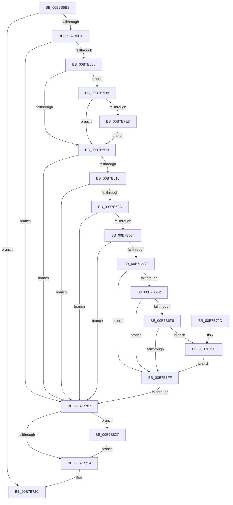

# BapdRegisterSiData

- RVA: `0x00B7B5B8`–`0x00B7B831` (길이 `633` bytes)
- VA: `0x0000000140B7B5B8`
- 실행 섹션: `PAGELK`
- PDB 이름 있음: `예`; PDB Function 태그: `예`
- unwind 정보 RVA: `0x000B9ECC`
- 디코드: `153`개 명령, `633/633` bytes 표시
- 미해석 바이트: `0` (있으면 어셈블리에 `.byte`로 보존)

> 이 문서는 커널 이미지의 기계어와 PDB 기호를 분석해 생성했습니다. 4번과 5번은 함수 원형과 자료형을 바이너리 사용 방식에서 추정한 C 해석이며 원본 소스 복구 결과는 아닙니다.

## 1. Dependencies

- 직접 호출 지점: **16**; 고유 호출 대상: **4**
- 직접 호출자로 확인된 함수: **2**
- RIP 상대 이미지 참조: **8**

### Outgoing calls
- `0x00B7B5F3` → [BapdGetISRegistryKey](BapdGetISRegistryKey_function_00B7B838.md) (function, `0x00B7B838`)
- `0x00B7B64A` → [RtlInitUnicodeString](../../text/42/RtlInitUnicodeString_function_0042A780.md) (function, `0x0042A780`)
- `0x00B7B676` → [ZwSetValueKey](../../text/6A/ZwSetValueKey_function_006ADCD0.md) (function, `0x006ADCD0`)
- `0x00B7B686` → [RtlInitUnicodeString](../../text/42/RtlInitUnicodeString_function_0042A780.md) (function, `0x0042A780`)
- `0x00B7B6AC` → [ZwSetValueKey](../../text/6A/ZwSetValueKey_function_006ADCD0.md) (function, `0x006ADCD0`)
- `0x00B7B6BC` → [RtlInitUnicodeString](../../text/42/RtlInitUnicodeString_function_0042A780.md) (function, `0x0042A780`)
- `0x00B7B6E6` → [ZwSetValueKey](../../text/6A/ZwSetValueKey_function_006ADCD0.md) (function, `0x006ADCD0`)
- `0x00B7B739` → [RtlInitUnicodeString](../../text/42/RtlInitUnicodeString_function_0042A780.md) (function, `0x0042A780`)
- `0x00B7B760` → [ZwSetValueKey](../../text/6A/ZwSetValueKey_function_006ADCD0.md) (function, `0x006ADCD0`)
- `0x00B7B770` → [RtlInitUnicodeString](../../text/42/RtlInitUnicodeString_function_0042A780.md) (function, `0x0042A780`)
- `0x00B7B798` → [ZwSetValueKey](../../text/6A/ZwSetValueKey_function_006ADCD0.md) (function, `0x006ADCD0`)
- `0x00B7B7A8` → [RtlInitUnicodeString](../../text/42/RtlInitUnicodeString_function_0042A780.md) (function, `0x0042A780`)
- `0x00B7B7D0` → [ZwSetValueKey](../../text/6A/ZwSetValueKey_function_006ADCD0.md) (function, `0x006ADCD0`)
- `0x00B7B7FC` → [RtlInitUnicodeString](../../text/42/RtlInitUnicodeString_function_0042A780.md) (function, `0x0042A780`)
- `0x00B7B81D` → [ZwSetValueKey](../../text/6A/ZwSetValueKey_function_006ADCD0.md) (function, `0x006ADCD0`)
- `0x00B7B827` → [ZwClose](../../text/6A/ZwClose_function_006AD2B0.md) (function, `0x006AD2B0`)

### Direct callers
- [PopBootLoaderSiDataProcess](PopBootLoaderSiDataProcess_function_00B7DFA0.md) at `0x00B7DFF0`
- [BapdpRegisterWbclData](../../init/C5/BapdpRegisterWbclData_function_00C50B3C.md) at `0x00C50C1F`

### Static image references
- `0x00B7B63F` → RVA `0x00B80080` (` ?? ::OKHAJAOM::`string'`; read)
- `0x00B7B67B` → RVA `0x00B80060` (` ?? ::OKHAJAOM::`string'`; read)
- `0x00B7B6B1` → RVA `0x00B7FFB0` (` ?? ::OKHAJAOM::`string'`; read)
- `0x00B7B72E` → RVA `0x00B7FF80` (` ?? ::OKHAJAOM::`string'`; read)
- `0x00B7B765` → RVA `0x00B7FFF0` (` ?? ::OKHAJAOM::`string'`; read)
- `0x00B7B79D` → RVA `0x00B7FFD0` (` ?? ::OKHAJAOM::`string'`; read)
- `0x00B7B7E3` → RVA `0x00B80110` (` ?? ::OKHAJAOM::`string'`; read)
- `0x00B7B7ED` → RVA `0x00B80040` (` ?? ::OKHAJAOM::`string'`; read)

## 2. Other-region calls and transfers

- 다른 실행 섹션으로 향하는 call: **15**
  - `0x00B7B64A` → [RtlInitUnicodeString](../../text/42/RtlInitUnicodeString_function_0042A780.md) (`PAGELK` → `.text`)
  - `0x00B7B676` → [ZwSetValueKey](../../text/6A/ZwSetValueKey_function_006ADCD0.md) (`PAGELK` → `.text`)
  - `0x00B7B686` → [RtlInitUnicodeString](../../text/42/RtlInitUnicodeString_function_0042A780.md) (`PAGELK` → `.text`)
  - `0x00B7B6AC` → [ZwSetValueKey](../../text/6A/ZwSetValueKey_function_006ADCD0.md) (`PAGELK` → `.text`)
  - `0x00B7B6BC` → [RtlInitUnicodeString](../../text/42/RtlInitUnicodeString_function_0042A780.md) (`PAGELK` → `.text`)
  - `0x00B7B6E6` → [ZwSetValueKey](../../text/6A/ZwSetValueKey_function_006ADCD0.md) (`PAGELK` → `.text`)
  - `0x00B7B739` → [RtlInitUnicodeString](../../text/42/RtlInitUnicodeString_function_0042A780.md) (`PAGELK` → `.text`)
  - `0x00B7B760` → [ZwSetValueKey](../../text/6A/ZwSetValueKey_function_006ADCD0.md) (`PAGELK` → `.text`)
  - `0x00B7B770` → [RtlInitUnicodeString](../../text/42/RtlInitUnicodeString_function_0042A780.md) (`PAGELK` → `.text`)
  - `0x00B7B798` → [ZwSetValueKey](../../text/6A/ZwSetValueKey_function_006ADCD0.md) (`PAGELK` → `.text`)
  - `0x00B7B7A8` → [RtlInitUnicodeString](../../text/42/RtlInitUnicodeString_function_0042A780.md) (`PAGELK` → `.text`)
  - `0x00B7B7D0` → [ZwSetValueKey](../../text/6A/ZwSetValueKey_function_006ADCD0.md) (`PAGELK` → `.text`)
  - `0x00B7B7FC` → [RtlInitUnicodeString](../../text/42/RtlInitUnicodeString_function_0042A780.md) (`PAGELK` → `.text`)
  - `0x00B7B81D` → [ZwSetValueKey](../../text/6A/ZwSetValueKey_function_006ADCD0.md) (`PAGELK` → `.text`)
  - `0x00B7B827` → [ZwClose](../../text/6A/ZwClose_function_006AD2B0.md) (`PAGELK` → `.text`)
- call이 아닌 외부 분기/꼬리 이동: **1**
  - `0x00B7B701` → [sub_00B80DDC](../B8/Unknown_function_00B80DDC.md) (`tail-transfer`)

## 3. Assembly (complete function range)

```asm
00B7B5B8  48 85 C9                        test rcx, rcx
00B7B5BB  0F 84 6B 01 00 00               je 0x140b7b72c
00B7B5C1  48 89 5C 24 10                  mov qword ptr [rsp + 0x10], rbx
00B7B5C6  48 89 74 24 18                  mov qword ptr [rsp + 0x18], rsi
00B7B5CB  55                              push rbp
00B7B5CC  57                              push rdi
00B7B5CD  41 54                           push r12
00B7B5CF  41 56                           push r14
00B7B5D1  41 57                           push r15
00B7B5D3  48 8B EC                        mov rbp, rsp
00B7B5D6  48 83 EC 40                     sub rsp, 0x40
00B7B5DA  48 83 65 30 00                  and qword ptr [rbp + 0x30], 0
00B7B5DF  48 8B D9                        mov rbx, rcx
00B7B5E2  0F 57 C0                        xorps xmm0, xmm0
00B7B5E5  44 8B F2                        mov r14d, edx
00B7B5E8  48 8D 4D 30                     lea rcx, [rbp + 0x30]
00B7B5EC  41 8B F0                        mov esi, r8d
00B7B5EF  0F 11 45 F0                     movups xmmword ptr [rbp - 0x10], xmm0
00B7B5F3  E8 40 02 00 00                  call 0x140b7b838
00B7B5F8  85 C0                           test eax, eax
00B7B5FA  0F 88 07 01 00 00               js 0x140b7b707
00B7B600  48 8D 7B 04                     lea rdi, [rbx + 4]
00B7B604  48 85 FF                        test rdi, rdi
00B7B607  0F 85 CD 01 00 00               jne 0x140b7b7da
00B7B60D  83 FE 02                        cmp esi, 2
00B7B610  0F 84 F1 00 00 00               je 0x140b7b707
00B7B616  8B 03                           mov eax, dword ptr [rbx]
00B7B618  83 C0 04                        add eax, 4
00B7B61B  8B F8                           mov edi, eax
00B7B61D  48 8D 48 30                     lea rcx, [rax + 0x30]
00B7B621  4C 3B F1                        cmp r14, rcx
00B7B624  0F 82 DD 00 00 00               jb 0x140b7b707
00B7B62A  83 3C 18 30                     cmp dword ptr [rax + rbx], 0x30
00B7B62E  0F 87 D3 00 00 00               ja 0x140b7b707
00B7B634  83 7C 18 04 02                  cmp dword ptr [rax + rbx + 4], 2
00B7B639  0F 87 C8 00 00 00               ja 0x140b7b707
00B7B63F  48 8D 15 3A 4A 00 00            lea rdx, [rip + 0x4a3a]
00B7B646  48 8D 4D F0                     lea rcx, [rbp - 0x10]
00B7B64A  E8 31 F1 8A FF                  call 0x14042a780
00B7B64F  48 8B 4D 30                     mov rcx, qword ptr [rbp + 0x30]
00B7B653  4C 8D 73 08                     lea r14, [rbx + 8]
00B7B657  41 BC 08 00 00 00               mov r12d, 8
00B7B65D  48 8D 55 F0                     lea rdx, [rbp - 0x10]
00B7B661  4C 03 F7                        add r14, rdi
00B7B664  44 89 64 24 28                  mov dword ptr [rsp + 0x28], r12d
00B7B669  45 33 C0                        xor r8d, r8d
00B7B66C  4C 89 74 24 20                  mov qword ptr [rsp + 0x20], r14
00B7B671  45 8D 4C 24 03                  lea r9d, [r12 + 3]
00B7B676  E8 55 26 B3 FF                  call 0x1406adcd0
00B7B67B  48 8D 15 DE 49 00 00            lea rdx, [rip + 0x49de]
00B7B682  48 8D 4D F0                     lea rcx, [rbp - 0x10]
00B7B686  E8 F5 F0 8A FF                  call 0x14042a780
00B7B68B  48 8B 4D 30                     mov rcx, qword ptr [rbp + 0x30]
00B7B68F  4C 8D 7B 10                     lea r15, [rbx + 0x10]
00B7B693  4C 03 FF                        add r15, rdi
00B7B696  44 89 64 24 28                  mov dword ptr [rsp + 0x28], r12d
00B7B69B  45 8D 4C 24 03                  lea r9d, [r12 + 3]
00B7B6A0  4C 89 7C 24 20                  mov qword ptr [rsp + 0x20], r15
00B7B6A5  45 33 C0                        xor r8d, r8d
00B7B6A8  48 8D 55 F0                     lea rdx, [rbp - 0x10]
00B7B6AC  E8 1F 26 B3 FF                  call 0x1406adcd0
00B7B6B1  48 8D 15 F8 48 00 00            lea rdx, [rip + 0x48f8]
00B7B6B8  48 8D 4D F0                     lea rcx, [rbp - 0x10]
00B7B6BC  E8 BF F0 8A FF                  call 0x14042a780
00B7B6C1  48 8B 4D 30                     mov rcx, qword ptr [rbp + 0x30]
00B7B6C5  4C 8D 63 18                     lea r12, [rbx + 0x18]
00B7B6C9  4C 03 E7                        add r12, rdi
00B7B6CC  C7 44 24 28 08 00 00 00         mov dword ptr [rsp + 0x28], 8
00B7B6D4  41 B9 0B 00 00 00               mov r9d, 0xb
00B7B6DA  4C 89 64 24 20                  mov qword ptr [rsp + 0x20], r12
00B7B6DF  45 33 C0                        xor r8d, r8d
00B7B6E2  48 8D 55 F0                     lea rdx, [rbp - 0x10]
00B7B6E6  E8 E5 25 B3 FF                  call 0x1406adcd0
00B7B6EB  83 7C 1F 04 02                  cmp dword ptr [rdi + rbx + 4], 2
00B7B6F0  75 0D                           jne 0x140b7b6ff
00B7B6F2  83 3C 1F 30                     cmp dword ptr [rdi + rbx], 0x30
00B7B6F6  75 07                           jne 0x140b7b6ff
00B7B6F8  80 7C 1F 20 00                  cmp byte ptr [rdi + rbx + 0x20], 0
00B7B6FD  75 2F                           jne 0x140b7b72e
00B7B6FF  85 F6                           test esi, esi
00B7B701  0F 84 D5 56 00 00               je 0x140b80ddc
00B7B707  48 8B 4D 30                     mov rcx, qword ptr [rbp + 0x30]
00B7B70B  48 85 C9                        test rcx, rcx
00B7B70E  0F 85 13 01 00 00               jne 0x140b7b827
00B7B714  4C 8D 5C 24 40                  lea r11, [rsp + 0x40]
00B7B719  49 8B 5B 38                     mov rbx, qword ptr [r11 + 0x38]
00B7B71D  49 8B 73 40                     mov rsi, qword ptr [r11 + 0x40]
00B7B721  49 8B E3                        mov rsp, r11
00B7B724  41 5F                           pop r15
00B7B726  41 5E                           pop r14
00B7B728  41 5C                           pop r12
00B7B72A  5F                              pop rdi
00B7B72B  5D                              pop rbp
00B7B72C  C3                              ret
00B7B72D  CC                              int3
00B7B72E  48 8D 15 4B 48 00 00            lea rdx, [rip + 0x484b]
00B7B735  48 8D 4D F0                     lea rcx, [rbp - 0x10]
00B7B739  E8 42 F0 8A FF                  call 0x14042a780
00B7B73E  48 8B 4D 30                     mov rcx, qword ptr [rbp + 0x30]
00B7B742  48 8D 43 28                     lea rax, [rbx + 0x28]
00B7B746  41 B9 04 00 00 00               mov r9d, 4
00B7B74C  48 8D 55 F0                     lea rdx, [rbp - 0x10]
00B7B750  48 03 C7                        add rax, rdi
00B7B753  44 89 4C 24 28                  mov dword ptr [rsp + 0x28], r9d
00B7B758  45 33 C0                        xor r8d, r8d
00B7B75B  48 89 44 24 20                  mov qword ptr [rsp + 0x20], rax
00B7B760  E8 6B 25 B3 FF                  call 0x1406adcd0
00B7B765  48 8D 15 84 48 00 00            lea rdx, [rip + 0x4884]
00B7B76C  48 8D 4D F0                     lea rcx, [rbp - 0x10]
00B7B770  E8 0B F0 8A FF                  call 0x14042a780
00B7B775  B9 04 00 00 00                  mov ecx, 4
00B7B77A  48 8D 43 2C                     lea rax, [rbx + 0x2c]
00B7B77E  89 4C 24 28                     mov dword ptr [rsp + 0x28], ecx
00B7B782  48 8D 55 F0                     lea rdx, [rbp - 0x10]
00B7B786  48 03 C7                        add rax, rdi
00B7B789  44 8B C9                        mov r9d, ecx
00B7B78C  48 8B 4D 30                     mov rcx, qword ptr [rbp + 0x30]
00B7B790  45 33 C0                        xor r8d, r8d
00B7B793  48 89 44 24 20                  mov qword ptr [rsp + 0x20], rax
00B7B798  E8 33 25 B3 FF                  call 0x1406adcd0
00B7B79D  48 8D 15 2C 48 00 00            lea rdx, [rip + 0x482c]
00B7B7A4  48 8D 4D F0                     lea rcx, [rbp - 0x10]
00B7B7A8  E8 D3 EF 8A FF                  call 0x14042a780
00B7B7AD  B9 04 00 00 00                  mov ecx, 4
00B7B7B2  48 8D 43 24                     lea rax, [rbx + 0x24]
00B7B7B6  89 4C 24 28                     mov dword ptr [rsp + 0x28], ecx
00B7B7BA  48 8D 55 F0                     lea rdx, [rbp - 0x10]
00B7B7BE  48 03 C7                        add rax, rdi
00B7B7C1  44 8B C9                        mov r9d, ecx
00B7B7C4  48 8B 4D 30                     mov rcx, qword ptr [rbp + 0x30]
00B7B7C8  45 33 C0                        xor r8d, r8d
00B7B7CB  48 89 44 24 20                  mov qword ptr [rsp + 0x20], rax
00B7B7D0  E8 FB 24 B3 FF                  call 0x1406adcd0
00B7B7D5  E9 25 FF FF FF                  jmp 0x140b7b6ff
00B7B7DA  83 3B 00                        cmp dword ptr [rbx], 0
00B7B7DD  0F 84 2A FE FF FF               je 0x140b7b60d
00B7B7E3  48 8D 05 26 49 00 00            lea rax, [rip + 0x4926]
00B7B7EA  83 FE 02                        cmp esi, 2
00B7B7ED  48 8D 15 4C 48 00 00            lea rdx, [rip + 0x484c]
00B7B7F4  48 0F 45 D0                     cmovne rdx, rax
00B7B7F8  48 8D 4D F0                     lea rcx, [rbp - 0x10]
00B7B7FC  E8 7F EF 8A FF                  call 0x14042a780
00B7B801  8B 03                           mov eax, dword ptr [rbx]
00B7B803  48 8D 55 F0                     lea rdx, [rbp - 0x10]
00B7B807  48 8B 4D 30                     mov rcx, qword ptr [rbp + 0x30]
00B7B80B  41 B9 03 00 00 00               mov r9d, 3
00B7B811  89 44 24 28                     mov dword ptr [rsp + 0x28], eax
00B7B815  45 33 C0                        xor r8d, r8d
00B7B818  48 89 7C 24 20                  mov qword ptr [rsp + 0x20], rdi
00B7B81D  E8 AE 24 B3 FF                  call 0x1406adcd0
00B7B822  E9 E6 FD FF FF                  jmp 0x140b7b60d
00B7B827  E8 84 1A B3 FF                  call 0x1406ad2b0
00B7B82C  E9 E3 FE FF FF                  jmp 0x140b7b714
```

## 4. C-style interpretation (structured pseudocode)

```c
__int64 __fastcall BapdRegisterSiData(__int64 a1, int a2, int a3)
{
    __int64 result;
    __int64 v_r12;
    __int64 v_r14;
    __int64 v_r15;
    __int64 v_rsp;
    unsigned int v_stack_m18;
    unsigned __int64 v_stack_m20;
    unsigned __int64 v_stack_m28;
    unsigned __int64 v_stack_m38;
    unsigned int v_stack_m40;
    unsigned __int64 v_stack_m48;
    unsigned __int64 v_stack_p10;
    unsigned __int64 v_stack_p18;
    unsigned __int64 v_stack_p8;

    if (a1 == 0) goto loc_00B7B72C;
    v_stack_p10 = v_rbx;
    v_stack_p18 = v_rsi;
    v_rsp = (v_rsp) - (64);
    v_stack_m38 = v_xmm0;
    result = BapdGetISRegistryKey(v_stack_p8, a2, a3, a4);
    if (sign_flag) goto loc_00B7B707;
    if (a1 + 4 != 0) goto loc_00B7B7DA;
loc_00B7B60D:
    if (((unsigned int)((unsigned int)(a3))) == 2) goto loc_00B7B707;
    result = (unsigned int)(((unsigned int)(*(unsigned int *)(a1))) + (4));
    if (((unsigned int)(a2)) < (result + 48)) goto loc_00B7B707;
    if ((*(unsigned int *)(result + a1 * 1)) > 48) goto loc_00B7B707;
    if ((*(unsigned int *)(result + a1 * 1 + 4)) > 2) goto loc_00B7B707;
    result = RtlInitUnicodeString(v_stack_m38, v_rip + 19002, a3, a4);
    v_r14 = (a1 + 8) + ((unsigned int)((unsigned int)(result)));
    v_stack_m40 = 8;
    a3 = 0;
    v_stack_m48 = v_r14;
    result = ZwSetValueKey(v_stack_p8, v_stack_m38, a3, 8 + 3);
    result = RtlInitUnicodeString(v_stack_m38, v_rip + 18910, a3, 8 + 3);
    v_r15 = (a1 + 16) + ((unsigned int)((unsigned int)(result)));
    v_stack_m40 = 8;
    v_stack_m48 = v_r15;
    a3 = 0;
    result = ZwSetValueKey(v_stack_p8, v_stack_m38, a3, 8 + 3);
    result = RtlInitUnicodeString(v_stack_m38, v_rip + 18680, a3, 8 + 3);
    v_r12 = (a1 + 24) + ((unsigned int)((unsigned int)(result)));
    v_stack_m40 = 8;
    v_stack_m48 = v_r12;
    a3 = 0;
    result = ZwSetValueKey(v_stack_p8, v_stack_m38, a3, 11);
    if ((*(unsigned int *)((unsigned int)((unsigned int)(result)) + a1 * 1 + 4)) != 2) goto loc_00B7B6FF;
    if ((*(unsigned int *)((unsigned int)((unsigned int)(result)) + a1 * 1)) != 48) goto loc_00B7B6FF;
    if ((*(unsigned __int8 *)((unsigned int)((unsigned int)(result)) + a1 * 1 + 32)) != 0) goto loc_00B7B72E;
loc_00B7B6FF:
loc_00B7B707:
    if (v_stack_p8 != 0) goto loc_00B7B827;
loc_00B7B714:
loc_00B7B72C:
    return result;
loc_00B7B72E:
    result = RtlInitUnicodeString(v_stack_m38, v_rip + 18507, a3, 11);
    result = (*(unsigned __int64 *)(v_stack_m28 + 56) + 40) + ((unsigned int)((unsigned int)(result)));
    v_stack_m18 = 4;
    a3 = 0;
    v_stack_m20 = result;
    result = ZwSetValueKey(v_stack_p8, v_stack_m38, a3, 4);
    result = RtlInitUnicodeString(v_stack_m38, v_rip + 18564, a3, 4);
    v_stack_m18 = 4;
    result = (*(unsigned __int64 *)(v_stack_m28 + 56) + 44) + ((unsigned int)((unsigned int)(result)));
    a3 = 0;
    v_stack_m20 = result;
    result = ZwSetValueKey(v_stack_p8, v_stack_m38, a3, 4);
    result = RtlInitUnicodeString(v_stack_m38, v_rip + 18476, a3, 4);
    v_stack_m18 = 4;
    result = (*(unsigned __int64 *)(v_stack_m28 + 56) + 36) + ((unsigned int)((unsigned int)(result)));
    a3 = 0;
    v_stack_m20 = result;
    result = ZwSetValueKey(v_stack_p8, v_stack_m38, a3, 4);
    goto loc_00B7B6FF;
loc_00B7B7DA:
    if ((*(unsigned int *)(*(unsigned __int64 *)(v_stack_m28 + 56))) == 0) goto loc_00B7B60D;
    a2 = v_rip + 18508;
    if (((unsigned int)(*(unsigned __int64 *)(v_stack_m28 + 64))) != 2) { a2 = v_rip + 18726; }
    result = RtlInitUnicodeString(v_stack_m38, a2, a3, 4);
    v_stack_m18 = (unsigned int)((unsigned int)(*(unsigned int *)(*(unsigned __int64 *)(v_stack_m28 + 56))));
    a3 = 0;
    v_stack_m20 = (unsigned int)((unsigned int)(result));
    result = ZwSetValueKey(v_stack_p8, v_stack_m38, a3, 3);
    goto loc_00B7B60D;
loc_00B7B827:
    result = ZwClose(v_stack_p8, v_stack_m38, a3, 3);
    goto loc_00B7B714;
}
```

## 5. (Beta) C Style

```c
int64_t BapdRegisterSiData(int64_t Arg1, int32_t Arg2, int32_t Arg3)
{
    int64_t result;
    int64_t local_r12;
    int64_t local_r14;
    int64_t local_r15;
    int64_t local_rsp;
    uint32_t v_stack_m18;
    uint64_t v_stack_m20;
    uint64_t v_stack_m28;
    uint64_t v_stack_m38;
    uint32_t v_stack_m40;
    uint64_t v_stack_m48;
    uint64_t v_stack_p10;
    uint64_t v_stack_p18;
    uint64_t v_stack_p8;

    if (Arg1 == 0) goto loc_00B7B72C;
    v_stack_p10 = local_rbx;
    v_stack_p18 = local_rsi;
    local_rsp = (local_rsp) - (64);
    v_stack_m38 = v_xmm0;
    result = BapdGetISRegistryKey(v_stack_p8, Arg2, Arg3, a4);
    if (sign_flag) goto loc_00B7B707;
    if (Arg1 + 4 != 0) goto loc_00B7B7DA;
loc_00B7B60D:
    if (((uint32_t)((uint32_t)(Arg3))) == 2) goto loc_00B7B707;
    result = (uint32_t)(((uint32_t)(*(uint32_t *)(Arg1))) + (4));
    if (((uint32_t)(Arg2)) < (result + 48)) goto loc_00B7B707;
    if ((*(uint32_t *)(result + Arg1 * 1)) > 48) goto loc_00B7B707;
    if ((*(uint32_t *)(result + Arg1 * 1 + 0x4)) > 2) goto loc_00B7B707;
    result = RtlInitUnicodeString(v_stack_m38, v_rip + 19002, Arg3, a4);
    local_r14 = (Arg1 + 8) + ((uint32_t)((uint32_t)(result)));
    v_stack_m40 = 8;
    Arg3 = 0;
    v_stack_m48 = local_r14;
    result = ZwSetValueKey(v_stack_p8, v_stack_m38, Arg3, 8 + 3);
    result = RtlInitUnicodeString(v_stack_m38, v_rip + 18910, Arg3, 8 + 3);
    local_r15 = (Arg1 + 16) + ((uint32_t)((uint32_t)(result)));
    v_stack_m40 = 8;
    v_stack_m48 = local_r15;
    Arg3 = 0;
    result = ZwSetValueKey(v_stack_p8, v_stack_m38, Arg3, 8 + 3);
    result = RtlInitUnicodeString(v_stack_m38, v_rip + 18680, Arg3, 8 + 3);
    local_r12 = (Arg1 + 24) + ((uint32_t)((uint32_t)(result)));
    v_stack_m40 = 8;
    v_stack_m48 = local_r12;
    Arg3 = 0;
    result = ZwSetValueKey(v_stack_p8, v_stack_m38, Arg3, 11);
    if ((*(uint32_t *)((uint32_t)((uint32_t)(result)) + Arg1 * 1 + 0x4)) != 2) goto loc_00B7B6FF;
    if ((*(uint32_t *)((uint32_t)((uint32_t)(result)) + Arg1 * 1)) != 48) goto loc_00B7B6FF;
    if ((*(uint8_t *)((uint32_t)((uint32_t)(result)) + Arg1 * 1 + 0x20)) != 0) goto loc_00B7B72E;
loc_00B7B6FF:
loc_00B7B707:
    if (v_stack_p8 != 0) goto loc_00B7B827;
loc_00B7B714:
loc_00B7B72C:
    return result;
loc_00B7B72E:
    result = RtlInitUnicodeString(v_stack_m38, v_rip + 18507, Arg3, 11);
    result = (*(uint64_t *)(v_stack_m28 + 0x38) + 40) + ((uint32_t)((uint32_t)(result)));
    v_stack_m18 = 4;
    Arg3 = 0;
    v_stack_m20 = result;
    result = ZwSetValueKey(v_stack_p8, v_stack_m38, Arg3, 4);
    result = RtlInitUnicodeString(v_stack_m38, v_rip + 18564, Arg3, 4);
    v_stack_m18 = 4;
    result = (*(uint64_t *)(v_stack_m28 + 0x38) + 44) + ((uint32_t)((uint32_t)(result)));
    Arg3 = 0;
    v_stack_m20 = result;
    result = ZwSetValueKey(v_stack_p8, v_stack_m38, Arg3, 4);
    result = RtlInitUnicodeString(v_stack_m38, v_rip + 18476, Arg3, 4);
    v_stack_m18 = 4;
    result = (*(uint64_t *)(v_stack_m28 + 0x38) + 36) + ((uint32_t)((uint32_t)(result)));
    Arg3 = 0;
    v_stack_m20 = result;
    result = ZwSetValueKey(v_stack_p8, v_stack_m38, Arg3, 4);
    goto loc_00B7B6FF;
loc_00B7B7DA:
    if ((*(uint32_t *)(*(uint64_t *)(v_stack_m28 + 0x38))) == 0) goto loc_00B7B60D;
    Arg2 = v_rip + 18508;
    if (((uint32_t)(*(uint64_t *)(v_stack_m28 + 0x40))) != 2) { Arg2 = v_rip + 18726; }
    result = RtlInitUnicodeString(v_stack_m38, Arg2, Arg3, 4);
    v_stack_m18 = (uint32_t)((uint32_t)(*(uint32_t *)(*(uint64_t *)(v_stack_m28 + 0x38))));
    Arg3 = 0;
    v_stack_m20 = (uint32_t)((uint32_t)(result));
    result = ZwSetValueKey(v_stack_p8, v_stack_m38, Arg3, 3);
    goto loc_00B7B60D;
loc_00B7B827:
    result = ZwClose(v_stack_p8, v_stack_m38, Arg3, 3);
    goto loc_00B7B714;
}
```

## 6. Execution-region graph

[열기: 2D/3D 그래프와 함수 탐색 컨트롤 패널](../../../control-panel.html?section=pagelk&rva=0x00B7B5B8&view=graph)

- 2D 그래프는 위에서 아래로 흐르고, 3D 그래프는 빈 공간을 드래그해 회전합니다. Shift+드래그는 이동, 휠은 확대·축소, 함수 노드 선택은 대상 보고서 이동입니다.

### Static fallback


