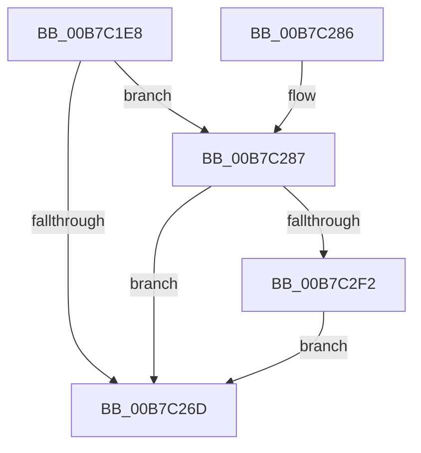

# BapdpWriteEventDataToRegistry

- RVA: `0x00B7C1E8`–`0x00B7C31F` (길이 `311` bytes)
- VA: `0x0000000140B7C1E8`
- 실행 섹션: `PAGELK`
- PDB 이름 있음: `예`; PDB Function 태그: `아니요`
- unwind 정보 RVA: `0x000BBC08`
- 디코드: `76`개 명령, `311/311` bytes 표시
- 미해석 바이트: `0` (있으면 어셈블리에 `.byte`로 보존)

> 이 문서는 커널 이미지의 기계어와 PDB 기호를 분석해 생성했습니다. 4번과 5번은 함수 원형과 자료형을 바이너리 사용 방식에서 추정한 C 해석이며 원본 소스 복구 결과는 아닙니다.

## 1. Dependencies

- 직접 호출 지점: **7**; 고유 호출 대상: **5**
- 직접 호출자로 확인된 함수: **2**
- RIP 상대 이미지 참조: **2**

### Outgoing calls
- `0x00B7C22E` → [RtlInitUnicodeString](../../text/42/RtlInitUnicodeString_function_0042A780.md) (function, `0x0042A780`)
- `0x00B7C264` → [ZwOpenKey](../../text/6A/ZwOpenKey_function_006AD310.md) (function, `0x006AD310`)
- `0x00B7C292` → [RtlInitUnicodeString](../../text/42/RtlInitUnicodeString_function_0042A780.md) (function, `0x0042A780`)
- `0x00B7C2DA` → [ZwCreateKey](../../text/6A/ZwCreateKey_function_006AD470.md) (function, `0x006AD470`)
- `0x00B7C2E5` → [ZwClose](../../text/6A/ZwClose_function_006AD2B0.md) (function, `0x006AD2B0`)
- `0x00B7C30C` → [ZwSetValueKey](../../text/6A/ZwSetValueKey_function_006ADCD0.md) (function, `0x006ADCD0`)
- `0x00B7C315` → [ZwClose](../../text/6A/ZwClose_function_006AD2B0.md) (function, `0x006AD2B0`)

### Direct callers
- [BapdWriteEtwEvents](../../text/4A/BapdWriteEtwEvents_function_004AE884.md) at `0x004AEAB7`
- [BapdWriteEtwEvents](../../text/4A/BapdWriteEtwEvents_function_004AE884.md) at `0x004AEB87`
- [BapdWriteEtwEvents](../../text/4A/BapdWriteEtwEvents_function_004AE884.md) at `0x004AEBA4`
- [BapdRecordFirmwareBootStats](BapdRecordFirmwareBootStats_function_00B72474.md) at `0x00B72895`

### Static image references
- `0x00B7C205` → RVA `0x00B800A0` (` ?? ::OKHAJAOM::`string'`; read)
- `0x00B7C287` → RVA `0x00B80150` (` ?? ::OKHAJAOM::`string'`; read)

## 2. Other-region calls and transfers

- 다른 실행 섹션으로 향하는 call: **7**
  - `0x00B7C22E` → [RtlInitUnicodeString](../../text/42/RtlInitUnicodeString_function_0042A780.md) (`PAGELK` → `.text`)
  - `0x00B7C264` → [ZwOpenKey](../../text/6A/ZwOpenKey_function_006AD310.md) (`PAGELK` → `.text`)
  - `0x00B7C292` → [RtlInitUnicodeString](../../text/42/RtlInitUnicodeString_function_0042A780.md) (`PAGELK` → `.text`)
  - `0x00B7C2DA` → [ZwCreateKey](../../text/6A/ZwCreateKey_function_006AD470.md) (`PAGELK` → `.text`)
  - `0x00B7C2E5` → [ZwClose](../../text/6A/ZwClose_function_006AD2B0.md) (`PAGELK` → `.text`)
  - `0x00B7C30C` → [ZwSetValueKey](../../text/6A/ZwSetValueKey_function_006ADCD0.md) (`PAGELK` → `.text`)
  - `0x00B7C315` → [ZwClose](../../text/6A/ZwClose_function_006AD2B0.md) (`PAGELK` → `.text`)
- 별도 외부 분기/꼬리 이동을 확인하지 못했습니다.

## 3. Assembly (complete function range)

```asm
00B7C1E8  48 8B C4                        mov rax, rsp
00B7C1EB  48 89 58 08                     mov qword ptr [rax + 8], rbx
00B7C1EF  48 89 70 10                     mov qword ptr [rax + 0x10], rsi
00B7C1F3  48 89 78 18                     mov qword ptr [rax + 0x18], rdi
00B7C1F7  55                              push rbp
00B7C1F8  48 8D 68 A1                     lea rbp, [rax - 0x5f]
00B7C1FC  48 81 EC 90 00 00 00            sub rsp, 0x90
00B7C203  33 C0                           xor eax, eax
00B7C205  48 8D 15 94 3E 00 00            lea rdx, [rip + 0x3e94]
00B7C20C  21 45 3B                        and dword ptr [rbp + 0x3b], eax
00B7C20F  48 8B F1                        mov rsi, rcx
00B7C212  48 21 45 7F                     and qword ptr [rbp + 0x7f], rax
00B7C216  48 8D 4D 0F                     lea rcx, [rbp + 0xf]
00B7C21A  48 21 45 07                     and qword ptr [rbp + 7], rax
00B7C21E  0F 57 C0                        xorps xmm0, xmm0
00B7C221  89 45 23                        mov dword ptr [rbp + 0x23], eax
00B7C224  49 8B F8                        mov rdi, r8
00B7C227  21 45 23                        and dword ptr [rbp + 0x23], eax
00B7C22A  0F 11 45 0F                     movups xmmword ptr [rbp + 0xf], xmm0
00B7C22E  E8 4D E5 8A FF                  call 0x14042a780
00B7C233  48 83 65 27 00                  and qword ptr [rbp + 0x27], 0
00B7C238  48 8D 45 0F                     lea rax, [rbp + 0xf]
00B7C23C  0F 57 C0                        xorps xmm0, xmm0
00B7C23F  48 89 45 2F                     mov qword ptr [rbp + 0x2f], rax
00B7C243  BB 30 00 00 00                  mov ebx, 0x30
00B7C248  C7 45 37 40 02 00 00            mov dword ptr [rbp + 0x37], 0x240
00B7C24F  4C 8D 45 1F                     lea r8, [rbp + 0x1f]
00B7C253  89 5D 1F                        mov dword ptr [rbp + 0x1f], ebx
00B7C256  BA 1F 00 02 00                  mov edx, 0x2001f
00B7C25B  48 8D 4D 7F                     lea rcx, [rbp + 0x7f]
00B7C25F  F3 0F 7F 45 3F                  movdqu xmmword ptr [rbp + 0x3f], xmm0
00B7C264  E8 A7 10 B3 FF                  call 0x1406ad310
00B7C269  85 C0                           test eax, eax
00B7C26B  79 1A                           jns 0x140b7c287
00B7C26D  4C 8D 9C 24 90 00 00 00         lea r11, [rsp + 0x90]
00B7C275  49 8B 5B 10                     mov rbx, qword ptr [r11 + 0x10]
00B7C279  49 8B 73 18                     mov rsi, qword ptr [r11 + 0x18]
00B7C27D  49 8B 7B 20                     mov rdi, qword ptr [r11 + 0x20]
00B7C281  49 8B E3                        mov rsp, r11
00B7C284  5D                              pop rbp
00B7C285  C3                              ret
00B7C286  CC                              int3
00B7C287  48 8D 15 C2 3E 00 00            lea rdx, [rip + 0x3ec2]
00B7C28E  48 8D 4D 0F                     lea rcx, [rbp + 0xf]
00B7C292  E8 E9 E4 8A FF                  call 0x14042a780
00B7C297  48 8B 45 7F                     mov rax, qword ptr [rbp + 0x7f]
00B7C29B  4C 8D 45 1F                     lea r8, [rbp + 0x1f]
00B7C29F  48 83 64 24 30 00               and qword ptr [rsp + 0x30], 0
00B7C2A5  48 8D 4D 07                     lea rcx, [rbp + 7]
00B7C2A9  83 64 24 28 00                  and dword ptr [rsp + 0x28], 0
00B7C2AE  0F 57 C0                        xorps xmm0, xmm0
00B7C2B1  48 83 64 24 20 00               and qword ptr [rsp + 0x20], 0
00B7C2B7  45 33 C9                        xor r9d, r9d
00B7C2BA  48 89 45 27                     mov qword ptr [rbp + 0x27], rax
00B7C2BE  BA 1F 00 02 00                  mov edx, 0x2001f
00B7C2C3  48 8D 45 0F                     lea rax, [rbp + 0xf]
00B7C2C7  89 5D 1F                        mov dword ptr [rbp + 0x1f], ebx
00B7C2CA  48 89 45 2F                     mov qword ptr [rbp + 0x2f], rax
00B7C2CE  C7 45 37 40 02 00 00            mov dword ptr [rbp + 0x37], 0x240
00B7C2D5  F3 0F 7F 45 3F                  movdqu xmmword ptr [rbp + 0x3f], xmm0
00B7C2DA  E8 91 11 B3 FF                  call 0x1406ad470
00B7C2DF  48 8B 4D 7F                     mov rcx, qword ptr [rbp + 0x7f]
00B7C2E3  8B D8                           mov ebx, eax
00B7C2E5  E8 C6 0F B3 FF                  call 0x1406ad2b0
00B7C2EA  85 DB                           test ebx, ebx
00B7C2EC  0F 88 7B FF FF FF               js 0x140b7c26d
00B7C2F2  48 8B 4D 07                     mov rcx, qword ptr [rbp + 7]
00B7C2F6  41 B9 04 00 00 00               mov r9d, 4
00B7C2FC  44 89 4C 24 28                  mov dword ptr [rsp + 0x28], r9d
00B7C301  45 33 C0                        xor r8d, r8d
00B7C304  48 8B D7                        mov rdx, rdi
00B7C307  48 89 74 24 20                  mov qword ptr [rsp + 0x20], rsi
00B7C30C  E8 BF 19 B3 FF                  call 0x1406adcd0
00B7C311  48 8B 4D 07                     mov rcx, qword ptr [rbp + 7]
00B7C315  E8 96 0F B3 FF                  call 0x1406ad2b0
00B7C31A  E9 4E FF FF FF                  jmp 0x140b7c26d
```

## 4. C-style interpretation (structured pseudocode)

```c
__int64 __fastcall BapdpWriteEventDataToRegistry(__int64 a1, __int64 a2, __int64 a3, int a4)
{
    __int64 result;
    __int64 v_rsp;
    unsigned __int64 v_stack_m60;
    unsigned int v_stack_m68;
    unsigned __int64 v_stack_m70;
    unsigned __int64 v_stack_m8;

    *(unsigned __int64 *)(v_rsp + 8) = v_rbx;
    *(unsigned __int64 *)(v_rsp + 16) = v_rsi;
    *(unsigned __int64 *)(v_rsp + 24) = v_rdi;
    v_rsp = (v_rsp) - (144);
    result = 0;
    *(unsigned int *)(v_rsp - 95 + 35) = 0;
    *(unsigned __int64 *)(v_rsp - 95 + 15) = v_xmm0;
    result = RtlInitUnicodeString(v_rsp - 95 + 15, v_rip + 16020, a3, a4);
    *(unsigned __int64 *)(v_rsp - 95 + 47) = v_rsp - 95 + 15;
    *(unsigned int *)(v_rsp - 95 + 55) = 576;
    *(unsigned int *)(v_rsp - 95 + 31) = 48;
    *(unsigned __int64 *)(v_rsp - 95 + 63) = v_xmm0;
    result = ZwOpenKey(v_rsp - 95 + 127, (unsigned int)(0x2001FULL), v_rsp - 95 + 31, a4);
    if (!sign_flag) goto loc_00B7C287;
loc_00B7C26D:
    return result;
loc_00B7C287:
    result = RtlInitUnicodeString(v_rsp - 95 + 15, v_rip + 16066, v_rsp - 95 + 31, a4);
    a4 = 0;
    *(unsigned __int64 *)(v_rsp - 95 + 39) = *(unsigned __int64 *)(v_rsp - 95 + 127);
    *(unsigned int *)(v_rsp - 95 + 31) = (unsigned int)(*(unsigned __int64 *)(v_stack_m8 + 16));
    *(unsigned __int64 *)(v_rsp - 95 + 47) = v_rsp - 95 + 15;
    *(unsigned int *)(v_rsp - 95 + 55) = 576;
    *(unsigned __int64 *)(v_rsp - 95 + 63) = v_xmm0;
    result = ZwCreateKey(v_rsp - 95 + 7, (unsigned int)(0x2001FULL), v_rsp - 95 + 31, a4);
    result = ZwClose(*(unsigned __int64 *)(v_rsp - 95 + 127), (unsigned int)(0x2001FULL), v_rsp - 95 + 31, a4);
    if (sign_flag) goto loc_00B7C26D;
    v_stack_m68 = 4;
    a3 = 0;
    v_stack_m70 = *(unsigned __int64 *)(v_stack_m8 + 24);
    result = ZwSetValueKey(*(unsigned __int64 *)(v_rsp - 95 + 7), *(unsigned __int64 *)(v_stack_m8 + 32), a3, 4);
    result = ZwClose(*(unsigned __int64 *)(v_rsp - 95 + 7), *(unsigned __int64 *)(v_stack_m8 + 32), a3, 4);
    goto loc_00B7C26D;
}
```

## 5. (Beta) C Style

```c
int64_t BapdpWriteEventDataToRegistry(int64_t Arg1, int64_t Arg2, int64_t Arg3, int32_t Arg4)
{
    int64_t result;
    int64_t local_rsp;
    uint64_t v_stack_m60;
    uint32_t v_stack_m68;
    uint64_t v_stack_m70;
    uint64_t v_stack_m8;

    *(uint64_t *)(local_rsp + 0x8) = local_rbx;
    *(uint64_t *)(local_rsp + 0x10) = local_rsi;
    *(uint64_t *)(local_rsp + 0x18) = local_rdi;
    local_rsp = (local_rsp) - (144);
    result = 0;
    *(uint32_t *)(local_rsp - 0x5F + 0x23) = 0;
    *(uint64_t *)(local_rsp - 0x5F + 0xF) = v_xmm0;
    result = RtlInitUnicodeString(local_rsp - 95 + 15, v_rip + 16020, Arg3, Arg4);
    *(uint64_t *)(local_rsp - 0x5F + 0x2F) = local_rsp - 95 + 15;
    *(uint32_t *)(local_rsp - 0x5F + 0x37) = 576;
    *(uint32_t *)(local_rsp - 0x5F + 0x1F) = 48;
    *(uint64_t *)(local_rsp - 0x5F + 0x3F) = v_xmm0;
    result = ZwOpenKey(local_rsp - 95 + 127, (uint32_t)(0x2001FULL), local_rsp - 95 + 31, Arg4);
    if (!sign_flag) goto loc_00B7C287;
loc_00B7C26D:
    return result;
loc_00B7C287:
    result = RtlInitUnicodeString(local_rsp - 95 + 15, v_rip + 16066, local_rsp - 95 + 31, Arg4);
    Arg4 = 0;
    *(uint64_t *)(local_rsp - 0x5F + 0x27) = *(uint64_t *)(local_rsp - 0x5F + 0x7F);
    *(uint32_t *)(local_rsp - 0x5F + 0x1F) = (uint32_t)(*(uint64_t *)(v_stack_m8 + 0x10));
    *(uint64_t *)(local_rsp - 0x5F + 0x2F) = local_rsp - 95 + 15;
    *(uint32_t *)(local_rsp - 0x5F + 0x37) = 576;
    *(uint64_t *)(local_rsp - 0x5F + 0x3F) = v_xmm0;
    result = ZwCreateKey(local_rsp - 95 + 7, (uint32_t)(0x2001FULL), local_rsp - 95 + 31, Arg4);
    result = ZwClose(*(uint64_t *)(local_rsp - 0x5F + 0x7F), (uint32_t)(0x2001FULL), local_rsp - 95 + 31, Arg4);
    if (sign_flag) goto loc_00B7C26D;
    v_stack_m68 = 4;
    Arg3 = 0;
    v_stack_m70 = *(uint64_t *)(v_stack_m8 + 0x18);
    result = ZwSetValueKey(*(uint64_t *)(local_rsp - 0x5F + 0x7), *(uint64_t *)(v_stack_m8 + 0x20), Arg3, 4);
    result = ZwClose(*(uint64_t *)(local_rsp - 0x5F + 0x7), *(uint64_t *)(v_stack_m8 + 0x20), Arg3, 4);
    goto loc_00B7C26D;
}
```

## 6. Execution-region graph

[열기: 2D/3D 그래프와 함수 탐색 컨트롤 패널](../../../control-panel.html?section=pagelk&rva=0x00B7C1E8&view=graph)

- 2D 그래프는 위에서 아래로 흐르고, 3D 그래프는 빈 공간을 드래그해 회전합니다. Shift+드래그는 이동, 휠은 확대·축소, 함수 노드 선택은 대상 보고서 이동입니다.

### Static fallback


