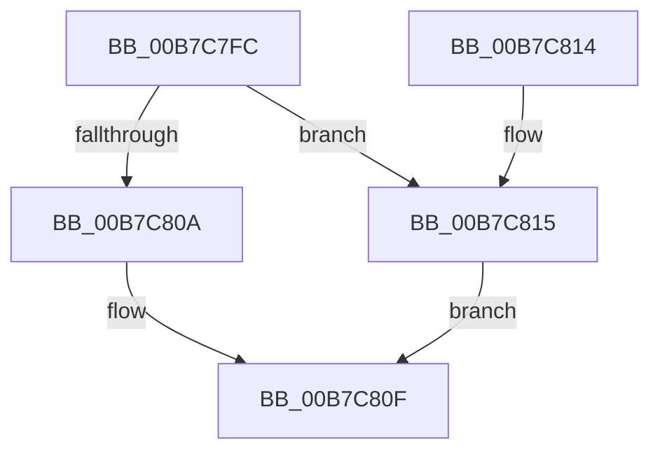

# BgkResumeFinished

- RVA: `0x00B7C7FC`–`0x00B7C830` (길이 `52` bytes)
- VA: `0x0000000140B7C7FC`
- 실행 섹션: `PAGELK`
- PDB 이름 있음: `예`; PDB Function 태그: `아니요`
- unwind 정보 RVA: `0x00094EEC`
- 디코드: `12`개 명령, `52/52` bytes 표시
- 미해석 바이트: `0` (있으면 어셈블리에 `.byte`로 보존)

> 이 문서는 커널 이미지의 기계어와 PDB 기호를 분석해 생성했습니다. 4번과 5번은 함수 원형과 자료형을 바이너리 사용 방식에서 추정한 C 해석이며 원본 소스 복구 결과는 아닙니다.

## 1. Dependencies

- 직접 호출 지점: **3**; 고유 호출 대상: **2**
- 직접 호출자로 확인된 함수: **2**
- RIP 상대 이미지 참조: **3**

### Outgoing calls
- `0x00B7C80A` → [BgkpUnlockBgfxCodeSection](../../pagebgfx/BC/BgkpUnlockBgfxCodeSection_function_00BC4910.md) (function, `0x00BC4910`)
- `0x00B7C815` → [BgFreeContext](../../pagebgfx/BC/BgFreeContext_function_00BC0664.md) (function, `0x00BC0664`)
- `0x00B7C822` → [BgkpUnlockBgfxCodeSection](../../pagebgfx/BC/BgkpUnlockBgfxCodeSection_function_00BC4910.md) (function, `0x00BC4910`)

### Direct callers
- [BgkNotifyDisplayOwnershipChange](../../text/59/BgkNotifyDisplayOwnershipChange_function_00590CC0.md) at `0x00590CF5`
- [PopFreeHiberContext](../../page/70/PopFreeHiberContext_function_00704F1C.md) at `0x007050D7`

### Static image references
- `0x00B7C800` → RVA `0x00E65E90` (`.data`; read)
- `0x00B7C81A` → RVA `0x00E65E90` (`.data`; read/write)
- `0x00B7C827` → RVA `0x00E65EB9` (`.data`; write)

## 2. Other-region calls and transfers

- 다른 실행 섹션으로 향하는 call: **3**
  - `0x00B7C80A` → [BgkpUnlockBgfxCodeSection](../../pagebgfx/BC/BgkpUnlockBgfxCodeSection_function_00BC4910.md) (`PAGELK` → `PAGEBGFX`)
  - `0x00B7C815` → [BgFreeContext](../../pagebgfx/BC/BgFreeContext_function_00BC0664.md) (`PAGELK` → `PAGEBGFX`)
  - `0x00B7C822` → [BgkpUnlockBgfxCodeSection](../../pagebgfx/BC/BgkpUnlockBgfxCodeSection_function_00BC4910.md) (`PAGELK` → `PAGEBGFX`)
- 별도 외부 분기/꼬리 이동을 확인하지 못했습니다.

## 3. Assembly (complete function range)

```asm
00B7C7FC  48 83 EC 28                     sub rsp, 0x28
00B7C800  48 83 3D 88 96 2E 00 00         cmp qword ptr [rip + 0x2e9688], 0
00B7C808  75 0B                           jne 0x140b7c815
00B7C80A  E8 01 81 04 00                  call 0x140bc4910
00B7C80F  48 83 C4 28                     add rsp, 0x28
00B7C813  C3                              ret
00B7C814  CC                              int3
00B7C815  E8 4A 3E 04 00                  call 0x140bc0664
00B7C81A  48 83 25 6E 96 2E 00 00         and qword ptr [rip + 0x2e966e], 0
00B7C822  E8 E9 80 04 00                  call 0x140bc4910
00B7C827  C6 05 8B 96 2E 00 00            mov byte ptr [rip + 0x2e968b], 0
00B7C82E  EB DF                           jmp 0x140b7c80f
```

## 4. C-style interpretation (structured pseudocode)

```c
__int64 __fastcall BgkResumeFinished(void)
{
    __int64 result;
    __int64 v_rsp;

    v_rsp = (v_rsp) - (40);
    if ((*(unsigned __int64 *)(v_rip + 3053192)) != 0) goto loc_00B7C815;
    result = BgkpUnlockBgfxCodeSection(a1, a2, a3, a4);
loc_00B7C80F:
    v_rsp = (v_rsp) + (40);
    return result;
loc_00B7C815:
    result = BgFreeContext(a1, a2, a3, a4);
    result = BgkpUnlockBgfxCodeSection(a1, a2, a3, a4);
    *(unsigned __int8 *)(v_rip + 3053195) = 0;
    goto loc_00B7C80F;
}
```

## 5. (Beta) C Style

```c
void BgkResumeFinished(void)
{
    int64_t result;
    int64_t local_rsp;

    local_rsp = (local_rsp) - (40);
    if ((*(uint64_t *)(v_rip + 0x2E9688)) != 0) goto loc_00B7C815;
    result = BgkpUnlockBgfxCodeSection(a1, a2, a3, a4);
loc_00B7C80F:
    local_rsp = (local_rsp) + (40);
    return result;
loc_00B7C815:
    result = BgFreeContext(a1, a2, a3, a4);
    result = BgkpUnlockBgfxCodeSection(a1, a2, a3, a4);
    *(uint8_t *)(v_rip + 0x2E968B) = 0;
    goto loc_00B7C80F;
}
```

## 6. Execution-region graph

[열기: 2D/3D 그래프와 함수 탐색 컨트롤 패널](../../../control-panel.html?section=pagelk&rva=0x00B7C7FC&view=graph)

- 2D 그래프는 위에서 아래로 흐르고, 3D 그래프는 빈 공간을 드래그해 회전합니다. Shift+드래그는 이동, 휠은 확대·축소, 함수 노드 선택은 대상 보고서 이동입니다.

### Static fallback


