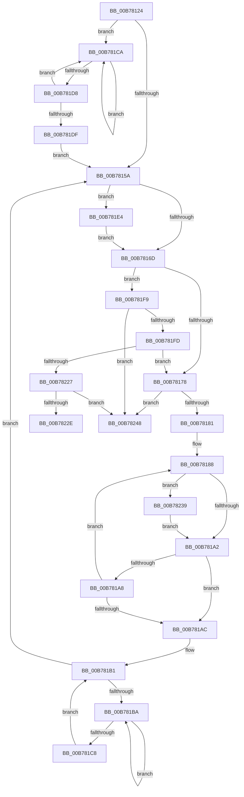

# ConsumerPeekAndConsumeBuffer

- RVA: `0x00B78124`–`0x00B78250` (길이 `300` bytes)
- VA: `0x0000000140B78124`
- 실행 섹션: `PAGELK`
- PDB 이름 있음: `예`; PDB Function 태그: `예`
- unwind 정보 RVA: `0x000ABF54`
- 디코드: `93`개 명령, `300/300` bytes 표시
- 미해석 바이트: `0` (있으면 어셈블리에 `.byte`로 보존)

> 이 문서는 커널 이미지의 기계어와 PDB 기호를 분석해 생성했습니다. 4번과 5번은 함수 원형과 자료형을 바이너리 사용 방식에서 추정한 C 해석이며 원본 소스 복구 결과는 아닙니다.

## 1. Dependencies

- 직접 호출 지점: **4**; 고유 호출 대상: **2**
- 직접 호출자로 확인된 함수: **1**
- RIP 상대 이미지 참조: **0**

### Outgoing calls
- `0x00B7818A` → [PopHiberCheckForDebugBreak](PopHiberCheckForDebugBreak_function_00B78258.md) (function, `0x00B78258`)
- `0x00B781BC` → [PopHiberCheckForDebugBreak](PopHiberCheckForDebugBreak_function_00B78258.md) (function, `0x00B78258`)
- `0x00B781CC` → [PopHiberCheckForDebugBreak](PopHiberCheckForDebugBreak_function_00B78258.md) (function, `0x00B78258`)
- `0x00B78218` → [PopHiberPeekRangeTable](../B6/PopHiberPeekRangeTable_function_00B6DD08.md) (function, `0x00B6DD08`)

### Direct callers
- [PopDecompressHiberBlocks](../B6/PopDecompressHiberBlocks_function_00B6D074.md) at `0x00B6D1A4`

### Static image references
- 디코드된 RIP-relative 메모리 참조가 없습니다.

## 2. Other-region calls and transfers

- 다른 실행 섹션으로 향하는 call: **0**
- call이 아닌 외부 분기/꼬리 이동: **2**
  - `0x00B78234` → [sub_00B806E6](../B8/Unknown_function_00B806E6.md) (`tail-transfer`)
  - `0x00B7824B` → [sub_00B806E6](../B8/Unknown_function_00B806E6.md) (`tail-transfer`)

## 3. Assembly (complete function range)

```asm
00B78124  48 8B C4                        mov rax, rsp
00B78127  48 89 58 08                     mov qword ptr [rax + 8], rbx
00B7812B  48 89 68 10                     mov qword ptr [rax + 0x10], rbp
00B7812F  48 89 70 18                     mov qword ptr [rax + 0x18], rsi
00B78133  48 89 78 20                     mov qword ptr [rax + 0x20], rdi
00B78137  41 54                           push r12
00B78139  41 56                           push r14
00B7813B  41 57                           push r15
00B7813D  48 83 EC 20                     sub rsp, 0x20
00B78141  45 33 F6                        xor r14d, r14d
00B78144  41 8B D8                        mov ebx, r8d
00B78147  4C 8B FA                        mov r15, rdx
00B7814A  48 8B F9                        mov rdi, rcx
00B7814D  33 C0                           xor eax, eax
00B7814F  41 8D 76 01                     lea esi, [r14 + 1]
00B78153  F0 0F B1 71 18                  lock cmpxchg dword ptr [rcx + 0x18], esi
00B78158  75 70                           jne 0x140b781ca
00B7815A  4C 8B 67 30                     mov r12, qword ptr [rdi + 0x30]
00B7815E  8B 6F 28                        mov ebp, dword ptr [rdi + 0x28]
00B78161  41 8B C4                        mov eax, r12d
00B78164  2B E8                           sub ebp, eax
00B78166  48 83 7F 10 00                  cmp qword ptr [rdi + 0x10], 0
00B7816B  74 77                           je 0x140b781e4
00B7816D  41 8B 37                        mov esi, dword ptr [r15]
00B78170  3B F5                           cmp esi, ebp
00B78172  0F 86 81 00 00 00               jbe 0x140b781f9
00B78178  F6 C3 01                        test bl, 1
00B7817B  0F 85 C7 00 00 00               jne 0x140b78248
00B78181  C7 47 18 00 00 00 00            mov dword ptr [rdi + 0x18], 0
00B78188  F3 90                           pause
00B7818A  E8 C9 00 00 00                  call 0x140b78258
00B7818F  8B 4F 28                        mov ecx, dword ptr [rdi + 0x28]
00B78192  8B 57 30                        mov edx, dword ptr [rdi + 0x30]
00B78195  2B CA                           sub ecx, edx
00B78197  48 83 7F 10 00                  cmp qword ptr [rdi + 0x10], 0
00B7819C  0F 84 97 00 00 00               je 0x140b78239
00B781A2  4C 39 67 30                     cmp qword ptr [rdi + 0x30], r12
00B781A6  75 04                           jne 0x140b781ac
00B781A8  3B F1                           cmp esi, ecx
00B781AA  77 DC                           ja 0x140b78188
00B781AC  BE 01 00 00 00                  mov esi, 1
00B781B1  33 C0                           xor eax, eax
00B781B3  F0 0F B1 77 18                  lock cmpxchg dword ptr [rdi + 0x18], esi
00B781B8  74 A0                           je 0x140b7815a
00B781BA  F3 90                           pause
00B781BC  E8 97 00 00 00                  call 0x140b78258
00B781C1  8B 47 18                        mov eax, dword ptr [rdi + 0x18]
00B781C4  85 C0                           test eax, eax
00B781C6  75 F2                           jne 0x140b781ba
00B781C8  EB E7                           jmp 0x140b781b1
00B781CA  F3 90                           pause
00B781CC  E8 87 00 00 00                  call 0x140b78258
00B781D1  8B 47 18                        mov eax, dword ptr [rdi + 0x18]
00B781D4  85 C0                           test eax, eax
00B781D6  75 F2                           jne 0x140b781ca
00B781D8  F0 0F B1 77 18                  lock cmpxchg dword ptr [rdi + 0x18], esi
00B781DD  75 EB                           jne 0x140b781ca
00B781DF  E9 76 FF FF FF                  jmp 0x140b7815a
00B781E4  8B 4F 20                        mov ecx, dword ptr [rdi + 0x20]
00B781E7  2B C8                           sub ecx, eax
00B781E9  41 8B 07                        mov eax, dword ptr [r15]
00B781EC  3B C1                           cmp eax, ecx
00B781EE  0F 43 C1                        cmovae eax, ecx
00B781F1  41 89 07                        mov dword ptr [r15], eax
00B781F4  E9 74 FF FF FF                  jmp 0x140b7816d
00B781F9  85 F6                           test esi, esi
00B781FB  74 4B                           je 0x140b78248
00B781FD  8B 4F 08                        mov ecx, dword ptr [rdi + 8]
00B78200  33 D2                           xor edx, edx
00B78202  4C 8B 44 24 60                  mov r8, qword ptr [rsp + 0x60]
00B78207  49 8B C4                        mov rax, r12
00B7820A  48 F7 F1                        div rcx
00B7820D  44 8B F2                        mov r14d, edx
00B78210  8B D6                           mov edx, esi
00B78212  4C 03 37                        add r14, qword ptr [rdi]
00B78215  49 8B CE                        mov rcx, r14
00B78218  E8 EB 5A FF FF                  call 0x140b6dd08
00B7821D  8B F0                           mov esi, eax
00B7821F  3B C5                           cmp eax, ebp
00B78221  0F 87 51 FF FF FF               ja 0x140b78178
00B78227  41 89 07                        mov dword ptr [r15], eax
00B7822A  85 C0                           test eax, eax
00B7822C  74 1A                           je 0x140b78248
00B7822E  8B C0                           mov eax, eax
00B78230  48 01 47 30                     add qword ptr [rdi + 0x30], rax
00B78234  E9 AD 84 00 00                  jmp 0x140b806e6
00B78239  8B 47 20                        mov eax, dword ptr [rdi + 0x20]
00B7823C  2B C2                           sub eax, edx
00B7823E  3B F0                           cmp esi, eax
00B78240  0F 43 F0                        cmovae esi, eax
00B78243  E9 5A FF FF FF                  jmp 0x140b781a2
00B78248  45 33 F6                        xor r14d, r14d
00B7824B  E9 96 84 00 00                  jmp 0x140b806e6
```

## 4. C-style interpretation (structured pseudocode)

```c
__int64 __fastcall ConsumerPeekAndConsumeBuffer(__int64 a1, __int64 a2, int a3, __int64 a4, __int64 a5)
{
    __int64 result;
    __int64 v_r14;
    __int64 v_rbp;
    __int64 v_rsi;
    __int64 v_rsp;

    *(unsigned __int64 *)(v_rsp + 8) = v_rbx;
    *(unsigned __int64 *)(v_rsp + 16) = v_rbp;
    *(unsigned __int64 *)(v_rsp + 24) = v_rsi;
    *(unsigned __int64 *)(v_rsp + 32) = v_rdi;
    v_rsp = (v_rsp) - (32);
    v_r14 = 0;
    result = 0;
    if (condition_is_not_equal) goto loc_00B781CA;
loc_00B7815A:
    v_rbp = (unsigned int)(((unsigned int)(*(unsigned int *)(a1 + 40))) - ((unsigned int)((unsigned int)((unsigned int)(*(unsigned __int64 *)(a1 + 48))))));
    if ((*(unsigned __int64 *)(a1 + 16)) == 0) goto loc_00B781E4;
loc_00B7816D:
    if (((unsigned int)((unsigned int)(*(unsigned int *)(a2)))) <= ((unsigned int)(v_rbp))) goto loc_00B781F9;
loc_00B78178:
    if ((((unsigned __int8)((unsigned int)(a3))) & (1)) != 0) goto loc_00B78248;
    *(unsigned int *)(a1 + 24) = 0;
loc_00B78188:
    result = PopHiberCheckForDebugBreak(a1, a2, a3, a4);
    a1 = (unsigned int)(((unsigned int)(*(unsigned int *)(a1 + 40))) - ((unsigned int)((unsigned int)(*(unsigned int *)(a1 + 48)))));
    if ((*(unsigned __int64 *)(a1 + 16)) == 0) goto loc_00B78239;
loc_00B781A2:
    if ((*(unsigned __int64 *)(a1 + 48)) != (*(unsigned __int64 *)(a1 + 48))) goto loc_00B781AC;
    if (((unsigned int)((unsigned int)(*(unsigned int *)(a2)))) > ((unsigned int)(a1))) goto loc_00B78188;
loc_00B781AC:
loc_00B781B1:
    result = 0;
    if (condition_is_equal) goto loc_00B7815A;
loc_00B781BA:
    result = PopHiberCheckForDebugBreak(a1, (unsigned int)(*(unsigned int *)(a1 + 48)), a3, a4);
    if ((unsigned int)((unsigned int)(*(unsigned int *)(a1 + 24))) != 0) goto loc_00B781BA;
    goto loc_00B781B1;
loc_00B781CA:
    result = PopHiberCheckForDebugBreak(a1, (unsigned int)(*(unsigned int *)(a1 + 48)), a3, a4);
    if ((unsigned int)((unsigned int)(*(unsigned int *)(a1 + 24))) != 0) goto loc_00B781CA;
    if ((unsigned int)((unsigned int)(*(unsigned int *)(a1 + 24))) != 0) goto loc_00B781CA;
    goto loc_00B7815A;
loc_00B781E4:
    a1 = (unsigned int)(((unsigned int)(*(unsigned int *)(a1 + 32))) - ((unsigned int)((unsigned int)(*(unsigned int *)(a1 + 24)))));
    result = (unsigned int)(*(unsigned int *)(a2));
    if (((unsigned int)((unsigned int)(*(unsigned int *)(a2)))) >= ((unsigned int)(a1))) { result = (unsigned int)(a1); }
    *(unsigned int *)(a2) = (unsigned int)(result);
    goto loc_00B7816D;
loc_00B781F9:
    if (1 == 0) goto loc_00B78248;
    a2 = 0;
    v_r14 = (0) + (*(unsigned __int64 *)(a1));
    result = PopHiberPeekRangeTable(v_r14, 1, a5, a4);
    if (((unsigned int)(result)) > ((unsigned int)(v_rbp))) goto loc_00B78178;
    *(unsigned int *)(a2) = (unsigned int)(result);
    if ((unsigned int)(result) == 0) goto loc_00B78248;
loc_00B78239:
    result = (unsigned int)(((unsigned int)(*(unsigned int *)(a1 + 32))) - (1));
    v_rsi = (unsigned int)((unsigned int)(result));
    if (((unsigned int)((unsigned int)((unsigned int)(result)))) >= ((unsigned int)(result))) { v_rsi = (unsigned int)(result); }
    goto loc_00B781A2;
loc_00B78248:
    v_r14 = 0;
}
```

## 5. (Beta) C Style

```c
int64_t ConsumerPeekAndConsumeBuffer(void *Arg1, void *Arg2, int32_t Arg3, int64_t Arg4, int64_t Arg5)
{
    uint8_t *arg1 = (uint8_t *)Arg1;
    uint8_t *arg2 = (uint8_t *)Arg2;

    int64_t result;
    int64_t local_r14;
    int64_t local_rbp;
    int64_t local_rsi;
    int64_t local_rsp;

    *(uint64_t *)(local_rsp + 0x8) = local_rbx;
    *(uint64_t *)(local_rsp + 0x10) = local_rbp;
    *(uint64_t *)(local_rsp + 0x18) = local_rsi;
    *(uint64_t *)(local_rsp + 0x20) = local_rdi;
    local_rsp = (local_rsp) - (32);
    local_r14 = 0;
    result = 0;
    if (condition_is_not_equal) goto loc_00B781CA;
loc_00B7815A:
    local_rbp = (uint32_t)(((uint32_t)(*(uint32_t *)(arg1 + 0x28))) - ((uint32_t)((uint32_t)((uint32_t)(*(uint64_t *)(arg1 + 0x30))))));
    if ((*(uint64_t *)(arg1 + 0x10)) == 0) goto loc_00B781E4;
loc_00B7816D:
    if (((uint32_t)((uint32_t)(*(uint32_t *)(arg2)))) <= ((uint32_t)(local_rbp))) goto loc_00B781F9;
loc_00B78178:
    if ((((uint8_t)((uint32_t)(Arg3))) & (1)) != 0) goto loc_00B78248;
    *(uint32_t *)(arg1 + 0x18) = 0;
loc_00B78188:
    result = PopHiberCheckForDebugBreak(Arg1, Arg2, Arg3, Arg4);
    Arg1 = (uint32_t)(((uint32_t)(*(uint32_t *)(arg1 + 0x28))) - ((uint32_t)((uint32_t)(*(uint32_t *)(arg1 + 0x30)))));
    if ((*(uint64_t *)(arg1 + 0x10)) == 0) goto loc_00B78239;
loc_00B781A2:
    if ((*(uint64_t *)(arg1 + 0x30)) != (*(uint64_t *)(arg1 + 0x30))) goto loc_00B781AC;
    if (((uint32_t)((uint32_t)(*(uint32_t *)(arg2)))) > ((uint32_t)(Arg1))) goto loc_00B78188;
loc_00B781AC:
loc_00B781B1:
    result = 0;
    if (condition_is_equal) goto loc_00B7815A;
loc_00B781BA:
    result = PopHiberCheckForDebugBreak(Arg1, (uint32_t)(*(uint32_t *)(arg1 + 0x30)), Arg3, Arg4);
    if ((uint32_t)((uint32_t)(*(uint32_t *)(arg1 + 0x18))) != 0) goto loc_00B781BA;
    goto loc_00B781B1;
loc_00B781CA:
    result = PopHiberCheckForDebugBreak(Arg1, (uint32_t)(*(uint32_t *)(arg1 + 0x30)), Arg3, Arg4);
    if ((uint32_t)((uint32_t)(*(uint32_t *)(arg1 + 0x18))) != 0) goto loc_00B781CA;
    if ((uint32_t)((uint32_t)(*(uint32_t *)(arg1 + 0x18))) != 0) goto loc_00B781CA;
    goto loc_00B7815A;
loc_00B781E4:
    Arg1 = (uint32_t)(((uint32_t)(*(uint32_t *)(arg1 + 0x20))) - ((uint32_t)((uint32_t)(*(uint32_t *)(arg1 + 0x18)))));
    result = (uint32_t)(*(uint32_t *)(arg2));
    if (((uint32_t)((uint32_t)(*(uint32_t *)(arg2)))) >= ((uint32_t)(Arg1))) { result = (uint32_t)(Arg1); }
    *(uint32_t *)(arg2) = (uint32_t)(result);
    goto loc_00B7816D;
loc_00B781F9:
    if (1 == 0) goto loc_00B78248;
    Arg2 = 0;
    local_r14 = (0) + (*(uint64_t *)(arg1));
    result = PopHiberPeekRangeTable(local_r14, 1, Arg5, Arg4);
    if (((uint32_t)(result)) > ((uint32_t)(local_rbp))) goto loc_00B78178;
    *(uint32_t *)(arg2) = (uint32_t)(result);
    if ((uint32_t)(result) == 0) goto loc_00B78248;
loc_00B78239:
    result = (uint32_t)(((uint32_t)(*(uint32_t *)(arg1 + 0x20))) - (1));
    local_rsi = (uint32_t)((uint32_t)(result));
    if (((uint32_t)((uint32_t)((uint32_t)(result)))) >= ((uint32_t)(result))) { local_rsi = (uint32_t)(result); }
    goto loc_00B781A2;
loc_00B78248:
    local_r14 = 0;
}
```

### 관측된 메모리 오프셋

구조체 형식이 확인되지 않은 접근은 인자 기준의 오프셋으로만 기록했습니다.

| 기준 인자 | 오프셋 표현 | 폭 (bit) | 접근 |
|---|---:|---:|---|
| `Arg1` | `+ 0x0` | `64` | `R` |
| `Arg1` | `+ 0x8` | `32` | `R` |
| `Arg1` | `+ 0x10` | `64` | `R` |
| `Arg1` | `+ 0x18` | `32` | `R` |
| `Arg1` | `+ 0x18` | `32` | `W` |
| `Arg1` | `+ 0x20` | `32` | `R` |
| `Arg1` | `+ 0x28` | `32` | `R` |
| `Arg1` | `+ 0x30` | `32` | `R` |
| `Arg1` | `+ 0x30` | `64` | `R` |
| `Arg1` | `+ 0x30` | `64` | `R/W` |
| `Arg2` | `+ 0x0` | `32` | `R` |
| `Arg2` | `+ 0x0` | `32` | `W` |

## 6. Execution-region graph

[열기: 2D/3D 그래프와 함수 탐색 컨트롤 패널](../../../control-panel.html?section=pagelk&rva=0x00B78124&view=graph)

- 2D 그래프는 위에서 아래로 흐르고, 3D 그래프는 빈 공간을 드래그해 회전합니다. Shift+드래그는 이동, 휠은 확대·축소, 함수 노드 선택은 대상 보고서 이동입니다.

### Static fallback


