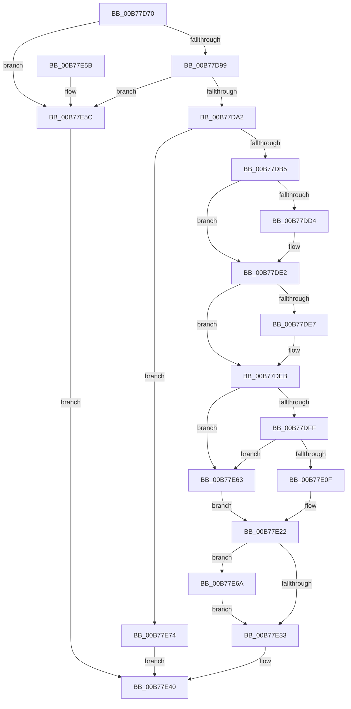

# EmClientQueryRuleState

- RVA: `0x00B77D70`–`0x00B77E7B` (길이 `267` bytes)
- VA: `0x0000000140B77D70`
- 실행 섹션: `PAGELK`
- PDB 이름 있음: `예`; PDB Function 태그: `아니요`
- unwind 정보 RVA: `0x00078250`
- 디코드: `76`개 명령, `267/267` bytes 표시
- 미해석 바이트: `0` (있으면 어셈블리에 `.byte`로 보존)

> 이 문서는 커널 이미지의 기계어와 PDB 기호를 분석해 생성했습니다. 4번과 5번은 함수 원형과 자료형을 바이너리 사용 방식에서 추정한 C 해석이며 원본 소스 복구 결과는 아닙니다.

## 1. Dependencies

- 직접 호출 지점: **9**; 고유 호출 대상: **9**
- 직접 호출자로 확인된 함수: **10**
- RIP 상대 이미지 참조: **2**

### Outgoing calls
- `0x00B77DA8` → [EmpAcquirePagingReference](EmpAcquirePagingReference_function_00B77FC8.md) (function, `0x00B77FC8`)
- `0x00B77DC4` → [KeAbPreAcquire](../../text/21/KeAbPreAcquire_function_00210230.md) (function, `0x00210230`)
- `0x00B77DDD` → [ExfAcquirePushLockExclusiveEx](../../text/20/ExfAcquirePushLockExclusiveEx_function_0020FC90.md) (function, `0x0020FC90`)
- `0x00B77DEE` → [EmpSearchRuleDatabase](../../text/45/EmpSearchRuleDatabase_function_00458A9C.md) (function, `0x00458A9C`)
- `0x00B77E02` → [EmpSearchTargetRuleList](../../text/45/EmpSearchTargetRuleList_function_00456CE0.md) (function, `0x00456CE0`)
- `0x00B77E14` → [EmpUpdateRuleState](../../text/49/EmpUpdateRuleState_function_0049CD48.md) (function, `0x0049CD48`)
- `0x00B77E36` → [KeAbPostRelease](../../text/2E/KeAbPostRelease_function_002E1600.md) (function, `0x002E1600`)
- `0x00B77E3B` → [EmpReleasePagingReference](EmpReleasePagingReference_function_00B78074.md) (function, `0x00B78074`)
- `0x00B77E6D` → [ExfTryToWakePushLock](../../text/26/ExfTryToWakePushLock_function_00265DD0.md) (function, `0x00265DD0`)

### Direct callers
- [HalpInterruptIsMsiSupported](../../text/4C/HalpInterruptIsMsiSupported_function_004C225C.md) at `0x004C22B7`
- [PopDirectedDripsQueryEnabledMitigations](../../page/75/PopDirectedDripsQueryEnabledMitigations_function_00757A84.md) at `0x00757AEA`
- [PopPolicyDeviceHandleWakeAlarmNotification](../../page/76/PopPolicyDeviceHandleWakeAlarmNotification_function_007660A4.md) at `0x00766115`
- [PopEnableHiberFile](../../page/90/PopEnableHiberFile_function_0090F850.md) at `0x0090FCB8`
- [PopFilterCapabilities](../../page/91/PopFilterCapabilities_function_0091141C.md) at `0x0091153F`
- [PopHiberEvaluateSkippingMemoryMapValidation](../../init/C3/PopHiberEvaluateSkippingMemoryMapValidation_function_00C3EF2C.md) at `0x00C3EF5F`
- [PopEvaluateInputSuppressionRequired](../../init/C4/PopEvaluateInputSuppressionRequired_function_00C40A1C.md) at `0x00C40AC1`
- [PopReadErrataForIncorrectLidNotification](../../init/C4/PopReadErrataForIncorrectLidNotification_function_00C43428.md) at `0x00C43453`
- [KeInitializeClock](../../init/C7/KeInitializeClock_function_00C70C30.md) at `0x00C70CDD`
- [PoInitSystem](../../init/C7/PoInitSystem_function_00C72358.md) at `0x00C72DA9`

### Static image references
- `0x00B77DB5` → RVA `0x00F8F1E0` (`.data`; read)
- `0x00B77E22` → RVA `0x00F8F1E0` (`.data`; read/write)

## 2. Other-region calls and transfers

- 다른 실행 섹션으로 향하는 call: **7**
  - `0x00B77DC4` → [KeAbPreAcquire](../../text/21/KeAbPreAcquire_function_00210230.md) (`PAGELK` → `.text`)
  - `0x00B77DDD` → [ExfAcquirePushLockExclusiveEx](../../text/20/ExfAcquirePushLockExclusiveEx_function_0020FC90.md) (`PAGELK` → `.text`)
  - `0x00B77DEE` → [EmpSearchRuleDatabase](../../text/45/EmpSearchRuleDatabase_function_00458A9C.md) (`PAGELK` → `.text`)
  - `0x00B77E02` → [EmpSearchTargetRuleList](../../text/45/EmpSearchTargetRuleList_function_00456CE0.md) (`PAGELK` → `.text`)
  - `0x00B77E14` → [EmpUpdateRuleState](../../text/49/EmpUpdateRuleState_function_0049CD48.md) (`PAGELK` → `.text`)
  - `0x00B77E36` → [KeAbPostRelease](../../text/2E/KeAbPostRelease_function_002E1600.md) (`PAGELK` → `.text`)
  - `0x00B77E6D` → [ExfTryToWakePushLock](../../text/26/ExfTryToWakePushLock_function_00265DD0.md) (`PAGELK` → `.text`)
- 별도 외부 분기/꼬리 이동을 확인하지 못했습니다.

## 3. Assembly (complete function range)

```asm
00B77D70  48 89 5C 24 08                  mov qword ptr [rsp + 8], rbx
00B77D75  48 89 6C 24 10                  mov qword ptr [rsp + 0x10], rbp
00B77D7A  48 89 74 24 18                  mov qword ptr [rsp + 0x18], rsi
00B77D7F  57                              push rdi
00B77D80  41 56                           push r14
00B77D82  41 57                           push r15
00B77D84  48 83 EC 20                     sub rsp, 0x20
00B77D88  33 FF                           xor edi, edi
00B77D8A  4C 8B F2                        mov r14, rdx
00B77D8D  48 8B F1                        mov rsi, rcx
00B77D90  48 85 C9                        test rcx, rcx
00B77D93  0F 84 C3 00 00 00               je 0x140b77e5c
00B77D99  48 85 D2                        test rdx, rdx
00B77D9C  0F 84 BA 00 00 00               je 0x140b77e5c
00B77DA2  C7 02 01 00 00 00               mov dword ptr [rdx], 1
00B77DA8  E8 1B 02 00 00                  call 0x140b77fc8
00B77DAD  84 C0                           test al, al
00B77DAF  0F 84 BF 00 00 00               je 0x140b77e74
00B77DB5  4C 8D 3D 24 74 41 00            lea r15, [rip + 0x417424]
00B77DBC  45 33 C0                        xor r8d, r8d
00B77DBF  49 8B CF                        mov rcx, r15
00B77DC2  33 D2                           xor edx, edx
00B77DC4  E8 67 84 69 FF                  call 0x140210230
00B77DC9  F0 49 0F BA 2F 00               lock bts qword ptr [r15], 0
00B77DCF  48 8B D8                        mov rbx, rax
00B77DD2  73 0E                           jae 0x140b77de2
00B77DD4  4D 8B C7                        mov r8, r15
00B77DD7  48 8B D0                        mov rdx, rax
00B77DDA  49 8B CF                        mov rcx, r15
00B77DDD  E8 AE 7E 69 FF                  call 0x14020fc90
00B77DE2  48 85 DB                        test rbx, rbx
00B77DE5  74 04                           je 0x140b77deb
00B77DE7  C6 43 0A 01                     mov byte ptr [rbx + 0xa], 1
00B77DEB  48 8B CE                        mov rcx, rsi
00B77DEE  E8 A9 0C 8E FF                  call 0x140458a9c
00B77DF3  48 83 CB FF                     or rbx, 0xffffffffffffffff
00B77DF7  48 8B E8                        mov rbp, rax
00B77DFA  48 85 C0                        test rax, rax
00B77DFD  74 64                           je 0x140b77e63
00B77DFF  48 8B C8                        mov rcx, rax
00B77E02  E8 D9 EE 8D FF                  call 0x140456ce0
00B77E07  48 8B F0                        mov rsi, rax
00B77E0A  48 85 C0                        test rax, rax
00B77E0D  74 54                           je 0x140b77e63
00B77E0F  F0 FF 00                        lock inc dword ptr [rax]
00B77E12  33 D2                           xor edx, edx
00B77E14  E8 2F 4F 92 FF                  call 0x14049cd48
00B77E19  F0 01 1E                        lock add dword ptr [rsi], ebx
00B77E1C  8B 45 10                        mov eax, dword ptr [rbp + 0x10]
00B77E1F  41 89 06                        mov dword ptr [r14], eax
00B77E22  F0 48 0F C1 1D B5 73 41 00      lock xadd qword ptr [rip + 0x4173b5], rbx
00B77E2B  80 E3 06                        and bl, 6
00B77E2E  80 FB 02                        cmp bl, 2
00B77E31  74 37                           je 0x140b77e6a
00B77E33  49 8B CF                        mov rcx, r15
00B77E36  E8 C5 97 76 FF                  call 0x1402e1600
00B77E3B  E8 34 02 00 00                  call 0x140b78074
00B77E40  48 8B 5C 24 40                  mov rbx, qword ptr [rsp + 0x40]
00B77E45  8B C7                           mov eax, edi
00B77E47  48 8B 6C 24 48                  mov rbp, qword ptr [rsp + 0x48]
00B77E4C  48 8B 74 24 50                  mov rsi, qword ptr [rsp + 0x50]
00B77E51  48 83 C4 20                     add rsp, 0x20
00B77E55  41 5F                           pop r15
00B77E57  41 5E                           pop r14
00B77E59  5F                              pop rdi
00B77E5A  C3                              ret
00B77E5B  CC                              int3
00B77E5C  BF 0D 00 00 C0                  mov edi, 0xc000000d
00B77E61  EB DD                           jmp 0x140b77e40
00B77E63  BF 25 02 00 C0                  mov edi, 0xc0000225
00B77E68  EB B8                           jmp 0x140b77e22
00B77E6A  49 8B CF                        mov rcx, r15
00B77E6D  E8 5E DF 6E FF                  call 0x140265dd0
00B77E72  EB BF                           jmp 0x140b77e33
00B77E74  BF 06 00 00 C0                  mov edi, 0xc0000006
00B77E79  EB C5                           jmp 0x140b77e40
```

## 4. C-style interpretation (structured pseudocode)

```c
__int64 __fastcall EmClientQueryRuleState(__int64 a1, __int64 a2, int a3)
{
    __int64 result;
    __int64 v_rbx;
    __int64 v_rdi;
    __int64 v_rsp;
    unsigned __int64 v_stack_p10;
    unsigned __int64 v_stack_p18;
    unsigned __int64 v_stack_p8;

    v_stack_p8 = v_rbx;
    v_stack_p10 = v_rbp;
    v_stack_p18 = v_rsi;
    v_rsp = (v_rsp) - (32);
    v_rdi = 0;
    if (a1 == 0) goto loc_00B77E5C;
    if (a2 == 0) goto loc_00B77E5C;
    *(unsigned int *)(a2) = 1;
    result = EmpAcquirePagingReference(a1, a2, a3, a4);
    if ((unsigned __int8)(result) == 0) goto loc_00B77E74;
    a3 = 0;
    a2 = 0;
    result = KeAbPreAcquire(v_rip + 4289572, a2, a3, a4);
    if (!(condition_is_above_or_equal)) {
        a3 = v_rip + 4289572;
        a2 = result;
        a1 = v_rip + 4289572;
        result = ExfAcquirePushLockExclusiveEx(a1, a2, a3, a4);
    }
    if (result != 0) {
        *(unsigned __int8 *)(result + 10) = 1;
    }
    result = EmpSearchRuleDatabase(a1, a2, a3, a4);
    v_rbx = (result) | (-1);
    if (result == 0) goto loc_00B77E63;
    result = EmpSearchTargetRuleList(result, a2, a3, a4);
    if (result == 0) goto loc_00B77E63;
    a2 = 0;
    result = EmpUpdateRuleState(result, a2, a3, a4);
    *(unsigned int *)(a2) = (unsigned int)((unsigned int)(*(unsigned int *)(result + 16)));
loc_00B77E22:
    v_rbx = (unsigned __int8)((v_rbx) & (6));
    if (((unsigned __int8)(v_rbx)) == 2) goto loc_00B77E6A;
loc_00B77E33:
    result = KeAbPostRelease(v_rip + 4289572, a2, a3, a4);
    result = EmpReleasePagingReference(v_rip + 4289572, a2, a3, a4);
loc_00B77E40:
    v_rsp = (v_rsp) + (32);
    return 0;
loc_00B77E5C:
    goto loc_00B77E40;
loc_00B77E63:
    goto loc_00B77E22;
loc_00B77E6A:
    result = ExfTryToWakePushLock(v_rip + 4289572, a2, a3, a4);
    goto loc_00B77E33;
loc_00B77E74:
    goto loc_00B77E40;
}
```

## 5. (Beta) C Style

```c
int64_t EmClientQueryRuleState(int64_t Arg1, void *Arg2, int32_t Arg3)
{
    uint8_t *arg2 = (uint8_t *)Arg2;

    int64_t result;
    int64_t local_rbx;
    int64_t local_rdi;
    int64_t local_rsp;
    uint64_t v_stack_p10;
    uint64_t v_stack_p18;
    uint64_t v_stack_p8;

    v_stack_p8 = local_rbx;
    v_stack_p10 = local_rbp;
    v_stack_p18 = local_rsi;
    local_rsp = (local_rsp) - (32);
    local_rdi = 0;
    if (Arg1 == 0) goto loc_00B77E5C;
    if (Arg2 == NULL) goto loc_00B77E5C;
    *(uint32_t *)(arg2) = 1;
    result = EmpAcquirePagingReference(Arg1, Arg2, Arg3, a4);
    if ((uint8_t)(result) == 0) goto loc_00B77E74;
    Arg3 = 0;
    Arg2 = 0;
    result = KeAbPreAcquire(v_rip + 4289572, Arg2, Arg3, a4);
    if (!(condition_is_above_or_equal)) {
        Arg3 = v_rip + 4289572;
        Arg2 = result;
        Arg1 = v_rip + 4289572;
        result = ExfAcquirePushLockExclusiveEx(Arg1, Arg2, Arg3, a4);
    }
    if (result != 0) {
        *(uint8_t *)(result + 0xA) = 1;
    }
    result = EmpSearchRuleDatabase(Arg1, Arg2, Arg3, a4);
    local_rbx = (result) | (-1);
    if (result == 0) goto loc_00B77E63;
    result = EmpSearchTargetRuleList(result, Arg2, Arg3, a4);
    if (result == 0) goto loc_00B77E63;
    Arg2 = 0;
    result = EmpUpdateRuleState(result, Arg2, Arg3, a4);
    *(uint32_t *)(arg2) = (uint32_t)((uint32_t)(*(uint32_t *)(result + 0x10)));
loc_00B77E22:
    local_rbx = (uint8_t)((local_rbx) & (6));
    if (((uint8_t)(local_rbx)) == 2) goto loc_00B77E6A;
loc_00B77E33:
    result = KeAbPostRelease(v_rip + 4289572, Arg2, Arg3, a4);
    result = EmpReleasePagingReference(v_rip + 4289572, Arg2, Arg3, a4);
loc_00B77E40:
    local_rsp = (local_rsp) + (32);
    return 0;
loc_00B77E5C:
    goto loc_00B77E40;
loc_00B77E63:
    goto loc_00B77E22;
loc_00B77E6A:
    result = ExfTryToWakePushLock(v_rip + 4289572, Arg2, Arg3, a4);
    goto loc_00B77E33;
loc_00B77E74:
    goto loc_00B77E40;
}
```

### 관측된 메모리 오프셋

구조체 형식이 확인되지 않은 접근은 인자 기준의 오프셋으로만 기록했습니다.

| 기준 인자 | 오프셋 표현 | 폭 (bit) | 접근 |
|---|---:|---:|---|
| `Arg2` | `+ 0x0` | `32` | `W` |

## 6. Execution-region graph

[열기: 2D/3D 그래프와 함수 탐색 컨트롤 패널](../../../control-panel.html?section=pagelk&rva=0x00B77D70&view=graph)

- 2D 그래프는 위에서 아래로 흐르고, 3D 그래프는 빈 공간을 드래그해 회전합니다. Shift+드래그는 이동, 휠은 확대·축소, 함수 노드 선택은 대상 보고서 이동입니다.

### Static fallback


