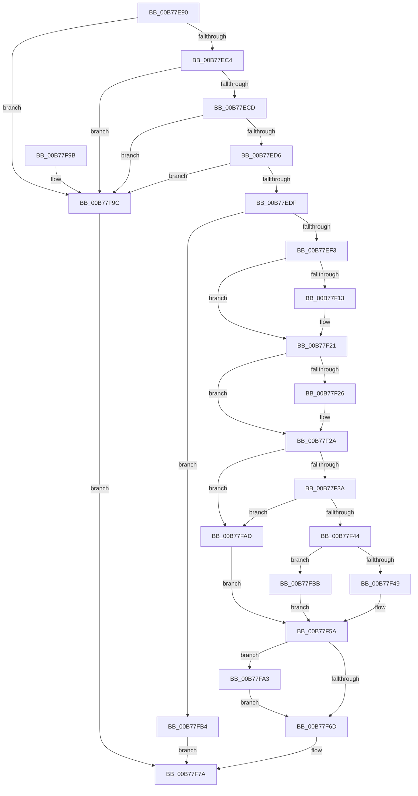

# EmClientRuleEvaluate

- RVA: `0x00B77E90`–`0x00B77FC2` (길이 `306` bytes)
- VA: `0x0000000140B77E90`
- 실행 섹션: `PAGELK`
- PDB 이름 있음: `예`; PDB Function 태그: `아니요`
- unwind 정보 RVA: `0x000AA124`
- 디코드: `86`개 명령, `306/306` bytes 표시
- 미해석 바이트: `0` (있으면 어셈블리에 `.byte`로 보존)

> 이 문서는 커널 이미지의 기계어와 PDB 기호를 분석해 생성했습니다. 4번과 5번은 함수 원형과 자료형을 바이너리 사용 방식에서 추정한 C 해석이며 원본 소스 복구 결과는 아닙니다.

## 1. Dependencies

- 직접 호출 지점: **9**; 고유 호출 대상: **9**
- 직접 호출자로 확인된 함수: **3**
- RIP 상대 이미지 참조: **2**

### Outgoing calls
- `0x00B77EE6` → [EmpAcquirePagingReference](EmpAcquirePagingReference_function_00B77FC8.md) (function, `0x00B77FC8`)
- `0x00B77F02` → [KeAbPreAcquire](../../text/21/KeAbPreAcquire_function_00210230.md) (function, `0x00210230`)
- `0x00B77F1C` → [ExfAcquirePushLockExclusiveEx](../../text/20/ExfAcquirePushLockExclusiveEx_function_0020FC90.md) (function, `0x0020FC90`)
- `0x00B77F2D` → [EmpSearchRuleDatabase](../../text/45/EmpSearchRuleDatabase_function_00458A9C.md) (function, `0x00458A9C`)
- `0x00B77F3A` → [EmpSearchTargetRuleList](../../text/45/EmpSearchTargetRuleList_function_00456CE0.md) (function, `0x00456CE0`)
- `0x00B77F52` → [EmpEvaluateTargetRule](../../text/44/EmpEvaluateTargetRule_function_00442E50.md) (function, `0x00442E50`)
- `0x00B77F70` → [KeAbPostRelease](../../text/2E/KeAbPostRelease_function_002E1600.md) (function, `0x002E1600`)
- `0x00B77F75` → [EmpReleasePagingReference](EmpReleasePagingReference_function_00B78074.md) (function, `0x00B78074`)
- `0x00B77FA6` → [ExfTryToWakePushLock](../../text/26/ExfTryToWakePushLock_function_00265DD0.md) (function, `0x00265DD0`)

### Direct callers
- [PopPepInitializeVetoMasks](../../text/4C/PopPepInitializeVetoMasks_function_004C9350.md) at `0x004C94A5`
- [PoRegisterPowerSettingCallback](../../page/A8/PoRegisterPowerSettingCallback_function_00A82150.md) at `0x00A82260`
- [PopReadErrataSkipMemoryOverwriteRequestControlLockAction](../../init/C4/PopReadErrataSkipMemoryOverwriteRequestControlLockAction_function_00C43474.md) at `0x00C434BF`

### Static image references
- `0x00B77EF3` → RVA `0x00F8F1E0` (`.data`; read)
- `0x00B77F5E` → RVA `0x00F8F1E0` (`.data`; read/write)

## 2. Other-region calls and transfers

- 다른 실행 섹션으로 향하는 call: **7**
  - `0x00B77F02` → [KeAbPreAcquire](../../text/21/KeAbPreAcquire_function_00210230.md) (`PAGELK` → `.text`)
  - `0x00B77F1C` → [ExfAcquirePushLockExclusiveEx](../../text/20/ExfAcquirePushLockExclusiveEx_function_0020FC90.md) (`PAGELK` → `.text`)
  - `0x00B77F2D` → [EmpSearchRuleDatabase](../../text/45/EmpSearchRuleDatabase_function_00458A9C.md) (`PAGELK` → `.text`)
  - `0x00B77F3A` → [EmpSearchTargetRuleList](../../text/45/EmpSearchTargetRuleList_function_00456CE0.md) (`PAGELK` → `.text`)
  - `0x00B77F52` → [EmpEvaluateTargetRule](../../text/44/EmpEvaluateTargetRule_function_00442E50.md) (`PAGELK` → `.text`)
  - `0x00B77F70` → [KeAbPostRelease](../../text/2E/KeAbPostRelease_function_002E1600.md) (`PAGELK` → `.text`)
  - `0x00B77FA6` → [ExfTryToWakePushLock](../../text/26/ExfTryToWakePushLock_function_00265DD0.md) (`PAGELK` → `.text`)
- 별도 외부 분기/꼬리 이동을 확인하지 못했습니다.

## 3. Assembly (complete function range)

```asm
00B77E90  48 8B C4                        mov rax, rsp
00B77E93  48 89 58 08                     mov qword ptr [rax + 8], rbx
00B77E97  48 89 68 10                     mov qword ptr [rax + 0x10], rbp
00B77E9B  48 89 70 18                     mov qword ptr [rax + 0x18], rsi
00B77E9F  48 89 78 20                     mov qword ptr [rax + 0x20], rdi
00B77EA3  41 54                           push r12
00B77EA5  41 56                           push r14
00B77EA7  41 57                           push r15
00B77EA9  48 83 EC 20                     sub rsp, 0x20
00B77EAD  33 DB                           xor ebx, ebx
00B77EAF  4D 8B F1                        mov r14, r9
00B77EB2  41 8B F0                        mov esi, r8d
00B77EB5  4C 8B FA                        mov r15, rdx
00B77EB8  48 8B E9                        mov rbp, rcx
00B77EBB  48 85 C9                        test rcx, rcx
00B77EBE  0F 84 D8 00 00 00               je 0x140b77f9c
00B77EC4  48 85 D2                        test rdx, rdx
00B77EC7  0F 84 CF 00 00 00               je 0x140b77f9c
00B77ECD  4D 85 C9                        test r9, r9
00B77ED0  0F 84 C6 00 00 00               je 0x140b77f9c
00B77ED6  45 85 C0                        test r8d, r8d
00B77ED9  0F 84 BD 00 00 00               je 0x140b77f9c
00B77EDF  41 C7 01 01 00 00 00            mov dword ptr [r9], 1
00B77EE6  E8 DD 00 00 00                  call 0x140b77fc8
00B77EEB  84 C0                           test al, al
00B77EED  0F 84 C1 00 00 00               je 0x140b77fb4
00B77EF3  4C 8D 25 E6 72 41 00            lea r12, [rip + 0x4172e6]
00B77EFA  45 33 C0                        xor r8d, r8d
00B77EFD  49 8B CC                        mov rcx, r12
00B77F00  33 D2                           xor edx, edx
00B77F02  E8 29 83 69 FF                  call 0x140210230
00B77F07  F0 49 0F BA 2C 24 00            lock bts qword ptr [r12], 0
00B77F0E  48 8B F8                        mov rdi, rax
00B77F11  73 0E                           jae 0x140b77f21
00B77F13  4D 8B C4                        mov r8, r12
00B77F16  48 8B D0                        mov rdx, rax
00B77F19  49 8B CC                        mov rcx, r12
00B77F1C  E8 6F 7D 69 FF                  call 0x14020fc90
00B77F21  48 85 FF                        test rdi, rdi
00B77F24  74 04                           je 0x140b77f2a
00B77F26  C6 47 0A 01                     mov byte ptr [rdi + 0xa], 1
00B77F2A  48 8B CD                        mov rcx, rbp
00B77F2D  E8 6A 0B 8E FF                  call 0x140458a9c
00B77F32  48 8B C8                        mov rcx, rax
00B77F35  48 85 C0                        test rax, rax
00B77F38  74 73                           je 0x140b77fad
00B77F3A  E8 A1 ED 8D FF                  call 0x140456ce0
00B77F3F  48 85 C0                        test rax, rax
00B77F42  74 69                           je 0x140b77fad
00B77F44  3B 71 30                        cmp esi, dword ptr [rcx + 0x30]
00B77F47  75 72                           jne 0x140b77fbb
00B77F49  44 8B C6                        mov r8d, esi
00B77F4C  49 8B D7                        mov rdx, r15
00B77F4F  48 8B C8                        mov rcx, rax
00B77F52  E8 F9 AE 8C FF                  call 0x140442e50
00B77F57  41 89 06                        mov dword ptr [r14], eax
00B77F5A  48 83 C8 FF                     or rax, 0xffffffffffffffff
00B77F5E  F0 48 0F C1 05 79 72 41 00      lock xadd qword ptr [rip + 0x417279], rax
00B77F67  24 06                           and al, 6
00B77F69  3C 02                           cmp al, 2
00B77F6B  74 36                           je 0x140b77fa3
00B77F6D  49 8B CC                        mov rcx, r12
00B77F70  E8 8B 96 76 FF                  call 0x1402e1600
00B77F75  E8 FA 00 00 00                  call 0x140b78074
00B77F7A  48 8B 6C 24 48                  mov rbp, qword ptr [rsp + 0x48]
00B77F7F  8B C3                           mov eax, ebx
00B77F81  48 8B 5C 24 40                  mov rbx, qword ptr [rsp + 0x40]
00B77F86  48 8B 74 24 50                  mov rsi, qword ptr [rsp + 0x50]
00B77F8B  48 8B 7C 24 58                  mov rdi, qword ptr [rsp + 0x58]
00B77F90  48 83 C4 20                     add rsp, 0x20
00B77F94  41 5F                           pop r15
00B77F96  41 5E                           pop r14
00B77F98  41 5C                           pop r12
00B77F9A  C3                              ret
00B77F9B  CC                              int3
00B77F9C  BB 0D 00 00 C0                  mov ebx, 0xc000000d
00B77FA1  EB D7                           jmp 0x140b77f7a
00B77FA3  49 8B CC                        mov rcx, r12
00B77FA6  E8 25 DE 6E FF                  call 0x140265dd0
00B77FAB  EB C0                           jmp 0x140b77f6d
00B77FAD  BB 25 02 00 C0                  mov ebx, 0xc0000225
00B77FB2  EB A6                           jmp 0x140b77f5a
00B77FB4  BB 06 00 00 C0                  mov ebx, 0xc0000006
00B77FB9  EB BF                           jmp 0x140b77f7a
00B77FBB  BB 0D 00 00 C0                  mov ebx, 0xc000000d
00B77FC0  EB 98                           jmp 0x140b77f5a
```

## 4. C-style interpretation (structured pseudocode)

```c
__int64 __fastcall EmClientRuleEvaluate(__int64 a1, __int64 a2, int a3, __int64 a4)
{
    __int64 result;
    __int64 v_rbx;
    __int64 v_rsp;
    unsigned __int64 v_stack_p10;
    unsigned __int64 v_stack_p18;
    unsigned __int64 v_stack_p20;
    unsigned __int64 v_stack_p8;

    *(unsigned __int64 *)(v_rsp + 8) = v_rbx;
    *(unsigned __int64 *)(v_rsp + 16) = v_rbp;
    *(unsigned __int64 *)(v_rsp + 24) = v_rsi;
    *(unsigned __int64 *)(v_rsp + 32) = v_rdi;
    v_rsp = (v_rsp) - (32);
    v_rbx = 0;
    if (a1 == 0) goto loc_00B77F9C;
    if (a2 == 0) goto loc_00B77F9C;
    if (a4 == 0) goto loc_00B77F9C;
    if (a3 == 0) goto loc_00B77F9C;
    *(unsigned int *)(a4) = 1;
    result = EmpAcquirePagingReference(a1, a2, a3, a4);
    if ((unsigned __int8)(result) == 0) goto loc_00B77FB4;
    a3 = 0;
    a2 = 0;
    result = KeAbPreAcquire(v_rip + 4289254, a2, a3, a4);
    if (!(condition_is_above_or_equal)) {
        a3 = v_rip + 4289254;
        a2 = result;
        a1 = v_rip + 4289254;
        result = ExfAcquirePushLockExclusiveEx(a1, a2, a3, a4);
    }
    if (result != 0) {
        *(unsigned __int8 *)(result + 10) = 1;
    }
    result = EmpSearchRuleDatabase(a1, a2, a3, a4);
    if (result == 0) goto loc_00B77FAD;
    result = EmpSearchTargetRuleList(result, a2, a3, a4);
    if (result == 0) goto loc_00B77FAD;
    if (((unsigned int)((unsigned int)(a3))) != (*(unsigned int *)(result + 48))) goto loc_00B77FBB;
    result = EmpEvaluateTargetRule(result, a2, (unsigned int)((unsigned int)((unsigned int)(a3))), a4);
    *(unsigned int *)(a4) = (unsigned int)(result);
loc_00B77F5A:
    result = (result) | (-1);
    result = (unsigned __int8)((result) & (6));
    if (((unsigned __int8)(result)) == 2) goto loc_00B77FA3;
loc_00B77F6D:
    result = KeAbPostRelease(v_rip + 4289254, a2, (unsigned int)((unsigned int)((unsigned int)(a3))), a4);
    result = EmpReleasePagingReference(v_rip + 4289254, a2, (unsigned int)((unsigned int)((unsigned int)(a3))), a4);
loc_00B77F7A:
    v_rsp = (v_rsp) + (32);
    return 0;
loc_00B77F9C:
    goto loc_00B77F7A;
loc_00B77FA3:
    result = ExfTryToWakePushLock(v_rip + 4289254, a2, (unsigned int)((unsigned int)((unsigned int)(a3))), a4);
    goto loc_00B77F6D;
loc_00B77FAD:
    goto loc_00B77F5A;
loc_00B77FB4:
    goto loc_00B77F7A;
loc_00B77FBB:
    goto loc_00B77F5A;
}
```

## 5. (Beta) C Style

```c
int64_t EmClientRuleEvaluate(int64_t Arg1, int64_t Arg2, int32_t Arg3, void *Arg4)
{
    uint8_t *arg4 = (uint8_t *)Arg4;

    int64_t result;
    int64_t local_rbx;
    int64_t local_rsp;
    uint64_t v_stack_p10;
    uint64_t v_stack_p18;
    uint64_t v_stack_p20;
    uint64_t v_stack_p8;

    *(uint64_t *)(local_rsp + 0x8) = local_rbx;
    *(uint64_t *)(local_rsp + 0x10) = local_rbp;
    *(uint64_t *)(local_rsp + 0x18) = local_rsi;
    *(uint64_t *)(local_rsp + 0x20) = local_rdi;
    local_rsp = (local_rsp) - (32);
    local_rbx = 0;
    if (Arg1 == 0) goto loc_00B77F9C;
    if (Arg2 == 0) goto loc_00B77F9C;
    if (Arg4 == NULL) goto loc_00B77F9C;
    if (Arg3 == 0) goto loc_00B77F9C;
    *(uint32_t *)(arg4) = 1;
    result = EmpAcquirePagingReference(Arg1, Arg2, Arg3, Arg4);
    if ((uint8_t)(result) == 0) goto loc_00B77FB4;
    Arg3 = 0;
    Arg2 = 0;
    result = KeAbPreAcquire(v_rip + 4289254, Arg2, Arg3, Arg4);
    if (!(condition_is_above_or_equal)) {
        Arg3 = v_rip + 4289254;
        Arg2 = result;
        Arg1 = v_rip + 4289254;
        result = ExfAcquirePushLockExclusiveEx(Arg1, Arg2, Arg3, Arg4);
    }
    if (result != 0) {
        *(uint8_t *)(result + 0xA) = 1;
    }
    result = EmpSearchRuleDatabase(Arg1, Arg2, Arg3, Arg4);
    if (result == 0) goto loc_00B77FAD;
    result = EmpSearchTargetRuleList(result, Arg2, Arg3, Arg4);
    if (result == 0) goto loc_00B77FAD;
    if (((uint32_t)((uint32_t)(Arg3))) != (*(uint32_t *)(result + 0x30))) goto loc_00B77FBB;
    result = EmpEvaluateTargetRule(result, Arg2, (uint32_t)((uint32_t)((uint32_t)(Arg3))), Arg4);
    *(uint32_t *)(arg4) = (uint32_t)(result);
loc_00B77F5A:
    result = (result) | (-1);
    result = (uint8_t)((result) & (6));
    if (((uint8_t)(result)) == 2) goto loc_00B77FA3;
loc_00B77F6D:
    result = KeAbPostRelease(v_rip + 4289254, Arg2, (uint32_t)((uint32_t)((uint32_t)(Arg3))), Arg4);
    result = EmpReleasePagingReference(v_rip + 4289254, Arg2, (uint32_t)((uint32_t)((uint32_t)(Arg3))), Arg4);
loc_00B77F7A:
    local_rsp = (local_rsp) + (32);
    return 0;
loc_00B77F9C:
    goto loc_00B77F7A;
loc_00B77FA3:
    result = ExfTryToWakePushLock(v_rip + 4289254, Arg2, (uint32_t)((uint32_t)((uint32_t)(Arg3))), Arg4);
    goto loc_00B77F6D;
loc_00B77FAD:
    goto loc_00B77F5A;
loc_00B77FB4:
    goto loc_00B77F7A;
loc_00B77FBB:
    goto loc_00B77F5A;
}
```

### 관측된 메모리 오프셋

구조체 형식이 확인되지 않은 접근은 인자 기준의 오프셋으로만 기록했습니다.

| 기준 인자 | 오프셋 표현 | 폭 (bit) | 접근 |
|---|---:|---:|---|
| `Arg4` | `+ 0x0` | `32` | `W` |

## 6. Execution-region graph

[열기: 2D/3D 그래프와 함수 탐색 컨트롤 패널](../../../control-panel.html?section=pagelk&rva=0x00B77E90&view=graph)

- 2D 그래프는 위에서 아래로 흐르고, 3D 그래프는 빈 공간을 드래그해 회전합니다. Shift+드래그는 이동, 휠은 확대·축소, 함수 노드 선택은 대상 보고서 이동입니다.

### Static fallback


