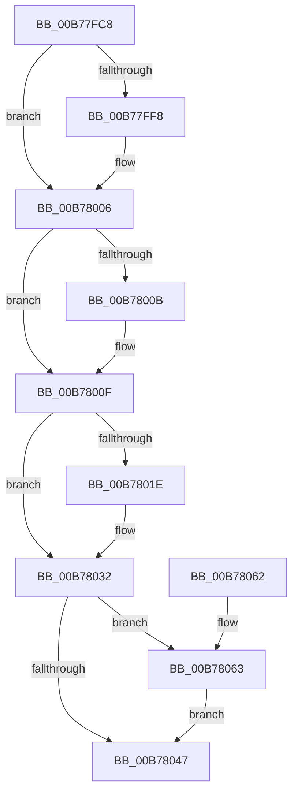

# EmpAcquirePagingReference

- RVA: `0x00B77FC8`–`0x00B7806D` (길이 `165` bytes)
- VA: `0x0000000140B77FC8`
- 실행 섹션: `PAGELK`
- PDB 이름 있음: `예`; PDB Function 태그: `아니요`
- unwind 정보 RVA: `0x0005C748`
- 디코드: `47`개 명령, `165/165` bytes 표시
- 미해석 바이트: `0` (있으면 어셈블리에 `.byte`로 보존)

> 이 문서는 커널 이미지의 기계어와 PDB 기호를 분석해 생성했습니다. 4번과 5번은 함수 원형과 자료형을 바이너리 사용 방식에서 추정한 C 해석이며 원본 소스 복구 결과는 아닙니다.

## 1. Dependencies

- 직접 호출 지점: **4**; 고유 호출 대상: **4**
- 직접 호출자로 확인된 함수: **2**
- RIP 상대 이미지 참조: **4**

### Outgoing calls
- `0x00B77FE8` → [KeAbPreAcquire](../../text/21/KeAbPreAcquire_function_00210230.md) (function, `0x00210230`)
- `0x00B78001` → [ExfAcquirePushLockExclusiveEx](../../text/20/ExfAcquirePushLockExclusiveEx_function_0020FC90.md) (function, `0x0020FC90`)
- `0x00B7804A` → [KeAbPostRelease](../../text/2E/KeAbPostRelease_function_002E1600.md) (function, `0x002E1600`)
- `0x00B78066` → [ExfTryToWakePushLock](../../text/26/ExfTryToWakePushLock_function_00265DD0.md) (function, `0x00265DD0`)

### Direct callers
- [EmClientQueryRuleState](EmClientQueryRuleState_function_00B77D70.md) at `0x00B77DA8`
- [EmClientRuleEvaluate](EmClientRuleEvaluate_function_00B77E90.md) at `0x00B77EE6`

### Static image references
- `0x00B77FD7` → RVA `0x00F8F190` (`.data`; read)
- `0x00B7800F` → RVA `0x00F8F1F8` (`.data`; read)
- `0x00B7802C` → RVA `0x00F8F1F8` (`.data`; write)
- `0x00B78036` → RVA `0x00F8F190` (`.data`; read/write)

## 2. Other-region calls and transfers

- 다른 실행 섹션으로 향하는 call: **4**
  - `0x00B77FE8` → [KeAbPreAcquire](../../text/21/KeAbPreAcquire_function_00210230.md) (`PAGELK` → `.text`)
  - `0x00B78001` → [ExfAcquirePushLockExclusiveEx](../../text/20/ExfAcquirePushLockExclusiveEx_function_0020FC90.md) (`PAGELK` → `.text`)
  - `0x00B7804A` → [KeAbPostRelease](../../text/2E/KeAbPostRelease_function_002E1600.md) (`PAGELK` → `.text`)
  - `0x00B78066` → [ExfTryToWakePushLock](../../text/26/ExfTryToWakePushLock_function_00265DD0.md) (`PAGELK` → `.text`)
- 별도 외부 분기/꼬리 이동을 확인하지 못했습니다.

## 3. Assembly (complete function range)

```asm
00B77FC8  48 89 5C 24 08                  mov qword ptr [rsp + 8], rbx
00B77FCD  48 89 74 24 10                  mov qword ptr [rsp + 0x10], rsi
00B77FD2  57                              push rdi
00B77FD3  48 83 EC 20                     sub rsp, 0x20
00B77FD7  48 8D 35 B2 71 41 00            lea rsi, [rip + 0x4171b2]
00B77FDE  45 33 C0                        xor r8d, r8d
00B77FE1  48 8B CE                        mov rcx, rsi
00B77FE4  33 D2                           xor edx, edx
00B77FE6  33 FF                           xor edi, edi
00B77FE8  E8 43 82 69 FF                  call 0x140210230
00B77FED  F0 48 0F BA 2E 00               lock bts qword ptr [rsi], 0
00B77FF3  48 8B D8                        mov rbx, rax
00B77FF6  73 0E                           jae 0x140b78006
00B77FF8  4C 8B C6                        mov r8, rsi
00B77FFB  48 8B D0                        mov rdx, rax
00B77FFE  48 8B CE                        mov rcx, rsi
00B78001  E8 8A 7C 69 FF                  call 0x14020fc90
00B78006  48 85 DB                        test rbx, rbx
00B78009  74 04                           je 0x140b7800f
00B7800B  C6 43 0A 01                     mov byte ptr [rbx + 0xa], 1
00B7800F  8B 0D E3 71 41 00               mov ecx, dword ptr [rip + 0x4171e3]
00B78015  BA 00 00 00 80                  mov edx, 0x80000000
00B7801A  85 CA                           test edx, ecx
00B7801C  74 14                           je 0x140b78032
00B7801E  8D 41 01                        lea eax, [rcx + 1]
00B78021  40 B7 01                        mov dil, 1
00B78024  0F BA F0 1F                     btr eax, 0x1f
00B78028  23 CA                           and ecx, edx
00B7802A  0B C1                           or eax, ecx
00B7802C  89 05 C6 71 41 00               mov dword ptr [rip + 0x4171c6], eax
00B78032  48 83 CA FF                     or rdx, 0xffffffffffffffff
00B78036  F0 48 0F C1 15 51 71 41 00      lock xadd qword ptr [rip + 0x417151], rdx
00B7803F  80 E2 06                        and dl, 6
00B78042  80 FA 02                        cmp dl, 2
00B78045  74 1C                           je 0x140b78063
00B78047  48 8B CE                        mov rcx, rsi
00B7804A  E8 B1 95 76 FF                  call 0x1402e1600
00B7804F  48 8B 5C 24 30                  mov rbx, qword ptr [rsp + 0x30]
00B78054  40 8A C7                        mov al, dil
00B78057  48 8B 74 24 38                  mov rsi, qword ptr [rsp + 0x38]
00B7805C  48 83 C4 20                     add rsp, 0x20
00B78060  5F                              pop rdi
00B78061  C3                              ret
00B78062  CC                              int3
00B78063  48 8B CE                        mov rcx, rsi
00B78066  E8 65 DD 6E FF                  call 0x140265dd0
00B7806B  EB DA                           jmp 0x140b78047
```

## 4. C-style interpretation (structured pseudocode)

```c
__int64 __fastcall EmpAcquirePagingReference(__int64 a1, int a2, int a3)
{
    __int64 result;
    __int64 v_rdi;
    __int64 v_rsp;
    unsigned __int64 v_stack_p10;
    unsigned __int64 v_stack_p8;

    v_stack_p8 = v_rbx;
    v_stack_p10 = v_rsi;
    v_rsp = (v_rsp) - (32);
    a3 = 0;
    a2 = 0;
    v_rdi = 0;
    result = KeAbPreAcquire(v_rip + 4288946, a2, a3, a4);
    if (!(condition_is_above_or_equal)) {
        a3 = v_rip + 4288946;
        a2 = result;
        a1 = v_rip + 4288946;
        result = ExfAcquirePushLockExclusiveEx(a1, a2, a3, a4);
    }
    if (result != 0) {
        *(unsigned __int8 *)(result + 10) = 1;
    }
    if ((((unsigned int)((unsigned int)(0x80000000ULL))) & ((unsigned int)((unsigned int)(*(unsigned int *)(v_rip + 4288995))))) != 0) {
        result = (unsigned int)(*(unsigned int *)(v_rip + 4288995)) + 1;
        v_rdi = 1;
        a1 = (unsigned int)(((unsigned int)(*(unsigned int *)(v_rip + 4288995))) & ((unsigned int)((unsigned int)(0x80000000ULL))));
        result = (unsigned int)((result) | ((unsigned int)(a1)));
        *(unsigned int *)(v_rip + 4288966) = (unsigned int)(result);
    }
    a2 = ((unsigned int)(0x80000000ULL)) | (-1);
    a2 = (unsigned __int8)((a2) & (6));
    if (((unsigned __int8)(a2)) == 2) goto loc_00B78063;
loc_00B78047:
    result = KeAbPostRelease(v_rip + 4288946, a2, a3, a4);
    v_rsp = (v_rsp) + (32);
    return (unsigned __int8)(v_rdi);
loc_00B78063:
    result = ExfTryToWakePushLock(v_stack_p10, a2, a3, a4);
    goto loc_00B78047;
}
```

## 5. (Beta) C Style

```c
int64_t EmpAcquirePagingReference(int64_t Arg1, int32_t Arg2, int32_t Arg3)
{
    int64_t result;
    int64_t local_rdi;
    int64_t local_rsp;
    uint64_t v_stack_p10;
    uint64_t v_stack_p8;

    v_stack_p8 = local_rbx;
    v_stack_p10 = local_rsi;
    local_rsp = (local_rsp) - (32);
    Arg3 = 0;
    Arg2 = 0;
    local_rdi = 0;
    result = KeAbPreAcquire(v_rip + 4288946, Arg2, Arg3, a4);
    if (!(condition_is_above_or_equal)) {
        Arg3 = v_rip + 4288946;
        Arg2 = result;
        Arg1 = v_rip + 4288946;
        result = ExfAcquirePushLockExclusiveEx(Arg1, Arg2, Arg3, a4);
    }
    if (result != 0) {
        *(uint8_t *)(result + 0xA) = 1;
    }
    if ((((uint32_t)((uint32_t)(0x80000000ULL))) & ((uint32_t)((uint32_t)(*(uint32_t *)(v_rip + 0x4171E3))))) != 0) {
        result = (uint32_t)(*(uint32_t *)(v_rip + 0x4171E3)) + 1;
        local_rdi = 1;
        Arg1 = (uint32_t)(((uint32_t)(*(uint32_t *)(v_rip + 0x4171E3))) & ((uint32_t)((uint32_t)(0x80000000ULL))));
        result = (uint32_t)((result) | ((uint32_t)(Arg1)));
        *(uint32_t *)(v_rip + 0x4171C6) = (uint32_t)(result);
    }
    Arg2 = ((uint32_t)(0x80000000ULL)) | (-1);
    Arg2 = (uint8_t)((Arg2) & (6));
    if (((uint8_t)(Arg2)) == 2) goto loc_00B78063;
loc_00B78047:
    result = KeAbPostRelease(v_rip + 4288946, Arg2, Arg3, a4);
    local_rsp = (local_rsp) + (32);
    return (uint8_t)(local_rdi);
loc_00B78063:
    result = ExfTryToWakePushLock(v_stack_p10, Arg2, Arg3, a4);
    goto loc_00B78047;
}
```

## 6. Execution-region graph

[열기: 2D/3D 그래프와 함수 탐색 컨트롤 패널](../../../control-panel.html?section=pagelk&rva=0x00B77FC8&view=graph)

- 2D 그래프는 위에서 아래로 흐르고, 3D 그래프는 빈 공간을 드래그해 회전합니다. Shift+드래그는 이동, 휠은 확대·축소, 함수 노드 선택은 대상 보고서 이동입니다.

### Static fallback


