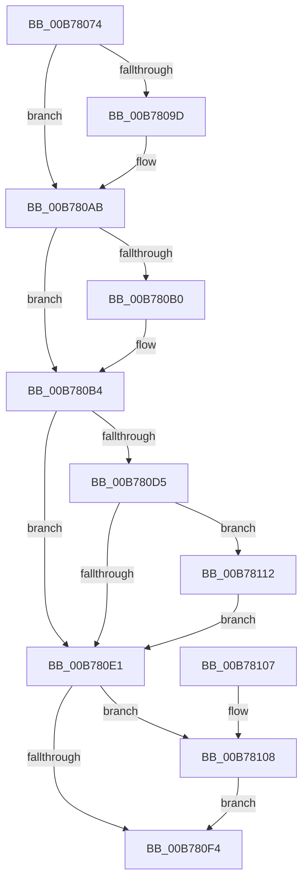

# EmpReleasePagingReference

- RVA: `0x00B78074`–`0x00B7811E` (길이 `170` bytes)
- VA: `0x0000000140B78074`
- 실행 섹션: `PAGELK`
- PDB 이름 있음: `예`; PDB Function 태그: `아니요`
- unwind 정보 RVA: `0x0006BDE4`
- 디코드: `49`개 명령, `170/170` bytes 표시
- 미해석 바이트: `0` (있으면 어셈블리에 `.byte`로 보존)

> 이 문서는 커널 이미지의 기계어와 PDB 기호를 분석해 생성했습니다. 4번과 5번은 함수 원형과 자료형을 바이너리 사용 방식에서 추정한 C 해석이며 원본 소스 복구 결과는 아닙니다.

## 1. Dependencies

- 직접 호출 지점: **5**; 고유 호출 대상: **5**
- 직접 호출자로 확인된 함수: **2**
- RIP 상대 이미지 참조: **5**

### Outgoing calls
- `0x00B7808D` → [KeAbPreAcquire](../../text/21/KeAbPreAcquire_function_00210230.md) (function, `0x00210230`)
- `0x00B780A6` → [ExfAcquirePushLockExclusiveEx](../../text/20/ExfAcquirePushLockExclusiveEx_function_0020FC90.md) (function, `0x0020FC90`)
- `0x00B780F7` → [KeAbPostRelease](../../text/2E/KeAbPostRelease_function_002E1600.md) (function, `0x002E1600`)
- `0x00B7810B` → [ExfTryToWakePushLock](../../text/26/ExfTryToWakePushLock_function_00265DD0.md) (function, `0x00265DD0`)
- `0x00B78117` → [KeSetEvent](../../text/33/KeSetEvent_function_0033F310.md) (function, `0x0033F310`)

### Direct callers
- [EmClientQueryRuleState](EmClientQueryRuleState_function_00B77D70.md) at `0x00B77E3B`
- [EmClientRuleEvaluate](EmClientRuleEvaluate_function_00B77E90.md) at `0x00B77F75`

### Static image references
- `0x00B7807E` → RVA `0x00F8F190` (`.data`; read)
- `0x00B780B4` → RVA `0x00F8F1F8` (`.data`; read)
- `0x00B780CB` → RVA `0x00F8F1F8` (`.data`; write)
- `0x00B780D5` → RVA `0x00F8F1F0` (`.data`; read)
- `0x00B780E5` → RVA `0x00F8F190` (`.data`; read/write)

## 2. Other-region calls and transfers

- 다른 실행 섹션으로 향하는 call: **5**
  - `0x00B7808D` → [KeAbPreAcquire](../../text/21/KeAbPreAcquire_function_00210230.md) (`PAGELK` → `.text`)
  - `0x00B780A6` → [ExfAcquirePushLockExclusiveEx](../../text/20/ExfAcquirePushLockExclusiveEx_function_0020FC90.md) (`PAGELK` → `.text`)
  - `0x00B780F7` → [KeAbPostRelease](../../text/2E/KeAbPostRelease_function_002E1600.md) (`PAGELK` → `.text`)
  - `0x00B7810B` → [ExfTryToWakePushLock](../../text/26/ExfTryToWakePushLock_function_00265DD0.md) (`PAGELK` → `.text`)
  - `0x00B78117` → [KeSetEvent](../../text/33/KeSetEvent_function_0033F310.md) (`PAGELK` → `.text`)
- 별도 외부 분기/꼬리 이동을 확인하지 못했습니다.

## 3. Assembly (complete function range)

```asm
00B78074  48 89 5C 24 08                  mov qword ptr [rsp + 8], rbx
00B78079  57                              push rdi
00B7807A  48 83 EC 20                     sub rsp, 0x20
00B7807E  48 8D 3D 0B 71 41 00            lea rdi, [rip + 0x41710b]
00B78085  45 33 C0                        xor r8d, r8d
00B78088  48 8B CF                        mov rcx, rdi
00B7808B  33 D2                           xor edx, edx
00B7808D  E8 9E 81 69 FF                  call 0x140210230
00B78092  F0 48 0F BA 2F 00               lock bts qword ptr [rdi], 0
00B78098  48 8B D8                        mov rbx, rax
00B7809B  73 0E                           jae 0x140b780ab
00B7809D  4C 8B C7                        mov r8, rdi
00B780A0  48 8B D0                        mov rdx, rax
00B780A3  48 8B CF                        mov rcx, rdi
00B780A6  E8 E5 7B 69 FF                  call 0x14020fc90
00B780AB  48 85 DB                        test rbx, rbx
00B780AE  74 04                           je 0x140b780b4
00B780B0  C6 43 0A 01                     mov byte ptr [rbx + 0xa], 1
00B780B4  8B 05 3E 71 41 00               mov eax, dword ptr [rip + 0x41713e]
00B780BA  BA FF FF FF 7F                  mov edx, 0x7fffffff
00B780BF  8D 48 FF                        lea ecx, [rax - 1]
00B780C2  25 00 00 00 80                  and eax, 0x80000000
00B780C7  23 CA                           and ecx, edx
00B780C9  0B C8                           or ecx, eax
00B780CB  89 0D 27 71 41 00               mov dword ptr [rip + 0x417127], ecx
00B780D1  85 CA                           test edx, ecx
00B780D3  75 0C                           jne 0x140b780e1
00B780D5  48 8B 0D 14 71 41 00            mov rcx, qword ptr [rip + 0x417114]
00B780DC  48 85 C9                        test rcx, rcx
00B780DF  75 31                           jne 0x140b78112
00B780E1  48 83 C8 FF                     or rax, 0xffffffffffffffff
00B780E5  F0 48 0F C1 05 A2 70 41 00      lock xadd qword ptr [rip + 0x4170a2], rax
00B780EE  24 06                           and al, 6
00B780F0  3C 02                           cmp al, 2
00B780F2  74 14                           je 0x140b78108
00B780F4  48 8B CF                        mov rcx, rdi
00B780F7  E8 04 95 76 FF                  call 0x1402e1600
00B780FC  48 8B 5C 24 30                  mov rbx, qword ptr [rsp + 0x30]
00B78101  48 83 C4 20                     add rsp, 0x20
00B78105  5F                              pop rdi
00B78106  C3                              ret
00B78107  CC                              int3
00B78108  48 8B CF                        mov rcx, rdi
00B7810B  E8 C0 DC 6E FF                  call 0x140265dd0
00B78110  EB E2                           jmp 0x140b780f4
00B78112  45 33 C0                        xor r8d, r8d
00B78115  33 D2                           xor edx, edx
00B78117  E8 F4 71 7C FF                  call 0x14033f310
00B7811C  EB C3                           jmp 0x140b780e1
```

## 4. C-style interpretation (structured pseudocode)

```c
__int64 __fastcall EmpReleasePagingReference(__int64 a1, int a2, int a3)
{
    __int64 result;
    __int64 v_rsp;
    unsigned __int64 v_stack_p8;

    v_stack_p8 = v_rbx;
    v_rsp = (v_rsp) - (32);
    a3 = 0;
    a2 = 0;
    result = KeAbPreAcquire(v_rip + 4288779, a2, a3, a4);
    if (!(condition_is_above_or_equal)) {
        a3 = v_rip + 4288779;
        a2 = result;
        a1 = v_rip + 4288779;
        result = ExfAcquirePushLockExclusiveEx(a1, a2, a3, a4);
    }
    if (result != 0) {
        *(unsigned __int8 *)(result + 10) = 1;
    }
    result = (unsigned int)(((unsigned int)(*(unsigned int *)(v_rip + 4288830))) & (0x80000000ULL));
    a1 = (unsigned int)(((unsigned int)(*(unsigned int *)(v_rip + 4288830)) - 1) & ((unsigned int)((unsigned int)(0x7FFFFFFFULL))));
    a1 = (unsigned int)((a1) | ((unsigned int)(result)));
    *(unsigned int *)(v_rip + 4288807) = (unsigned int)(a1);
    if ((((unsigned int)((unsigned int)(0x7FFFFFFFULL))) & ((unsigned int)(a1))) != 0) goto loc_00B780E1;
    if (*(unsigned __int64 *)(v_rip + 4288788) != 0) goto loc_00B78112;
loc_00B780E1:
    result = (result) | (-1);
    result = (unsigned __int8)((result) & (6));
    if (((unsigned __int8)(result)) == 2) goto loc_00B78108;
loc_00B780F4:
    result = KeAbPostRelease(v_rip + 4288779, (unsigned int)(0x7FFFFFFFULL), a3, a4);
    v_rsp = (v_rsp) + (32);
    return result;
loc_00B78108:
    result = ExfTryToWakePushLock(v_rip + 4288779, (unsigned int)(0x7FFFFFFFULL), a3, a4);
    goto loc_00B780F4;
loc_00B78112:
    a3 = 0;
    a2 = 0;
    result = KeSetEvent(v_rip + 4288779, a2, a3, a4);
    goto loc_00B780E1;
}
```

## 5. (Beta) C Style

```c
int64_t EmpReleasePagingReference(int64_t Arg1, int32_t Arg2, int32_t Arg3)
{
    int64_t result;
    int64_t local_rsp;
    uint64_t v_stack_p8;

    v_stack_p8 = local_rbx;
    local_rsp = (local_rsp) - (32);
    Arg3 = 0;
    Arg2 = 0;
    result = KeAbPreAcquire(v_rip + 4288779, Arg2, Arg3, a4);
    if (!(condition_is_above_or_equal)) {
        Arg3 = v_rip + 4288779;
        Arg2 = result;
        Arg1 = v_rip + 4288779;
        result = ExfAcquirePushLockExclusiveEx(Arg1, Arg2, Arg3, a4);
    }
    if (result != 0) {
        *(uint8_t *)(result + 0xA) = 1;
    }
    result = (uint32_t)(((uint32_t)(*(uint32_t *)(v_rip + 0x41713E))) & (0x80000000ULL));
    Arg1 = (uint32_t)(((uint32_t)(*(uint32_t *)(v_rip + 0x41713E)) - 1) & ((uint32_t)((uint32_t)(0x7FFFFFFFULL))));
    Arg1 = (uint32_t)((Arg1) | ((uint32_t)(result)));
    *(uint32_t *)(v_rip + 0x417127) = (uint32_t)(Arg1);
    if ((((uint32_t)((uint32_t)(0x7FFFFFFFULL))) & ((uint32_t)(Arg1))) != 0) goto loc_00B780E1;
    if (*(uint64_t *)(v_rip + 0x417114) != 0) goto loc_00B78112;
loc_00B780E1:
    result = (result) | (-1);
    result = (uint8_t)((result) & (6));
    if (((uint8_t)(result)) == 2) goto loc_00B78108;
loc_00B780F4:
    result = KeAbPostRelease(v_rip + 4288779, (uint32_t)(0x7FFFFFFFULL), Arg3, a4);
    local_rsp = (local_rsp) + (32);
    return result;
loc_00B78108:
    result = ExfTryToWakePushLock(v_rip + 4288779, (uint32_t)(0x7FFFFFFFULL), Arg3, a4);
    goto loc_00B780F4;
loc_00B78112:
    Arg3 = 0;
    Arg2 = 0;
    result = KeSetEvent(v_rip + 4288779, Arg2, Arg3, a4);
    goto loc_00B780E1;
}
```

## 6. Execution-region graph

[열기: 2D/3D 그래프와 함수 탐색 컨트롤 패널](../../../control-panel.html?section=pagelk&rva=0x00B78074&view=graph)

- 2D 그래프는 위에서 아래로 흐르고, 3D 그래프는 빈 공간을 드래그해 회전합니다. Shift+드래그는 이동, 휠은 확대·축소, 함수 노드 선택은 대상 보고서 이동입니다.

### Static fallback


