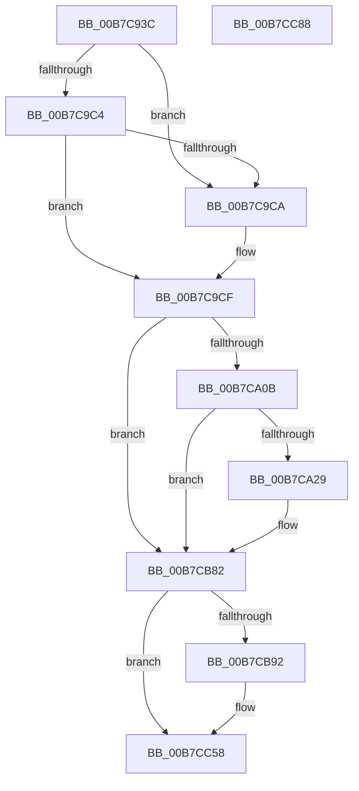

# EtwTraceSystemTimeChange

- RVA: `0x00B7C93C`–`0x00B7CC89` (길이 `845` bytes)
- VA: `0x0000000140B7C93C`
- 실행 섹션: `PAGELK`
- PDB 이름 있음: `예`; PDB Function 태그: `아니요`
- unwind 정보 RVA: `0x000BD030`
- 디코드: `164`개 명령, `845/845` bytes 표시
- 미해석 바이트: `0` (있으면 어셈블리에 `.byte`로 보존)

> 이 문서는 커널 이미지의 기계어와 PDB 기호를 분석해 생성했습니다. 4번과 5번은 함수 원형과 자료형을 바이너리 사용 방식에서 추정한 C 해석이며 원본 소스 복구 결과는 아닙니다.

## 1. Dependencies

- 직접 호출 지점: **5**; 고유 호출 대상: **5**
- 직접 호출자로 확인된 함수: **1**
- RIP 상대 이미지 참조: **6**

### Outgoing calls
- `0x00B7C9AB` → [PsGetProcessId](../../text/43/PsGetProcessId_function_0043D910.md) (function, `0x0043D910`)
- `0x00B7CA1C` → [tlgKeywordOn](../../text/42/tlgKeywordOn_function_0042EAA0.md) (function, `0x0042EAA0`)
- `0x00B7CB7D` → [tlgWriteTransfer_EtwWriteTransfer](../../text/42/tlgWriteTransfer_EtwWriteTransfer_function_004260E0.md) (function, `0x004260E0`)
- `0x00B7CC53` → [EtwWrite](../../text/41/EtwWrite_function_0041C720.md) (function, `0x0041C720`)
- `0x00B7CC62` → [_security_check_cookie](../../text/6A/_security_check_cookie_function_006AC640.md) (function, `0x006AC640`)

### Direct callers
- [PoNotifySystemTimeSet](../../text/4D/PoNotifySystemTimeSet_function_004D4F7C.md) at `0x004D501E`

### Static image references
- `0x00B7C966` → RVA `0x00E0A740` (`.data`; read)
- `0x00B7C977` → RVA `0x00B7FF40` (` ?? ::OKHAJAOM::`string'`; read)
- `0x00B7C9F9` → RVA `0x00E09168` (`.data`; read)
- `0x00B7CA37` → RVA `0x00053F04` (`.rdata`; read)
- `0x00B7CB82` → RVA `0x00EFFA28` (`.data`; read)
- `0x00B7CB9F` → RVA `0x00021250` (`.rdata`; read)

## 2. Other-region calls and transfers

- 다른 실행 섹션으로 향하는 call: **5**
  - `0x00B7C9AB` → [PsGetProcessId](../../text/43/PsGetProcessId_function_0043D910.md) (`PAGELK` → `.text`)
  - `0x00B7CA1C` → [tlgKeywordOn](../../text/42/tlgKeywordOn_function_0042EAA0.md) (`PAGELK` → `.text`)
  - `0x00B7CB7D` → [tlgWriteTransfer_EtwWriteTransfer](../../text/42/tlgWriteTransfer_EtwWriteTransfer_function_004260E0.md) (`PAGELK` → `.text`)
  - `0x00B7CC53` → [EtwWrite](../../text/41/EtwWrite_function_0041C720.md) (`PAGELK` → `.text`)
  - `0x00B7CC62` → [_security_check_cookie](../../text/6A/_security_check_cookie_function_006AC640.md) (`PAGELK` → `.text`)
- 별도 외부 분기/꼬리 이동을 확인하지 못했습니다.

## 3. Assembly (complete function range)

```asm
00B7C93C  48 8B C4                        mov rax, rsp
00B7C93F  48 89 58 08                     mov qword ptr [rax + 8], rbx
00B7C943  48 89 70 10                     mov qword ptr [rax + 0x10], rsi
00B7C947  48 89 78 20                     mov qword ptr [rax + 0x20], rdi
00B7C94B  44 89 40 18                     mov dword ptr [rax + 0x18], r8d
00B7C94F  55                              push rbp
00B7C950  41 54                           push r12
00B7C952  41 55                           push r13
00B7C954  41 56                           push r14
00B7C956  41 57                           push r15
00B7C958  48 8D A8 D8 FE FF FF            lea rbp, [rax - 0x128]
00B7C95F  48 81 EC 00 02 00 00            sub rsp, 0x200
00B7C966  48 8B 05 D3 DD 28 00            mov rax, qword ptr [rip + 0x28ddd3]
00B7C96D  48 33 C4                        xor rax, rsp
00B7C970  48 89 85 F0 00 00 00            mov qword ptr [rbp + 0xf0], rax
00B7C977  48 8D 05 C2 35 00 00            lea rax, [rip + 0x35c2]
00B7C97E  48 C7 44 24 48 00 00 02 00      mov qword ptr [rsp + 0x48], 0x20000
00B7C987  48 89 44 24 50                  mov qword ptr [rsp + 0x50], rax
00B7C98C  48 8B F1                        mov rsi, rcx
00B7C98F  65 48 8B 04 25 88 01 00 00      mov rax, qword ptr gs:[0x188]
00B7C998  4D 8B F1                        mov r14, r9
00B7C99B  48 8B FA                        mov rdi, rdx
00B7C99E  45 33 FF                        xor r15d, r15d
00B7C9A1  48 8B 98 B8 00 00 00            mov rbx, qword ptr [rax + 0xb8]
00B7C9A8  48 8B CB                        mov rcx, rbx
00B7C9AB  E8 60 0F 8C FF                  call 0x14043d910
00B7C9B0  4C 8B D8                        mov r11, rax
00B7C9B3  44 89 5C 24 44                  mov dword ptr [rsp + 0x44], r11d
00B7C9B8  48 8B 9B 50 03 00 00            mov rbx, qword ptr [rbx + 0x350]
00B7C9BF  48 85 DB                        test rbx, rbx
00B7C9C2  74 06                           je 0x140b7c9ca
00B7C9C4  66 44 3B 3B                     cmp r15w, word ptr [rbx]
00B7C9C8  75 05                           jne 0x140b7c9cf
00B7C9CA  48 8D 5C 24 48                  lea rbx, [rsp + 0x48]
00B7C9CF  4C 8B 0E                        mov r9, qword ptr [rsi]
00B7C9D2  48 B8 4B 59 86 38 D6 C5 6D 34   movabs rax, 0x346dc5d63886594b
00B7C9DC  4C 8B 17                        mov r10, qword ptr [rdi]
00B7C9DF  49 8B C9                        mov rcx, r9
00B7C9E2  49 2B CA                        sub rcx, r10
00B7C9E5  48 F7 E9                        imul rcx
00B7C9E8  4C 8B C2                        mov r8, rdx
00B7C9EB  49 C1 F8 0B                     sar r8, 0xb
00B7C9EF  49 8B C0                        mov rax, r8
00B7C9F2  48 C1 E8 3F                     shr rax, 0x3f
00B7C9F6  4C 03 C0                        add r8, rax
00B7C9F9  83 3D 68 C7 28 00 05            cmp dword ptr [rip + 0x28c768], 5
00B7CA00  4C 89 44 24 78                  mov qword ptr [rsp + 0x78], r8
00B7CA05  0F 86 77 01 00 00               jbe 0x140b7cb82
00B7CA0B  48 BA 00 00 00 00 00 40 00 00   movabs rdx, 0x400000000000
00B7CA15  48 8D 0D 4C C7 28 00            lea rcx, [rip + 0x28c74c]
00B7CA1C  E8 7F 20 8B FF                  call 0x14042eaa0
00B7CA21  84 C0                           test al, al
00B7CA23  0F 84 59 01 00 00               je 0x140b7cb82
00B7CA29  48 8D 44 24 58                  lea rax, [rsp + 0x58]
00B7CA2E  4C 89 4C 24 58                  mov qword ptr [rsp + 0x58], r9
00B7CA33  48 89 45 40                     mov qword ptr [rbp + 0x40], rax
00B7CA37  48 8D 15 C6 74 4D FF            lea rdx, [rip - 0xb28b3a]
00B7CA3E  48 8D 44 24 60                  lea rax, [rsp + 0x60]
00B7CA43  4C 89 44 24 68                  mov qword ptr [rsp + 0x68], r8
00B7CA48  48 89 45 50                     mov qword ptr [rbp + 0x50], rax
00B7CA4C  48 8D 0D 15 C7 28 00            lea rcx, [rip + 0x28c715]
00B7CA53  48 8D 44 24 68                  lea rax, [rsp + 0x68]
00B7CA58  48 C7 45 48 08 00 00 00         mov qword ptr [rbp + 0x48], 8
00B7CA60  48 89 45 60                     mov qword ptr [rbp + 0x60], rax
00B7CA64  45 33 C9                        xor r9d, r9d
00B7CA67  8B 85 40 01 00 00               mov eax, dword ptr [rbp + 0x140]
00B7CA6D  45 33 C0                        xor r8d, r8d
00B7CA70  89 44 24 30                     mov dword ptr [rsp + 0x30], eax
00B7CA74  48 8D 44 24 30                  lea rax, [rsp + 0x30]
00B7CA79  48 89 45 70                     mov qword ptr [rbp + 0x70], rax
00B7CA7D  48 8D 85 98 00 00 00            lea rax, [rbp + 0x98]
00B7CA84  48 89 85 80 00 00 00            mov qword ptr [rbp + 0x80], rax
00B7CA8B  48 8B 43 08                     mov rax, qword ptr [rbx + 8]
00B7CA8F  48 89 85 90 00 00 00            mov qword ptr [rbp + 0x90], rax
00B7CA96  0F B7 03                        movzx eax, word ptr [rbx]
00B7CA99  89 85 98 00 00 00               mov dword ptr [rbp + 0x98], eax
00B7CA9F  48 8D 44 24 34                  lea rax, [rsp + 0x34]
00B7CAA4  48 89 85 A0 00 00 00            mov qword ptr [rbp + 0xa0], rax
00B7CAAB  49 8B 06                        mov rax, qword ptr [r14]
00B7CAAE  48 89 44 24 70                  mov qword ptr [rsp + 0x70], rax
00B7CAB3  48 8D 44 24 70                  lea rax, [rsp + 0x70]
00B7CAB8  48 89 85 B0 00 00 00            mov qword ptr [rbp + 0xb0], rax
00B7CABF  8B 85 50 01 00 00               mov eax, dword ptr [rbp + 0x150]
00B7CAC5  89 44 24 38                     mov dword ptr [rsp + 0x38], eax
00B7CAC9  48 8D 44 24 38                  lea rax, [rsp + 0x38]
00B7CACE  48 89 85 C0 00 00 00            mov qword ptr [rbp + 0xc0], rax
00B7CAD5  8B 85 58 01 00 00               mov eax, dword ptr [rbp + 0x158]
00B7CADB  89 44 24 3C                     mov dword ptr [rsp + 0x3c], eax
00B7CADF  48 8D 44 24 3C                  lea rax, [rsp + 0x3c]
00B7CAE4  48 89 85 D0 00 00 00            mov qword ptr [rbp + 0xd0], rax
00B7CAEB  8B 85 60 01 00 00               mov eax, dword ptr [rbp + 0x160]
00B7CAF1  89 44 24 40                     mov dword ptr [rsp + 0x40], eax
00B7CAF5  48 8D 44 24 40                  lea rax, [rsp + 0x40]
00B7CAFA  48 89 85 E0 00 00 00            mov qword ptr [rbp + 0xe0], rax
00B7CB01  48 8D 45 20                     lea rax, [rbp + 0x20]
00B7CB05  48 89 44 24 28                  mov qword ptr [rsp + 0x28], rax
00B7CB0A  C7 44 24 20 0D 00 00 00         mov dword ptr [rsp + 0x20], 0xd
00B7CB12  4C 89 54 24 60                  mov qword ptr [rsp + 0x60], r10
00B7CB17  48 C7 45 58 08 00 00 00         mov qword ptr [rbp + 0x58], 8
00B7CB1F  48 C7 45 68 08 00 00 00         mov qword ptr [rbp + 0x68], 8
00B7CB27  48 C7 45 78 04 00 00 00         mov qword ptr [rbp + 0x78], 4
00B7CB2F  48 C7 85 88 00 00 00 02 00 00 00  mov qword ptr [rbp + 0x88], 2
00B7CB3A  44 89 BD 9C 00 00 00            mov dword ptr [rbp + 0x9c], r15d
00B7CB41  44 89 5C 24 34                  mov dword ptr [rsp + 0x34], r11d
00B7CB46  48 C7 85 A8 00 00 00 04 00 00 00  mov qword ptr [rbp + 0xa8], 4
00B7CB51  48 C7 85 B8 00 00 00 08 00 00 00  mov qword ptr [rbp + 0xb8], 8
00B7CB5C  48 C7 85 C8 00 00 00 04 00 00 00  mov qword ptr [rbp + 0xc8], 4
00B7CB67  48 C7 85 D8 00 00 00 04 00 00 00  mov qword ptr [rbp + 0xd8], 4
00B7CB72  48 C7 85 E8 00 00 00 04 00 00 00  mov qword ptr [rbp + 0xe8], 4
00B7CB7D  E8 5E 95 8A FF                  call 0x1404260e0
00B7CB82  4C 8B 15 9F 2E 38 00            mov r10, qword ptr [rip + 0x382e9f]
00B7CB89  4D 85 D2                        test r10, r10
00B7CB8C  0F 84 C6 00 00 00               je 0x140b7cc58
00B7CB92  48 89 75 80                     mov qword ptr [rbp - 0x80], rsi
00B7CB96  48 8D 44 24 78                  lea rax, [rsp + 0x78]
00B7CB9B  48 89 45 A0                     mov qword ptr [rbp - 0x60], rax
00B7CB9F  48 8D 15 AA 46 4A FF            lea rdx, [rip - 0xb5b956]
00B7CBA6  48 C7 45 88 08 00 00 00         mov qword ptr [rbp - 0x78], 8
00B7CBAE  48 8D 85 40 01 00 00            lea rax, [rbp + 0x140]
00B7CBB5  48 89 45 B0                     mov qword ptr [rbp - 0x50], rax
00B7CBB9  41 B9 0A 00 00 00               mov r9d, 0xa
00B7CBBF  48 89 7D 90                     mov qword ptr [rbp - 0x70], rdi
00B7CBC3  45 33 C0                        xor r8d, r8d
00B7CBC6  48 C7 45 98 08 00 00 00         mov qword ptr [rbp - 0x68], 8
00B7CBCE  48 C7 45 A8 08 00 00 00         mov qword ptr [rbp - 0x58], 8
00B7CBD6  48 C7 45 B8 04 00 00 00         mov qword ptr [rbp - 0x48], 4
00B7CBDE  48 8B 43 08                     mov rax, qword ptr [rbx + 8]
00B7CBE2  0F B7 4B 02                     movzx ecx, word ptr [rbx + 2]
00B7CBE6  48 89 45 C0                     mov qword ptr [rbp - 0x40], rax
00B7CBEA  48 8D 44 24 44                  lea rax, [rsp + 0x44]
00B7CBEF  48 89 45 D0                     mov qword ptr [rbp - 0x30], rax
00B7CBF3  48 8D 85 50 01 00 00            lea rax, [rbp + 0x150]
00B7CBFA  48 89 45 F0                     mov qword ptr [rbp - 0x10], rax
00B7CBFE  48 8D 85 58 01 00 00            lea rax, [rbp + 0x158]
00B7CC05  48 89 45 00                     mov qword ptr [rbp], rax
00B7CC09  48 8D 85 60 01 00 00            lea rax, [rbp + 0x160]
00B7CC10  48 89 45 10                     mov qword ptr [rbp + 0x10], rax
00B7CC14  48 8D 45 80                     lea rax, [rbp - 0x80]
00B7CC18  89 4D C8                        mov dword ptr [rbp - 0x38], ecx
00B7CC1B  49 8B CA                        mov rcx, r10
00B7CC1E  48 89 44 24 20                  mov qword ptr [rsp + 0x20], rax
00B7CC23  44 89 7D CC                     mov dword ptr [rbp - 0x34], r15d
00B7CC27  48 C7 45 D8 04 00 00 00         mov qword ptr [rbp - 0x28], 4
00B7CC2F  4C 89 75 E0                     mov qword ptr [rbp - 0x20], r14
00B7CC33  48 C7 45 E8 08 00 00 00         mov qword ptr [rbp - 0x18], 8
00B7CC3B  48 C7 45 F8 04 00 00 00         mov qword ptr [rbp - 8], 4
00B7CC43  48 C7 45 08 04 00 00 00         mov qword ptr [rbp + 8], 4
00B7CC4B  48 C7 45 18 04 00 00 00         mov qword ptr [rbp + 0x18], 4
00B7CC53  E8 C8 FA 89 FF                  call 0x14041c720
00B7CC58  48 8B 8D F0 00 00 00            mov rcx, qword ptr [rbp + 0xf0]
00B7CC5F  48 33 CC                        xor rcx, rsp
00B7CC62  E8 D9 F9 B2 FF                  call 0x1406ac640
00B7CC67  4C 8D 9C 24 00 02 00 00         lea r11, [rsp + 0x200]
00B7CC6F  49 8B 5B 30                     mov rbx, qword ptr [r11 + 0x30]
00B7CC73  49 8B 73 38                     mov rsi, qword ptr [r11 + 0x38]
00B7CC77  49 8B 7B 48                     mov rdi, qword ptr [r11 + 0x48]
00B7CC7B  49 8B E3                        mov rsp, r11
00B7CC7E  41 5F                           pop r15
00B7CC80  41 5E                           pop r14
00B7CC82  41 5D                           pop r13
00B7CC84  41 5C                           pop r12
00B7CC86  5D                              pop rbp
00B7CC87  C3                              ret
00B7CC88  CC                              int3
```

## 4. C-style interpretation (structured pseudocode)

```c
__int64 __fastcall EtwTraceSystemTimeChange(__int64 a1, __int64 a2, int a3, __int64 a4)
{
    __int64 result;
    __int64 v_r15;
    __int64 v_rbx;
    __int64 v_rsp;
    unsigned __int64 v_stack_m1B0;
    unsigned __int64 v_stack_m1B8;
    unsigned __int64 v_stack_m1C0;
    unsigned __int64 v_stack_m1C8;
    unsigned __int64 v_stack_m1D0;
    unsigned __int64 v_stack_m1D8;
    unsigned __int64 v_stack_m1E0;
    unsigned int v_stack_m1E4;
    unsigned int v_stack_m1E8;
    unsigned int v_stack_m1EC;
    unsigned int v_stack_m1F0;
    unsigned __int64 v_stack_m1F4;
    unsigned int v_stack_m1F8;
    unsigned __int64 v_stack_m200;
    unsigned int v_stack_m208;
    unsigned __int64 v_stack_m28;

    *(unsigned __int64 *)(v_rsp + 8) = v_rbx;
    *(unsigned __int64 *)(v_rsp + 16) = v_rsi;
    *(unsigned __int64 *)(v_rsp + 32) = v_rdi;
    *(unsigned int *)(v_rsp + 24) = a3;
    v_rsp = (v_rsp) - (512);
    result = (*(unsigned __int64 *)(v_rip + 2678227)) ^ (v_rsp);
    *(unsigned __int64 *)(v_rsp - 296 + 240) = result;
    v_stack_m1E0 = 0x20000ULL;
    v_stack_m1D8 = v_rip + 13762;
    v_r15 = 0;
    result = PsGetProcessId(*(unsigned __int64 *)(*(unsigned __int64 *)(gs_base + (0 + 392)) + 184), a2, a3, a4);
    v_stack_m1E4 = (unsigned int)(result);
    if (*(unsigned __int64 *)(*(unsigned __int64 *)(*(unsigned __int64 *)(gs_base + (0 + 392)) + 184) + 848) == 0) goto loc_00B7C9CA;
    v_rbx = *(unsigned __int64 *)(*(unsigned __int64 *)(*(unsigned __int64 *)(gs_base + (0 + 392)) + 184) + 848);
    if (0 == (*(unsigned __int16 *)(*(unsigned __int64 *)(*(unsigned __int64 *)(*(unsigned __int64 *)(gs_base + (0 + 392)) + 184) + 848)))) {
        v_rbx = v_stack_m1E0;
    }
    a1 = (*(unsigned __int64 *)(a1)) - (*(unsigned __int64 *)(a2));
    a3 = (a2) >> (11);
    result = (a3) >> (63);
    a3 = (a3) + (result);
    v_stack_m1B0 = a3;
    if ((*(unsigned int *)(v_rip + 2672488)) <= 5) goto loc_00B7CB82;
    result = tlgKeywordOn(v_rip + 2672460, a2, a3, *(unsigned __int64 *)(a1));
    if ((unsigned __int8)(result) != 0) {
        result = v_stack_m1D0;
        v_stack_m1D0 = *(unsigned __int64 *)(a1);
        *(unsigned __int64 *)(v_rsp - 296 + 64) = result;
        a2 = v_rip - 11701050;
        result = v_stack_m1C8;
        v_stack_m1C0 = a3;
        *(unsigned __int64 *)(v_rsp - 296 + 80) = result;
        a1 = v_rip + 2672405;
        result = v_stack_m1C0;
        *(unsigned __int64 *)(v_rsp - 296 + 72) = 8;
        *(unsigned __int64 *)(v_rsp - 296 + 96) = result;
        a4 = 0;
        result = *(unsigned int *)(v_rsp - 296 + 320);
        a3 = 0;
        v_stack_m1F8 = (unsigned int)(result);
        result = v_stack_m1F8;
        *(unsigned __int64 *)(v_rsp - 296 + 112) = result;
        result = v_rsp - 296 + 152;
        *(unsigned __int64 *)(v_rsp - 296 + 128) = result;
        result = *(unsigned __int64 *)(v_rbx + 8);
        *(unsigned __int64 *)(v_rsp - 296 + 144) = result;
        result = *(unsigned __int16 *)(v_rbx);
        *(unsigned int *)(v_rsp - 296 + 152) = (unsigned int)(result);
        result = v_stack_m1F4;
        *(unsigned __int64 *)(v_rsp - 296 + 160) = result;
        result = *(unsigned __int64 *)(a4);
        v_stack_m1B8 = result;
        result = v_stack_m1B8;
        *(unsigned __int64 *)(v_rsp - 296 + 176) = result;
        result = *(unsigned int *)(v_rsp - 296 + 336);
        v_stack_m1F0 = (unsigned int)(result);
        result = v_stack_m1F0;
        *(unsigned __int64 *)(v_rsp - 296 + 192) = result;
        result = *(unsigned int *)(v_rsp - 296 + 344);
        v_stack_m1EC = (unsigned int)(result);
        result = v_stack_m1EC;
        *(unsigned __int64 *)(v_rsp - 296 + 208) = result;
        result = *(unsigned int *)(v_rsp - 296 + 352);
        v_stack_m1E8 = (unsigned int)(result);
        result = v_stack_m1E8;
        *(unsigned __int64 *)(v_rsp - 296 + 224) = result;
        result = v_rsp - 296 + 32;
        v_stack_m200 = result;
        v_stack_m208 = 13;
        v_stack_m1C8 = *(unsigned __int64 *)(a2);
        *(unsigned __int64 *)(v_rsp - 296 + 88) = 8;
        *(unsigned __int64 *)(v_rsp - 296 + 104) = 8;
        *(unsigned __int64 *)(v_rsp - 296 + 120) = 4;
        *(unsigned __int64 *)(v_rsp - 296 + 136) = 2;
        *(unsigned int *)(v_rsp - 296 + 156) = 0;
        v_stack_m1F4 = (unsigned int)(result);
        *(unsigned __int64 *)(v_rsp - 296 + 168) = 4;
        *(unsigned __int64 *)(v_rsp - 296 + 184) = 8;
        *(unsigned __int64 *)(v_rsp - 296 + 200) = 4;
        *(unsigned __int64 *)(v_rsp - 296 + 216) = 4;
        *(unsigned __int64 *)(v_rsp - 296 + 232) = 4;
        result = tlgWriteTransfer_EtwWriteTransfer(a1, a2, a3, a4);
    }
    if (*(unsigned __int64 *)(v_rip + 3681951) != 0) {
        *(unsigned __int64 *)(v_rsp - 296 - 128) = a1;
        result = v_stack_m1B0;
        *(unsigned __int64 *)(v_rsp - 296 - 96) = result;
        a2 = v_rip - 11909462;
        *(unsigned __int64 *)(v_rsp - 296 - 120) = 8;
        result = v_rsp - 296 + 320;
        *(unsigned __int64 *)(v_rsp - 296 - 80) = result;
        a4 = 10;
        *(unsigned __int64 *)(v_rsp - 296 - 112) = a2;
        a3 = 0;
        *(unsigned __int64 *)(v_rsp - 296 - 104) = 8;
        *(unsigned __int64 *)(v_rsp - 296 - 88) = 8;
        *(unsigned __int64 *)(v_rsp - 296 - 72) = 4;
        result = *(unsigned __int64 *)(v_rbx + 8);
        a1 = *(unsigned __int16 *)(v_rbx + 2);
        *(unsigned __int64 *)(v_rsp - 296 - 64) = result;
        result = v_stack_m1E4;
        *(unsigned __int64 *)(v_rsp - 296 - 48) = result;
        result = v_rsp - 296 + 336;
        *(unsigned __int64 *)(v_rsp - 296 - 16) = result;
        result = v_rsp - 296 + 344;
        *(unsigned __int64 *)(v_rsp - 296) = result;
        result = v_rsp - 296 + 352;
        *(unsigned __int64 *)(v_rsp - 296 + 16) = result;
        result = v_rsp - 296 - 128;
        *(unsigned int *)(v_rsp - 296 - 56) = (unsigned int)(a1);
        a1 = *(unsigned __int64 *)(v_rip + 3681951);
        v_stack_m208 = result;
        *(unsigned int *)(v_rsp - 296 - 52) = 0;
        *(unsigned __int64 *)(v_rsp - 296 - 40) = 4;
        *(unsigned __int64 *)(v_rsp - 296 - 32) = a4;
        *(unsigned __int64 *)(v_rsp - 296 - 24) = 8;
        *(unsigned __int64 *)(v_rsp - 296 - 8) = 4;
        *(unsigned __int64 *)(v_rsp - 296 + 8) = 4;
        *(unsigned __int64 *)(v_rsp - 296 + 24) = 4;
        result = EtwWrite(a1, a2, a3, a4);
    }
    a1 = (*(unsigned __int64 *)(v_rsp - 296 + 240)) ^ (v_rsp);
    result = _security_check_cookie(a1, a2, a3, a4);
    return result;
}
```

## 5. (Beta) C Style

```c
int64_t EtwTraceSystemTimeChange(void *Arg1, void *Arg2, int32_t Arg3, void *Arg4)
{
    uint8_t *arg1 = (uint8_t *)Arg1;
    uint8_t *arg2 = (uint8_t *)Arg2;
    uint8_t *arg4 = (uint8_t *)Arg4;

    int64_t result;
    int64_t local_r15;
    int64_t local_rbx;
    int64_t local_rsp;
    uint64_t v_stack_m1B0;
    uint64_t v_stack_m1B8;
    uint64_t v_stack_m1C0;
    uint64_t v_stack_m1C8;
    uint64_t v_stack_m1D0;
    uint64_t v_stack_m1D8;
    uint64_t v_stack_m1E0;
    uint32_t v_stack_m1E4;
    uint32_t v_stack_m1E8;
    uint32_t v_stack_m1EC;
    uint32_t v_stack_m1F0;
    uint64_t v_stack_m1F4;
    uint32_t v_stack_m1F8;
    uint64_t v_stack_m200;
    uint32_t v_stack_m208;
    uint64_t v_stack_m28;

    *(uint64_t *)(local_rsp + 0x8) = local_rbx;
    *(uint64_t *)(local_rsp + 0x10) = local_rsi;
    *(uint64_t *)(local_rsp + 0x20) = local_rdi;
    *(uint32_t *)(local_rsp + 0x18) = Arg3;
    local_rsp = (local_rsp) - (512);
    result = (*(uint64_t *)(v_rip + 0x28DDD3)) ^ (local_rsp);
    *(uint64_t *)(local_rsp - 0x128 + 0xF0) = result;
    v_stack_m1E0 = 0x20000ULL;
    v_stack_m1D8 = v_rip + 13762;
    local_r15 = 0;
    result = PsGetProcessId(*(uint64_t *)(*(uint64_t *)(gs_base + (0 + 0x188)) + 0xB8), Arg2, Arg3, Arg4);
    v_stack_m1E4 = (uint32_t)(result);
    if (*(uint64_t *)(*(uint64_t *)(*(uint64_t *)(gs_base + (0 + 0x188)) + 0xB8) + 0x350) == 0) goto loc_00B7C9CA;
    local_rbx = *(uint64_t *)(*(uint64_t *)(*(uint64_t *)(gs_base + (0 + 0x188)) + 0xB8) + 0x350);
    if (0 == (*(uint16_t *)(*(uint64_t *)(*(uint64_t *)(*(uint64_t *)(gs_base + (0 + 0x188)) + 0xB8) + 0x350)))) {
        local_rbx = v_stack_m1E0;
    }
    Arg1 = (*(uint64_t *)(arg1)) - (*(uint64_t *)(arg2));
    Arg3 = (Arg2) >> (11);
    result = (Arg3) >> (63);
    Arg3 = (Arg3) + (result);
    v_stack_m1B0 = Arg3;
    if ((*(uint32_t *)(v_rip + 0x28C768)) <= 5) goto loc_00B7CB82;
    result = tlgKeywordOn(v_rip + 2672460, Arg2, Arg3, *(uint64_t *)(arg1));
    if ((uint8_t)(result) != 0) {
        result = v_stack_m1D0;
        v_stack_m1D0 = *(uint64_t *)(arg1);
        *(uint64_t *)(local_rsp - 0x128 + 0x40) = result;
        Arg2 = v_rip - 11701050;
        result = v_stack_m1C8;
        v_stack_m1C0 = Arg3;
        *(uint64_t *)(local_rsp - 0x128 + 0x50) = result;
        Arg1 = v_rip + 2672405;
        result = v_stack_m1C0;
        *(uint64_t *)(local_rsp - 0x128 + 0x48) = 8;
        *(uint64_t *)(local_rsp - 0x128 + 0x60) = result;
        Arg4 = 0;
        result = *(uint32_t *)(local_rsp - 0x128 + 0x140);
        Arg3 = 0;
        v_stack_m1F8 = (uint32_t)(result);
        result = v_stack_m1F8;
        *(uint64_t *)(local_rsp - 0x128 + 0x70) = result;
        result = local_rsp - 296 + 152;
        *(uint64_t *)(local_rsp - 0x128 + 0x80) = result;
        result = *(uint64_t *)(local_rbx + 0x8);
        *(uint64_t *)(local_rsp - 0x128 + 0x90) = result;
        result = *(uint16_t *)(local_rbx);
        *(uint32_t *)(local_rsp - 0x128 + 0x98) = (uint32_t)(result);
        result = v_stack_m1F4;
        *(uint64_t *)(local_rsp - 0x128 + 0xA0) = result;
        result = *(uint64_t *)(arg4);
        v_stack_m1B8 = result;
        result = v_stack_m1B8;
        *(uint64_t *)(local_rsp - 0x128 + 0xB0) = result;
        result = *(uint32_t *)(local_rsp - 0x128 + 0x150);
        v_stack_m1F0 = (uint32_t)(result);
        result = v_stack_m1F0;
        *(uint64_t *)(local_rsp - 0x128 + 0xC0) = result;
        result = *(uint32_t *)(local_rsp - 0x128 + 0x158);
        v_stack_m1EC = (uint32_t)(result);
        result = v_stack_m1EC;
        *(uint64_t *)(local_rsp - 0x128 + 0xD0) = result;
        result = *(uint32_t *)(local_rsp - 0x128 + 0x160);
        v_stack_m1E8 = (uint32_t)(result);
        result = v_stack_m1E8;
        *(uint64_t *)(local_rsp - 0x128 + 0xE0) = result;
        result = local_rsp - 296 + 32;
        v_stack_m200 = result;
        v_stack_m208 = 13;
        v_stack_m1C8 = *(uint64_t *)(arg2);
        *(uint64_t *)(local_rsp - 0x128 + 0x58) = 8;
        *(uint64_t *)(local_rsp - 0x128 + 0x68) = 8;
        *(uint64_t *)(local_rsp - 0x128 + 0x78) = 4;
        *(uint64_t *)(local_rsp - 0x128 + 0x88) = 2;
        *(uint32_t *)(local_rsp - 0x128 + 0x9C) = 0;
        v_stack_m1F4 = (uint32_t)(result);
        *(uint64_t *)(local_rsp - 0x128 + 0xA8) = 4;
        *(uint64_t *)(local_rsp - 0x128 + 0xB8) = 8;
        *(uint64_t *)(local_rsp - 0x128 + 0xC8) = 4;
        *(uint64_t *)(local_rsp - 0x128 + 0xD8) = 4;
        *(uint64_t *)(local_rsp - 0x128 + 0xE8) = 4;
        result = tlgWriteTransfer_EtwWriteTransfer(Arg1, Arg2, Arg3, Arg4);
    }
    if (*(uint64_t *)(v_rip + 0x382E9F) != 0) {
        *(void **)(local_rsp - 0x128 - 0x80) = Arg1;
        result = v_stack_m1B0;
        *(uint64_t *)(local_rsp - 0x128 - 0x60) = result;
        Arg2 = v_rip - 11909462;
        *(uint64_t *)(local_rsp - 0x128 - 0x78) = 8;
        result = local_rsp - 296 + 320;
        *(uint64_t *)(local_rsp - 0x128 - 0x50) = result;
        Arg4 = 10;
        *(void **)(local_rsp - 0x128 - 0x70) = Arg2;
        Arg3 = 0;
        *(uint64_t *)(local_rsp - 0x128 - 0x68) = 8;
        *(uint64_t *)(local_rsp - 0x128 - 0x58) = 8;
        *(uint64_t *)(local_rsp - 0x128 - 0x48) = 4;
        result = *(uint64_t *)(local_rbx + 0x8);
        Arg1 = *(uint16_t *)(local_rbx + 0x2);
        *(uint64_t *)(local_rsp - 0x128 - 0x40) = result;
        result = v_stack_m1E4;
        *(uint64_t *)(local_rsp - 0x128 - 0x30) = result;
        result = local_rsp - 296 + 336;
        *(uint64_t *)(local_rsp - 0x128 - 0x10) = result;
        result = local_rsp - 296 + 344;
        *(uint64_t *)(local_rsp - 0x128) = result;
        result = local_rsp - 296 + 352;
        *(uint64_t *)(local_rsp - 0x128 + 0x10) = result;
        result = local_rsp - 296 - 128;
        *(uint32_t *)(local_rsp - 0x128 - 0x38) = (uint32_t)(Arg1);
        Arg1 = *(uint64_t *)(v_rip + 0x382E9F);
        v_stack_m208 = result;
        *(uint32_t *)(local_rsp - 0x128 - 0x34) = 0;
        *(uint64_t *)(local_rsp - 0x128 - 0x28) = 4;
        *(void **)(local_rsp - 0x128 - 0x20) = Arg4;
        *(uint64_t *)(local_rsp - 0x128 - 0x18) = 8;
        *(uint64_t *)(local_rsp - 0x128 - 0x8) = 4;
        *(uint64_t *)(local_rsp - 0x128 + 0x8) = 4;
        *(uint64_t *)(local_rsp - 0x128 + 0x18) = 4;
        result = EtwWrite(Arg1, Arg2, Arg3, Arg4);
    }
    Arg1 = (*(uint64_t *)(local_rsp - 0x128 + 0xF0)) ^ (local_rsp);
    result = _security_check_cookie(Arg1, Arg2, Arg3, Arg4);
    return result;
}
```

### 관측된 메모리 오프셋

구조체 형식이 확인되지 않은 접근은 인자 기준의 오프셋으로만 기록했습니다.

| 기준 인자 | 오프셋 표현 | 폭 (bit) | 접근 |
|---|---:|---:|---|
| `Arg1` | `+ 0x0` | `64` | `R` |
| `Arg2` | `+ 0x0` | `64` | `R` |
| `Arg4` | `+ 0x0` | `64` | `R` |

## 6. Execution-region graph

[열기: 2D/3D 그래프와 함수 탐색 컨트롤 패널](../../../control-panel.html?section=pagelk&rva=0x00B7C93C&view=graph)

- 2D 그래프는 위에서 아래로 흐르고, 3D 그래프는 빈 공간을 드래그해 회전합니다. Shift+드래그는 이동, 휠은 확대·축소, 함수 노드 선택은 대상 보고서 이동입니다.

### Static fallback


