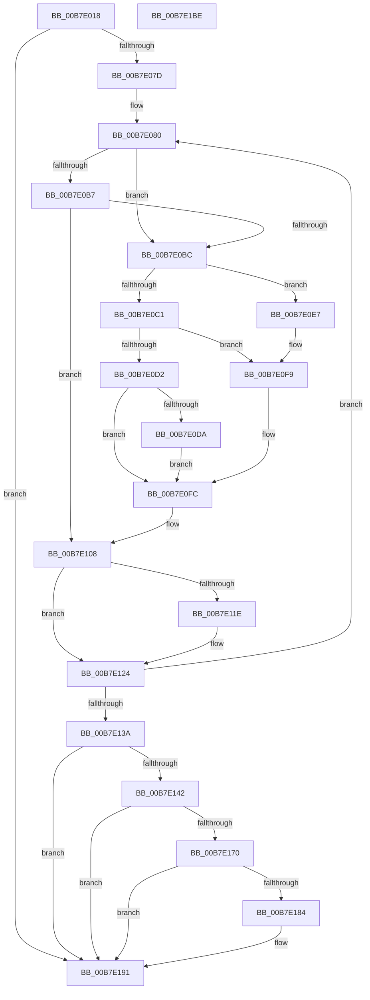

# ExGetNextWakeTime

- RVA: `0x00B7E018`–`0x00B7E1BF` (길이 `423` bytes)
- VA: `0x0000000140B7E018`
- 실행 섹션: `PAGELK`
- PDB 이름 있음: `예`; PDB Function 태그: `아니요`
- unwind 정보 RVA: `0x00089D74`
- 디코드: `115`개 명령, `423/423` bytes 표시
- 미해석 바이트: `0` (있으면 어셈블리에 `.byte`로 보존)

> 이 문서는 커널 이미지의 기계어와 PDB 기호를 분석해 생성했습니다. 4번과 5번은 함수 원형과 자료형을 바이너리 사용 방식에서 추정한 C 해석이며 원본 소스 복구 결과는 아닙니다.

## 1. Dependencies

- 직접 호출 지점: **7**; 고유 호출 대상: **6**
- 직접 호출자로 확인된 함수: **2**
- RIP 상대 이미지 참조: **1**

### Outgoing calls
- `0x00B7E093` → [KeAcquireSpinLockRaiseToDpc](../../text/20/KeAcquireSpinLockRaiseToDpc_function_00208470.md) (function, `0x00208470`)
- `0x00B7E0EA` → [KeQueryTimerDueTime](../../text/49/KeQueryTimerDueTime_function_00499CC0.md) (function, `0x00499CC0`)
- `0x00B7E10C` → [KeReleaseSpinLock](../../text/39/KeReleaseSpinLock_function_00392BA0.md) (function, `0x00392BA0`)
- `0x00B7E14C` → [PoStoreDiagnosticContext](../../text/23/PoStoreDiagnosticContext_function_0023009C.md) (function, `0x0023009C`)
- `0x00B7E163` → [ExAllocatePool2](../../poolcode/B8/ExAllocatePool2_function_00B820F0.md) (function, `0x00B820F0`)
- `0x00B7E17B` → [PoStoreDiagnosticContext](../../text/23/PoStoreDiagnosticContext_function_0023009C.md) (function, `0x0023009C`)
- `0x00B7E189` → [ExFreePoolWithTag](../../poolcode/B8/ExFreePoolWithTag_function_00B82870.md) (function, `0x00B82870`)

### Direct callers
- [PopIsWakeTimerImmanent](../../page/76/PopIsWakeTimerImmanent_function_00760118.md) at `0x007601BF`
- [PopIsWakeTimerImmanent](../../page/76/PopIsWakeTimerImmanent_function_00760118.md) at `0x00760213`
- [PopTransitionSystemPowerStateEx](PopTransitionSystemPowerStateEx_function_00B7E8C0.md) at `0x00B7F517`
- [PopTransitionSystemPowerStateEx](PopTransitionSystemPowerStateEx_function_00B7E8C0.md) at `0x00B7F584`

### Static image references
- `0x00B7E061` → RVA `0x00EFAB90` (`.data`; read)

## 2. Other-region calls and transfers

- 다른 실행 섹션으로 향하는 call: **7**
  - `0x00B7E093` → [KeAcquireSpinLockRaiseToDpc](../../text/20/KeAcquireSpinLockRaiseToDpc_function_00208470.md) (`PAGELK` → `.text`)
  - `0x00B7E0EA` → [KeQueryTimerDueTime](../../text/49/KeQueryTimerDueTime_function_00499CC0.md) (`PAGELK` → `.text`)
  - `0x00B7E10C` → [KeReleaseSpinLock](../../text/39/KeReleaseSpinLock_function_00392BA0.md) (`PAGELK` → `.text`)
  - `0x00B7E14C` → [PoStoreDiagnosticContext](../../text/23/PoStoreDiagnosticContext_function_0023009C.md) (`PAGELK` → `.text`)
  - `0x00B7E163` → [ExAllocatePool2](../../poolcode/B8/ExAllocatePool2_function_00B820F0.md) (`PAGELK` → `POOLCODE`)
  - `0x00B7E17B` → [PoStoreDiagnosticContext](../../text/23/PoStoreDiagnosticContext_function_0023009C.md) (`PAGELK` → `.text`)
  - `0x00B7E189` → [ExFreePoolWithTag](../../poolcode/B8/ExFreePoolWithTag_function_00B82870.md) (`PAGELK` → `POOLCODE`)
- 별도 외부 분기/꼬리 이동을 확인하지 못했습니다.

## 3. Assembly (complete function range)

```asm
00B7E018  4C 8B DC                        mov r11, rsp
00B7E01B  4D 89 4B 20                     mov qword ptr [r11 + 0x20], r9
00B7E01F  45 88 43 18                     mov byte ptr [r11 + 0x18], r8b
00B7E023  49 89 4B 08                     mov qword ptr [r11 + 8], rcx
00B7E027  53                              push rbx
00B7E028  55                              push rbp
00B7E029  56                              push rsi
00B7E02A  57                              push rdi
00B7E02B  41 54                           push r12
00B7E02D  41 55                           push r13
00B7E02F  41 56                           push r14
00B7E031  41 57                           push r15
00B7E033  48 83 EC 48                     sub rsp, 0x48
00B7E037  45 33 ED                        xor r13d, r13d
00B7E03A  48 BB 14 00 00 00 80 F7 FF FF   movabs rbx, 0xfffff78000000014
00B7E044  48 B8 08 00 00 00 80 F7 FF FF   movabs rax, 0xfffff78000000008
00B7E04E  4D 89 6B 98                     mov qword ptr [r11 - 0x68], r13
00B7E052  48 8B F2                        mov rsi, rdx
00B7E055  41 8B ED                        mov ebp, r13d
00B7E058  45 8B FD                        mov r15d, r13d
00B7E05B  48 8B 1B                        mov rbx, qword ptr [rbx]
00B7E05E  48 8B 00                        mov rax, qword ptr [rax]
00B7E061  4C 8B 25 28 CB 37 00            mov r12, qword ptr [rip + 0x37cb28]
00B7E068  48 89 44 24 28                  mov qword ptr [rsp + 0x28], rax
00B7E06D  48 8D 05 1C CB 37 00            lea rax, [rip + 0x37cb1c]
00B7E074  4C 3B E0                        cmp r12, rax
00B7E077  0F 84 14 01 00 00               je 0x140b7e191
00B7E07D  45 8A F8                        mov r15b, r8b
00B7E080  4D 8D B4 24 F8 FE FF FF         lea r14, [r12 - 0x108]
00B7E088  49 8B FD                        mov rdi, r13
00B7E08B  4D 8B 24 24                     mov r12, qword ptr [r12]
00B7E08F  49 8D 4E 40                     lea rcx, [r14 + 0x40]
00B7E093  E8 D8 A3 68 FF                  call 0x140208470
00B7E098  4D 8B AE 00 01 00 00            mov r13, qword ptr [r14 + 0x100]
00B7E09F  49 8D 8E 30 01 00 00            lea rcx, [r14 + 0x130]
00B7E0A6  45 33 C0                        xor r8d, r8d
00B7E0A9  88 84 24 98 00 00 00            mov byte ptr [rsp + 0x98], al
00B7E0B0  8A D0                           mov dl, al
00B7E0B2  45 84 FF                        test r15b, r15b
00B7E0B5  74 05                           je 0x140b7e0bc
00B7E0B7  F6 01 04                        test byte ptr [rcx], 4
00B7E0BA  74 4C                           je 0x140b7e108
00B7E0BC  F6 01 02                        test byte ptr [rcx], 2
00B7E0BF  74 26                           je 0x140b7e0e7
00B7E0C1  41 80 BE F8 00 00 00 01         cmp byte ptr [r14 + 0xf8], 1
00B7E0C9  49 8B 86 38 01 00 00            mov rax, qword ptr [r14 + 0x138]
00B7E0D0  75 27                           jne 0x140b7e0f9
00B7E0D2  49 8B F8                        mov rdi, r8
00B7E0D5  48 85 C0                        test rax, rax
00B7E0D8  74 22                           je 0x140b7e0fc
00B7E0DA  48 8B F8                        mov rdi, rax
00B7E0DD  48 2B FB                        sub rdi, rbx
00B7E0E0  48 03 7C 24 28                  add rdi, qword ptr [rsp + 0x28]
00B7E0E5  EB 15                           jmp 0x140b7e0fc
00B7E0E7  49 8B CE                        mov rcx, r14
00B7E0EA  E8 D1 BB 91 FF                  call 0x140499cc0
00B7E0EF  8A 94 24 98 00 00 00            mov dl, byte ptr [rsp + 0x98]
00B7E0F6  45 33 C0                        xor r8d, r8d
00B7E0F9  48 8B F8                        mov rdi, rax
00B7E0FC  48 3B BC 24 90 00 00 00         cmp rdi, qword ptr [rsp + 0x90]
00B7E104  49 0F 42 F8                     cmovb rdi, r8
00B7E108  49 8D 4E 40                     lea rcx, [r14 + 0x40]
00B7E10C  E8 8F 4A 81 FF                  call 0x140392ba0
00B7E111  48 8D 4F FF                     lea rcx, [rdi - 1]
00B7E115  48 8D 46 FF                     lea rax, [rsi - 1]
00B7E119  48 3B C8                        cmp rcx, rax
00B7E11C  73 06                           jae 0x140b7e124
00B7E11E  48 8B F7                        mov rsi, rdi
00B7E121  49 8B ED                        mov rbp, r13
00B7E124  48 8D 05 65 CA 37 00            lea rax, [rip + 0x37ca65]
00B7E12B  41 BD 00 00 00 00               mov r13d, 0
00B7E131  4C 3B E0                        cmp r12, rax
00B7E134  0F 85 46 FF FF FF               jne 0x140b7e080
00B7E13A  45 8B FD                        mov r15d, r13d
00B7E13D  48 85 ED                        test rbp, rbp
00B7E140  74 4F                           je 0x140b7e191
00B7E142  4C 8D 44 24 20                  lea r8, [rsp + 0x20]
00B7E147  33 D2                           xor edx, edx
00B7E149  48 8B CD                        mov rcx, rbp
00B7E14C  E8 4B 1F 6B FF                  call 0x14023009c
00B7E151  48 8B 54 24 20                  mov rdx, qword ptr [rsp + 0x20]
00B7E156  BB 54 72 57 53                  mov ebx, 0x53577254
00B7E15B  44 8B C3                        mov r8d, ebx
00B7E15E  B9 00 01 00 00                  mov ecx, 0x100
00B7E163  E8 88 3F 00 00                  call 0x140b820f0
00B7E168  4C 8B F8                        mov r15, rax
00B7E16B  48 85 C0                        test rax, rax
00B7E16E  74 21                           je 0x140b7e191
00B7E170  4C 8D 44 24 20                  lea r8, [rsp + 0x20]
00B7E175  48 8B D0                        mov rdx, rax
00B7E178  48 8B CD                        mov rcx, rbp
00B7E17B  E8 1C 1F 6B FF                  call 0x14023009c
00B7E180  85 C0                           test eax, eax
00B7E182  79 0D                           jns 0x140b7e191
00B7E184  8B D3                           mov edx, ebx
00B7E186  49 8B CF                        mov rcx, r15
00B7E189  E8 E2 46 00 00                  call 0x140b82870
00B7E18E  45 8B FD                        mov r15d, r13d
00B7E191  48 8B 84 24 A8 00 00 00         mov rax, qword ptr [rsp + 0xa8]
00B7E199  48 85 ED                        test rbp, rbp
00B7E19C  48 89 30                        mov qword ptr [rax], rsi
00B7E19F  48 8B 84 24 B0 00 00 00         mov rax, qword ptr [rsp + 0xb0]
00B7E1A7  4C 89 38                        mov qword ptr [rax], r15
00B7E1AA  0F 95 C0                        setne al
00B7E1AD  48 83 C4 48                     add rsp, 0x48
00B7E1B1  41 5F                           pop r15
00B7E1B3  41 5E                           pop r14
00B7E1B5  41 5D                           pop r13
00B7E1B7  41 5C                           pop r12
00B7E1B9  5F                              pop rdi
00B7E1BA  5E                              pop rsi
00B7E1BB  5D                              pop rbp
00B7E1BC  5B                              pop rbx
00B7E1BD  C3                              ret
00B7E1BE  CC                              int3
```

## 4. C-style interpretation (structured pseudocode)

```c
__int64 __fastcall ExGetNextWakeTime(__int64 a1, __int64 a2, int a3, __int64 a4, __int64 a5)
{
    __int64 result;
    __int64 v_r13;
    __int64 v_r15;
    __int64 v_rbp;
    __int64 v_rdi;
    __int64 v_rsi;
    __int64 v_rsp;
    unsigned __int64 v_stack_m60;
    unsigned __int64 v_stack_m68;
    unsigned __int8 v_stack_p10;
    unsigned __int64 v_stack_p20;
    unsigned __int64 v_stack_p8;

    *(unsigned __int64 *)(v_rsp + 32) = a4;
    *(unsigned __int8 *)(v_rsp + 24) = (unsigned __int8)(a3);
    *(unsigned __int64 *)(v_rsp + 8) = a1;
    v_rsp = (v_rsp) - (72);
    v_r13 = 0;
    *(unsigned __int64 *)(v_rsp - 104) = 0;
    v_stack_m60 = *(unsigned __int64 *)(result);
    if ((*(unsigned __int64 *)(v_rip + 3656488)) == (v_rip + 3656476)) goto loc_00B7E191;
loc_00B7E080:
    result = KeAcquireSpinLockRaiseToDpc(*(unsigned __int64 *)(v_rip + 3656488) - 264 + 64, a2, a3, a4);
    a3 = 0;
    v_stack_p10 = (unsigned __int8)(result);
    if ((unsigned __int8)((unsigned __int8)(a3)) == 0) goto loc_00B7E0BC;
    if (((*(unsigned __int8 *)(*(unsigned __int64 *)(v_rip + 3656488) - 264 + 304)) & (4)) == 0) goto loc_00B7E108;
loc_00B7E0BC:
    if (((*(unsigned __int8 *)(*(unsigned __int64 *)(v_rip + 3656488) - 264 + 304)) & (2)) == 0) goto loc_00B7E0E7;
    if ((*(unsigned __int8 *)(*(unsigned __int64 *)(v_rip + 3656488) - 264 + 248)) != 1) goto loc_00B7E0F9;
    if (*(unsigned __int64 *)(*(unsigned __int64 *)(v_rip + 3656488) - 264 + 312) == 0) goto loc_00B7E0FC;
    v_rdi = (*(unsigned __int64 *)(*(unsigned __int64 *)(v_rip + 3656488) - 264 + 312)) - (*(unsigned __int64 *)(v_rbx));
    v_rdi = (v_rdi) + (v_stack_m60);
    goto loc_00B7E0FC;
loc_00B7E0E7:
    result = KeQueryTimerDueTime(*(unsigned __int64 *)(v_rip + 3656488) - 264, (unsigned __int8)(result), a3, a4);
    a3 = 0;
loc_00B7E0F9:
loc_00B7E0FC:
    v_rdi = result;
    if (result < v_stack_p8) { v_rdi = 0; }
loc_00B7E108:
    result = KeReleaseSpinLock(*(unsigned __int64 *)(v_rip + 3656488) - 264 + 64, v_stack_p10, a3, a4);
    v_rsi = a2;
    v_rbp = 0;
    if ((v_rdi - 1) < (a2 - 1)) {
        v_rsi = v_rdi;
        v_rbp = *(unsigned __int64 *)(*(unsigned __int64 *)(v_rip + 3656488) - 264 + 256);
    }
    if ((*(unsigned __int64 *)(*(unsigned __int64 *)(v_rip + 3656488))) != (v_rip + 3656293)) goto loc_00B7E080;
    if (v_rbp == 0) goto loc_00B7E191;
    a2 = 0;
    result = PoStoreDiagnosticContext(v_rbp, a2, v_stack_m68, a4);
    result = ExAllocatePool2(256, v_stack_m68, (unsigned int)((unsigned int)((unsigned int)(0x53577254ULL))), a4);
    if (result == 0) goto loc_00B7E191;
    result = PoStoreDiagnosticContext(v_rbp, result, v_stack_m68, a4);
    v_r15 = result;
    if (sign_flag) {
        a2 = (unsigned int)((unsigned int)(0x53577254ULL));
        a1 = result;
        result = ExFreePoolWithTag(a1, a2, v_stack_m68, a4);
        v_r15 = 0;
    }
    *(unsigned __int64 *)(v_stack_p20) = v_rsi;
    *(unsigned __int64 *)(a5) = v_r15;
    result = (v_rbp != 0) ? 1 : 0;
    v_rsp = (v_rsp) + (72);
    return result;
}
```

## 5. (Beta) C Style

```c
int64_t ExGetNextWakeTime(int64_t Arg1, int64_t Arg2, int32_t Arg3, int64_t Arg4, void *Arg5)
{
    uint8_t *arg5 = (uint8_t *)Arg5;

    int64_t result;
    int64_t local_r13;
    int64_t local_r15;
    int64_t local_rbp;
    int64_t local_rdi;
    int64_t local_rsi;
    int64_t local_rsp;
    uint64_t v_stack_m60;
    uint64_t v_stack_m68;
    uint8_t v_stack_p10;
    uint64_t v_stack_p20;
    uint64_t v_stack_p8;

    *(uint64_t *)(local_rsp + 0x20) = Arg4;
    *(uint8_t *)(local_rsp + 0x18) = (uint8_t)(Arg3);
    *(uint64_t *)(local_rsp + 0x8) = Arg1;
    local_rsp = (local_rsp) - (72);
    local_r13 = 0;
    *(uint64_t *)(local_rsp - 0x68) = 0;
    v_stack_m60 = *(uint64_t *)(result);
    if ((*(uint64_t *)(v_rip + 0x37CB28)) == (v_rip + 3656476)) goto loc_00B7E191;
loc_00B7E080:
    result = KeAcquireSpinLockRaiseToDpc(*(uint64_t *)(v_rip + 0x37CB28) - 264 + 64, Arg2, Arg3, Arg4);
    Arg3 = 0;
    v_stack_p10 = (uint8_t)(result);
    if ((uint8_t)((uint8_t)(Arg3)) == 0) goto loc_00B7E0BC;
    if (((*(uint8_t *)(*(uint64_t *)(v_rip + 0x37CB28) - 0x108 + 0x130)) & (4)) == 0) goto loc_00B7E108;
loc_00B7E0BC:
    if (((*(uint8_t *)(*(uint64_t *)(v_rip + 0x37CB28) - 0x108 + 0x130)) & (2)) == 0) goto loc_00B7E0E7;
    if ((*(uint8_t *)(*(uint64_t *)(v_rip + 0x37CB28) - 0x108 + 0xF8)) != 1) goto loc_00B7E0F9;
    if (*(uint64_t *)(*(uint64_t *)(v_rip + 0x37CB28) - 0x108 + 0x138) == 0) goto loc_00B7E0FC;
    local_rdi = (*(uint64_t *)(*(uint64_t *)(v_rip + 0x37CB28) - 0x108 + 0x138)) - (*(uint64_t *)(local_rbx));
    local_rdi = (local_rdi) + (v_stack_m60);
    goto loc_00B7E0FC;
loc_00B7E0E7:
    result = KeQueryTimerDueTime(*(uint64_t *)(v_rip + 0x37CB28) - 264, (uint8_t)(result), Arg3, Arg4);
    Arg3 = 0;
loc_00B7E0F9:
loc_00B7E0FC:
    local_rdi = result;
    if (result < v_stack_p8) { local_rdi = 0; }
loc_00B7E108:
    result = KeReleaseSpinLock(*(uint64_t *)(v_rip + 0x37CB28) - 264 + 64, v_stack_p10, Arg3, Arg4);
    local_rsi = Arg2;
    local_rbp = 0;
    if ((local_rdi - 1) < (Arg2 - 1)) {
        local_rsi = local_rdi;
        local_rbp = *(uint64_t *)(*(uint64_t *)(v_rip + 0x37CB28) - 0x108 + 0x100);
    }
    if ((*(uint64_t *)(*(uint64_t *)(v_rip + 0x37CB28))) != (v_rip + 3656293)) goto loc_00B7E080;
    if (local_rbp == 0) goto loc_00B7E191;
    Arg2 = 0;
    result = PoStoreDiagnosticContext(local_rbp, Arg2, v_stack_m68, Arg4);
    result = ExAllocatePool2(256, v_stack_m68, (uint32_t)((uint32_t)((uint32_t)(0x53577254ULL))), Arg4);
    if (result == 0) goto loc_00B7E191;
    result = PoStoreDiagnosticContext(local_rbp, result, v_stack_m68, Arg4);
    local_r15 = result;
    if (sign_flag) {
        Arg2 = (uint32_t)((uint32_t)(0x53577254ULL));
        Arg1 = result;
        result = ExFreePoolWithTag(Arg1, Arg2, v_stack_m68, Arg4);
        local_r15 = 0;
    }
    *(uint64_t *)(v_stack_p20) = local_rsi;
    *(uint64_t *)(arg5) = local_r15;
    result = (local_rbp != 0) ? 1 : 0;
    local_rsp = (local_rsp) + (72);
    return result;
}
```

### 관측된 메모리 오프셋

구조체 형식이 확인되지 않은 접근은 인자 기준의 오프셋으로만 기록했습니다.

| 기준 인자 | 오프셋 표현 | 폭 (bit) | 접근 |
|---|---:|---:|---|
| `Arg5` | `+ 0x0` | `64` | `W` |

## 6. Execution-region graph

[열기: 2D/3D 그래프와 함수 탐색 컨트롤 패널](../../../control-panel.html?section=pagelk&rva=0x00B7E018&view=graph)

- 2D 그래프는 위에서 아래로 흐르고, 3D 그래프는 빈 공간을 드래그해 회전합니다. Shift+드래그는 이동, 휠은 확대·축소, 함수 노드 선택은 대상 보고서 이동입니다.

### Static fallback


