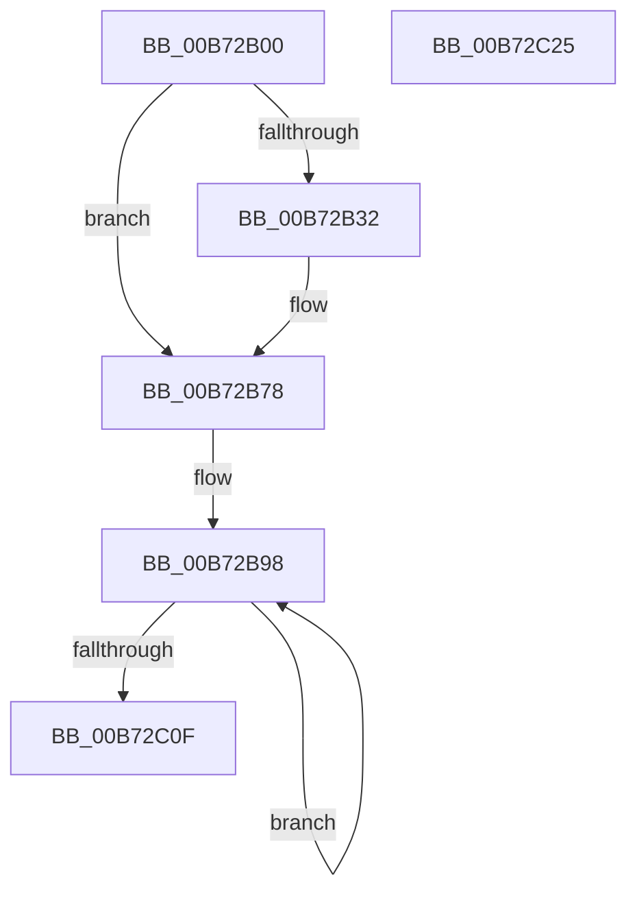

# ExInitPoolLookasidePointers

- RVA: `0x00B72B00`–`0x00B72C26` (길이 `294` bytes)
- VA: `0x0000000140B72B00`
- 실행 섹션: `PAGELK`
- PDB 이름 있음: `예`; PDB Function 태그: `아니요`
- unwind 정보 RVA: `0x000CC0C8`
- 디코드: `60`개 명령, `294/294` bytes 표시
- 미해석 바이트: `0` (있으면 어셈블리에 `.byte`로 보존)

> 이 문서는 커널 이미지의 기계어와 PDB 기호를 분석해 생성했습니다. 4번과 5번은 함수 원형과 자료형을 바이너리 사용 방식에서 추정한 C 해석이며 원본 소스 복구 결과는 아닙니다.

## 1. Dependencies

- 직접 호출 지점: **4**; 고유 호출 대상: **1**
- 직접 호출자로 확인된 함수: **1**
- RIP 상대 이미지 참조: **7**

### Outgoing calls
- `0x00B72B73` → [ExInitializeSystemLookasideList](ExInitializeSystemLookasideList_function_00B7E57C.md) (function, `0x00B7E57C`)
- `0x00B72BB5` → [ExInitializeSystemLookasideList](ExInitializeSystemLookasideList_function_00B7E57C.md) (function, `0x00B7E57C`)
- `0x00B72BD6` → [ExInitializeSystemLookasideList](ExInitializeSystemLookasideList_function_00B7E57C.md) (function, `0x00B7E57C`)
- `0x00B72BFB` → [ExInitializeSystemLookasideList](ExInitializeSystemLookasideList_function_00B7E57C.md) (function, `0x00B7E57C`)

### Direct callers
- [KiInitializeBootStructures](../B6/KiInitializeBootStructures_function_00B68530.md) at `0x00B689A4`

### Static image references
- `0x00B72B1E` → RVA `0x00EFABD0` (`.data`; read)
- `0x00B72B25` → RVA `0x00E29000` (`.data`; read)
- `0x00B72B32` → RVA `0x00EFAC00` (`.data`; read)
- `0x00B72B39` → RVA `0x00EFABD8` (`.data`; write)
- `0x00B72B49` → RVA `0x00EFAC08` (`.data`; write)
- `0x00B72B56` → RVA `0x00EFAC00` (`.data`; write)
- `0x00B72B66` → RVA `0x00EFABD0` (`.data`; write)

## 2. Other-region calls and transfers

- 다른 실행 섹션으로 향하는 call: **0**
- 별도 외부 분기/꼬리 이동을 확인하지 못했습니다.

## 3. Assembly (complete function range)

```asm
00B72B00  48 8B C4                        mov rax, rsp
00B72B03  48 89 58 08                     mov qword ptr [rax + 8], rbx
00B72B07  48 89 70 10                     mov qword ptr [rax + 0x10], rsi
00B72B0B  48 89 78 18                     mov qword ptr [rax + 0x18], rdi
00B72B0F  41 57                           push r15
00B72B11  48 83 EC 30                     sub rsp, 0x30
00B72B15  65 48 8B 1C 25 20 00 00 00      mov rbx, qword ptr gs:[0x20]
00B72B1E  48 8D 35 AB 80 38 00            lea rsi, [rip + 0x3880ab]
00B72B25  48 8D 3D D4 64 2B 00            lea rdi, [rip + 0x2b64d4]
00B72B2C  83 7B 24 00                     cmp dword ptr [rbx + 0x24], 0
00B72B30  75 46                           jne 0x140b72b78
00B72B32  48 8D 0D C7 80 38 00            lea rcx, [rip + 0x3880c7]
00B72B39  48 89 35 98 80 38 00            mov qword ptr [rip + 0x388098], rsi
00B72B40  48 89 48 F0                     mov qword ptr [rax - 0x10], rcx
00B72B44  BA 00 02 00 00                  mov edx, 0x200
00B72B49  48 89 0D B8 80 38 00            mov qword ptr [rip + 0x3880b8], rcx
00B72B50  41 B9 53 63 62 66               mov r9d, 0x66626353
00B72B56  48 89 0D A3 80 38 00            mov qword ptr [rip + 0x3880a3], rcx
00B72B5D  41 B8 F0 04 00 00               mov r8d, 0x4f0
00B72B63  48 8B CF                        mov rcx, rdi
00B72B66  48 89 35 63 80 38 00            mov qword ptr [rip + 0x388063], rsi
00B72B6D  66 C7 40 E8 20 00               mov word ptr [rax - 0x18], 0x20
00B72B73  E8 04 BA 00 00                  call 0x140b7e57c
00B72B78  48 89 BB 88 08 00 00            mov qword ptr [rbx + 0x888], rdi
00B72B7F  41 BF 00 01 00 00               mov r15d, 0x100
00B72B85  48 89 BB 80 08 00 00            mov qword ptr [rbx + 0x880], rdi
00B72B8C  BF 10 00 00 00                  mov edi, 0x10
00B72B91  48 81 C3 00 09 00 00            add rbx, 0x900
00B72B98  48 8D 8B 00 0C 00 00            lea rcx, [rbx + 0xc00]
00B72B9F  48 89 74 24 28                  mov qword ptr [rsp + 0x28], rsi
00B72BA4  41 B9 50 6F 6F 4C               mov r9d, 0x4c6f6f50
00B72BAA  66 44 89 7C 24 20               mov word ptr [rsp + 0x20], r15w
00B72BB0  44 8B C7                        mov r8d, edi
00B72BB3  33 D2                           xor edx, edx
00B72BB5  E8 C2 B9 00 00                  call 0x140b7e57c
00B72BBA  41 B9 50 6F 6F 4C               mov r9d, 0x4c6f6f50
00B72BC0  48 89 74 24 28                  mov qword ptr [rsp + 0x28], rsi
00B72BC5  44 8B C7                        mov r8d, edi
00B72BC8  66 44 89 7C 24 20               mov word ptr [rsp + 0x20], r15w
00B72BCE  BA 00 02 00 00                  mov edx, 0x200
00B72BD3  48 8B CB                        mov rcx, rbx
00B72BD6  E8 A1 B9 00 00                  call 0x140b7e57c
00B72BDB  48 8D 8B 00 18 00 00            lea rcx, [rbx + 0x1800]
00B72BE2  48 89 74 24 28                  mov qword ptr [rsp + 0x28], rsi
00B72BE7  41 B9 50 6F 6F 4C               mov r9d, 0x4c6f6f50
00B72BED  66 44 89 7C 24 20               mov word ptr [rsp + 0x20], r15w
00B72BF3  44 8B C7                        mov r8d, edi
00B72BF6  BA 01 00 00 00                  mov edx, 1
00B72BFB  E8 7C B9 00 00                  call 0x140b7e57c
00B72C00  83 C7 10                        add edi, 0x10
00B72C03  48 83 C3 60                     add rbx, 0x60
00B72C07  81 FF 10 02 00 00               cmp edi, 0x210
00B72C0D  72 89                           jb 0x140b72b98
00B72C0F  48 8B 5C 24 40                  mov rbx, qword ptr [rsp + 0x40]
00B72C14  48 8B 74 24 48                  mov rsi, qword ptr [rsp + 0x48]
00B72C19  48 8B 7C 24 50                  mov rdi, qword ptr [rsp + 0x50]
00B72C1E  48 83 C4 30                     add rsp, 0x30
00B72C22  41 5F                           pop r15
00B72C24  C3                              ret
00B72C25  CC                              int3
```

## 4. C-style interpretation (structured pseudocode)

```c
__int64 __fastcall ExInitPoolLookasidePointers(void)
{
    __int64 result;
    __int64 v_rbx;
    __int64 v_rdi;
    __int64 v_rsp;
    unsigned __int64 v_stack_m10;
    unsigned __int16 v_stack_m18;
    unsigned __int64 v_stack_p10;
    unsigned __int64 v_stack_p18;
    unsigned __int64 v_stack_p8;

    *(unsigned __int64 *)(v_rsp + 8) = v_rbx;
    *(unsigned __int64 *)(v_rsp + 16) = v_rsi;
    *(unsigned __int64 *)(v_rsp + 24) = v_rdi;
    v_rsp = (v_rsp) - (48);
    result = v_rsp;
    if ((*(unsigned int *)(*(unsigned __int64 *)(gs_base + (0 + 32)) + 36)) == 0) {
        a1 = v_rip + 3702983;
        *(unsigned __int64 *)(v_rip + 3702936) = v_rip + 3702955;
        *(unsigned __int64 *)(v_rsp - 16) = a1;
        a2 = 512;
        *(unsigned __int64 *)(v_rip + 3702968) = a1;
        a4 = 0x66626353ULL;
        *(unsigned __int64 *)(v_rip + 3702947) = a1;
        a3 = 0x4F0ULL;
        a1 = v_rip + 2843860;
        *(unsigned __int64 *)(v_rip + 3702883) = v_rip + 3702955;
        *(unsigned __int16 *)(v_rsp - 24) = 32;
        result = ExInitializeSystemLookasideList(a1, a2, a3, a4);
    }
    *(unsigned __int64 *)(*(unsigned __int64 *)(gs_base + (0 + 32)) + 2184) = v_rip + 2843860;
    *(unsigned __int64 *)(*(unsigned __int64 *)(gs_base + (0 + 32)) + 2176) = v_rip + 2843860;
    v_rbx = (*(unsigned __int64 *)(gs_base + (0 + 32))) + (0x900ULL);
loc_00B72B98:
    v_stack_m10 = v_rip + 3702955;
    v_stack_m18 = 256;
    a2 = 0;
    result = ExInitializeSystemLookasideList(v_rbx + 3072, a2, 16, (unsigned int)(0x4C6F6F50ULL));
    v_stack_m10 = v_rip + 3702955;
    v_stack_m18 = 256;
    result = ExInitializeSystemLookasideList(v_rbx, 512, 16, (unsigned int)(0x4C6F6F50ULL));
    v_stack_m10 = v_rip + 3702955;
    v_stack_m18 = 256;
    result = ExInitializeSystemLookasideList(v_rbx + 6144, 1, 16, (unsigned int)(0x4C6F6F50ULL));
    v_rdi = (unsigned int)((16) + (16));
    v_rbx = (v_rbx) + (96);
    if (((unsigned int)(v_rdi)) < 528) goto loc_00B72B98;
    v_rsp = (v_rsp) + (48);
    return result;
}
```

## 5. (Beta) C Style

```c
void ExInitPoolLookasidePointers(void)
{
    int64_t result;
    int64_t local_rbx;
    int64_t local_rdi;
    int64_t local_rsp;
    uint64_t v_stack_m10;
    uint16_t v_stack_m18;
    uint64_t v_stack_p10;
    uint64_t v_stack_p18;
    uint64_t v_stack_p8;

    *(uint64_t *)(local_rsp + 0x8) = local_rbx;
    *(uint64_t *)(local_rsp + 0x10) = local_rsi;
    *(uint64_t *)(local_rsp + 0x18) = local_rdi;
    local_rsp = (local_rsp) - (48);
    result = local_rsp;
    if ((*(uint32_t *)(*(uint64_t *)(gs_base + (0 + 0x20)) + 0x24)) == 0) {
        a1 = v_rip + 3702983;
        *(uint64_t *)(v_rip + 0x388098) = v_rip + 3702955;
        *(uint64_t *)(local_rsp - 0x10) = a1;
        a2 = 512;
        *(uint64_t *)(v_rip + 0x3880B8) = a1;
        a4 = 0x66626353ULL;
        *(uint64_t *)(v_rip + 0x3880A3) = a1;
        a3 = 0x4F0ULL;
        a1 = v_rip + 2843860;
        *(uint64_t *)(v_rip + 0x388063) = v_rip + 3702955;
        *(uint16_t *)(local_rsp - 0x18) = 32;
        result = ExInitializeSystemLookasideList(a1, a2, a3, a4);
    }
    *(uint64_t *)(*(uint64_t *)(gs_base + (0 + 0x20)) + 0x888) = v_rip + 2843860;
    *(uint64_t *)(*(uint64_t *)(gs_base + (0 + 0x20)) + 0x880) = v_rip + 2843860;
    local_rbx = (*(uint64_t *)(gs_base + (0 + 0x20))) + (0x900ULL);
loc_00B72B98:
    v_stack_m10 = v_rip + 3702955;
    v_stack_m18 = 256;
    a2 = 0;
    result = ExInitializeSystemLookasideList(local_rbx + 3072, a2, 16, (uint32_t)(0x4C6F6F50ULL));
    v_stack_m10 = v_rip + 3702955;
    v_stack_m18 = 256;
    result = ExInitializeSystemLookasideList(local_rbx, 512, 16, (uint32_t)(0x4C6F6F50ULL));
    v_stack_m10 = v_rip + 3702955;
    v_stack_m18 = 256;
    result = ExInitializeSystemLookasideList(local_rbx + 6144, 1, 16, (uint32_t)(0x4C6F6F50ULL));
    local_rdi = (uint32_t)((16) + (16));
    local_rbx = (local_rbx) + (96);
    if (((uint32_t)(local_rdi)) < 528) goto loc_00B72B98;
    local_rsp = (local_rsp) + (48);
    return result;
}
```

## 6. Execution-region graph

[열기: 2D/3D 그래프와 함수 탐색 컨트롤 패널](../../../control-panel.html?section=pagelk&rva=0x00B72B00&view=graph)

- 2D 그래프는 위에서 아래로 흐르고, 3D 그래프는 빈 공간을 드래그해 회전합니다. Shift+드래그는 이동, 휠은 확대·축소, 함수 노드 선택은 대상 보고서 이동입니다.

### Static fallback


