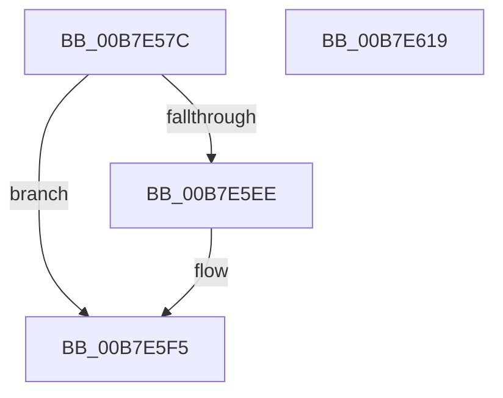

# ExInitializeSystemLookasideList

- RVA: `0x00B7E57C`–`0x00B7E61A` (길이 `158` bytes)
- VA: `0x0000000140B7E57C`
- 실행 섹션: `PAGELK`
- PDB 이름 있음: `예`; PDB Function 태그: `아니요`
- unwind 정보 RVA: `0x0005C954`
- 디코드: `42`개 명령, `158/158` bytes 표시
- 미해석 바이트: `0` (있으면 어셈블리에 `.byte`로 보존)

> 이 문서는 커널 이미지의 기계어와 PDB 기호를 분석해 생성했습니다. 4번과 5번은 함수 원형과 자료형을 바이너리 사용 방식에서 추정한 C 해석이며 원본 소스 복구 결과는 아닙니다.

## 1. Dependencies

- 직접 호출 지점: **1**; 고유 호출 대상: **1**
- 직접 호출자로 확인된 함수: **12**
- RIP 상대 이미지 참조: **2**

### Outgoing calls
- `0x00B7E59B` → [InitializeSListHead](../../text/46/InitializeSListHead_function_00468A90.md) (function, `0x00468A90`)

### Direct callers
- [KiInitializeProcessorXSaveStructures](../../text/5B/KiInitializeProcessorXSaveStructures_function_005BA004.md) at `0x005BA081`
- [ExInitializeProcessor](../../text/65/ExInitializeProcessor_function_00655844.md) at `0x006558A2`
- [CcInitializeProcessor](../../page/71/CcInitializeProcessor_function_00710220.md) at `0x007102A4`
- [IoInitializeProcessor](../../page/71/IoInitializeProcessor_function_0071A91C.md) at `0x0071A9E2`
- [IoInitializeProcessor](../../page/71/IoInitializeProcessor_function_0071A91C.md) at `0x0071AA2A`
- [IoInitializeProcessor](../../page/71/IoInitializeProcessor_function_0071A91C.md) at `0x0071AA72`
- [IoInitializeProcessor](../../page/71/IoInitializeProcessor_function_0071A91C.md) at `0x0071AAB9`
- [IoInitializeProcessor](../../page/71/IoInitializeProcessor_function_0071A91C.md) at `0x0071AAFE`
- [ObInitializeProcessor](../../page/74/ObInitializeProcessor_function_0074DA98.md) at `0x0074DB24`
- [ObInitializeProcessor](../../page/74/ObInitializeProcessor_function_0074DA98.md) at `0x0074DB7C`
- [CmInitializeProcessorCallbacks](../../page/7E/CmInitializeProcessorCallbacks_function_007E143C.md) at `0x007E149D`
- [CmpInitCallbacks](../../page/7E/CmpInitCallbacks_function_007E19A0.md) at `0x007E1A48`
- [KeInitializeXSaveStructures](../B6/KeInitializeXSaveStructures_function_00B66CEC.md) at `0x00B66D27`
- [ExInitPoolLookasidePointers](ExInitPoolLookasidePointers_function_00B72B00.md) at `0x00B72B73`
- [ExInitPoolLookasidePointers](ExInitPoolLookasidePointers_function_00B72B00.md) at `0x00B72BB5`
- [ExInitPoolLookasidePointers](ExInitPoolLookasidePointers_function_00B72B00.md) at `0x00B72BD6`
- [ExInitPoolLookasidePointers](ExInitPoolLookasidePointers_function_00B72B00.md) at `0x00B72BFB`
- [CcInitializeCacheManager](../../init/BE/CcInitializeCacheManager_function_00BEE2E8.md) at `0x00BEE5BC`
- [IoInitSystemPreDrivers](../../init/C2/IoInitSystemPreDrivers_function_00C2AC3C.md) at `0x00C2AEED`
- [IoInitSystemPreDrivers](../../init/C2/IoInitSystemPreDrivers_function_00C2AC3C.md) at `0x00C2AF14`
- [IoInitSystemPreDrivers](../../init/C2/IoInitSystemPreDrivers_function_00C2AC3C.md) at `0x00C2AF3B`
- [IoInitSystemPreDrivers](../../init/C2/IoInitSystemPreDrivers_function_00C2AC3C.md) at `0x00C2AF62`
- [IoInitSystemPreDrivers](../../init/C2/IoInitSystemPreDrivers_function_00C2AC3C.md) at `0x00C2AF89`
- [ObInitSystem](../../init/C7/ObInitSystem_function_00C71C7C.md) at `0x00C71D51`
- [ObInitSystem](../../init/C7/ObInitSystem_function_00C71C7C.md) at `0x00C71D7D`

### Static image references
- `0x00B7E5A6` → RVA `0x0043F0D0` (`ExAllocatePoolEx`; read)
- `0x00B7E5B1` → RVA `0x00B82850` (`ExFreePool`; read)

## 2. Other-region calls and transfers

- 다른 실행 섹션으로 향하는 call: **1**
  - `0x00B7E59B` → [InitializeSListHead](../../text/46/InitializeSListHead_function_00468A90.md) (`PAGELK` → `.text`)
- 별도 외부 분기/꼬리 이동을 확인하지 못했습니다.

## 3. Assembly (complete function range)

```asm
00B7E57C  48 89 5C 24 08                  mov qword ptr [rsp + 8], rbx
00B7E581  48 89 6C 24 10                  mov qword ptr [rsp + 0x10], rbp
00B7E586  48 89 74 24 18                  mov qword ptr [rsp + 0x18], rsi
00B7E58B  57                              push rdi
00B7E58C  48 83 EC 20                     sub rsp, 0x20
00B7E590  41 8B F9                        mov edi, r9d
00B7E593  41 8B F0                        mov esi, r8d
00B7E596  8B DA                           mov ebx, edx
00B7E598  48 8B E9                        mov rbp, rcx
00B7E59B  E8 F0 A4 8E FF                  call 0x140468a90
00B7E5A0  66 C7 45 10 02 00               mov word ptr [rbp + 0x10], 2
00B7E5A6  48 8D 05 23 0B 8C FF            lea rax, [rip - 0x73f4dd]
00B7E5AD  48 89 45 30                     mov qword ptr [rbp + 0x30], rax
00B7E5B1  48 8D 05 98 42 00 00            lea rax, [rip + 0x4298]
00B7E5B8  48 89 45 38                     mov qword ptr [rbp + 0x38], rax
00B7E5BC  0F B7 44 24 50                  movzx eax, word ptr [rsp + 0x50]
00B7E5C1  66 89 45 12                     mov word ptr [rbp + 0x12], ax
00B7E5C5  33 C0                           xor eax, eax
00B7E5C7  48 89 45 14                     mov qword ptr [rbp + 0x14], rax
00B7E5CB  48 89 45 1C                     mov qword ptr [rbp + 0x1c], rax
00B7E5CF  48 89 45 50                     mov qword ptr [rbp + 0x50], rax
00B7E5D3  48 8B 44 24 58                  mov rax, qword ptr [rsp + 0x58]
00B7E5D8  89 5D 24                        mov dword ptr [rbp + 0x24], ebx
00B7E5DB  89 7D 28                        mov dword ptr [rbp + 0x28], edi
00B7E5DE  89 75 2C                        mov dword ptr [rbp + 0x2c], esi
00B7E5E1  48 83 C5 40                     add rbp, 0x40
00B7E5E5  48 8B 48 08                     mov rcx, qword ptr [rax + 8]
00B7E5E9  48 39 01                        cmp qword ptr [rcx], rax
00B7E5EC  74 07                           je 0x140b7e5f5
00B7E5EE  B9 03 00 00 00                  mov ecx, 3
00B7E5F3  CD 29                           int 0x29
00B7E5F5  48 8B 5C 24 30                  mov rbx, qword ptr [rsp + 0x30]
00B7E5FA  48 8B 74 24 40                  mov rsi, qword ptr [rsp + 0x40]
00B7E5FF  48 89 45 00                     mov qword ptr [rbp], rax
00B7E603  48 89 4D 08                     mov qword ptr [rbp + 8], rcx
00B7E607  48 89 29                        mov qword ptr [rcx], rbp
00B7E60A  48 89 68 08                     mov qword ptr [rax + 8], rbp
00B7E60E  48 8B 6C 24 38                  mov rbp, qword ptr [rsp + 0x38]
00B7E613  48 83 C4 20                     add rsp, 0x20
00B7E617  5F                              pop rdi
00B7E618  C3                              ret
00B7E619  CC                              int3
```

## 4. C-style interpretation (structured pseudocode)

```c
__int64 __fastcall ExInitializeSystemLookasideList(__int64 a1, int a2, int a3, int a4, unsigned __int16 a5, __int64 a6)
{
    __int64 result;
    __int64 v_rbp;
    __int64 v_rsp;
    unsigned __int64 v_stack_p10;
    unsigned __int64 v_stack_p18;
    unsigned __int64 v_stack_p8;

    v_stack_p8 = v_rbx;
    v_stack_p10 = v_rbp;
    v_stack_p18 = v_rsi;
    v_rsp = (v_rsp) - (32);
    result = InitializeSListHead(a1, a2, a3, a4);
    *(unsigned __int16 *)(a1 + 16) = 2;
    *(unsigned __int64 *)(a1 + 48) = v_rip - 7599325;
    *(unsigned __int64 *)(a1 + 56) = v_rip + 17048;
    *(unsigned __int16 *)(a1 + 18) = a5;
    result = 0;
    *(unsigned __int64 *)(a1 + 20) = 0;
    *(unsigned __int64 *)(a1 + 28) = 0;
    *(unsigned __int64 *)(a1 + 80) = 0;
    *(unsigned int *)(a1 + 36) = (unsigned int)((unsigned int)(a2));
    *(unsigned int *)(a1 + 40) = (unsigned int)((unsigned int)(a4));
    *(unsigned int *)(a1 + 44) = (unsigned int)((unsigned int)(a3));
    v_rbp = (a1) + (64);
    if ((*(unsigned __int64 *)(*(unsigned __int64 *)(a6 + 8))) != a6) {
        a1 = 3;
    }
    *(unsigned __int64 *)(v_rbp) = a6;
    *(unsigned __int64 *)(v_rbp + 8) = a1;
    *(unsigned __int64 *)(a1) = v_rbp;
    *(unsigned __int64 *)(a6 + 8) = v_rbp;
    v_rsp = (v_rsp) + (32);
    return a6;
}
```

## 5. (Beta) C Style

```c
void *ExInitializeSystemLookasideList(void *SystemLookasideList, int32_t Arg2, int32_t Arg3, int32_t Arg4, uint16_t Arg5, void *Arg6)
{
    uint8_t *systemLookasideList = (uint8_t *)SystemLookasideList;
    uint8_t *arg6 = (uint8_t *)Arg6;

    int64_t result;
    int64_t local_rbp;
    int64_t local_rsp;
    uint64_t v_stack_p10;
    uint64_t v_stack_p18;
    uint64_t v_stack_p8;

    v_stack_p8 = local_rbx;
    v_stack_p10 = local_rbp;
    v_stack_p18 = local_rsi;
    local_rsp = (local_rsp) - (32);
    result = InitializeSListHead(SystemLookasideList, Arg2, Arg3, Arg4);
    *(uint16_t *)(systemLookasideList + 0x10) = 2;
    *(uint64_t *)(systemLookasideList + 0x30) = v_rip - 7599325;
    *(uint64_t *)(systemLookasideList + 0x38) = v_rip + 17048;
    *(uint16_t *)(systemLookasideList + 0x12) = Arg5;
    result = 0;
    *(uint64_t *)(systemLookasideList + 0x14) = 0;
    *(uint64_t *)(systemLookasideList + 0x1C) = 0;
    *(uint64_t *)(systemLookasideList + 0x50) = 0;
    *(uint32_t *)(systemLookasideList + 0x24) = (uint32_t)((uint32_t)(Arg2));
    *(uint32_t *)(systemLookasideList + 0x28) = (uint32_t)((uint32_t)(Arg4));
    *(uint32_t *)(systemLookasideList + 0x2C) = (uint32_t)((uint32_t)(Arg3));
    local_rbp = (SystemLookasideList) + (64);
    if ((*(uint64_t *)(*(uint64_t *)(arg6 + 0x8))) != Arg6) {
        SystemLookasideList = 3;
    }
    *(void **)(local_rbp) = Arg6;
    *(void **)(local_rbp + 0x8) = SystemLookasideList;
    *(uint64_t *)(systemLookasideList) = local_rbp;
    *(uint64_t *)(arg6 + 0x8) = local_rbp;
    local_rsp = (local_rsp) + (32);
    return Arg6;
}
```

### 관측된 메모리 오프셋

구조체 형식이 확인되지 않은 접근은 인자 기준의 오프셋으로만 기록했습니다.

| 기준 인자 | 오프셋 표현 | 폭 (bit) | 접근 |
|---|---:|---:|---|
| `SystemLookasideList` | `+ 0x0` | `64` | `W` |
| `SystemLookasideList` | `+ 0x8` | `64` | `W` |
| `SystemLookasideList` | `+ 0x10` | `16` | `W` |
| `SystemLookasideList` | `+ 0x12` | `16` | `W` |
| `SystemLookasideList` | `+ 0x14` | `64` | `W` |
| `SystemLookasideList` | `+ 0x1C` | `64` | `W` |
| `SystemLookasideList` | `+ 0x24` | `32` | `W` |
| `SystemLookasideList` | `+ 0x28` | `32` | `W` |
| `SystemLookasideList` | `+ 0x2C` | `32` | `W` |
| `SystemLookasideList` | `+ 0x30` | `64` | `W` |
| `SystemLookasideList` | `+ 0x38` | `64` | `W` |
| `SystemLookasideList` | `+ 0x50` | `64` | `W` |
| `Arg6` | `+ 0x8` | `64` | `R` |
| `Arg6` | `+ 0x8` | `64` | `W` |

## 6. Execution-region graph

[열기: 2D/3D 그래프와 함수 탐색 컨트롤 패널](../../../control-panel.html?section=pagelk&rva=0x00B7E57C&view=graph)

- 2D 그래프는 위에서 아래로 흐르고, 3D 그래프는 빈 공간을 드래그해 회전합니다. Shift+드래그는 이동, 휠은 확대·축소, 함수 노드 선택은 대상 보고서 이동입니다.

### Static fallback


