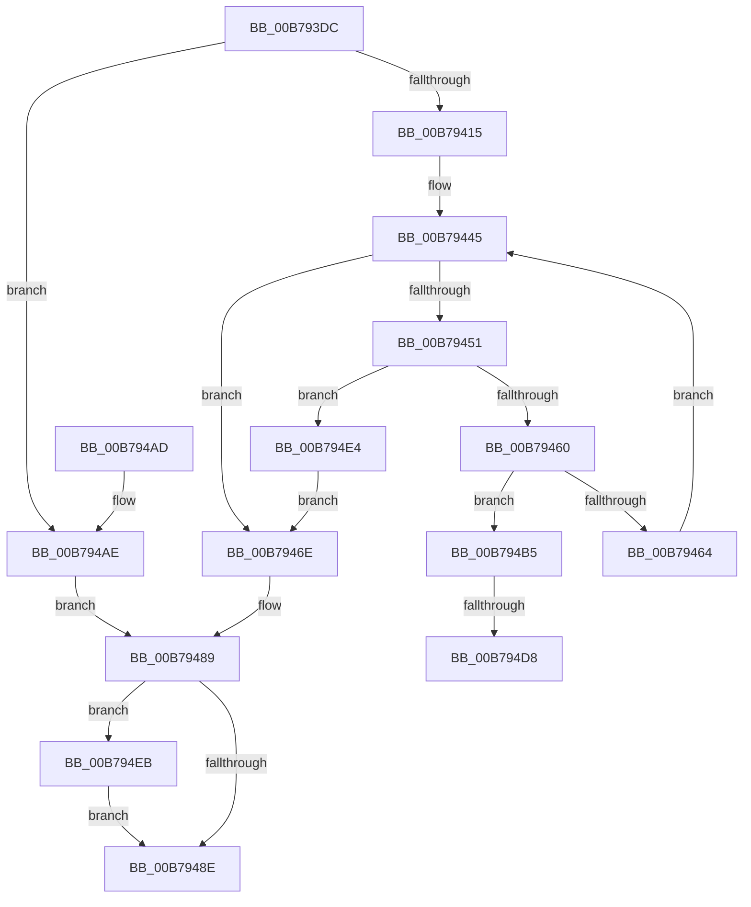

# ExQuerySystemLockInformation

- RVA: `0x00B793DC`–`0x00B794F0` (길이 `276` bytes)
- VA: `0x0000000140B793DC`
- 실행 섹션: `PAGELK`
- PDB 이름 있음: `예`; PDB Function 태그: `예`
- unwind 정보 RVA: `0x000B39EC`
- 디코드: `75`개 명령, `276/276` bytes 표시
- 미해석 바이트: `0` (있으면 어셈블리에 `.byte`로 보존)

> 이 문서는 커널 이미지의 기계어와 PDB 기호를 분석해 생성했습니다. 4번과 5번은 함수 원형과 자료형을 바이너리 사용 방식에서 추정한 C 해석이며 원본 소스 복구 결과는 아닙니다.

## 1. Dependencies

- 직접 호출 지점: **5**; 고유 호출 대상: **5**
- 직접 호출자로 확인된 함수: **1**
- RIP 상대 이미지 참조: **3**

### Outgoing calls
- `0x00B79426` → [MmLockPagableSectionByHandle](../../page/A4/MmLockPagableSectionByHandle_function_00A4D1E0.md) (function, `0x00A4D1E0`)
- `0x00B79432` → [ExAcquireSpinLockShared](../../text/24/ExAcquireSpinLockShared_function_0024DCE0.md) (function, `0x0024DCE0`)
- `0x00B79478` → [ExReleaseSpinLockShared](../../text/2F/ExReleaseSpinLockShared_function_002F0EF0.md) (function, `0x002F0EF0`)
- `0x00B79484` → [MmUnlockPagableImageSection](../../text/2A/MmUnlockPagableImageSection_function_002A39F0.md) (function, `0x002A39F0`)
- `0x00B794CA` → [ExpOwnerEntryToThread](../../text/38/ExpOwnerEntryToThread_function_0038C030.md) (function, `0x0038C030`)

### Direct callers
- [ExpGetLockInformation](../../page/7C/ExpGetLockInformation_function_007C3AE0.md) at `0x007C3B4A`

### Static image references
- `0x00B79415` → RVA `0x00FC6C00` (`ALMOSTRO`; read)
- `0x00B7942B` → RVA `0x00FCF0C0` (`CACHEALI`; read)
- `0x00B79437` → RVA `0x00EFAC20` (`.data`; read)

## 2. Other-region calls and transfers

- 다른 실행 섹션으로 향하는 call: **5**
  - `0x00B79426` → [MmLockPagableSectionByHandle](../../page/A4/MmLockPagableSectionByHandle_function_00A4D1E0.md) (`PAGELK` → `PAGE`)
  - `0x00B79432` → [ExAcquireSpinLockShared](../../text/24/ExAcquireSpinLockShared_function_0024DCE0.md) (`PAGELK` → `.text`)
  - `0x00B79478` → [ExReleaseSpinLockShared](../../text/2F/ExReleaseSpinLockShared_function_002F0EF0.md) (`PAGELK` → `.text`)
  - `0x00B79484` → [MmUnlockPagableImageSection](../../text/2A/MmUnlockPagableImageSection_function_002A39F0.md) (`PAGELK` → `.text`)
  - `0x00B794CA` → [ExpOwnerEntryToThread](../../text/38/ExpOwnerEntryToThread_function_0038C030.md) (`PAGELK` → `.text`)
- call이 아닌 외부 분기/꼬리 이동: **2**
  - `0x00B794D2` → [sub_00B80772](../B8/Unknown_function_00B80772.md) (`tail-transfer`)
  - `0x00B794DF` → [sub_00B80772 + 0x3](../B8/Unknown_function_00B80772.md) (`tail-transfer`)

## 3. Assembly (complete function range)

```asm
00B793DC  48 89 5C 24 08                  mov qword ptr [rsp + 8], rbx
00B793E1  48 89 6C 24 10                  mov qword ptr [rsp + 0x10], rbp
00B793E6  48 89 74 24 18                  mov qword ptr [rsp + 0x18], rsi
00B793EB  57                              push rdi
00B793EC  41 54                           push r12
00B793EE  41 55                           push r13
00B793F0  41 56                           push r14
00B793F2  41 57                           push r15
00B793F4  48 83 EC 20                     sub rsp, 0x20
00B793F8  BB 08 00 00 00                  mov ebx, 8
00B793FD  45 33 ED                        xor r13d, r13d
00B79400  4D 8B F9                        mov r15, r9
00B79403  41 8B E8                        mov ebp, r8d
00B79406  4C 8B F2                        mov r14, rdx
00B79409  44 8B E1                        mov r12d, ecx
00B7940C  44 3B C3                        cmp r8d, ebx
00B7940F  0F 82 99 00 00 00               jb 0x140b794ae
00B79415  48 8B 0D E4 D7 44 00            mov rcx, qword ptr [rip + 0x44d7e4]
00B7941C  48 8D 72 08                     lea rsi, [rdx + 8]
00B79420  41 8B FD                        mov edi, r13d
00B79423  44 89 2A                        mov dword ptr [rdx], r13d
00B79426  E8 B5 3D ED FF                  call 0x140a4d1e0
00B7942B  48 8D 0D 8E 5C 45 00            lea rcx, [rip + 0x455c8e]
00B79432  E8 A9 48 6D FF                  call 0x14024dce0
00B79437  4C 8B 05 E2 17 38 00            mov r8, qword ptr [rip + 0x3817e2]
00B7943E  44 8D 53 F9                     lea r10d, [rbx - 7]
00B79442  44 8A C8                        mov r9b, al
00B79445  48 8D 05 D4 17 38 00            lea rax, [rip + 0x3817d4]
00B7944C  4C 3B C0                        cmp r8, rax
00B7944F  74 1D                           je 0x140b7946e
00B79451  45 01 16                        add dword ptr [r14], r10d
00B79454  83 C3 30                        add ebx, 0x30
00B79457  83 FB 30                        cmp ebx, 0x30
00B7945A  0F 82 84 00 00 00               jb 0x140b794e4
00B79460  3B EB                           cmp ebp, ebx
00B79462  73 51                           jae 0x140b794b5
00B79464  BF 04 00 00 C0                  mov edi, 0xc0000004
00B79469  4D 8B 00                        mov r8, qword ptr [r8]
00B7946C  EB D7                           jmp 0x140b79445
00B7946E  41 8A D1                        mov dl, r9b
00B79471  48 8D 0D 48 5C 45 00            lea rcx, [rip + 0x455c48]
00B79478  E8 73 7A 77 FF                  call 0x1402f0ef0
00B7947D  48 8B 0D 7C D7 44 00            mov rcx, qword ptr [rip + 0x44d77c]
00B79484  E8 67 A5 72 FF                  call 0x1402a39f0
00B79489  4D 85 FF                        test r15, r15
00B7948C  75 5D                           jne 0x140b794eb
00B7948E  48 8B 5C 24 50                  mov rbx, qword ptr [rsp + 0x50]
00B79493  8B C7                           mov eax, edi
00B79495  48 8B 6C 24 58                  mov rbp, qword ptr [rsp + 0x58]
00B7949A  48 8B 74 24 60                  mov rsi, qword ptr [rsp + 0x60]
00B7949F  48 83 C4 20                     add rsp, 0x20
00B794A3  41 5F                           pop r15
00B794A5  41 5E                           pop r14
00B794A7  41 5D                           pop r13
00B794A9  41 5C                           pop r12
00B794AB  5F                              pop rdi
00B794AC  C3                              ret
00B794AD  CC                              int3
00B794AE  BF 04 00 00 C0                  mov edi, 0xc0000004
00B794B3  EB D4                           jmp 0x140b79489
00B794B5  45 85 E4                        test r12d, r12d
00B794B8  44 89 56 08                     mov dword ptr [rsi + 8], r10d
00B794BC  49 8B C5                        mov rax, r13
00B794BF  49 8D 48 30                     lea rcx, [r8 + 0x30]
00B794C3  49 0F 44 C0                     cmove rax, r8
00B794C7  48 89 06                        mov qword ptr [rsi], rax
00B794CA  E8 61 2B 81 FF                  call 0x14038c030
00B794CF  48 85 C0                        test rax, rax
00B794D2  0F 84 9A 72 00 00               je 0x140b80772
00B794D8  48 8B 80 10 05 00 00            mov rax, qword ptr [rax + 0x510]
00B794DF  E9 91 72 00 00                  jmp 0x140b80775
00B794E4  BF 95 00 00 C0                  mov edi, 0xc0000095
00B794E9  EB 83                           jmp 0x140b7946e
00B794EB  41 89 1F                        mov dword ptr [r15], ebx
00B794EE  EB 9E                           jmp 0x140b7948e
```

## 4. C-style interpretation (structured pseudocode)

```c
__int64 __fastcall ExQuerySystemLockInformation(int a1, __int64 a2, int a3, __int64 a4)
{
    __int64 result;
    __int64 v_r13;
    __int64 v_rbx;
    __int64 v_rsp;
    unsigned __int64 v_stack_p10;
    unsigned __int64 v_stack_p18;
    unsigned __int64 v_stack_p8;

    v_stack_p8 = v_rbx;
    v_stack_p10 = v_rbp;
    v_stack_p18 = v_rsi;
    v_rsp = (v_rsp) - (32);
    v_r13 = 0;
    if (a3 < 8) goto loc_00B794AE;
    *(unsigned int *)(a2) = 0;
    result = MmLockPagableSectionByHandle(*(unsigned __int64 *)(v_rip + 4511716), a2, a3, a4);
    result = ExAcquireSpinLockShared(v_rip + 4545678, a2, a3, a4);
loc_00B79445:
    if ((*(unsigned __int64 *)(v_rip + 3676130)) == (v_rip + 3676116)) goto loc_00B7946E;
    v_rbx = (unsigned int)((8) + (48));
    if (((unsigned int)(v_rbx)) < 48) goto loc_00B794E4;
    if (((unsigned int)((unsigned int)(a3))) >= ((unsigned int)(v_rbx))) goto loc_00B794B5;
    goto loc_00B79445;
loc_00B7946E:
    result = ExReleaseSpinLockShared(v_rip + 4545608, (unsigned __int8)((unsigned __int8)(result)), *(unsigned __int64 *)(*(unsigned __int64 *)(v_rip + 3676130)), (unsigned __int8)(result));
    result = MmUnlockPagableImageSection(*(unsigned __int64 *)(v_rip + 4511612), (unsigned __int8)((unsigned __int8)(result)), *(unsigned __int64 *)(*(unsigned __int64 *)(v_rip + 3676130)), (unsigned __int8)(result));
loc_00B79489:
    if (a4 != 0) goto loc_00B794EB;
loc_00B7948E:
    v_rsp = (v_rsp) + (32);
    return (unsigned int)((unsigned int)((unsigned int)(0xC0000004ULL)));
loc_00B794AE:
    goto loc_00B79489;
loc_00B794B5:
    *(unsigned int *)(v_stack_p18 + 8) = (unsigned int)(8 - 7);
    result = 0;
    if ((unsigned int)((unsigned int)(a1)) == 0) { result = *(unsigned __int64 *)(*(unsigned __int64 *)(v_rip + 3676130)); }
    *(unsigned __int64 *)(v_stack_p18) = result;
    result = ExpOwnerEntryToThread(*(unsigned __int64 *)(*(unsigned __int64 *)(v_rip + 3676130)) + 48, (unsigned __int8)((unsigned __int8)(result)), *(unsigned __int64 *)(*(unsigned __int64 *)(v_rip + 3676130)), (unsigned __int8)(result));
loc_00B794E4:
    goto loc_00B7946E;
loc_00B794EB:
    *(unsigned int *)(a4) = (unsigned int)(v_stack_p8);
    goto loc_00B7948E;
}
```

## 5. (Beta) C Style

```c
int64_t ExQuerySystemLockInformation(int32_t Arg1, void *Arg2, int32_t Arg3, int64_t Arg4)
{
    uint8_t *arg2 = (uint8_t *)Arg2;

    int64_t result;
    int64_t local_r13;
    int64_t local_rbx;
    int64_t local_rsp;
    uint64_t v_stack_p10;
    uint64_t v_stack_p18;
    uint64_t v_stack_p8;

    v_stack_p8 = local_rbx;
    v_stack_p10 = local_rbp;
    v_stack_p18 = local_rsi;
    local_rsp = (local_rsp) - (32);
    local_r13 = 0;
    if (Arg3 < 8) goto loc_00B794AE;
    *(uint32_t *)(arg2) = 0;
    result = MmLockPagableSectionByHandle(*(uint64_t *)(v_rip + 0x44D7E4), Arg2, Arg3, Arg4);
    result = ExAcquireSpinLockShared(v_rip + 4545678, Arg2, Arg3, Arg4);
loc_00B79445:
    if ((*(uint64_t *)(v_rip + 0x3817E2)) == (v_rip + 3676116)) goto loc_00B7946E;
    local_rbx = (uint32_t)((8) + (48));
    if (((uint32_t)(local_rbx)) < 48) goto loc_00B794E4;
    if (((uint32_t)((uint32_t)(Arg3))) >= ((uint32_t)(local_rbx))) goto loc_00B794B5;
    goto loc_00B79445;
loc_00B7946E:
    result = ExReleaseSpinLockShared(v_rip + 4545608, (uint8_t)((uint8_t)(result)), *(uint64_t *)(*(uint64_t *)(v_rip + 0x3817E2)), (uint8_t)(result));
    result = MmUnlockPagableImageSection(*(uint64_t *)(v_rip + 0x44D77C), (uint8_t)((uint8_t)(result)), *(uint64_t *)(*(uint64_t *)(v_rip + 0x3817E2)), (uint8_t)(result));
loc_00B79489:
    if (Arg4 != 0) goto loc_00B794EB;
loc_00B7948E:
    local_rsp = (local_rsp) + (32);
    return (uint32_t)((uint32_t)((uint32_t)(0xC0000004ULL)));
loc_00B794AE:
    goto loc_00B79489;
loc_00B794B5:
    *(uint32_t *)(v_stack_p18 + 0x8) = (uint32_t)(8 - 7);
    result = 0;
    if ((uint32_t)((uint32_t)(Arg1)) == 0) { result = *(uint64_t *)(*(uint64_t *)(v_rip + 0x3817E2)); }
    *(uint64_t *)(v_stack_p18) = result;
    result = ExpOwnerEntryToThread(*(uint64_t *)(*(uint64_t *)(v_rip + 0x3817E2)) + 48, (uint8_t)((uint8_t)(result)), *(uint64_t *)(*(uint64_t *)(v_rip + 0x3817E2)), (uint8_t)(result));
loc_00B794E4:
    goto loc_00B7946E;
loc_00B794EB:
    *(uint32_t *)(Arg4) = (uint32_t)(v_stack_p8);
    goto loc_00B7948E;
}
```

### 관측된 메모리 오프셋

구조체 형식이 확인되지 않은 접근은 인자 기준의 오프셋으로만 기록했습니다.

| 기준 인자 | 오프셋 표현 | 폭 (bit) | 접근 |
|---|---:|---:|---|
| `Arg2` | `+ 0x0` | `32` | `R/W` |
| `Arg2` | `+ 0x0` | `32` | `W` |
| `Arg2` | `+ 0x0` | `64` | `W` |
| `Arg2` | `+ 0x8` | `32` | `W` |
| `Arg2` | `+ 0x8` | `64` | `R` |

## 6. Execution-region graph

[열기: 2D/3D 그래프와 함수 탐색 컨트롤 패널](../../../control-panel.html?section=pagelk&rva=0x00B793DC&view=graph)

- 2D 그래프는 위에서 아래로 흐르고, 3D 그래프는 빈 공간을 드래그해 회전합니다. Shift+드래그는 이동, 휠은 확대·축소, 함수 노드 선택은 대상 보고서 이동입니다.

### Static fallback


