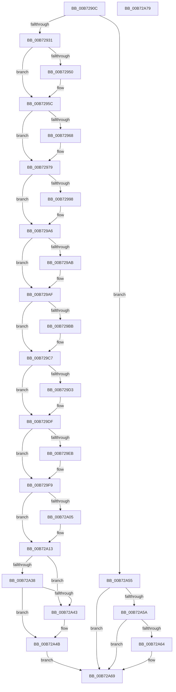

# ExShutdownSystem

- RVA: `0x00B7290C`–`0x00B72A7A` (길이 `366` bytes)
- VA: `0x0000000140B7290C`
- 실행 섹션: `PAGELK`
- PDB 이름 있음: `예`; PDB Function 태그: `아니요`
- unwind 정보 RVA: `0x00060BC4`
- 디코드: `90`개 명령, `366/366` bytes 표시
- 미해석 바이트: `0` (있으면 어셈블리에 `.byte`로 보존)

> 이 문서는 커널 이미지의 기계어와 PDB 기호를 분석해 생성했습니다. 4번과 5번은 함수 원형과 자료형을 바이너리 사용 방식에서 추정한 C 해석이며 원본 소스 복구 결과는 아닙니다.

## 1. Dependencies

- 직접 호출 지점: **13**; 고유 호출 대상: **10**
- 직접 호출자로 확인된 함수: **1**
- RIP 상대 이미지 참조: **12**

### Outgoing calls
- `0x00B7291F` → [PsGetServerSiloGlobals](../../text/22/PsGetServerSiloGlobals_function_002250A0.md) (function, `0x002250A0`)
- `0x00B72931` → [ExpRecordShutdownTime](../../text/65/ExpRecordShutdownTime_function_006555FC.md) (function, `0x006555FC`)
- `0x00B72950` → [ObfDereferenceObject](../../text/2F/ObfDereferenceObject_function_002F9350.md) (function, `0x002F9350`)
- `0x00B7296D` → [ObfDereferenceObjectWithTag](../../text/2F/ObfDereferenceObjectWithTag_function_002F78E0.md) (function, `0x002F78E0`)
- `0x00B72988` → [KeAbPreAcquire](../../text/21/KeAbPreAcquire_function_00210230.md) (function, `0x00210230`)
- `0x00B729A1` → [ExfAcquirePushLockExclusiveEx](../../text/20/ExfAcquirePushLockExclusiveEx_function_0020FC90.md) (function, `0x0020FC90`)
- `0x00B729BB` → [ObfDereferenceObject](../../text/2F/ObfDereferenceObject_function_002F9350.md) (function, `0x002F9350`)
- `0x00B729D3` → [ObfDereferenceObject](../../text/2F/ObfDereferenceObject_function_002F9350.md) (function, `0x002F9350`)
- `0x00B729ED` → [ObCloseHandle](../../page/8A/ObCloseHandle_function_008A1870.md) (function, `0x008A1870`)
- `0x00B72A07` → [ObCloseHandle](../../page/8A/ObCloseHandle_function_008A1870.md) (function, `0x008A1870`)
- `0x00B72A46` → [ExfReleasePushLock](../../text/26/ExfReleasePushLock_function_002638D0.md) (function, `0x002638D0`)
- `0x00B72A4E` → [KeAbPostRelease](../../text/2E/KeAbPostRelease_function_002E1600.md) (function, `0x002E1600`)
- `0x00B72A64` → [ExSwapinWorkerThreads](../../page/A6/ExSwapinWorkerThreads_function_00A68C40.md) (function, `0x00A68C40`)

### Direct callers
- [PopGracefulShutdown](../B6/PopGracefulShutdown_function_00B6BEC8.md) at `0x00B6C012`
- [PopGracefulShutdown](../B6/PopGracefulShutdown_function_00B6BEC8.md) at `0x00B6C0D8`
- [PopGracefulShutdown](../B6/PopGracefulShutdown_function_00B6BEC8.md) at `0x00B6C19F`

### Static image references
- `0x00B7293D` → RVA `0x00E685D1` (`.data`; write)
- `0x00B72944` → RVA `0x00FD9A9C` (`PAGEDATA`; write)
- `0x00B72979` → RVA `0x00EFEE30` (`.data`; read)
- `0x00B729AF` → RVA `0x00EFEE20` (`.data`; read)
- `0x00B729C0` → RVA `0x00EFEE20` (`.data`; write)
- `0x00B729C7` → RVA `0x00EFEE28` (`.data`; read)
- `0x00B729D8` → RVA `0x00EFEE28` (`.data`; write)
- `0x00B729DF` → RVA `0x00EFEE18` (`.data`; read)
- `0x00B729F2` → RVA `0x00EFEE18` (`.data`; write)
- `0x00B729F9` → RVA `0x00EF0130` (`.data`; read)
- `0x00B72A0C` → RVA `0x00EF0130` (`.data`; write)
- `0x00B72A5A` → RVA `0x00F0C8B0` (`.data`; read)

## 2. Other-region calls and transfers

- 다른 실행 섹션으로 향하는 call: **13**
  - `0x00B7291F` → [PsGetServerSiloGlobals](../../text/22/PsGetServerSiloGlobals_function_002250A0.md) (`PAGELK` → `.text`)
  - `0x00B72931` → [ExpRecordShutdownTime](../../text/65/ExpRecordShutdownTime_function_006555FC.md) (`PAGELK` → `.text`)
  - `0x00B72950` → [ObfDereferenceObject](../../text/2F/ObfDereferenceObject_function_002F9350.md) (`PAGELK` → `.text`)
  - `0x00B7296D` → [ObfDereferenceObjectWithTag](../../text/2F/ObfDereferenceObjectWithTag_function_002F78E0.md) (`PAGELK` → `.text`)
  - `0x00B72988` → [KeAbPreAcquire](../../text/21/KeAbPreAcquire_function_00210230.md) (`PAGELK` → `.text`)
  - `0x00B729A1` → [ExfAcquirePushLockExclusiveEx](../../text/20/ExfAcquirePushLockExclusiveEx_function_0020FC90.md) (`PAGELK` → `.text`)
  - `0x00B729BB` → [ObfDereferenceObject](../../text/2F/ObfDereferenceObject_function_002F9350.md) (`PAGELK` → `.text`)
  - `0x00B729D3` → [ObfDereferenceObject](../../text/2F/ObfDereferenceObject_function_002F9350.md) (`PAGELK` → `.text`)
  - `0x00B729ED` → [ObCloseHandle](../../page/8A/ObCloseHandle_function_008A1870.md) (`PAGELK` → `PAGE`)
  - `0x00B72A07` → [ObCloseHandle](../../page/8A/ObCloseHandle_function_008A1870.md) (`PAGELK` → `PAGE`)
  - `0x00B72A46` → [ExfReleasePushLock](../../text/26/ExfReleasePushLock_function_002638D0.md) (`PAGELK` → `.text`)
  - `0x00B72A4E` → [KeAbPostRelease](../../text/2E/KeAbPostRelease_function_002E1600.md) (`PAGELK` → `.text`)
  - `0x00B72A64` → [ExSwapinWorkerThreads](../../page/A6/ExSwapinWorkerThreads_function_00A68C40.md) (`PAGELK` → `PAGE`)
- 별도 외부 분기/꼬리 이동을 확인하지 못했습니다.

## 3. Assembly (complete function range)

```asm
00B7290C  48 89 5C 24 08                  mov qword ptr [rsp + 8], rbx
00B72911  48 89 74 24 10                  mov qword ptr [rsp + 0x10], rsi
00B72916  57                              push rdi
00B72917  48 83 EC 20                     sub rsp, 0x20
00B7291B  8B D1                           mov edx, ecx
00B7291D  33 C9                           xor ecx, ecx
00B7291F  E8 7C 27 6B FF                  call 0x1402250a0
00B72924  33 FF                           xor edi, edi
00B72926  48 8B D8                        mov rbx, rax
00B72929  85 D2                           test edx, edx
00B7292B  0F 85 24 01 00 00               jne 0x140b72a55
00B72931  E8 C6 2C AE FF                  call 0x1406555fc
00B72936  48 8B 8B 58 03 00 00            mov rcx, qword ptr [rbx + 0x358]
00B7293D  C6 05 8D 5C 2F 00 01            mov byte ptr [rip + 0x2f5c8d], 1
00B72944  C6 05 51 71 46 00 01            mov byte ptr [rip + 0x467151], 1
00B7294B  48 85 C9                        test rcx, rcx
00B7294E  74 0C                           je 0x140b7295c
00B72950  E8 FB 69 78 FF                  call 0x1402f9350
00B72955  48 89 BB 58 03 00 00            mov qword ptr [rbx + 0x358], rdi
00B7295C  48 8B 8B 50 03 00 00            mov rcx, qword ptr [rbx + 0x350]
00B72963  48 85 C9                        test rcx, rcx
00B72966  74 11                           je 0x140b72979
00B72968  BA 45 78 48 65                  mov edx, 0x65487845
00B7296D  E8 6E 4F 78 FF                  call 0x1402f78e0
00B72972  48 89 BB 50 03 00 00            mov qword ptr [rbx + 0x350], rdi
00B72979  48 8D 35 B0 C4 38 00            lea rsi, [rip + 0x38c4b0]
00B72980  45 33 C0                        xor r8d, r8d
00B72983  48 8B CE                        mov rcx, rsi
00B72986  33 D2                           xor edx, edx
00B72988  E8 A3 D8 69 FF                  call 0x140210230
00B7298D  F0 48 0F BA 2E 00               lock bts qword ptr [rsi], 0
00B72993  48 8B D8                        mov rbx, rax
00B72996  73 0E                           jae 0x140b729a6
00B72998  4C 8B C6                        mov r8, rsi
00B7299B  48 8B D0                        mov rdx, rax
00B7299E  48 8B CE                        mov rcx, rsi
00B729A1  E8 EA D2 69 FF                  call 0x14020fc90
00B729A6  48 85 DB                        test rbx, rbx
00B729A9  74 04                           je 0x140b729af
00B729AB  C6 43 0A 01                     mov byte ptr [rbx + 0xa], 1
00B729AF  48 8B 0D 6A C4 38 00            mov rcx, qword ptr [rip + 0x38c46a]
00B729B6  48 85 C9                        test rcx, rcx
00B729B9  74 0C                           je 0x140b729c7
00B729BB  E8 90 69 78 FF                  call 0x1402f9350
00B729C0  48 89 3D 59 C4 38 00            mov qword ptr [rip + 0x38c459], rdi
00B729C7  48 8B 0D 5A C4 38 00            mov rcx, qword ptr [rip + 0x38c45a]
00B729CE  48 85 C9                        test rcx, rcx
00B729D1  74 0C                           je 0x140b729df
00B729D3  E8 78 69 78 FF                  call 0x1402f9350
00B729D8  48 89 3D 49 C4 38 00            mov qword ptr [rip + 0x38c449], rdi
00B729DF  48 8B 0D 32 C4 38 00            mov rcx, qword ptr [rip + 0x38c432]
00B729E6  48 85 C9                        test rcx, rcx
00B729E9  74 0E                           je 0x140b729f9
00B729EB  33 D2                           xor edx, edx
00B729ED  E8 7E EE D2 FF                  call 0x1408a1870
00B729F2  48 89 3D 1F C4 38 00            mov qword ptr [rip + 0x38c41f], rdi
00B729F9  48 8B 0D 30 D7 37 00            mov rcx, qword ptr [rip + 0x37d730]
00B72A00  48 85 C9                        test rcx, rcx
00B72A03  74 0E                           je 0x140b72a13
00B72A05  33 D2                           xor edx, edx
00B72A07  E8 64 EE D2 FF                  call 0x1408a1870
00B72A0C  48 89 3D 1D D7 37 00            mov qword ptr [rip + 0x37d71d], rdi
00B72A13  0F 0D 0D 16 C4 38 00            prefetchw byte ptr [rip + 0x38c416]
00B72A1A  48 8B 05 0F C4 38 00            mov rax, qword ptr [rip + 0x38c40f]
00B72A21  48 8B C8                        mov rcx, rax
00B72A24  48 83 E1 F0                     and rcx, 0xfffffffffffffff0
00B72A28  48 83 F9 10                     cmp rcx, 0x10
00B72A2C  48 8D 50 F0                     lea rdx, [rax - 0x10]
00B72A30  48 0F 46 D7                     cmovbe rdx, rdi
00B72A34  A8 02                           test al, 2
00B72A36  75 0B                           jne 0x140b72a43
00B72A38  F0 48 0F B1 15 EF C3 38 00      lock cmpxchg qword ptr [rip + 0x38c3ef], rdx
00B72A41  74 08                           je 0x140b72a4b
00B72A43  48 8B CE                        mov rcx, rsi
00B72A46  E8 85 0E 6F FF                  call 0x1402638d0
00B72A4B  48 8B CE                        mov rcx, rsi
00B72A4E  E8 AD EB 76 FF                  call 0x1402e1600
00B72A53  EB 14                           jmp 0x140b72a69
00B72A55  83 FA 01                        cmp edx, 1
00B72A58  75 0F                           jne 0x140b72a69
00B72A5A  8B 05 50 9E 39 00               mov eax, dword ptr [rip + 0x399e50]
00B72A60  A8 02                           test al, 2
00B72A62  74 05                           je 0x140b72a69
00B72A64  E8 D7 61 EF FF                  call 0x140a68c40
00B72A69  48 8B 5C 24 30                  mov rbx, qword ptr [rsp + 0x30]
00B72A6E  48 8B 74 24 38                  mov rsi, qword ptr [rsp + 0x38]
00B72A73  48 83 C4 20                     add rsp, 0x20
00B72A77  5F                              pop rdi
00B72A78  C3                              ret
00B72A79  CC                              int3
```

## 4. C-style interpretation (structured pseudocode)

```c
__int64 __fastcall ExShutdownSystem(int a1, __int64 a2, int a3)
{
    __int64 result;
    __int64 v_rdi;
    __int64 v_rsp;
    unsigned __int64 v_stack_p10;
    unsigned __int64 v_stack_p8;

    v_stack_p8 = v_rbx;
    v_stack_p10 = v_rsi;
    v_rsp = (v_rsp) - (32);
    a1 = 0;
    result = PsGetServerSiloGlobals(a1, (unsigned int)(a1), a3, a4);
    v_rdi = 0;
    if ((unsigned int)((unsigned int)(a1)) != 0) goto loc_00B72A55;
    result = ExpRecordShutdownTime(a1, (unsigned int)(a1), a3, a4);
    *(unsigned __int8 *)(v_rip + 3103885) = 1;
    *(unsigned __int8 *)(v_rip + 4616529) = 1;
    if (*(unsigned __int64 *)(result + 856) != 0) {
        result = ObfDereferenceObject(*(unsigned __int64 *)(result + 856), (unsigned int)(a1), a3, a4);
        *(unsigned __int64 *)(result + 856) = 0;
    }
    if (*(unsigned __int64 *)(result + 848) != 0) {
        a2 = 0x65487845ULL;
        result = ObfDereferenceObjectWithTag(*(unsigned __int64 *)(result + 848), a2, a3, a4);
        *(unsigned __int64 *)(result + 848) = 0;
    }
    a3 = 0;
    a2 = 0;
    result = KeAbPreAcquire(v_rip + 3720368, a2, a3, a4);
    if (!(condition_is_above_or_equal)) {
        a3 = v_rip + 3720368;
        a2 = result;
        a1 = v_rip + 3720368;
        result = ExfAcquirePushLockExclusiveEx(a1, a2, a3, a4);
    }
    if (result != 0) {
        *(unsigned __int8 *)(result + 10) = 1;
    }
    if (*(unsigned __int64 *)(v_rip + 3720298) != 0) {
        result = ObfDereferenceObject(*(unsigned __int64 *)(v_rip + 3720298), a2, a3, a4);
        *(unsigned __int64 *)(v_rip + 3720281) = 0;
    }
    if (*(unsigned __int64 *)(v_rip + 3720282) != 0) {
        result = ObfDereferenceObject(*(unsigned __int64 *)(v_rip + 3720282), a2, a3, a4);
        *(unsigned __int64 *)(v_rip + 3720265) = 0;
    }
    if (*(unsigned __int64 *)(v_rip + 3720242) != 0) {
        a2 = 0;
        result = ObCloseHandle(*(unsigned __int64 *)(v_rip + 3720242), a2, a3, a4);
        *(unsigned __int64 *)(v_rip + 3720223) = 0;
    }
    if (*(unsigned __int64 *)(v_rip + 3659568) != 0) {
        a2 = 0;
        result = ObCloseHandle(*(unsigned __int64 *)(v_rip + 3659568), a2, a3, a4);
        *(unsigned __int64 *)(v_rip + 3659549) = 0;
    }
    a1 = (*(unsigned __int64 *)(v_rip + 3720207)) & (-16);
    a2 = *(unsigned __int64 *)(v_rip + 3720207) - 16;
    if (a1 <= 16) { a2 = 0; }
    if ((((unsigned __int8)(*(unsigned __int64 *)(v_rip + 3720207))) & (2)) != 0) goto loc_00B72A43;
    result = *(unsigned __int64 *)(v_rip + 3720207);
    if ((((unsigned __int8)(*(unsigned __int64 *)(v_rip + 3720207))) & (2)) != 0) {
        a1 = v_rip + 3720368;
        result = ExfReleasePushLock(a1, a2, a3, a4);
    }
    result = KeAbPostRelease(v_rip + 3720368, a2, a3, a4);
    goto loc_00B72A69;
loc_00B72A55:
    if (((unsigned int)(a2)) != 1) goto loc_00B72A69;
    result = (unsigned int)(*(unsigned int *)(v_rip + 3776080));
    if ((((unsigned __int8)((unsigned int)(*(unsigned int *)(v_rip + 3776080)))) & (2)) != 0) {
        result = ExSwapinWorkerThreads(v_rip + 3720368, a2, a3, a4);
    }
    v_rsp = (v_rsp) + (32);
    return result;
}
```

## 5. (Beta) C Style

```c
int64_t ExShutdownSystem(int32_t Arg1, int64_t Arg2, int32_t Arg3)
{
    int64_t result;
    int64_t local_rdi;
    int64_t local_rsp;
    uint64_t v_stack_p10;
    uint64_t v_stack_p8;

    v_stack_p8 = local_rbx;
    v_stack_p10 = local_rsi;
    local_rsp = (local_rsp) - (32);
    Arg1 = 0;
    result = PsGetServerSiloGlobals(Arg1, (uint32_t)(Arg1), Arg3, a4);
    local_rdi = 0;
    if ((uint32_t)((uint32_t)(Arg1)) != 0) goto loc_00B72A55;
    result = ExpRecordShutdownTime(Arg1, (uint32_t)(Arg1), Arg3, a4);
    *(uint8_t *)(v_rip + 0x2F5C8D) = 1;
    *(uint8_t *)(v_rip + 0x467151) = 1;
    if (*(uint64_t *)(result + 0x358) != 0) {
        result = ObfDereferenceObject(*(uint64_t *)(result + 0x358), (uint32_t)(Arg1), Arg3, a4);
        *(uint64_t *)(result + 0x358) = 0;
    }
    if (*(uint64_t *)(result + 0x350) != 0) {
        Arg2 = 0x65487845ULL;
        result = ObfDereferenceObjectWithTag(*(uint64_t *)(result + 0x350), Arg2, Arg3, a4);
        *(uint64_t *)(result + 0x350) = 0;
    }
    Arg3 = 0;
    Arg2 = 0;
    result = KeAbPreAcquire(v_rip + 3720368, Arg2, Arg3, a4);
    if (!(condition_is_above_or_equal)) {
        Arg3 = v_rip + 3720368;
        Arg2 = result;
        Arg1 = v_rip + 3720368;
        result = ExfAcquirePushLockExclusiveEx(Arg1, Arg2, Arg3, a4);
    }
    if (result != 0) {
        *(uint8_t *)(result + 0xA) = 1;
    }
    if (*(uint64_t *)(v_rip + 0x38C46A) != 0) {
        result = ObfDereferenceObject(*(uint64_t *)(v_rip + 0x38C46A), Arg2, Arg3, a4);
        *(uint64_t *)(v_rip + 0x38C459) = 0;
    }
    if (*(uint64_t *)(v_rip + 0x38C45A) != 0) {
        result = ObfDereferenceObject(*(uint64_t *)(v_rip + 0x38C45A), Arg2, Arg3, a4);
        *(uint64_t *)(v_rip + 0x38C449) = 0;
    }
    if (*(uint64_t *)(v_rip + 0x38C432) != 0) {
        Arg2 = 0;
        result = ObCloseHandle(*(uint64_t *)(v_rip + 0x38C432), Arg2, Arg3, a4);
        *(uint64_t *)(v_rip + 0x38C41F) = 0;
    }
    if (*(uint64_t *)(v_rip + 0x37D730) != 0) {
        Arg2 = 0;
        result = ObCloseHandle(*(uint64_t *)(v_rip + 0x37D730), Arg2, Arg3, a4);
        *(uint64_t *)(v_rip + 0x37D71D) = 0;
    }
    Arg1 = (*(uint64_t *)(v_rip + 0x38C40F)) & (-16);
    Arg2 = *(uint64_t *)(v_rip + 0x38C40F) - 16;
    if (Arg1 <= 16) { Arg2 = 0; }
    if ((((uint8_t)(*(uint64_t *)(v_rip + 0x38C40F))) & (2)) != 0) goto loc_00B72A43;
    result = *(uint64_t *)(v_rip + 0x38C40F);
    if ((((uint8_t)(*(uint64_t *)(v_rip + 0x38C40F))) & (2)) != 0) {
        Arg1 = v_rip + 3720368;
        result = ExfReleasePushLock(Arg1, Arg2, Arg3, a4);
    }
    result = KeAbPostRelease(v_rip + 3720368, Arg2, Arg3, a4);
    goto loc_00B72A69;
loc_00B72A55:
    if (((uint32_t)(Arg2)) != 1) goto loc_00B72A69;
    result = (uint32_t)(*(uint32_t *)(v_rip + 0x399E50));
    if ((((uint8_t)((uint32_t)(*(uint32_t *)(v_rip + 0x399E50)))) & (2)) != 0) {
        result = ExSwapinWorkerThreads(v_rip + 3720368, Arg2, Arg3, a4);
    }
    local_rsp = (local_rsp) + (32);
    return result;
}
```

## 6. Execution-region graph

[열기: 2D/3D 그래프와 함수 탐색 컨트롤 패널](../../../control-panel.html?section=pagelk&rva=0x00B7290C&view=graph)

- 2D 그래프는 위에서 아래로 흐르고, 3D 그래프는 빈 공간을 드래그해 회전합니다. Shift+드래그는 이동, 휠은 확대·축소, 함수 노드 선택은 대상 보고서 이동입니다.

### Static fallback


